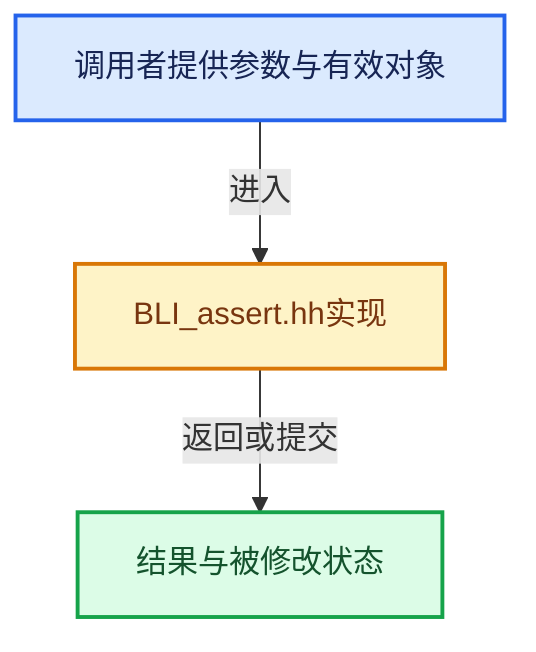

# 实现依赖专题：source/blender/blenlib/BLI_assert.hh

[方向导航](README.md) · [符号索引](../%E7%AC%A6%E5%8F%B7%E4%BE%9D%E8%B5%96%E4%B8%8E%E5%AE%9E%E7%8E%B0%E7%B4%A2%E5%BC%95.md)

本专题从正文实际调用进入，集中保存共享实现。函数有稳定锚点，可从调用处直接跳到对应完整函数；递归与互相调用通过回链组织。

## 本文件的实现关系





<a id="m-57a88495704d"></a>

## 宏 `BLI_assert`

<!-- annotated:d9486cc8d0c08e -->

```cpp
#  define BLI_assert(a) \
    (void)((!(a)) ? ((_BLI_assert_print_backtrace(), \
                      _BLI_ASSERT_PRINT_POS(a), \
                      _BLI_ASSERT_ABORT(), \
                      NULL)) : \
                    NULL)
/** A version of #BLI_assert() to pass an additional message to be printed on failure. */
```

<details>
<summary>核对原始源码：source/blender/blenlib/BLI_assert.hh · L48—L54</summary>

<!-- original:d9486cc8d0c08e:source/blender/blenlib/BLI_assert.hh:48:54 -->

```cpp
#  define BLI_assert(a) \
    (void)((!(a)) ? ((_BLI_assert_print_backtrace(), \
                      _BLI_ASSERT_PRINT_POS(a), \
                      _BLI_ASSERT_ABORT(), \
                      NULL)) : \
                    NULL)
/** A version of #BLI_assert() to pass an additional message to be printed on failure. */
```

</details>

宏在预处理阶段展开，参数替换、重复求值和条件编译应直接从该定义检查。与普通函数不同，宏不会自动提供参数类型检查；构建配置选择哪个定义需结合外围条件。

<a id="m-695eed20dceb"></a>

## 宏 `BLI_assert_msg`

<!-- annotated:67c90f825c95f4 -->

```cpp
#  define BLI_assert_msg(a, msg) \
    (void)((!(a)) ? ((_BLI_assert_print_backtrace(), \
                      _BLI_ASSERT_PRINT_POS(a), \
                      _BLI_assert_print_extra(msg), \
                      _BLI_ASSERT_ABORT(), \
                      NULL)) : \
                    NULL)
#else
```

<details>
<summary>核对原始源码：source/blender/blenlib/BLI_assert.hh · L55—L62</summary>

<!-- original:67c90f825c95f4:source/blender/blenlib/BLI_assert.hh:55:62 -->

```cpp
#  define BLI_assert_msg(a, msg) \
    (void)((!(a)) ? ((_BLI_assert_print_backtrace(), \
                      _BLI_ASSERT_PRINT_POS(a), \
                      _BLI_assert_print_extra(msg), \
                      _BLI_ASSERT_ABORT(), \
                      NULL)) : \
                    NULL)
#else
```

</details>

宏在预处理阶段展开，参数替换、重复求值和条件编译应直接从该定义检查。与普通函数不同，宏不会自动提供参数类型检查；构建配置选择哪个定义需结合外围条件。

<a id="m-d07050020cb5"></a>

## 宏 `BLI_assert`

<!-- annotated:2207c63f99add1 -->

```cpp
#  define BLI_assert(a) ((void)0)
#  define BLI_assert_msg(a, msg) ((void)0)
```

<details>
<summary>核对原始源码：source/blender/blenlib/BLI_assert.hh · L63—L64</summary>

<!-- original:2207c63f99add1:source/blender/blenlib/BLI_assert.hh:63:64 -->

```cpp
#  define BLI_assert(a) ((void)0)
#  define BLI_assert_msg(a, msg) ((void)0)
```

</details>

宏在预处理阶段展开，参数替换、重复求值和条件编译应直接从该定义检查。与普通函数不同，宏不会自动提供参数类型检查；构建配置选择哪个定义需结合外围条件。

<a id="m-7de5563de4db"></a>

## 宏 `BLI_assert_msg`

<!-- annotated:44742ba875e831 -->

```cpp
#  define BLI_assert_msg(a, msg) ((void)0)
#endif
```

<details>
<summary>核对原始源码：source/blender/blenlib/BLI_assert.hh · L64—L65</summary>

<!-- original:44742ba875e831:source/blender/blenlib/BLI_assert.hh:64:65 -->

```cpp
#  define BLI_assert_msg(a, msg) ((void)0)
#endif
```

</details>

宏在预处理阶段展开，参数替换、重复求值和条件编译应直接从该定义检查。与普通函数不同，宏不会自动提供参数类型检查；构建配置选择哪个定义需结合外围条件。

<a id="m-2847bd43464c"></a>

## 宏 `BLI_STATIC_ASSERT`

<!-- annotated:60f70f2714250f -->

```cpp
#define BLI_STATIC_ASSERT(a, msg) static_assert(a, msg);

```

<details>
<summary>核对原始源码：source/blender/blenlib/BLI_assert.hh · L68—L69</summary>

<!-- original:60f70f2714250f:source/blender/blenlib/BLI_assert.hh:68:69 -->

```cpp
#define BLI_STATIC_ASSERT(a, msg) static_assert(a, msg);

```

</details>

宏在预处理阶段展开，参数替换、重复求值和条件编译应直接从该定义检查。与普通函数不同，宏不会自动提供参数类型检查；构建配置选择哪个定义需结合外围条件。

<a id="m-7a2d91a67d8e"></a>

## 宏 `BLI_assert_unreachable`

<!-- annotated:c00928c0e0998d -->

```cpp
#define BLI_assert_unreachable() \
  { \
    _BLI_assert_unreachable_print(__FILE__, __LINE__, __func__); \
    BLI_assert_msg(0, "This line of code is marked to be unreachable."); \
  } \
  ((void)0)

```

<details>
<summary>核对原始源码：source/blender/blenlib/BLI_assert.hh · L77—L83</summary>

<!-- original:c00928c0e0998d:source/blender/blenlib/BLI_assert.hh:77:83 -->

```cpp
#define BLI_assert_unreachable() \
  { \
    _BLI_assert_unreachable_print(__FILE__, __LINE__, __func__); \
    BLI_assert_msg(0, "This line of code is marked to be unreachable."); \
  } \
  ((void)0)

```

</details>

宏在预处理阶段展开，参数替换、重复求值和条件编译应直接从该定义检查。与普通函数不同，宏不会自动提供参数类型检查；构建配置选择哪个定义需结合外围条件。

<a id="m-368120c7952b"></a>

## 宏 `BLI_assert_unreachable_static_t`

<!-- annotated:fc753cc4d17a8d -->

```cpp
#define BLI_assert_unreachable_static_t(T) \
  static_assert(_bli_always_false<T>, "Unreachable code path reached at compile-time!")
```

<details>
<summary>核对原始源码：source/blender/blenlib/BLI_assert.hh · L99—L101</summary>

<!-- original:fc753cc4d17a8d:source/blender/blenlib/BLI_assert.hh:99:101 -->

```cpp
#define BLI_assert_unreachable_static_t(T) \
  static_assert(_bli_always_false<T>, "Unreachable code path reached at compile-time!")
```

</details>

宏在预处理阶段展开，参数替换、重复求值和条件编译应直接从该定义检查。与普通函数不同，宏不会自动提供参数类型检查；构建配置选择哪个定义需结合外围条件。

## 完整成员与函数实现

## BLI_assert的实际失败路径

非NDEBUG分支先判断条件；失败才打印回溯和文件、行号、函数名及表达式文本。WITH_ASSERT_ABORT决定_BLI_ASSERT_ABORT是否终止，所以不能笼统说所有调试断言一定abort。NDEBUG分支为((void)0)，不求值条件；因此不得依赖断言条件的副作用。宏中的NULL只是条件表达式的结果占位，外层转void，不是函数返回的错误码。_BLI_assert_print_backtrace、_BLI_assert_print_pos与_BLI_assert_abort的实现位于source/blender/blenlib/intern/BLI_assert.cc，诊断链不改变Vector的业务状态。
