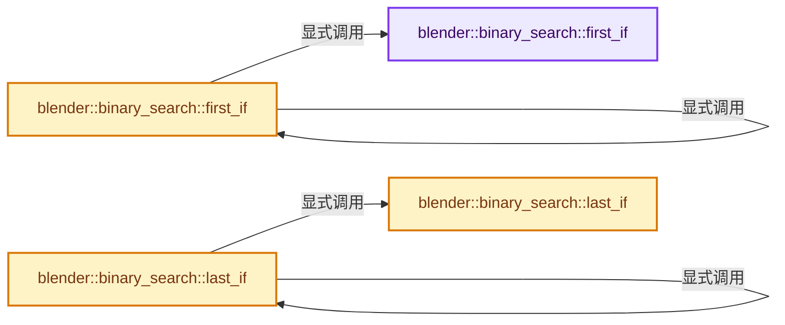

# 实现依赖专题：source/blender/blenlib/BLI_binary_search.hh

[方向导航](README.md) · [符号索引](../%E7%AC%A6%E5%8F%B7%E4%BE%9D%E8%B5%96%E4%B8%8E%E5%AE%9E%E7%8E%B0%E7%B4%A2%E5%BC%95.md)

本专题从正文实际调用进入，集中保存共享实现。函数有稳定锚点，可从调用处直接跳到对应完整函数；递归与互相调用通过回链组织。

## 本文件的实现关系




## 完整成员与函数实现

<a id="f-cb713f4689659e70"></a>

### `blender::binary_search::first_if`

实现位置：[source/blender/blenlib/BLI_binary_search.hh](../../../../../source/blender/blenlib/BLI_binary_search.hh) · L20—L28。

接口参数：

- `Iterator begin`
- `Iterator end`
- `Predicate &&predicate`

**教学注释版**

<!-- annotated:66d2b2726e37b8 -->

```cpp
template<typename Iterator, typename Predicate>
static int64_t first_if(Iterator begin, Iterator end, Predicate &&predicate)
{
  return std::lower_bound(begin,
                          end,
                          nullptr,
                          [&](const auto &value, void * /*dummy*/) { return !predicate(value); }) -
         begin;
}
```

<details>
<summary>核对原始源码：source/blender/blenlib/BLI_binary_search.hh · L20—L28</summary>

<!-- original:66d2b2726e37b8:source/blender/blenlib/BLI_binary_search.hh:20:28 -->

```cpp
template<typename Iterator, typename Predicate>
static int64_t first_if(Iterator begin, Iterator end, Predicate &&predicate)
{
  return std::lower_bound(begin,
                          end,
                          nullptr,
                          [&](const auto &value, void * /*dummy*/) { return !predicate(value); }) -
         begin;
}
```

</details>

**结果出口**

- `return std::lower_bound(begin,`

**继续追踪实现**

- `std::lower_bound` → [外部契约](https://eel.is/c++draft/)：这个边界按实际表达式及所属类型核对参数、返回值、寿命与失败行为。这里提供接口入口，不声称已解释该第三方版本的内部实现。
- `predicate` → [调用协议](../%E6%A8%A1%E6%9D%BF%E5%AE%8F%E4%B8%8E%E5%8A%A8%E6%80%81%E5%88%86%E6%B4%BE%E5%8D%8F%E8%AE%AE.md)：局部可调用对象，须结合其初始化与捕获环境。调用位置L26。

<a id="f-9879863def989912"></a>

### `blender::binary_search::last_if`

实现位置：[source/blender/blenlib/BLI_binary_search.hh](../../../../../source/blender/blenlib/BLI_binary_search.hh) · L34—L42。

接口参数：

- `Iterator begin`
- `Iterator end`
- `Predicate &&predicate`

**教学注释版**

<!-- annotated:4c845367e94418 -->

```cpp
template<typename Iterator, typename Predicate>
static int64_t last_if(Iterator begin, Iterator end, Predicate &&predicate)
{
  return std::upper_bound(begin,
                          end,
                          nullptr,
                          [&](void * /*dummy*/, const auto &value) { return !predicate(value); }) -
         begin - 1;
}
```

<details>
<summary>核对原始源码：source/blender/blenlib/BLI_binary_search.hh · L34—L42</summary>

<!-- original:4c845367e94418:source/blender/blenlib/BLI_binary_search.hh:34:42 -->

```cpp
template<typename Iterator, typename Predicate>
static int64_t last_if(Iterator begin, Iterator end, Predicate &&predicate)
{
  return std::upper_bound(begin,
                          end,
                          nullptr,
                          [&](void * /*dummy*/, const auto &value) { return !predicate(value); }) -
         begin - 1;
}
```

</details>

**结果出口**

- `return std::upper_bound(begin,`

**继续追踪实现**

- `std::upper_bound` → [外部契约](https://eel.is/c++draft/)：这个边界按实际表达式及所属类型核对参数、返回值、寿命与失败行为。这里提供接口入口，不声称已解释该第三方版本的内部实现。
- `predicate` → [调用协议](../%E6%A8%A1%E6%9D%BF%E5%AE%8F%E4%B8%8E%E5%8A%A8%E6%80%81%E5%88%86%E6%B4%BE%E5%8D%8F%E8%AE%AE.md)：局部可调用对象，须结合其初始化与捕获环境。调用位置L40。

<a id="f-474927d7d21416b1"></a>

### `blender::binary_search::first_if`

实现位置：[source/blender/blenlib/BLI_binary_search.hh](../../../../../source/blender/blenlib/BLI_binary_search.hh) · L44—L48。

接口参数：

- `const Range &range`
- `Predicate &&predicate`

**教学注释版**

<!-- annotated:083aa8a758026a -->

```cpp
template<typename Range, typename Predicate>
int64_t first_if(const Range &range, Predicate &&predicate)
{
  return first_if(range.begin(), range.end(), predicate);
}
```

<details>
<summary>核对原始源码：source/blender/blenlib/BLI_binary_search.hh · L44—L48</summary>

<!-- original:083aa8a758026a:source/blender/blenlib/BLI_binary_search.hh:44:48 -->

```cpp
template<typename Range, typename Predicate>
int64_t first_if(const Range &range, Predicate &&predicate)
{
  return first_if(range.begin(), range.end(), predicate);
}
```

</details>

**结果出口**

- `return first_if(range.begin(), range.end(), predicate);`

**继续追踪实现**

- `first_if` → [blender::binary_search::first_if · L20](%E4%BE%9D%E8%B5%96-BLI_binary_search-bd55e6.md#f-cb713f4689659e70)；[blender::binary_search::first_if · L44](%E4%BE%9D%E8%B5%96-BLI_binary_search-bd55e6.md#f-474927d7d21416b1)。同名重载需按实参类型选择。
- `range.begin` → [调用协议](../%E6%A8%A1%E6%9D%BF%E5%AE%8F%E4%B8%8E%E5%8A%A8%E6%80%81%E5%88%86%E6%B4%BE%E5%8D%8F%E8%AE%AE.md)：由接收对象具体类型或运行时策略提供实现。调用位置L47。
- `range.end` → [调用协议](../%E6%A8%A1%E6%9D%BF%E5%AE%8F%E4%B8%8E%E5%8A%A8%E6%80%81%E5%88%86%E6%B4%BE%E5%8D%8F%E8%AE%AE.md)：由接收对象具体类型或运行时策略提供实现。调用位置L47。

<a id="f-2329405845e7c4e4"></a>

### `blender::binary_search::last_if`

实现位置：[source/blender/blenlib/BLI_binary_search.hh](../../../../../source/blender/blenlib/BLI_binary_search.hh) · L50—L54。

接口参数：

- `const Range &range`
- `Predicate &&predicate`

**教学注释版**

<!-- annotated:7d33901107c2a1 -->

```cpp
template<typename Range, typename Predicate>
int64_t last_if(const Range &range, Predicate &&predicate)
{
  return last_if(range.begin(), range.end(), predicate);
}
```

<details>
<summary>核对原始源码：source/blender/blenlib/BLI_binary_search.hh · L50—L54</summary>

<!-- original:7d33901107c2a1:source/blender/blenlib/BLI_binary_search.hh:50:54 -->

```cpp
template<typename Range, typename Predicate>
int64_t last_if(const Range &range, Predicate &&predicate)
{
  return last_if(range.begin(), range.end(), predicate);
}
```

</details>

**结果出口**

- `return last_if(range.begin(), range.end(), predicate);`

**继续追踪实现**

- `last_if` → [blender::binary_search::last_if · L34](%E4%BE%9D%E8%B5%96-BLI_binary_search-bd55e6.md#f-9879863def989912)；[blender::binary_search::last_if · L50](%E4%BE%9D%E8%B5%96-BLI_binary_search-bd55e6.md#f-2329405845e7c4e4)。同名重载需按实参类型选择。
- `range.begin` → [调用协议](../%E6%A8%A1%E6%9D%BF%E5%AE%8F%E4%B8%8E%E5%8A%A8%E6%80%81%E5%88%86%E6%B4%BE%E5%8D%8F%E8%AE%AE.md)：由接收对象具体类型或运行时策略提供实现。调用位置L53。
- `range.end` → [调用协议](../%E6%A8%A1%E6%9D%BF%E5%AE%8F%E4%B8%8E%E5%8A%A8%E6%80%81%E5%88%86%E6%B4%BE%E5%8D%8F%E8%AE%AE.md)：由接收对象具体类型或运行时策略提供实现。调用位置L53。
