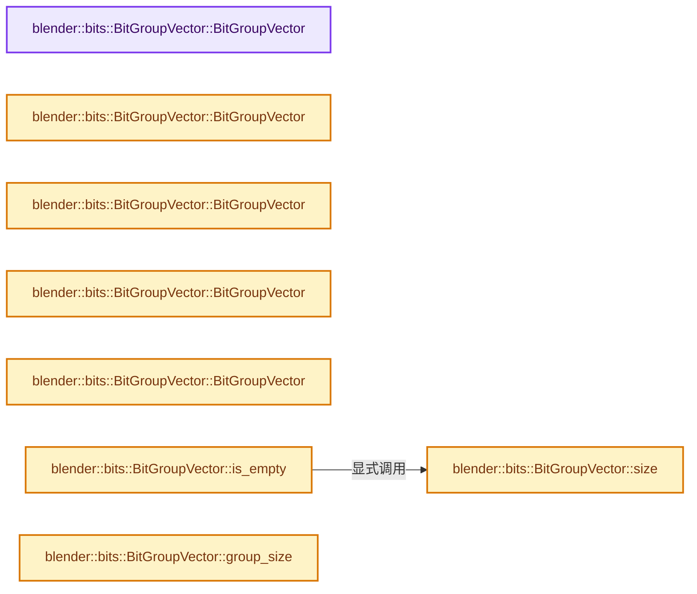
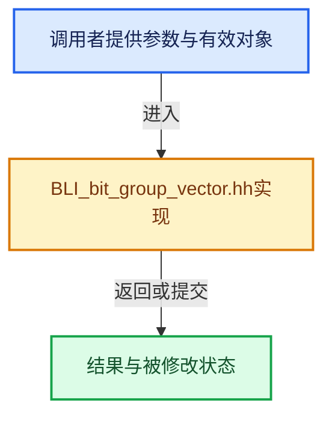

# 实现依赖专题：source/blender/blenlib/BLI_bit_group_vector.hh

[方向导航](README.md) · [符号索引](../%E7%AC%A6%E5%8F%B7%E4%BE%9D%E8%B5%96%E4%B8%8E%E5%AE%9E%E7%8E%B0%E7%B4%A2%E5%BC%95.md)

本专题从正文实际调用进入，集中保存共享实现。函数有稳定锚点，可从调用处直接跳到对应完整函数；递归与互相调用通过回链组织。

## 本文件的实现关系






## 完整成员与函数实现

<a id="f-13c8ffd5a22df34b"></a>

### `blender::bits::BitGroupVector::BitGroupVector`

实现位置：[source/blender/blenlib/BLI_bit_group_vector.hh](../../../../../source/blender/blenlib/BLI_bit_group_vector.hh) · L50—L50。

接口参数：

- `Allocator allocator = {}`

**教学注释版**

<!-- annotated:eb847daf162a10 -->

```cpp
  BitGroupVector(Allocator allocator = {}) noexcept : data_(allocator) {}
```

<details>
<summary>核对原始源码：source/blender/blenlib/BLI_bit_group_vector.hh · L50—L50</summary>

<!-- original:eb847daf162a10:source/blender/blenlib/BLI_bit_group_vector.hh:50:50 -->

```cpp
  BitGroupVector(Allocator allocator = {}) noexcept : data_(allocator) {}
```

</details>

**继续追踪实现**

本实现没有需要继续展开的显式调用；检查返回表达式、对象转换和调用者前置条件。

<a id="f-6951ed5a04ec925c"></a>

### `blender::bits::BitGroupVector::BitGroupVector`

实现位置：[source/blender/blenlib/BLI_bit_group_vector.hh](../../../../../source/blender/blenlib/BLI_bit_group_vector.hh) · L52—L55。

接口参数：

- `NoExceptConstructor`
- `Allocator allocator = {}`

**教学注释版**

<!-- annotated:c170896878edd7 -->

```cpp
  BitGroupVector(NoExceptConstructor, Allocator allocator = {}) noexcept
      : BitGroupVector(allocator)
  {
  }
```

<details>
<summary>核对原始源码：source/blender/blenlib/BLI_bit_group_vector.hh · L52—L55</summary>

<!-- original:c170896878edd7:source/blender/blenlib/BLI_bit_group_vector.hh:52:55 -->

```cpp
  BitGroupVector(NoExceptConstructor, Allocator allocator = {}) noexcept
      : BitGroupVector(allocator)
  {
  }
```

</details>

**继续追踪实现**

本实现没有需要继续展开的显式调用；检查返回表达式、对象转换和调用者前置条件。

<a id="f-b4e8e8f7dcfcb04a"></a>

### `blender::bits::BitGroupVector::BitGroupVector`

实现位置：[source/blender/blenlib/BLI_bit_group_vector.hh](../../../../../source/blender/blenlib/BLI_bit_group_vector.hh) · L57—L67。

接口参数：

- `const int64_t size_in_groups`
- `const int64_t group_size`
- `const bool value = false`
- `Allocator allocator = {}`

**教学注释版**

<!-- annotated:ecd53f05896cf8 -->

```cpp
  BitGroupVector(const int64_t size_in_groups,
                 const int64_t group_size,
                 const bool value = false,
                 Allocator allocator = {})
      : group_size_(group_size),
        aligned_group_size_(align_group_size(group_size)),
        data_(size_in_groups * aligned_group_size_, value, allocator)
  {
    BLI_assert(group_size >= 0);
    BLI_assert(size_in_groups >= 0);
  }
```

<details>
<summary>核对原始源码：source/blender/blenlib/BLI_bit_group_vector.hh · L57—L67</summary>

<!-- original:ecd53f05896cf8:source/blender/blenlib/BLI_bit_group_vector.hh:57:67 -->

```cpp
  BitGroupVector(const int64_t size_in_groups,
                 const int64_t group_size,
                 const bool value = false,
                 Allocator allocator = {})
      : group_size_(group_size),
        aligned_group_size_(align_group_size(group_size)),
        data_(size_in_groups * aligned_group_size_, value, allocator)
  {
    BLI_assert(group_size >= 0);
    BLI_assert(size_in_groups >= 0);
  }
```

</details>

**继续追踪实现**

- `BLI_assert` → [BLI_assert · L48](%E4%BE%9D%E8%B5%96-BLI_assert-cc98e8.md#m-57a88495704d)；[BLI_assert · L63](%E4%BE%9D%E8%B5%96-BLI_assert-cc98e8.md#m-d07050020cb5)。宏定义由构建条件选择。

<a id="f-f3be75cba65f05d7"></a>

### `blender::bits::BitGroupVector::BitGroupVector`

实现位置：[source/blender/blenlib/BLI_bit_group_vector.hh](../../../../../source/blender/blenlib/BLI_bit_group_vector.hh) · L69—L74。

接口参数：

- `const BitGroupVector &other`

**教学注释版**

<!-- annotated:172c59e79bdb2e -->

```cpp
  BitGroupVector(const BitGroupVector &other)
      : group_size_(other.group_size_),
        aligned_group_size_(other.aligned_group_size_),
        data_(other.data_)
  {
  }
```

<details>
<summary>核对原始源码：source/blender/blenlib/BLI_bit_group_vector.hh · L69—L74</summary>

<!-- original:172c59e79bdb2e:source/blender/blenlib/BLI_bit_group_vector.hh:69:74 -->

```cpp
  BitGroupVector(const BitGroupVector &other)
      : group_size_(other.group_size_),
        aligned_group_size_(other.aligned_group_size_),
        data_(other.data_)
  {
  }
```

</details>

**继续追踪实现**

本实现没有需要继续展开的显式调用；检查返回表达式、对象转换和调用者前置条件。

<a id="f-17b45222d3a2aa31"></a>

### `blender::bits::BitGroupVector::BitGroupVector`

实现位置：[source/blender/blenlib/BLI_bit_group_vector.hh](../../../../../source/blender/blenlib/BLI_bit_group_vector.hh) · L76—L81。

接口参数：

- `BitGroupVector &&other`

**教学注释版**

<!-- annotated:9b36d63cfeba37 -->

```cpp
  BitGroupVector(BitGroupVector &&other)
      : group_size_(other.group_size_),
        aligned_group_size_(other.aligned_group_size_),
        data_(std::move(other.data_))
  {
  }
```

<details>
<summary>核对原始源码：source/blender/blenlib/BLI_bit_group_vector.hh · L76—L81</summary>

<!-- original:9b36d63cfeba37:source/blender/blenlib/BLI_bit_group_vector.hh:76:81 -->

```cpp
  BitGroupVector(BitGroupVector &&other)
      : group_size_(other.group_size_),
        aligned_group_size_(other.aligned_group_size_),
        data_(std::move(other.data_))
  {
  }
```

</details>

**继续追踪实现**

本实现没有需要继续展开的显式调用；检查返回表达式、对象转换和调用者前置条件。

<a id="f-f3445f322259d3db"></a>

### `blender::bits::BitGroupVector::size`

实现位置：[source/blender/blenlib/BLI_bit_group_vector.hh](../../../../../source/blender/blenlib/BLI_bit_group_vector.hh) · L112—L115。

**教学注释版**

<!-- annotated:ef7d0e7565417f -->

```cpp
  int64_t size() const
  {
    return aligned_group_size_ == 0 ? 0 : data_.size() / aligned_group_size_;
  }
```

<details>
<summary>核对原始源码：source/blender/blenlib/BLI_bit_group_vector.hh · L112—L115</summary>

<!-- original:ef7d0e7565417f:source/blender/blenlib/BLI_bit_group_vector.hh:112:115 -->

```cpp
  int64_t size() const
  {
    return aligned_group_size_ == 0 ? 0 : data_.size() / aligned_group_size_;
  }
```

</details>

**结果出口**

- `return aligned_group_size_ == 0 ? 0 : data_.size() / aligned_group_size_;`

**继续追踪实现**

- `data_.size` → [blender::bits::BitVector::size · L198](19-BitSpan%E4%B8%8EBitVector.md#f-a7b6c5beecee4b89)。

<a id="f-b4e944d06689089d"></a>

### `blender::bits::BitGroupVector::is_empty`

实现位置：[source/blender/blenlib/BLI_bit_group_vector.hh](../../../../../source/blender/blenlib/BLI_bit_group_vector.hh) · L117—L120。

**教学注释版**

<!-- annotated:411452dca2359d -->

```cpp
  bool is_empty() const
  {
    return this->size() == 0;
  }
```

<details>
<summary>核对原始源码：source/blender/blenlib/BLI_bit_group_vector.hh · L117—L120</summary>

<!-- original:411452dca2359d:source/blender/blenlib/BLI_bit_group_vector.hh:117:120 -->

```cpp
  bool is_empty() const
  {
    return this->size() == 0;
  }
```

</details>

**结果出口**

- `return this->size() == 0;`

**继续追踪实现**

- `this->size` → [blender::bits::BitGroupVector::size · L112](%E4%BE%9D%E8%B5%96-BLI_bit_group_vector-b34190.md#f-f3445f322259d3db)。

<a id="f-3d5ba11bba7a2682"></a>

### `blender::bits::BitGroupVector::group_size`

实现位置：[source/blender/blenlib/BLI_bit_group_vector.hh](../../../../../source/blender/blenlib/BLI_bit_group_vector.hh) · L123—L126。

**教学注释版**

<!-- annotated:ba94868d710cc3 -->

```cpp
  int64_t group_size() const
  {
    return group_size_;
  }
```

<details>
<summary>核对原始源码：source/blender/blenlib/BLI_bit_group_vector.hh · L123—L126</summary>

<!-- original:ba94868d710cc3:source/blender/blenlib/BLI_bit_group_vector.hh:123:126 -->

```cpp
  int64_t group_size() const
  {
    return group_size_;
  }
```

</details>

**结果出口**

- `return group_size_;`

**继续追踪实现**

本实现没有需要继续展开的显式调用；检查返回表达式、对象转换和调用者前置条件。

<a id="f-e7c51b2d1327f4ab"></a>

### `blender::bits::BitGroupVector::index_range`

实现位置：[source/blender/blenlib/BLI_bit_group_vector.hh](../../../../../source/blender/blenlib/BLI_bit_group_vector.hh) · L128—L131。

**教学注释版**

<!-- annotated:c3b89369369c2d -->

```cpp
  IndexRange index_range() const
  {
    return IndexRange{this->size()};
  }
```

<details>
<summary>核对原始源码：source/blender/blenlib/BLI_bit_group_vector.hh · L128—L131</summary>

<!-- original:c3b89369369c2d:source/blender/blenlib/BLI_bit_group_vector.hh:128:131 -->

```cpp
  IndexRange index_range() const
  {
    return IndexRange{this->size()};
  }
```

</details>

**结果出口**

- `return IndexRange{this->size()};`

**继续追踪实现**

- `this->size` → [blender::bits::BitGroupVector::size · L112](%E4%BE%9D%E8%B5%96-BLI_bit_group_vector-b34190.md#f-f3445f322259d3db)。

<a id="f-8340d7384faa37c4"></a>

### `blender::bits::BitGroupVector::all_bits`

实现位置：[source/blender/blenlib/BLI_bit_group_vector.hh](../../../../../source/blender/blenlib/BLI_bit_group_vector.hh) · L137—L140。

**教学注释版**

<!-- annotated:aa83e23956a6ca -->

```cpp
  BoundedBitSpan all_bits() const
  {
    return data_;
  }
```

<details>
<summary>核对原始源码：source/blender/blenlib/BLI_bit_group_vector.hh · L137—L140</summary>

<!-- original:aa83e23956a6ca:source/blender/blenlib/BLI_bit_group_vector.hh:137:140 -->

```cpp
  BoundedBitSpan all_bits() const
  {
    return data_;
  }
```

</details>

**结果出口**

- `return data_;`

**继续追踪实现**

本实现没有需要继续展开的显式调用；检查返回表达式、对象转换和调用者前置条件。

<a id="f-c4d5370ada0fc77c"></a>

### `blender::bits::BitGroupVector::all_bits`

实现位置：[source/blender/blenlib/BLI_bit_group_vector.hh](../../../../../source/blender/blenlib/BLI_bit_group_vector.hh) · L142—L145。

**教学注释版**

<!-- annotated:a3fe51214f6fbe -->

```cpp
  MutableBoundedBitSpan all_bits()
  {
    return data_;
  }
```

<details>
<summary>核对原始源码：source/blender/blenlib/BLI_bit_group_vector.hh · L142—L145</summary>

<!-- original:a3fe51214f6fbe:source/blender/blenlib/BLI_bit_group_vector.hh:142:145 -->

```cpp
  MutableBoundedBitSpan all_bits()
  {
    return data_;
  }
```

</details>

**结果出口**

- `return data_;`

**继续追踪实现**

本实现没有需要继续展开的显式调用；检查返回表达式、对象转换和调用者前置条件。

<a id="f-4ccfb34a953b0c0f"></a>

### `blender::bits::BitGroupVector::foreach_and`

实现位置：[source/blender/blenlib/BLI_bit_group_vector.hh](../../../../../source/blender/blenlib/BLI_bit_group_vector.hh) · L150—L159。

接口参数：

- `const BoundedBitSpan bits`

**教学注释版**

<!-- annotated:57306f60009d01 -->

```cpp
  void foreach_and(const BoundedBitSpan bits)
  {
    /* This can still be optimized due to the additional knowledge we have how consecutive groups
     * are laid out in memory. It is possible to updated multiple small groups at once. */
    BLI_assert(bits.size() == group_size_);
    for (const int64_t i : this->index_range()) {
      MutableBoundedBitSpan group = (*this)[i];
      group &= bits;
    }
  }
```

<details>
<summary>核对原始源码：source/blender/blenlib/BLI_bit_group_vector.hh · L150—L159</summary>

<!-- original:57306f60009d01:source/blender/blenlib/BLI_bit_group_vector.hh:150:159 -->

```cpp
  void foreach_and(const BoundedBitSpan bits)
  {
    /* This can still be optimized due to the additional knowledge we have how consecutive groups
     * are laid out in memory. It is possible to updated multiple small groups at once. */
    BLI_assert(bits.size() == group_size_);
    for (const int64_t i : this->index_range()) {
      MutableBoundedBitSpan group = (*this)[i];
      group &= bits;
    }
  }
```

</details>

**沿实际写入检查状态**

- `group &= bits;`

**继续追踪实现**

- `BLI_assert` → [BLI_assert · L48](%E4%BE%9D%E8%B5%96-BLI_assert-cc98e8.md#m-57a88495704d)；[BLI_assert · L63](%E4%BE%9D%E8%B5%96-BLI_assert-cc98e8.md#m-d07050020cb5)。宏定义由构建条件选择。
- `bits.size` → [blender::bits::BitGroupVector::size · L112](%E4%BE%9D%E8%B5%96-BLI_bit_group_vector-b34190.md#f-f3445f322259d3db)。
- `this->index_range` → [blender::bits::BitGroupVector::index_range · L128](%E4%BE%9D%E8%B5%96-BLI_bit_group_vector-b34190.md#f-e7c51b2d1327f4ab)。
