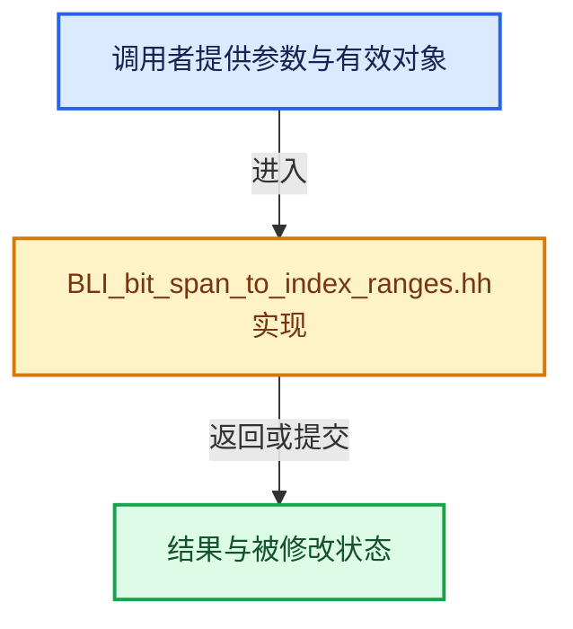

# 实现依赖专题：source/blender/blenlib/BLI_bit_span_to_index_ranges.hh

[方向导航](README.md) · [符号索引](../%E7%AC%A6%E5%8F%B7%E4%BE%9D%E8%B5%96%E4%B8%8E%E5%AE%9E%E7%8E%B0%E7%B4%A2%E5%BC%95.md)

本专题从正文实际调用进入，集中保存共享实现。函数有稳定锚点，可从调用处直接跳到对应完整函数；递归与互相调用通过回链组织。

## 本文件的实现关系





## 完整成员与函数实现

<a id="f-532777d3ea61ca07"></a>

### `blender::bits::bits_to_index_ranges`

实现位置：[source/blender/blenlib/BLI_bit_span_to_index_ranges.hh](../../../../../source/blender/blenlib/BLI_bit_span_to_index_ranges.hh) · L26—L138。

接口参数：

- `const BitSpan bits`
- `IndexRangesBuilder<IntT> &builder`

**教学注释版**

<!-- annotated:0cfcb1892716e4 -->

```cpp
template<typename IntT>
inline void bits_to_index_ranges(const BitSpan bits, IndexRangesBuilder<IntT> &builder)
{
  if (bits.is_empty()) {
    return;
  }

  /* -1 because we also need to store the end of the last range. */
  // [讲解] std::numeric_limits<IntT>::max：按比较关系选取较大值。本讲解中的增长公式同时满足最低请求和几何增长；若保存返回引用，还需注意实参寿命。
  constexpr int64_t max_index = std::numeric_limits<IntT>::max() - 1;
  UNUSED_VARS_NDEBUG(max_index);

  auto append_range = [&](const IndexRange range) {
    // [讲解] range.last：读取范围两端的有效索引或值。
    BLI_assert(range.last() <= max_index);
    // [讲解] range.start：读取连续区间或分组的边界信息。
    builder.add_range(IntT(range.start()), IntT(range.one_after_last()));
  };

  auto process_bit_int = [&](const BitInt value,
                             const int64_t start_bit,
                             const int64_t bits_num,
                             const int64_t start) {
    /* The bits in the mask are the ones we should look at. */
    const BitInt mask = mask_range_bits(start_bit, bits_num);
    const BitInt masked_value = mask & value;
    if (masked_value == 0) {
      /* Do nothing. */
      return;
    }
    if (masked_value == mask) {
      /* All bits are set. */
      append_range(IndexRange::from_begin_size(start, bits_num));
      return;
    }
    const int64_t bit_i_to_output_offset = start - start_bit;

    /* Iterate over ranges of 1s. For example, if the bits are 0b000111110001111000, the loop
     * below requires two iterations. The worst case for this is when there are very many small
     * ranges of 1s (e.g. 0b10101010101). So far it seems like the overhead of detecting such
     * cases is higher than the potential benefit of using another algorithm. */
    BitInt current_value = masked_value;
    while (current_value != 0) {
      /* Find start of next range of 1s. */
      const int64_t first_set_bit_i = int64_t(bitscan_forward_uint64(current_value));
      /* This mask is used to find the end of the 1s range. */
      const BitInt find_unset_value = ~(current_value | mask_first_n_bits(first_set_bit_i) |
                                        ~mask);
      if (find_unset_value == 0) {
        /* In this case, the range one 1s extends to the end of the current integer. */
        const IndexRange range = IndexRange::from_begin_end(first_set_bit_i, start_bit + bits_num);
        append_range(range.shift(bit_i_to_output_offset));
        break;
      }
      /* Find the index of the first 0 after the range of 1s. */
      const int64_t next_unset_bit_i = int64_t(bitscan_forward_uint64(find_unset_value));
      /* Store the range of 1s. */
      const IndexRange range = IndexRange::from_begin_end(first_set_bit_i, next_unset_bit_i);
      append_range(range.shift(bit_i_to_output_offset));
      /* Remove the processed range of 1s so that it is ignored in the next iteration. */
      current_value &= ~mask_first_n_bits(next_unset_bit_i);
    }
    return;
  };

  const BitInt *data = bits.data();
  const IndexRange bit_range = bits.bit_range();

  /* As much as possible we want to process full 64-bit integers at once. However, the bit-span may
   * not be aligned, so it's first split up into aligned and unaligned sections. */
  const AlignedIndexRanges ranges = split_index_range_by_alignment(bit_range, bits::BitsPerInt);

  /* Process the first (partial) integer in the bit-span. */
  if (!ranges.prefix.is_empty()) {
    const BitInt first_int = *int_containing_bit(data, bit_range.start());
    process_bit_int(
        first_int, BitInt(ranges.prefix.start()) & BitIndexMask, ranges.prefix.size(), 0);
  }

  /* Process all the full integers in the bit-span. */
  if (!ranges.aligned.is_empty()) {
    const BitInt *start = int_containing_bit(data, ranges.aligned.start());
    const int64_t ints_to_check = ranges.aligned.size() / BitsPerInt;
    int64_t int_i = 0;

/* Checking for chunks of 0 bits can be speedup using intrinsics quite significantly. */
#if BLI_HAVE_SSE4
    for (; int_i + 1 < ints_to_check; int_i += 2) {
      /* Loads the next 128 bit. */
      const __m128i group = _mm_loadu_si128(reinterpret_cast<const __m128i *>(start + int_i));
      /* Checks if all the 128 bits are zero. */
      const bool group_is_zero = _mm_testz_si128(group, group);
      if (group_is_zero) {
        continue;
      }
      /* If at least one of them is not zero, process the two integers separately. */
      for (int j = 0; j < 2; j++) {
        process_bit_int(
            start[int_i + j], 0, BitsPerInt, ranges.prefix.size() + (int_i + j) * BitsPerInt);
      }
    }
#endif

    /* Process the remaining integers. */
    for (; int_i < ints_to_check; int_i++) {
      process_bit_int(start[int_i], 0, BitsPerInt, ranges.prefix.size() + int_i * BitsPerInt);
    }
  }

  /* Process the final few bits that don't fill up a full integer. */
  if (!ranges.suffix.is_empty()) {
    const BitInt last_int = *int_containing_bit(data, bit_range.last());
    process_bit_int(
        last_int, 0, ranges.suffix.size(), ranges.prefix.size() + ranges.aligned.size());
  }
}
```

<details>
<summary>核对原始源码：source/blender/blenlib/BLI_bit_span_to_index_ranges.hh · L26—L138</summary>

<!-- original:0cfcb1892716e4:source/blender/blenlib/BLI_bit_span_to_index_ranges.hh:26:138 -->

```cpp
template<typename IntT>
inline void bits_to_index_ranges(const BitSpan bits, IndexRangesBuilder<IntT> &builder)
{
  if (bits.is_empty()) {
    return;
  }

  /* -1 because we also need to store the end of the last range. */
  constexpr int64_t max_index = std::numeric_limits<IntT>::max() - 1;
  UNUSED_VARS_NDEBUG(max_index);

  auto append_range = [&](const IndexRange range) {
    BLI_assert(range.last() <= max_index);
    builder.add_range(IntT(range.start()), IntT(range.one_after_last()));
  };

  auto process_bit_int = [&](const BitInt value,
                             const int64_t start_bit,
                             const int64_t bits_num,
                             const int64_t start) {
    /* The bits in the mask are the ones we should look at. */
    const BitInt mask = mask_range_bits(start_bit, bits_num);
    const BitInt masked_value = mask & value;
    if (masked_value == 0) {
      /* Do nothing. */
      return;
    }
    if (masked_value == mask) {
      /* All bits are set. */
      append_range(IndexRange::from_begin_size(start, bits_num));
      return;
    }
    const int64_t bit_i_to_output_offset = start - start_bit;

    /* Iterate over ranges of 1s. For example, if the bits are 0b000111110001111000, the loop
     * below requires two iterations. The worst case for this is when there are very many small
     * ranges of 1s (e.g. 0b10101010101). So far it seems like the overhead of detecting such
     * cases is higher than the potential benefit of using another algorithm. */
    BitInt current_value = masked_value;
    while (current_value != 0) {
      /* Find start of next range of 1s. */
      const int64_t first_set_bit_i = int64_t(bitscan_forward_uint64(current_value));
      /* This mask is used to find the end of the 1s range. */
      const BitInt find_unset_value = ~(current_value | mask_first_n_bits(first_set_bit_i) |
                                        ~mask);
      if (find_unset_value == 0) {
        /* In this case, the range one 1s extends to the end of the current integer. */
        const IndexRange range = IndexRange::from_begin_end(first_set_bit_i, start_bit + bits_num);
        append_range(range.shift(bit_i_to_output_offset));
        break;
      }
      /* Find the index of the first 0 after the range of 1s. */
      const int64_t next_unset_bit_i = int64_t(bitscan_forward_uint64(find_unset_value));
      /* Store the range of 1s. */
      const IndexRange range = IndexRange::from_begin_end(first_set_bit_i, next_unset_bit_i);
      append_range(range.shift(bit_i_to_output_offset));
      /* Remove the processed range of 1s so that it is ignored in the next iteration. */
      current_value &= ~mask_first_n_bits(next_unset_bit_i);
    }
    return;
  };

  const BitInt *data = bits.data();
  const IndexRange bit_range = bits.bit_range();

  /* As much as possible we want to process full 64-bit integers at once. However, the bit-span may
   * not be aligned, so it's first split up into aligned and unaligned sections. */
  const AlignedIndexRanges ranges = split_index_range_by_alignment(bit_range, bits::BitsPerInt);

  /* Process the first (partial) integer in the bit-span. */
  if (!ranges.prefix.is_empty()) {
    const BitInt first_int = *int_containing_bit(data, bit_range.start());
    process_bit_int(
        first_int, BitInt(ranges.prefix.start()) & BitIndexMask, ranges.prefix.size(), 0);
  }

  /* Process all the full integers in the bit-span. */
  if (!ranges.aligned.is_empty()) {
    const BitInt *start = int_containing_bit(data, ranges.aligned.start());
    const int64_t ints_to_check = ranges.aligned.size() / BitsPerInt;
    int64_t int_i = 0;

/* Checking for chunks of 0 bits can be speedup using intrinsics quite significantly. */
#if BLI_HAVE_SSE4
    for (; int_i + 1 < ints_to_check; int_i += 2) {
      /* Loads the next 128 bit. */
      const __m128i group = _mm_loadu_si128(reinterpret_cast<const __m128i *>(start + int_i));
      /* Checks if all the 128 bits are zero. */
      const bool group_is_zero = _mm_testz_si128(group, group);
      if (group_is_zero) {
        continue;
      }
      /* If at least one of them is not zero, process the two integers separately. */
      for (int j = 0; j < 2; j++) {
        process_bit_int(
            start[int_i + j], 0, BitsPerInt, ranges.prefix.size() + (int_i + j) * BitsPerInt);
      }
    }
#endif

    /* Process the remaining integers. */
    for (; int_i < ints_to_check; int_i++) {
      process_bit_int(start[int_i], 0, BitsPerInt, ranges.prefix.size() + int_i * BitsPerInt);
    }
  }

  /* Process the final few bits that don't fill up a full integer. */
  if (!ranges.suffix.is_empty()) {
    const BitInt last_int = *int_containing_bit(data, bit_range.last());
    process_bit_int(
        last_int, 0, ranges.suffix.size(), ranges.prefix.size() + ranges.aligned.size());
  }
}
```

</details>

**沿实际写入检查状态**

- `current_value &= ~mask_first_n_bits(next_unset_bit_i);`

**继续追踪实现**

- `bits.is_empty` → [blender::bits::BitSpan::is_empty · L156](19-BitSpan%E4%B8%8EBitVector.md#f-9e464d71eeb9d5c6)。
- `std::numeric_limits<IntT>::max` → [外部契约](https://eel.is/c++draft/alg.min.max)：按比较关系选取较大值。本讲解中的增长公式同时满足最低请求和几何增长；若保存返回引用，还需注意实参寿命。
- `UNUSED_VARS_NDEBUG` → [UNUSED_VARS_NDEBUG · L526](%E4%BE%9D%E8%B5%96-BLI_utildefines-293a0a.md#m-fea439f7d366)；[UNUSED_VARS_NDEBUG · L528](%E4%BE%9D%E8%B5%96-BLI_utildefines-293a0a.md#m-a8f8cfac06c0)。宏定义由构建条件选择。
- `BLI_assert` → [BLI_assert · L48](%E4%BE%9D%E8%B5%96-BLI_assert-cc98e8.md#m-57a88495704d)；[BLI_assert · L63](%E4%BE%9D%E8%B5%96-BLI_assert-cc98e8.md#m-d07050020cb5)。宏定义由构建条件选择。
- `range.last` → [blender::IndexRange::last · L214](04-IndexRange%E8%BF%9E%E7%BB%AD%E6%95%B4%E6%95%B0%E5%8C%BA%E9%97%B4.md#f-66896c6351a40de1)。
- `builder.add_range` → [blender::IndexRangesBuilder::add_range · L56](%E4%BE%9D%E8%B5%96-BLI_index_ranges_builder-425233.md#f-e75c6d8f7f4f3070)。
- `IntT` → [调用协议](../%E6%A8%A1%E6%9D%BF%E5%AE%8F%E4%B8%8E%E5%8A%A8%E6%80%81%E5%88%86%E6%B4%BE%E5%8D%8F%E8%AE%AE.md)：函数指针、局部可调用对象或未展开的宏；必须结合调用者环境。调用位置L39。
- `range.start` → [blender::IndexRange::start · L243](04-IndexRange%E8%BF%9E%E7%BB%AD%E6%95%B4%E6%95%B0%E5%8C%BA%E9%97%B4.md#f-99d2195bd9cfd1f0)。
- `range.one_after_last` → [blender::IndexRange::one_after_last · L235](04-IndexRange%E8%BF%9E%E7%BB%AD%E6%95%B4%E6%95%B0%E5%8C%BA%E9%97%B4.md#f-ed04bec9c731fc86)。
- `mask_range_bits` → [blender::bits::mask_range_bits · L53](%E4%BE%9D%E8%B5%96-BLI_bit_ref-359167.md#f-ceb0021a5b4da156)。
- `append_range` → [调用协议](../%E6%A8%A1%E6%9D%BF%E5%AE%8F%E4%B8%8E%E5%8A%A8%E6%80%81%E5%88%86%E6%B4%BE%E5%8D%8F%E8%AE%AE.md)：局部可调用对象，须结合其初始化与捕获环境。调用位置L55。
- `IndexRange::from_begin_size` → [blender::IndexRange::from_begin_size · L73](04-IndexRange%E8%BF%9E%E7%BB%AD%E6%95%B4%E6%95%B0%E5%8C%BA%E9%97%B4.md#f-392d3c73c80f255d)。
- `bitscan_forward_uint64` → [blender::bitscan_forward_uint64 · L32](../12-%E7%A9%BA%E9%97%B4%E6%95%B0%E6%8D%AE%E7%BB%93%E6%9E%84%E4%B8%8E%E5%87%A0%E4%BD%95%E7%AE%97%E6%B3%95/%E4%BE%9D%E8%B5%96-math_bits_inline-8a26f2.md#f-81c6299b5b713570)。
- `mask_first_n_bits` → [blender::bits::mask_first_n_bits · L38](%E4%BE%9D%E8%B5%96-BLI_bit_ref-359167.md#f-7c64d5504e3e9925)。
- `IndexRange::from_begin_end` → [blender::IndexRange::from_begin_end · L78](04-IndexRange%E8%BF%9E%E7%BB%AD%E6%95%B4%E6%95%B0%E5%8C%BA%E9%97%B4.md#f-a523839fb9650253)。
- `range.shift` → [blender::IndexRange::shift · L350](04-IndexRange%E8%BF%9E%E7%BB%AD%E6%95%B4%E6%95%B0%E5%8C%BA%E9%97%B4.md#f-76db8d7d4d67215c)。
- `bits.data` → [blender::bits::BitSpan::data · L198](19-BitSpan%E4%B8%8EBitVector.md#f-7fb8ab932727dff6)。
- `bits.bit_range` → [blender::bits::BitSpan::bit_range · L203](19-BitSpan%E4%B8%8EBitVector.md#f-8752cfebfc5d5dc6)。
- `split_index_range_by_alignment` → [blender::split_index_range_by_alignment · L16](%E4%BE%9D%E8%B5%96-index_range-982286.md#f-2d9a3529ce0f2331)。
- `ranges.prefix.is_empty` → [调用协议](../%E6%A8%A1%E6%9D%BF%E5%AE%8F%E4%B8%8E%E5%8A%A8%E6%80%81%E5%88%86%E6%B4%BE%E5%8D%8F%E8%AE%AE.md)：接收对象类型依赖auto、返回值或模板实例；不按同名猜测目标。调用位置L96。
- `int_containing_bit` → [blender::bits::int_containing_bit · L72](%E4%BE%9D%E8%B5%96-BLI_bit_ref-359167.md#f-dddfb68bb10f0356)；[blender::bits::int_containing_bit · L77](%E4%BE%9D%E8%B5%96-BLI_bit_ref-359167.md#f-6ea7b9235ac9dbab)。同名重载需按实参类型选择。
- `bit_range.start` → [blender::IndexRange::start · L243](04-IndexRange%E8%BF%9E%E7%BB%AD%E6%95%B4%E6%95%B0%E5%8C%BA%E9%97%B4.md#f-99d2195bd9cfd1f0)。
- `process_bit_int` → [调用协议](../%E6%A8%A1%E6%9D%BF%E5%AE%8F%E4%B8%8E%E5%8A%A8%E6%80%81%E5%88%86%E6%B4%BE%E5%8D%8F%E8%AE%AE.md)：局部可调用对象，须结合其初始化与捕获环境。调用位置L98。
- `BitInt` → [调用协议](../%E6%A8%A1%E6%9D%BF%E5%AE%8F%E4%B8%8E%E5%8A%A8%E6%80%81%E5%88%86%E6%B4%BE%E5%8D%8F%E8%AE%AE.md)：函数指针、局部可调用对象或未展开的宏；必须结合调用者环境。调用位置L99。
- `ranges.prefix.start` → [调用协议](../%E6%A8%A1%E6%9D%BF%E5%AE%8F%E4%B8%8E%E5%8A%A8%E6%80%81%E5%88%86%E6%B4%BE%E5%8D%8F%E8%AE%AE.md)：接收对象类型依赖auto、返回值或模板实例；不按同名猜测目标。调用位置L99。
- `ranges.prefix.size` → [调用协议](../%E6%A8%A1%E6%9D%BF%E5%AE%8F%E4%B8%8E%E5%8A%A8%E6%80%81%E5%88%86%E6%B4%BE%E5%8D%8F%E8%AE%AE.md)：接收对象类型依赖auto、返回值或模板实例；不按同名猜测目标。调用位置L99。
- `ranges.aligned.is_empty` → [调用协议](../%E6%A8%A1%E6%9D%BF%E5%AE%8F%E4%B8%8E%E5%8A%A8%E6%80%81%E5%88%86%E6%B4%BE%E5%8D%8F%E8%AE%AE.md)：接收对象类型依赖auto、返回值或模板实例；不按同名猜测目标。调用位置L103。
- `ranges.aligned.start` → [调用协议](../%E6%A8%A1%E6%9D%BF%E5%AE%8F%E4%B8%8E%E5%8A%A8%E6%80%81%E5%88%86%E6%B4%BE%E5%8D%8F%E8%AE%AE.md)：接收对象类型依赖auto、返回值或模板实例；不按同名猜测目标。调用位置L104。
- `ranges.aligned.size` → [调用协议](../%E6%A8%A1%E6%9D%BF%E5%AE%8F%E4%B8%8E%E5%8A%A8%E6%80%81%E5%88%86%E6%B4%BE%E5%8D%8F%E8%AE%AE.md)：接收对象类型依赖auto、返回值或模板实例；不按同名猜测目标。调用位置L105。
- `_mm_loadu_si128` → [调用协议](../%E6%A8%A1%E6%9D%BF%E5%AE%8F%E4%B8%8E%E5%8A%A8%E6%80%81%E5%88%86%E6%B4%BE%E5%8D%8F%E8%AE%AE.md)：函数指针、局部可调用对象或未展开的宏；必须结合调用者环境。调用位置L112。
- `_mm_testz_si128` → [调用协议](../%E6%A8%A1%E6%9D%BF%E5%AE%8F%E4%B8%8E%E5%8A%A8%E6%80%81%E5%88%86%E6%B4%BE%E5%8D%8F%E8%AE%AE.md)：函数指针、局部可调用对象或未展开的宏；必须结合调用者环境。调用位置L114。
- `ranges.suffix.is_empty` → [调用协议](../%E6%A8%A1%E6%9D%BF%E5%AE%8F%E4%B8%8E%E5%8A%A8%E6%80%81%E5%88%86%E6%B4%BE%E5%8D%8F%E8%AE%AE.md)：接收对象类型依赖auto、返回值或模板实例；不按同名猜测目标。调用位置L133。
- `bit_range.last` → [blender::IndexRange::last · L214](04-IndexRange%E8%BF%9E%E7%BB%AD%E6%95%B4%E6%95%B0%E5%8C%BA%E9%97%B4.md#f-66896c6351a40de1)。
- `ranges.suffix.size` → [调用协议](../%E6%A8%A1%E6%9D%BF%E5%AE%8F%E4%B8%8E%E5%8A%A8%E6%80%81%E5%88%86%E6%B4%BE%E5%8D%8F%E8%AE%AE.md)：接收对象类型依赖auto、返回值或模板实例；不按同名猜测目标。调用位置L136。
