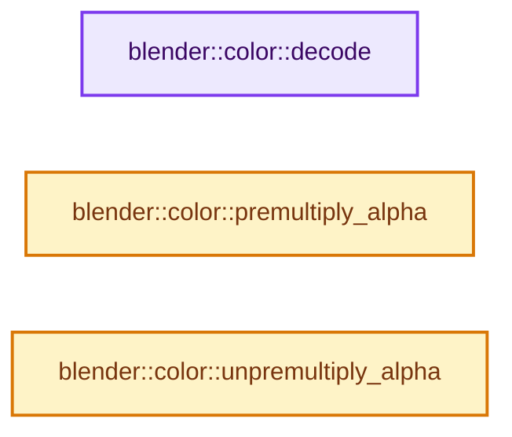
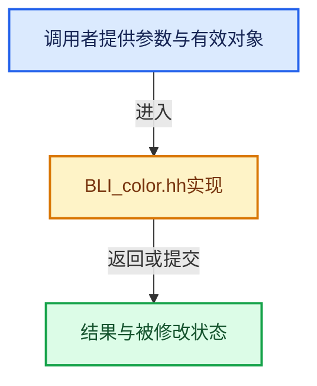

# 实现依赖专题：source/blender/blenlib/BLI_color.hh

[方向导航](README.md) · [符号索引](../%E7%AC%A6%E5%8F%B7%E4%BE%9D%E8%B5%96%E4%B8%8E%E5%AE%9E%E7%8E%B0%E7%B4%A2%E5%BC%95.md)

本专题从正文实际调用进入，集中保存共享实现。函数有稳定锚点，可从调用处直接跳到对应完整函数；递归与互相调用通过回链组织。

## 本文件的实现关系






## 完整成员与函数实现

<a id="f-fd48169535f754fd"></a>

### `blender::color::decode`

实现位置：[source/blender/blenlib/BLI_color.hh](../../../../../source/blender/blenlib/BLI_color.hh) · L76—L85。

接口参数：

- `const ColorSceneLinearByteEncoded4b<Alpha> &color`

**教学注释版**

<!-- annotated:939555f42b99fb -->

```cpp
template<eAlpha Alpha>
BLI_INLINE ColorSceneLinear4f<Alpha> decode(const ColorSceneLinearByteEncoded4b<Alpha> &color)
{
  ColorSceneLinear4f<Alpha> decoded;
  srgb_to_linearrgb_uchar4(decoded, color);
  if (!colorspace::scene_linear_is_rec709) {
    copy_v3_v3(decoded, colorspace::rec709_to_scene_linear * float3(decoded));
  }
  return decoded;
}
```

<details>
<summary>核对原始源码：source/blender/blenlib/BLI_color.hh · L76—L85</summary>

<!-- original:939555f42b99fb:source/blender/blenlib/BLI_color.hh:76:85 -->

```cpp
template<eAlpha Alpha>
BLI_INLINE ColorSceneLinear4f<Alpha> decode(const ColorSceneLinearByteEncoded4b<Alpha> &color)
{
  ColorSceneLinear4f<Alpha> decoded;
  srgb_to_linearrgb_uchar4(decoded, color);
  if (!colorspace::scene_linear_is_rec709) {
    copy_v3_v3(decoded, colorspace::rec709_to_scene_linear * float3(decoded));
  }
  return decoded;
}
```

</details>

**结果出口**

- `return decoded;`

**继续追踪实现**

- `srgb_to_linearrgb_uchar4` → [blender::srgb_to_linearrgb_uchar4 · L105](../12-%E7%A9%BA%E9%97%B4%E6%95%B0%E6%8D%AE%E7%BB%93%E6%9E%84%E4%B8%8E%E5%87%A0%E4%BD%95%E7%AE%97%E6%B3%95/%E4%BE%9D%E8%B5%96-math_color_inline-48fb4c.md#f-39048d10c45c927e)。
- `copy_v3_v3` → [调用协议](../%E6%A8%A1%E6%9D%BF%E5%AE%8F%E4%B8%8E%E5%8A%A8%E6%80%81%E5%88%86%E6%B4%BE%E5%8D%8F%E8%AE%AE.md)：函数指针、局部可调用对象或未展开的宏；必须结合调用者环境。调用位置L82。
- `float3` → [float3 · L641](../05-%E5%87%A0%E4%BD%95%E5%AD%98%E5%82%A8%E4%B8%8E%E6%8B%93%E6%89%91%E6%98%A0%E5%B0%84/%E4%BE%9D%E8%B5%96-smaa-b67bc2.md#m-0ea8254cfdb4)。宏定义由构建条件选择。

<a id="f-9f692e7e848f8039"></a>

### `blender::color::premultiply_alpha`

实现位置：[source/blender/blenlib/BLI_color.hh](../../../../../source/blender/blenlib/BLI_color.hh) · L92—L103。

接口参数：

- `const ColorSceneLinear4f<Alpha> &color`

**教学注释版**

<!-- annotated:06723d5deba0e1 -->

```cpp
template<eAlpha Alpha>
ColorSceneLinear4f<eAlpha::Premultiplied> premultiply_alpha(const ColorSceneLinear4f<Alpha> &color)
{
  if constexpr (Alpha == eAlpha::Straight) {
    ColorSceneLinear4f<eAlpha::Premultiplied> premultiplied;
    straight_to_premul_v4_v4(premultiplied, color);
    return premultiplied;
  }
  else {
    return color;
  }
}
```

<details>
<summary>核对原始源码：source/blender/blenlib/BLI_color.hh · L92—L103</summary>

<!-- original:06723d5deba0e1:source/blender/blenlib/BLI_color.hh:92:103 -->

```cpp
template<eAlpha Alpha>
ColorSceneLinear4f<eAlpha::Premultiplied> premultiply_alpha(const ColorSceneLinear4f<Alpha> &color)
{
  if constexpr (Alpha == eAlpha::Straight) {
    ColorSceneLinear4f<eAlpha::Premultiplied> premultiplied;
    straight_to_premul_v4_v4(premultiplied, color);
    return premultiplied;
  }
  else {
    return color;
  }
}
```

</details>

**结果出口**

- `return premultiplied;`
- `return color;`

**继续追踪实现**

- `straight_to_premul_v4_v4` → [blender::straight_to_premul_v4_v4 · L305](../12-%E7%A9%BA%E9%97%B4%E6%95%B0%E6%8D%AE%E7%BB%93%E6%9E%84%E4%B8%8E%E5%87%A0%E4%BD%95%E7%AE%97%E6%B3%95/%E4%BE%9D%E8%B5%96-math_color_inline-48fb4c.md#f-7144705bbd89683c)。

<a id="f-9c65567863c88610"></a>

### `blender::color::unpremultiply_alpha`

实现位置：[source/blender/blenlib/BLI_color.hh](../../../../../source/blender/blenlib/BLI_color.hh) · L110—L121。

接口参数：

- `const ColorSceneLinear4f<Alpha> &color`

**教学注释版**

<!-- annotated:cdb9fabafce8ed -->

```cpp
template<eAlpha Alpha>
ColorSceneLinear4f<eAlpha::Straight> unpremultiply_alpha(const ColorSceneLinear4f<Alpha> &color)
{
  if constexpr (Alpha == eAlpha::Premultiplied) {
    ColorSceneLinear4f<eAlpha::Straight> straighten;
    premul_to_straight_v4_v4(straighten, color);
    return straighten;
  }
  else {
    return color;
  }
}
```

<details>
<summary>核对原始源码：source/blender/blenlib/BLI_color.hh · L110—L121</summary>

<!-- original:cdb9fabafce8ed:source/blender/blenlib/BLI_color.hh:110:121 -->

```cpp
template<eAlpha Alpha>
ColorSceneLinear4f<eAlpha::Straight> unpremultiply_alpha(const ColorSceneLinear4f<Alpha> &color)
{
  if constexpr (Alpha == eAlpha::Premultiplied) {
    ColorSceneLinear4f<eAlpha::Straight> straighten;
    premul_to_straight_v4_v4(straighten, color);
    return straighten;
  }
  else {
    return color;
  }
}
```

</details>

**结果出口**

- `return straighten;`
- `return color;`

**继续追踪实现**

- `premul_to_straight_v4_v4` → [blender::premul_to_straight_v4_v4 · L283](../12-%E7%A9%BA%E9%97%B4%E6%95%B0%E6%8D%AE%E7%BB%93%E6%9E%84%E4%B8%8E%E5%87%A0%E4%BD%95%E7%AE%97%E6%B3%95/%E4%BE%9D%E8%B5%96-math_color_inline-48fb4c.md#f-04964d02dcc5cfa0)。
