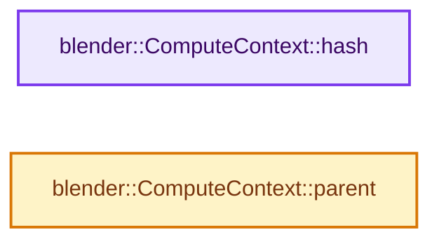
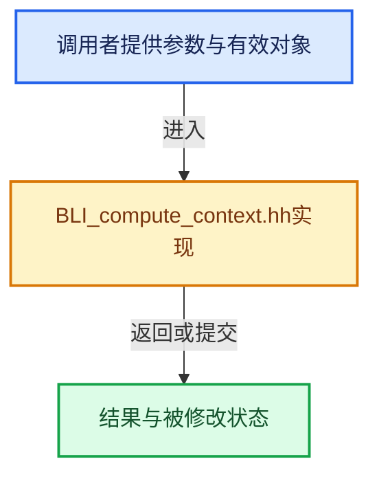

# 实现依赖专题：source/blender/blenlib/BLI_compute_context.hh

[方向导航](README.md) · [符号索引](../%E7%AC%A6%E5%8F%B7%E4%BE%9D%E8%B5%96%E4%B8%8E%E5%AE%9E%E7%8E%B0%E7%B4%A2%E5%BC%95.md)

本专题从正文实际调用进入，集中保存共享实现。函数有稳定锚点，可从调用处直接跳到对应完整函数；递归与互相调用通过回链组织。

## 本文件的实现关系






## 完整成员与函数实现

<a id="f-12bb4fe289dd6f55"></a>

### `blender::ComputeContext::hash`

实现位置：[source/blender/blenlib/BLI_compute_context.hh](../../../../../source/blender/blenlib/BLI_compute_context.hh) · L111—L115。

**教学注释版**

<!-- annotated:87125010c323a6 -->

```cpp
  const ComputeContextHash &hash() const
  {
    hash_mutex_.ensure([&]() { hash_ = this->compute_hash(); });
    return hash_;
  }
```

<details>
<summary>核对原始源码：source/blender/blenlib/BLI_compute_context.hh · L111—L115</summary>

<!-- original:87125010c323a6:source/blender/blenlib/BLI_compute_context.hh:111:115 -->

```cpp
  const ComputeContextHash &hash() const
  {
    hash_mutex_.ensure([&]() { hash_ = this->compute_hash(); });
    return hash_;
  }
```

</details>

**结果出口**

- `return hash_;`

**继续追踪实现**

- `hash_mutex_.ensure` → [blender::CacheMutex::ensure · L85](../06-%E9%9A%90%E5%BC%8F%E5%85%B1%E4%BA%AB%E4%B8%8E%E7%BC%93%E5%AD%98%E7%B3%BB%E7%BB%9F/06-CacheMutex%E6%83%B0%E6%80%A7%E5%88%9D%E5%A7%8B%E5%8C%96.md#f-97d7c841675a4237)。
- `this->compute_hash` → [调用协议](../%E6%A8%A1%E6%9D%BF%E5%AE%8F%E4%B8%8E%E5%8A%A8%E6%80%81%E5%88%86%E6%B4%BE%E5%8D%8F%E8%AE%AE.md)：由接收对象具体类型或运行时策略提供实现。调用位置L113。

<a id="f-6c97ea64470f3be0"></a>

### `blender::ComputeContext::parent`

实现位置：[source/blender/blenlib/BLI_compute_context.hh](../../../../../source/blender/blenlib/BLI_compute_context.hh) · L117—L120。

**教学注释版**

<!-- annotated:2ec78e8e07630c -->

```cpp
  const ComputeContext *parent() const
  {
    return parent_;
  }
```

<details>
<summary>核对原始源码：source/blender/blenlib/BLI_compute_context.hh · L117—L120</summary>

<!-- original:2ec78e8e07630c:source/blender/blenlib/BLI_compute_context.hh:117:120 -->

```cpp
  const ComputeContext *parent() const
  {
    return parent_;
  }
```

</details>

**结果出口**

- `return parent_;`

**继续追踪实现**

本实现没有需要继续展开的显式调用；检查返回表达式、对象转换和调用者前置条件。
