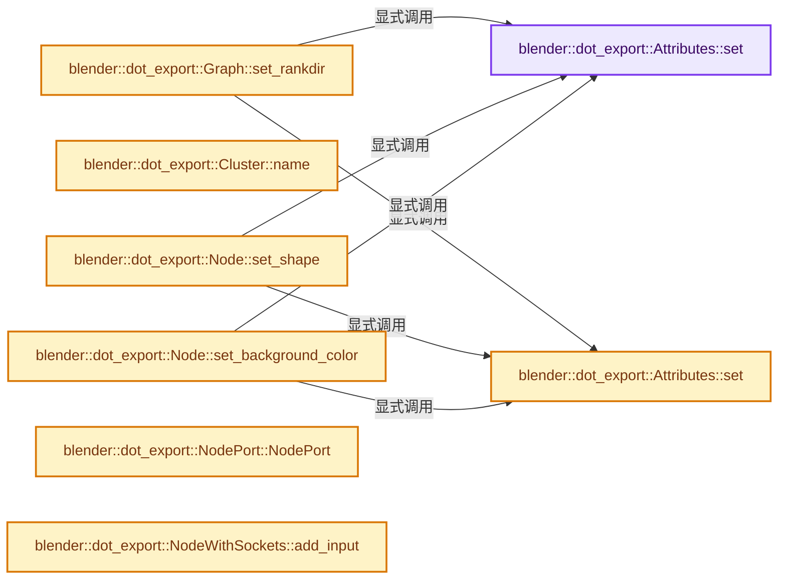

# 实现依赖专题：source/blender/blenlib/BLI_dot_export.hh

[方向导航](README.md) · [符号索引](../%E7%AC%A6%E5%8F%B7%E4%BE%9D%E8%B5%96%E4%B8%8E%E5%AE%9E%E7%8E%B0%E7%B4%A2%E5%BC%95.md)

本专题从正文实际调用进入，集中保存共享实现。函数有稳定锚点，可从调用处直接跳到对应完整函数；递归与互相调用通过回链组织。

## 本文件的实现关系




## 完整成员与函数实现

<a id="f-61c0bf11bc66fc9a"></a>

### `blender::dot_export::Attributes::set`

实现位置：[source/blender/blenlib/BLI_dot_export.hh](../../../../../source/blender/blenlib/BLI_dot_export.hh) · L36—L39。

接口参数：

- `StringRef key`
- `StringRef value`

**教学注释版**

<!-- annotated:048c46521bec2f -->

```cpp
  void set(StringRef key, StringRef value)
  {
    attributes_.add_overwrite(key, value);
  }
```

<details>
<summary>核对原始源码：source/blender/blenlib/BLI_dot_export.hh · L36—L39</summary>

<!-- original:048c46521bec2f:source/blender/blenlib/BLI_dot_export.hh:36:39 -->

```cpp
  void set(StringRef key, StringRef value)
  {
    attributes_.add_overwrite(key, value);
  }
```

</details>

**继续追踪实现**

- `attributes_.add_overwrite` → [blender::Map::add_overwrite · L325](../02-%E5%93%88%E5%B8%8C%E8%A1%A8%E4%B8%8E%E5%85%B3%E8%81%94%E6%95%B0%E6%8D%AE%E7%BB%93%E6%9E%84/04-Map%E6%9F%A5%E6%89%BE%E4%B8%8E%E9%94%AE%E8%AE%BF%E9%97%AE.md#f-e340706c503570c8)；[blender::Map::add_overwrite · L329](../02-%E5%93%88%E5%B8%8C%E8%A1%A8%E4%B8%8E%E5%85%B3%E8%81%94%E6%95%B0%E6%8D%AE%E7%BB%93%E6%9E%84/04-Map%E6%9F%A5%E6%89%BE%E4%B8%8E%E9%94%AE%E8%AE%BF%E9%97%AE.md#f-33b468b72fd66944)；[blender::Map::add_overwrite · L333](../02-%E5%93%88%E5%B8%8C%E8%A1%A8%E4%B8%8E%E5%85%B3%E8%81%94%E6%95%B0%E6%8D%AE%E7%BB%93%E6%9E%84/04-Map%E6%9F%A5%E6%89%BE%E4%B8%8E%E9%94%AE%E8%AE%BF%E9%97%AE.md#f-d91cbf0ab4beeb7f)；[blender::Map::add_overwrite · L337](../02-%E5%93%88%E5%B8%8C%E8%A1%A8%E4%B8%8E%E5%85%B3%E8%81%94%E6%95%B0%E6%8D%AE%E7%BB%93%E6%9E%84/04-Map%E6%9F%A5%E6%89%BE%E4%B8%8E%E9%94%AE%E8%AE%BF%E9%97%AE.md#f-7e2b93551ab3f253)。同名重载需按实参类型选择。

<a id="f-2cfd8f1d0cea7005"></a>

### `blender::dot_export::Attributes::set`

实现位置：[source/blender/blenlib/BLI_dot_export.hh](../../../../../source/blender/blenlib/BLI_dot_export.hh) · L41—L44。

接口参数：

- `StringRef key`
- `float value`

**教学注释版**

<!-- annotated:b0199f7cd8bb09 -->

```cpp
  void set(StringRef key, float value)
  {
    attributes_.add_overwrite(key, std::to_string(value));
  }
```

<details>
<summary>核对原始源码：source/blender/blenlib/BLI_dot_export.hh · L41—L44</summary>

<!-- original:b0199f7cd8bb09:source/blender/blenlib/BLI_dot_export.hh:41:44 -->

```cpp
  void set(StringRef key, float value)
  {
    attributes_.add_overwrite(key, std::to_string(value));
  }
```

</details>

**继续追踪实现**

- `attributes_.add_overwrite` → [blender::Map::add_overwrite · L325](../02-%E5%93%88%E5%B8%8C%E8%A1%A8%E4%B8%8E%E5%85%B3%E8%81%94%E6%95%B0%E6%8D%AE%E7%BB%93%E6%9E%84/04-Map%E6%9F%A5%E6%89%BE%E4%B8%8E%E9%94%AE%E8%AE%BF%E9%97%AE.md#f-e340706c503570c8)；[blender::Map::add_overwrite · L329](../02-%E5%93%88%E5%B8%8C%E8%A1%A8%E4%B8%8E%E5%85%B3%E8%81%94%E6%95%B0%E6%8D%AE%E7%BB%93%E6%9E%84/04-Map%E6%9F%A5%E6%89%BE%E4%B8%8E%E9%94%AE%E8%AE%BF%E9%97%AE.md#f-33b468b72fd66944)；[blender::Map::add_overwrite · L333](../02-%E5%93%88%E5%B8%8C%E8%A1%A8%E4%B8%8E%E5%85%B3%E8%81%94%E6%95%B0%E6%8D%AE%E7%BB%93%E6%9E%84/04-Map%E6%9F%A5%E6%89%BE%E4%B8%8E%E9%94%AE%E8%AE%BF%E9%97%AE.md#f-d91cbf0ab4beeb7f)；[blender::Map::add_overwrite · L337](../02-%E5%93%88%E5%B8%8C%E8%A1%A8%E4%B8%8E%E5%85%B3%E8%81%94%E6%95%B0%E6%8D%AE%E7%BB%93%E6%9E%84/04-Map%E6%9F%A5%E6%89%BE%E4%B8%8E%E9%94%AE%E8%AE%BF%E9%97%AE.md#f-7e2b93551ab3f253)。同名重载需按实参类型选择。
- `std::to_string` → [外部契约](https://eel.is/c++draft/)：这个边界按实际表达式及所属类型核对参数、返回值、寿命与失败行为。这里提供接口入口，不声称已解释该第三方版本的内部实现。

<a id="f-6a6a631a40d140f4"></a>

### `blender::dot_export::Graph::set_rankdir`

实现位置：[source/blender/blenlib/BLI_dot_export.hh](../../../../../source/blender/blenlib/BLI_dot_export.hh) · L66—L69。

接口参数：

- `Attr_rankdir rankdir`

**教学注释版**

<!-- annotated:592244199d7abf -->

```cpp
  void set_rankdir(Attr_rankdir rankdir)
  {
    attributes.set("rankdir", rankdir_to_string(rankdir));
  }
```

<details>
<summary>核对原始源码：source/blender/blenlib/BLI_dot_export.hh · L66—L69</summary>

<!-- original:592244199d7abf:source/blender/blenlib/BLI_dot_export.hh:66:69 -->

```cpp
  void set_rankdir(Attr_rankdir rankdir)
  {
    attributes.set("rankdir", rankdir_to_string(rankdir));
  }
```

</details>

**继续追踪实现**

- `attributes.set` → [blender::dot_export::Attributes::set · L36](%E4%BE%9D%E8%B5%96-BLI_dot_export-eb2f54.md#f-61c0bf11bc66fc9a)；[blender::dot_export::Attributes::set · L41](%E4%BE%9D%E8%B5%96-BLI_dot_export-eb2f54.md#f-2cfd8f1d0cea7005)。同名重载需按实参类型选择。
- `rankdir_to_string` → [blender::dot_export::rankdir_to_string · L20](%E4%BE%9D%E8%B5%96-BLI_dot_export_attribute_enums-3fbd45.md#f-dfca44c0e14fc6ed)。

<a id="f-e9049fa64f743eee"></a>

### `blender::dot_export::Cluster::name`

实现位置：[source/blender/blenlib/BLI_dot_export.hh](../../../../../source/blender/blenlib/BLI_dot_export.hh) · L91—L94。

**教学注释版**

<!-- annotated:f03976bfc728f8 -->

```cpp
  std::string name() const
  {
    return "cluster_" + std::to_string(uintptr_t(this));
  }
```

<details>
<summary>核对原始源码：source/blender/blenlib/BLI_dot_export.hh · L91—L94</summary>

<!-- original:f03976bfc728f8:source/blender/blenlib/BLI_dot_export.hh:91:94 -->

```cpp
  std::string name() const
  {
    return "cluster_" + std::to_string(uintptr_t(this));
  }
```

</details>

**结果出口**

- `return "cluster_" + std::to_string(uintptr_t(this));`

**继续追踪实现**

- `std::to_string` → [外部契约](https://eel.is/c++draft/)：这个边界按实际表达式及所属类型核对参数、返回值、寿命与失败行为。这里提供接口入口，不声称已解释该第三方版本的内部实现。

<a id="f-d0136e44b0967099"></a>

### `blender::dot_export::Node::set_shape`

实现位置：[source/blender/blenlib/BLI_dot_export.hh](../../../../../source/blender/blenlib/BLI_dot_export.hh) · L135—L138。

接口参数：

- `Attr_shape shape`

**教学注释版**

<!-- annotated:0b4594ff939be1 -->

```cpp
  void set_shape(Attr_shape shape)
  {
    attributes.set("shape", shape_to_string(shape));
  }
```

<details>
<summary>核对原始源码：source/blender/blenlib/BLI_dot_export.hh · L135—L138</summary>

<!-- original:0b4594ff939be1:source/blender/blenlib/BLI_dot_export.hh:135:138 -->

```cpp
  void set_shape(Attr_shape shape)
  {
    attributes.set("shape", shape_to_string(shape));
  }
```

</details>

**继续追踪实现**

- `attributes.set` → [blender::dot_export::Attributes::set · L36](%E4%BE%9D%E8%B5%96-BLI_dot_export-eb2f54.md#f-61c0bf11bc66fc9a)；[blender::dot_export::Attributes::set · L41](%E4%BE%9D%E8%B5%96-BLI_dot_export-eb2f54.md#f-2cfd8f1d0cea7005)。同名重载需按实参类型选择。
- `shape_to_string` → [blender::dot_export::shape_to_string · L40](%E4%BE%9D%E8%B5%96-BLI_dot_export_attribute_enums-3fbd45.md#f-877ffa22060595ce)。

<a id="f-f263db014ae693f4"></a>

### `blender::dot_export::Node::set_background_color`

实现位置：[source/blender/blenlib/BLI_dot_export.hh](../../../../../source/blender/blenlib/BLI_dot_export.hh) · L141—L145。

接口参数：

- `StringRef name`

**教学注释版**

<!-- annotated:3237733c8ce3ce -->

```cpp
  void set_background_color(StringRef name)
  {
    attributes.set("fillcolor", name);
    attributes.set("style", "filled");
  }
```

<details>
<summary>核对原始源码：source/blender/blenlib/BLI_dot_export.hh · L141—L145</summary>

<!-- original:3237733c8ce3ce:source/blender/blenlib/BLI_dot_export.hh:141:145 -->

```cpp
  void set_background_color(StringRef name)
  {
    attributes.set("fillcolor", name);
    attributes.set("style", "filled");
  }
```

</details>

**继续追踪实现**

- `attributes.set` → [blender::dot_export::Attributes::set · L36](%E4%BE%9D%E8%B5%96-BLI_dot_export-eb2f54.md#f-61c0bf11bc66fc9a)；[blender::dot_export::Attributes::set · L41](%E4%BE%9D%E8%B5%96-BLI_dot_export-eb2f54.md#f-2cfd8f1d0cea7005)。同名重载需按实参类型选择。

<a id="f-a4ee1b04c6d7b056"></a>

### `blender::dot_export::NodePort::NodePort`

实现位置：[source/blender/blenlib/BLI_dot_export.hh](../../../../../source/blender/blenlib/BLI_dot_export.hh) · L179—L184。

接口参数：

- `Node &node`
- `std::optional<std::string> port_name = {}`
- `std::optional<std::string> port_position = {}`

**教学注释版**

<!-- annotated:8bd8d4882de870 -->

```cpp
  NodePort(Node &node,
           std::optional<std::string> port_name = {},
           std::optional<std::string> port_position = {})
      : node_(&node), port_name_(std::move(port_name)), port_position_(std::move(port_position))
  {
  }
```

<details>
<summary>核对原始源码：source/blender/blenlib/BLI_dot_export.hh · L179—L184</summary>

<!-- original:8bd8d4882de870:source/blender/blenlib/BLI_dot_export.hh:179:184 -->

```cpp
  NodePort(Node &node,
           std::optional<std::string> port_name = {},
           std::optional<std::string> port_position = {})
      : node_(&node), port_name_(std::move(port_name)), port_position_(std::move(port_position))
  {
  }
```

</details>

**继续追踪实现**

本实现没有需要继续展开的显式调用；检查返回表达式、对象转换和调用者前置条件。

<a id="f-7f7e4c71eb25b482"></a>

### `blender::dot_export::NodeWithSockets::add_input`

实现位置：[source/blender/blenlib/BLI_dot_export.hh](../../../../../source/blender/blenlib/BLI_dot_export.hh) · L248—L254。

接口参数：

- `std::string name`

**教学注释版**

<!-- annotated:0c63375292076e -->

```cpp
  Input &add_input(std::string name)
  {
    this->inputs.append({});
    Input &input = this->inputs.last();
    // [讲解] std::move：把表达式转换成可供移动重载选择的值类别；不保证真的移动，不结束源对象寿命，对const值可能选择复制。
    input.name = std::move(name);
    return input;
  }
```

<details>
<summary>核对原始源码：source/blender/blenlib/BLI_dot_export.hh · L248—L254</summary>

<!-- original:0c63375292076e:source/blender/blenlib/BLI_dot_export.hh:248:254 -->

```cpp
  Input &add_input(std::string name)
  {
    this->inputs.append({});
    Input &input = this->inputs.last();
    input.name = std::move(name);
    return input;
  }
```

</details>

**沿实际写入检查状态**

- `input.name = std::move(name);`

**结果出口**

- `return input;`

**继续追踪实现**

- `this->inputs.append` → [调用协议](../%E6%A8%A1%E6%9D%BF%E5%AE%8F%E4%B8%8E%E5%8A%A8%E6%80%81%E5%88%86%E6%B4%BE%E5%8D%8F%E8%AE%AE.md)：接收对象类型依赖auto、返回值或模板实例；不按同名猜测目标。调用位置L250。
- `this->inputs.last` → [调用协议](../%E6%A8%A1%E6%9D%BF%E5%AE%8F%E4%B8%8E%E5%8A%A8%E6%80%81%E5%88%86%E6%B4%BE%E5%8D%8F%E8%AE%AE.md)：接收对象类型依赖auto、返回值或模板实例；不按同名猜测目标。调用位置L251。
- `std::move` → [外部契约](https://eel.is/c++draft/utility.forward)：把表达式转换成可供移动重载选择的值类别；不保证真的移动，不结束源对象寿命，对const值可能选择复制。

<a id="f-570a373a999226d4"></a>

### `blender::dot_export::NodeWithSockets::add_output`

实现位置：[source/blender/blenlib/BLI_dot_export.hh](../../../../../source/blender/blenlib/BLI_dot_export.hh) · L256—L262。

接口参数：

- `std::string name`

**教学注释版**

<!-- annotated:3b493c35b55f58 -->

```cpp
  Output &add_output(std::string name)
  {
    this->outputs.append({});
    Output &output = this->outputs.last();
    // [讲解] std::move：把表达式转换成可供移动重载选择的值类别；不保证真的移动，不结束源对象寿命，对const值可能选择复制。
    output.name = std::move(name);
    return output;
  }
```

<details>
<summary>核对原始源码：source/blender/blenlib/BLI_dot_export.hh · L256—L262</summary>

<!-- original:3b493c35b55f58:source/blender/blenlib/BLI_dot_export.hh:256:262 -->

```cpp
  Output &add_output(std::string name)
  {
    this->outputs.append({});
    Output &output = this->outputs.last();
    output.name = std::move(name);
    return output;
  }
```

</details>

**沿实际写入检查状态**

- `output.name = std::move(name);`

**结果出口**

- `return output;`

**继续追踪实现**

- `this->outputs.append` → [调用协议](../%E6%A8%A1%E6%9D%BF%E5%AE%8F%E4%B8%8E%E5%8A%A8%E6%80%81%E5%88%86%E6%B4%BE%E5%8D%8F%E8%AE%AE.md)：接收对象类型依赖auto、返回值或模板实例；不按同名猜测目标。调用位置L258。
- `this->outputs.last` → [调用协议](../%E6%A8%A1%E6%9D%BF%E5%AE%8F%E4%B8%8E%E5%8A%A8%E6%80%81%E5%88%86%E6%B4%BE%E5%8D%8F%E8%AE%AE.md)：接收对象类型依赖auto、返回值或模板实例；不按同名猜测目标。调用位置L259。
- `std::move` → [外部契约](https://eel.is/c++draft/utility.forward)：把表达式转换成可供移动重载选择的值类别；不保证真的移动，不结束源对象寿命，对const值可能选择复制。

<a id="f-3cf69014c53b1d21"></a>

### `blender::dot_export::NodeWithSocketsRef::input`

实现位置：[source/blender/blenlib/BLI_dot_export.hh](../../../../../source/blender/blenlib/BLI_dot_export.hh) · L277—L281。

接口参数：

- `int index`

**教学注释版**

<!-- annotated:99d20b5fcb1152 -->

```cpp
  NodePort input(int index) const
  {
    std::string port = "\"in" + std::to_string(index) + "\"";
    return NodePort(*node_, port, "w");
  }
```

<details>
<summary>核对原始源码：source/blender/blenlib/BLI_dot_export.hh · L277—L281</summary>

<!-- original:99d20b5fcb1152:source/blender/blenlib/BLI_dot_export.hh:277:281 -->

```cpp
  NodePort input(int index) const
  {
    std::string port = "\"in" + std::to_string(index) + "\"";
    return NodePort(*node_, port, "w");
  }
```

</details>

**结果出口**

- `return NodePort(*node_, port, "w");`

**继续追踪实现**

- `std::to_string` → [外部契约](https://eel.is/c++draft/)：这个边界按实际表达式及所属类型核对参数、返回值、寿命与失败行为。这里提供接口入口，不声称已解释该第三方版本的内部实现。
- `NodePort` → [blender::dot_export::NodePort::NodePort · L179](%E4%BE%9D%E8%B5%96-BLI_dot_export-eb2f54.md#f-a4ee1b04c6d7b056)。

<a id="f-d5f4f4ee0c054131"></a>

### `blender::dot_export::NodeWithSocketsRef::output`

实现位置：[source/blender/blenlib/BLI_dot_export.hh](../../../../../source/blender/blenlib/BLI_dot_export.hh) · L283—L287。

接口参数：

- `int index`

**教学注释版**

<!-- annotated:7f7bd3182c76a4 -->

```cpp
  NodePort output(int index) const
  {
    std::string port = "\"out" + std::to_string(index) + "\"";
    return NodePort(*node_, port, "e");
  }
```

<details>
<summary>核对原始源码：source/blender/blenlib/BLI_dot_export.hh · L283—L287</summary>

<!-- original:7f7bd3182c76a4:source/blender/blenlib/BLI_dot_export.hh:283:287 -->

```cpp
  NodePort output(int index) const
  {
    std::string port = "\"out" + std::to_string(index) + "\"";
    return NodePort(*node_, port, "e");
  }
```

</details>

**结果出口**

- `return NodePort(*node_, port, "e");`

**继续追踪实现**

- `std::to_string` → [外部契约](https://eel.is/c++draft/)：这个边界按实际表达式及所属类型核对参数、返回值、寿命与失败行为。这里提供接口入口，不声称已解释该第三方版本的内部实现。
- `NodePort` → [blender::dot_export::NodePort::NodePort · L179](%E4%BE%9D%E8%B5%96-BLI_dot_export-eb2f54.md#f-a4ee1b04c6d7b056)。
