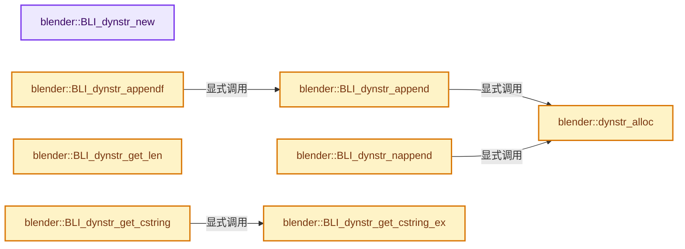
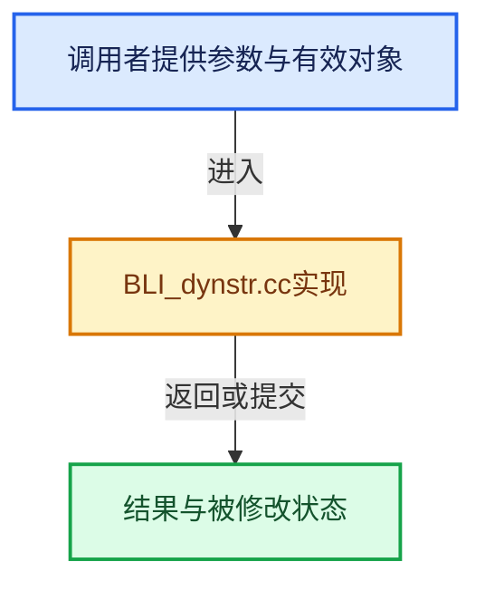

# 实现依赖专题：source/blender/blenlib/intern/BLI_dynstr.cc

[方向导航](README.md) · [符号索引](../%E7%AC%A6%E5%8F%B7%E4%BE%9D%E8%B5%96%E4%B8%8E%E5%AE%9E%E7%8E%B0%E7%B4%A2%E5%BC%95.md)

本专题从正文实际调用进入，集中保存共享实现。函数有稳定锚点，可从调用处直接跳到对应完整函数；递归与互相调用通过回链组织。

## 本文件的实现关系






## 完整成员与函数实现

<a id="f-175f7e29ab0bb527"></a>

### `blender::BLI_dynstr_new`

实现位置：[source/blender/blenlib/intern/BLI_dynstr.cc](../../../../../source/blender/blenlib/intern/BLI_dynstr.cc) · L39—L42。

**教学注释版**

<!-- annotated:216bfa9f2c9e8e -->

```cpp
DynStr *BLI_dynstr_new()
{
  return MEM_new_zeroed<DynStr>("DynStr");
}
```

<details>
<summary>核对原始源码：source/blender/blenlib/intern/BLI_dynstr.cc · L39—L42</summary>

<!-- original:216bfa9f2c9e8e:source/blender/blenlib/intern/BLI_dynstr.cc:39:42 -->

```cpp
DynStr *BLI_dynstr_new()
{
  return MEM_new_zeroed<DynStr>("DynStr");
}
```

</details>

**结果出口**

- `return MEM_new_zeroed<DynStr>("DynStr");`

**继续追踪实现**

- `MEM_new_zeroed<DynStr>` → [MEM_new_zeroed · L550](../03-%E5%86%85%E5%AD%98%E5%88%86%E9%85%8D%E4%B8%8E%E8%BF%90%E8%A1%8C%E6%97%B6%E7%B1%BB%E5%9E%8B/%E4%BE%9D%E8%B5%96-MEM_guardedalloc-b54eca.md#f-eeb1e2a7f57dd231)；[MEM_new_zeroed · L114](../03-%E5%86%85%E5%AD%98%E5%88%86%E9%85%8D%E4%B8%8E%E8%BF%90%E8%A1%8C%E6%97%B6%E7%B1%BB%E5%9E%8B/%E4%BE%9D%E8%B5%96-mallocn-afdcd4.md#f-e04cf01c64c8b180)。同名重载需按实参类型选择。

<a id="f-241316295f29a118"></a>

### `blender::dynstr_alloc`

实现位置：[source/blender/blenlib/intern/BLI_dynstr.cc](../../../../../source/blender/blenlib/intern/BLI_dynstr.cc) · L52—L56。

接口参数：

- `DynStr *__restrict ds`
- `size_t num = 1`

**教学注释版**

<!-- annotated:3d9c9dadf8de74 -->

```cpp
template<typename T> inline T *dynstr_alloc(DynStr *__restrict ds, size_t num = 1)
{
  return ds->memarena ? BLI_memarena_alloc<T>(ds->memarena, num) :
                        // [讲解] malloc：取得原始存储，失败可返回空指针；不构造C++对象。必须与匹配释放接口及对象寿命管理结合。
                        static_cast<T *>(malloc(num * sizeof(T)));
}
```

<details>
<summary>核对原始源码：source/blender/blenlib/intern/BLI_dynstr.cc · L52—L56</summary>

<!-- original:3d9c9dadf8de74:source/blender/blenlib/intern/BLI_dynstr.cc:52:56 -->

```cpp
template<typename T> inline T *dynstr_alloc(DynStr *__restrict ds, size_t num = 1)
{
  return ds->memarena ? BLI_memarena_alloc<T>(ds->memarena, num) :
                        static_cast<T *>(malloc(num * sizeof(T)));
}
```

</details>

**结果出口**

- `return ds->memarena ? BLI_memarena_alloc<T>(ds->memarena, num) :`

**继续追踪实现**

- `BLI_memarena_alloc<T>` → [blender::BLI_memarena_alloc · L125](%E4%BE%9D%E8%B5%96-BLI_memarena-aea32a.md#f-ae79828c3629e134)。
- `malloc` → [外部契约](https://eel.is/c++draft/c.malloc)：取得原始存储，失败可返回空指针；不构造C++对象。必须与匹配释放接口及对象寿命管理结合。

<a id="f-5cdd0abfaf808d5e"></a>

### `blender::BLI_dynstr_append`

实现位置：[source/blender/blenlib/intern/BLI_dynstr.cc](../../../../../source/blender/blenlib/intern/BLI_dynstr.cc) · L58—L75。

接口参数：

- `DynStr *__restrict ds`
- `const char *cstr`

**教学注释版**

<!-- annotated:85ed02be261a7a -->

```cpp
void BLI_dynstr_append(DynStr *__restrict ds, const char *cstr)
{
  DynStrElem *dse = dynstr_alloc<DynStrElem>(ds);
  int cstrlen = strlen(cstr);

  dse->str = dynstr_alloc<char>(ds, cstrlen + 1);
  // [讲解] memcpy：复制字节，源与目标不应重叠。类型生命周期、对齐和可复制表示须由调用者证明，不是任意对象的复制构造。
  memcpy(dse->str, cstr, cstrlen + 1);
  dse->next = nullptr;

  if (!ds->last) {
    ds->last = ds->elems = dse;
  }
  else {
    ds->last = ds->last->next = dse;
  }

  ds->curlen += cstrlen;
}
```

<details>
<summary>核对原始源码：source/blender/blenlib/intern/BLI_dynstr.cc · L58—L75</summary>

<!-- original:85ed02be261a7a:source/blender/blenlib/intern/BLI_dynstr.cc:58:75 -->

```cpp
void BLI_dynstr_append(DynStr *__restrict ds, const char *cstr)
{
  DynStrElem *dse = dynstr_alloc<DynStrElem>(ds);
  int cstrlen = strlen(cstr);

  dse->str = dynstr_alloc<char>(ds, cstrlen + 1);
  memcpy(dse->str, cstr, cstrlen + 1);
  dse->next = nullptr;

  if (!ds->last) {
    ds->last = ds->elems = dse;
  }
  else {
    ds->last = ds->last->next = dse;
  }

  ds->curlen += cstrlen;
}
```

</details>

**沿实际写入检查状态**

- `dse->str = dynstr_alloc<char>(ds, cstrlen + 1);`
- `dse->next = nullptr;`
- `ds->last = ds->elems = dse;`
- `ds->last = ds->last->next = dse;`
- `ds->curlen += cstrlen;`

**继续追踪实现**

- `dynstr_alloc<DynStrElem>` → [blender::dynstr_alloc · L52](%E4%BE%9D%E8%B5%96-BLI_dynstr-0c174c.md#f-241316295f29a118)。
- `strlen` → [外部契约](https://eel.is/c++draft/)：这个边界按实际表达式及所属类型核对参数、返回值、寿命与失败行为。这里提供接口入口，不声称已解释该第三方版本的内部实现。
- `dynstr_alloc<char>` → [blender::dynstr_alloc · L52](%E4%BE%9D%E8%B5%96-BLI_dynstr-0c174c.md#f-241316295f29a118)。
- `memcpy` → [外部契约](https://eel.is/c++draft/cstring.syn)：复制字节，源与目标不应重叠。类型生命周期、对齐和可复制表示须由调用者证明，不是任意对象的复制构造。

<a id="f-c848f55debb777f1"></a>

### `blender::BLI_dynstr_nappend`

实现位置：[source/blender/blenlib/intern/BLI_dynstr.cc](../../../../../source/blender/blenlib/intern/BLI_dynstr.cc) · L77—L95。

接口参数：

- `DynStr *__restrict ds`
- `const char *cstr`
- `int len`

**教学注释版**

<!-- annotated:921a79b1007cd6 -->

```cpp
void BLI_dynstr_nappend(DynStr *__restrict ds, const char *cstr, int len)
{
  DynStrElem *dse = dynstr_alloc<DynStrElem>(ds);
  int cstrlen = BLI_strnlen(cstr, len);

  dse->str = dynstr_alloc<char>(ds, cstrlen + 1);
  // [讲解] memcpy：复制字节，源与目标不应重叠。类型生命周期、对齐和可复制表示须由调用者证明，不是任意对象的复制构造。
  memcpy(dse->str, cstr, cstrlen);
  dse->str[cstrlen] = '\0';
  dse->next = nullptr;

  if (!ds->last) {
    ds->last = ds->elems = dse;
  }
  else {
    ds->last = ds->last->next = dse;
  }

  ds->curlen += cstrlen;
}
```

<details>
<summary>核对原始源码：source/blender/blenlib/intern/BLI_dynstr.cc · L77—L95</summary>

<!-- original:921a79b1007cd6:source/blender/blenlib/intern/BLI_dynstr.cc:77:95 -->

```cpp
void BLI_dynstr_nappend(DynStr *__restrict ds, const char *cstr, int len)
{
  DynStrElem *dse = dynstr_alloc<DynStrElem>(ds);
  int cstrlen = BLI_strnlen(cstr, len);

  dse->str = dynstr_alloc<char>(ds, cstrlen + 1);
  memcpy(dse->str, cstr, cstrlen);
  dse->str[cstrlen] = '\0';
  dse->next = nullptr;

  if (!ds->last) {
    ds->last = ds->elems = dse;
  }
  else {
    ds->last = ds->last->next = dse;
  }

  ds->curlen += cstrlen;
}
```

</details>

**沿实际写入检查状态**

- `dse->str = dynstr_alloc<char>(ds, cstrlen + 1);`
- `dse->str[cstrlen] = '\0';`
- `dse->next = nullptr;`
- `ds->last = ds->elems = dse;`
- `ds->last = ds->last->next = dse;`
- `ds->curlen += cstrlen;`

**继续追踪实现**

- `dynstr_alloc<DynStrElem>` → [blender::dynstr_alloc · L52](%E4%BE%9D%E8%B5%96-BLI_dynstr-0c174c.md#f-241316295f29a118)。
- `BLI_strnlen` → [blender::BLI_strnlen · L919](%E4%BE%9D%E8%B5%96-string-1d986f.md#f-137cab173af92dd4)。
- `dynstr_alloc<char>` → [blender::dynstr_alloc · L52](%E4%BE%9D%E8%B5%96-BLI_dynstr-0c174c.md#f-241316295f29a118)。
- `memcpy` → [外部契约](https://eel.is/c++draft/cstring.syn)：复制字节，源与目标不应重叠。类型生命周期、对齐和可复制表示须由调用者证明，不是任意对象的复制构造。

<a id="f-4c5a9394eb5ed39c"></a>

### `blender::BLI_dynstr_appendf`

实现位置：[source/blender/blenlib/intern/BLI_dynstr.cc](../../../../../source/blender/blenlib/intern/BLI_dynstr.cc) · L108—L122。

接口参数：

- `DynStr *__restrict ds`
- `const char *__restrict format`

**教学注释版**

<!-- annotated:1541312d7bc28a -->

```cpp
void BLI_dynstr_appendf(DynStr *__restrict ds, const char *__restrict format, ...)
{
  va_list args;
  char *str, fixed_buf[256];
  size_t str_len;
  va_start(args, format);
  str = BLI_vsprintfN_with_buffer(fixed_buf, sizeof(fixed_buf), &str_len, format, args);
  va_end(args);
  if (str) [[likely]] {
    BLI_dynstr_append(ds, str);
    if (str != fixed_buf) {
      MEM_delete(str);
    }
  }
}
```

<details>
<summary>核对原始源码：source/blender/blenlib/intern/BLI_dynstr.cc · L108—L122</summary>

<!-- original:1541312d7bc28a:source/blender/blenlib/intern/BLI_dynstr.cc:108:122 -->

```cpp
void BLI_dynstr_appendf(DynStr *__restrict ds, const char *__restrict format, ...)
{
  va_list args;
  char *str, fixed_buf[256];
  size_t str_len;
  va_start(args, format);
  str = BLI_vsprintfN_with_buffer(fixed_buf, sizeof(fixed_buf), &str_len, format, args);
  va_end(args);
  if (str) [[likely]] {
    BLI_dynstr_append(ds, str);
    if (str != fixed_buf) {
      MEM_delete(str);
    }
  }
}
```

</details>

**沿实际写入检查状态**

- `str = BLI_vsprintfN_with_buffer(fixed_buf, sizeof(fixed_buf), &str_len, format, args);`

**继续追踪实现**

- `va_start` → [调用协议](../%E6%A8%A1%E6%9D%BF%E5%AE%8F%E4%B8%8E%E5%8A%A8%E6%80%81%E5%88%86%E6%B4%BE%E5%8D%8F%E8%AE%AE.md)：函数指针、局部可调用对象或未展开的宏；必须结合调用者环境。调用位置L113。
- `BLI_vsprintfN_with_buffer` → [blender::BLI_vsprintfN_with_buffer · L263](%E4%BE%9D%E8%B5%96-string-1d986f.md#f-1385b6093dcbd514)。
- `va_end` → [调用协议](../%E6%A8%A1%E6%9D%BF%E5%AE%8F%E4%B8%8E%E5%8A%A8%E6%80%81%E5%88%86%E6%B4%BE%E5%8D%8F%E8%AE%AE.md)：函数指针、局部可调用对象或未展开的宏；必须结合调用者环境。调用位置L115。
- `BLI_dynstr_append` → [blender::BLI_dynstr_append · L58](%E4%BE%9D%E8%B5%96-BLI_dynstr-0c174c.md#f-5cdd0abfaf808d5e)。
- `MEM_delete` → [MEM_delete · L400](../03-%E5%86%85%E5%AD%98%E5%88%86%E9%85%8D%E4%B8%8E%E8%BF%90%E8%A1%8C%E6%97%B6%E7%B1%BB%E5%9E%8B/%E4%BE%9D%E8%B5%96-MEM_guardedalloc-b54eca.md#f-9049ffdd1682887c)。

<a id="f-b531ee8abf4f54d9"></a>

### `blender::BLI_dynstr_get_len`

实现位置：[source/blender/blenlib/intern/BLI_dynstr.cc](../../../../../source/blender/blenlib/intern/BLI_dynstr.cc) · L124—L127。

接口参数：

- `const DynStr *ds`

**教学注释版**

<!-- annotated:0453c70d255bd5 -->

```cpp
int BLI_dynstr_get_len(const DynStr *ds)
{
  return ds->curlen;
}
```

<details>
<summary>核对原始源码：source/blender/blenlib/intern/BLI_dynstr.cc · L124—L127</summary>

<!-- original:0453c70d255bd5:source/blender/blenlib/intern/BLI_dynstr.cc:124:127 -->

```cpp
int BLI_dynstr_get_len(const DynStr *ds)
{
  return ds->curlen;
}
```

</details>

**结果出口**

- `return ds->curlen;`

**继续追踪实现**

本实现没有需要继续展开的显式调用；检查返回表达式、对象转换和调用者前置条件。

<a id="f-d23985db4124b793"></a>

### `blender::BLI_dynstr_get_cstring_ex`

实现位置：[source/blender/blenlib/intern/BLI_dynstr.cc](../../../../../source/blender/blenlib/intern/BLI_dynstr.cc) · L129—L143。

接口参数：

- `const DynStr *__restrict ds`
- `char *__restrict rets`

**教学注释版**

<!-- annotated:70fba1daf103c2 -->

```cpp
void BLI_dynstr_get_cstring_ex(const DynStr *__restrict ds, char *__restrict rets)
{
  char *s;
  const DynStrElem *dse;

  for (s = rets, dse = ds->elems; dse; dse = dse->next) {
    int slen = strlen(dse->str);

    // [讲解] memcpy：复制字节，源与目标不应重叠。类型生命周期、对齐和可复制表示须由调用者证明，不是任意对象的复制构造。
    memcpy(s, dse->str, slen);

    s += slen;
  }
  BLI_assert((s - rets) == ds->curlen);
  rets[ds->curlen] = '\0';
}
```

<details>
<summary>核对原始源码：source/blender/blenlib/intern/BLI_dynstr.cc · L129—L143</summary>

<!-- original:70fba1daf103c2:source/blender/blenlib/intern/BLI_dynstr.cc:129:143 -->

```cpp
void BLI_dynstr_get_cstring_ex(const DynStr *__restrict ds, char *__restrict rets)
{
  char *s;
  const DynStrElem *dse;

  for (s = rets, dse = ds->elems; dse; dse = dse->next) {
    int slen = strlen(dse->str);

    memcpy(s, dse->str, slen);

    s += slen;
  }
  BLI_assert((s - rets) == ds->curlen);
  rets[ds->curlen] = '\0';
}
```

</details>

**沿实际写入检查状态**

- `s += slen;`
- `rets[ds->curlen] = '\0';`

**继续追踪实现**

- `strlen` → [外部契约](https://eel.is/c++draft/)：这个边界按实际表达式及所属类型核对参数、返回值、寿命与失败行为。这里提供接口入口，不声称已解释该第三方版本的内部实现。
- `memcpy` → [外部契约](https://eel.is/c++draft/cstring.syn)：复制字节，源与目标不应重叠。类型生命周期、对齐和可复制表示须由调用者证明，不是任意对象的复制构造。
- `BLI_assert` → [BLI_assert · L48](%E4%BE%9D%E8%B5%96-BLI_assert-cc98e8.md#m-57a88495704d)；[BLI_assert · L63](%E4%BE%9D%E8%B5%96-BLI_assert-cc98e8.md#m-d07050020cb5)。宏定义由构建条件选择。

<a id="f-96bf160f2e4e8179"></a>

### `blender::BLI_dynstr_get_cstring`

实现位置：[source/blender/blenlib/intern/BLI_dynstr.cc](../../../../../source/blender/blenlib/intern/BLI_dynstr.cc) · L145—L150。

接口参数：

- `const DynStr *ds`

**教学注释版**

<!-- annotated:80a78ab8a64cab -->

```cpp
char *BLI_dynstr_get_cstring(const DynStr *ds)
{
  char *rets = MEM_new_array_uninitialized<char>(size_t(ds->curlen) + 1, "dynstr_cstring");
  BLI_dynstr_get_cstring_ex(ds, rets);
  return rets;
}
```

<details>
<summary>核对原始源码：source/blender/blenlib/intern/BLI_dynstr.cc · L145—L150</summary>

<!-- original:80a78ab8a64cab:source/blender/blenlib/intern/BLI_dynstr.cc:145:150 -->

```cpp
char *BLI_dynstr_get_cstring(const DynStr *ds)
{
  char *rets = MEM_new_array_uninitialized<char>(size_t(ds->curlen) + 1, "dynstr_cstring");
  BLI_dynstr_get_cstring_ex(ds, rets);
  return rets;
}
```

</details>

**结果出口**

- `return rets;`

**继续追踪实现**

- `MEM_new_array_uninitialized<char>` → [MEM_new_array_uninitialized · L608](../03-%E5%86%85%E5%AD%98%E5%88%86%E9%85%8D%E4%B8%8E%E8%BF%90%E8%A1%8C%E6%97%B6%E7%B1%BB%E5%9E%8B/%E4%BE%9D%E8%B5%96-MEM_guardedalloc-b54eca.md#f-b7103eae8eb57b05)；[MEM_new_array_uninitialized · L129](../03-%E5%86%85%E5%AD%98%E5%88%86%E9%85%8D%E4%B8%8E%E8%BF%90%E8%A1%8C%E6%97%B6%E7%B1%BB%E5%9E%8B/%E4%BE%9D%E8%B5%96-mallocn-afdcd4.md#f-bf6ef4ddcfb6e5df)。同名重载需按实参类型选择。
- `BLI_dynstr_get_cstring_ex` → [blender::BLI_dynstr_get_cstring_ex · L129](%E4%BE%9D%E8%B5%96-BLI_dynstr-0c174c.md#f-d23985db4124b793)。

<a id="f-3cc8217a3fe9a68e"></a>

### `blender::BLI_dynstr_clear`

实现位置：[source/blender/blenlib/intern/BLI_dynstr.cc](../../../../../source/blender/blenlib/intern/BLI_dynstr.cc) · L152—L168。

接口参数：

- `DynStr *ds`

**教学注释版**

<!-- annotated:21f036c0e1fa9c -->

```cpp
void BLI_dynstr_clear(DynStr *ds)
{
  if (ds->memarena) {
    BLI_memarena_clear(ds->memarena);
  }
  else {
    for (DynStrElem *dse_next, *dse = ds->elems; dse; dse = dse_next) {
      dse_next = dse->next;

      // [讲解] free：归还相匹配的C分配存储，不自动执行C++析构；不可用于Windows的_aligned_malloc结果。
      free(dse->str);
      free(dse);
    }
  }

  ds->elems = ds->last = nullptr;
  ds->curlen = 0;
}
```

<details>
<summary>核对原始源码：source/blender/blenlib/intern/BLI_dynstr.cc · L152—L168</summary>

<!-- original:21f036c0e1fa9c:source/blender/blenlib/intern/BLI_dynstr.cc:152:168 -->

```cpp
void BLI_dynstr_clear(DynStr *ds)
{
  if (ds->memarena) {
    BLI_memarena_clear(ds->memarena);
  }
  else {
    for (DynStrElem *dse_next, *dse = ds->elems; dse; dse = dse_next) {
      dse_next = dse->next;

      free(dse->str);
      free(dse);
    }
  }

  ds->elems = ds->last = nullptr;
  ds->curlen = 0;
}
```

</details>

**沿实际写入检查状态**

- `dse_next = dse->next;`
- `ds->elems = ds->last = nullptr;`
- `ds->curlen = 0;`

**继续追踪实现**

- `BLI_memarena_clear` → [blender::BLI_memarena_clear · L225](%E4%BE%9D%E8%B5%96-BLI_memarena-aea32a.md#f-58102a3c4f840caa)。
- `free` → [外部契约](https://eel.is/c++draft/c.malloc)：归还相匹配的C分配存储，不自动执行C++析构；不可用于Windows的_aligned_malloc结果。

<a id="f-9c73673642d1e91f"></a>

### `blender::BLI_dynstr_free`

实现位置：[source/blender/blenlib/intern/BLI_dynstr.cc](../../../../../source/blender/blenlib/intern/BLI_dynstr.cc) · L170—L180。

接口参数：

- `DynStr *ds`

**教学注释版**

<!-- annotated:eeb95f9b69ef6f -->

```cpp
void BLI_dynstr_free(DynStr *ds)
{
  if (ds->memarena) {
    BLI_memarena_free(ds->memarena);
  }
  else {
    BLI_dynstr_clear(ds);
  }

  MEM_delete(ds);
}
```

<details>
<summary>核对原始源码：source/blender/blenlib/intern/BLI_dynstr.cc · L170—L180</summary>

<!-- original:eeb95f9b69ef6f:source/blender/blenlib/intern/BLI_dynstr.cc:170:180 -->

```cpp
void BLI_dynstr_free(DynStr *ds)
{
  if (ds->memarena) {
    BLI_memarena_free(ds->memarena);
  }
  else {
    BLI_dynstr_clear(ds);
  }

  MEM_delete(ds);
}
```

</details>

**继续追踪实现**

- `BLI_memarena_free` → [blender::BLI_memarena_free · L103](%E4%BE%9D%E8%B5%96-BLI_memarena-aea32a.md#f-a655794ad41d1bdf)。
- `BLI_dynstr_clear` → [blender::BLI_dynstr_clear · L152](%E4%BE%9D%E8%B5%96-BLI_dynstr-0c174c.md#f-3cc8217a3fe9a68e)。
- `MEM_delete` → [MEM_delete · L400](../03-%E5%86%85%E5%AD%98%E5%88%86%E9%85%8D%E4%B8%8E%E8%BF%90%E8%A1%8C%E6%97%B6%E7%B1%BB%E5%9E%8B/%E4%BE%9D%E8%B5%96-MEM_guardedalloc-b54eca.md#f-9049ffdd1682887c)。
