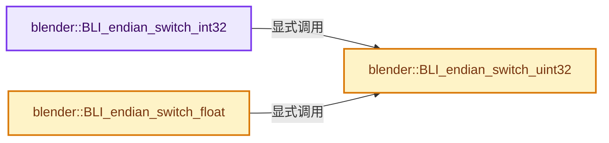
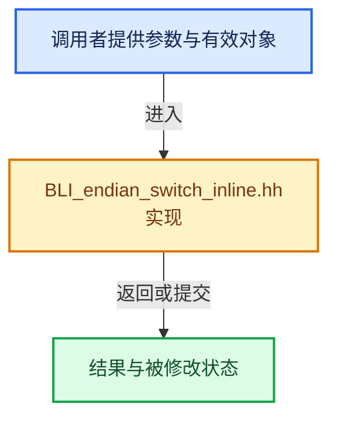

# 实现依赖专题：source/blender/blenlib/BLI_endian_switch_inline.hh

[方向导航](README.md) · [符号索引](../%E7%AC%A6%E5%8F%B7%E4%BE%9D%E8%B5%96%E4%B8%8E%E5%AE%9E%E7%8E%B0%E7%B4%A2%E5%BC%95.md)

本专题从正文实际调用进入，集中保存共享实现。函数有稳定锚点，可从调用处直接跳到对应完整函数；递归与互相调用通过回链组织。

## 本文件的实现关系






## 完整成员与函数实现

<a id="f-dd7e0fbdff1bf7eb"></a>

### `blender::BLI_endian_switch_int32`

实现位置：[source/blender/blenlib/BLI_endian_switch_inline.hh](../../../../../source/blender/blenlib/BLI_endian_switch_inline.hh) · L42—L45。

接口参数：

- `int *val`

**教学注释版**

<!-- annotated:51ab6e6d3d9fcc -->

```cpp
BLI_INLINE void BLI_endian_switch_int32(int *val)
{
  BLI_endian_switch_uint32(reinterpret_cast<unsigned int *>(val));
}
```

<details>
<summary>核对原始源码：source/blender/blenlib/BLI_endian_switch_inline.hh · L42—L45</summary>

<!-- original:51ab6e6d3d9fcc:source/blender/blenlib/BLI_endian_switch_inline.hh:42:45 -->

```cpp
BLI_INLINE void BLI_endian_switch_int32(int *val)
{
  BLI_endian_switch_uint32(reinterpret_cast<unsigned int *>(val));
}
```

</details>

**继续追踪实现**

- `BLI_endian_switch_uint32` → [blender::BLI_endian_switch_uint32 · L46](%E4%BE%9D%E8%B5%96-BLI_endian_switch_inline-fbfa0a.md#f-45eaa04f9c4e9640)。

<a id="f-45eaa04f9c4e9640"></a>

### `blender::BLI_endian_switch_uint32`

实现位置：[source/blender/blenlib/BLI_endian_switch_inline.hh](../../../../../source/blender/blenlib/BLI_endian_switch_inline.hh) · L46—L54。

接口参数：

- `unsigned int *val`

**教学注释版**

<!-- annotated:b4f189ae8517b7 -->

```cpp
BLI_INLINE void BLI_endian_switch_uint32(unsigned int *val)
{
#ifdef __GNUC__
  *val = __builtin_bswap32(*val);
#else
  unsigned int tval = *val;
  *val = ((tval >> 24)) | ((tval << 8) & 0x00ff0000) | ((tval >> 8) & 0x0000ff00) | ((tval << 24));
#endif
}
```

<details>
<summary>核对原始源码：source/blender/blenlib/BLI_endian_switch_inline.hh · L46—L54</summary>

<!-- original:b4f189ae8517b7:source/blender/blenlib/BLI_endian_switch_inline.hh:46:54 -->

```cpp
BLI_INLINE void BLI_endian_switch_uint32(unsigned int *val)
{
#ifdef __GNUC__
  *val = __builtin_bswap32(*val);
#else
  unsigned int tval = *val;
  *val = ((tval >> 24)) | ((tval << 8) & 0x00ff0000) | ((tval >> 8) & 0x0000ff00) | ((tval << 24));
#endif
}
```

</details>

**继续追踪实现**

- `__builtin_bswap32` → [调用协议](../%E6%A8%A1%E6%9D%BF%E5%AE%8F%E4%B8%8E%E5%8A%A8%E6%80%81%E5%88%86%E6%B4%BE%E5%8D%8F%E8%AE%AE.md)：函数指针、局部可调用对象或未展开的宏；必须结合调用者环境。调用位置L49。

<a id="f-188b4b205db6042e"></a>

### `blender::BLI_endian_switch_float`

实现位置：[source/blender/blenlib/BLI_endian_switch_inline.hh](../../../../../source/blender/blenlib/BLI_endian_switch_inline.hh) · L55—L58。

接口参数：

- `float *val`

**教学注释版**

<!-- annotated:0100315f479bc1 -->

```cpp
BLI_INLINE void BLI_endian_switch_float(float *val)
{
  BLI_endian_switch_uint32(reinterpret_cast<unsigned int *>(val));
}
```

<details>
<summary>核对原始源码：source/blender/blenlib/BLI_endian_switch_inline.hh · L55—L58</summary>

<!-- original:0100315f479bc1:source/blender/blenlib/BLI_endian_switch_inline.hh:55:58 -->

```cpp
BLI_INLINE void BLI_endian_switch_float(float *val)
{
  BLI_endian_switch_uint32(reinterpret_cast<unsigned int *>(val));
}
```

</details>

**继续追踪实现**

- `BLI_endian_switch_uint32` → [blender::BLI_endian_switch_uint32 · L46](%E4%BE%9D%E8%B5%96-BLI_endian_switch_inline-fbfa0a.md#f-45eaa04f9c4e9640)。
