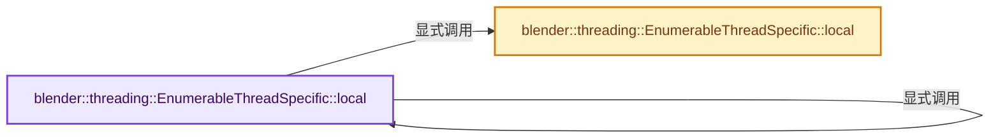
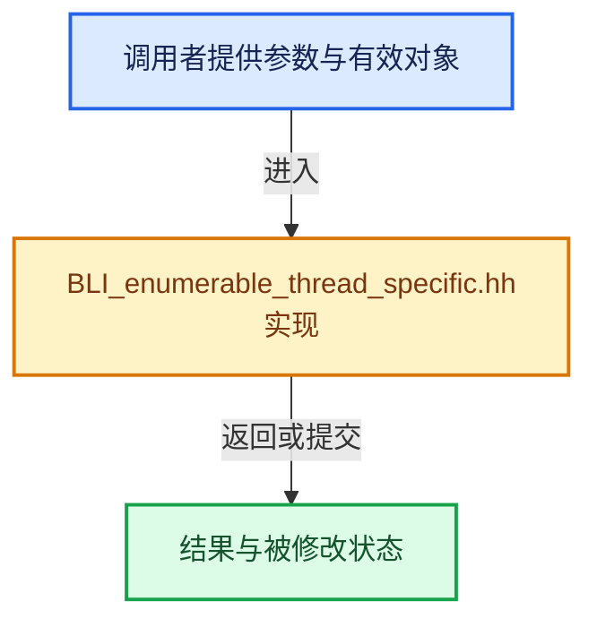

# 实现依赖专题：source/blender/blenlib/BLI_enumerable_thread_specific.hh

[方向导航](README.md) · [符号索引](../%E7%AC%A6%E5%8F%B7%E4%BE%9D%E8%B5%96%E4%B8%8E%E5%AE%9E%E7%8E%B0%E7%B4%A2%E5%BC%95.md)

本专题从正文实际调用进入，集中保存共享实现。函数有稳定锚点，可从调用处直接跳到对应完整函数；递归与互相调用通过回链组织。

## 本文件的实现关系






## 完整成员与函数实现

<a id="f-38c6c32570e94c93"></a>

### `blender::threading::EnumerableThreadSpecific::local`

实现位置：[source/blender/blenlib/BLI_enumerable_thread_specific.hh](../../../../../source/blender/blenlib/BLI_enumerable_thread_specific.hh) · L51—L54。

**教学注释版**

<!-- annotated:590c2263b95e90 -->

```cpp
  T &local()
  {
    return values_.local();
  }
```

<details>
<summary>核对原始源码：source/blender/blenlib/BLI_enumerable_thread_specific.hh · L51—L54</summary>

<!-- original:590c2263b95e90:source/blender/blenlib/BLI_enumerable_thread_specific.hh:51:54 -->

```cpp
  T &local()
  {
    return values_.local();
  }
```

</details>

**结果出口**

- `return values_.local();`

**继续追踪实现**

- `values_.local` → [blender::threading::EnumerableThreadSpecific::local · L51](%E4%BE%9D%E8%B5%96-BLI_enumerable_thread_specific-ceb6f9.md#f-38c6c32570e94c93)；[blender::threading::EnumerableThreadSpecific::local · L87](%E4%BE%9D%E8%B5%96-BLI_enumerable_thread_specific-ceb6f9.md#f-3c8975467b7a35ba)。同名重载需按实参类型选择。

<a id="f-3c8975467b7a35ba"></a>

### `blender::threading::EnumerableThreadSpecific::local`

实现位置：[source/blender/blenlib/BLI_enumerable_thread_specific.hh](../../../../../source/blender/blenlib/BLI_enumerable_thread_specific.hh) · L87—L97。

**教学注释版**

<!-- annotated:0cccd9324820f4 -->

```cpp
  T &local()
  {
    const int thread_id = enumerable_thread_specific_utils::thread_id;
    std::lock_guard lock{mutex_};
    // [讲解] values_.lookup_or_add_cb：把查找与缺失时创建合成一次操作。
    return values_.lookup_or_add_cb(thread_id, [&]() {
      T *value = static_cast<T *>(::operator new(sizeof(T)));
      initializer_(value);
      // [讲解] owned_values_.append：在尾部建立新元素，必要时先扩大存储。
      owned_values_.append(std::unique_ptr<T>{value});
      return std::reference_wrapper<T>{*value};
    });
  }
```

<details>
<summary>核对原始源码：source/blender/blenlib/BLI_enumerable_thread_specific.hh · L87—L97</summary>

<!-- original:0cccd9324820f4:source/blender/blenlib/BLI_enumerable_thread_specific.hh:87:97 -->

```cpp
  T &local()
  {
    const int thread_id = enumerable_thread_specific_utils::thread_id;
    std::lock_guard lock{mutex_};
    return values_.lookup_or_add_cb(thread_id, [&]() {
      T *value = static_cast<T *>(::operator new(sizeof(T)));
      initializer_(value);
      owned_values_.append(std::unique_ptr<T>{value});
      return std::reference_wrapper<T>{*value};
    });
  }
```

</details>

**结果出口**

- `return values_.lookup_or_add_cb(thread_id, [&]() {`
- `return std::reference_wrapper<T>{*value};`

**继续追踪实现**

- `values_.lookup_or_add_cb` → [blender::Map::lookup_or_add_cb · L619](../02-%E5%93%88%E5%B8%8C%E8%A1%A8%E4%B8%8E%E5%85%B3%E8%81%94%E6%95%B0%E6%8D%AE%E7%BB%93%E6%9E%84/05-Map%E6%8F%92%E5%85%A5%E4%B8%8E%E5%9B%9E%E8%B0%83.md#f-6e15bb75721c1170)；[blender::Map::lookup_or_add_cb · L624](../02-%E5%93%88%E5%B8%8C%E8%A1%A8%E4%B8%8E%E5%85%B3%E8%81%94%E6%95%B0%E6%8D%AE%E7%BB%93%E6%9E%84/05-Map%E6%8F%92%E5%85%A5%E4%B8%8E%E5%9B%9E%E8%B0%83.md#f-9685875870107c12)。同名重载需按实参类型选择。
- `::operator new` → [调用协议](../%E6%A8%A1%E6%9D%BF%E5%AE%8F%E4%B8%8E%E5%8A%A8%E6%80%81%E5%88%86%E6%B4%BE%E5%8D%8F%E8%AE%AE.md)：函数指针、局部可调用对象或未展开的宏；必须结合调用者环境。调用位置L92。
- `initializer_` → [调用协议](../%E6%A8%A1%E6%9D%BF%E5%AE%8F%E4%B8%8E%E5%8A%A8%E6%80%81%E5%88%86%E6%B4%BE%E5%8D%8F%E8%AE%AE.md)：函数指针、局部可调用对象或未展开的宏；必须结合调用者环境。调用位置L93。
- `owned_values_.append` → [blender::Vector::append · L498](11-Vector%E6%8F%92%E5%85%A5%E5%88%A0%E9%99%A4%E4%B8%8E%E9%87%8D%E6%8E%92.md#f-5bde268a69e443ec)；[blender::Vector::append · L502](11-Vector%E6%8F%92%E5%85%A5%E5%88%A0%E9%99%A4%E4%B8%8E%E9%87%8D%E6%8E%92.md#f-591e0b15e6308532)。同名重载需按实参类型选择。
