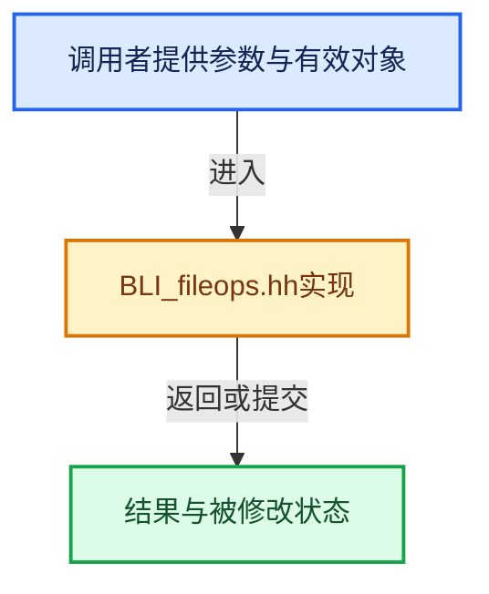

# 实现依赖专题：source/blender/blenlib/BLI_fileops.hh

[方向导航](README.md) · [符号索引](../%E7%AC%A6%E5%8F%B7%E4%BE%9D%E8%B5%96%E4%B8%8E%E5%AE%9E%E7%8E%B0%E7%B4%A2%E5%BC%95.md)

本专题从正文实际调用进入，集中保存共享实现。函数有稳定锚点，可从调用处直接跳到对应完整函数；递归与互相调用通过回链组织。

## 本文件的实现关系





## 相关类型布局与成员入口

<a id="t-8f8cd852c002"></a>

### `blender::stat`

原始声明：[source/blender/blenlib/BLI_fileops.hh](../../../../../source/blender/blenlib/BLI_fileops.hh) · L137—L137。

以下保留类的数据声明与编译条件，成员函数实现通过后面的精确链接阅读。

<!-- annotated:cc949fc5b031f8 -->

```cpp
typedef struct stat BLI_stat_t;
```

<details>
<summary>核对原始源码：source/blender/blenlib/BLI_fileops.hh · L137—L137</summary>

<!-- original:cc949fc5b031f8:source/blender/blenlib/BLI_fileops.hh:137:137 -->

```cpp
typedef struct stat BLI_stat_t;
```

</details>


<a id="t-96dba0398930"></a>

### `blender::eFileAttributes`

原始声明：[source/blender/blenlib/BLI_fileops.hh](../../../../../source/blender/blenlib/BLI_fileops.hh) · L150—L167。

以下保留类的数据声明与编译条件，成员函数实现通过后面的精确链接阅读。

<!-- annotated:f62105caa397c7 -->

```cpp
enum eFileAttributes {
  FILE_ATTR_READONLY = 1 << 0,        /* Read-only or Immutable. */
  FILE_ATTR_HIDDEN = 1 << 1,          /* Hidden or invisible. */
  FILE_ATTR_SYSTEM = 1 << 2,          /* Used by the Operating System. */
  FILE_ATTR_ARCHIVE = 1 << 3,         /* Marked as archived. */
  FILE_ATTR_COMPRESSED = 1 << 4,      /* Compressed. */
  FILE_ATTR_ENCRYPTED = 1 << 5,       /* Encrypted. */
  FILE_ATTR_RESTRICTED = 1 << 6,      /* Protected by OS. */
  FILE_ATTR_TEMPORARY = 1 << 7,       /* Used for temporary storage. */
  FILE_ATTR_SPARSE_FILE = 1 << 8,     /* Sparse File. */
  FILE_ATTR_OFFLINE = 1 << 9,         /* Contents available after a short delay. */
  FILE_ATTR_ALIAS = 1 << 10,          /* Mac Alias or Windows LNK. File-based redirection. */
  FILE_ATTR_REPARSE_POINT = 1 << 11,  /* File has associated re-parse point. */
  FILE_ATTR_SYMLINK = 1 << 12,        /* Reference to another file. */
  FILE_ATTR_JUNCTION_POINT = 1 << 13, /* Folder Symbolic-link. */
  FILE_ATTR_MOUNT_POINT = 1 << 14,    /* Volume mounted as a folder. */
  FILE_ATTR_HARDLINK = 1 << 15,       /* Duplicated directory entry. */
};
```

<details>
<summary>核对原始源码：source/blender/blenlib/BLI_fileops.hh · L150—L167</summary>

<!-- original:f62105caa397c7:source/blender/blenlib/BLI_fileops.hh:150:167 -->

```cpp
enum eFileAttributes {
  FILE_ATTR_READONLY = 1 << 0,        /* Read-only or Immutable. */
  FILE_ATTR_HIDDEN = 1 << 1,          /* Hidden or invisible. */
  FILE_ATTR_SYSTEM = 1 << 2,          /* Used by the Operating System. */
  FILE_ATTR_ARCHIVE = 1 << 3,         /* Marked as archived. */
  FILE_ATTR_COMPRESSED = 1 << 4,      /* Compressed. */
  FILE_ATTR_ENCRYPTED = 1 << 5,       /* Encrypted. */
  FILE_ATTR_RESTRICTED = 1 << 6,      /* Protected by OS. */
  FILE_ATTR_TEMPORARY = 1 << 7,       /* Used for temporary storage. */
  FILE_ATTR_SPARSE_FILE = 1 << 8,     /* Sparse File. */
  FILE_ATTR_OFFLINE = 1 << 9,         /* Contents available after a short delay. */
  FILE_ATTR_ALIAS = 1 << 10,          /* Mac Alias or Windows LNK. File-based redirection. */
  FILE_ATTR_REPARSE_POINT = 1 << 11,  /* File has associated re-parse point. */
  FILE_ATTR_SYMLINK = 1 << 12,        /* Reference to another file. */
  FILE_ATTR_JUNCTION_POINT = 1 << 13, /* Folder Symbolic-link. */
  FILE_ATTR_MOUNT_POINT = 1 << 14,    /* Volume mounted as a folder. */
  FILE_ATTR_HARDLINK = 1 << 15,       /* Duplicated directory entry. */
};
```

</details>


<a id="t-95e827294f0d"></a>

### `blender::stat`

原始声明：[source/blender/blenlib/BLI_fileops.hh](../../../../../source/blender/blenlib/BLI_fileops.hh) · L299—L299。

以下保留类的数据声明与编译条件，成员函数实现通过后面的精确链接阅读。

<!-- annotated:55f7409f53a64b -->

```cpp
void BLI_filelist_entry_size_to_string(const struct stat *st,
```

<details>
<summary>核对原始源码：source/blender/blenlib/BLI_fileops.hh · L299—L299</summary>

<!-- original:55f7409f53a64b:source/blender/blenlib/BLI_fileops.hh:299:299 -->

```cpp
void BLI_filelist_entry_size_to_string(const struct stat *st,
```

</details>


<a id="t-dd2cbfd6bf28"></a>

### `blender::stat`

原始声明：[source/blender/blenlib/BLI_fileops.hh](../../../../../source/blender/blenlib/BLI_fileops.hh) · L306—L306。

以下保留类的数据声明与编译条件，成员函数实现通过后面的精确链接阅读。

<!-- annotated:9355587e2757e1 -->

```cpp
void BLI_filelist_entry_mode_to_string(const struct stat *st,
```

<details>
<summary>核对原始源码：source/blender/blenlib/BLI_fileops.hh · L306—L306</summary>

<!-- original:9355587e2757e1:source/blender/blenlib/BLI_fileops.hh:306:306 -->

```cpp
void BLI_filelist_entry_mode_to_string(const struct stat *st,
```

</details>


<a id="t-c2bddf329a3c"></a>

### `blender::stat`

原始声明：[source/blender/blenlib/BLI_fileops.hh](../../../../../source/blender/blenlib/BLI_fileops.hh) · L314—L314。

以下保留类的数据声明与编译条件，成员函数实现通过后面的精确链接阅读。

<!-- annotated:8feed2e783c3d3 -->

```cpp
void BLI_filelist_entry_owner_to_string(const struct stat *st,
```

<details>
<summary>核对原始源码：source/blender/blenlib/BLI_fileops.hh · L314—L314</summary>

<!-- original:8feed2e783c3d3:source/blender/blenlib/BLI_fileops.hh:314:314 -->

```cpp
void BLI_filelist_entry_owner_to_string(const struct stat *st,
```

</details>


## 完整成员与函数实现
