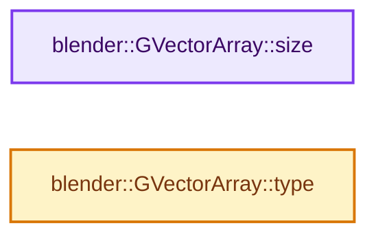
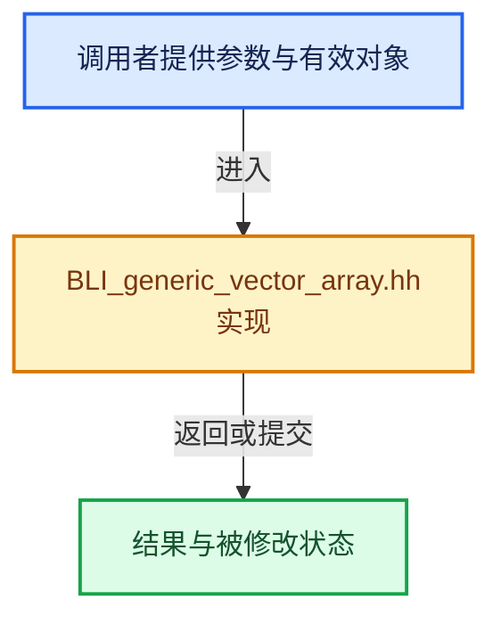

# 实现依赖专题：source/blender/blenlib/BLI_generic_vector_array.hh

[方向导航](README.md) · [符号索引](../%E7%AC%A6%E5%8F%B7%E4%BE%9D%E8%B5%96%E4%B8%8E%E5%AE%9E%E7%8E%B0%E7%B4%A2%E5%BC%95.md)

本专题从正文实际调用进入，集中保存共享实现。函数有稳定锚点，可从调用处直接跳到对应完整函数；递归与互相调用通过回链组织。

## 本文件的实现关系






## 完整成员与函数实现

<a id="f-19cac5e83152c452"></a>

### `blender::GVectorArray::size`

实现位置：[source/blender/blenlib/BLI_generic_vector_array.hh](../../../../../source/blender/blenlib/BLI_generic_vector_array.hh) · L47—L50。

**教学注释版**

<!-- annotated:2484cc0ccd94ab -->

```cpp
  int64_t size() const
  {
    // [讲解] items_.size：查询固定有效长度及其索引范围。
    return items_.size();
  }
```

<details>
<summary>核对原始源码：source/blender/blenlib/BLI_generic_vector_array.hh · L47—L50</summary>

<!-- original:2484cc0ccd94ab:source/blender/blenlib/BLI_generic_vector_array.hh:47:50 -->

```cpp
  int64_t size() const
  {
    return items_.size();
  }
```

</details>

**结果出口**

- `return items_.size();`

**继续追踪实现**

- `items_.size` → [blender::Array::size · L267](08-Array%E5%A4%8D%E5%88%B6%E7%A7%BB%E5%8A%A8%E4%B8%8E%E9%94%80%E6%AF%81.md#f-c13f1b5a44f423b2)。

<a id="f-9dc15cffca471ee8"></a>

### `blender::GVectorArray::type`

实现位置：[source/blender/blenlib/BLI_generic_vector_array.hh](../../../../../source/blender/blenlib/BLI_generic_vector_array.hh) · L57—L60。

**教学注释版**

<!-- annotated:0ca3546a68ebc3 -->

```cpp
  const CPPType &type() const
  {
    return type_;
  }
```

<details>
<summary>核对原始源码：source/blender/blenlib/BLI_generic_vector_array.hh · L57—L60</summary>

<!-- original:0ca3546a68ebc3:source/blender/blenlib/BLI_generic_vector_array.hh:57:60 -->

```cpp
  const CPPType &type() const
  {
    return type_;
  }
```

</details>

**结果出口**

- `return type_;`

**继续追踪实现**

本实现没有需要继续展开的显式调用；检查返回表达式、对象转换和调用者前置条件。
