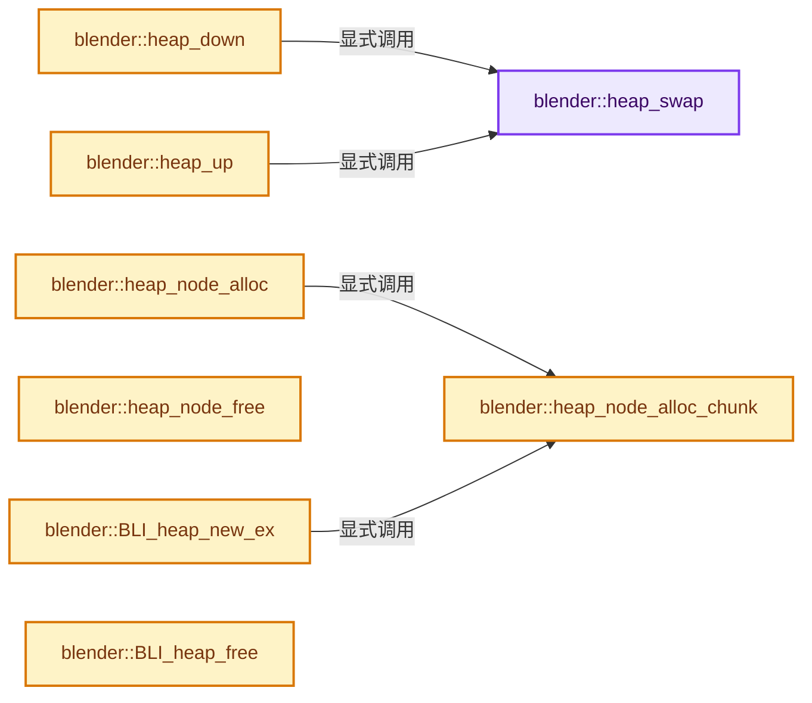
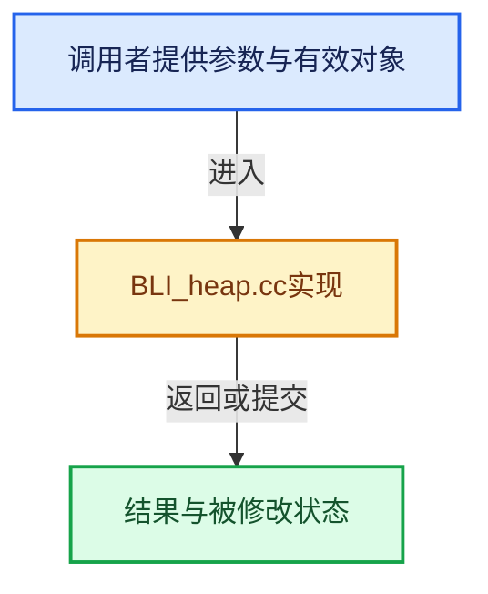

# 实现依赖专题：source/blender/blenlib/intern/BLI_heap.cc

[方向导航](README.md) · [符号索引](../%E7%AC%A6%E5%8F%B7%E4%BE%9D%E8%B5%96%E4%B8%8E%E5%AE%9E%E7%8E%B0%E7%B4%A2%E5%BC%95.md)

本专题从正文实际调用进入，集中保存共享实现。函数有稳定锚点，可从调用处直接跳到对应完整函数；递归与互相调用通过回链组织。

## 本文件的实现关系






<a id="m-b72f4a557f7e"></a>

## 宏 `HEAP_PARENT`

<!-- annotated:2a29469236c276 -->

```cpp
#define HEAP_PARENT(i) (((i) - 1) >> 1)
#define HEAP_LEFT(i) (((i) << 1) + 1)
```

<details>
<summary>核对原始源码：source/blender/blenlib/intern/BLI_heap.cc · L65—L66</summary>

<!-- original:2a29469236c276:source/blender/blenlib/intern/BLI_heap.cc:65:66 -->

```cpp
#define HEAP_PARENT(i) (((i) - 1) >> 1)
#define HEAP_LEFT(i) (((i) << 1) + 1)
```

</details>

宏在预处理阶段展开，参数替换、重复求值和条件编译应直接从该定义检查。与普通函数不同，宏不会自动提供参数类型检查；构建配置选择哪个定义需结合外围条件。

<a id="m-34f092e30ba3"></a>

## 宏 `HEAP_LEFT`

<!-- annotated:b4fc8324b7ad2f -->

```cpp
#define HEAP_LEFT(i) (((i) << 1) + 1)
#define HEAP_RIGHT(i) (((i) << 1) + 2)
```

<details>
<summary>核对原始源码：source/blender/blenlib/intern/BLI_heap.cc · L66—L67</summary>

<!-- original:b4fc8324b7ad2f:source/blender/blenlib/intern/BLI_heap.cc:66:67 -->

```cpp
#define HEAP_LEFT(i) (((i) << 1) + 1)
#define HEAP_RIGHT(i) (((i) << 1) + 2)
```

</details>

宏在预处理阶段展开，参数替换、重复求值和条件编译应直接从该定义检查。与普通函数不同，宏不会自动提供参数类型检查；构建配置选择哪个定义需结合外围条件。

<a id="m-2f2d398d82bd"></a>

## 宏 `HEAP_RIGHT`

<!-- annotated:488151f7b3dfda -->

```cpp
#define HEAP_RIGHT(i) (((i) << 1) + 2)
#define HEAP_COMPARE(a, b) ((a)->value < (b)->value)
```

<details>
<summary>核对原始源码：source/blender/blenlib/intern/BLI_heap.cc · L67—L68</summary>

<!-- original:488151f7b3dfda:source/blender/blenlib/intern/BLI_heap.cc:67:68 -->

```cpp
#define HEAP_RIGHT(i) (((i) << 1) + 2)
#define HEAP_COMPARE(a, b) ((a)->value < (b)->value)
```

</details>

宏在预处理阶段展开，参数替换、重复求值和条件编译应直接从该定义检查。与普通函数不同，宏不会自动提供参数类型检查；构建配置选择哪个定义需结合外围条件。

<a id="m-952b007822ee"></a>

## 宏 `HEAP_COMPARE`

<!-- annotated:d340838da0def5 -->

```cpp
#define HEAP_COMPARE(a, b) ((a)->value < (b)->value)

```

<details>
<summary>核对原始源码：source/blender/blenlib/intern/BLI_heap.cc · L68—L69</summary>

<!-- original:d340838da0def5:source/blender/blenlib/intern/BLI_heap.cc:68:69 -->

```cpp
#define HEAP_COMPARE(a, b) ((a)->value < (b)->value)

```

</details>

宏在预处理阶段展开，参数替换、重复求值和条件编译应直接从该定义检查。与普通函数不同，宏不会自动提供参数类型检查；构建配置选择哪个定义需结合外围条件。

## 完整成员与函数实现

<a id="f-a7f012ba62d41042"></a>

### `blender::heap_swap`

实现位置：[source/blender/blenlib/intern/BLI_heap.cc](../../../../../source/blender/blenlib/intern/BLI_heap.cc) · L74—L82。

接口参数：

- `Heap *heap`
- `const uint i`
- `const uint j`

**教学注释版**

<!-- annotated:ba49b4c140b719 -->

```cpp
BLI_INLINE void heap_swap(Heap *heap, const uint i, const uint j)
{
  HeapNode **tree = heap->tree;
  HeapNode *pi = tree[i], *pj = tree[j];
  pi->index = j;
  tree[j] = pi;
  pj->index = i;
  tree[i] = pj;
}
```

<details>
<summary>核对原始源码：source/blender/blenlib/intern/BLI_heap.cc · L74—L82</summary>

<!-- original:ba49b4c140b719:source/blender/blenlib/intern/BLI_heap.cc:74:82 -->

```cpp
BLI_INLINE void heap_swap(Heap *heap, const uint i, const uint j)
{
  HeapNode **tree = heap->tree;
  HeapNode *pi = tree[i], *pj = tree[j];
  pi->index = j;
  tree[j] = pi;
  pj->index = i;
  tree[i] = pj;
}
```

</details>

**沿实际写入检查状态**

- `pi->index = j;`
- `tree[j] = pi;`
- `pj->index = i;`
- `tree[i] = pj;`

**继续追踪实现**

本实现没有需要继续展开的显式调用；检查返回表达式、对象转换和调用者前置条件。

<a id="f-cf3b5dac2f40a518"></a>

### `blender::heap_down`

实现位置：[source/blender/blenlib/intern/BLI_heap.cc](../../../../../source/blender/blenlib/intern/BLI_heap.cc) · L84—L109。

接口参数：

- `Heap *heap`
- `uint i`

**教学注释版**

<!-- annotated:c94269298bc773 -->

```cpp
static void heap_down(Heap *heap, uint i)
{
  /* size won't change in the loop */
  HeapNode **const tree = heap->tree;
  const uint size = heap->size;

  while (true) {
    const uint l = HEAP_LEFT(i);
    const uint r = HEAP_RIGHT(i);
    uint smallest = i;

    if (LIKELY(l < size) && HEAP_COMPARE(tree[l], tree[smallest])) {
      smallest = l;
    }
    if (LIKELY(r < size) && HEAP_COMPARE(tree[r], tree[smallest])) {
      smallest = r;
    }

    if (smallest == i) [[unlikely]] {
      break;
    }

    heap_swap(heap, i, smallest);
    i = smallest;
  }
}
```

<details>
<summary>核对原始源码：source/blender/blenlib/intern/BLI_heap.cc · L84—L109</summary>

<!-- original:c94269298bc773:source/blender/blenlib/intern/BLI_heap.cc:84:109 -->

```cpp
static void heap_down(Heap *heap, uint i)
{
  /* size won't change in the loop */
  HeapNode **const tree = heap->tree;
  const uint size = heap->size;

  while (true) {
    const uint l = HEAP_LEFT(i);
    const uint r = HEAP_RIGHT(i);
    uint smallest = i;

    if (LIKELY(l < size) && HEAP_COMPARE(tree[l], tree[smallest])) {
      smallest = l;
    }
    if (LIKELY(r < size) && HEAP_COMPARE(tree[r], tree[smallest])) {
      smallest = r;
    }

    if (smallest == i) [[unlikely]] {
      break;
    }

    heap_swap(heap, i, smallest);
    i = smallest;
  }
}
```

</details>

**沿实际写入检查状态**

- `smallest = l;`
- `smallest = r;`
- `i = smallest;`

**继续追踪实现**

- `HEAP_LEFT` → [HEAP_LEFT · L66](%E4%BE%9D%E8%B5%96-BLI_heap-16714e.md#m-34f092e30ba3)。宏定义由构建条件选择。
- `HEAP_RIGHT` → [HEAP_RIGHT · L67](%E4%BE%9D%E8%B5%96-BLI_heap-16714e.md#m-2f2d398d82bd)。宏定义由构建条件选择。
- `LIKELY` → [LIKELY · L51](../03-%E5%86%85%E5%AD%98%E5%88%86%E9%85%8D%E4%B8%8E%E8%BF%90%E8%A1%8C%E6%97%B6%E7%B1%BB%E5%9E%8B/%E4%BE%9D%E8%B5%96-mallocn_intern-e4d317.md#m-53ea5e2ff73b)；[LIKELY · L54](../03-%E5%86%85%E5%AD%98%E5%88%86%E9%85%8D%E4%B8%8E%E8%BF%90%E8%A1%8C%E6%97%B6%E7%B1%BB%E5%9E%8B/%E4%BE%9D%E8%B5%96-mallocn_intern-e4d317.md#m-bb82bdeee493)；[LIKELY · L107](../05-%E5%87%A0%E4%BD%95%E5%AD%98%E5%82%A8%E4%B8%8E%E6%8B%93%E6%89%91%E6%98%A0%E5%B0%84/%E4%BE%9D%E8%B5%96-defines-cd82f8.md#m-bd6166173f61)；[LIKELY · L110](../05-%E5%87%A0%E4%BD%95%E5%AD%98%E5%82%A8%E4%B8%8E%E6%8B%93%E6%89%91%E6%98%A0%E5%B0%84/%E4%BE%9D%E8%B5%96-defines-cd82f8.md#m-2c2ad9a348a5)；[LIKELY · L543](%E4%BE%9D%E8%B5%96-BLI_utildefines-293a0a.md#m-eeacc3e1dee8)；[LIKELY · L546](%E4%BE%9D%E8%B5%96-BLI_utildefines-293a0a.md#m-26b4114d7b77)。宏定义由构建条件选择。
- `HEAP_COMPARE` → [HEAP_COMPARE · L68](%E4%BE%9D%E8%B5%96-BLI_heap-16714e.md#m-952b007822ee)。宏定义由构建条件选择。
- `heap_swap` → [blender::heap_swap · L74](%E4%BE%9D%E8%B5%96-BLI_heap-16714e.md#f-a7f012ba62d41042)。

<a id="f-8d32c6e5ab05f5ed"></a>

### `blender::heap_up`

实现位置：[source/blender/blenlib/intern/BLI_heap.cc](../../../../../source/blender/blenlib/intern/BLI_heap.cc) · L111—L124。

接口参数：

- `Heap *heap`
- `uint i`

**教学注释版**

<!-- annotated:e6d0adfc932161 -->

```cpp
static void heap_up(Heap *heap, uint i)
{
  HeapNode **const tree = heap->tree;

  while (i > 0) [[likely]] {
    const uint p = HEAP_PARENT(i);

    if (HEAP_COMPARE(tree[p], tree[i])) {
      break;
    }
    heap_swap(heap, p, i);
    i = p;
  }
}
```

<details>
<summary>核对原始源码：source/blender/blenlib/intern/BLI_heap.cc · L111—L124</summary>

<!-- original:e6d0adfc932161:source/blender/blenlib/intern/BLI_heap.cc:111:124 -->

```cpp
static void heap_up(Heap *heap, uint i)
{
  HeapNode **const tree = heap->tree;

  while (i > 0) [[likely]] {
    const uint p = HEAP_PARENT(i);

    if (HEAP_COMPARE(tree[p], tree[i])) {
      break;
    }
    heap_swap(heap, p, i);
    i = p;
  }
}
```

</details>

**沿实际写入检查状态**

- `i = p;`

**继续追踪实现**

- `HEAP_PARENT` → [HEAP_PARENT · L65](%E4%BE%9D%E8%B5%96-BLI_heap-16714e.md#m-b72f4a557f7e)。宏定义由构建条件选择。
- `HEAP_COMPARE` → [HEAP_COMPARE · L68](%E4%BE%9D%E8%B5%96-BLI_heap-16714e.md#m-952b007822ee)。宏定义由构建条件选择。
- `heap_swap` → [blender::heap_swap · L74](%E4%BE%9D%E8%B5%96-BLI_heap-16714e.md#f-a7f012ba62d41042)。

<a id="f-d98305bce83fe029"></a>

### `blender::heap_node_alloc_chunk`

实现位置：[source/blender/blenlib/intern/BLI_heap.cc](../../../../../source/blender/blenlib/intern/BLI_heap.cc) · L132—L140。

接口参数：

- `uint nodes_num`
- `HeapNode_Chunk *chunk_prev`

**教学注释版**

<!-- annotated:ef3396c0a8a2df -->

```cpp
static HeapNode_Chunk *heap_node_alloc_chunk(uint nodes_num, HeapNode_Chunk *chunk_prev)
{
  HeapNode_Chunk *chunk = static_cast<HeapNode_Chunk *>(
      MEM_new_uninitialized(sizeof(HeapNode_Chunk) + (sizeof(HeapNode) * nodes_num), __func__));
  chunk->prev = chunk_prev;
  chunk->bufsize = nodes_num;
  chunk->size = 0;
  return chunk;
}
```

<details>
<summary>核对原始源码：source/blender/blenlib/intern/BLI_heap.cc · L132—L140</summary>

<!-- original:ef3396c0a8a2df:source/blender/blenlib/intern/BLI_heap.cc:132:140 -->

```cpp
static HeapNode_Chunk *heap_node_alloc_chunk(uint nodes_num, HeapNode_Chunk *chunk_prev)
{
  HeapNode_Chunk *chunk = static_cast<HeapNode_Chunk *>(
      MEM_new_uninitialized(sizeof(HeapNode_Chunk) + (sizeof(HeapNode) * nodes_num), __func__));
  chunk->prev = chunk_prev;
  chunk->bufsize = nodes_num;
  chunk->size = 0;
  return chunk;
}
```

</details>

**沿实际写入检查状态**

- `chunk->prev = chunk_prev;`
- `chunk->bufsize = nodes_num;`
- `chunk->size = 0;`

**结果出口**

- `return chunk;`

**继续追踪实现**

- `MEM_new_uninitialized` → [MEM_new_uninitialized · L590](../03-%E5%86%85%E5%AD%98%E5%88%86%E9%85%8D%E4%B8%8E%E8%BF%90%E8%A1%8C%E6%97%B6%E7%B1%BB%E5%9E%8B/%E4%BE%9D%E8%B5%96-MEM_guardedalloc-b54eca.md#f-c773b2e5b8fe70e4)；[MEM_new_uninitialized · L124](../03-%E5%86%85%E5%AD%98%E5%88%86%E9%85%8D%E4%B8%8E%E8%BF%90%E8%A1%8C%E6%97%B6%E7%B1%BB%E5%9E%8B/%E4%BE%9D%E8%B5%96-mallocn-afdcd4.md#f-28a7e00a1e67f699)。同名重载需按实参类型选择。

<a id="f-47e4e957bf470d03"></a>

### `blender::heap_node_alloc`

实现位置：[source/blender/blenlib/intern/BLI_heap.cc](../../../../../source/blender/blenlib/intern/BLI_heap.cc) · L142—L159。

接口参数：

- `Heap *heap`

**教学注释版**

<!-- annotated:6e4ddc2b59f098 -->

```cpp
static HeapNode *heap_node_alloc(Heap *heap)
{
  HeapNode *node;

  if (heap->nodes.free) {
    node = heap->nodes.free;
    heap->nodes.free = static_cast<HeapNode *>(heap->nodes.free->ptr);
  }
  else {
    HeapNode_Chunk *chunk = heap->nodes.chunk;
    if (chunk->size == chunk->bufsize) [[unlikely]] {
      chunk = heap->nodes.chunk = heap_node_alloc_chunk(HEAP_CHUNK_DEFAULT_NUM, chunk);
    }
    node = &chunk->buf[chunk->size++];
  }

  return node;
}
```

<details>
<summary>核对原始源码：source/blender/blenlib/intern/BLI_heap.cc · L142—L159</summary>

<!-- original:6e4ddc2b59f098:source/blender/blenlib/intern/BLI_heap.cc:142:159 -->

```cpp
static HeapNode *heap_node_alloc(Heap *heap)
{
  HeapNode *node;

  if (heap->nodes.free) {
    node = heap->nodes.free;
    heap->nodes.free = static_cast<HeapNode *>(heap->nodes.free->ptr);
  }
  else {
    HeapNode_Chunk *chunk = heap->nodes.chunk;
    if (chunk->size == chunk->bufsize) [[unlikely]] {
      chunk = heap->nodes.chunk = heap_node_alloc_chunk(HEAP_CHUNK_DEFAULT_NUM, chunk);
    }
    node = &chunk->buf[chunk->size++];
  }

  return node;
}
```

</details>

**沿实际写入检查状态**

- `node = heap->nodes.free;`
- `heap->nodes.free = static_cast<HeapNode *>(heap->nodes.free->ptr);`
- `chunk = heap->nodes.chunk = heap_node_alloc_chunk(HEAP_CHUNK_DEFAULT_NUM, chunk);`
- `node = &chunk->buf[chunk->size++];`

**结果出口**

- `return node;`

**继续追踪实现**

- `heap_node_alloc_chunk` → [blender::heap_node_alloc_chunk · L132](%E4%BE%9D%E8%B5%96-BLI_heap-16714e.md#f-d98305bce83fe029)。

<a id="f-4faa89e7973cde86"></a>

### `blender::heap_node_free`

实现位置：[source/blender/blenlib/intern/BLI_heap.cc](../../../../../source/blender/blenlib/intern/BLI_heap.cc) · L161—L165。

接口参数：

- `Heap *heap`
- `HeapNode *node`

**教学注释版**

<!-- annotated:a50467addfdb35 -->

```cpp
static void heap_node_free(Heap *heap, HeapNode *node)
{
  node->ptr = heap->nodes.free;
  heap->nodes.free = node;
}
```

<details>
<summary>核对原始源码：source/blender/blenlib/intern/BLI_heap.cc · L161—L165</summary>

<!-- original:a50467addfdb35:source/blender/blenlib/intern/BLI_heap.cc:161:165 -->

```cpp
static void heap_node_free(Heap *heap, HeapNode *node)
{
  node->ptr = heap->nodes.free;
  heap->nodes.free = node;
}
```

</details>

**沿实际写入检查状态**

- `node->ptr = heap->nodes.free;`
- `heap->nodes.free = node;`

**继续追踪实现**

本实现没有需要继续展开的显式调用；检查返回表达式、对象转换和调用者前置条件。

<a id="f-f7be2a63ad410ef3"></a>

### `blender::BLI_heap_new_ex`

实现位置：[source/blender/blenlib/intern/BLI_heap.cc](../../../../../source/blender/blenlib/intern/BLI_heap.cc) · L173—L186。

接口参数：

- `uint reserve_num`

**教学注释版**

<!-- annotated:b43ca85da4b6f5 -->

```cpp
Heap *BLI_heap_new_ex(uint reserve_num)
{
  Heap *heap = MEM_new_zeroed<Heap>(__func__);
  /* ensure we have at least one so we can keep doubling it */
  heap->size = 0;
  // [讲解] std::max：按比较关系选取较大值。本讲解中的增长公式同时满足最低请求和几何增长；若保存返回引用，还需注意实参寿命。
  heap->bufsize = std::max(1u, reserve_num);
  heap->tree = MEM_new_array_zeroed<HeapNode *>(heap->bufsize, "BLIHeapTree");

  heap->nodes.chunk = heap_node_alloc_chunk(
      (reserve_num > 1) ? reserve_num : HEAP_CHUNK_DEFAULT_NUM, nullptr);
  heap->nodes.free = nullptr;

  return heap;
}
```

<details>
<summary>核对原始源码：source/blender/blenlib/intern/BLI_heap.cc · L173—L186</summary>

<!-- original:b43ca85da4b6f5:source/blender/blenlib/intern/BLI_heap.cc:173:186 -->

```cpp
Heap *BLI_heap_new_ex(uint reserve_num)
{
  Heap *heap = MEM_new_zeroed<Heap>(__func__);
  /* ensure we have at least one so we can keep doubling it */
  heap->size = 0;
  heap->bufsize = std::max(1u, reserve_num);
  heap->tree = MEM_new_array_zeroed<HeapNode *>(heap->bufsize, "BLIHeapTree");

  heap->nodes.chunk = heap_node_alloc_chunk(
      (reserve_num > 1) ? reserve_num : HEAP_CHUNK_DEFAULT_NUM, nullptr);
  heap->nodes.free = nullptr;

  return heap;
}
```

</details>

**沿实际写入检查状态**

- `heap->size = 0;`
- `heap->bufsize = std::max(1u, reserve_num);`
- `heap->tree = MEM_new_array_zeroed<HeapNode *>(heap->bufsize, "BLIHeapTree");`
- `heap->nodes.chunk = heap_node_alloc_chunk(`
- `heap->nodes.free = nullptr;`

**结果出口**

- `return heap;`

**继续追踪实现**

- `MEM_new_zeroed<Heap>` → [MEM_new_zeroed · L550](../03-%E5%86%85%E5%AD%98%E5%88%86%E9%85%8D%E4%B8%8E%E8%BF%90%E8%A1%8C%E6%97%B6%E7%B1%BB%E5%9E%8B/%E4%BE%9D%E8%B5%96-MEM_guardedalloc-b54eca.md#f-eeb1e2a7f57dd231)；[MEM_new_zeroed · L114](../03-%E5%86%85%E5%AD%98%E5%88%86%E9%85%8D%E4%B8%8E%E8%BF%90%E8%A1%8C%E6%97%B6%E7%B1%BB%E5%9E%8B/%E4%BE%9D%E8%B5%96-mallocn-afdcd4.md#f-e04cf01c64c8b180)。同名重载需按实参类型选择。
- `std::max` → [外部契约](https://eel.is/c++draft/alg.min.max)：按比较关系选取较大值。本讲解中的增长公式同时满足最低请求和几何增长；若保存返回引用，还需注意实参寿命。
- `MEM_new_array_zeroed<HeapNode *>` → [MEM_new_array_zeroed · L566](../03-%E5%86%85%E5%AD%98%E5%88%86%E9%85%8D%E4%B8%8E%E8%BF%90%E8%A1%8C%E6%97%B6%E7%B1%BB%E5%9E%8B/%E4%BE%9D%E8%B5%96-MEM_guardedalloc-b54eca.md#f-3a0cf63fb5216500)；[MEM_new_array_zeroed · L119](../03-%E5%86%85%E5%AD%98%E5%88%86%E9%85%8D%E4%B8%8E%E8%BF%90%E8%A1%8C%E6%97%B6%E7%B1%BB%E5%9E%8B/%E4%BE%9D%E8%B5%96-mallocn-afdcd4.md#f-6825557da566fdbe)。同名重载需按实参类型选择。
- `heap_node_alloc_chunk` → [blender::heap_node_alloc_chunk · L132](%E4%BE%9D%E8%B5%96-BLI_heap-16714e.md#f-d98305bce83fe029)。

<a id="f-8460909856d9ccf1"></a>

### `blender::BLI_heap_free`

实现位置：[source/blender/blenlib/intern/BLI_heap.cc](../../../../../source/blender/blenlib/intern/BLI_heap.cc) · L193—L213。

接口参数：

- `Heap *heap`
- `HeapFreeFP ptrfreefp`

**教学注释版**

<!-- annotated:7e89348539d282 -->

```cpp
void BLI_heap_free(Heap *heap, HeapFreeFP ptrfreefp)
{
  if (ptrfreefp) {
    uint i;

    for (i = 0; i < heap->size; i++) {
      ptrfreefp(heap->tree[i]->ptr);
    }
  }

  HeapNode_Chunk *chunk = heap->nodes.chunk;
  do {
    HeapNode_Chunk *chunk_prev;
    chunk_prev = chunk->prev;
    MEM_delete(chunk);
    chunk = chunk_prev;
  } while (chunk);

  MEM_delete(heap->tree);
  MEM_delete(heap);
}
```

<details>
<summary>核对原始源码：source/blender/blenlib/intern/BLI_heap.cc · L193—L213</summary>

<!-- original:7e89348539d282:source/blender/blenlib/intern/BLI_heap.cc:193:213 -->

```cpp
void BLI_heap_free(Heap *heap, HeapFreeFP ptrfreefp)
{
  if (ptrfreefp) {
    uint i;

    for (i = 0; i < heap->size; i++) {
      ptrfreefp(heap->tree[i]->ptr);
    }
  }

  HeapNode_Chunk *chunk = heap->nodes.chunk;
  do {
    HeapNode_Chunk *chunk_prev;
    chunk_prev = chunk->prev;
    MEM_delete(chunk);
    chunk = chunk_prev;
  } while (chunk);

  MEM_delete(heap->tree);
  MEM_delete(heap);
}
```

</details>

**沿实际写入检查状态**

- `chunk_prev = chunk->prev;`
- `chunk = chunk_prev;`

**继续追踪实现**

- `ptrfreefp` → [调用协议](../%E6%A8%A1%E6%9D%BF%E5%AE%8F%E4%B8%8E%E5%8A%A8%E6%80%81%E5%88%86%E6%B4%BE%E5%8D%8F%E8%AE%AE.md)：局部可调用对象，须结合其初始化与捕获环境。调用位置L199。
- `MEM_delete` → [MEM_delete · L400](../03-%E5%86%85%E5%AD%98%E5%88%86%E9%85%8D%E4%B8%8E%E8%BF%90%E8%A1%8C%E6%97%B6%E7%B1%BB%E5%9E%8B/%E4%BE%9D%E8%B5%96-MEM_guardedalloc-b54eca.md#f-9049ffdd1682887c)。

<a id="f-eb6568190dc1e41d"></a>

### `blender::BLI_heap_clear`

实现位置：[source/blender/blenlib/intern/BLI_heap.cc](../../../../../source/blender/blenlib/intern/BLI_heap.cc) · L215—L234。

接口参数：

- `Heap *heap`
- `HeapFreeFP ptrfreefp`

**教学注释版**

<!-- annotated:ec4b81d93f0388 -->

```cpp
void BLI_heap_clear(Heap *heap, HeapFreeFP ptrfreefp)
{
  if (ptrfreefp) {
    uint i;

    for (i = 0; i < heap->size; i++) {
      ptrfreefp(heap->tree[i]->ptr);
    }
  }
  heap->size = 0;

  /* Remove all except the last chunk */
  while (heap->nodes.chunk->prev) {
    HeapNode_Chunk *chunk_prev = heap->nodes.chunk->prev;
    MEM_delete(heap->nodes.chunk);
    heap->nodes.chunk = chunk_prev;
  }
  heap->nodes.chunk->size = 0;
  heap->nodes.free = nullptr;
}
```

<details>
<summary>核对原始源码：source/blender/blenlib/intern/BLI_heap.cc · L215—L234</summary>

<!-- original:ec4b81d93f0388:source/blender/blenlib/intern/BLI_heap.cc:215:234 -->

```cpp
void BLI_heap_clear(Heap *heap, HeapFreeFP ptrfreefp)
{
  if (ptrfreefp) {
    uint i;

    for (i = 0; i < heap->size; i++) {
      ptrfreefp(heap->tree[i]->ptr);
    }
  }
  heap->size = 0;

  /* Remove all except the last chunk */
  while (heap->nodes.chunk->prev) {
    HeapNode_Chunk *chunk_prev = heap->nodes.chunk->prev;
    MEM_delete(heap->nodes.chunk);
    heap->nodes.chunk = chunk_prev;
  }
  heap->nodes.chunk->size = 0;
  heap->nodes.free = nullptr;
}
```

</details>

**沿实际写入检查状态**

- `heap->size = 0;`
- `heap->nodes.chunk = chunk_prev;`
- `heap->nodes.chunk->size = 0;`
- `heap->nodes.free = nullptr;`

**继续追踪实现**

- `ptrfreefp` → [调用协议](../%E6%A8%A1%E6%9D%BF%E5%AE%8F%E4%B8%8E%E5%8A%A8%E6%80%81%E5%88%86%E6%B4%BE%E5%8D%8F%E8%AE%AE.md)：局部可调用对象，须结合其初始化与捕获环境。调用位置L221。
- `MEM_delete` → [MEM_delete · L400](../03-%E5%86%85%E5%AD%98%E5%88%86%E9%85%8D%E4%B8%8E%E8%BF%90%E8%A1%8C%E6%97%B6%E7%B1%BB%E5%9E%8B/%E4%BE%9D%E8%B5%96-MEM_guardedalloc-b54eca.md#f-9049ffdd1682887c)。

<a id="f-fd05ef9c93ed9d92"></a>

### `blender::BLI_heap_insert`

实现位置：[source/blender/blenlib/intern/BLI_heap.cc](../../../../../source/blender/blenlib/intern/BLI_heap.cc) · L236—L259。

接口参数：

- `Heap *heap`
- `float value`
- `void *ptr`

**教学注释版**

<!-- annotated:d308e9c02e2db2 -->

```cpp
HeapNode *BLI_heap_insert(Heap *heap, float value, void *ptr)
{
  HeapNode *node;

  if (heap->size >= heap->bufsize) [[unlikely]] {
    heap->bufsize *= 2;
    heap->tree = static_cast<HeapNode **>(
        MEM_realloc_uninitialized(heap->tree, heap->bufsize * sizeof(*heap->tree)));
  }

  node = heap_node_alloc(heap);

  node->ptr = ptr;
  node->value = value;
  node->index = heap->size;

  heap->tree[node->index] = node;

  heap->size++;

  heap_up(heap, node->index);

  return node;
}
```

<details>
<summary>核对原始源码：source/blender/blenlib/intern/BLI_heap.cc · L236—L259</summary>

<!-- original:d308e9c02e2db2:source/blender/blenlib/intern/BLI_heap.cc:236:259 -->

```cpp
HeapNode *BLI_heap_insert(Heap *heap, float value, void *ptr)
{
  HeapNode *node;

  if (heap->size >= heap->bufsize) [[unlikely]] {
    heap->bufsize *= 2;
    heap->tree = static_cast<HeapNode **>(
        MEM_realloc_uninitialized(heap->tree, heap->bufsize * sizeof(*heap->tree)));
  }

  node = heap_node_alloc(heap);

  node->ptr = ptr;
  node->value = value;
  node->index = heap->size;

  heap->tree[node->index] = node;

  heap->size++;

  heap_up(heap, node->index);

  return node;
}
```

</details>

**沿实际写入检查状态**

- `heap->bufsize *= 2;`
- `heap->tree = static_cast<HeapNode **>(`
- `node = heap_node_alloc(heap);`
- `node->ptr = ptr;`
- `node->value = value;`
- `node->index = heap->size;`
- `heap->tree[node->index] = node;`

**结果出口**

- `return node;`

**继续追踪实现**

- `MEM_realloc_uninitialized` → [MEM_realloc_uninitialized · L118](../03-%E5%86%85%E5%AD%98%E5%88%86%E9%85%8D%E4%B8%8E%E8%BF%90%E8%A1%8C%E6%97%B6%E7%B1%BB%E5%9E%8B/%E4%BE%9D%E8%B5%96-MEM_guardedalloc-b54eca.md#m-813b7cd3fcff)。宏定义由构建条件选择。
- `heap_node_alloc` → [blender::heap_node_alloc · L142](%E4%BE%9D%E8%B5%96-BLI_heap-16714e.md#f-47e4e957bf470d03)。
- `heap_up` → [blender::heap_up · L111](%E4%BE%9D%E8%B5%96-BLI_heap-16714e.md#f-8d32c6e5ab05f5ed)。

<a id="f-23bdfc00946eb15b"></a>

### `blender::BLI_heap_insert_or_update`

实现位置：[source/blender/blenlib/intern/BLI_heap.cc](../../../../../source/blender/blenlib/intern/BLI_heap.cc) · L261—L269。

接口参数：

- `Heap *heap`
- `HeapNode **node_p`
- `float value`
- `void *ptr`

**教学注释版**

<!-- annotated:3f0b09762aa08d -->

```cpp
void BLI_heap_insert_or_update(Heap *heap, HeapNode **node_p, float value, void *ptr)
{
  if (*node_p == nullptr) {
    *node_p = BLI_heap_insert(heap, value, ptr);
  }
  else {
    BLI_heap_node_value_update_ptr(heap, *node_p, value, ptr);
  }
}
```

<details>
<summary>核对原始源码：source/blender/blenlib/intern/BLI_heap.cc · L261—L269</summary>

<!-- original:3f0b09762aa08d:source/blender/blenlib/intern/BLI_heap.cc:261:269 -->

```cpp
void BLI_heap_insert_or_update(Heap *heap, HeapNode **node_p, float value, void *ptr)
{
  if (*node_p == nullptr) {
    *node_p = BLI_heap_insert(heap, value, ptr);
  }
  else {
    BLI_heap_node_value_update_ptr(heap, *node_p, value, ptr);
  }
}
```

</details>

**继续追踪实现**

- `BLI_heap_insert` → [blender::BLI_heap_insert · L236](%E4%BE%9D%E8%B5%96-BLI_heap-16714e.md#f-fd05ef9c93ed9d92)。
- `BLI_heap_node_value_update_ptr` → [blender::BLI_heap_node_value_update_ptr · L336](%E4%BE%9D%E8%B5%96-BLI_heap-16714e.md#f-15d8d2b28b104980)。

<a id="f-91631934a9f3b1cc"></a>

### `blender::BLI_heap_is_empty`

实现位置：[source/blender/blenlib/intern/BLI_heap.cc](../../../../../source/blender/blenlib/intern/BLI_heap.cc) · L271—L274。

接口参数：

- `const Heap *heap`

**教学注释版**

<!-- annotated:60fd7c7ec4fa63 -->

```cpp
bool BLI_heap_is_empty(const Heap *heap)
{
  return (heap->size == 0);
}
```

<details>
<summary>核对原始源码：source/blender/blenlib/intern/BLI_heap.cc · L271—L274</summary>

<!-- original:60fd7c7ec4fa63:source/blender/blenlib/intern/BLI_heap.cc:271:274 -->

```cpp
bool BLI_heap_is_empty(const Heap *heap)
{
  return (heap->size == 0);
}
```

</details>

**结果出口**

- `return (heap->size == 0);`

**继续追踪实现**

本实现没有需要继续展开的显式调用；检查返回表达式、对象转换和调用者前置条件。

<a id="f-8d7e3ffdff7e5695"></a>

### `blender::BLI_heap_top`

实现位置：[source/blender/blenlib/intern/BLI_heap.cc](../../../../../source/blender/blenlib/intern/BLI_heap.cc) · L281—L284。

接口参数：

- `const Heap *heap`

**教学注释版**

<!-- annotated:e2a9029c7d3133 -->

```cpp
HeapNode *BLI_heap_top(const Heap *heap)
{
  return heap->tree[0];
}
```

<details>
<summary>核对原始源码：source/blender/blenlib/intern/BLI_heap.cc · L281—L284</summary>

<!-- original:e2a9029c7d3133:source/blender/blenlib/intern/BLI_heap.cc:281:284 -->

```cpp
HeapNode *BLI_heap_top(const Heap *heap)
{
  return heap->tree[0];
}
```

</details>

**结果出口**

- `return heap->tree[0];`

**继续追踪实现**

本实现没有需要继续展开的显式调用；检查返回表达式、对象转换和调用者前置条件。

<a id="f-8eed4f3f48b448bc"></a>

### `blender::BLI_heap_top_value`

实现位置：[source/blender/blenlib/intern/BLI_heap.cc](../../../../../source/blender/blenlib/intern/BLI_heap.cc) · L286—L291。

接口参数：

- `const Heap *heap`

**教学注释版**

<!-- annotated:a827ceeaf94d8c -->

```cpp
float BLI_heap_top_value(const Heap *heap)
{
  BLI_assert(heap->size != 0);

  return heap->tree[0]->value;
}
```

<details>
<summary>核对原始源码：source/blender/blenlib/intern/BLI_heap.cc · L286—L291</summary>

<!-- original:a827ceeaf94d8c:source/blender/blenlib/intern/BLI_heap.cc:286:291 -->

```cpp
float BLI_heap_top_value(const Heap *heap)
{
  BLI_assert(heap->size != 0);

  return heap->tree[0]->value;
}
```

</details>

**结果出口**

- `return heap->tree[0]->value;`

**继续追踪实现**

- `BLI_assert` → [BLI_assert · L48](%E4%BE%9D%E8%B5%96-BLI_assert-cc98e8.md#m-57a88495704d)；[BLI_assert · L63](%E4%BE%9D%E8%B5%96-BLI_assert-cc98e8.md#m-d07050020cb5)。宏定义由构建条件选择。

<a id="f-eab86680abd97371"></a>

### `blender::BLI_heap_pop_min`

实现位置：[source/blender/blenlib/intern/BLI_heap.cc](../../../../../source/blender/blenlib/intern/BLI_heap.cc) · L293—L307。

接口参数：

- `Heap *heap`

**教学注释版**

<!-- annotated:5ef517e991f928 -->

```cpp
void *BLI_heap_pop_min(Heap *heap)
{
  BLI_assert(heap->size != 0);

  void *ptr = heap->tree[0]->ptr;

  heap_node_free(heap, heap->tree[0]);

  if (--heap->size) {
    heap_swap(heap, 0, heap->size);
    heap_down(heap, 0);
  }

  return ptr;
}
```

<details>
<summary>核对原始源码：source/blender/blenlib/intern/BLI_heap.cc · L293—L307</summary>

<!-- original:5ef517e991f928:source/blender/blenlib/intern/BLI_heap.cc:293:307 -->

```cpp
void *BLI_heap_pop_min(Heap *heap)
{
  BLI_assert(heap->size != 0);

  void *ptr = heap->tree[0]->ptr;

  heap_node_free(heap, heap->tree[0]);

  if (--heap->size) {
    heap_swap(heap, 0, heap->size);
    heap_down(heap, 0);
  }

  return ptr;
}
```

</details>

**结果出口**

- `return ptr;`

**继续追踪实现**

- `BLI_assert` → [BLI_assert · L48](%E4%BE%9D%E8%B5%96-BLI_assert-cc98e8.md#m-57a88495704d)；[BLI_assert · L63](%E4%BE%9D%E8%B5%96-BLI_assert-cc98e8.md#m-d07050020cb5)。宏定义由构建条件选择。
- `heap_node_free` → [blender::heap_node_free · L161](%E4%BE%9D%E8%B5%96-BLI_heap-16714e.md#f-4faa89e7973cde86)。
- `heap_swap` → [blender::heap_swap · L74](%E4%BE%9D%E8%B5%96-BLI_heap-16714e.md#f-a7f012ba62d41042)。
- `heap_down` → [blender::heap_down · L84](%E4%BE%9D%E8%B5%96-BLI_heap-16714e.md#f-cf3b5dac2f40a518)。

<a id="f-73577ad583f99473"></a>

### `blender::BLI_heap_remove`

实现位置：[source/blender/blenlib/intern/BLI_heap.cc](../../../../../source/blender/blenlib/intern/BLI_heap.cc) · L309—L322。

接口参数：

- `Heap *heap`
- `HeapNode *node`

**教学注释版**

<!-- annotated:3fce110fb95257 -->

```cpp
void BLI_heap_remove(Heap *heap, HeapNode *node)
{
  BLI_assert(heap->size != 0);

  uint i = node->index;

  while (i > 0) {
    uint p = HEAP_PARENT(i);
    heap_swap(heap, p, i);
    i = p;
  }

  BLI_heap_pop_min(heap);
}
```

<details>
<summary>核对原始源码：source/blender/blenlib/intern/BLI_heap.cc · L309—L322</summary>

<!-- original:3fce110fb95257:source/blender/blenlib/intern/BLI_heap.cc:309:322 -->

```cpp
void BLI_heap_remove(Heap *heap, HeapNode *node)
{
  BLI_assert(heap->size != 0);

  uint i = node->index;

  while (i > 0) {
    uint p = HEAP_PARENT(i);
    heap_swap(heap, p, i);
    i = p;
  }

  BLI_heap_pop_min(heap);
}
```

</details>

**沿实际写入检查状态**

- `i = p;`

**继续追踪实现**

- `BLI_assert` → [BLI_assert · L48](%E4%BE%9D%E8%B5%96-BLI_assert-cc98e8.md#m-57a88495704d)；[BLI_assert · L63](%E4%BE%9D%E8%B5%96-BLI_assert-cc98e8.md#m-d07050020cb5)。宏定义由构建条件选择。
- `HEAP_PARENT` → [HEAP_PARENT · L65](%E4%BE%9D%E8%B5%96-BLI_heap-16714e.md#m-b72f4a557f7e)。宏定义由构建条件选择。
- `heap_swap` → [blender::heap_swap · L74](%E4%BE%9D%E8%B5%96-BLI_heap-16714e.md#f-a7f012ba62d41042)。
- `BLI_heap_pop_min` → [blender::BLI_heap_pop_min · L293](%E4%BE%9D%E8%B5%96-BLI_heap-16714e.md#f-eab86680abd97371)。

<a id="f-e2edad304c3f1ab9"></a>

### `blender::BLI_heap_node_value_update`

实现位置：[source/blender/blenlib/intern/BLI_heap.cc](../../../../../source/blender/blenlib/intern/BLI_heap.cc) · L324—L334。

接口参数：

- `Heap *heap`
- `HeapNode *node`
- `float value`

**教学注释版**

<!-- annotated:82f13dccd89fcd -->

```cpp
void BLI_heap_node_value_update(Heap *heap, HeapNode *node, float value)
{
  if (value < node->value) {
    node->value = value;
    heap_up(heap, node->index);
  }
  else if (value > node->value) {
    node->value = value;
    heap_down(heap, node->index);
  }
}
```

<details>
<summary>核对原始源码：source/blender/blenlib/intern/BLI_heap.cc · L324—L334</summary>

<!-- original:82f13dccd89fcd:source/blender/blenlib/intern/BLI_heap.cc:324:334 -->

```cpp
void BLI_heap_node_value_update(Heap *heap, HeapNode *node, float value)
{
  if (value < node->value) {
    node->value = value;
    heap_up(heap, node->index);
  }
  else if (value > node->value) {
    node->value = value;
    heap_down(heap, node->index);
  }
}
```

</details>

**沿实际写入检查状态**

- `node->value = value;`

**继续追踪实现**

- `heap_up` → [blender::heap_up · L111](%E4%BE%9D%E8%B5%96-BLI_heap-16714e.md#f-8d32c6e5ab05f5ed)。
- `heap_down` → [blender::heap_down · L84](%E4%BE%9D%E8%B5%96-BLI_heap-16714e.md#f-cf3b5dac2f40a518)。

<a id="f-15d8d2b28b104980"></a>

### `blender::BLI_heap_node_value_update_ptr`

实现位置：[source/blender/blenlib/intern/BLI_heap.cc](../../../../../source/blender/blenlib/intern/BLI_heap.cc) · L336—L347。

接口参数：

- `Heap *heap`
- `HeapNode *node`
- `float value`
- `void *ptr`

**教学注释版**

<!-- annotated:ad4955ecf0a231 -->

```cpp
void BLI_heap_node_value_update_ptr(Heap *heap, HeapNode *node, float value, void *ptr)
{
  node->ptr = ptr; /* only difference */
  if (value < node->value) {
    node->value = value;
    heap_up(heap, node->index);
  }
  else if (value > node->value) {
    node->value = value;
    heap_down(heap, node->index);
  }
}
```

<details>
<summary>核对原始源码：source/blender/blenlib/intern/BLI_heap.cc · L336—L347</summary>

<!-- original:ad4955ecf0a231:source/blender/blenlib/intern/BLI_heap.cc:336:347 -->

```cpp
void BLI_heap_node_value_update_ptr(Heap *heap, HeapNode *node, float value, void *ptr)
{
  node->ptr = ptr; /* only difference */
  if (value < node->value) {
    node->value = value;
    heap_up(heap, node->index);
  }
  else if (value > node->value) {
    node->value = value;
    heap_down(heap, node->index);
  }
}
```

</details>

**沿实际写入检查状态**

- `node->ptr = ptr; /* only difference */`
- `node->value = value;`

**继续追踪实现**

- `heap_up` → [blender::heap_up · L111](%E4%BE%9D%E8%B5%96-BLI_heap-16714e.md#f-8d32c6e5ab05f5ed)。
- `heap_down` → [blender::heap_down · L84](%E4%BE%9D%E8%B5%96-BLI_heap-16714e.md#f-cf3b5dac2f40a518)。

<a id="f-a1d7268cfbcb005b"></a>

### `blender::BLI_heap_node_value`

实现位置：[source/blender/blenlib/intern/BLI_heap.cc](../../../../../source/blender/blenlib/intern/BLI_heap.cc) · L349—L352。

接口参数：

- `const HeapNode *heap`

**教学注释版**

<!-- annotated:4cf2a7fb7f0446 -->

```cpp
float BLI_heap_node_value(const HeapNode *heap)
{
  return heap->value;
}
```

<details>
<summary>核对原始源码：source/blender/blenlib/intern/BLI_heap.cc · L349—L352</summary>

<!-- original:4cf2a7fb7f0446:source/blender/blenlib/intern/BLI_heap.cc:349:352 -->

```cpp
float BLI_heap_node_value(const HeapNode *heap)
{
  return heap->value;
}
```

</details>

**结果出口**

- `return heap->value;`

**继续追踪实现**

本实现没有需要继续展开的显式调用；检查返回表达式、对象转换和调用者前置条件。

<a id="f-a09efc3a9a0dd254"></a>

### `blender::BLI_heap_node_ptr`

实现位置：[source/blender/blenlib/intern/BLI_heap.cc](../../../../../source/blender/blenlib/intern/BLI_heap.cc) · L354—L357。

接口参数：

- `const HeapNode *heap`

**教学注释版**

<!-- annotated:911a1fc169b2c3 -->

```cpp
void *BLI_heap_node_ptr(const HeapNode *heap)
{
  return heap->ptr;
}
```

<details>
<summary>核对原始源码：source/blender/blenlib/intern/BLI_heap.cc · L354—L357</summary>

<!-- original:911a1fc169b2c3:source/blender/blenlib/intern/BLI_heap.cc:354:357 -->

```cpp
void *BLI_heap_node_ptr(const HeapNode *heap)
{
  return heap->ptr;
}
```

</details>

**结果出口**

- `return heap->ptr;`

**继续追踪实现**

本实现没有需要继续展开的显式调用；检查返回表达式、对象转换和调用者前置条件。
