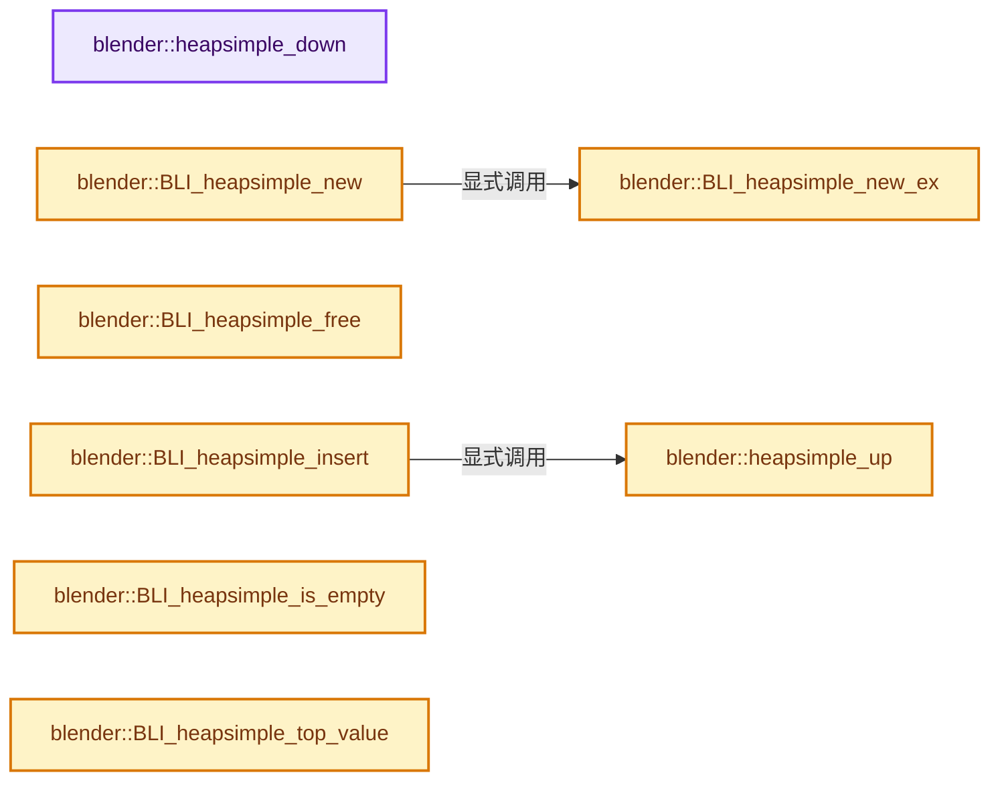

# 实现依赖专题：source/blender/blenlib/intern/BLI_heap_simple.cc

[方向导航](README.md) · [符号索引](../%E7%AC%A6%E5%8F%B7%E4%BE%9D%E8%B5%96%E4%B8%8E%E5%AE%9E%E7%8E%B0%E7%B4%A2%E5%BC%95.md)

本专题从正文实际调用进入，集中保存共享实现。函数有稳定锚点，可从调用处直接跳到对应完整函数；递归与互相调用通过回链组织。

## 本文件的实现关系




<a id="m-9dd0efaf276a"></a>

## 宏 `HEAP_PARENT`

<!-- annotated:71aeedb66600a9 -->

```cpp
#define HEAP_PARENT(i) (((i) - 1) >> 1)

```

<details>
<summary>核对原始源码：source/blender/blenlib/intern/BLI_heap_simple.cc · L27—L28</summary>

<!-- original:71aeedb66600a9:source/blender/blenlib/intern/BLI_heap_simple.cc:27:28 -->

```cpp
#define HEAP_PARENT(i) (((i) - 1) >> 1)

```

</details>

宏在预处理阶段展开，参数替换、重复求值和条件编译应直接从该定义检查。与普通函数不同，宏不会自动提供参数类型检查；构建配置选择哪个定义需结合外围条件。

## 完整成员与函数实现

<a id="f-8ef924c84b6b9e30"></a>

### `blender::heapsimple_down`

实现位置：[source/blender/blenlib/intern/BLI_heap_simple.cc](../../../../../source/blender/blenlib/intern/BLI_heap_simple.cc) · L50—L114。

接口参数：

- `HeapSimple *heap`
- `uint start_i`
- `const HeapSimpleNode *init`

**教学注释版**

<!-- annotated:b4c06dc82a3767 -->

```cpp
static void heapsimple_down(HeapSimple *heap, uint start_i, const HeapSimpleNode *init)
{
#if 1
  /* The compiler isn't smart enough to realize that all computations
   * using index here can be modified to work with byte offset. */
  uint8_t *const tree_buf = reinterpret_cast<uint8_t *>(heap->tree);

#  define OFFSET(i) (i * uint(sizeof(HeapSimpleNode)))
#  define NODE(offset) (*(HeapSimpleNode *)(tree_buf + (offset)))
#else
  HeapSimpleNode *const tree = heap->tree;

#  define OFFSET(i) (i)
#  define NODE(i) tree[i]
#endif

#define HEAP_LEFT_OFFSET(i) (((i) << 1) + OFFSET(1))

  const uint size = OFFSET(heap->size);

  /* Pull the active node values into locals. This allows spilling
   * the data from registers instead of literally swapping nodes. */
  float active_val = init->value;
  void *active_ptr = init->ptr;

  /* Prepare the first iteration and spill value. */
  uint i = OFFSET(start_i);

  NODE(i).value = active_val;

  for (;;) {
    const uint l = HEAP_LEFT_OFFSET(i);
    const uint r = l + OFFSET(1); /* right */

    /* Find the child with the smallest value. */
    uint smallest = i;

    if (LIKELY(l < size) && NODE(l).value < active_val) {
      smallest = l;
    }
    if (LIKELY(r < size) && NODE(r).value < NODE(smallest).value) {
      smallest = r;
    }

    if (smallest == i) [[unlikely]] {
      break;
    }

    /* Move the smallest child into the current node.
     * Skip padding: for some reason that makes it faster here. */
    NODE(i).value = NODE(smallest).value;
    NODE(i).ptr = NODE(smallest).ptr;

    /* Proceed to next iteration and spill value. */
    i = smallest;
    NODE(i).value = active_val;
  }

  /* Spill the pointer into the final position of the node. */
  NODE(i).ptr = active_ptr;

#undef NODE
#undef OFFSET
#undef HEAP_LEFT_OFFSET
}
```

<details>
<summary>核对原始源码：source/blender/blenlib/intern/BLI_heap_simple.cc · L50—L114</summary>

<!-- original:b4c06dc82a3767:source/blender/blenlib/intern/BLI_heap_simple.cc:50:114 -->

```cpp
static void heapsimple_down(HeapSimple *heap, uint start_i, const HeapSimpleNode *init)
{
#if 1
  /* The compiler isn't smart enough to realize that all computations
   * using index here can be modified to work with byte offset. */
  uint8_t *const tree_buf = reinterpret_cast<uint8_t *>(heap->tree);

#  define OFFSET(i) (i * uint(sizeof(HeapSimpleNode)))
#  define NODE(offset) (*(HeapSimpleNode *)(tree_buf + (offset)))
#else
  HeapSimpleNode *const tree = heap->tree;

#  define OFFSET(i) (i)
#  define NODE(i) tree[i]
#endif

#define HEAP_LEFT_OFFSET(i) (((i) << 1) + OFFSET(1))

  const uint size = OFFSET(heap->size);

  /* Pull the active node values into locals. This allows spilling
   * the data from registers instead of literally swapping nodes. */
  float active_val = init->value;
  void *active_ptr = init->ptr;

  /* Prepare the first iteration and spill value. */
  uint i = OFFSET(start_i);

  NODE(i).value = active_val;

  for (;;) {
    const uint l = HEAP_LEFT_OFFSET(i);
    const uint r = l + OFFSET(1); /* right */

    /* Find the child with the smallest value. */
    uint smallest = i;

    if (LIKELY(l < size) && NODE(l).value < active_val) {
      smallest = l;
    }
    if (LIKELY(r < size) && NODE(r).value < NODE(smallest).value) {
      smallest = r;
    }

    if (smallest == i) [[unlikely]] {
      break;
    }

    /* Move the smallest child into the current node.
     * Skip padding: for some reason that makes it faster here. */
    NODE(i).value = NODE(smallest).value;
    NODE(i).ptr = NODE(smallest).ptr;

    /* Proceed to next iteration and spill value. */
    i = smallest;
    NODE(i).value = active_val;
  }

  /* Spill the pointer into the final position of the node. */
  NODE(i).ptr = active_ptr;

#undef NODE
#undef OFFSET
#undef HEAP_LEFT_OFFSET
}
```

</details>

**沿实际写入检查状态**

- `smallest = l;`
- `smallest = r;`
- `i = smallest;`

**继续追踪实现**

- `OFFSET` → [OFFSET · L37](../05-%E5%87%A0%E4%BD%95%E5%AD%98%E5%82%A8%E4%B8%8E%E6%8B%93%E6%89%91%E6%98%A0%E5%B0%84/%E4%BE%9D%E8%B5%96-bmo_offset_edgeloops-14c59b.md#m-6a7bd6b8d693)。宏定义由构建条件选择。
- `NODE` → [NODE · L74](../05-%E5%87%A0%E4%BD%95%E5%AD%98%E5%82%A8%E4%B8%8E%E6%8B%93%E6%89%91%E6%98%A0%E5%B0%84/%E4%BE%9D%E8%B5%96-grammar-a9ba19.md#m-0a55055a15d0)。宏定义由构建条件选择。
- `HEAP_LEFT_OFFSET` → [调用协议](../%E6%A8%A1%E6%9D%BF%E5%AE%8F%E4%B8%8E%E5%8A%A8%E6%80%81%E5%88%86%E6%B4%BE%E5%8D%8F%E8%AE%AE.md)：函数指针、局部可调用对象或未展开的宏；必须结合调用者环境。调用位置L81。
- `LIKELY` → [LIKELY · L51](../03-%E5%86%85%E5%AD%98%E5%88%86%E9%85%8D%E4%B8%8E%E8%BF%90%E8%A1%8C%E6%97%B6%E7%B1%BB%E5%9E%8B/%E4%BE%9D%E8%B5%96-mallocn_intern-e4d317.md#m-53ea5e2ff73b)；[LIKELY · L54](../03-%E5%86%85%E5%AD%98%E5%88%86%E9%85%8D%E4%B8%8E%E8%BF%90%E8%A1%8C%E6%97%B6%E7%B1%BB%E5%9E%8B/%E4%BE%9D%E8%B5%96-mallocn_intern-e4d317.md#m-bb82bdeee493)；[LIKELY · L107](../05-%E5%87%A0%E4%BD%95%E5%AD%98%E5%82%A8%E4%B8%8E%E6%8B%93%E6%89%91%E6%98%A0%E5%B0%84/%E4%BE%9D%E8%B5%96-defines-cd82f8.md#m-bd6166173f61)；[LIKELY · L110](../05-%E5%87%A0%E4%BD%95%E5%AD%98%E5%82%A8%E4%B8%8E%E6%8B%93%E6%89%91%E6%98%A0%E5%B0%84/%E4%BE%9D%E8%B5%96-defines-cd82f8.md#m-2c2ad9a348a5)；[LIKELY · L543](%E4%BE%9D%E8%B5%96-BLI_utildefines-293a0a.md#m-eeacc3e1dee8)；[LIKELY · L546](%E4%BE%9D%E8%B5%96-BLI_utildefines-293a0a.md#m-26b4114d7b77)。宏定义由构建条件选择。

<a id="f-7c12703f75be1dd3"></a>

### `blender::heapsimple_up`

实现位置：[source/blender/blenlib/intern/BLI_heap_simple.cc](../../../../../source/blender/blenlib/intern/BLI_heap_simple.cc) · L116—L133。

接口参数：

- `HeapSimple *heap`
- `uint i`
- `float active_val`
- `void *active_ptr`

**教学注释版**

<!-- annotated:afb97910459d57 -->

```cpp
static void heapsimple_up(HeapSimple *heap, uint i, float active_val, void *active_ptr)
{
  HeapSimpleNode *const tree = heap->tree;

  while (i > 0) [[likely]] {
    const uint p = HEAP_PARENT(i);

    if (active_val >= tree[p].value) {
      break;
    }

    tree[i] = tree[p];
    i = p;
  }

  tree[i].value = active_val;
  tree[i].ptr = active_ptr;
}
```

<details>
<summary>核对原始源码：source/blender/blenlib/intern/BLI_heap_simple.cc · L116—L133</summary>

<!-- original:afb97910459d57:source/blender/blenlib/intern/BLI_heap_simple.cc:116:133 -->

```cpp
static void heapsimple_up(HeapSimple *heap, uint i, float active_val, void *active_ptr)
{
  HeapSimpleNode *const tree = heap->tree;

  while (i > 0) [[likely]] {
    const uint p = HEAP_PARENT(i);

    if (active_val >= tree[p].value) {
      break;
    }

    tree[i] = tree[p];
    i = p;
  }

  tree[i].value = active_val;
  tree[i].ptr = active_ptr;
}
```

</details>

**沿实际写入检查状态**

- `tree[i] = tree[p];`
- `i = p;`
- `tree[i].value = active_val;`
- `tree[i].ptr = active_ptr;`

**继续追踪实现**

- `HEAP_PARENT` → [HEAP_PARENT · L27](%E4%BE%9D%E8%B5%96-BLI_heap_simple-50ae5b.md#m-9dd0efaf276a)。宏定义由构建条件选择。

<a id="f-15503c6b9cfe9a5d"></a>

### `blender::BLI_heapsimple_new_ex`

实现位置：[source/blender/blenlib/intern/BLI_heap_simple.cc](../../../../../source/blender/blenlib/intern/BLI_heap_simple.cc) · L141—L149。

接口参数：

- `uint reserve_num`

**教学注释版**

<!-- annotated:ad62d14079ec44 -->

```cpp
HeapSimple *BLI_heapsimple_new_ex(uint reserve_num)
{
  HeapSimple *heap = MEM_new_zeroed<HeapSimple>(__func__);
  /* ensure we have at least one so we can keep doubling it */
  heap->size = 0;
  // [讲解] std::max：按比较关系选取较大值。本讲解中的增长公式同时满足最低请求和几何增长；若保存返回引用，还需注意实参寿命。
  heap->bufsize = std::max(1u, reserve_num);
  heap->tree = MEM_new_array_zeroed<HeapSimpleNode>(heap->bufsize, "BLIHeapSimpleTree");
  return heap;
}
```

<details>
<summary>核对原始源码：source/blender/blenlib/intern/BLI_heap_simple.cc · L141—L149</summary>

<!-- original:ad62d14079ec44:source/blender/blenlib/intern/BLI_heap_simple.cc:141:149 -->

```cpp
HeapSimple *BLI_heapsimple_new_ex(uint reserve_num)
{
  HeapSimple *heap = MEM_new_zeroed<HeapSimple>(__func__);
  /* ensure we have at least one so we can keep doubling it */
  heap->size = 0;
  heap->bufsize = std::max(1u, reserve_num);
  heap->tree = MEM_new_array_zeroed<HeapSimpleNode>(heap->bufsize, "BLIHeapSimpleTree");
  return heap;
}
```

</details>

**沿实际写入检查状态**

- `heap->size = 0;`
- `heap->bufsize = std::max(1u, reserve_num);`
- `heap->tree = MEM_new_array_zeroed<HeapSimpleNode>(heap->bufsize, "BLIHeapSimpleTree");`

**结果出口**

- `return heap;`

**继续追踪实现**

- `MEM_new_zeroed<HeapSimple>` → [MEM_new_zeroed · L550](../03-%E5%86%85%E5%AD%98%E5%88%86%E9%85%8D%E4%B8%8E%E8%BF%90%E8%A1%8C%E6%97%B6%E7%B1%BB%E5%9E%8B/%E4%BE%9D%E8%B5%96-MEM_guardedalloc-b54eca.md#f-eeb1e2a7f57dd231)；[MEM_new_zeroed · L114](../03-%E5%86%85%E5%AD%98%E5%88%86%E9%85%8D%E4%B8%8E%E8%BF%90%E8%A1%8C%E6%97%B6%E7%B1%BB%E5%9E%8B/%E4%BE%9D%E8%B5%96-mallocn-afdcd4.md#f-e04cf01c64c8b180)。同名重载需按实参类型选择。
- `std::max` → [外部契约](https://eel.is/c++draft/alg.min.max)：按比较关系选取较大值。本讲解中的增长公式同时满足最低请求和几何增长；若保存返回引用，还需注意实参寿命。
- `MEM_new_array_zeroed<HeapSimpleNode>` → [MEM_new_array_zeroed · L566](../03-%E5%86%85%E5%AD%98%E5%88%86%E9%85%8D%E4%B8%8E%E8%BF%90%E8%A1%8C%E6%97%B6%E7%B1%BB%E5%9E%8B/%E4%BE%9D%E8%B5%96-MEM_guardedalloc-b54eca.md#f-3a0cf63fb5216500)；[MEM_new_array_zeroed · L119](../03-%E5%86%85%E5%AD%98%E5%88%86%E9%85%8D%E4%B8%8E%E8%BF%90%E8%A1%8C%E6%97%B6%E7%B1%BB%E5%9E%8B/%E4%BE%9D%E8%B5%96-mallocn-afdcd4.md#f-6825557da566fdbe)。同名重载需按实参类型选择。

<a id="f-af0c13b50154fff4"></a>

### `blender::BLI_heapsimple_new`

实现位置：[source/blender/blenlib/intern/BLI_heap_simple.cc](../../../../../source/blender/blenlib/intern/BLI_heap_simple.cc) · L151—L154。

**教学注释版**

<!-- annotated:ce97804fc40033 -->

```cpp
HeapSimple *BLI_heapsimple_new()
{
  return BLI_heapsimple_new_ex(1);
}
```

<details>
<summary>核对原始源码：source/blender/blenlib/intern/BLI_heap_simple.cc · L151—L154</summary>

<!-- original:ce97804fc40033:source/blender/blenlib/intern/BLI_heap_simple.cc:151:154 -->

```cpp
HeapSimple *BLI_heapsimple_new()
{
  return BLI_heapsimple_new_ex(1);
}
```

</details>

**结果出口**

- `return BLI_heapsimple_new_ex(1);`

**继续追踪实现**

- `BLI_heapsimple_new_ex` → [blender::BLI_heapsimple_new_ex · L141](%E4%BE%9D%E8%B5%96-BLI_heap_simple-50ae5b.md#f-15503c6b9cfe9a5d)。

<a id="f-f2457cb8cc09bc60"></a>

### `blender::BLI_heapsimple_free`

实现位置：[source/blender/blenlib/intern/BLI_heap_simple.cc](../../../../../source/blender/blenlib/intern/BLI_heap_simple.cc) · L156—L166。

接口参数：

- `HeapSimple *heap`
- `HeapSimpleFreeFP ptrfreefp`

**教学注释版**

<!-- annotated:e4e227e5dee1de -->

```cpp
void BLI_heapsimple_free(HeapSimple *heap, HeapSimpleFreeFP ptrfreefp)
{
  if (ptrfreefp) {
    for (uint i = 0; i < heap->size; i++) {
      ptrfreefp(heap->tree[i].ptr);
    }
  }

  MEM_delete(heap->tree);
  MEM_delete(heap);
}
```

<details>
<summary>核对原始源码：source/blender/blenlib/intern/BLI_heap_simple.cc · L156—L166</summary>

<!-- original:e4e227e5dee1de:source/blender/blenlib/intern/BLI_heap_simple.cc:156:166 -->

```cpp
void BLI_heapsimple_free(HeapSimple *heap, HeapSimpleFreeFP ptrfreefp)
{
  if (ptrfreefp) {
    for (uint i = 0; i < heap->size; i++) {
      ptrfreefp(heap->tree[i].ptr);
    }
  }

  MEM_delete(heap->tree);
  MEM_delete(heap);
}
```

</details>

**继续追踪实现**

- `ptrfreefp` → [调用协议](../%E6%A8%A1%E6%9D%BF%E5%AE%8F%E4%B8%8E%E5%8A%A8%E6%80%81%E5%88%86%E6%B4%BE%E5%8D%8F%E8%AE%AE.md)：局部可调用对象，须结合其初始化与捕获环境。调用位置L160。
- `MEM_delete` → [MEM_delete · L400](../03-%E5%86%85%E5%AD%98%E5%88%86%E9%85%8D%E4%B8%8E%E8%BF%90%E8%A1%8C%E6%97%B6%E7%B1%BB%E5%9E%8B/%E4%BE%9D%E8%B5%96-MEM_guardedalloc-b54eca.md#f-9049ffdd1682887c)。

<a id="f-c4ee1de332620e54"></a>

### `blender::BLI_heapsimple_insert`

实现位置：[source/blender/blenlib/intern/BLI_heap_simple.cc](../../../../../source/blender/blenlib/intern/BLI_heap_simple.cc) · L179—L188。

接口参数：

- `HeapSimple *heap`
- `float value`
- `void *ptr`

**教学注释版**

<!-- annotated:910ac658b41a7e -->

```cpp
void BLI_heapsimple_insert(HeapSimple *heap, float value, void *ptr)
{
  if (heap->size >= heap->bufsize) [[unlikely]] {
    heap->bufsize *= 2;
    heap->tree = static_cast<HeapSimpleNode *>(
        MEM_realloc_uninitialized(heap->tree, heap->bufsize * sizeof(*heap->tree)));
  }

  heapsimple_up(heap, heap->size++, value, ptr);
}
```

<details>
<summary>核对原始源码：source/blender/blenlib/intern/BLI_heap_simple.cc · L179—L188</summary>

<!-- original:910ac658b41a7e:source/blender/blenlib/intern/BLI_heap_simple.cc:179:188 -->

```cpp
void BLI_heapsimple_insert(HeapSimple *heap, float value, void *ptr)
{
  if (heap->size >= heap->bufsize) [[unlikely]] {
    heap->bufsize *= 2;
    heap->tree = static_cast<HeapSimpleNode *>(
        MEM_realloc_uninitialized(heap->tree, heap->bufsize * sizeof(*heap->tree)));
  }

  heapsimple_up(heap, heap->size++, value, ptr);
}
```

</details>

**沿实际写入检查状态**

- `heap->bufsize *= 2;`
- `heap->tree = static_cast<HeapSimpleNode *>(`

**继续追踪实现**

- `MEM_realloc_uninitialized` → [MEM_realloc_uninitialized · L118](../03-%E5%86%85%E5%AD%98%E5%88%86%E9%85%8D%E4%B8%8E%E8%BF%90%E8%A1%8C%E6%97%B6%E7%B1%BB%E5%9E%8B/%E4%BE%9D%E8%B5%96-MEM_guardedalloc-b54eca.md#m-813b7cd3fcff)。宏定义由构建条件选择。
- `heapsimple_up` → [blender::heapsimple_up · L116](%E4%BE%9D%E8%B5%96-BLI_heap_simple-50ae5b.md#f-7c12703f75be1dd3)。

<a id="f-60afd1a8a46caf7d"></a>

### `blender::BLI_heapsimple_is_empty`

实现位置：[source/blender/blenlib/intern/BLI_heap_simple.cc](../../../../../source/blender/blenlib/intern/BLI_heap_simple.cc) · L190—L193。

接口参数：

- `const HeapSimple *heap`

**教学注释版**

<!-- annotated:b4d498938eacf8 -->

```cpp
bool BLI_heapsimple_is_empty(const HeapSimple *heap)
{
  return (heap->size == 0);
}
```

<details>
<summary>核对原始源码：source/blender/blenlib/intern/BLI_heap_simple.cc · L190—L193</summary>

<!-- original:b4d498938eacf8:source/blender/blenlib/intern/BLI_heap_simple.cc:190:193 -->

```cpp
bool BLI_heapsimple_is_empty(const HeapSimple *heap)
{
  return (heap->size == 0);
}
```

</details>

**结果出口**

- `return (heap->size == 0);`

**继续追踪实现**

本实现没有需要继续展开的显式调用；检查返回表达式、对象转换和调用者前置条件。

<a id="f-c362b8505b720a52"></a>

### `blender::BLI_heapsimple_top_value`

实现位置：[source/blender/blenlib/intern/BLI_heap_simple.cc](../../../../../source/blender/blenlib/intern/BLI_heap_simple.cc) · L200—L205。

接口参数：

- `const HeapSimple *heap`

**教学注释版**

<!-- annotated:2328b4b17001a7 -->

```cpp
float BLI_heapsimple_top_value(const HeapSimple *heap)
{
  BLI_assert(heap->size != 0);

  return heap->tree[0].value;
}
```

<details>
<summary>核对原始源码：source/blender/blenlib/intern/BLI_heap_simple.cc · L200—L205</summary>

<!-- original:2328b4b17001a7:source/blender/blenlib/intern/BLI_heap_simple.cc:200:205 -->

```cpp
float BLI_heapsimple_top_value(const HeapSimple *heap)
{
  BLI_assert(heap->size != 0);

  return heap->tree[0].value;
}
```

</details>

**结果出口**

- `return heap->tree[0].value;`

**继续追踪实现**

- `BLI_assert` → [BLI_assert · L48](%E4%BE%9D%E8%B5%96-BLI_assert-cc98e8.md#m-57a88495704d)；[BLI_assert · L63](%E4%BE%9D%E8%B5%96-BLI_assert-cc98e8.md#m-d07050020cb5)。宏定义由构建条件选择。

<a id="f-3a4fc124a9118a1e"></a>

### `blender::BLI_heapsimple_pop_min`

实现位置：[source/blender/blenlib/intern/BLI_heap_simple.cc](../../../../../source/blender/blenlib/intern/BLI_heap_simple.cc) · L207—L218。

接口参数：

- `HeapSimple *heap`

**教学注释版**

<!-- annotated:c0eaa6c7aad81b -->

```cpp
void *BLI_heapsimple_pop_min(HeapSimple *heap)
{
  BLI_assert(heap->size != 0);

  void *ptr = heap->tree[0].ptr;

  if (--heap->size) {
    heapsimple_down(heap, 0, &heap->tree[heap->size]);
  }

  return ptr;
}
```

<details>
<summary>核对原始源码：source/blender/blenlib/intern/BLI_heap_simple.cc · L207—L218</summary>

<!-- original:c0eaa6c7aad81b:source/blender/blenlib/intern/BLI_heap_simple.cc:207:218 -->

```cpp
void *BLI_heapsimple_pop_min(HeapSimple *heap)
{
  BLI_assert(heap->size != 0);

  void *ptr = heap->tree[0].ptr;

  if (--heap->size) {
    heapsimple_down(heap, 0, &heap->tree[heap->size]);
  }

  return ptr;
}
```

</details>

**结果出口**

- `return ptr;`

**继续追踪实现**

- `BLI_assert` → [BLI_assert · L48](%E4%BE%9D%E8%B5%96-BLI_assert-cc98e8.md#m-57a88495704d)；[BLI_assert · L63](%E4%BE%9D%E8%B5%96-BLI_assert-cc98e8.md#m-d07050020cb5)。宏定义由构建条件选择。
- `heapsimple_down` → [blender::heapsimple_down · L50](%E4%BE%9D%E8%B5%96-BLI_heap_simple-50ae5b.md#f-8ef924c84b6b9e30)。
