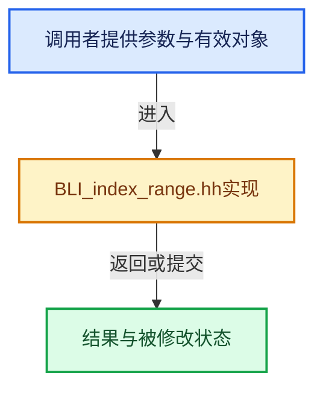

# 实现依赖专题：source/blender/blenlib/BLI_index_range.hh

[方向导航](README.md) · [符号索引](../%E7%AC%A6%E5%8F%B7%E4%BE%9D%E8%B5%96%E4%B8%8E%E5%AE%9E%E7%8E%B0%E7%B4%A2%E5%BC%95.md)

本专题从正文实际调用进入，集中保存共享实现。函数有稳定锚点，可从调用处直接跳到对应完整函数；递归与互相调用通过回链组织。

## 本文件的实现关系





## 相关类型布局与成员入口

<a id="t-86091874a1c0"></a>

### `blender::Span`

原始声明：[source/blender/blenlib/BLI_index_range.hh](../../../../../source/blender/blenlib/BLI_index_range.hh) · L52—L52。

以下保留类的数据声明与编译条件，成员函数实现通过后面的精确链接阅读。

<!-- annotated:523a6762a91fde -->

```cpp
template<typename T> class Span;
```

<details>
<summary>核对原始源码：source/blender/blenlib/BLI_index_range.hh · L52—L52</summary>

<!-- original:523a6762a91fde:source/blender/blenlib/BLI_index_range.hh:52:52 -->

```cpp
template<typename T> class Span;
```

</details>


<a id="t-caa3466d6776"></a>

### `blender::IndexRange`

原始声明：[source/blender/blenlib/BLI_index_range.hh](../../../../../source/blender/blenlib/BLI_index_range.hh) · L54—L356。

成员布局：

- `int64_t start_`
- `int64_t size_`

以下保留类的数据声明与编译条件，成员函数实现通过后面的精确链接阅读。

<!-- annotated:55c8cf9a1b4680 -->

```cpp
class IndexRange {
 private:
  int64_t start_ = 0;
  int64_t size_ = 0;

 public:
```

<details>
<summary>核对原始源码：source/blender/blenlib/BLI_index_range.hh · L54—L59</summary>

<!-- original:55c8cf9a1b4680:source/blender/blenlib/BLI_index_range.hh:54:59 -->

```cpp
class IndexRange {
 private:
  int64_t start_ = 0;
  int64_t size_ = 0;

 public:
```

</details>

<!-- annotated:fc678cdc765c07 -->

```cpp

```

<details>
<summary>核对原始源码：source/blender/blenlib/BLI_index_range.hh · L61—L61</summary>

<!-- original:fc678cdc765c07:source/blender/blenlib/BLI_index_range.hh:61:61 -->

```cpp

```

</details>

<!-- annotated:e502acb8980eff -->

```cpp

```

<details>
<summary>核对原始源码：source/blender/blenlib/BLI_index_range.hh · L66—L66</summary>

<!-- original:e502acb8980eff:source/blender/blenlib/BLI_index_range.hh:66:66 -->

```cpp

```

</details>

<!-- annotated:2f03e74cbf767a -->

```cpp

```

<details>
<summary>核对原始源码：source/blender/blenlib/BLI_index_range.hh · L72—L72</summary>

<!-- original:2f03e74cbf767a:source/blender/blenlib/BLI_index_range.hh:72:72 -->

```cpp

```

</details>

<!-- annotated:698dcd8d7cb628 -->

```cpp

```

<details>
<summary>核对原始源码：source/blender/blenlib/BLI_index_range.hh · L77—L77</summary>

<!-- original:698dcd8d7cb628:source/blender/blenlib/BLI_index_range.hh:77:77 -->

```cpp

```

</details>

<!-- annotated:73430192e86e67 -->

```cpp

```

<details>
<summary>核对原始源码：source/blender/blenlib/BLI_index_range.hh · L82—L82</summary>

<!-- original:73430192e86e67:source/blender/blenlib/BLI_index_range.hh:82:82 -->

```cpp

```

</details>

<!-- annotated:b74dcfc1f7b37a -->

```cpp

```

<details>
<summary>核对原始源码：source/blender/blenlib/BLI_index_range.hh · L87—L87</summary>

<!-- original:b74dcfc1f7b37a:source/blender/blenlib/BLI_index_range.hh:87:87 -->

```cpp

```

</details>

<!-- annotated:bc156823ccd5c1 -->

```cpp

```

<details>
<summary>核对原始源码：source/blender/blenlib/BLI_index_range.hh · L92—L92</summary>

<!-- original:bc156823ccd5c1:source/blender/blenlib/BLI_index_range.hh:92:92 -->

```cpp

```

</details>

<!-- annotated:1dc091b2a496c4 -->

```cpp

  class Iterator : public iterator::RandomAccessIteratorMixin<Iterator> {
   public:
    using value_type = int64_t;
    using pointer = const int64_t *;
    using reference = int64_t;

   private:
    int64_t current_;

   public:
```

<details>
<summary>核对原始源码：source/blender/blenlib/BLI_index_range.hh · L97—L107</summary>

<!-- original:1dc091b2a496c4:source/blender/blenlib/BLI_index_range.hh:97:107 -->

```cpp

  class Iterator : public iterator::RandomAccessIteratorMixin<Iterator> {
   public:
    using value_type = int64_t;
    using pointer = const int64_t *;
    using reference = int64_t;

   private:
    int64_t current_;

   public:
```

</details>

<!-- annotated:d31888dbdda1f1 -->

```cpp

```

<details>
<summary>核对原始源码：source/blender/blenlib/BLI_index_range.hh · L109—L109</summary>

<!-- original:d31888dbdda1f1:source/blender/blenlib/BLI_index_range.hh:109:109 -->

```cpp

```

</details>

<!-- annotated:61bd82e47724fa -->

```cpp

```

<details>
<summary>核对原始源码：source/blender/blenlib/BLI_index_range.hh · L114—L114</summary>

<!-- original:61bd82e47724fa:source/blender/blenlib/BLI_index_range.hh:114:114 -->

```cpp

```

</details>

<!-- annotated:a5264141277317 -->

```cpp
  };

```

<details>
<summary>核对原始源码：source/blender/blenlib/BLI_index_range.hh · L119—L120</summary>

<!-- original:a5264141277317:source/blender/blenlib/BLI_index_range.hh:119:120 -->

```cpp
  };

```

</details>

<!-- annotated:bad899c9fc291f -->

```cpp

```

<details>
<summary>核对原始源码：source/blender/blenlib/BLI_index_range.hh · L125—L125</summary>

<!-- original:bad899c9fc291f:source/blender/blenlib/BLI_index_range.hh:125:125 -->

```cpp

```

</details>

<!-- annotated:c035ead09635f5 -->

```cpp

  /**
   * Access an element in the range.
   */
```

<details>
<summary>核对原始源码：source/blender/blenlib/BLI_index_range.hh · L130—L133</summary>

<!-- original:c035ead09635f5:source/blender/blenlib/BLI_index_range.hh:130:133 -->

```cpp

  /**
   * Access an element in the range.
   */
```

</details>

<!-- annotated:4d07fe994883f6 -->

```cpp

  /**
   * Two ranges compare equal when they contain the same numbers.
   */
```

<details>
<summary>核对原始源码：source/blender/blenlib/BLI_index_range.hh · L140—L143</summary>

<!-- original:4d07fe994883f6:source/blender/blenlib/BLI_index_range.hh:140:143 -->

```cpp

  /**
   * Two ranges compare equal when they contain the same numbers.
   */
```

</details>

<!-- annotated:0fa627872d270b -->

```cpp

  /**
   * Get the amount of numbers in the range.
   */
```

<details>
<summary>核对原始源码：source/blender/blenlib/BLI_index_range.hh · L152—L155</summary>

<!-- original:0fa627872d270b:source/blender/blenlib/BLI_index_range.hh:152:155 -->

```cpp

  /**
   * Get the amount of numbers in the range.
   */
```

</details>

<!-- annotated:2e26d12b1d255e -->

```cpp

```

<details>
<summary>核对原始源码：source/blender/blenlib/BLI_index_range.hh · L160—L160</summary>

<!-- original:2e26d12b1d255e:source/blender/blenlib/BLI_index_range.hh:160:160 -->

```cpp

```

</details>

<!-- annotated:58b0a0e06e9f02 -->

```cpp

  /**
   * Returns true if the size is zero.
   */
```

<details>
<summary>核对原始源码：source/blender/blenlib/BLI_index_range.hh · L165—L168</summary>

<!-- original:58b0a0e06e9f02:source/blender/blenlib/BLI_index_range.hh:165:168 -->

```cpp

  /**
   * Returns true if the size is zero.
   */
```

</details>

<!-- annotated:a7c60014cad5e4 -->

```cpp

  /**
   * Creates a new index range with the same beginning but a different end.
   */
```

<details>
<summary>核对原始源码：source/blender/blenlib/BLI_index_range.hh · L173—L176</summary>

<!-- original:a7c60014cad5e4:source/blender/blenlib/BLI_index_range.hh:173:176 -->

```cpp

  /**
   * Creates a new index range with the same beginning but a different end.
   */
```

</details>

<!-- annotated:f7832d3649bafe -->

```cpp

  /**
   * Create a new range starting at the end of the current one.
   */
```

<details>
<summary>核对原始源码：source/blender/blenlib/BLI_index_range.hh · L181—L184</summary>

<!-- original:f7832d3649bafe:source/blender/blenlib/BLI_index_range.hh:181:184 -->

```cpp

  /**
   * Create a new range starting at the end of the current one.
   */
```

</details>

<!-- annotated:eb3e59d228cbb5 -->

```cpp

  /**
   * Create a new range that ends at the start of the current one.
   */
```

<details>
<summary>核对原始源码：source/blender/blenlib/BLI_index_range.hh · L190—L193</summary>

<!-- original:eb3e59d228cbb5:source/blender/blenlib/BLI_index_range.hh:190:193 -->

```cpp

  /**
   * Create a new range that ends at the start of the current one.
   */
```

</details>

<!-- annotated:b75a4e446b8968 -->

```cpp

  /**
   * Get the first element in the range.
   * Asserts when the range is empty.
   */
```

<details>
<summary>核对原始源码：source/blender/blenlib/BLI_index_range.hh · L199—L203</summary>

<!-- original:b75a4e446b8968:source/blender/blenlib/BLI_index_range.hh:199:203 -->

```cpp

  /**
   * Get the first element in the range.
   * Asserts when the range is empty.
   */
```

</details>

<!-- annotated:458792804f2022 -->

```cpp

  /**
   * Get the nth last element in the range.
   * Asserts when the range is empty or when n is negative.
   */
```

<details>
<summary>核对原始源码：source/blender/blenlib/BLI_index_range.hh · L209—L213</summary>

<!-- original:458792804f2022:source/blender/blenlib/BLI_index_range.hh:209:213 -->

```cpp

  /**
   * Get the nth last element in the range.
   * Asserts when the range is empty or when n is negative.
   */
```

</details>

<!-- annotated:3ea1937d4c8c76 -->

```cpp

  /**
   * Get the element one before the beginning. The returned value is undefined when the range is
   * empty, and the range must start after zero already.
   */
```

<details>
<summary>核对原始源码：source/blender/blenlib/BLI_index_range.hh · L221—L225</summary>

<!-- original:3ea1937d4c8c76:source/blender/blenlib/BLI_index_range.hh:221:225 -->

```cpp

  /**
   * Get the element one before the beginning. The returned value is undefined when the range is
   * empty, and the range must start after zero already.
   */
```

</details>

<!-- annotated:f59c5556c1cd6f -->

```cpp

  /**
   * Get the element one after the end. The returned value is undefined when the range is empty.
   */
```

<details>
<summary>核对原始源码：source/blender/blenlib/BLI_index_range.hh · L231—L234</summary>

<!-- original:f59c5556c1cd6f:source/blender/blenlib/BLI_index_range.hh:231:234 -->

```cpp

  /**
   * Get the element one after the end. The returned value is undefined when the range is empty.
   */
```

</details>

<!-- annotated:550d63172e10d9 -->

```cpp

  /**
   * Get the first element in the range. The returned value is undefined when the range is empty.
   */
```

<details>
<summary>核对原始源码：source/blender/blenlib/BLI_index_range.hh · L239—L242</summary>

<!-- original:550d63172e10d9:source/blender/blenlib/BLI_index_range.hh:239:242 -->

```cpp

  /**
   * Get the first element in the range. The returned value is undefined when the range is empty.
   */
```

</details>

<!-- annotated:c4eaaec15132b9 -->

```cpp

  /**
   * Returns true when the range contains a certain number, otherwise false.
   */
```

<details>
<summary>核对原始源码：source/blender/blenlib/BLI_index_range.hh · L247—L250</summary>

<!-- original:c4eaaec15132b9:source/blender/blenlib/BLI_index_range.hh:247:250 -->

```cpp

  /**
   * Returns true when the range contains a certain number, otherwise false.
   */
```

</details>

<!-- annotated:efae11ee89ecf2 -->

```cpp

  /**
   * Returns true when all indices in the given range are also in the current range.
   */
```

<details>
<summary>核对原始源码：source/blender/blenlib/BLI_index_range.hh · L255—L258</summary>

<!-- original:efae11ee89ecf2:source/blender/blenlib/BLI_index_range.hh:255:258 -->

```cpp

  /**
   * Returns true when all indices in the given range are also in the current range.
   */
```

</details>

<!-- annotated:8962ac451d6799 -->

```cpp

  /**
   * Returns a new range, that contains a sub-interval of the current one.
   */
```

<details>
<summary>核对原始源码：source/blender/blenlib/BLI_index_range.hh · L272—L275</summary>

<!-- original:8962ac451d6799:source/blender/blenlib/BLI_index_range.hh:272:275 -->

```cpp

  /**
   * Returns a new range, that contains a sub-interval of the current one.
   */
```

</details>

<!-- annotated:c7d7b018c90212 -->

```cpp

  /**
   * Returns a new IndexRange that contains the intersection of the current one with the given
   * range. Returns empty range if there are no overlapping indices. The returned range is always
   * a valid slice of this range.
   */
```

<details>
<summary>核对原始源码：source/blender/blenlib/BLI_index_range.hh · L288—L293</summary>

<!-- original:c7d7b018c90212:source/blender/blenlib/BLI_index_range.hh:288:293 -->

```cpp

  /**
   * Returns a new IndexRange that contains the intersection of the current one with the given
   * range. Returns empty range if there are no overlapping indices. The returned range is always
   * a valid slice of this range.
   */
```

</details>

<!-- annotated:548718c590d3bb -->

```cpp

  /**
   * Returns a new IndexRange with n elements removed from the beginning of the range.
   * This invokes undefined behavior when n is negative.
   */
```

<details>
<summary>核对原始源码：source/blender/blenlib/BLI_index_range.hh · L301—L305</summary>

<!-- original:548718c590d3bb:source/blender/blenlib/BLI_index_range.hh:301:305 -->

```cpp

  /**
   * Returns a new IndexRange with n elements removed from the beginning of the range.
   * This invokes undefined behavior when n is negative.
   */
```

</details>

<!-- annotated:b709ab9d4598ee -->

```cpp

  /**
   * Returns a new IndexRange with n elements removed from the end of the range.
   * This invokes undefined behavior when n is negative.
   */
```

<details>
<summary>核对原始源码：source/blender/blenlib/BLI_index_range.hh · L312—L316</summary>

<!-- original:b709ab9d4598ee:source/blender/blenlib/BLI_index_range.hh:312:316 -->

```cpp

  /**
   * Returns a new IndexRange with n elements removed from the end of the range.
   * This invokes undefined behavior when n is negative.
   */
```

</details>

<!-- annotated:2593f4e851ac0d -->

```cpp

  /**
   * Returns a new IndexRange that only contains the first n elements. This invokes undefined
   * behavior when n is negative.
   */
```

<details>
<summary>核对原始源码：source/blender/blenlib/BLI_index_range.hh · L323—L327</summary>

<!-- original:2593f4e851ac0d:source/blender/blenlib/BLI_index_range.hh:323:327 -->

```cpp

  /**
   * Returns a new IndexRange that only contains the first n elements. This invokes undefined
   * behavior when n is negative.
   */
```

</details>

<!-- annotated:948e9146f5cb62 -->

```cpp

  /**
   * Returns a new IndexRange that only contains the last n elements. This invokes undefined
   * behavior when n is negative.
   */
```

<details>
<summary>核对原始源码：source/blender/blenlib/BLI_index_range.hh · L334—L338</summary>

<!-- original:948e9146f5cb62:source/blender/blenlib/BLI_index_range.hh:334:338 -->

```cpp

  /**
   * Returns a new IndexRange that only contains the last n elements. This invokes undefined
   * behavior when n is negative.
   */
```

</details>

<!-- annotated:3c84aafa8a78a6 -->

```cpp

  /**
   * Move the range forward or backward within the larger array. The amount may be negative,
   * but its absolute value cannot be greater than the existing start of the range.
   */
```

<details>
<summary>核对原始源码：source/blender/blenlib/BLI_index_range.hh · L345—L349</summary>

<!-- original:3c84aafa8a78a6:source/blender/blenlib/BLI_index_range.hh:345:349 -->

```cpp

  /**
   * Move the range forward or backward within the larger array. The amount may be negative,
   * but its absolute value cannot be greater than the existing start of the range.
   */
```

</details>

<!-- annotated:10c96af5e740bd -->

```cpp

  friend std::ostream &operator<<(std::ostream &stream, IndexRange range);
};
```

<details>
<summary>核对原始源码：source/blender/blenlib/BLI_index_range.hh · L354—L356</summary>

<!-- original:10c96af5e740bd:source/blender/blenlib/BLI_index_range.hh:354:356 -->

```cpp

  friend std::ostream &operator<<(std::ostream &stream, IndexRange range);
};
```

</details>

- [IndexRange](04-IndexRange%E8%BF%9E%E7%BB%AD%E6%95%B4%E6%95%B0%E5%8C%BA%E9%97%B4.md#f-137c81a537a5d604)
- [IndexRange](04-IndexRange%E8%BF%9E%E7%BB%AD%E6%95%B4%E6%95%B0%E5%8C%BA%E9%97%B4.md#f-e7f519dcc417d983)
- [IndexRange](04-IndexRange%E8%BF%9E%E7%BB%AD%E6%95%B4%E6%95%B0%E5%8C%BA%E9%97%B4.md#f-2d5ea7e20125ee16)
- [from_begin_size](04-IndexRange%E8%BF%9E%E7%BB%AD%E6%95%B4%E6%95%B0%E5%8C%BA%E9%97%B4.md#f-392d3c73c80f255d)
- [from_begin_end](04-IndexRange%E8%BF%9E%E7%BB%AD%E6%95%B4%E6%95%B0%E5%8C%BA%E9%97%B4.md#f-a523839fb9650253)
- [from_begin_end_inclusive](04-IndexRange%E8%BF%9E%E7%BB%AD%E6%95%B4%E6%95%B0%E5%8C%BA%E9%97%B4.md#f-66cc5b933b552ea1)
- [from_end_size](04-IndexRange%E8%BF%9E%E7%BB%AD%E6%95%B4%E6%95%B0%E5%8C%BA%E9%97%B4.md#f-14a2146987e7c92d)
- [from_single](04-IndexRange%E8%BF%9E%E7%BB%AD%E6%95%B4%E6%95%B0%E5%8C%BA%E9%97%B4.md#f-c53911354f78d5b0)
- [Iterator](04-IndexRange%E8%BF%9E%E7%BB%AD%E6%95%B4%E6%95%B0%E5%8C%BA%E9%97%B4.md#f-27f6725fdde0e062)
- [operator*](04-IndexRange%E8%BF%9E%E7%BB%AD%E6%95%B4%E6%95%B0%E5%8C%BA%E9%97%B4.md#f-c5f5c826cbb273d8)
- [iter_prop](04-IndexRange%E8%BF%9E%E7%BB%AD%E6%95%B4%E6%95%B0%E5%8C%BA%E9%97%B4.md#f-fee52fe271750873)
- [begin](04-IndexRange%E8%BF%9E%E7%BB%AD%E6%95%B4%E6%95%B0%E5%8C%BA%E9%97%B4.md#f-1ea3c945dec55d0a)
- [end](04-IndexRange%E8%BF%9E%E7%BB%AD%E6%95%B4%E6%95%B0%E5%8C%BA%E9%97%B4.md#f-119dd529d7090e64)
- [operator[]](04-IndexRange%E8%BF%9E%E7%BB%AD%E6%95%B4%E6%95%B0%E5%8C%BA%E9%97%B4.md#f-7369b205de195454)
- [operator==](04-IndexRange%E8%BF%9E%E7%BB%AD%E6%95%B4%E6%95%B0%E5%8C%BA%E9%97%B4.md#f-65eebc6a24647e81)
- [operator!=](04-IndexRange%E8%BF%9E%E7%BB%AD%E6%95%B4%E6%95%B0%E5%8C%BA%E9%97%B4.md#f-9d6d8d6ebe05411a)
- [size](04-IndexRange%E8%BF%9E%E7%BB%AD%E6%95%B4%E6%95%B0%E5%8C%BA%E9%97%B4.md#f-05f66c3ebb2fdfec)
- [index_range](04-IndexRange%E8%BF%9E%E7%BB%AD%E6%95%B4%E6%95%B0%E5%8C%BA%E9%97%B4.md#f-fd83072b4b81bce5)
- [is_empty](04-IndexRange%E8%BF%9E%E7%BB%AD%E6%95%B4%E6%95%B0%E5%8C%BA%E9%97%B4.md#f-9501e070be01ff71)
- [with_new_end](04-IndexRange%E8%BF%9E%E7%BB%AD%E6%95%B4%E6%95%B0%E5%8C%BA%E9%97%B4.md#f-834d1751c4701574)
- [after](04-IndexRange%E8%BF%9E%E7%BB%AD%E6%95%B4%E6%95%B0%E5%8C%BA%E9%97%B4.md#f-33b01201b3ef9092)
- [before](04-IndexRange%E8%BF%9E%E7%BB%AD%E6%95%B4%E6%95%B0%E5%8C%BA%E9%97%B4.md#f-4b046e8c0c80c95a)
- [first](04-IndexRange%E8%BF%9E%E7%BB%AD%E6%95%B4%E6%95%B0%E5%8C%BA%E9%97%B4.md#f-ab443c94e531befa)
- [last](04-IndexRange%E8%BF%9E%E7%BB%AD%E6%95%B4%E6%95%B0%E5%8C%BA%E9%97%B4.md#f-66896c6351a40de1)
- [one_before_start](04-IndexRange%E8%BF%9E%E7%BB%AD%E6%95%B4%E6%95%B0%E5%8C%BA%E9%97%B4.md#f-d0a8ffd393a2929e)
- [one_after_last](04-IndexRange%E8%BF%9E%E7%BB%AD%E6%95%B4%E6%95%B0%E5%8C%BA%E9%97%B4.md#f-ed04bec9c731fc86)
- [start](04-IndexRange%E8%BF%9E%E7%BB%AD%E6%95%B4%E6%95%B0%E5%8C%BA%E9%97%B4.md#f-99d2195bd9cfd1f0)
- [contains](04-IndexRange%E8%BF%9E%E7%BB%AD%E6%95%B4%E6%95%B0%E5%8C%BA%E9%97%B4.md#f-1a01eaa28eaecd5c)
- [contains](04-IndexRange%E8%BF%9E%E7%BB%AD%E6%95%B4%E6%95%B0%E5%8C%BA%E9%97%B4.md#f-8eb195a52f17a51f)
- [slice](04-IndexRange%E8%BF%9E%E7%BB%AD%E6%95%B4%E6%95%B0%E5%8C%BA%E9%97%B4.md#f-6249bf624e38d609)
- [slice](04-IndexRange%E8%BF%9E%E7%BB%AD%E6%95%B4%E6%95%B0%E5%8C%BA%E9%97%B4.md#f-eb80885fefc31b6f)
- [intersect](04-IndexRange%E8%BF%9E%E7%BB%AD%E6%95%B4%E6%95%B0%E5%8C%BA%E9%97%B4.md#f-be538eb451fe039b)
- [drop_front](04-IndexRange%E8%BF%9E%E7%BB%AD%E6%95%B4%E6%95%B0%E5%8C%BA%E9%97%B4.md#f-ef3101407d982c90)
- [drop_back](04-IndexRange%E8%BF%9E%E7%BB%AD%E6%95%B4%E6%95%B0%E5%8C%BA%E9%97%B4.md#f-be17c307e5b14575)
- [take_front](04-IndexRange%E8%BF%9E%E7%BB%AD%E6%95%B4%E6%95%B0%E5%8C%BA%E9%97%B4.md#f-63ad1817cc7169c5)
- [take_back](04-IndexRange%E8%BF%9E%E7%BB%AD%E6%95%B4%E6%95%B0%E5%8C%BA%E9%97%B4.md#f-90cb4525591ba822)
- [shift](04-IndexRange%E8%BF%9E%E7%BB%AD%E6%95%B4%E6%95%B0%E5%8C%BA%E9%97%B4.md#f-76db8d7d4d67215c)

## 完整成员与函数实现
