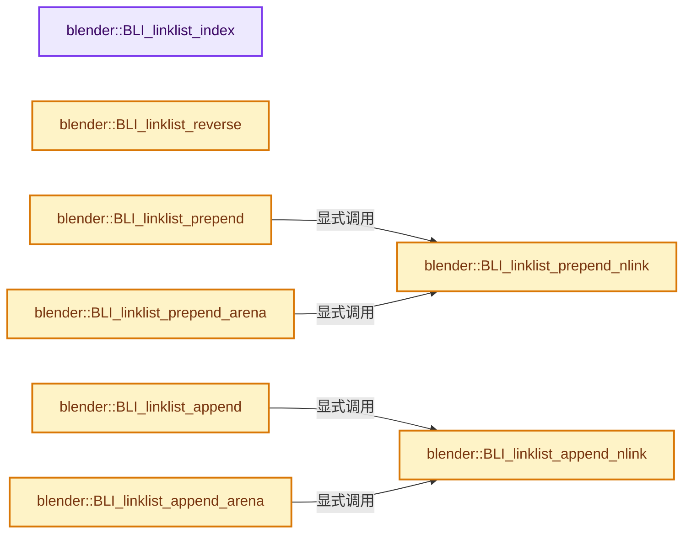
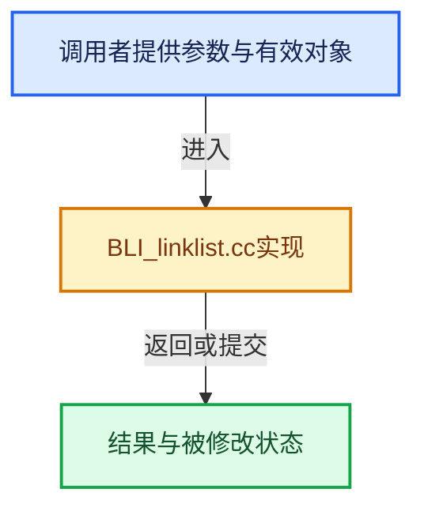

# 实现依赖专题：source/blender/blenlib/intern/BLI_linklist.cc

[方向导航](README.md) · [符号索引](../%E7%AC%A6%E5%8F%B7%E4%BE%9D%E8%B5%96%E4%B8%8E%E5%AE%9E%E7%8E%B0%E7%B4%A2%E5%BC%95.md)

本专题从正文实际调用进入，集中保存共享实现。函数有稳定锚点，可从调用处直接跳到对应完整函数；递归与互相调用通过回链组织。

## 本文件的实现关系






## 完整成员与函数实现

<a id="f-9fc579e49cf5406f"></a>

### `blender::BLI_linklist_index`

实现位置：[source/blender/blenlib/intern/BLI_linklist.cc](../../../../../source/blender/blenlib/intern/BLI_linklist.cc) · L37—L48。

接口参数：

- `const LinkNode *list`
- `const void *ptr`

**教学注释版**

<!-- annotated:d3534d077c0d61 -->

```cpp
int BLI_linklist_index(const LinkNode *list, const void *ptr)
{
  int index;

  for (index = 0; list; list = list->next, index++) {
    if (list->link == ptr) {
      return index;
    }
  }

  return -1;
}
```

<details>
<summary>核对原始源码：source/blender/blenlib/intern/BLI_linklist.cc · L37—L48</summary>

<!-- original:d3534d077c0d61:source/blender/blenlib/intern/BLI_linklist.cc:37:48 -->

```cpp
int BLI_linklist_index(const LinkNode *list, const void *ptr)
{
  int index;

  for (index = 0; list; list = list->next, index++) {
    if (list->link == ptr) {
      return index;
    }
  }

  return -1;
}
```

</details>

**结果出口**

- `return index;`
- `return -1;`

**继续追踪实现**

本实现没有需要继续展开的显式调用；检查返回表达式、对象转换和调用者前置条件。

<a id="f-c6c9caa93a44343b"></a>

### `blender::BLI_linklist_reverse`

实现位置：[source/blender/blenlib/intern/BLI_linklist.cc](../../../../../source/blender/blenlib/intern/BLI_linklist.cc) · L73—L87。

接口参数：

- `LinkNode **listp`

**教学注释版**

<!-- annotated:8aa6ef27ce9b65 -->

```cpp
void BLI_linklist_reverse(LinkNode **listp)
{
  LinkNode *rhead = nullptr, *cur = *listp;

  while (cur) {
    LinkNode *next = cur->next;

    cur->next = rhead;
    rhead = cur;

    cur = next;
  }

  *listp = rhead;
}
```

<details>
<summary>核对原始源码：source/blender/blenlib/intern/BLI_linklist.cc · L73—L87</summary>

<!-- original:8aa6ef27ce9b65:source/blender/blenlib/intern/BLI_linklist.cc:73:87 -->

```cpp
void BLI_linklist_reverse(LinkNode **listp)
{
  LinkNode *rhead = nullptr, *cur = *listp;

  while (cur) {
    LinkNode *next = cur->next;

    cur->next = rhead;
    rhead = cur;

    cur = next;
  }

  *listp = rhead;
}
```

</details>

**沿实际写入检查状态**

- `cur->next = rhead;`
- `rhead = cur;`
- `cur = next;`

**继续追踪实现**

本实现没有需要继续展开的显式调用；检查返回表达式、对象转换和调用者前置条件。

<a id="f-b9aa7837cf05537f"></a>

### `blender::BLI_linklist_prepend_nlink`

实现位置：[source/blender/blenlib/intern/BLI_linklist.cc](../../../../../source/blender/blenlib/intern/BLI_linklist.cc) · L156—L161。

接口参数：

- `LinkNode **listp`
- `void *ptr`
- `LinkNode *nlink`

**教学注释版**

<!-- annotated:d76e43ecf31169 -->

```cpp
void BLI_linklist_prepend_nlink(LinkNode **listp, void *ptr, LinkNode *nlink)
{
  nlink->link = ptr;
  nlink->next = *listp;
  *listp = nlink;
}
```

<details>
<summary>核对原始源码：source/blender/blenlib/intern/BLI_linklist.cc · L156—L161</summary>

<!-- original:d76e43ecf31169:source/blender/blenlib/intern/BLI_linklist.cc:156:161 -->

```cpp
void BLI_linklist_prepend_nlink(LinkNode **listp, void *ptr, LinkNode *nlink)
{
  nlink->link = ptr;
  nlink->next = *listp;
  *listp = nlink;
}
```

</details>

**沿实际写入检查状态**

- `nlink->link = ptr;`
- `nlink->next = *listp;`

**继续追踪实现**

本实现没有需要继续展开的显式调用；检查返回表达式、对象转换和调用者前置条件。

<a id="f-b35d8489bdf7cbce"></a>

### `blender::BLI_linklist_prepend`

实现位置：[source/blender/blenlib/intern/BLI_linklist.cc](../../../../../source/blender/blenlib/intern/BLI_linklist.cc) · L163—L167。

接口参数：

- `LinkNode **listp`
- `void *ptr`

**教学注释版**

<!-- annotated:ac80cf1e610014 -->

```cpp
void BLI_linklist_prepend(LinkNode **listp, void *ptr)
{
  LinkNode *nlink = MEM_new_uninitialized<LinkNode>(__func__);
  BLI_linklist_prepend_nlink(listp, ptr, nlink);
}
```

<details>
<summary>核对原始源码：source/blender/blenlib/intern/BLI_linklist.cc · L163—L167</summary>

<!-- original:ac80cf1e610014:source/blender/blenlib/intern/BLI_linklist.cc:163:167 -->

```cpp
void BLI_linklist_prepend(LinkNode **listp, void *ptr)
{
  LinkNode *nlink = MEM_new_uninitialized<LinkNode>(__func__);
  BLI_linklist_prepend_nlink(listp, ptr, nlink);
}
```

</details>

**继续追踪实现**

- `MEM_new_uninitialized<LinkNode>` → [MEM_new_uninitialized · L590](../03-%E5%86%85%E5%AD%98%E5%88%86%E9%85%8D%E4%B8%8E%E8%BF%90%E8%A1%8C%E6%97%B6%E7%B1%BB%E5%9E%8B/%E4%BE%9D%E8%B5%96-MEM_guardedalloc-b54eca.md#f-c773b2e5b8fe70e4)；[MEM_new_uninitialized · L124](../03-%E5%86%85%E5%AD%98%E5%88%86%E9%85%8D%E4%B8%8E%E8%BF%90%E8%A1%8C%E6%97%B6%E7%B1%BB%E5%9E%8B/%E4%BE%9D%E8%B5%96-mallocn-afdcd4.md#f-28a7e00a1e67f699)。同名重载需按实参类型选择。
- `BLI_linklist_prepend_nlink` → [blender::BLI_linklist_prepend_nlink · L156](%E4%BE%9D%E8%B5%96-BLI_linklist-23c475.md#f-b9aa7837cf05537f)。

<a id="f-de98ab9b60371015"></a>

### `blender::BLI_linklist_prepend_arena`

实现位置：[source/blender/blenlib/intern/BLI_linklist.cc](../../../../../source/blender/blenlib/intern/BLI_linklist.cc) · L169—L173。

接口参数：

- `LinkNode **listp`
- `void *ptr`
- `MemArena *ma`

**教学注释版**

<!-- annotated:1dd27cead0b7a2 -->

```cpp
void BLI_linklist_prepend_arena(LinkNode **listp, void *ptr, MemArena *ma)
{
  LinkNode *nlink = BLI_memarena_alloc<LinkNode>(ma);
  BLI_linklist_prepend_nlink(listp, ptr, nlink);
}
```

<details>
<summary>核对原始源码：source/blender/blenlib/intern/BLI_linklist.cc · L169—L173</summary>

<!-- original:1dd27cead0b7a2:source/blender/blenlib/intern/BLI_linklist.cc:169:173 -->

```cpp
void BLI_linklist_prepend_arena(LinkNode **listp, void *ptr, MemArena *ma)
{
  LinkNode *nlink = BLI_memarena_alloc<LinkNode>(ma);
  BLI_linklist_prepend_nlink(listp, ptr, nlink);
}
```

</details>

**继续追踪实现**

- `BLI_memarena_alloc<LinkNode>` → [blender::BLI_memarena_alloc · L125](%E4%BE%9D%E8%B5%96-BLI_memarena-aea32a.md#f-ae79828c3629e134)。
- `BLI_linklist_prepend_nlink` → [blender::BLI_linklist_prepend_nlink · L156](%E4%BE%9D%E8%B5%96-BLI_linklist-23c475.md#f-b9aa7837cf05537f)。

<a id="f-f48be102660d7b80"></a>

### `blender::BLI_linklist_append_nlink`

实现位置：[source/blender/blenlib/intern/BLI_linklist.cc](../../../../../source/blender/blenlib/intern/BLI_linklist.cc) · L181—L196。

接口参数：

- `LinkNodePair *list_pair`
- `void *ptr`
- `LinkNode *nlink`

**教学注释版**

<!-- annotated:b9572d70a57012 -->

```cpp
void BLI_linklist_append_nlink(LinkNodePair *list_pair, void *ptr, LinkNode *nlink)
{
  nlink->link = ptr;
  nlink->next = nullptr;

  if (list_pair->list) {
    BLI_assert((list_pair->last_node != nullptr) && (list_pair->last_node->next == nullptr));
    list_pair->last_node->next = nlink;
  }
  else {
    BLI_assert(list_pair->last_node == nullptr);
    list_pair->list = nlink;
  }

  list_pair->last_node = nlink;
}
```

<details>
<summary>核对原始源码：source/blender/blenlib/intern/BLI_linklist.cc · L181—L196</summary>

<!-- original:b9572d70a57012:source/blender/blenlib/intern/BLI_linklist.cc:181:196 -->

```cpp
void BLI_linklist_append_nlink(LinkNodePair *list_pair, void *ptr, LinkNode *nlink)
{
  nlink->link = ptr;
  nlink->next = nullptr;

  if (list_pair->list) {
    BLI_assert((list_pair->last_node != nullptr) && (list_pair->last_node->next == nullptr));
    list_pair->last_node->next = nlink;
  }
  else {
    BLI_assert(list_pair->last_node == nullptr);
    list_pair->list = nlink;
  }

  list_pair->last_node = nlink;
}
```

</details>

**沿实际写入检查状态**

- `nlink->link = ptr;`
- `nlink->next = nullptr;`
- `list_pair->last_node->next = nlink;`
- `list_pair->list = nlink;`
- `list_pair->last_node = nlink;`

**继续追踪实现**

- `BLI_assert` → [BLI_assert · L48](%E4%BE%9D%E8%B5%96-BLI_assert-cc98e8.md#m-57a88495704d)；[BLI_assert · L63](%E4%BE%9D%E8%B5%96-BLI_assert-cc98e8.md#m-d07050020cb5)。宏定义由构建条件选择。

<a id="f-27635d32899a8402"></a>

### `blender::BLI_linklist_append`

实现位置：[source/blender/blenlib/intern/BLI_linklist.cc](../../../../../source/blender/blenlib/intern/BLI_linklist.cc) · L198—L202。

接口参数：

- `LinkNodePair *list_pair`
- `void *ptr`

**教学注释版**

<!-- annotated:c2a626321608ef -->

```cpp
void BLI_linklist_append(LinkNodePair *list_pair, void *ptr)
{
  LinkNode *nlink = MEM_new_uninitialized<LinkNode>(__func__);
  BLI_linklist_append_nlink(list_pair, ptr, nlink);
}
```

<details>
<summary>核对原始源码：source/blender/blenlib/intern/BLI_linklist.cc · L198—L202</summary>

<!-- original:c2a626321608ef:source/blender/blenlib/intern/BLI_linklist.cc:198:202 -->

```cpp
void BLI_linklist_append(LinkNodePair *list_pair, void *ptr)
{
  LinkNode *nlink = MEM_new_uninitialized<LinkNode>(__func__);
  BLI_linklist_append_nlink(list_pair, ptr, nlink);
}
```

</details>

**继续追踪实现**

- `MEM_new_uninitialized<LinkNode>` → [MEM_new_uninitialized · L590](../03-%E5%86%85%E5%AD%98%E5%88%86%E9%85%8D%E4%B8%8E%E8%BF%90%E8%A1%8C%E6%97%B6%E7%B1%BB%E5%9E%8B/%E4%BE%9D%E8%B5%96-MEM_guardedalloc-b54eca.md#f-c773b2e5b8fe70e4)；[MEM_new_uninitialized · L124](../03-%E5%86%85%E5%AD%98%E5%88%86%E9%85%8D%E4%B8%8E%E8%BF%90%E8%A1%8C%E6%97%B6%E7%B1%BB%E5%9E%8B/%E4%BE%9D%E8%B5%96-mallocn-afdcd4.md#f-28a7e00a1e67f699)。同名重载需按实参类型选择。
- `BLI_linklist_append_nlink` → [blender::BLI_linklist_append_nlink · L181](%E4%BE%9D%E8%B5%96-BLI_linklist-23c475.md#f-f48be102660d7b80)。

<a id="f-39bb3e9b61f556ea"></a>

### `blender::BLI_linklist_append_arena`

实现位置：[source/blender/blenlib/intern/BLI_linklist.cc](../../../../../source/blender/blenlib/intern/BLI_linklist.cc) · L204—L208。

接口参数：

- `LinkNodePair *list_pair`
- `void *ptr`
- `MemArena *ma`

**教学注释版**

<!-- annotated:508066b6cf5483 -->

```cpp
void BLI_linklist_append_arena(LinkNodePair *list_pair, void *ptr, MemArena *ma)
{
  LinkNode *nlink = BLI_memarena_alloc<LinkNode>(ma);
  BLI_linklist_append_nlink(list_pair, ptr, nlink);
}
```

<details>
<summary>核对原始源码：source/blender/blenlib/intern/BLI_linklist.cc · L204—L208</summary>

<!-- original:508066b6cf5483:source/blender/blenlib/intern/BLI_linklist.cc:204:208 -->

```cpp
void BLI_linklist_append_arena(LinkNodePair *list_pair, void *ptr, MemArena *ma)
{
  LinkNode *nlink = BLI_memarena_alloc<LinkNode>(ma);
  BLI_linklist_append_nlink(list_pair, ptr, nlink);
}
```

</details>

**继续追踪实现**

- `BLI_memarena_alloc<LinkNode>` → [blender::BLI_memarena_alloc · L125](%E4%BE%9D%E8%B5%96-BLI_memarena-aea32a.md#f-ae79828c3629e134)。
- `BLI_linklist_append_nlink` → [blender::BLI_linklist_append_nlink · L181](%E4%BE%9D%E8%B5%96-BLI_linklist-23c475.md#f-f48be102660d7b80)。

<a id="f-90bb23fca0a67f69"></a>

### `blender::BLI_linklist_pop`

实现位置：[source/blender/blenlib/intern/BLI_linklist.cc](../../../../../source/blender/blenlib/intern/BLI_linklist.cc) · L216—L226。

接口参数：

- `LinkNode **listp`

**教学注释版**

<!-- annotated:0c868da23cfb9b -->

```cpp
void *BLI_linklist_pop(LinkNode **listp)
{
  /* intentionally no nullptr check */
  void *link = (*listp)->link;
  LinkNode *next = (*listp)->next;

  MEM_delete(*listp);

  *listp = next;
  return link;
}
```

<details>
<summary>核对原始源码：source/blender/blenlib/intern/BLI_linklist.cc · L216—L226</summary>

<!-- original:0c868da23cfb9b:source/blender/blenlib/intern/BLI_linklist.cc:216:226 -->

```cpp
void *BLI_linklist_pop(LinkNode **listp)
{
  /* intentionally no nullptr check */
  void *link = (*listp)->link;
  LinkNode *next = (*listp)->next;

  MEM_delete(*listp);

  *listp = next;
  return link;
}
```

</details>

**结果出口**

- `return link;`

**继续追踪实现**

- `MEM_delete` → [MEM_delete · L400](../03-%E5%86%85%E5%AD%98%E5%88%86%E9%85%8D%E4%B8%8E%E8%BF%90%E8%A1%8C%E6%97%B6%E7%B1%BB%E5%9E%8B/%E4%BE%9D%E8%B5%96-MEM_guardedalloc-b54eca.md#f-9049ffdd1682887c)。

<a id="f-4e67a6aefc1a2276"></a>

### `blender::BLI_linklist_free`

实现位置：[source/blender/blenlib/intern/BLI_linklist.cc](../../../../../source/blender/blenlib/intern/BLI_linklist.cc) · L257—L269。

接口参数：

- `LinkNode *list`
- `LinkNodeFreeFP freefunc`

**教学注释版**

<!-- annotated:acd42ccf349bd6 -->

```cpp
void BLI_linklist_free(LinkNode *list, LinkNodeFreeFP freefunc)
{
  while (list) {
    LinkNode *next = list->next;

    if (freefunc) {
      freefunc(list->link);
    }
    MEM_delete(list);

    list = next;
  }
}
```

<details>
<summary>核对原始源码：source/blender/blenlib/intern/BLI_linklist.cc · L257—L269</summary>

<!-- original:acd42ccf349bd6:source/blender/blenlib/intern/BLI_linklist.cc:257:269 -->

```cpp
void BLI_linklist_free(LinkNode *list, LinkNodeFreeFP freefunc)
{
  while (list) {
    LinkNode *next = list->next;

    if (freefunc) {
      freefunc(list->link);
    }
    MEM_delete(list);

    list = next;
  }
}
```

</details>

**沿实际写入检查状态**

- `list = next;`

**继续追踪实现**

- `freefunc` → [调用协议](../%E6%A8%A1%E6%9D%BF%E5%AE%8F%E4%B8%8E%E5%8A%A8%E6%80%81%E5%88%86%E6%B4%BE%E5%8D%8F%E8%AE%AE.md)：局部可调用对象，须结合其初始化与捕获环境。调用位置L263。
- `MEM_delete` → [MEM_delete · L400](../03-%E5%86%85%E5%AD%98%E5%88%86%E9%85%8D%E4%B8%8E%E8%BF%90%E8%A1%8C%E6%97%B6%E7%B1%BB%E5%9E%8B/%E4%BE%9D%E8%B5%96-MEM_guardedalloc-b54eca.md#f-9049ffdd1682887c)。

<a id="f-a6bee34b8fdcdf5a"></a>

### `blender::BLI_linklist_freeN`

实现位置：[source/blender/blenlib/intern/BLI_linklist.cc](../../../../../source/blender/blenlib/intern/BLI_linklist.cc) · L285—L295。

接口参数：

- `LinkNode *list`

**教学注释版**

<!-- annotated:49e679ff6d4a44 -->

```cpp
void BLI_linklist_freeN(LinkNode *list)
{
  while (list) {
    LinkNode *next = list->next;

    // [讲解] MEM_delete_void：以原始存储释放约定调用当前后端。
    MEM_delete_void(list->link);
    MEM_delete(list);

    list = next;
  }
}
```

<details>
<summary>核对原始源码：source/blender/blenlib/intern/BLI_linklist.cc · L285—L295</summary>

<!-- original:49e679ff6d4a44:source/blender/blenlib/intern/BLI_linklist.cc:285:295 -->

```cpp
void BLI_linklist_freeN(LinkNode *list)
{
  while (list) {
    LinkNode *next = list->next;

    MEM_delete_void(list->link);
    MEM_delete(list);

    list = next;
  }
}
```

</details>

**沿实际写入检查状态**

- `list = next;`

**继续追踪实现**

- `MEM_delete_void` → [MEM_delete_void · L647](../03-%E5%86%85%E5%AD%98%E5%88%86%E9%85%8D%E4%B8%8E%E8%BF%90%E8%A1%8C%E6%97%B6%E7%B1%BB%E5%9E%8B/%E4%BE%9D%E8%B5%96-MEM_guardedalloc-b54eca.md#f-642896c7c62ff8b9)；[MEM_delete_void · L109](../03-%E5%86%85%E5%AD%98%E5%88%86%E9%85%8D%E4%B8%8E%E8%BF%90%E8%A1%8C%E6%97%B6%E7%B1%BB%E5%9E%8B/%E4%BE%9D%E8%B5%96-mallocn-afdcd4.md#f-9a07b26421f2bee6)。同名重载需按实参类型选择。
- `MEM_delete` → [MEM_delete · L400](../03-%E5%86%85%E5%AD%98%E5%88%86%E9%85%8D%E4%B8%8E%E8%BF%90%E8%A1%8C%E6%97%B6%E7%B1%BB%E5%9E%8B/%E4%BE%9D%E8%B5%96-MEM_guardedalloc-b54eca.md#f-9049ffdd1682887c)。
