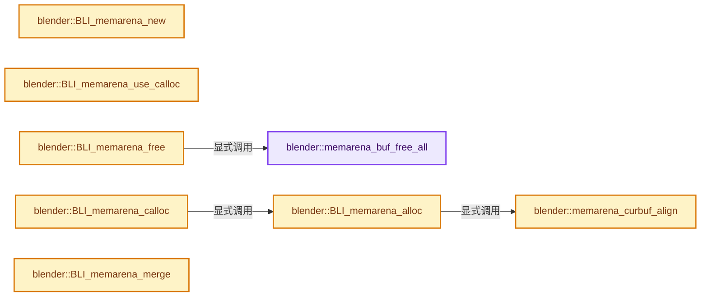

# 实现依赖专题：source/blender/blenlib/intern/BLI_memarena.cc

[方向导航](README.md) · [符号索引](../%E7%AC%A6%E5%8F%B7%E4%BE%9D%E8%B5%96%E4%B8%8E%E5%AE%9E%E7%8E%B0%E7%B4%A2%E5%BC%95.md)

本专题从正文实际调用进入，集中保存共享实现。函数有稳定锚点，可从调用处直接跳到对应完整函数；递归与互相调用通过回链组织。

## 本文件的实现关系




<a id="m-ae14250b7285"></a>

## 宏 `VALGRIND_CREATE_MEMPOOL`

<!-- annotated:8a70b4875ef1bb -->

```cpp
#  define VALGRIND_CREATE_MEMPOOL(pool, rzB, is_zeroed) UNUSED_VARS(pool, rzB, is_zeroed)
#  define VALGRIND_DESTROY_MEMPOOL(pool) UNUSED_VARS(pool)
```

<details>
<summary>核对原始源码：source/blender/blenlib/intern/BLI_memarena.cc · L29—L30</summary>

<!-- original:8a70b4875ef1bb:source/blender/blenlib/intern/BLI_memarena.cc:29:30 -->

```cpp
#  define VALGRIND_CREATE_MEMPOOL(pool, rzB, is_zeroed) UNUSED_VARS(pool, rzB, is_zeroed)
#  define VALGRIND_DESTROY_MEMPOOL(pool) UNUSED_VARS(pool)
```

</details>

宏在预处理阶段展开，参数替换、重复求值和条件编译应直接从该定义检查。与普通函数不同，宏不会自动提供参数类型检查；构建配置选择哪个定义需结合外围条件。

<a id="m-76729046fc0d"></a>

## 宏 `VALGRIND_DESTROY_MEMPOOL`

<!-- annotated:2b92812bcf055a -->

```cpp
#  define VALGRIND_DESTROY_MEMPOOL(pool) UNUSED_VARS(pool)
#  define VALGRIND_MEMPOOL_ALLOC(pool, addr, size) UNUSED_VARS(pool, addr, size)
```

<details>
<summary>核对原始源码：source/blender/blenlib/intern/BLI_memarena.cc · L30—L31</summary>

<!-- original:2b92812bcf055a:source/blender/blenlib/intern/BLI_memarena.cc:30:31 -->

```cpp
#  define VALGRIND_DESTROY_MEMPOOL(pool) UNUSED_VARS(pool)
#  define VALGRIND_MEMPOOL_ALLOC(pool, addr, size) UNUSED_VARS(pool, addr, size)
```

</details>

宏在预处理阶段展开，参数替换、重复求值和条件编译应直接从该定义检查。与普通函数不同，宏不会自动提供参数类型检查；构建配置选择哪个定义需结合外围条件。

<a id="m-9002b9d327f8"></a>

## 宏 `VALGRIND_MEMPOOL_ALLOC`

<!-- annotated:da32c2a2ec9e5c -->

```cpp
#  define VALGRIND_MEMPOOL_ALLOC(pool, addr, size) UNUSED_VARS(pool, addr, size)
#  define VALGRIND_MOVE_MEMPOOL(pool_a, pool_b) UNUSED_VARS(pool_a, pool_b)
```

<details>
<summary>核对原始源码：source/blender/blenlib/intern/BLI_memarena.cc · L31—L32</summary>

<!-- original:da32c2a2ec9e5c:source/blender/blenlib/intern/BLI_memarena.cc:31:32 -->

```cpp
#  define VALGRIND_MEMPOOL_ALLOC(pool, addr, size) UNUSED_VARS(pool, addr, size)
#  define VALGRIND_MOVE_MEMPOOL(pool_a, pool_b) UNUSED_VARS(pool_a, pool_b)
```

</details>

宏在预处理阶段展开，参数替换、重复求值和条件编译应直接从该定义检查。与普通函数不同，宏不会自动提供参数类型检查；构建配置选择哪个定义需结合外围条件。

<a id="m-c9504bedd38b"></a>

## 宏 `VALGRIND_MOVE_MEMPOOL`

<!-- annotated:4c97d4ce4e088c -->

```cpp
#  define VALGRIND_MOVE_MEMPOOL(pool_a, pool_b) UNUSED_VARS(pool_a, pool_b)
#endif
```

<details>
<summary>核对原始源码：source/blender/blenlib/intern/BLI_memarena.cc · L32—L33</summary>

<!-- original:4c97d4ce4e088c:source/blender/blenlib/intern/BLI_memarena.cc:32:33 -->

```cpp
#  define VALGRIND_MOVE_MEMPOOL(pool_a, pool_b) UNUSED_VARS(pool_a, pool_b)
#endif
```

</details>

宏在预处理阶段展开，参数替换、重复求值和条件编译应直接从该定义检查。与普通函数不同，宏不会自动提供参数类型检查；构建配置选择哪个定义需结合外围条件。

<a id="m-15f3682c6b08"></a>

## 宏 `PADUP`

<!-- annotated:03da02e917b31e -->

```cpp
#define PADUP(num, amt) (((num) + ((amt) - 1)) & ~((amt) - 1))

```

<details>
<summary>核对原始源码：source/blender/blenlib/intern/BLI_memarena.cc · L113—L114</summary>

<!-- original:03da02e917b31e:source/blender/blenlib/intern/BLI_memarena.cc:113:114 -->

```cpp
#define PADUP(num, amt) (((num) + ((amt) - 1)) & ~((amt) - 1))

```

</details>

宏在预处理阶段展开，参数替换、重复求值和条件编译应直接从该定义检查。与普通函数不同，宏不会自动提供参数类型检查；构建配置选择哪个定义需结合外围条件。

## 完整成员与函数实现

<a id="f-18dcaddb9a81889f"></a>

### `blender::memarena_buf_free_all`

实现位置：[source/blender/blenlib/intern/BLI_memarena.cc](../../../../../source/blender/blenlib/intern/BLI_memarena.cc) · L58—L71。

接口参数：

- `MemBuf *mb`

**教学注释版**

<!-- annotated:0c29e74a42d074 -->

```cpp
static void memarena_buf_free_all(MemBuf *mb)
{
  while (mb != nullptr) {
    MemBuf *mb_next = mb->next;

#ifdef WITH_ASAN
    /* Unpoison memory because #MEM_delete_void might overwrite it. */
    BLI_asan_unpoison(mb, uint(mb->size));
#endif

    MEM_delete(mb);
    mb = mb_next;
  }
}
```

<details>
<summary>核对原始源码：source/blender/blenlib/intern/BLI_memarena.cc · L58—L71</summary>

<!-- original:0c29e74a42d074:source/blender/blenlib/intern/BLI_memarena.cc:58:71 -->

```cpp
static void memarena_buf_free_all(MemBuf *mb)
{
  while (mb != nullptr) {
    MemBuf *mb_next = mb->next;

#ifdef WITH_ASAN
    /* Unpoison memory because #MEM_delete_void might overwrite it. */
    BLI_asan_unpoison(mb, uint(mb->size));
#endif

    MEM_delete(mb);
    mb = mb_next;
  }
}
```

</details>

**沿实际写入检查状态**

- `mb = mb_next;`

**继续追踪实现**

- `BLI_asan_unpoison` → [BLI_asan_unpoison · L36](%E4%BE%9D%E8%B5%96-BLI_asan-96bcf6.md#m-1b72097364ea)。宏定义由构建条件选择。
- `MEM_delete` → [MEM_delete · L400](../03-%E5%86%85%E5%AD%98%E5%88%86%E9%85%8D%E4%B8%8E%E8%BF%90%E8%A1%8C%E6%97%B6%E7%B1%BB%E5%9E%8B/%E4%BE%9D%E8%B5%96-MEM_guardedalloc-b54eca.md#f-9049ffdd1682887c)。

<a id="f-590ef4f6ab548c98"></a>

### `blender::BLI_memarena_new`

实现位置：[source/blender/blenlib/intern/BLI_memarena.cc](../../../../../source/blender/blenlib/intern/BLI_memarena.cc) · L73—L83。

接口参数：

- `const size_t bufsize`
- `const char *name`

**教学注释版**

<!-- annotated:8249a01ada04b8 -->

```cpp
MemArena *BLI_memarena_new(const size_t bufsize, const char *name)
{
  MemArena *ma = MEM_new_zeroed<MemArena>("memarena");
  ma->bufsize = bufsize;
  ma->align = 8;
  ma->name = name;

  VALGRIND_CREATE_MEMPOOL(ma, 0, false);

  return ma;
}
```

<details>
<summary>核对原始源码：source/blender/blenlib/intern/BLI_memarena.cc · L73—L83</summary>

<!-- original:8249a01ada04b8:source/blender/blenlib/intern/BLI_memarena.cc:73:83 -->

```cpp
MemArena *BLI_memarena_new(const size_t bufsize, const char *name)
{
  MemArena *ma = MEM_new_zeroed<MemArena>("memarena");
  ma->bufsize = bufsize;
  ma->align = 8;
  ma->name = name;

  VALGRIND_CREATE_MEMPOOL(ma, 0, false);

  return ma;
}
```

</details>

**沿实际写入检查状态**

- `ma->bufsize = bufsize;`
- `ma->align = 8;`
- `ma->name = name;`

**结果出口**

- `return ma;`

**继续追踪实现**

- `MEM_new_zeroed<MemArena>` → [MEM_new_zeroed · L550](../03-%E5%86%85%E5%AD%98%E5%88%86%E9%85%8D%E4%B8%8E%E8%BF%90%E8%A1%8C%E6%97%B6%E7%B1%BB%E5%9E%8B/%E4%BE%9D%E8%B5%96-MEM_guardedalloc-b54eca.md#f-eeb1e2a7f57dd231)；[MEM_new_zeroed · L114](../03-%E5%86%85%E5%AD%98%E5%88%86%E9%85%8D%E4%B8%8E%E8%BF%90%E8%A1%8C%E6%97%B6%E7%B1%BB%E5%9E%8B/%E4%BE%9D%E8%B5%96-mallocn-afdcd4.md#f-e04cf01c64c8b180)。同名重载需按实参类型选择。
- `VALGRIND_CREATE_MEMPOOL` → [VALGRIND_CREATE_MEMPOOL · L29](%E4%BE%9D%E8%B5%96-BLI_memarena-aea32a.md#m-ae14250b7285)。宏定义由构建条件选择。

<a id="f-5fefcfa991d74f3f"></a>

### `blender::BLI_memarena_use_calloc`

实现位置：[source/blender/blenlib/intern/BLI_memarena.cc](../../../../../source/blender/blenlib/intern/BLI_memarena.cc) · L85—L88。

接口参数：

- `MemArena *ma`

**教学注释版**

<!-- annotated:91b48b1817d10b -->

```cpp
void BLI_memarena_use_calloc(MemArena *ma)
{
  ma->use_calloc = true;
}
```

<details>
<summary>核对原始源码：source/blender/blenlib/intern/BLI_memarena.cc · L85—L88</summary>

<!-- original:91b48b1817d10b:source/blender/blenlib/intern/BLI_memarena.cc:85:88 -->

```cpp
void BLI_memarena_use_calloc(MemArena *ma)
{
  ma->use_calloc = true;
}
```

</details>

**沿实际写入检查状态**

- `ma->use_calloc = true;`

**继续追踪实现**

本实现没有需要继续展开的显式调用；检查返回表达式、对象转换和调用者前置条件。

<a id="f-a655794ad41d1bdf"></a>

### `blender::BLI_memarena_free`

实现位置：[source/blender/blenlib/intern/BLI_memarena.cc](../../../../../source/blender/blenlib/intern/BLI_memarena.cc) · L103—L110。

接口参数：

- `MemArena *ma`

**教学注释版**

<!-- annotated:477fe8e4f2e64f -->

```cpp
void BLI_memarena_free(MemArena *ma)
{
  memarena_buf_free_all(ma->bufs);

  VALGRIND_DESTROY_MEMPOOL(ma);

  MEM_delete(ma);
}
```

<details>
<summary>核对原始源码：source/blender/blenlib/intern/BLI_memarena.cc · L103—L110</summary>

<!-- original:477fe8e4f2e64f:source/blender/blenlib/intern/BLI_memarena.cc:103:110 -->

```cpp
void BLI_memarena_free(MemArena *ma)
{
  memarena_buf_free_all(ma->bufs);

  VALGRIND_DESTROY_MEMPOOL(ma);

  MEM_delete(ma);
}
```

</details>

**继续追踪实现**

- `memarena_buf_free_all` → [blender::memarena_buf_free_all · L58](%E4%BE%9D%E8%B5%96-BLI_memarena-aea32a.md#f-18dcaddb9a81889f)。
- `VALGRIND_DESTROY_MEMPOOL` → [VALGRIND_DESTROY_MEMPOOL · L30](%E4%BE%9D%E8%B5%96-BLI_memarena-aea32a.md#m-76729046fc0d)。宏定义由构建条件选择。
- `MEM_delete` → [MEM_delete · L400](../03-%E5%86%85%E5%AD%98%E5%88%86%E9%85%8D%E4%B8%8E%E8%BF%90%E8%A1%8C%E6%97%B6%E7%B1%BB%E5%9E%8B/%E4%BE%9D%E8%B5%96-MEM_guardedalloc-b54eca.md#f-9049ffdd1682887c)。

<a id="f-d0711107a9451453"></a>

### `blender::memarena_curbuf_align`

实现位置：[source/blender/blenlib/intern/BLI_memarena.cc](../../../../../source/blender/blenlib/intern/BLI_memarena.cc) · L116—L123。

接口参数：

- `MemArena *ma`

**教学注释版**

<!-- annotated:4556162c128003 -->

```cpp
static void memarena_curbuf_align(MemArena *ma)
{
  uchar *tmp;

  tmp = reinterpret_cast<uchar *> PADUP(intptr_t(ma->curbuf), int(ma->align));
  ma->cursize -= size_t(tmp - ma->curbuf);
  ma->curbuf = tmp;
}
```

<details>
<summary>核对原始源码：source/blender/blenlib/intern/BLI_memarena.cc · L116—L123</summary>

<!-- original:4556162c128003:source/blender/blenlib/intern/BLI_memarena.cc:116:123 -->

```cpp
static void memarena_curbuf_align(MemArena *ma)
{
  uchar *tmp;

  tmp = reinterpret_cast<uchar *> PADUP(intptr_t(ma->curbuf), int(ma->align));
  ma->cursize -= size_t(tmp - ma->curbuf);
  ma->curbuf = tmp;
}
```

</details>

**沿实际写入检查状态**

- `tmp = reinterpret_cast<uchar *> PADUP(intptr_t(ma->curbuf), int(ma->align));`
- `ma->cursize -= size_t(tmp - ma->curbuf);`
- `ma->curbuf = tmp;`

**继续追踪实现**

- `PADUP` → [PADUP · L113](%E4%BE%9D%E8%B5%96-BLI_memarena-aea32a.md#m-15f3682c6b08)。宏定义由构建条件选择。

<a id="f-ae79828c3629e134"></a>

### `blender::BLI_memarena_alloc`

实现位置：[source/blender/blenlib/intern/BLI_memarena.cc](../../../../../source/blender/blenlib/intern/BLI_memarena.cc) · L125—L168。

接口参数：

- `MemArena *ma`
- `size_t size`

**教学注释版**

<!-- annotated:e8a74772cde565 -->

```cpp
void *BLI_memarena_alloc(MemArena *ma, size_t size)
{
  void *ptr;

  /* Ensure proper alignment by rounding size up to multiple of 8. */
  size = PADUP(size, ma->align);

  if (size > ma->cursize) [[unlikely]] {
    if (size > ma->bufsize - (ma->align - 1)) {
      ma->cursize = PADUP(size + 1, ma->align);
    }
    else {
      ma->cursize = ma->bufsize;
    }

    MemBuf *mb;
    if (ma->use_calloc) {
      mb = static_cast<MemBuf *>(MEM_new_zeroed(sizeof(*mb) + ma->cursize, ma->name));
    }
    else {
      mb = static_cast<MemBuf *>(MEM_new_uninitialized(sizeof(*mb) + ma->cursize, ma->name));
    }
    ma->curbuf = mb->data;
    mb->next = ma->bufs;
#ifdef WITH_ASAN
    mb->size = sizeof(*mb) + ma->cursize;
#endif
    ma->bufs = mb;

    BLI_asan_poison(ma->curbuf, ma->cursize);

    memarena_curbuf_align(ma);
  }

  ptr = ma->curbuf;
  ma->curbuf += size;
  ma->cursize -= size;

  VALGRIND_MEMPOOL_ALLOC(ma, ptr, size);

  BLI_asan_unpoison(ptr, size);

  return ptr;
}
```

<details>
<summary>核对原始源码：source/blender/blenlib/intern/BLI_memarena.cc · L125—L168</summary>

<!-- original:e8a74772cde565:source/blender/blenlib/intern/BLI_memarena.cc:125:168 -->

```cpp
void *BLI_memarena_alloc(MemArena *ma, size_t size)
{
  void *ptr;

  /* Ensure proper alignment by rounding size up to multiple of 8. */
  size = PADUP(size, ma->align);

  if (size > ma->cursize) [[unlikely]] {
    if (size > ma->bufsize - (ma->align - 1)) {
      ma->cursize = PADUP(size + 1, ma->align);
    }
    else {
      ma->cursize = ma->bufsize;
    }

    MemBuf *mb;
    if (ma->use_calloc) {
      mb = static_cast<MemBuf *>(MEM_new_zeroed(sizeof(*mb) + ma->cursize, ma->name));
    }
    else {
      mb = static_cast<MemBuf *>(MEM_new_uninitialized(sizeof(*mb) + ma->cursize, ma->name));
    }
    ma->curbuf = mb->data;
    mb->next = ma->bufs;
#ifdef WITH_ASAN
    mb->size = sizeof(*mb) + ma->cursize;
#endif
    ma->bufs = mb;

    BLI_asan_poison(ma->curbuf, ma->cursize);

    memarena_curbuf_align(ma);
  }

  ptr = ma->curbuf;
  ma->curbuf += size;
  ma->cursize -= size;

  VALGRIND_MEMPOOL_ALLOC(ma, ptr, size);

  BLI_asan_unpoison(ptr, size);

  return ptr;
}
```

</details>

**沿实际写入检查状态**

- `size = PADUP(size, ma->align);`
- `ma->cursize = PADUP(size + 1, ma->align);`
- `ma->cursize = ma->bufsize;`
- `mb = static_cast<MemBuf *>(MEM_new_zeroed(sizeof(*mb) + ma->cursize, ma->name));`
- `mb = static_cast<MemBuf *>(MEM_new_uninitialized(sizeof(*mb) + ma->cursize, ma->name));`
- `ma->curbuf = mb->data;`
- `mb->next = ma->bufs;`
- `mb->size = sizeof(*mb) + ma->cursize;`
- `ma->bufs = mb;`
- `ptr = ma->curbuf;`
- `ma->curbuf += size;`
- `ma->cursize -= size;`

**结果出口**

- `return ptr;`

**继续追踪实现**

- `PADUP` → [PADUP · L113](%E4%BE%9D%E8%B5%96-BLI_memarena-aea32a.md#m-15f3682c6b08)。宏定义由构建条件选择。
- `MEM_new_zeroed` → [MEM_new_zeroed · L550](../03-%E5%86%85%E5%AD%98%E5%88%86%E9%85%8D%E4%B8%8E%E8%BF%90%E8%A1%8C%E6%97%B6%E7%B1%BB%E5%9E%8B/%E4%BE%9D%E8%B5%96-MEM_guardedalloc-b54eca.md#f-eeb1e2a7f57dd231)；[MEM_new_zeroed · L114](../03-%E5%86%85%E5%AD%98%E5%88%86%E9%85%8D%E4%B8%8E%E8%BF%90%E8%A1%8C%E6%97%B6%E7%B1%BB%E5%9E%8B/%E4%BE%9D%E8%B5%96-mallocn-afdcd4.md#f-e04cf01c64c8b180)。同名重载需按实参类型选择。
- `MEM_new_uninitialized` → [MEM_new_uninitialized · L590](../03-%E5%86%85%E5%AD%98%E5%88%86%E9%85%8D%E4%B8%8E%E8%BF%90%E8%A1%8C%E6%97%B6%E7%B1%BB%E5%9E%8B/%E4%BE%9D%E8%B5%96-MEM_guardedalloc-b54eca.md#f-c773b2e5b8fe70e4)；[MEM_new_uninitialized · L124](../03-%E5%86%85%E5%AD%98%E5%88%86%E9%85%8D%E4%B8%8E%E8%BF%90%E8%A1%8C%E6%97%B6%E7%B1%BB%E5%9E%8B/%E4%BE%9D%E8%B5%96-mallocn-afdcd4.md#f-28a7e00a1e67f699)。同名重载需按实参类型选择。
- `BLI_asan_poison` → [BLI_asan_poison · L31](%E4%BE%9D%E8%B5%96-BLI_asan-96bcf6.md#m-4cf78e7886f3)。宏定义由构建条件选择。
- `memarena_curbuf_align` → [blender::memarena_curbuf_align · L116](%E4%BE%9D%E8%B5%96-BLI_memarena-aea32a.md#f-d0711107a9451453)。
- `VALGRIND_MEMPOOL_ALLOC` → [VALGRIND_MEMPOOL_ALLOC · L31](%E4%BE%9D%E8%B5%96-BLI_memarena-aea32a.md#m-9002b9d327f8)。宏定义由构建条件选择。
- `BLI_asan_unpoison` → [BLI_asan_unpoison · L36](%E4%BE%9D%E8%B5%96-BLI_asan-96bcf6.md#m-1b72097364ea)。宏定义由构建条件选择。

<a id="f-3bb0d5bc840ed647"></a>

### `blender::BLI_memarena_calloc`

实现位置：[source/blender/blenlib/intern/BLI_memarena.cc](../../../../../source/blender/blenlib/intern/BLI_memarena.cc) · L170—L182。

接口参数：

- `MemArena *ma`
- `size_t size`

**教学注释版**

<!-- annotated:8e2b5705457335 -->

```cpp
void *BLI_memarena_calloc(MemArena *ma, size_t size)
{
  void *ptr;

  /* No need to use this function call if we're calloc'ing by default. */
  BLI_assert(ma->use_calloc == false);

  ptr = BLI_memarena_alloc(ma, size);
  BLI_assert(ptr != nullptr);
  // [讲解] memset：填充字节，不调用T构造函数，也不保证任意类型的全零表示是合法或期望值。
  memset(ptr, 0, size);

  return ptr;
}
```

<details>
<summary>核对原始源码：source/blender/blenlib/intern/BLI_memarena.cc · L170—L182</summary>

<!-- original:8e2b5705457335:source/blender/blenlib/intern/BLI_memarena.cc:170:182 -->

```cpp
void *BLI_memarena_calloc(MemArena *ma, size_t size)
{
  void *ptr;

  /* No need to use this function call if we're calloc'ing by default. */
  BLI_assert(ma->use_calloc == false);

  ptr = BLI_memarena_alloc(ma, size);
  BLI_assert(ptr != nullptr);
  memset(ptr, 0, size);

  return ptr;
}
```

</details>

**沿实际写入检查状态**

- `ptr = BLI_memarena_alloc(ma, size);`

**结果出口**

- `return ptr;`

**继续追踪实现**

- `BLI_assert` → [BLI_assert · L48](%E4%BE%9D%E8%B5%96-BLI_assert-cc98e8.md#m-57a88495704d)；[BLI_assert · L63](%E4%BE%9D%E8%B5%96-BLI_assert-cc98e8.md#m-d07050020cb5)。宏定义由构建条件选择。
- `BLI_memarena_alloc` → [blender::BLI_memarena_alloc · L125](%E4%BE%9D%E8%B5%96-BLI_memarena-aea32a.md#f-ae79828c3629e134)。
- `memset` → [外部契约](https://eel.is/c++draft/cstring.syn)：填充字节，不调用T构造函数，也不保证任意类型的全零表示是合法或期望值。

<a id="f-7135d3612c50b719"></a>

### `blender::BLI_memarena_merge`

实现位置：[source/blender/blenlib/intern/BLI_memarena.cc](../../../../../source/blender/blenlib/intern/BLI_memarena.cc) · L184—L223。

接口参数：

- `MemArena *ma_dst`
- `MemArena *ma_src`

**教学注释版**

<!-- annotated:47a5bb0f67cc15 -->

```cpp
void BLI_memarena_merge(MemArena *ma_dst, MemArena *ma_src)
{
  /* Memory arenas must be compatible. */
  BLI_assert(ma_dst != ma_src);
  BLI_assert(ma_dst->align == ma_src->align);
  BLI_assert(ma_dst->use_calloc == ma_src->use_calloc);
  BLI_assert(ma_dst->bufsize == ma_src->bufsize);

  if (ma_src->bufs == nullptr) {
    return;
  }

  if (ma_dst->bufs == nullptr) [[unlikely]] {
    BLI_assert(ma_dst->curbuf == nullptr);
    ma_dst->bufs = ma_src->bufs;
    ma_dst->curbuf = ma_src->curbuf;
    ma_dst->cursize = ma_src->cursize;
  }
  else {
    /* Keep the 'ma_dst->curbuf' for simplicity.
     * Insert buffers after the first. */
    if (ma_dst->bufs->next != nullptr) {
      /* Loop over `ma_src` instead of `ma_dst` since it's likely the destination is larger
       * when used for accumulating from multiple sources. */
      MemBuf *mb_src = ma_src->bufs;
      while (mb_src->next) {
        mb_src = mb_src->next;
      }
      mb_src->next = ma_dst->bufs->next;
    }
    ma_dst->bufs->next = ma_src->bufs;
  }

  ma_src->bufs = nullptr;
  ma_src->curbuf = nullptr;
  ma_src->cursize = 0;

  VALGRIND_MOVE_MEMPOOL(ma_src, ma_dst);
  VALGRIND_CREATE_MEMPOOL(ma_src, 0, false);
}
```

<details>
<summary>核对原始源码：source/blender/blenlib/intern/BLI_memarena.cc · L184—L223</summary>

<!-- original:47a5bb0f67cc15:source/blender/blenlib/intern/BLI_memarena.cc:184:223 -->

```cpp
void BLI_memarena_merge(MemArena *ma_dst, MemArena *ma_src)
{
  /* Memory arenas must be compatible. */
  BLI_assert(ma_dst != ma_src);
  BLI_assert(ma_dst->align == ma_src->align);
  BLI_assert(ma_dst->use_calloc == ma_src->use_calloc);
  BLI_assert(ma_dst->bufsize == ma_src->bufsize);

  if (ma_src->bufs == nullptr) {
    return;
  }

  if (ma_dst->bufs == nullptr) [[unlikely]] {
    BLI_assert(ma_dst->curbuf == nullptr);
    ma_dst->bufs = ma_src->bufs;
    ma_dst->curbuf = ma_src->curbuf;
    ma_dst->cursize = ma_src->cursize;
  }
  else {
    /* Keep the 'ma_dst->curbuf' for simplicity.
     * Insert buffers after the first. */
    if (ma_dst->bufs->next != nullptr) {
      /* Loop over `ma_src` instead of `ma_dst` since it's likely the destination is larger
       * when used for accumulating from multiple sources. */
      MemBuf *mb_src = ma_src->bufs;
      while (mb_src->next) {
        mb_src = mb_src->next;
      }
      mb_src->next = ma_dst->bufs->next;
    }
    ma_dst->bufs->next = ma_src->bufs;
  }

  ma_src->bufs = nullptr;
  ma_src->curbuf = nullptr;
  ma_src->cursize = 0;

  VALGRIND_MOVE_MEMPOOL(ma_src, ma_dst);
  VALGRIND_CREATE_MEMPOOL(ma_src, 0, false);
}
```

</details>

**沿实际写入检查状态**

- `ma_dst->bufs = ma_src->bufs;`
- `ma_dst->curbuf = ma_src->curbuf;`
- `ma_dst->cursize = ma_src->cursize;`
- `mb_src = mb_src->next;`
- `mb_src->next = ma_dst->bufs->next;`
- `ma_dst->bufs->next = ma_src->bufs;`
- `ma_src->bufs = nullptr;`
- `ma_src->curbuf = nullptr;`
- `ma_src->cursize = 0;`

**继续追踪实现**

- `BLI_assert` → [BLI_assert · L48](%E4%BE%9D%E8%B5%96-BLI_assert-cc98e8.md#m-57a88495704d)；[BLI_assert · L63](%E4%BE%9D%E8%B5%96-BLI_assert-cc98e8.md#m-d07050020cb5)。宏定义由构建条件选择。
- `VALGRIND_MOVE_MEMPOOL` → [VALGRIND_MOVE_MEMPOOL · L32](%E4%BE%9D%E8%B5%96-BLI_memarena-aea32a.md#m-c9504bedd38b)。宏定义由构建条件选择。
- `VALGRIND_CREATE_MEMPOOL` → [VALGRIND_CREATE_MEMPOOL · L29](%E4%BE%9D%E8%B5%96-BLI_memarena-aea32a.md#m-ae14250b7285)。宏定义由构建条件选择。

<a id="f-58102a3c4f840caa"></a>

### `blender::BLI_memarena_clear`

实现位置：[source/blender/blenlib/intern/BLI_memarena.cc](../../../../../source/blender/blenlib/intern/BLI_memarena.cc) · L225—L249。

接口参数：

- `MemArena *ma`

**教学注释版**

<!-- annotated:7825e0c35a0a6b -->

```cpp
void BLI_memarena_clear(MemArena *ma)
{
  if (ma->bufs) {
    if (ma->bufs->next) {
      memarena_buf_free_all(ma->bufs->next);
      ma->bufs->next = nullptr;
    }

    const uchar *curbuf_prev = ma->curbuf;
    ma->curbuf = ma->bufs->data;
    memarena_curbuf_align(ma);

    /* restore to original size */
    const size_t curbuf_used = size_t(curbuf_prev - ma->curbuf);
    ma->cursize += curbuf_used;

    if (ma->use_calloc) {
      // [讲解] memset：填充字节，不调用T构造函数，也不保证任意类型的全零表示是合法或期望值。
      memset(ma->curbuf, 0, curbuf_used);
    }
    BLI_asan_poison(ma->curbuf, ma->cursize);
  }

  VALGRIND_DESTROY_MEMPOOL(ma);
  VALGRIND_CREATE_MEMPOOL(ma, 0, false);
}
```

<details>
<summary>核对原始源码：source/blender/blenlib/intern/BLI_memarena.cc · L225—L249</summary>

<!-- original:7825e0c35a0a6b:source/blender/blenlib/intern/BLI_memarena.cc:225:249 -->

```cpp
void BLI_memarena_clear(MemArena *ma)
{
  if (ma->bufs) {
    if (ma->bufs->next) {
      memarena_buf_free_all(ma->bufs->next);
      ma->bufs->next = nullptr;
    }

    const uchar *curbuf_prev = ma->curbuf;
    ma->curbuf = ma->bufs->data;
    memarena_curbuf_align(ma);

    /* restore to original size */
    const size_t curbuf_used = size_t(curbuf_prev - ma->curbuf);
    ma->cursize += curbuf_used;

    if (ma->use_calloc) {
      memset(ma->curbuf, 0, curbuf_used);
    }
    BLI_asan_poison(ma->curbuf, ma->cursize);
  }

  VALGRIND_DESTROY_MEMPOOL(ma);
  VALGRIND_CREATE_MEMPOOL(ma, 0, false);
}
```

</details>

**沿实际写入检查状态**

- `ma->bufs->next = nullptr;`
- `ma->curbuf = ma->bufs->data;`
- `ma->cursize += curbuf_used;`

**继续追踪实现**

- `memarena_buf_free_all` → [blender::memarena_buf_free_all · L58](%E4%BE%9D%E8%B5%96-BLI_memarena-aea32a.md#f-18dcaddb9a81889f)。
- `memarena_curbuf_align` → [blender::memarena_curbuf_align · L116](%E4%BE%9D%E8%B5%96-BLI_memarena-aea32a.md#f-d0711107a9451453)。
- `memset` → [外部契约](https://eel.is/c++draft/cstring.syn)：填充字节，不调用T构造函数，也不保证任意类型的全零表示是合法或期望值。
- `BLI_asan_poison` → [BLI_asan_poison · L31](%E4%BE%9D%E8%B5%96-BLI_asan-96bcf6.md#m-4cf78e7886f3)。宏定义由构建条件选择。
- `VALGRIND_DESTROY_MEMPOOL` → [VALGRIND_DESTROY_MEMPOOL · L30](%E4%BE%9D%E8%B5%96-BLI_memarena-aea32a.md#m-76729046fc0d)。宏定义由构建条件选择。
- `VALGRIND_CREATE_MEMPOOL` → [VALGRIND_CREATE_MEMPOOL · L29](%E4%BE%9D%E8%B5%96-BLI_memarena-aea32a.md#m-ae14250b7285)。宏定义由构建条件选择。
