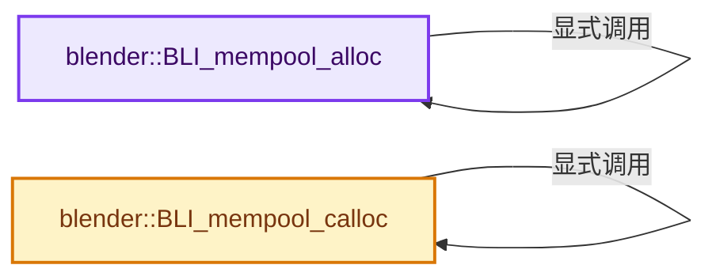
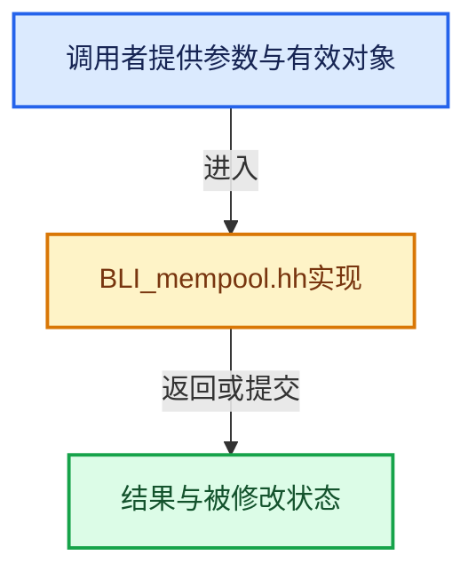

# 实现依赖专题：source/blender/blenlib/BLI_mempool.hh

[方向导航](README.md) · [符号索引](../%E7%AC%A6%E5%8F%B7%E4%BE%9D%E8%B5%96%E4%B8%8E%E5%AE%9E%E7%8E%B0%E7%B4%A2%E5%BC%95.md)

本专题从正文实际调用进入，集中保存共享实现。函数有稳定锚点，可从调用处直接跳到对应完整函数；递归与互相调用通过回链组织。

## 本文件的实现关系






## 完整成员与函数实现

<a id="f-3a0a9f741b9d9972"></a>

### `blender::BLI_mempool_alloc`

实现位置：[source/blender/blenlib/BLI_mempool.hh](../../../../../source/blender/blenlib/BLI_mempool.hh) · L33—L40。

接口参数：

- `BLI_mempool *pool`

**教学注释版**

<!-- annotated:ad6816fb2057dc -->

```cpp
template<typename T>
ATTR_MALLOC ATTR_WARN_UNUSED_RESULT ATTR_RETURNS_NONNULL
    ATTR_NONNULL(1) T *BLI_mempool_alloc(BLI_mempool *pool)
{
  static_assert(std::is_trivial_v<T>,
                "Only trivial types may be allocated with BLI_mempool_alloc");
  return static_cast<T *>(BLI_mempool_alloc(pool));
}
```

<details>
<summary>核对原始源码：source/blender/blenlib/BLI_mempool.hh · L33—L40</summary>

<!-- original:ad6816fb2057dc:source/blender/blenlib/BLI_mempool.hh:33:40 -->

```cpp
template<typename T>
ATTR_MALLOC ATTR_WARN_UNUSED_RESULT ATTR_RETURNS_NONNULL
    ATTR_NONNULL(1) T *BLI_mempool_alloc(BLI_mempool *pool)
{
  static_assert(std::is_trivial_v<T>,
                "Only trivial types may be allocated with BLI_mempool_alloc");
  return static_cast<T *>(BLI_mempool_alloc(pool));
}
```

</details>

**结果出口**

- `return static_cast<T *>(BLI_mempool_alloc(pool));`

**继续追踪实现**

- `BLI_mempool_alloc` → [blender::BLI_mempool_alloc · L33](%E4%BE%9D%E8%B5%96-BLI_mempool-4b5fa7.md#f-3a0a9f741b9d9972)。

<a id="f-202f5a34c11990d3"></a>

### `blender::BLI_mempool_calloc`

实现位置：[source/blender/blenlib/BLI_mempool.hh](../../../../../source/blender/blenlib/BLI_mempool.hh) · L41—L48。

接口参数：

- `BLI_mempool *pool`

**教学注释版**

<!-- annotated:6339cf7b72995a -->

```cpp
template<typename T>
ATTR_MALLOC ATTR_WARN_UNUSED_RESULT ATTR_RETURNS_NONNULL
    ATTR_NONNULL(1) T *BLI_mempool_calloc(BLI_mempool *pool)
{
  static_assert(std::is_trivial_v<T>,
                "Only trivial types may be allocated with BLI_mempool_calloc");
  return static_cast<T *>(BLI_mempool_calloc(pool));
}
```

<details>
<summary>核对原始源码：source/blender/blenlib/BLI_mempool.hh · L41—L48</summary>

<!-- original:6339cf7b72995a:source/blender/blenlib/BLI_mempool.hh:41:48 -->

```cpp
template<typename T>
ATTR_MALLOC ATTR_WARN_UNUSED_RESULT ATTR_RETURNS_NONNULL
    ATTR_NONNULL(1) T *BLI_mempool_calloc(BLI_mempool *pool)
{
  static_assert(std::is_trivial_v<T>,
                "Only trivial types may be allocated with BLI_mempool_calloc");
  return static_cast<T *>(BLI_mempool_calloc(pool));
}
```

</details>

**结果出口**

- `return static_cast<T *>(BLI_mempool_calloc(pool));`

**继续追踪实现**

- `BLI_mempool_calloc` → [blender::BLI_mempool_calloc · L41](%E4%BE%9D%E8%B5%96-BLI_mempool-4b5fa7.md#f-202f5a34c11990d3)。
