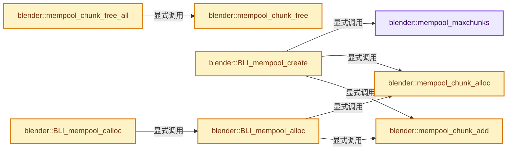
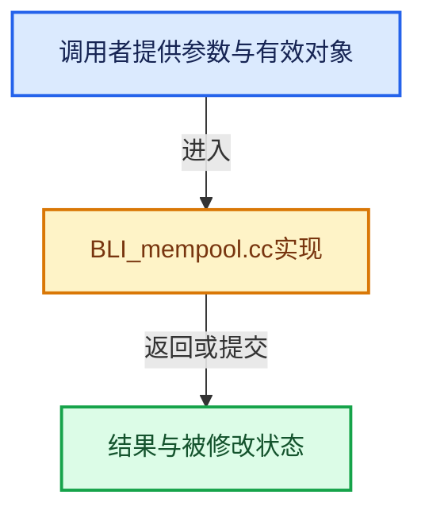

# 实现依赖专题：source/blender/blenlib/intern/BLI_mempool.cc

[方向导航](README.md) · [符号索引](../%E7%AC%A6%E5%8F%B7%E4%BE%9D%E8%B5%96%E4%B8%8E%E5%AE%9E%E7%8E%B0%E7%B4%A2%E5%BC%95.md)

本专题从正文实际调用进入，集中保存共享实现。函数有稳定锚点，可从调用处直接跳到对应完整函数；递归与互相调用通过回链组织。

## 本文件的实现关系






<a id="m-265b7bf8cb9b"></a>

## 宏 `CHUNK_DATA`

<!-- annotated:d0e8501cd76d5b -->

```cpp
#define CHUNK_DATA(chunk) \
  ((BLI_freenode *)(CHECK_TYPE_INLINE(chunk, BLI_mempool_chunk *), (void *)((chunk) + 1)))

```

<details>
<summary>核对原始源码：source/blender/blenlib/intern/BLI_mempool.cc · L133—L135</summary>

<!-- original:d0e8501cd76d5b:source/blender/blenlib/intern/BLI_mempool.cc:133:135 -->

```cpp
#define CHUNK_DATA(chunk) \
  ((BLI_freenode *)(CHECK_TYPE_INLINE(chunk, BLI_mempool_chunk *), (void *)((chunk) + 1)))

```

</details>

宏在预处理阶段展开，参数替换、重复求值和条件编译应直接从该定义检查。与普通函数不同，宏不会自动提供参数类型检查；构建配置选择哪个定义需结合外围条件。

<a id="m-9d19a7c0d8af"></a>

## 宏 `NODE_STEP_NEXT`

<!-- annotated:0489b0f1dbf33a -->

```cpp
#define NODE_STEP_NEXT(node) ((BLI_freenode *)((char *)(node) + esize))
#define NODE_STEP_PREV(node) ((BLI_freenode *)((char *)(node) - esize))
```

<details>
<summary>核对原始源码：source/blender/blenlib/intern/BLI_mempool.cc · L136—L137</summary>

<!-- original:0489b0f1dbf33a:source/blender/blenlib/intern/BLI_mempool.cc:136:137 -->

```cpp
#define NODE_STEP_NEXT(node) ((BLI_freenode *)((char *)(node) + esize))
#define NODE_STEP_PREV(node) ((BLI_freenode *)((char *)(node) - esize))
```

</details>

宏在预处理阶段展开，参数替换、重复求值和条件编译应直接从该定义检查。与普通函数不同，宏不会自动提供参数类型检查；构建配置选择哪个定义需结合外围条件。

<a id="m-3bad45485121"></a>

## 宏 `NODE_STEP_PREV`

<!-- annotated:71c149d551a06a -->

```cpp
#define NODE_STEP_PREV(node) ((BLI_freenode *)((char *)(node) - esize))

```

<details>
<summary>核对原始源码：source/blender/blenlib/intern/BLI_mempool.cc · L137—L138</summary>

<!-- original:71c149d551a06a:source/blender/blenlib/intern/BLI_mempool.cc:137:138 -->

```cpp
#define NODE_STEP_PREV(node) ((BLI_freenode *)((char *)(node) - esize))

```

</details>

宏在预处理阶段展开，参数替换、重复求值和条件编译应直接从该定义检查。与普通函数不同，宏不会自动提供参数类型检查；构建配置选择哪个定义需结合外围条件。

## 完整成员与函数实现

<a id="f-5cccde0ee85292bf"></a>

### `blender::mempool_maxchunks`

实现位置：[source/blender/blenlib/intern/BLI_mempool.cc](../../../../../source/blender/blenlib/intern/BLI_mempool.cc) · L174—L177。

接口参数：

- `const uint elem_num`
- `const uint pchunk`

**教学注释版**

<!-- annotated:c2b49fa81325a7 -->

```cpp
BLI_INLINE uint mempool_maxchunks(const uint elem_num, const uint pchunk)
{
  return (elem_num <= pchunk) ? 1 : ((elem_num / pchunk) + 1);
}
```

<details>
<summary>核对原始源码：source/blender/blenlib/intern/BLI_mempool.cc · L174—L177</summary>

<!-- original:c2b49fa81325a7:source/blender/blenlib/intern/BLI_mempool.cc:174:177 -->

```cpp
BLI_INLINE uint mempool_maxchunks(const uint elem_num, const uint pchunk)
{
  return (elem_num <= pchunk) ? 1 : ((elem_num / pchunk) + 1);
}
```

</details>

**结果出口**

- `return (elem_num <= pchunk) ? 1 : ((elem_num / pchunk) + 1);`

**继续追踪实现**

本实现没有需要继续展开的显式调用；检查返回表达式、对象转换和调用者前置条件。

<a id="f-ae41502768f95b8e"></a>

### `blender::mempool_chunk_alloc`

实现位置：[source/blender/blenlib/intern/BLI_mempool.cc](../../../../../source/blender/blenlib/intern/BLI_mempool.cc) · L179—L183。

接口参数：

- `const BLI_mempool *pool`

**教学注释版**

<!-- annotated:7e0e3b2490c0a7 -->

```cpp
static BLI_mempool_chunk *mempool_chunk_alloc(const BLI_mempool *pool)
{
  return static_cast<BLI_mempool_chunk *>(
      MEM_new_uninitialized(sizeof(BLI_mempool_chunk) + size_t(pool->csize), "mempool chunk"));
}
```

<details>
<summary>核对原始源码：source/blender/blenlib/intern/BLI_mempool.cc · L179—L183</summary>

<!-- original:7e0e3b2490c0a7:source/blender/blenlib/intern/BLI_mempool.cc:179:183 -->

```cpp
static BLI_mempool_chunk *mempool_chunk_alloc(const BLI_mempool *pool)
{
  return static_cast<BLI_mempool_chunk *>(
      MEM_new_uninitialized(sizeof(BLI_mempool_chunk) + size_t(pool->csize), "mempool chunk"));
}
```

</details>

**结果出口**

- `return static_cast<BLI_mempool_chunk *>(`

**继续追踪实现**

- `MEM_new_uninitialized` → [MEM_new_uninitialized · L590](../03-%E5%86%85%E5%AD%98%E5%88%86%E9%85%8D%E4%B8%8E%E8%BF%90%E8%A1%8C%E6%97%B6%E7%B1%BB%E5%9E%8B/%E4%BE%9D%E8%B5%96-MEM_guardedalloc-b54eca.md#f-c773b2e5b8fe70e4)；[MEM_new_uninitialized · L124](../03-%E5%86%85%E5%AD%98%E5%88%86%E9%85%8D%E4%B8%8E%E8%BF%90%E8%A1%8C%E6%97%B6%E7%B1%BB%E5%9E%8B/%E4%BE%9D%E8%B5%96-mallocn-afdcd4.md#f-28a7e00a1e67f699)。同名重载需按实参类型选择。

<a id="f-03f6388addf8b122"></a>

### `blender::mempool_chunk_add`

实现位置：[source/blender/blenlib/intern/BLI_mempool.cc](../../../../../source/blender/blenlib/intern/BLI_mempool.cc) · L194—L295。

接口参数：

- `BLI_mempool *pool`
- `BLI_mempool_chunk *mpchunk`
- `BLI_freenode *last_tail`

**教学注释版**

<!-- annotated:6f5f73da934b6a -->

```cpp
static BLI_freenode *mempool_chunk_add(BLI_mempool *pool,
                                       BLI_mempool_chunk *mpchunk,
                                       BLI_freenode *last_tail)
{
  const uint esize = pool->esize;
  BLI_freenode *curnode = CHUNK_DATA(mpchunk);
  uint j;

  /* append */
  if (pool->chunk_tail) {
    pool->chunk_tail->next = mpchunk;
  }
  else {
    BLI_assert(pool->chunks == nullptr);
    pool->chunks = mpchunk;
  }

  mpchunk->next = nullptr;
  pool->chunk_tail = mpchunk;

  if (pool->free == nullptr) [[unlikely]] {
    pool->free = curnode;
  }

  /* loop through the allocated data, building the pointer structures */
  j = pool->pchunk;
  if (pool->flag & BLI_MEMPOOL_ALLOW_ITER) {
    while (j--) {
      BLI_freenode *next;

      BLI_asan_unpoison(curnode, pool->esize - POISON_REDZONE_SIZE);
#ifdef WITH_MEM_VALGRIND
      VALGRIND_MAKE_MEM_DEFINED(curnode, pool->esize - POISON_REDZONE_SIZE);
#endif
      curnode->next = next = NODE_STEP_NEXT(curnode);
      curnode->freeword = FREEWORD;

      BLI_asan_poison(curnode, pool->esize);
#ifdef WITH_MEM_VALGRIND
      VALGRIND_MAKE_MEM_UNDEFINED(curnode, pool->esize);
#endif
      curnode = next;
    }
  }
  else {
    while (j--) {
      BLI_freenode *next;

      BLI_asan_unpoison(curnode, pool->esize - POISON_REDZONE_SIZE);
#ifdef WITH_MEM_VALGRIND
      VALGRIND_MAKE_MEM_DEFINED(curnode, pool->esize - POISON_REDZONE_SIZE);
#endif
      curnode->next = next = NODE_STEP_NEXT(curnode);
      BLI_asan_poison(curnode, pool->esize);
#ifdef WITH_MEM_VALGRIND
      VALGRIND_MAKE_MEM_UNDEFINED(curnode, pool->esize);
#endif

      curnode = next;
    }
  }

  /* terminate the list (rewind one)
   * will be overwritten if 'curnode' gets passed in again as 'last_tail' */

  if (POISON_REDZONE_SIZE > 0) {
    BLI_asan_unpoison(curnode, pool->esize - POISON_REDZONE_SIZE);
    BLI_asan_poison(curnode, pool->esize);
#ifdef WITH_MEM_VALGRIND
    VALGRIND_MAKE_MEM_DEFINED(curnode, pool->esize - POISON_REDZONE_SIZE);
    VALGRIND_MAKE_MEM_UNDEFINED(curnode, pool->esize);
#endif
  }

  curnode = NODE_STEP_PREV(curnode);

  BLI_asan_unpoison(curnode, pool->esize - POISON_REDZONE_SIZE);
#ifdef WITH_MEM_VALGRIND
  VALGRIND_MAKE_MEM_DEFINED(curnode, pool->esize - POISON_REDZONE_SIZE);
#endif

  curnode->next = nullptr;
  BLI_asan_poison(curnode, pool->esize);
#ifdef WITH_MEM_VALGRIND
  VALGRIND_MAKE_MEM_UNDEFINED(curnode, pool->esize);
#endif

  /* final pointer in the previously allocated chunk is wrong */
  if (last_tail) {
    BLI_asan_unpoison(last_tail, pool->esize - POISON_REDZONE_SIZE);
#ifdef WITH_MEM_VALGRIND
    VALGRIND_MAKE_MEM_DEFINED(last_tail, pool->esize - POISON_REDZONE_SIZE);
#endif
    last_tail->next = CHUNK_DATA(mpchunk);
    BLI_asan_poison(last_tail, pool->esize);
#ifdef WITH_MEM_VALGRIND
    VALGRIND_MAKE_MEM_UNDEFINED(last_tail, pool->esize);
#endif
  }

  return curnode;
}
```

<details>
<summary>核对原始源码：source/blender/blenlib/intern/BLI_mempool.cc · L194—L295</summary>

<!-- original:6f5f73da934b6a:source/blender/blenlib/intern/BLI_mempool.cc:194:295 -->

```cpp
static BLI_freenode *mempool_chunk_add(BLI_mempool *pool,
                                       BLI_mempool_chunk *mpchunk,
                                       BLI_freenode *last_tail)
{
  const uint esize = pool->esize;
  BLI_freenode *curnode = CHUNK_DATA(mpchunk);
  uint j;

  /* append */
  if (pool->chunk_tail) {
    pool->chunk_tail->next = mpchunk;
  }
  else {
    BLI_assert(pool->chunks == nullptr);
    pool->chunks = mpchunk;
  }

  mpchunk->next = nullptr;
  pool->chunk_tail = mpchunk;

  if (pool->free == nullptr) [[unlikely]] {
    pool->free = curnode;
  }

  /* loop through the allocated data, building the pointer structures */
  j = pool->pchunk;
  if (pool->flag & BLI_MEMPOOL_ALLOW_ITER) {
    while (j--) {
      BLI_freenode *next;

      BLI_asan_unpoison(curnode, pool->esize - POISON_REDZONE_SIZE);
#ifdef WITH_MEM_VALGRIND
      VALGRIND_MAKE_MEM_DEFINED(curnode, pool->esize - POISON_REDZONE_SIZE);
#endif
      curnode->next = next = NODE_STEP_NEXT(curnode);
      curnode->freeword = FREEWORD;

      BLI_asan_poison(curnode, pool->esize);
#ifdef WITH_MEM_VALGRIND
      VALGRIND_MAKE_MEM_UNDEFINED(curnode, pool->esize);
#endif
      curnode = next;
    }
  }
  else {
    while (j--) {
      BLI_freenode *next;

      BLI_asan_unpoison(curnode, pool->esize - POISON_REDZONE_SIZE);
#ifdef WITH_MEM_VALGRIND
      VALGRIND_MAKE_MEM_DEFINED(curnode, pool->esize - POISON_REDZONE_SIZE);
#endif
      curnode->next = next = NODE_STEP_NEXT(curnode);
      BLI_asan_poison(curnode, pool->esize);
#ifdef WITH_MEM_VALGRIND
      VALGRIND_MAKE_MEM_UNDEFINED(curnode, pool->esize);
#endif

      curnode = next;
    }
  }

  /* terminate the list (rewind one)
   * will be overwritten if 'curnode' gets passed in again as 'last_tail' */

  if (POISON_REDZONE_SIZE > 0) {
    BLI_asan_unpoison(curnode, pool->esize - POISON_REDZONE_SIZE);
    BLI_asan_poison(curnode, pool->esize);
#ifdef WITH_MEM_VALGRIND
    VALGRIND_MAKE_MEM_DEFINED(curnode, pool->esize - POISON_REDZONE_SIZE);
    VALGRIND_MAKE_MEM_UNDEFINED(curnode, pool->esize);
#endif
  }

  curnode = NODE_STEP_PREV(curnode);

  BLI_asan_unpoison(curnode, pool->esize - POISON_REDZONE_SIZE);
#ifdef WITH_MEM_VALGRIND
  VALGRIND_MAKE_MEM_DEFINED(curnode, pool->esize - POISON_REDZONE_SIZE);
#endif

  curnode->next = nullptr;
  BLI_asan_poison(curnode, pool->esize);
#ifdef WITH_MEM_VALGRIND
  VALGRIND_MAKE_MEM_UNDEFINED(curnode, pool->esize);
#endif

  /* final pointer in the previously allocated chunk is wrong */
  if (last_tail) {
    BLI_asan_unpoison(last_tail, pool->esize - POISON_REDZONE_SIZE);
#ifdef WITH_MEM_VALGRIND
    VALGRIND_MAKE_MEM_DEFINED(last_tail, pool->esize - POISON_REDZONE_SIZE);
#endif
    last_tail->next = CHUNK_DATA(mpchunk);
    BLI_asan_poison(last_tail, pool->esize);
#ifdef WITH_MEM_VALGRIND
    VALGRIND_MAKE_MEM_UNDEFINED(last_tail, pool->esize);
#endif
  }

  return curnode;
}
```

</details>

**沿实际写入检查状态**

- `pool->chunk_tail->next = mpchunk;`
- `pool->chunks = mpchunk;`
- `mpchunk->next = nullptr;`
- `pool->chunk_tail = mpchunk;`
- `pool->free = curnode;`
- `j = pool->pchunk;`
- `curnode->next = next = NODE_STEP_NEXT(curnode);`
- `curnode->freeword = FREEWORD;`
- `curnode = next;`
- `curnode = NODE_STEP_PREV(curnode);`
- `curnode->next = nullptr;`
- `last_tail->next = CHUNK_DATA(mpchunk);`

**结果出口**

- `return curnode;`

**继续追踪实现**

- `CHUNK_DATA` → [CHUNK_DATA · L133](%E4%BE%9D%E8%B5%96-BLI_mempool-991442.md#m-265b7bf8cb9b)。宏定义由构建条件选择。
- `BLI_assert` → [BLI_assert · L48](%E4%BE%9D%E8%B5%96-BLI_assert-cc98e8.md#m-57a88495704d)；[BLI_assert · L63](%E4%BE%9D%E8%B5%96-BLI_assert-cc98e8.md#m-d07050020cb5)。宏定义由构建条件选择。
- `BLI_asan_unpoison` → [BLI_asan_unpoison · L36](%E4%BE%9D%E8%B5%96-BLI_asan-96bcf6.md#m-1b72097364ea)。宏定义由构建条件选择。
- `VALGRIND_MAKE_MEM_DEFINED` → [调用协议](../%E6%A8%A1%E6%9D%BF%E5%AE%8F%E4%B8%8E%E5%8A%A8%E6%80%81%E5%88%86%E6%B4%BE%E5%8D%8F%E8%AE%AE.md)：配置相关检测或外部运行时接口。调用位置L226。
- `NODE_STEP_NEXT` → [NODE_STEP_NEXT · L136](%E4%BE%9D%E8%B5%96-BLI_mempool-991442.md#m-9d19a7c0d8af)。宏定义由构建条件选择。
- `BLI_asan_poison` → [BLI_asan_poison · L31](%E4%BE%9D%E8%B5%96-BLI_asan-96bcf6.md#m-4cf78e7886f3)。宏定义由构建条件选择。
- `VALGRIND_MAKE_MEM_UNDEFINED` → [调用协议](../%E6%A8%A1%E6%9D%BF%E5%AE%8F%E4%B8%8E%E5%8A%A8%E6%80%81%E5%88%86%E6%B4%BE%E5%8D%8F%E8%AE%AE.md)：配置相关检测或外部运行时接口。调用位置L233。
- `NODE_STEP_PREV` → [NODE_STEP_PREV · L137](%E4%BE%9D%E8%B5%96-BLI_mempool-991442.md#m-3bad45485121)。宏定义由构建条件选择。

<a id="f-58420a14853e5192"></a>

### `blender::mempool_chunk_free`

实现位置：[source/blender/blenlib/intern/BLI_mempool.cc](../../../../../source/blender/blenlib/intern/BLI_mempool.cc) · L297—L308。

接口参数：

- `BLI_mempool_chunk *mpchunk`
- `BLI_mempool *pool`

**教学注释版**

<!-- annotated:e2204c9a186a89 -->

```cpp
static void mempool_chunk_free(BLI_mempool_chunk *mpchunk, BLI_mempool *pool)
{
#ifdef WITH_ASAN
  BLI_asan_unpoison(mpchunk, sizeof(BLI_mempool_chunk) + pool->esize * pool->csize);
#else
  UNUSED_VARS(pool);
#endif
#ifdef WITH_MEM_VALGRIND
  VALGRIND_MAKE_MEM_DEFINED(mpchunk, sizeof(BLI_mempool_chunk) + pool->esize * pool->csize);
#endif
  MEM_delete(mpchunk);
}
```

<details>
<summary>核对原始源码：source/blender/blenlib/intern/BLI_mempool.cc · L297—L308</summary>

<!-- original:e2204c9a186a89:source/blender/blenlib/intern/BLI_mempool.cc:297:308 -->

```cpp
static void mempool_chunk_free(BLI_mempool_chunk *mpchunk, BLI_mempool *pool)
{
#ifdef WITH_ASAN
  BLI_asan_unpoison(mpchunk, sizeof(BLI_mempool_chunk) + pool->esize * pool->csize);
#else
  UNUSED_VARS(pool);
#endif
#ifdef WITH_MEM_VALGRIND
  VALGRIND_MAKE_MEM_DEFINED(mpchunk, sizeof(BLI_mempool_chunk) + pool->esize * pool->csize);
#endif
  MEM_delete(mpchunk);
}
```

</details>

**继续追踪实现**

- `BLI_asan_unpoison` → [BLI_asan_unpoison · L36](%E4%BE%9D%E8%B5%96-BLI_asan-96bcf6.md#m-1b72097364ea)。宏定义由构建条件选择。
- `UNUSED_VARS` → [UNUSED_VARS · L522](%E4%BE%9D%E8%B5%96-BLI_utildefines-293a0a.md#m-013582537634)；[UNUSED_VARS · L41](../05-%E5%87%A0%E4%BD%95%E5%AD%98%E5%82%A8%E4%B8%8E%E6%8B%93%E6%89%91%E6%98%A0%E5%B0%84/%E4%BE%9D%E8%B5%96-GPU_shader_shared_utils-0adda3.md#m-05d9d7a33da0)；[UNUSED_VARS · L62](../05-%E5%87%A0%E4%BD%95%E5%AD%98%E5%82%A8%E4%B8%8E%E6%8B%93%E6%89%91%E6%98%A0%E5%B0%84/%E4%BE%9D%E8%B5%96-GPU_shader_shared_utils-0adda3.md#m-e12c683a4aca)。宏定义由构建条件选择。
- `VALGRIND_MAKE_MEM_DEFINED` → [调用协议](../%E6%A8%A1%E6%9D%BF%E5%AE%8F%E4%B8%8E%E5%8A%A8%E6%80%81%E5%88%86%E6%B4%BE%E5%8D%8F%E8%AE%AE.md)：配置相关检测或外部运行时接口。调用位置L305。
- `MEM_delete` → [MEM_delete · L400](../03-%E5%86%85%E5%AD%98%E5%88%86%E9%85%8D%E4%B8%8E%E8%BF%90%E8%A1%8C%E6%97%B6%E7%B1%BB%E5%9E%8B/%E4%BE%9D%E8%B5%96-MEM_guardedalloc-b54eca.md#f-9049ffdd1682887c)。

<a id="f-4070fbec4c0574c1"></a>

### `blender::mempool_chunk_free_all`

实现位置：[source/blender/blenlib/intern/BLI_mempool.cc](../../../../../source/blender/blenlib/intern/BLI_mempool.cc) · L310—L318。

接口参数：

- `BLI_mempool_chunk *mpchunk`
- `BLI_mempool *pool`

**教学注释版**

<!-- annotated:05b44bcc32902e -->

```cpp
static void mempool_chunk_free_all(BLI_mempool_chunk *mpchunk, BLI_mempool *pool)
{
  BLI_mempool_chunk *mpchunk_next;

  for (; mpchunk; mpchunk = mpchunk_next) {
    mpchunk_next = mpchunk->next;
    mempool_chunk_free(mpchunk, pool);
  }
}
```

<details>
<summary>核对原始源码：source/blender/blenlib/intern/BLI_mempool.cc · L310—L318</summary>

<!-- original:05b44bcc32902e:source/blender/blenlib/intern/BLI_mempool.cc:310:318 -->

```cpp
static void mempool_chunk_free_all(BLI_mempool_chunk *mpchunk, BLI_mempool *pool)
{
  BLI_mempool_chunk *mpchunk_next;

  for (; mpchunk; mpchunk = mpchunk_next) {
    mpchunk_next = mpchunk->next;
    mempool_chunk_free(mpchunk, pool);
  }
}
```

</details>

**沿实际写入检查状态**

- `mpchunk_next = mpchunk->next;`

**继续追踪实现**

- `mempool_chunk_free` → [blender::mempool_chunk_free · L297](%E4%BE%9D%E8%B5%96-BLI_mempool-991442.md#f-58420a14853e5192)。

<a id="f-90a2c14d1b30f9cf"></a>

### `blender::BLI_mempool_create`

实现位置：[source/blender/blenlib/intern/BLI_mempool.cc](../../../../../source/blender/blenlib/intern/BLI_mempool.cc) · L320—L385。

接口参数：

- `uint esize`
- `uint elem_num`
- `uint pchunk`
- `uint flag`

**教学注释版**

<!-- annotated:675ab0ffd9498d -->

```cpp
BLI_mempool *BLI_mempool_create(uint esize, uint elem_num, uint pchunk, uint flag)
{
  BLI_mempool *pool;
  BLI_freenode *last_tail = nullptr;
  uint i, maxchunks;

  /* allocate the pool structure */
  pool = MEM_new_zeroed<BLI_mempool>("memory pool");

#ifdef WITH_ASAN
  BLI_mutex_init(&pool->mutex);
#endif

  /* set the elem size */
  // [讲解] std::max：按比较关系选取较大值。本讲解中的增长公式同时满足最低请求和几何增长；若保存返回引用，还需注意实参寿命。
  esize = std::max(esize, uint(MEMPOOL_ELEM_SIZE_MIN));

  if (flag & BLI_MEMPOOL_ALLOW_ITER) {
    esize = std::max(esize, uint(sizeof(BLI_freenode)));
  }

  esize += POISON_REDZONE_SIZE;

  maxchunks = mempool_maxchunks(elem_num, pchunk);

  pool->chunks = nullptr;
  pool->chunk_tail = nullptr;
  pool->esize = esize;

  /* Optimize chunk size to powers of 2, accounting for slop-space. */
#ifdef USE_CHUNK_POW2
  {
    BLI_assert(power_of_2_max_u(pchunk * esize) > CHUNK_OVERHEAD);
    pchunk = (power_of_2_max_u(pchunk * esize) - CHUNK_OVERHEAD) / esize;
  }
#endif

  pool->csize = esize * pchunk;

  /* Ensure this is a power of 2, minus the rounding by element size. */
#if defined(USE_CHUNK_POW2) && !defined(NDEBUG)
  {
    uint final_size = uint(MEM_SIZE_OVERHEAD) + uint(sizeof(BLI_mempool_chunk)) + pool->csize;
    BLI_assert((uint(power_of_2_max_u(final_size)) - final_size) < pool->esize);
  }
#endif

  pool->pchunk = pchunk;
  pool->flag = flag;
  pool->free = nullptr; /* mempool_chunk_add assigns */
  pool->maxchunks = maxchunks;
  pool->totused = 0;

  if (elem_num) {
    /* Allocate the actual chunks. */
    for (i = 0; i < maxchunks; i++) {
      BLI_mempool_chunk *mpchunk = mempool_chunk_alloc(pool);
      last_tail = mempool_chunk_add(pool, mpchunk, last_tail);
    }
  }

#ifdef WITH_MEM_VALGRIND
  VALGRIND_CREATE_MEMPOOL(pool, 0, false);
#endif

  return pool;
}
```

<details>
<summary>核对原始源码：source/blender/blenlib/intern/BLI_mempool.cc · L320—L385</summary>

<!-- original:675ab0ffd9498d:source/blender/blenlib/intern/BLI_mempool.cc:320:385 -->

```cpp
BLI_mempool *BLI_mempool_create(uint esize, uint elem_num, uint pchunk, uint flag)
{
  BLI_mempool *pool;
  BLI_freenode *last_tail = nullptr;
  uint i, maxchunks;

  /* allocate the pool structure */
  pool = MEM_new_zeroed<BLI_mempool>("memory pool");

#ifdef WITH_ASAN
  BLI_mutex_init(&pool->mutex);
#endif

  /* set the elem size */
  esize = std::max(esize, uint(MEMPOOL_ELEM_SIZE_MIN));

  if (flag & BLI_MEMPOOL_ALLOW_ITER) {
    esize = std::max(esize, uint(sizeof(BLI_freenode)));
  }

  esize += POISON_REDZONE_SIZE;

  maxchunks = mempool_maxchunks(elem_num, pchunk);

  pool->chunks = nullptr;
  pool->chunk_tail = nullptr;
  pool->esize = esize;

  /* Optimize chunk size to powers of 2, accounting for slop-space. */
#ifdef USE_CHUNK_POW2
  {
    BLI_assert(power_of_2_max_u(pchunk * esize) > CHUNK_OVERHEAD);
    pchunk = (power_of_2_max_u(pchunk * esize) - CHUNK_OVERHEAD) / esize;
  }
#endif

  pool->csize = esize * pchunk;

  /* Ensure this is a power of 2, minus the rounding by element size. */
#if defined(USE_CHUNK_POW2) && !defined(NDEBUG)
  {
    uint final_size = uint(MEM_SIZE_OVERHEAD) + uint(sizeof(BLI_mempool_chunk)) + pool->csize;
    BLI_assert((uint(power_of_2_max_u(final_size)) - final_size) < pool->esize);
  }
#endif

  pool->pchunk = pchunk;
  pool->flag = flag;
  pool->free = nullptr; /* mempool_chunk_add assigns */
  pool->maxchunks = maxchunks;
  pool->totused = 0;

  if (elem_num) {
    /* Allocate the actual chunks. */
    for (i = 0; i < maxchunks; i++) {
      BLI_mempool_chunk *mpchunk = mempool_chunk_alloc(pool);
      last_tail = mempool_chunk_add(pool, mpchunk, last_tail);
    }
  }

#ifdef WITH_MEM_VALGRIND
  VALGRIND_CREATE_MEMPOOL(pool, 0, false);
#endif

  return pool;
}
```

</details>

**沿实际写入检查状态**

- `pool = MEM_new_zeroed<BLI_mempool>("memory pool");`
- `esize = std::max(esize, uint(MEMPOOL_ELEM_SIZE_MIN));`
- `esize = std::max(esize, uint(sizeof(BLI_freenode)));`
- `esize += POISON_REDZONE_SIZE;`
- `maxchunks = mempool_maxchunks(elem_num, pchunk);`
- `pool->chunks = nullptr;`
- `pool->chunk_tail = nullptr;`
- `pool->esize = esize;`
- `pchunk = (power_of_2_max_u(pchunk * esize) - CHUNK_OVERHEAD) / esize;`
- `pool->csize = esize * pchunk;`
- `pool->pchunk = pchunk;`
- `pool->flag = flag;`
- `pool->free = nullptr; /* mempool_chunk_add assigns */`
- `pool->maxchunks = maxchunks;`
- `pool->totused = 0;`
- `last_tail = mempool_chunk_add(pool, mpchunk, last_tail);`

**结果出口**

- `return pool;`

**继续追踪实现**

- `MEM_new_zeroed<BLI_mempool>` → [MEM_new_zeroed · L550](../03-%E5%86%85%E5%AD%98%E5%88%86%E9%85%8D%E4%B8%8E%E8%BF%90%E8%A1%8C%E6%97%B6%E7%B1%BB%E5%9E%8B/%E4%BE%9D%E8%B5%96-MEM_guardedalloc-b54eca.md#f-eeb1e2a7f57dd231)；[MEM_new_zeroed · L114](../03-%E5%86%85%E5%AD%98%E5%88%86%E9%85%8D%E4%B8%8E%E8%BF%90%E8%A1%8C%E6%97%B6%E7%B1%BB%E5%9E%8B/%E4%BE%9D%E8%B5%96-mallocn-afdcd4.md#f-e04cf01c64c8b180)。同名重载需按实参类型选择。
- `BLI_mutex_init` → [BLI_mutex_init · L343](%E4%BE%9D%E8%B5%96-threads-a036bf.md#f-7d065be18920fb3a)。
- `std::max` → [外部契约](https://eel.is/c++draft/alg.min.max)：按比较关系选取较大值。本讲解中的增长公式同时满足最低请求和几何增长；若保存返回引用，还需注意实参寿命。
- `mempool_maxchunks` → [blender::mempool_maxchunks · L174](%E4%BE%9D%E8%B5%96-BLI_mempool-991442.md#f-5cccde0ee85292bf)。
- `BLI_assert` → [BLI_assert · L48](%E4%BE%9D%E8%B5%96-BLI_assert-cc98e8.md#m-57a88495704d)；[BLI_assert · L63](%E4%BE%9D%E8%B5%96-BLI_assert-cc98e8.md#m-d07050020cb5)。宏定义由构建条件选择。
- `power_of_2_max_u` → [blender::power_of_2_max_u · L132](../12-%E7%A9%BA%E9%97%B4%E6%95%B0%E6%8D%AE%E7%BB%93%E6%9E%84%E4%B8%8E%E5%87%A0%E4%BD%95%E7%AE%97%E6%B3%95/%E4%BE%9D%E8%B5%96-math_base_inline-546b00.md#f-7a7e360f222ff310)。
- `mempool_chunk_alloc` → [blender::mempool_chunk_alloc · L179](%E4%BE%9D%E8%B5%96-BLI_mempool-991442.md#f-ae41502768f95b8e)。
- `mempool_chunk_add` → [blender::mempool_chunk_add · L194](%E4%BE%9D%E8%B5%96-BLI_mempool-991442.md#f-03f6388addf8b122)。
- `VALGRIND_CREATE_MEMPOOL` → [VALGRIND_CREATE_MEMPOOL · L29](%E4%BE%9D%E8%B5%96-BLI_memarena-aea32a.md#m-ae14250b7285)。宏定义由构建条件选择。

<a id="f-2e4ccb76db23671b"></a>

### `blender::BLI_mempool_alloc`

实现位置：[source/blender/blenlib/intern/BLI_mempool.cc](../../../../../source/blender/blenlib/intern/BLI_mempool.cc) · L387—L426。

接口参数：

- `BLI_mempool *pool`

**教学注释版**

<!-- annotated:3470b00037b5e0 -->

```cpp
void *BLI_mempool_alloc(BLI_mempool *pool)
{
  BLI_freenode *free_pop;

  if (pool->free == nullptr) [[unlikely]] {
    /* Need to allocate a new chunk. */
    BLI_mempool_chunk *mpchunk = mempool_chunk_alloc(pool);
    mempool_chunk_add(pool, mpchunk, nullptr);
  }

  free_pop = pool->free;

  BLI_asan_unpoison(free_pop, pool->esize - POISON_REDZONE_SIZE);
#ifdef WITH_MEM_VALGRIND
  VALGRIND_MEMPOOL_ALLOC(pool, free_pop, pool->esize - POISON_REDZONE_SIZE);
  /* Mark as define, then undefine immediately before returning so:
   * - `free_pop->next` can be read without reading "undefined" memory.
   * - `freeword` can be set without causing the memory to be considered "defined".
   *
   * These could be handled on a more granular level - dealing with defining & underlining these
   * members explicitly but that requires more involved calls,
   * adding overhead for no real benefit. */
  VALGRIND_MAKE_MEM_DEFINED(free_pop, pool->esize - POISON_REDZONE_SIZE);
#endif

  BLI_assert(pool->chunk_tail->next == nullptr);

  if (pool->flag & BLI_MEMPOOL_ALLOW_ITER) {
    free_pop->freeword = USEDWORD;
  }

  pool->free = free_pop->next;
  pool->totused++;

#ifdef WITH_MEM_VALGRIND
  VALGRIND_MAKE_MEM_UNDEFINED(free_pop, pool->esize - POISON_REDZONE_SIZE);
#endif

  return static_cast<void *>(free_pop);
}
```

<details>
<summary>核对原始源码：source/blender/blenlib/intern/BLI_mempool.cc · L387—L426</summary>

<!-- original:3470b00037b5e0:source/blender/blenlib/intern/BLI_mempool.cc:387:426 -->

```cpp
void *BLI_mempool_alloc(BLI_mempool *pool)
{
  BLI_freenode *free_pop;

  if (pool->free == nullptr) [[unlikely]] {
    /* Need to allocate a new chunk. */
    BLI_mempool_chunk *mpchunk = mempool_chunk_alloc(pool);
    mempool_chunk_add(pool, mpchunk, nullptr);
  }

  free_pop = pool->free;

  BLI_asan_unpoison(free_pop, pool->esize - POISON_REDZONE_SIZE);
#ifdef WITH_MEM_VALGRIND
  VALGRIND_MEMPOOL_ALLOC(pool, free_pop, pool->esize - POISON_REDZONE_SIZE);
  /* Mark as define, then undefine immediately before returning so:
   * - `free_pop->next` can be read without reading "undefined" memory.
   * - `freeword` can be set without causing the memory to be considered "defined".
   *
   * These could be handled on a more granular level - dealing with defining & underlining these
   * members explicitly but that requires more involved calls,
   * adding overhead for no real benefit. */
  VALGRIND_MAKE_MEM_DEFINED(free_pop, pool->esize - POISON_REDZONE_SIZE);
#endif

  BLI_assert(pool->chunk_tail->next == nullptr);

  if (pool->flag & BLI_MEMPOOL_ALLOW_ITER) {
    free_pop->freeword = USEDWORD;
  }

  pool->free = free_pop->next;
  pool->totused++;

#ifdef WITH_MEM_VALGRIND
  VALGRIND_MAKE_MEM_UNDEFINED(free_pop, pool->esize - POISON_REDZONE_SIZE);
#endif

  return static_cast<void *>(free_pop);
}
```

</details>

**沿实际写入检查状态**

- `free_pop = pool->free;`
- `free_pop->freeword = USEDWORD;`
- `pool->free = free_pop->next;`

**结果出口**

- `return static_cast<void *>(free_pop);`

**继续追踪实现**

- `mempool_chunk_alloc` → [blender::mempool_chunk_alloc · L179](%E4%BE%9D%E8%B5%96-BLI_mempool-991442.md#f-ae41502768f95b8e)。
- `mempool_chunk_add` → [blender::mempool_chunk_add · L194](%E4%BE%9D%E8%B5%96-BLI_mempool-991442.md#f-03f6388addf8b122)。
- `BLI_asan_unpoison` → [BLI_asan_unpoison · L36](%E4%BE%9D%E8%B5%96-BLI_asan-96bcf6.md#m-1b72097364ea)。宏定义由构建条件选择。
- `VALGRIND_MEMPOOL_ALLOC` → [VALGRIND_MEMPOOL_ALLOC · L31](%E4%BE%9D%E8%B5%96-BLI_memarena-aea32a.md#m-9002b9d327f8)。宏定义由构建条件选择。
- `VALGRIND_MAKE_MEM_DEFINED` → [调用协议](../%E6%A8%A1%E6%9D%BF%E5%AE%8F%E4%B8%8E%E5%8A%A8%E6%80%81%E5%88%86%E6%B4%BE%E5%8D%8F%E8%AE%AE.md)：配置相关检测或外部运行时接口。调用位置L409。
- `BLI_assert` → [BLI_assert · L48](%E4%BE%9D%E8%B5%96-BLI_assert-cc98e8.md#m-57a88495704d)；[BLI_assert · L63](%E4%BE%9D%E8%B5%96-BLI_assert-cc98e8.md#m-d07050020cb5)。宏定义由构建条件选择。
- `VALGRIND_MAKE_MEM_UNDEFINED` → [调用协议](../%E6%A8%A1%E6%9D%BF%E5%AE%8F%E4%B8%8E%E5%8A%A8%E6%80%81%E5%88%86%E6%B4%BE%E5%8D%8F%E8%AE%AE.md)：配置相关检测或外部运行时接口。调用位置L422。

<a id="f-d69998b8a4465dc5"></a>

### `blender::BLI_mempool_calloc`

实现位置：[source/blender/blenlib/intern/BLI_mempool.cc](../../../../../source/blender/blenlib/intern/BLI_mempool.cc) · L428—L435。

接口参数：

- `BLI_mempool *pool`

**教学注释版**

<!-- annotated:19a8663a0523c6 -->

```cpp
void *BLI_mempool_calloc(BLI_mempool *pool)
{
  void *retval = BLI_mempool_alloc(pool);

  // [讲解] memset：填充字节，不调用T构造函数，也不保证任意类型的全零表示是合法或期望值。
  memset(retval, 0, size_t(pool->esize) - POISON_REDZONE_SIZE);

  return retval;
}
```

<details>
<summary>核对原始源码：source/blender/blenlib/intern/BLI_mempool.cc · L428—L435</summary>

<!-- original:19a8663a0523c6:source/blender/blenlib/intern/BLI_mempool.cc:428:435 -->

```cpp
void *BLI_mempool_calloc(BLI_mempool *pool)
{
  void *retval = BLI_mempool_alloc(pool);

  memset(retval, 0, size_t(pool->esize) - POISON_REDZONE_SIZE);

  return retval;
}
```

</details>

**结果出口**

- `return retval;`

**继续追踪实现**

- `BLI_mempool_alloc` → [blender::BLI_mempool_alloc · L387](%E4%BE%9D%E8%B5%96-BLI_mempool-991442.md#f-2e4ccb76db23671b)。
- `memset` → [外部契约](https://eel.is/c++draft/cstring.syn)：填充字节，不调用T构造函数，也不保证任意类型的全零表示是合法或期望值。

<a id="f-b7800fad621bf306"></a>

### `blender::BLI_mempool_free`

实现位置：[source/blender/blenlib/intern/BLI_mempool.cc](../../../../../source/blender/blenlib/intern/BLI_mempool.cc) · L437—L523。

接口参数：

- `BLI_mempool *pool`
- `void *addr`

**教学注释版**

<!-- annotated:ad787e9f96c020 -->

```cpp
void BLI_mempool_free(BLI_mempool *pool, void *addr)
{
  BLI_freenode *newhead = static_cast<BLI_freenode *>(addr);

#ifndef NDEBUG
  {
    BLI_mempool_chunk *chunk;
    bool found = false;
    for (chunk = pool->chunks; chunk; chunk = chunk->next) {
      if (ARRAY_HAS_ITEM((char *)addr, (char *)CHUNK_DATA(chunk), pool->csize)) {
        found = true;
        break;
      }
    }
    if (!found) {
      BLI_assert_msg(0, "Attempt to free data which is not in pool.\n");
    }
  }

  /* Enable for debugging. */
  if (mempool_debug_memset) [[unlikely]] {
    // [讲解] memset：填充字节，不调用T构造函数，也不保证任意类型的全零表示是合法或期望值。
    memset(addr, 255, pool->esize - POISON_REDZONE_SIZE);
  }
#endif

  if (pool->flag & BLI_MEMPOOL_ALLOW_ITER) {
#ifndef NDEBUG
    /* This will detect double free's. */
    BLI_assert(newhead->freeword != FREEWORD);
#endif
    newhead->freeword = FREEWORD;
  }

  newhead->next = pool->free;
  pool->free = newhead;

  BLI_asan_poison(newhead, pool->esize);

  pool->totused--;

#ifdef WITH_MEM_VALGRIND
  VALGRIND_MEMPOOL_FREE(pool, addr);
#endif

  /* Nothing is in use; free all the chunks except the first. */
  if (UNLIKELY(pool->totused == 0) && (pool->chunks->next)) {
    const uint esize = pool->esize;
    BLI_freenode *curnode;
    uint j;
    BLI_mempool_chunk *first;

    first = pool->chunks;
    mempool_chunk_free_all(first->next, pool);
    first->next = nullptr;
    pool->chunk_tail = first;

    /* Temporary allocation so VALGRIND doesn't complain when setting freed blocks 'next'. */
#ifdef WITH_MEM_VALGRIND
    VALGRIND_MEMPOOL_ALLOC(pool, CHUNK_DATA(first), pool->csize);
#endif

    curnode = CHUNK_DATA(first);
    pool->free = curnode;

    j = pool->pchunk;
    while (j--) {
      BLI_asan_unpoison(curnode, pool->esize - POISON_REDZONE_SIZE);
      BLI_freenode *next = curnode->next = NODE_STEP_NEXT(curnode);
      BLI_asan_poison(curnode, pool->esize);
      curnode = next;
    }

    BLI_asan_unpoison(curnode, pool->esize - POISON_REDZONE_SIZE);
    BLI_freenode *prev = NODE_STEP_PREV(curnode);
    BLI_asan_poison(curnode, pool->esize);

    curnode = prev;

    BLI_asan_unpoison(curnode, pool->esize - POISON_REDZONE_SIZE);
    curnode->next = nullptr; /* terminate the list */
    BLI_asan_poison(curnode, pool->esize);

#ifdef WITH_MEM_VALGRIND
    VALGRIND_MEMPOOL_FREE(pool, CHUNK_DATA(first));
#endif
  }
}
```

<details>
<summary>核对原始源码：source/blender/blenlib/intern/BLI_mempool.cc · L437—L523</summary>

<!-- original:ad787e9f96c020:source/blender/blenlib/intern/BLI_mempool.cc:437:523 -->

```cpp
void BLI_mempool_free(BLI_mempool *pool, void *addr)
{
  BLI_freenode *newhead = static_cast<BLI_freenode *>(addr);

#ifndef NDEBUG
  {
    BLI_mempool_chunk *chunk;
    bool found = false;
    for (chunk = pool->chunks; chunk; chunk = chunk->next) {
      if (ARRAY_HAS_ITEM((char *)addr, (char *)CHUNK_DATA(chunk), pool->csize)) {
        found = true;
        break;
      }
    }
    if (!found) {
      BLI_assert_msg(0, "Attempt to free data which is not in pool.\n");
    }
  }

  /* Enable for debugging. */
  if (mempool_debug_memset) [[unlikely]] {
    memset(addr, 255, pool->esize - POISON_REDZONE_SIZE);
  }
#endif

  if (pool->flag & BLI_MEMPOOL_ALLOW_ITER) {
#ifndef NDEBUG
    /* This will detect double free's. */
    BLI_assert(newhead->freeword != FREEWORD);
#endif
    newhead->freeword = FREEWORD;
  }

  newhead->next = pool->free;
  pool->free = newhead;

  BLI_asan_poison(newhead, pool->esize);

  pool->totused--;

#ifdef WITH_MEM_VALGRIND
  VALGRIND_MEMPOOL_FREE(pool, addr);
#endif

  /* Nothing is in use; free all the chunks except the first. */
  if (UNLIKELY(pool->totused == 0) && (pool->chunks->next)) {
    const uint esize = pool->esize;
    BLI_freenode *curnode;
    uint j;
    BLI_mempool_chunk *first;

    first = pool->chunks;
    mempool_chunk_free_all(first->next, pool);
    first->next = nullptr;
    pool->chunk_tail = first;

    /* Temporary allocation so VALGRIND doesn't complain when setting freed blocks 'next'. */
#ifdef WITH_MEM_VALGRIND
    VALGRIND_MEMPOOL_ALLOC(pool, CHUNK_DATA(first), pool->csize);
#endif

    curnode = CHUNK_DATA(first);
    pool->free = curnode;

    j = pool->pchunk;
    while (j--) {
      BLI_asan_unpoison(curnode, pool->esize - POISON_REDZONE_SIZE);
      BLI_freenode *next = curnode->next = NODE_STEP_NEXT(curnode);
      BLI_asan_poison(curnode, pool->esize);
      curnode = next;
    }

    BLI_asan_unpoison(curnode, pool->esize - POISON_REDZONE_SIZE);
    BLI_freenode *prev = NODE_STEP_PREV(curnode);
    BLI_asan_poison(curnode, pool->esize);

    curnode = prev;

    BLI_asan_unpoison(curnode, pool->esize - POISON_REDZONE_SIZE);
    curnode->next = nullptr; /* terminate the list */
    BLI_asan_poison(curnode, pool->esize);

#ifdef WITH_MEM_VALGRIND
    VALGRIND_MEMPOOL_FREE(pool, CHUNK_DATA(first));
#endif
  }
}
```

</details>

**沿实际写入检查状态**

- `found = true;`
- `newhead->freeword = FREEWORD;`
- `newhead->next = pool->free;`
- `pool->free = newhead;`
- `first = pool->chunks;`
- `first->next = nullptr;`
- `pool->chunk_tail = first;`
- `curnode = CHUNK_DATA(first);`
- `pool->free = curnode;`
- `j = pool->pchunk;`
- `curnode = next;`
- `curnode = prev;`
- `curnode->next = nullptr; /* terminate the list */`

**继续追踪实现**

- `ARRAY_HAS_ITEM` → [ARRAY_HAS_ITEM · L248](%E4%BE%9D%E8%B5%96-BLI_utildefines-293a0a.md#m-62bdc6b7ff96)。宏定义由构建条件选择。
- `CHUNK_DATA` → [CHUNK_DATA · L133](%E4%BE%9D%E8%B5%96-BLI_mempool-991442.md#m-265b7bf8cb9b)。宏定义由构建条件选择。
- `BLI_assert_msg` → [BLI_assert_msg · L55](%E4%BE%9D%E8%B5%96-BLI_assert-cc98e8.md#m-695eed20dceb)；[BLI_assert_msg · L64](%E4%BE%9D%E8%B5%96-BLI_assert-cc98e8.md#m-7de5563de4db)。宏定义由构建条件选择。
- `memset` → [外部契约](https://eel.is/c++draft/cstring.syn)：填充字节，不调用T构造函数，也不保证任意类型的全零表示是合法或期望值。
- `BLI_assert` → [BLI_assert · L48](%E4%BE%9D%E8%B5%96-BLI_assert-cc98e8.md#m-57a88495704d)；[BLI_assert · L63](%E4%BE%9D%E8%B5%96-BLI_assert-cc98e8.md#m-d07050020cb5)。宏定义由构建条件选择。
- `BLI_asan_poison` → [BLI_asan_poison · L31](%E4%BE%9D%E8%B5%96-BLI_asan-96bcf6.md#m-4cf78e7886f3)。宏定义由构建条件选择。
- `VALGRIND_MEMPOOL_FREE` → [调用协议](../%E6%A8%A1%E6%9D%BF%E5%AE%8F%E4%B8%8E%E5%8A%A8%E6%80%81%E5%88%86%E6%B4%BE%E5%8D%8F%E8%AE%AE.md)：配置相关检测或外部运行时接口。调用位置L478。
- `UNLIKELY` → [UNLIKELY · L52](../03-%E5%86%85%E5%AD%98%E5%88%86%E9%85%8D%E4%B8%8E%E8%BF%90%E8%A1%8C%E6%97%B6%E7%B1%BB%E5%9E%8B/%E4%BE%9D%E8%B5%96-mallocn_intern-e4d317.md#m-b66d81651173)；[UNLIKELY · L55](../03-%E5%86%85%E5%AD%98%E5%88%86%E9%85%8D%E4%B8%8E%E8%BF%90%E8%A1%8C%E6%97%B6%E7%B1%BB%E5%9E%8B/%E4%BE%9D%E8%B5%96-mallocn_intern-e4d317.md#m-43069123e9fe)；[UNLIKELY · L108](../05-%E5%87%A0%E4%BD%95%E5%AD%98%E5%82%A8%E4%B8%8E%E6%8B%93%E6%89%91%E6%98%A0%E5%B0%84/%E4%BE%9D%E8%B5%96-defines-cd82f8.md#m-c50729f638e8)；[UNLIKELY · L111](../05-%E5%87%A0%E4%BD%95%E5%AD%98%E5%82%A8%E4%B8%8E%E6%8B%93%E6%89%91%E6%98%A0%E5%B0%84/%E4%BE%9D%E8%B5%96-defines-cd82f8.md#m-08e633831622)；[UNLIKELY · L25](../12-%E7%A9%BA%E9%97%B4%E6%95%B0%E6%8D%AE%E7%BB%93%E6%9E%84%E4%B8%8E%E5%87%A0%E4%BD%95%E7%AE%97%E6%B3%95/%E4%BE%9D%E8%B5%96-math_base_inline-546b00.md#m-beab6e34c61e)；[UNLIKELY · L27](../12-%E7%A9%BA%E9%97%B4%E6%95%B0%E6%8D%AE%E7%BB%93%E6%9E%84%E4%B8%8E%E5%87%A0%E4%BD%95%E7%AE%97%E6%B3%95/%E4%BE%9D%E8%B5%96-math_base_inline-546b00.md#m-9b279ffdd95b)；[UNLIKELY · L544](%E4%BE%9D%E8%B5%96-BLI_utildefines-293a0a.md#m-74644b8209a0)；[UNLIKELY · L547](%E4%BE%9D%E8%B5%96-BLI_utildefines-293a0a.md#m-3a47ebab6298)。宏定义由构建条件选择。
- `mempool_chunk_free_all` → [blender::mempool_chunk_free_all · L310](%E4%BE%9D%E8%B5%96-BLI_mempool-991442.md#f-4070fbec4c0574c1)。
- `VALGRIND_MEMPOOL_ALLOC` → [VALGRIND_MEMPOOL_ALLOC · L31](%E4%BE%9D%E8%B5%96-BLI_memarena-aea32a.md#m-9002b9d327f8)。宏定义由构建条件选择。
- `BLI_asan_unpoison` → [BLI_asan_unpoison · L36](%E4%BE%9D%E8%B5%96-BLI_asan-96bcf6.md#m-1b72097364ea)。宏定义由构建条件选择。
- `NODE_STEP_NEXT` → [NODE_STEP_NEXT · L136](%E4%BE%9D%E8%B5%96-BLI_mempool-991442.md#m-9d19a7c0d8af)。宏定义由构建条件选择。
- `NODE_STEP_PREV` → [NODE_STEP_PREV · L137](%E4%BE%9D%E8%B5%96-BLI_mempool-991442.md#m-3bad45485121)。宏定义由构建条件选择。

<a id="f-ec36933b6ebad206"></a>

### `blender::BLI_mempool_len`

实现位置：[source/blender/blenlib/intern/BLI_mempool.cc](../../../../../source/blender/blenlib/intern/BLI_mempool.cc) · L525—L530。

接口参数：

- `const BLI_mempool *pool`

**教学注释版**

<!-- annotated:f1f7b5ea2eb843 -->

```cpp
int BLI_mempool_len(const BLI_mempool *pool)
{
  int ret = int(pool->totused);

  return ret;
}
```

<details>
<summary>核对原始源码：source/blender/blenlib/intern/BLI_mempool.cc · L525—L530</summary>

<!-- original:f1f7b5ea2eb843:source/blender/blenlib/intern/BLI_mempool.cc:525:530 -->

```cpp
int BLI_mempool_len(const BLI_mempool *pool)
{
  int ret = int(pool->totused);

  return ret;
}
```

</details>

**结果出口**

- `return ret;`

**继续追踪实现**

本实现没有需要继续展开的显式调用；检查返回表达式、对象转换和调用者前置条件。

<a id="f-df0a4e4833b84605"></a>

### `blender::BLI_mempool_iternew`

实现位置：[source/blender/blenlib/intern/BLI_mempool.cc](../../../../../source/blender/blenlib/intern/BLI_mempool.cc) · L581—L588。

接口参数：

- `BLI_mempool *pool`
- `BLI_mempool_iter *iter`

**教学注释版**

<!-- annotated:88e8e6bbedea20 -->

```cpp
void BLI_mempool_iternew(BLI_mempool *pool, BLI_mempool_iter *iter)
{
  BLI_assert(pool->flag & BLI_MEMPOOL_ALLOW_ITER);

  iter->pool = pool;
  iter->curchunk = pool->chunks;
  iter->curindex = 0;
}
```

<details>
<summary>核对原始源码：source/blender/blenlib/intern/BLI_mempool.cc · L581—L588</summary>

<!-- original:88e8e6bbedea20:source/blender/blenlib/intern/BLI_mempool.cc:581:588 -->

```cpp
void BLI_mempool_iternew(BLI_mempool *pool, BLI_mempool_iter *iter)
{
  BLI_assert(pool->flag & BLI_MEMPOOL_ALLOW_ITER);

  iter->pool = pool;
  iter->curchunk = pool->chunks;
  iter->curindex = 0;
}
```

</details>

**沿实际写入检查状态**

- `iter->pool = pool;`
- `iter->curchunk = pool->chunks;`
- `iter->curindex = 0;`

**继续追踪实现**

- `BLI_assert` → [BLI_assert · L48](%E4%BE%9D%E8%B5%96-BLI_assert-cc98e8.md#m-57a88495704d)；[BLI_assert · L63](%E4%BE%9D%E8%B5%96-BLI_assert-cc98e8.md#m-d07050020cb5)。宏定义由构建条件选择。

<a id="f-1b181796694daf6a"></a>

### `blender::mempool_threadsafe_iternew`

实现位置：[source/blender/blenlib/intern/BLI_mempool.cc](../../../../../source/blender/blenlib/intern/BLI_mempool.cc) · L590—L594。

接口参数：

- `BLI_mempool *pool`
- `BLI_mempool_threadsafe_iter *ts_iter`

**教学注释版**

<!-- annotated:8f06d9b3311d72 -->

```cpp
static void mempool_threadsafe_iternew(BLI_mempool *pool, BLI_mempool_threadsafe_iter *ts_iter)
{
  BLI_mempool_iternew(pool, &ts_iter->iter);
  ts_iter->curchunk_threaded_shared = nullptr;
}
```

<details>
<summary>核对原始源码：source/blender/blenlib/intern/BLI_mempool.cc · L590—L594</summary>

<!-- original:8f06d9b3311d72:source/blender/blenlib/intern/BLI_mempool.cc:590:594 -->

```cpp
static void mempool_threadsafe_iternew(BLI_mempool *pool, BLI_mempool_threadsafe_iter *ts_iter)
{
  BLI_mempool_iternew(pool, &ts_iter->iter);
  ts_iter->curchunk_threaded_shared = nullptr;
}
```

</details>

**沿实际写入检查状态**

- `ts_iter->curchunk_threaded_shared = nullptr;`

**继续追踪实现**

- `BLI_mempool_iternew` → [blender::BLI_mempool_iternew · L581](%E4%BE%9D%E8%B5%96-BLI_mempool-991442.md#f-df0a4e4833b84605)。

<a id="f-9943b8f82f1b3ed5"></a>

### `blender::mempool_iter_threadsafe_create`

实现位置：[source/blender/blenlib/intern/BLI_mempool.cc](../../../../../source/blender/blenlib/intern/BLI_mempool.cc) · L596—L615。

接口参数：

- `BLI_mempool *pool`
- `const size_t iter_num`

**教学注释版**

<!-- annotated:825d75a2e8ac9e -->

```cpp
ParallelMempoolTaskData *mempool_iter_threadsafe_create(BLI_mempool *pool, const size_t iter_num)
{
  BLI_assert(pool->flag & BLI_MEMPOOL_ALLOW_ITER);

  ParallelMempoolTaskData *iter_arr = MEM_new_array_zeroed<ParallelMempoolTaskData>(iter_num,
                                                                                    __func__);
  BLI_mempool_chunk **curchunk_threaded_shared = MEM_new_zeroed<BLI_mempool_chunk *>(__func__);

  mempool_threadsafe_iternew(pool, &iter_arr->ts_iter);

  *curchunk_threaded_shared = iter_arr->ts_iter.iter.curchunk;
  iter_arr->ts_iter.curchunk_threaded_shared = curchunk_threaded_shared;
  for (size_t i = 1; i < iter_num; i++) {
    iter_arr[i].ts_iter = iter_arr[0].ts_iter;
    *curchunk_threaded_shared = iter_arr[i].ts_iter.iter.curchunk =
        ((*curchunk_threaded_shared) ? (*curchunk_threaded_shared)->next : nullptr);
  }

  return iter_arr;
}
```

<details>
<summary>核对原始源码：source/blender/blenlib/intern/BLI_mempool.cc · L596—L615</summary>

<!-- original:825d75a2e8ac9e:source/blender/blenlib/intern/BLI_mempool.cc:596:615 -->

```cpp
ParallelMempoolTaskData *mempool_iter_threadsafe_create(BLI_mempool *pool, const size_t iter_num)
{
  BLI_assert(pool->flag & BLI_MEMPOOL_ALLOW_ITER);

  ParallelMempoolTaskData *iter_arr = MEM_new_array_zeroed<ParallelMempoolTaskData>(iter_num,
                                                                                    __func__);
  BLI_mempool_chunk **curchunk_threaded_shared = MEM_new_zeroed<BLI_mempool_chunk *>(__func__);

  mempool_threadsafe_iternew(pool, &iter_arr->ts_iter);

  *curchunk_threaded_shared = iter_arr->ts_iter.iter.curchunk;
  iter_arr->ts_iter.curchunk_threaded_shared = curchunk_threaded_shared;
  for (size_t i = 1; i < iter_num; i++) {
    iter_arr[i].ts_iter = iter_arr[0].ts_iter;
    *curchunk_threaded_shared = iter_arr[i].ts_iter.iter.curchunk =
        ((*curchunk_threaded_shared) ? (*curchunk_threaded_shared)->next : nullptr);
  }

  return iter_arr;
}
```

</details>

**沿实际写入检查状态**

- `iter_arr->ts_iter.curchunk_threaded_shared = curchunk_threaded_shared;`
- `iter_arr[i].ts_iter = iter_arr[0].ts_iter;`

**结果出口**

- `return iter_arr;`

**继续追踪实现**

- `BLI_assert` → [BLI_assert · L48](%E4%BE%9D%E8%B5%96-BLI_assert-cc98e8.md#m-57a88495704d)；[BLI_assert · L63](%E4%BE%9D%E8%B5%96-BLI_assert-cc98e8.md#m-d07050020cb5)。宏定义由构建条件选择。
- `MEM_new_array_zeroed<ParallelMempoolTaskData>` → [MEM_new_array_zeroed · L566](../03-%E5%86%85%E5%AD%98%E5%88%86%E9%85%8D%E4%B8%8E%E8%BF%90%E8%A1%8C%E6%97%B6%E7%B1%BB%E5%9E%8B/%E4%BE%9D%E8%B5%96-MEM_guardedalloc-b54eca.md#f-3a0cf63fb5216500)；[MEM_new_array_zeroed · L119](../03-%E5%86%85%E5%AD%98%E5%88%86%E9%85%8D%E4%B8%8E%E8%BF%90%E8%A1%8C%E6%97%B6%E7%B1%BB%E5%9E%8B/%E4%BE%9D%E8%B5%96-mallocn-afdcd4.md#f-6825557da566fdbe)。同名重载需按实参类型选择。
- `MEM_new_zeroed<BLI_mempool_chunk *>` → [MEM_new_zeroed · L550](../03-%E5%86%85%E5%AD%98%E5%88%86%E9%85%8D%E4%B8%8E%E8%BF%90%E8%A1%8C%E6%97%B6%E7%B1%BB%E5%9E%8B/%E4%BE%9D%E8%B5%96-MEM_guardedalloc-b54eca.md#f-eeb1e2a7f57dd231)；[MEM_new_zeroed · L114](../03-%E5%86%85%E5%AD%98%E5%88%86%E9%85%8D%E4%B8%8E%E8%BF%90%E8%A1%8C%E6%97%B6%E7%B1%BB%E5%9E%8B/%E4%BE%9D%E8%B5%96-mallocn-afdcd4.md#f-e04cf01c64c8b180)。同名重载需按实参类型选择。
- `mempool_threadsafe_iternew` → [blender::mempool_threadsafe_iternew · L590](%E4%BE%9D%E8%B5%96-BLI_mempool-991442.md#f-1b181796694daf6a)。

<a id="f-5536c3dc115d381d"></a>

### `blender::mempool_iter_threadsafe_destroy`

实现位置：[source/blender/blenlib/intern/BLI_mempool.cc](../../../../../source/blender/blenlib/intern/BLI_mempool.cc) · L617—L623。

接口参数：

- `ParallelMempoolTaskData *iter_arr`

**教学注释版**

<!-- annotated:61712487cbdf7e -->

```cpp
void mempool_iter_threadsafe_destroy(ParallelMempoolTaskData *iter_arr)
{
  BLI_assert(iter_arr->ts_iter.curchunk_threaded_shared != nullptr);

  MEM_delete(iter_arr->ts_iter.curchunk_threaded_shared);
  MEM_delete(iter_arr);
}
```

<details>
<summary>核对原始源码：source/blender/blenlib/intern/BLI_mempool.cc · L617—L623</summary>

<!-- original:61712487cbdf7e:source/blender/blenlib/intern/BLI_mempool.cc:617:623 -->

```cpp
void mempool_iter_threadsafe_destroy(ParallelMempoolTaskData *iter_arr)
{
  BLI_assert(iter_arr->ts_iter.curchunk_threaded_shared != nullptr);

  MEM_delete(iter_arr->ts_iter.curchunk_threaded_shared);
  MEM_delete(iter_arr);
}
```

</details>

**继续追踪实现**

- `BLI_assert` → [BLI_assert · L48](%E4%BE%9D%E8%B5%96-BLI_assert-cc98e8.md#m-57a88495704d)；[BLI_assert · L63](%E4%BE%9D%E8%B5%96-BLI_assert-cc98e8.md#m-d07050020cb5)。宏定义由构建条件选择。
- `MEM_delete` → [MEM_delete · L400](../03-%E5%86%85%E5%AD%98%E5%88%86%E9%85%8D%E4%B8%8E%E8%BF%90%E8%A1%8C%E6%97%B6%E7%B1%BB%E5%9E%8B/%E4%BE%9D%E8%B5%96-MEM_guardedalloc-b54eca.md#f-9049ffdd1682887c)。

<a id="f-8f418514d1fbf876"></a>

### `blender::bli_mempool_iternext`

实现位置：[source/blender/blenlib/intern/BLI_mempool.cc](../../../../../source/blender/blenlib/intern/BLI_mempool.cc) · L628—L646。

接口参数：

- `BLI_mempool_iter *iter`

**教学注释版**

<!-- annotated:6b5f6fcfa8b59c -->

```cpp
static void *bli_mempool_iternext(BLI_mempool_iter *iter)
{
  void *ret = nullptr;

  if (iter->curchunk == nullptr || !iter->pool->totused) {
    return ret;
  }

  ret = ((char *)CHUNK_DATA(iter->curchunk)) + (iter->pool->esize * iter->curindex);

  iter->curindex++;

  if (iter->curindex == iter->pool->pchunk) {
    iter->curindex = 0;
    iter->curchunk = iter->curchunk->next;
  }

  return ret;
}
```

<details>
<summary>核对原始源码：source/blender/blenlib/intern/BLI_mempool.cc · L628—L646</summary>

<!-- original:6b5f6fcfa8b59c:source/blender/blenlib/intern/BLI_mempool.cc:628:646 -->

```cpp
static void *bli_mempool_iternext(BLI_mempool_iter *iter)
{
  void *ret = nullptr;

  if (iter->curchunk == nullptr || !iter->pool->totused) {
    return ret;
  }

  ret = ((char *)CHUNK_DATA(iter->curchunk)) + (iter->pool->esize * iter->curindex);

  iter->curindex++;

  if (iter->curindex == iter->pool->pchunk) {
    iter->curindex = 0;
    iter->curchunk = iter->curchunk->next;
  }

  return ret;
}
```

</details>

**沿实际写入检查状态**

- `ret = ((char *)CHUNK_DATA(iter->curchunk)) + (iter->pool->esize * iter->curindex);`
- `iter->curindex = 0;`
- `iter->curchunk = iter->curchunk->next;`

**结果出口**

- `return ret;`

**继续追踪实现**

- `CHUNK_DATA` → [CHUNK_DATA · L133](%E4%BE%9D%E8%B5%96-BLI_mempool-991442.md#m-265b7bf8cb9b)。宏定义由构建条件选择。

<a id="f-a388cb984a4763d7"></a>

### `blender::BLI_mempool_iterstep`

实现位置：[source/blender/blenlib/intern/BLI_mempool.cc](../../../../../source/blender/blenlib/intern/BLI_mempool.cc) · L648—L657。

接口参数：

- `BLI_mempool_iter *iter`

**教学注释版**

<!-- annotated:b47fda7d8e3aa4 -->

```cpp
void *BLI_mempool_iterstep(BLI_mempool_iter *iter)
{
  BLI_freenode *ret;

  do {
    ret = bli_mempool_iternext(iter);
  } while (ret && ret->freeword == FREEWORD);

  return ret;
}
```

<details>
<summary>核对原始源码：source/blender/blenlib/intern/BLI_mempool.cc · L648—L657</summary>

<!-- original:b47fda7d8e3aa4:source/blender/blenlib/intern/BLI_mempool.cc:648:657 -->

```cpp
void *BLI_mempool_iterstep(BLI_mempool_iter *iter)
{
  BLI_freenode *ret;

  do {
    ret = bli_mempool_iternext(iter);
  } while (ret && ret->freeword == FREEWORD);

  return ret;
}
```

</details>

**沿实际写入检查状态**

- `ret = bli_mempool_iternext(iter);`

**结果出口**

- `return ret;`

**继续追踪实现**

- `bli_mempool_iternext` → [blender::bli_mempool_iternext · L628](%E4%BE%9D%E8%B5%96-BLI_mempool-991442.md#f-8f418514d1fbf876)。

<a id="f-9140a42df5c2c177"></a>

### `blender::BLI_mempool_iterstep`

实现位置：[source/blender/blenlib/intern/BLI_mempool.cc](../../../../../source/blender/blenlib/intern/BLI_mempool.cc) · L661—L705。

接口参数：

- `BLI_mempool_iter *iter`

**教学注释版**

<!-- annotated:92c15aaaeb35b4 -->

```cpp
void *BLI_mempool_iterstep(BLI_mempool_iter *iter)
{
  if (iter->curchunk == nullptr) [[unlikely]] {
    return nullptr;
  }

  const uint esize = iter->pool->esize;
  BLI_freenode *curnode = POINTER_OFFSET(CHUNK_DATA(iter->curchunk), (esize * iter->curindex));
  BLI_freenode *ret;
  do {
    ret = curnode;

    BLI_asan_unpoison(ret, iter->pool->esize - POISON_REDZONE_SIZE);
#  ifdef WITH_MEM_VALGRIND
    VALGRIND_MAKE_MEM_DEFINED(ret, iter->pool->esize - POISON_REDZONE_SIZE);
#  endif

    if (++iter->curindex != iter->pool->pchunk) {
      curnode = POINTER_OFFSET(curnode, esize);
    }
    else {
      iter->curindex = 0;
      iter->curchunk = iter->curchunk->next;
      if (iter->curchunk == nullptr) [[unlikely]] {
        BLI_asan_unpoison(ret, iter->pool->esize - POISON_REDZONE_SIZE);
#  ifdef WITH_MEM_VALGRIND
        VALGRIND_MAKE_MEM_DEFINED(ret, iter->pool->esize - POISON_REDZONE_SIZE);
#  endif
        void *ret2 = (ret->freeword == FREEWORD) ? nullptr : ret;

        if (ret->freeword == FREEWORD) {
          BLI_asan_poison(ret, iter->pool->esize);
#  ifdef WITH_MEM_VALGRIND
          VALGRIND_MAKE_MEM_UNDEFINED(ret, iter->pool->esize);
#  endif
        }

        return ret2;
      }
      curnode = CHUNK_DATA(iter->curchunk);
    }
  } while (ret->freeword == FREEWORD);

  return ret;
}
```

<details>
<summary>核对原始源码：source/blender/blenlib/intern/BLI_mempool.cc · L661—L705</summary>

<!-- original:92c15aaaeb35b4:source/blender/blenlib/intern/BLI_mempool.cc:661:705 -->

```cpp
void *BLI_mempool_iterstep(BLI_mempool_iter *iter)
{
  if (iter->curchunk == nullptr) [[unlikely]] {
    return nullptr;
  }

  const uint esize = iter->pool->esize;
  BLI_freenode *curnode = POINTER_OFFSET(CHUNK_DATA(iter->curchunk), (esize * iter->curindex));
  BLI_freenode *ret;
  do {
    ret = curnode;

    BLI_asan_unpoison(ret, iter->pool->esize - POISON_REDZONE_SIZE);
#  ifdef WITH_MEM_VALGRIND
    VALGRIND_MAKE_MEM_DEFINED(ret, iter->pool->esize - POISON_REDZONE_SIZE);
#  endif

    if (++iter->curindex != iter->pool->pchunk) {
      curnode = POINTER_OFFSET(curnode, esize);
    }
    else {
      iter->curindex = 0;
      iter->curchunk = iter->curchunk->next;
      if (iter->curchunk == nullptr) [[unlikely]] {
        BLI_asan_unpoison(ret, iter->pool->esize - POISON_REDZONE_SIZE);
#  ifdef WITH_MEM_VALGRIND
        VALGRIND_MAKE_MEM_DEFINED(ret, iter->pool->esize - POISON_REDZONE_SIZE);
#  endif
        void *ret2 = (ret->freeword == FREEWORD) ? nullptr : ret;

        if (ret->freeword == FREEWORD) {
          BLI_asan_poison(ret, iter->pool->esize);
#  ifdef WITH_MEM_VALGRIND
          VALGRIND_MAKE_MEM_UNDEFINED(ret, iter->pool->esize);
#  endif
        }

        return ret2;
      }
      curnode = CHUNK_DATA(iter->curchunk);
    }
  } while (ret->freeword == FREEWORD);

  return ret;
}
```

</details>

**沿实际写入检查状态**

- `ret = curnode;`
- `curnode = POINTER_OFFSET(curnode, esize);`
- `iter->curindex = 0;`
- `iter->curchunk = iter->curchunk->next;`
- `curnode = CHUNK_DATA(iter->curchunk);`

**结果出口**

- `return nullptr;`
- `return ret2;`
- `return ret;`

**继续追踪实现**

- `POINTER_OFFSET` → [POINTER_OFFSET · L316](%E4%BE%9D%E8%B5%96-BLI_utildefines-293a0a.md#m-c812e199f26c)。宏定义由构建条件选择。
- `CHUNK_DATA` → [CHUNK_DATA · L133](%E4%BE%9D%E8%B5%96-BLI_mempool-991442.md#m-265b7bf8cb9b)。宏定义由构建条件选择。
- `BLI_asan_unpoison` → [BLI_asan_unpoison · L36](%E4%BE%9D%E8%B5%96-BLI_asan-96bcf6.md#m-1b72097364ea)。宏定义由构建条件选择。
- `VALGRIND_MAKE_MEM_DEFINED` → [调用协议](../%E6%A8%A1%E6%9D%BF%E5%AE%8F%E4%B8%8E%E5%8A%A8%E6%80%81%E5%88%86%E6%B4%BE%E5%8D%8F%E8%AE%AE.md)：配置相关检测或外部运行时接口。调用位置L675。
- `BLI_asan_poison` → [BLI_asan_poison · L31](%E4%BE%9D%E8%B5%96-BLI_asan-96bcf6.md#m-4cf78e7886f3)。宏定义由构建条件选择。
- `VALGRIND_MAKE_MEM_UNDEFINED` → [调用协议](../%E6%A8%A1%E6%9D%BF%E5%AE%8F%E4%B8%8E%E5%8A%A8%E6%80%81%E5%88%86%E6%B4%BE%E5%8D%8F%E8%AE%AE.md)：配置相关检测或外部运行时接口。调用位置L694。

<a id="f-6f09741326791f2d"></a>

### `blender::BLI_mempool_destroy`

实现位置：[source/blender/blenlib/intern/BLI_mempool.cc](../../../../../source/blender/blenlib/intern/BLI_mempool.cc) · L844—L853。

接口参数：

- `BLI_mempool *pool`

**教学注释版**

<!-- annotated:4f90f843cbe4d1 -->

```cpp
void BLI_mempool_destroy(BLI_mempool *pool)
{
  mempool_chunk_free_all(pool->chunks, pool);

#ifdef WITH_MEM_VALGRIND
  VALGRIND_DESTROY_MEMPOOL(pool);
#endif

  MEM_delete(pool);
}
```

<details>
<summary>核对原始源码：source/blender/blenlib/intern/BLI_mempool.cc · L844—L853</summary>

<!-- original:4f90f843cbe4d1:source/blender/blenlib/intern/BLI_mempool.cc:844:853 -->

```cpp
void BLI_mempool_destroy(BLI_mempool *pool)
{
  mempool_chunk_free_all(pool->chunks, pool);

#ifdef WITH_MEM_VALGRIND
  VALGRIND_DESTROY_MEMPOOL(pool);
#endif

  MEM_delete(pool);
}
```

</details>

**继续追踪实现**

- `mempool_chunk_free_all` → [blender::mempool_chunk_free_all · L310](%E4%BE%9D%E8%B5%96-BLI_mempool-991442.md#f-4070fbec4c0574c1)。
- `VALGRIND_DESTROY_MEMPOOL` → [VALGRIND_DESTROY_MEMPOOL · L30](%E4%BE%9D%E8%B5%96-BLI_memarena-aea32a.md#m-76729046fc0d)。宏定义由构建条件选择。
- `MEM_delete` → [MEM_delete · L400](../03-%E5%86%85%E5%AD%98%E5%88%86%E9%85%8D%E4%B8%8E%E8%BF%90%E8%A1%8C%E6%97%B6%E7%B1%BB%E5%9E%8B/%E4%BE%9D%E8%B5%96-MEM_guardedalloc-b54eca.md#f-9049ffdd1682887c)。
