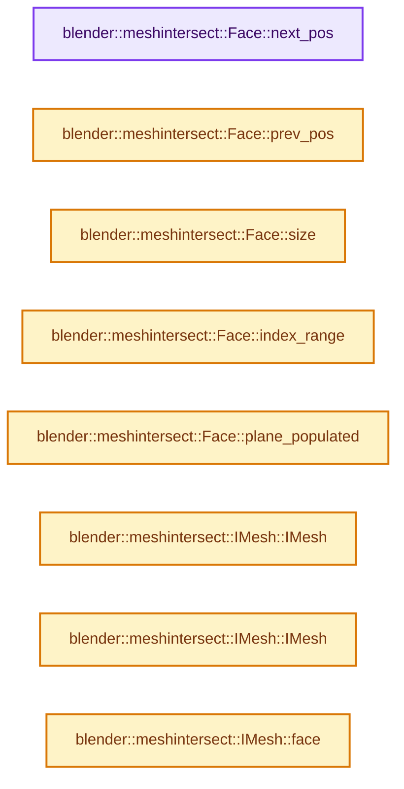
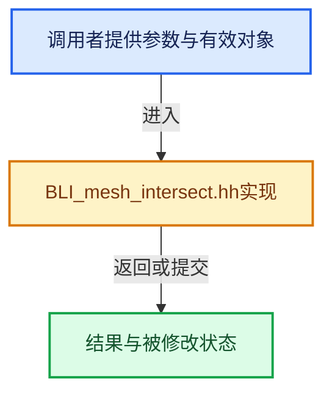

# 实现依赖专题：source/blender/blenlib/BLI_mesh_intersect.hh

[方向导航](README.md) · [符号索引](../%E7%AC%A6%E5%8F%B7%E4%BE%9D%E8%B5%96%E4%B8%8E%E5%AE%9E%E7%8E%B0%E7%B4%A2%E5%BC%95.md)

本专题从正文实际调用进入，集中保存共享实现。函数有稳定锚点，可从调用处直接跳到对应完整函数；递归与互相调用通过回链组织。

## 本文件的实现关系






## 完整成员与函数实现

<a id="f-5c255eb49529c843"></a>

### `blender::meshintersect::Face::next_pos`

实现位置：[source/blender/blenlib/BLI_mesh_intersect.hh](../../../../../source/blender/blenlib/BLI_mesh_intersect.hh) · L141—L144。

接口参数：

- `FacePos p`

**教学注释版**

<!-- annotated:9d9af9fa8fcbf6 -->

```cpp
  FacePos next_pos(FacePos p) const
  {
    // [讲解] vert.size：查询固定有效长度及其索引范围。
    return (p + 1) % vert.size();
  }
```

<details>
<summary>核对原始源码：source/blender/blenlib/BLI_mesh_intersect.hh · L141—L144</summary>

<!-- original:9d9af9fa8fcbf6:source/blender/blenlib/BLI_mesh_intersect.hh:141:144 -->

```cpp
  FacePos next_pos(FacePos p) const
  {
    return (p + 1) % vert.size();
  }
```

</details>

**结果出口**

- `return (p + 1) % vert.size();`

**继续追踪实现**

- `vert.size` → [blender::Array::size · L267](08-Array%E5%A4%8D%E5%88%B6%E7%A7%BB%E5%8A%A8%E4%B8%8E%E9%94%80%E6%AF%81.md#f-c13f1b5a44f423b2)。

<a id="f-577400f21dd2ada2"></a>

### `blender::meshintersect::Face::prev_pos`

实现位置：[source/blender/blenlib/BLI_mesh_intersect.hh](../../../../../source/blender/blenlib/BLI_mesh_intersect.hh) · L146—L149。

接口参数：

- `FacePos p`

**教学注释版**

<!-- annotated:82be5c6c7b9443 -->

```cpp
  FacePos prev_pos(FacePos p) const
  {
    // [讲解] vert.size：查询固定有效长度及其索引范围。
    return (p + vert.size() - 1) % vert.size();
  }
```

<details>
<summary>核对原始源码：source/blender/blenlib/BLI_mesh_intersect.hh · L146—L149</summary>

<!-- original:82be5c6c7b9443:source/blender/blenlib/BLI_mesh_intersect.hh:146:149 -->

```cpp
  FacePos prev_pos(FacePos p) const
  {
    return (p + vert.size() - 1) % vert.size();
  }
```

</details>

**结果出口**

- `return (p + vert.size() - 1) % vert.size();`

**继续追踪实现**

- `vert.size` → [blender::Array::size · L267](08-Array%E5%A4%8D%E5%88%B6%E7%A7%BB%E5%8A%A8%E4%B8%8E%E9%94%80%E6%AF%81.md#f-c13f1b5a44f423b2)。

<a id="f-ae8917c425c3684c"></a>

### `blender::meshintersect::Face::size`

实现位置：[source/blender/blenlib/BLI_mesh_intersect.hh](../../../../../source/blender/blenlib/BLI_mesh_intersect.hh) · L156—L159。

**教学注释版**

<!-- annotated:0c8a07d7e0592b -->

```cpp
  int size() const
  {
    // [讲解] vert.size：查询固定有效长度及其索引范围。
    return vert.size();
  }
```

<details>
<summary>核对原始源码：source/blender/blenlib/BLI_mesh_intersect.hh · L156—L159</summary>

<!-- original:0c8a07d7e0592b:source/blender/blenlib/BLI_mesh_intersect.hh:156:159 -->

```cpp
  int size() const
  {
    return vert.size();
  }
```

</details>

**结果出口**

- `return vert.size();`

**继续追踪实现**

- `vert.size` → [blender::Array::size · L267](08-Array%E5%A4%8D%E5%88%B6%E7%A7%BB%E5%8A%A8%E4%B8%8E%E9%94%80%E6%AF%81.md#f-c13f1b5a44f423b2)。

<a id="f-6d7b67dcb755ec3b"></a>

### `blender::meshintersect::Face::index_range`

实现位置：[source/blender/blenlib/BLI_mesh_intersect.hh](../../../../../source/blender/blenlib/BLI_mesh_intersect.hh) · L171—L174。

**教学注释版**

<!-- annotated:f0ee4954a244bf -->

```cpp
  IndexRange index_range() const
  {
    // [讲解] vert.size：查询固定有效长度及其索引范围。
    return IndexRange(vert.size());
  }
```

<details>
<summary>核对原始源码：source/blender/blenlib/BLI_mesh_intersect.hh · L171—L174</summary>

<!-- original:f0ee4954a244bf:source/blender/blenlib/BLI_mesh_intersect.hh:171:174 -->

```cpp
  IndexRange index_range() const
  {
    return IndexRange(vert.size());
  }
```

</details>

**结果出口**

- `return IndexRange(vert.size());`

**继续追踪实现**

- `IndexRange` → [blender::IndexRange](%E4%BE%9D%E8%B5%96-BLI_index_range-7d7cc5.md#t-caa3466d6776)；[blender::gpu::shader::parser::IndexRange](../05-%E5%87%A0%E4%BD%95%E5%AD%98%E5%82%A8%E4%B8%8E%E6%8B%93%E6%89%91%E6%98%A0%E5%B0%84/%E4%BE%9D%E8%B5%96-utils-06433d.md#t-82d2bd4ea71c)；[blender::IndexRange](../05-%E5%87%A0%E4%BD%95%E5%AD%98%E5%82%A8%E4%B8%8E%E6%8B%93%E6%89%91%E6%98%A0%E5%B0%84/%E4%BE%9D%E8%B5%96-DNA_node_types-6708b9.md#t-0448cc889d39)。
- `vert.size` → [blender::Array::size · L267](08-Array%E5%A4%8D%E5%88%B6%E7%A7%BB%E5%8A%A8%E4%B8%8E%E9%94%80%E6%AF%81.md#f-c13f1b5a44f423b2)。

<a id="f-071be69ff03c7a48"></a>

### `blender::meshintersect::Face::plane_populated`

实现位置：[source/blender/blenlib/BLI_mesh_intersect.hh](../../../../../source/blender/blenlib/BLI_mesh_intersect.hh) · L178—L181。

**教学注释版**

<!-- annotated:03cff7f7936d5d -->

```cpp
  bool plane_populated() const
  {
    return plane != nullptr;
  }
```

<details>
<summary>核对原始源码：source/blender/blenlib/BLI_mesh_intersect.hh · L178—L181</summary>

<!-- original:03cff7f7936d5d:source/blender/blenlib/BLI_mesh_intersect.hh:178:181 -->

```cpp
  bool plane_populated() const
  {
    return plane != nullptr;
  }
```

</details>

**结果出口**

- `return plane != nullptr;`

**继续追踪实现**

本实现没有需要继续展开的显式调用；检查返回表达式、对象转换和调用者前置条件。

<a id="f-a634f97a36e1e530"></a>

### `blender::meshintersect::IMesh::IMesh`

实现位置：[source/blender/blenlib/BLI_mesh_intersect.hh](../../../../../source/blender/blenlib/BLI_mesh_intersect.hh) · L249—L249。

**教学注释版**

<!-- annotated:11b228fba8cf57 -->

```cpp
  IMesh() = default;
```

<details>
<summary>核对原始源码：source/blender/blenlib/BLI_mesh_intersect.hh · L249—L249</summary>

<!-- original:11b228fba8cf57:source/blender/blenlib/BLI_mesh_intersect.hh:249:249 -->

```cpp
  IMesh() = default;
```

</details>

**继续追踪实现**

本实现没有需要继续展开的显式调用；检查返回表达式、对象转换和调用者前置条件。

<a id="f-3bf7e33468786690"></a>

### `blender::meshintersect::IMesh::IMesh`

实现位置：[source/blender/blenlib/BLI_mesh_intersect.hh](../../../../../source/blender/blenlib/BLI_mesh_intersect.hh) · L250—L250。

接口参数：

- `Span<Face *> faces`

**教学注释版**

<!-- annotated:4f5ae21fceabac -->

```cpp
  IMesh(Span<Face *> faces) : face_(faces) {}
```

<details>
<summary>核对原始源码：source/blender/blenlib/BLI_mesh_intersect.hh · L250—L250</summary>

<!-- original:4f5ae21fceabac:source/blender/blenlib/BLI_mesh_intersect.hh:250:250 -->

```cpp
  IMesh(Span<Face *> faces) : face_(faces) {}
```

</details>

**继续追踪实现**

本实现没有需要继续展开的显式调用；检查返回表达式、对象转换和调用者前置条件。

<a id="f-02419d5b631de370"></a>

### `blender::meshintersect::IMesh::face`

实现位置：[source/blender/blenlib/BLI_mesh_intersect.hh](../../../../../source/blender/blenlib/BLI_mesh_intersect.hh) · L253—L256。

接口参数：

- `int index`

**教学注释版**

<!-- annotated:c35655048eeb96 -->

```cpp
  Face *face(int index) const
  {
    return face_[index];
  }
```

<details>
<summary>核对原始源码：source/blender/blenlib/BLI_mesh_intersect.hh · L253—L256</summary>

<!-- original:c35655048eeb96:source/blender/blenlib/BLI_mesh_intersect.hh:253:256 -->

```cpp
  Face *face(int index) const
  {
    return face_[index];
  }
```

</details>

**结果出口**

- `return face_[index];`

**继续追踪实现**

本实现没有需要继续展开的显式调用；检查返回表达式、对象转换和调用者前置条件。

<a id="f-12b9bd3f4e861301"></a>

### `blender::meshintersect::IMesh::face_size`

实现位置：[source/blender/blenlib/BLI_mesh_intersect.hh](../../../../../source/blender/blenlib/BLI_mesh_intersect.hh) · L258—L261。

**教学注释版**

<!-- annotated:c1caeff46887c4 -->

```cpp
  int face_size() const
  {
    // [讲解] face_.size：查询固定有效长度及其索引范围。
    return face_.size();
  }
```

<details>
<summary>核对原始源码：source/blender/blenlib/BLI_mesh_intersect.hh · L258—L261</summary>

<!-- original:c1caeff46887c4:source/blender/blenlib/BLI_mesh_intersect.hh:258:261 -->

```cpp
  int face_size() const
  {
    return face_.size();
  }
```

</details>

**结果出口**

- `return face_.size();`

**继续追踪实现**

- `face_.size` → [blender::Array::size · L267](08-Array%E5%A4%8D%E5%88%B6%E7%A7%BB%E5%8A%A8%E4%B8%8E%E9%94%80%E6%AF%81.md#f-c13f1b5a44f423b2)。

<a id="f-1e4f5fe3aa468b26"></a>

### `blender::meshintersect::IMesh::vert_size`

实现位置：[source/blender/blenlib/BLI_mesh_intersect.hh](../../../../../source/blender/blenlib/BLI_mesh_intersect.hh) · L263—L266。

**教学注释版**

<!-- annotated:cda6a154fe0682 -->

```cpp
  int vert_size() const
  {
    // [讲解] vert_.size：查询固定有效长度及其索引范围。
    return vert_.size();
  }
```

<details>
<summary>核对原始源码：source/blender/blenlib/BLI_mesh_intersect.hh · L263—L266</summary>

<!-- original:cda6a154fe0682:source/blender/blenlib/BLI_mesh_intersect.hh:263:266 -->

```cpp
  int vert_size() const
  {
    return vert_.size();
  }
```

</details>

**结果出口**

- `return vert_.size();`

**继续追踪实现**

- `vert_.size` → [blender::Array::size · L267](08-Array%E5%A4%8D%E5%88%B6%E7%A7%BB%E5%8A%A8%E4%B8%8E%E9%94%80%E6%AF%81.md#f-c13f1b5a44f423b2)。

<a id="f-f0c9e8a7fba64131"></a>

### `blender::meshintersect::IMesh::has_verts`

实现位置：[source/blender/blenlib/BLI_mesh_intersect.hh](../../../../../source/blender/blenlib/BLI_mesh_intersect.hh) · L268—L271。

**教学注释版**

<!-- annotated:62d13ecb319189 -->

```cpp
  bool has_verts() const
  {
    return vert_populated_;
  }
```

<details>
<summary>核对原始源码：source/blender/blenlib/BLI_mesh_intersect.hh · L268—L271</summary>

<!-- original:62d13ecb319189:source/blender/blenlib/BLI_mesh_intersect.hh:268:271 -->

```cpp
  bool has_verts() const
  {
    return vert_populated_;
  }
```

</details>

**结果出口**

- `return vert_populated_;`

**继续追踪实现**

本实现没有需要继续展开的显式调用；检查返回表达式、对象转换和调用者前置条件。

<a id="f-d1a30ef55c94c2d3"></a>

### `blender::meshintersect::IMesh::set_dirty_verts`

实现位置：[source/blender/blenlib/BLI_mesh_intersect.hh](../../../../../source/blender/blenlib/BLI_mesh_intersect.hh) · L273—L278。

**教学注释版**

<!-- annotated:d5b382b602c736 -->

```cpp
  void set_dirty_verts()
  {
    vert_populated_ = false;
    // [讲解] vert_to_index_.clear：移除全部活项，并按接口决定是否归还存储。
    vert_to_index_.clear();
    vert_ = Array<const Vert *>();
  }
```

<details>
<summary>核对原始源码：source/blender/blenlib/BLI_mesh_intersect.hh · L273—L278</summary>

<!-- original:d5b382b602c736:source/blender/blenlib/BLI_mesh_intersect.hh:273:278 -->

```cpp
  void set_dirty_verts()
  {
    vert_populated_ = false;
    vert_to_index_.clear();
    vert_ = Array<const Vert *>();
  }
```

</details>

**沿实际写入检查状态**

- `vert_populated_ = false;`
- `vert_ = Array<const Vert *>();`

**继续追踪实现**

- `vert_to_index_.clear` → [blender::Map::clear · L1038](../02-%E5%93%88%E5%B8%8C%E8%A1%A8%E4%B8%8E%E5%85%B3%E8%81%94%E6%95%B0%E6%8D%AE%E7%BB%93%E6%9E%84/06-%E5%88%A0%E9%99%A4%E5%A2%93%E7%A2%91%E4%B8%8E%E5%80%BC%E9%94%80%E6%AF%81.md#f-c58ca43ed9dafe4a)。
- `Array<const Vert *>` → [blender::Array::Array · L78](07-Array%E6%9E%84%E9%80%A0%E4%B8%8E%E5%AD%98%E5%82%A8.md#f-001fd5eb3c658238)；[blender::Array::Array · L84](07-Array%E6%9E%84%E9%80%A0%E4%B8%8E%E5%AD%98%E5%82%A8.md#f-674e2f10361a462b)；[blender::Array::Array · L89](07-Array%E6%9E%84%E9%80%A0%E4%B8%8E%E5%AD%98%E5%82%A8.md#f-aa1e5908a9b67557)；[blender::Array::Array · L103](07-Array%E6%9E%84%E9%80%A0%E4%B8%8E%E5%AD%98%E5%82%A8.md#f-b141be39084346f3)；[blender::Array::Array · L110](07-Array%E6%9E%84%E9%80%A0%E4%B8%8E%E5%AD%98%E5%82%A8.md#f-452e276f39e81a2a)；[blender::Array::Array · L123](07-Array%E6%9E%84%E9%80%A0%E4%B8%8E%E5%AD%98%E5%82%A8.md#f-646aa58152ec44f6)；[blender::Array::Array · L135](07-Array%E6%9E%84%E9%80%A0%E4%B8%8E%E5%AD%98%E5%82%A8.md#f-0a9de4a549125f99)；[blender::Array::Array · L168](07-Array%E6%9E%84%E9%80%A0%E4%B8%8E%E5%AD%98%E5%82%A8.md#f-31f001eb92069e9d)；[blender::Array::Array · L176](07-Array%E6%9E%84%E9%80%A0%E4%B8%8E%E5%AD%98%E5%82%A8.md#f-cf8148f06fc6747a)；[blender::Array::Array · L178](07-Array%E6%9E%84%E9%80%A0%E4%B8%8E%E5%AD%98%E5%82%A8.md#f-2ddca2fb9dd964b3)。同名重载需按实参类型选择。

<a id="f-23ce1c473fac1492"></a>

### `blender::meshintersect::IMesh::vert`

实现位置：[source/blender/blenlib/BLI_mesh_intersect.hh](../../../../../source/blender/blenlib/BLI_mesh_intersect.hh) · L284—L288。

接口参数：

- `int index`

**教学注释版**

<!-- annotated:1e905af33cb7e2 -->

```cpp
  const Vert *vert(int index) const
  {
    BLI_assert(vert_populated_);
    return vert_[index];
  }
```

<details>
<summary>核对原始源码：source/blender/blenlib/BLI_mesh_intersect.hh · L284—L288</summary>

<!-- original:1e905af33cb7e2:source/blender/blenlib/BLI_mesh_intersect.hh:284:288 -->

```cpp
  const Vert *vert(int index) const
  {
    BLI_assert(vert_populated_);
    return vert_[index];
  }
```

</details>

**结果出口**

- `return vert_[index];`

**继续追踪实现**

- `BLI_assert` → [BLI_assert · L48](%E4%BE%9D%E8%B5%96-BLI_assert-cc98e8.md#m-57a88495704d)；[BLI_assert · L63](%E4%BE%9D%E8%B5%96-BLI_assert-cc98e8.md#m-d07050020cb5)。宏定义由构建条件选择。

<a id="f-537622ab267fbb35"></a>

### `blender::meshintersect::IMesh::lookup_vert`

实现位置：[source/blender/blenlib/BLI_mesh_intersect.hh](../../../../../source/blender/blenlib/BLI_mesh_intersect.hh) · L291—L295。

接口参数：

- `const Vert *v`

**教学注释版**

<!-- annotated:a2b189c2d8c390 -->

```cpp
  int lookup_vert(const Vert *v) const
  {
    BLI_assert(vert_populated_);
    // [讲解] vert_to_index_.lookup_default：按键查找对应项。
    return vert_to_index_.lookup_default(v, NO_INDEX);
  }
```

<details>
<summary>核对原始源码：source/blender/blenlib/BLI_mesh_intersect.hh · L291—L295</summary>

<!-- original:a2b189c2d8c390:source/blender/blenlib/BLI_mesh_intersect.hh:291:295 -->

```cpp
  int lookup_vert(const Vert *v) const
  {
    BLI_assert(vert_populated_);
    return vert_to_index_.lookup_default(v, NO_INDEX);
  }
```

</details>

**结果出口**

- `return vert_to_index_.lookup_default(v, NO_INDEX);`

**继续追踪实现**

- `BLI_assert` → [BLI_assert · L48](%E4%BE%9D%E8%B5%96-BLI_assert-cc98e8.md#m-57a88495704d)；[BLI_assert · L63](%E4%BE%9D%E8%B5%96-BLI_assert-cc98e8.md#m-d07050020cb5)。宏定义由构建条件选择。
- `vert_to_index_.lookup_default` → [blender::Map::lookup_default · L570](../02-%E5%93%88%E5%B8%8C%E8%A1%A8%E4%B8%8E%E5%85%B3%E8%81%94%E6%95%B0%E6%8D%AE%E7%BB%93%E6%9E%84/05-Map%E6%8F%92%E5%85%A5%E4%B8%8E%E5%9B%9E%E8%B0%83.md#f-40294aaf345f6a8b)。

<a id="f-63fe7400c5e87d01"></a>

### `blender::meshintersect::IMesh::vert_index_range`

实现位置：[source/blender/blenlib/BLI_mesh_intersect.hh](../../../../../source/blender/blenlib/BLI_mesh_intersect.hh) · L297—L301。

**教学注释版**

<!-- annotated:b8d3298d5b4034 -->

```cpp
  IndexRange vert_index_range() const
  {
    BLI_assert(vert_populated_);
    // [讲解] vert_.size：查询固定有效长度及其索引范围。
    return IndexRange(vert_.size());
  }
```

<details>
<summary>核对原始源码：source/blender/blenlib/BLI_mesh_intersect.hh · L297—L301</summary>

<!-- original:b8d3298d5b4034:source/blender/blenlib/BLI_mesh_intersect.hh:297:301 -->

```cpp
  IndexRange vert_index_range() const
  {
    BLI_assert(vert_populated_);
    return IndexRange(vert_.size());
  }
```

</details>

**结果出口**

- `return IndexRange(vert_.size());`

**继续追踪实现**

- `BLI_assert` → [BLI_assert · L48](%E4%BE%9D%E8%B5%96-BLI_assert-cc98e8.md#m-57a88495704d)；[BLI_assert · L63](%E4%BE%9D%E8%B5%96-BLI_assert-cc98e8.md#m-d07050020cb5)。宏定义由构建条件选择。
- `IndexRange` → [blender::IndexRange](%E4%BE%9D%E8%B5%96-BLI_index_range-7d7cc5.md#t-caa3466d6776)；[blender::gpu::shader::parser::IndexRange](../05-%E5%87%A0%E4%BD%95%E5%AD%98%E5%82%A8%E4%B8%8E%E6%8B%93%E6%89%91%E6%98%A0%E5%B0%84/%E4%BE%9D%E8%B5%96-utils-06433d.md#t-82d2bd4ea71c)；[blender::IndexRange](../05-%E5%87%A0%E4%BD%95%E5%AD%98%E5%82%A8%E4%B8%8E%E6%8B%93%E6%89%91%E6%98%A0%E5%B0%84/%E4%BE%9D%E8%B5%96-DNA_node_types-6708b9.md#t-0448cc889d39)。
- `vert_.size` → [blender::Array::size · L267](08-Array%E5%A4%8D%E5%88%B6%E7%A7%BB%E5%8A%A8%E4%B8%8E%E9%94%80%E6%AF%81.md#f-c13f1b5a44f423b2)。

<a id="f-f99d06ca9b4d4bf3"></a>

### `blender::meshintersect::IMesh::face_index_range`

实现位置：[source/blender/blenlib/BLI_mesh_intersect.hh](../../../../../source/blender/blenlib/BLI_mesh_intersect.hh) · L303—L306。

**教学注释版**

<!-- annotated:d2cad8409382a9 -->

```cpp
  IndexRange face_index_range() const
  {
    // [讲解] face_.size：查询固定有效长度及其索引范围。
    return IndexRange(face_.size());
  }
```

<details>
<summary>核对原始源码：source/blender/blenlib/BLI_mesh_intersect.hh · L303—L306</summary>

<!-- original:d2cad8409382a9:source/blender/blenlib/BLI_mesh_intersect.hh:303:306 -->

```cpp
  IndexRange face_index_range() const
  {
    return IndexRange(face_.size());
  }
```

</details>

**结果出口**

- `return IndexRange(face_.size());`

**继续追踪实现**

- `IndexRange` → [blender::IndexRange](%E4%BE%9D%E8%B5%96-BLI_index_range-7d7cc5.md#t-caa3466d6776)；[blender::gpu::shader::parser::IndexRange](../05-%E5%87%A0%E4%BD%95%E5%AD%98%E5%82%A8%E4%B8%8E%E6%8B%93%E6%89%91%E6%98%A0%E5%B0%84/%E4%BE%9D%E8%B5%96-utils-06433d.md#t-82d2bd4ea71c)；[blender::IndexRange](../05-%E5%87%A0%E4%BD%95%E5%AD%98%E5%82%A8%E4%B8%8E%E6%8B%93%E6%89%91%E6%98%A0%E5%B0%84/%E4%BE%9D%E8%B5%96-DNA_node_types-6708b9.md#t-0448cc889d39)。
- `face_.size` → [blender::Array::size · L267](08-Array%E5%A4%8D%E5%88%B6%E7%A7%BB%E5%8A%A8%E4%B8%8E%E9%94%80%E6%AF%81.md#f-c13f1b5a44f423b2)。

<a id="f-014a20eb33ef6510"></a>

### `blender::meshintersect::IMesh::vertices`

实现位置：[source/blender/blenlib/BLI_mesh_intersect.hh](../../../../../source/blender/blenlib/BLI_mesh_intersect.hh) · L308—L312。

**教学注释版**

<!-- annotated:1c3b8924992745 -->

```cpp
  Span<const Vert *> vertices() const
  {
    BLI_assert(vert_populated_);
    return Span<const Vert *>(vert_);
  }
```

<details>
<summary>核对原始源码：source/blender/blenlib/BLI_mesh_intersect.hh · L308—L312</summary>

<!-- original:1c3b8924992745:source/blender/blenlib/BLI_mesh_intersect.hh:308:312 -->

```cpp
  Span<const Vert *> vertices() const
  {
    BLI_assert(vert_populated_);
    return Span<const Vert *>(vert_);
  }
```

</details>

**结果出口**

- `return Span<const Vert *>(vert_);`

**继续追踪实现**

- `BLI_assert` → [BLI_assert · L48](%E4%BE%9D%E8%B5%96-BLI_assert-cc98e8.md#m-57a88495704d)；[BLI_assert · L63](%E4%BE%9D%E8%B5%96-BLI_assert-cc98e8.md#m-d07050020cb5)。宏定义由构建条件选择。
- `Span<const Vert *>` → [blender::Span](%E4%BE%9D%E8%B5%96-BLI_span-6aa95f.md#t-8765a8e0c1d5)；[blender::Span](%E4%BE%9D%E8%B5%96-BLI_index_range-7d7cc5.md#t-86091874a1c0)；[blender::Span](../05-%E5%87%A0%E4%BD%95%E5%AD%98%E5%82%A8%E4%B8%8E%E6%8B%93%E6%89%91%E6%98%A0%E5%B0%84/%E4%BE%9D%E8%B5%96-DNA_pointcloud_types-cfb82c.md#t-112aa6ed842c)；[blender::Span](../05-%E5%87%A0%E4%BD%95%E5%AD%98%E5%82%A8%E4%B8%8E%E6%8B%93%E6%89%91%E6%98%A0%E5%B0%84/%E4%BE%9D%E8%B5%96-DNA_node_types-6708b9.md#t-49ec6fbb9b69)；[blender::Span](../05-%E5%87%A0%E4%BD%95%E5%AD%98%E5%82%A8%E4%B8%8E%E6%8B%93%E6%89%91%E6%98%A0%E5%B0%84/%E4%BE%9D%E8%B5%96-DNA_mesh_types-81f02e.md#t-184fd48fb638)；[blender::Span](../05-%E5%87%A0%E4%BD%95%E5%AD%98%E5%82%A8%E4%B8%8E%E6%8B%93%E6%89%91%E6%98%A0%E5%B0%84/%E4%BE%9D%E8%B5%96-DNA_anim_types-39c5d9.md#t-d841071994c2)；[blender::Span](../05-%E5%87%A0%E4%BD%95%E5%AD%98%E5%82%A8%E4%B8%8E%E6%8B%93%E6%89%91%E6%98%A0%E5%B0%84/%E4%BE%9D%E8%B5%96-RNA_path_fwd-79c989.md#t-4dbb08969e41)。

<a id="f-d7cce97e16d068d6"></a>

### `blender::meshintersect::IMesh::faces`

实现位置：[source/blender/blenlib/BLI_mesh_intersect.hh](../../../../../source/blender/blenlib/BLI_mesh_intersect.hh) · L314—L317。

**教学注释版**

<!-- annotated:83a1a9bd281bd9 -->

```cpp
  Span<Face *> faces() const
  {
    return Span<Face *>(face_);
  }
```

<details>
<summary>核对原始源码：source/blender/blenlib/BLI_mesh_intersect.hh · L314—L317</summary>

<!-- original:83a1a9bd281bd9:source/blender/blenlib/BLI_mesh_intersect.hh:314:317 -->

```cpp
  Span<Face *> faces() const
  {
    return Span<Face *>(face_);
  }
```

</details>

**结果出口**

- `return Span<Face *>(face_);`

**继续追踪实现**

- `Span<Face *>` → [blender::Span](%E4%BE%9D%E8%B5%96-BLI_span-6aa95f.md#t-8765a8e0c1d5)；[blender::Span](%E4%BE%9D%E8%B5%96-BLI_index_range-7d7cc5.md#t-86091874a1c0)；[blender::Span](../05-%E5%87%A0%E4%BD%95%E5%AD%98%E5%82%A8%E4%B8%8E%E6%8B%93%E6%89%91%E6%98%A0%E5%B0%84/%E4%BE%9D%E8%B5%96-DNA_pointcloud_types-cfb82c.md#t-112aa6ed842c)；[blender::Span](../05-%E5%87%A0%E4%BD%95%E5%AD%98%E5%82%A8%E4%B8%8E%E6%8B%93%E6%89%91%E6%98%A0%E5%B0%84/%E4%BE%9D%E8%B5%96-DNA_node_types-6708b9.md#t-49ec6fbb9b69)；[blender::Span](../05-%E5%87%A0%E4%BD%95%E5%AD%98%E5%82%A8%E4%B8%8E%E6%8B%93%E6%89%91%E6%98%A0%E5%B0%84/%E4%BE%9D%E8%B5%96-DNA_mesh_types-81f02e.md#t-184fd48fb638)；[blender::Span](../05-%E5%87%A0%E4%BD%95%E5%AD%98%E5%82%A8%E4%B8%8E%E6%8B%93%E6%89%91%E6%98%A0%E5%B0%84/%E4%BE%9D%E8%B5%96-DNA_anim_types-39c5d9.md#t-d841071994c2)；[blender::Span](../05-%E5%87%A0%E4%BD%95%E5%AD%98%E5%82%A8%E4%B8%8E%E6%8B%93%E6%89%91%E6%98%A0%E5%B0%84/%E4%BE%9D%E8%B5%96-RNA_path_fwd-79c989.md#t-4dbb08969e41)。

<a id="f-b2e813bdc68c5941"></a>

### `blender::meshintersect::BoundingBox::combine`

实现位置：[source/blender/blenlib/BLI_mesh_intersect.hh](../../../../../source/blender/blenlib/BLI_mesh_intersect.hh) · L346—L349。

接口参数：

- `const float3 &p`

**教学注释版**

<!-- annotated:2b225287bed234 -->

```cpp
  void combine(const float3 &p)
  {
    math::min_max(p, this->min, this->max);
  }
```

<details>
<summary>核对原始源码：source/blender/blenlib/BLI_mesh_intersect.hh · L346—L349</summary>

<!-- original:2b225287bed234:source/blender/blenlib/BLI_mesh_intersect.hh:346:349 -->

```cpp
  void combine(const float3 &p)
  {
    math::min_max(p, this->min, this->max);
  }
```

</details>

**继续追踪实现**

- `math::min_max` → [blender::math::min_max · L331](../12-%E7%A9%BA%E9%97%B4%E6%95%B0%E6%8D%AE%E7%BB%93%E6%9E%84%E4%B8%8E%E5%87%A0%E4%BD%95%E7%AE%97%E6%B3%95/%E4%BE%9D%E8%B5%96-BLI_math_vector-906a87.md#f-d0ca25e982d9489c)；[blender::math::min_max · L99](../12-%E7%A9%BA%E9%97%B4%E6%95%B0%E6%8D%AE%E7%BB%93%E6%9E%84%E4%B8%8E%E5%87%A0%E4%BD%95%E7%AE%97%E6%B3%95/%E4%BE%9D%E8%B5%96-BLI_math_base-0728eb.md#f-d076aca4030981e7)。同名重载需按实参类型选择。

<a id="f-6340148ca7e92a7f"></a>

### `blender::meshintersect::BoundingBox::combine`

实现位置：[source/blender/blenlib/BLI_mesh_intersect.hh](../../../../../source/blender/blenlib/BLI_mesh_intersect.hh) · L351—L354。

接口参数：

- `const double3 &p`

**教学注释版**

<!-- annotated:bb6b2f99ca38c2 -->

```cpp
  void combine(const double3 &p)
  {
    math::min_max(float3(p), this->min, this->max);
  }
```

<details>
<summary>核对原始源码：source/blender/blenlib/BLI_mesh_intersect.hh · L351—L354</summary>

<!-- original:bb6b2f99ca38c2:source/blender/blenlib/BLI_mesh_intersect.hh:351:354 -->

```cpp
  void combine(const double3 &p)
  {
    math::min_max(float3(p), this->min, this->max);
  }
```

</details>

**继续追踪实现**

- `math::min_max` → [blender::math::min_max · L331](../12-%E7%A9%BA%E9%97%B4%E6%95%B0%E6%8D%AE%E7%BB%93%E6%9E%84%E4%B8%8E%E5%87%A0%E4%BD%95%E7%AE%97%E6%B3%95/%E4%BE%9D%E8%B5%96-BLI_math_vector-906a87.md#f-d0ca25e982d9489c)；[blender::math::min_max · L99](../12-%E7%A9%BA%E9%97%B4%E6%95%B0%E6%8D%AE%E7%BB%93%E6%9E%84%E4%B8%8E%E5%87%A0%E4%BD%95%E7%AE%97%E6%B3%95/%E4%BE%9D%E8%B5%96-BLI_math_base-0728eb.md#f-d076aca4030981e7)。同名重载需按实参类型选择。
- `float3` → [float3 · L641](../05-%E5%87%A0%E4%BD%95%E5%AD%98%E5%82%A8%E4%B8%8E%E6%8B%93%E6%89%91%E6%98%A0%E5%B0%84/%E4%BE%9D%E8%B5%96-smaa-b67bc2.md#m-0ea8254cfdb4)。宏定义由构建条件选择。

<a id="f-919d3f7ebe1858bc"></a>

### `blender::meshintersect::BoundingBox::combine`

实现位置：[source/blender/blenlib/BLI_mesh_intersect.hh](../../../../../source/blender/blenlib/BLI_mesh_intersect.hh) · L356—L360。

接口参数：

- `const BoundingBox &bb`

**教学注释版**

<!-- annotated:f7a0019a68c242 -->

```cpp
  void combine(const BoundingBox &bb)
  {
    min = math::min(this->min, bb.min);
    max = math::max(this->max, bb.max);
  }
```

<details>
<summary>核对原始源码：source/blender/blenlib/BLI_mesh_intersect.hh · L356—L360</summary>

<!-- original:f7a0019a68c242:source/blender/blenlib/BLI_mesh_intersect.hh:356:360 -->

```cpp
  void combine(const BoundingBox &bb)
  {
    min = math::min(this->min, bb.min);
    max = math::max(this->max, bb.max);
  }
```

</details>

**沿实际写入检查状态**

- `min = math::min(this->min, bb.min);`
- `max = math::max(this->max, bb.max);`

**继续追踪实现**

- `math::min` → [blender::math::min · L56](../12-%E7%A9%BA%E9%97%B4%E6%95%B0%E6%8D%AE%E7%BB%93%E6%9E%84%E4%B8%8E%E5%87%A0%E4%BD%95%E7%AE%97%E6%B3%95/%E4%BE%9D%E8%B5%96-BLI_math_vector-906a87.md#f-ee6ead51e4bb3364)；[blender::math::min · L65](../12-%E7%A9%BA%E9%97%B4%E6%95%B0%E6%8D%AE%E7%BB%93%E6%9E%84%E4%B8%8E%E5%87%A0%E4%BD%95%E7%AE%97%E6%B3%95/%E4%BE%9D%E8%B5%96-BLI_math_vector-906a87.md#f-f65ce48b3051cce3)；[blender::math::min · L81](../12-%E7%A9%BA%E9%97%B4%E6%95%B0%E6%8D%AE%E7%BB%93%E6%9E%84%E4%B8%8E%E5%87%A0%E4%BD%95%E7%AE%97%E6%B3%95/%E4%BE%9D%E8%B5%96-BLI_math_vector-906a87.md#f-9c602d29fab41795)；[blender::math::min · L43](../12-%E7%A9%BA%E9%97%B4%E6%95%B0%E6%8D%AE%E7%BB%93%E6%9E%84%E4%B8%8E%E5%87%A0%E4%BD%95%E7%AE%97%E6%B3%95/%E4%BE%9D%E8%B5%96-BLI_math_base-0728eb.md#f-72ff0c229e6c09b0)。同名重载需按实参类型选择。
- `math::max` → [blender::math::max · L87](../12-%E7%A9%BA%E9%97%B4%E6%95%B0%E6%8D%AE%E7%BB%93%E6%9E%84%E4%B8%8E%E5%87%A0%E4%BD%95%E7%AE%97%E6%B3%95/%E4%BE%9D%E8%B5%96-BLI_math_vector-906a87.md#f-9be564a293777d6b)；[blender::math::max · L96](../12-%E7%A9%BA%E9%97%B4%E6%95%B0%E6%8D%AE%E7%BB%93%E6%9E%84%E4%B8%8E%E5%87%A0%E4%BD%95%E7%AE%97%E6%B3%95/%E4%BE%9D%E8%B5%96-BLI_math_vector-906a87.md#f-ce32dff37d0af3bc)；[blender::math::max · L112](../12-%E7%A9%BA%E9%97%B4%E6%95%B0%E6%8D%AE%E7%BB%93%E6%9E%84%E4%B8%8E%E5%87%A0%E4%BD%95%E7%AE%97%E6%B3%95/%E4%BE%9D%E8%B5%96-BLI_math_vector-906a87.md#f-668eb1fcf1fa8292)；[blender::math::max · L49](../12-%E7%A9%BA%E9%97%B4%E6%95%B0%E6%8D%AE%E7%BB%93%E6%9E%84%E4%B8%8E%E5%87%A0%E4%BD%95%E7%AE%97%E6%B3%95/%E4%BE%9D%E8%B5%96-BLI_math_base-0728eb.md#f-a6991ca3d12937e1)。同名重载需按实参类型选择。
