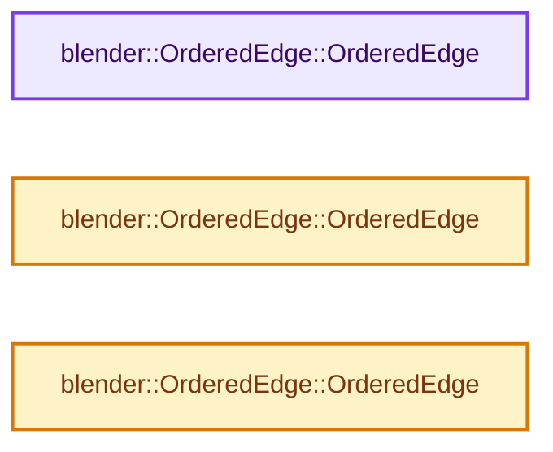
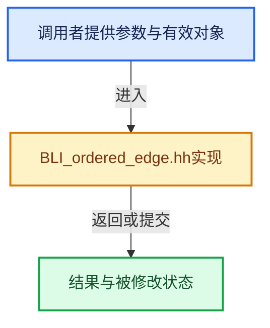

# 实现依赖专题：source/blender/blenlib/BLI_ordered_edge.hh

[方向导航](README.md) · [符号索引](../%E7%AC%A6%E5%8F%B7%E4%BE%9D%E8%B5%96%E4%B8%8E%E5%AE%9E%E7%8E%B0%E7%B4%A2%E5%BC%95.md)

本专题从正文实际调用进入，集中保存共享实现。函数有稳定锚点，可从调用处直接跳到对应完整函数；递归与互相调用通过回链组织。

## 本文件的实现关系






## 完整成员与函数实现

<a id="f-a3124963ff5ebc95"></a>

### `blender::OrderedEdge::OrderedEdge`

实现位置：[source/blender/blenlib/BLI_ordered_edge.hh](../../../../../source/blender/blenlib/BLI_ordered_edge.hh) · L23—L33。

接口参数：

- `const int v1`
- `const int v2`

**教学注释版**

<!-- annotated:5cf3a6208c3b6e -->

```cpp
  OrderedEdge(const int v1, const int v2)
  {
    if (v1 < v2) {
      v_low = v1;
      v_high = v2;
    }
    else {
      v_low = v2;
      v_high = v1;
    }
  }
```

<details>
<summary>核对原始源码：source/blender/blenlib/BLI_ordered_edge.hh · L23—L33</summary>

<!-- original:5cf3a6208c3b6e:source/blender/blenlib/BLI_ordered_edge.hh:23:33 -->

```cpp
  OrderedEdge(const int v1, const int v2)
  {
    if (v1 < v2) {
      v_low = v1;
      v_high = v2;
    }
    else {
      v_low = v2;
      v_high = v1;
    }
  }
```

</details>

**沿实际写入检查状态**

- `v_low = v1;`
- `v_high = v2;`
- `v_low = v2;`
- `v_high = v1;`

**继续追踪实现**

本实现没有需要继续展开的显式调用；检查返回表达式、对象转换和调用者前置条件。

<a id="f-d84344bfffb12a82"></a>

### `blender::OrderedEdge::OrderedEdge`

实现位置：[source/blender/blenlib/BLI_ordered_edge.hh](../../../../../source/blender/blenlib/BLI_ordered_edge.hh) · L34—L34。

接口参数：

- `const int2 edge`

**教学注释版**

<!-- annotated:acab66ec1d8678 -->

```cpp
  OrderedEdge(const int2 edge) : OrderedEdge(edge[0], edge[1]) {}
```

<details>
<summary>核对原始源码：source/blender/blenlib/BLI_ordered_edge.hh · L34—L34</summary>

<!-- original:acab66ec1d8678:source/blender/blenlib/BLI_ordered_edge.hh:34:34 -->

```cpp
  OrderedEdge(const int2 edge) : OrderedEdge(edge[0], edge[1]) {}
```

</details>

**继续追踪实现**

本实现没有需要继续展开的显式调用；检查返回表达式、对象转换和调用者前置条件。

<a id="f-03a4b58de7ddef2c"></a>

### `blender::OrderedEdge::OrderedEdge`

实现位置：[source/blender/blenlib/BLI_ordered_edge.hh](../../../../../source/blender/blenlib/BLI_ordered_edge.hh) · L35—L35。

接口参数：

- `const uint v1`
- `const uint v2`

**教学注释版**

<!-- annotated:2d47ddf8def670 -->

```cpp
  OrderedEdge(const uint v1, const uint v2) : OrderedEdge(int(v1), int(v2)) {}
```

<details>
<summary>核对原始源码：source/blender/blenlib/BLI_ordered_edge.hh · L35—L35</summary>

<!-- original:2d47ddf8def670:source/blender/blenlib/BLI_ordered_edge.hh:35:35 -->

```cpp
  OrderedEdge(const uint v1, const uint v2) : OrderedEdge(int(v1), int(v2)) {}
```

</details>

**继续追踪实现**

本实现没有需要继续展开的显式调用；检查返回表达式、对象转换和调用者前置条件。
