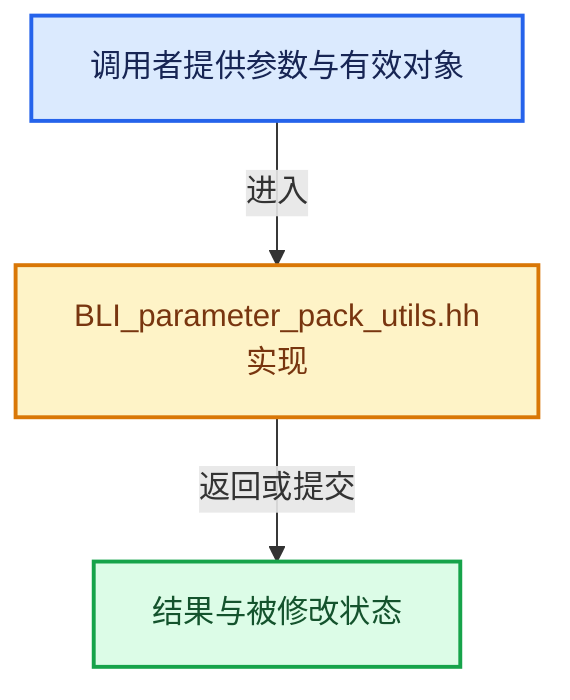

# 实现依赖专题：source/blender/blenlib/BLI_parameter_pack_utils.hh

[方向导航](README.md) · [符号索引](../%E7%AC%A6%E5%8F%B7%E4%BE%9D%E8%B5%96%E4%B8%8E%E5%AE%9E%E7%8E%B0%E7%B4%A2%E5%BC%95.md)

本专题从正文实际调用进入，集中保存共享实现。函数有稳定锚点，可从调用处直接跳到对应完整函数；递归与互相调用通过回链组织。

## 本文件的实现关系





## 相关类型布局与成员入口

<a id="t-9eab4a6dfcf7"></a>

### `blender::TypeForValue`

原始声明：[source/blender/blenlib/BLI_parameter_pack_utils.hh](../../../../../source/blender/blenlib/BLI_parameter_pack_utils.hh) · L23—L25。

成员布局：

- `T value`

以下保留类的数据声明与编译条件，成员函数实现通过后面的精确链接阅读。

<!-- annotated:96a9167256364f -->

```cpp
template<typename T, T Element> struct TypeForValue {
  static constexpr T value = Element;
};
```

<details>
<summary>核对原始源码：source/blender/blenlib/BLI_parameter_pack_utils.hh · L23—L25</summary>

<!-- original:96a9167256364f:source/blender/blenlib/BLI_parameter_pack_utils.hh:23:25 -->

```cpp
template<typename T, T Element> struct TypeForValue {
  static constexpr T value = Element;
};
```

</details>


<a id="t-ba3daeaa021c"></a>

### `blender::TypeTag`

原始声明：[source/blender/blenlib/BLI_parameter_pack_utils.hh](../../../../../source/blender/blenlib/BLI_parameter_pack_utils.hh) · L30—L32。

以下保留类的数据声明与编译条件，成员函数实现通过后面的精确链接阅读。

<!-- annotated:61c2d4be690194 -->

```cpp
template<typename T> struct TypeTag {
  using type = T;
};
```

<details>
<summary>核对原始源码：source/blender/blenlib/BLI_parameter_pack_utils.hh · L30—L32</summary>

<!-- original:61c2d4be690194:source/blender/blenlib/BLI_parameter_pack_utils.hh:30:32 -->

```cpp
template<typename T> struct TypeTag {
  using type = T;
};
```

</details>


<a id="t-218a2a043f3f"></a>

### `blender::ValueSequence`

原始声明：[source/blender/blenlib/BLI_parameter_pack_utils.hh](../../../../../source/blender/blenlib/BLI_parameter_pack_utils.hh) · L39—L64。

以下保留类的数据声明与编译条件，成员函数实现通过后面的精确链接阅读。

<!-- annotated:78ca5ed6539cfb -->

```cpp
template<typename T, T... Elements> struct ValueSequence {
  /**
   * Get the number of elements in the sequence.
   */
```

<details>
<summary>核对原始源码：source/blender/blenlib/BLI_parameter_pack_utils.hh · L39—L42</summary>

<!-- original:78ca5ed6539cfb:source/blender/blenlib/BLI_parameter_pack_utils.hh:39:42 -->

```cpp
template<typename T, T... Elements> struct ValueSequence {
  /**
   * Get the number of elements in the sequence.
   */
```

</details>

<!-- annotated:999ea8a731a550 -->

```cpp

  /**
   * Get the element at a specific index.
   */
```

<details>
<summary>核对原始源码：source/blender/blenlib/BLI_parameter_pack_utils.hh · L47—L50</summary>

<!-- original:999ea8a731a550:source/blender/blenlib/BLI_parameter_pack_utils.hh:47:50 -->

```cpp

  /**
   * Get the element at a specific index.
   */
```

</details>

<!-- annotated:fc968e832663ac -->

```cpp

  /**
   * Return true if the element is in the sequence.
   */
```

<details>
<summary>核对原始源码：source/blender/blenlib/BLI_parameter_pack_utils.hh · L56—L59</summary>

<!-- original:fc968e832663ac:source/blender/blenlib/BLI_parameter_pack_utils.hh:56:59 -->

```cpp

  /**
   * Return true if the element is in the sequence.
   */
```

</details>

<!-- annotated:dc07d5d64d3ef9 -->

```cpp
};
```

<details>
<summary>核对原始源码：source/blender/blenlib/BLI_parameter_pack_utils.hh · L64—L64</summary>

<!-- original:dc07d5d64d3ef9:source/blender/blenlib/BLI_parameter_pack_utils.hh:64:64 -->

```cpp
};
```

</details>


<a id="t-e894d3f83539"></a>

### `blender::TypeSequence`

原始声明：[source/blender/blenlib/BLI_parameter_pack_utils.hh](../../../../../source/blender/blenlib/BLI_parameter_pack_utils.hh) · L70—L83。

以下保留类的数据声明与编译条件，成员函数实现通过后面的精确链接阅读。

<!-- annotated:d419bd63c7f665 -->

```cpp
template<typename... T> struct TypeSequence {
  /**
   * Get the number of types in the sequence.
   */
```

<details>
<summary>核对原始源码：source/blender/blenlib/BLI_parameter_pack_utils.hh · L70—L73</summary>

<!-- original:d419bd63c7f665:source/blender/blenlib/BLI_parameter_pack_utils.hh:70:73 -->

```cpp
template<typename... T> struct TypeSequence {
  /**
   * Get the number of types in the sequence.
   */
```

</details>

<!-- annotated:51dc2ffb0270e1 -->

```cpp

  /**
   * Get the type at a specific index.
   */
  template<size_t I> using at_index = std::tuple_element_t<I, std::tuple<T...>>;
};
```

<details>
<summary>核对原始源码：source/blender/blenlib/BLI_parameter_pack_utils.hh · L78—L83</summary>

<!-- original:51dc2ffb0270e1:source/blender/blenlib/BLI_parameter_pack_utils.hh:78:83 -->

```cpp

  /**
   * Get the type at a specific index.
   */
  template<size_t I> using at_index = std::tuple_element_t<I, std::tuple<T...>>;
};
```

</details>


## 完整成员与函数实现
