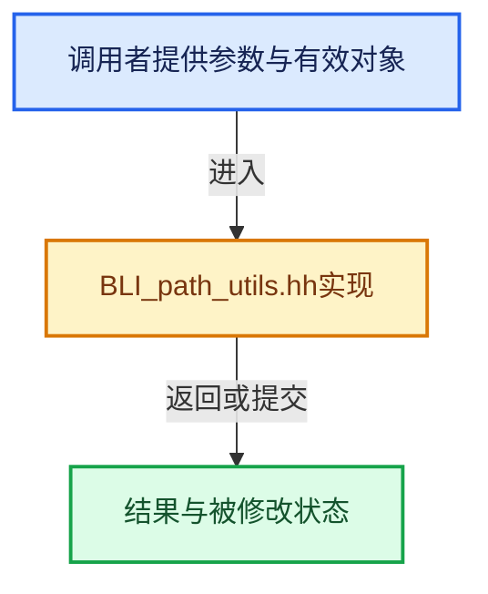

# 实现依赖专题：source/blender/blenlib/BLI_path_utils.hh

[方向导航](README.md) · [符号索引](../%E7%AC%A6%E5%8F%B7%E4%BE%9D%E8%B5%96%E4%B8%8E%E5%AE%9E%E7%8E%B0%E7%B4%A2%E5%BC%95.md)

本专题从正文实际调用进入，集中保存共享实现。函数有稳定锚点，可从调用处直接跳到对应完整函数；递归与互相调用通过回链组织。

## 本文件的实现关系





<a id="m-f3b1183fb80c"></a>

## 宏 `BLI_path_join`

<!-- annotated:124221b3dca266 -->

```cpp
#define BLI_path_join(...) VA_NARGS_CALL_OVERLOAD(_BLI_path_join_, __VA_ARGS__)

```

<details>
<summary>核对原始源码：source/blender/blenlib/BLI_path_utils.hh · L386—L387</summary>

<!-- original:124221b3dca266:source/blender/blenlib/BLI_path_utils.hh:386:387 -->

```cpp
#define BLI_path_join(...) VA_NARGS_CALL_OVERLOAD(_BLI_path_join_, __VA_ARGS__)

```

</details>

宏在预处理阶段展开，参数替换、重复求值和条件编译应直接从该定义检查。与普通函数不同，宏不会自动提供参数类型检查；构建配置选择哪个定义需结合外围条件。

<a id="m-fb8e9adb1664"></a>

## 宏 `BLI_path_cmp`

<!-- annotated:006acce9e23755 -->

```cpp
#  define BLI_path_cmp BLI_strcasecmp
#  define BLI_path_ncmp BLI_strncasecmp
```

<details>
<summary>核对原始源码：source/blender/blenlib/BLI_path_utils.hh · L542—L543</summary>

<!-- original:006acce9e23755:source/blender/blenlib/BLI_path_utils.hh:542:543 -->

```cpp
#  define BLI_path_cmp BLI_strcasecmp
#  define BLI_path_ncmp BLI_strncasecmp
```

</details>

宏在预处理阶段展开，参数替换、重复求值和条件编译应直接从该定义检查。与普通函数不同，宏不会自动提供参数类型检查；构建配置选择哪个定义需结合外围条件。

<a id="m-8a291d4d2a80"></a>

## 宏 `BLI_path_ncmp`

<!-- annotated:aada63dda598b9 -->

```cpp
#  define BLI_path_ncmp BLI_strncasecmp
#else
```

<details>
<summary>核对原始源码：source/blender/blenlib/BLI_path_utils.hh · L543—L544</summary>

<!-- original:aada63dda598b9:source/blender/blenlib/BLI_path_utils.hh:543:544 -->

```cpp
#  define BLI_path_ncmp BLI_strncasecmp
#else
```

</details>

宏在预处理阶段展开，参数替换、重复求值和条件编译应直接从该定义检查。与普通函数不同，宏不会自动提供参数类型检查；构建配置选择哪个定义需结合外围条件。

<a id="m-babc26dbf6dd"></a>

## 宏 `BLI_path_cmp`

<!-- annotated:a4f82648a54888 -->

```cpp
#  define BLI_path_cmp strcmp
#  define BLI_path_ncmp strncmp
```

<details>
<summary>核对原始源码：source/blender/blenlib/BLI_path_utils.hh · L545—L546</summary>

<!-- original:a4f82648a54888:source/blender/blenlib/BLI_path_utils.hh:545:546 -->

```cpp
#  define BLI_path_cmp strcmp
#  define BLI_path_ncmp strncmp
```

</details>

宏在预处理阶段展开，参数替换、重复求值和条件编译应直接从该定义检查。与普通函数不同，宏不会自动提供参数类型检查；构建配置选择哪个定义需结合外围条件。

<a id="m-ec093dfacbd2"></a>

## 宏 `BLI_path_ncmp`

<!-- annotated:d9781432fbaac9 -->

```cpp
#  define BLI_path_ncmp strncmp
#endif
```

<details>
<summary>核对原始源码：source/blender/blenlib/BLI_path_utils.hh · L546—L547</summary>

<!-- original:d9781432fbaac9:source/blender/blenlib/BLI_path_utils.hh:546:547 -->

```cpp
#  define BLI_path_ncmp strncmp
#endif
```

</details>

宏在预处理阶段展开，参数替换、重复求值和条件编译应直接从该定义检查。与普通函数不同，宏不会自动提供参数类型检查；构建配置选择哪个定义需结合外围条件。

<a id="m-a1fce9c370c2"></a>

## 宏 `FILENAME_IS_PARENT`

<!-- annotated:068bf50e9f8e64 -->

```cpp
#define FILENAME_IS_PARENT(_n) (((_n)[0] == '.') && ((_n)[1] == '.') && ((_n)[2] == '\0'))
#define FILENAME_IS_CURRENT(_n) (((_n)[0] == '.') && ((_n)[1] == '\0'))
```

<details>
<summary>核对原始源码：source/blender/blenlib/BLI_path_utils.hh · L821—L822</summary>

<!-- original:068bf50e9f8e64:source/blender/blenlib/BLI_path_utils.hh:821:822 -->

```cpp
#define FILENAME_IS_PARENT(_n) (((_n)[0] == '.') && ((_n)[1] == '.') && ((_n)[2] == '\0'))
#define FILENAME_IS_CURRENT(_n) (((_n)[0] == '.') && ((_n)[1] == '\0'))
```

</details>

宏在预处理阶段展开，参数替换、重复求值和条件编译应直接从该定义检查。与普通函数不同，宏不会自动提供参数类型检查；构建配置选择哪个定义需结合外围条件。

<a id="m-fae6802bc056"></a>

## 宏 `FILENAME_IS_CURRENT`

<!-- annotated:bae2eee394c3a9 -->

```cpp
#define FILENAME_IS_CURRENT(_n) (((_n)[0] == '.') && ((_n)[1] == '\0'))
#define FILENAME_IS_CURRPAR(_n) \
```

<details>
<summary>核对原始源码：source/blender/blenlib/BLI_path_utils.hh · L822—L823</summary>

<!-- original:bae2eee394c3a9:source/blender/blenlib/BLI_path_utils.hh:822:823 -->

```cpp
#define FILENAME_IS_CURRENT(_n) (((_n)[0] == '.') && ((_n)[1] == '\0'))
#define FILENAME_IS_CURRPAR(_n) \
```

</details>

宏在预处理阶段展开，参数替换、重复求值和条件编译应直接从该定义检查。与普通函数不同，宏不会自动提供参数类型检查；构建配置选择哪个定义需结合外围条件。

<a id="m-f41bcdb4516d"></a>

## 宏 `FILENAME_IS_CURRPAR`

<!-- annotated:eef5bb230d4f16 -->

```cpp
#define FILENAME_IS_CURRPAR(_n) \
  (((_n)[0] == '.') && (((_n)[1] == '\0') || (((_n)[1] == '.') && ((_n)[2] == '\0'))))

```

<details>
<summary>核对原始源码：source/blender/blenlib/BLI_path_utils.hh · L823—L825</summary>

<!-- original:eef5bb230d4f16:source/blender/blenlib/BLI_path_utils.hh:823:825 -->

```cpp
#define FILENAME_IS_CURRPAR(_n) \
  (((_n)[0] == '.') && (((_n)[1] == '\0') || (((_n)[1] == '.') && ((_n)[2] == '\0'))))

```

</details>

宏在预处理阶段展开，参数替换、重复求值和条件编译应直接从该定义检查。与普通函数不同，宏不会自动提供参数类型检查；构建配置选择哪个定义需结合外围条件。

## 完整成员与函数实现

<a id="f-e95b7b29f428577d"></a>

### `blender::BLI_path_slash_is_native_compat`

实现位置：[source/blender/blenlib/BLI_path_utils.hh](../../../../../source/blender/blenlib/BLI_path_utils.hh) · L765—L778。

接口参数：

- `const char ch`

**教学注释版**

<!-- annotated:d8561846b89384 -->

```cpp
BLI_INLINE bool BLI_path_slash_is_native_compat(const char ch)
{
  /* On UNIX it only makes sense to treat `/` as a path separator.
   * On WIN32 either may be used. */
  if (ch == SEP) {
    return true;
  }
#ifdef WIN32
  if (ch == ALTSEP) {
    return true;
  }
#endif
  return false;
}
```

<details>
<summary>核对原始源码：source/blender/blenlib/BLI_path_utils.hh · L765—L778</summary>

<!-- original:d8561846b89384:source/blender/blenlib/BLI_path_utils.hh:765:778 -->

```cpp
BLI_INLINE bool BLI_path_slash_is_native_compat(const char ch)
{
  /* On UNIX it only makes sense to treat `/` as a path separator.
   * On WIN32 either may be used. */
  if (ch == SEP) {
    return true;
  }
#ifdef WIN32
  if (ch == ALTSEP) {
    return true;
  }
#endif
  return false;
}
```

</details>

**结果出口**

- `return true;`
- `return false;`

**继续追踪实现**

本实现没有需要继续展开的显式调用；检查返回表达式、对象转换和调用者前置条件。
