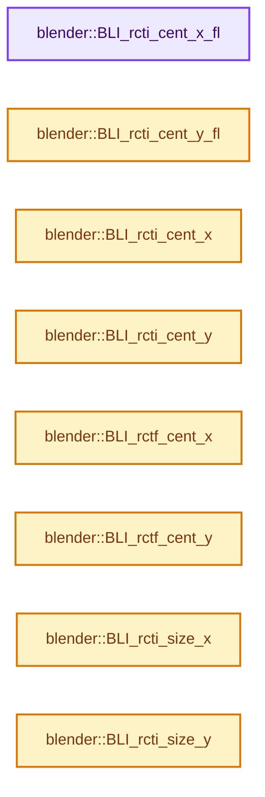
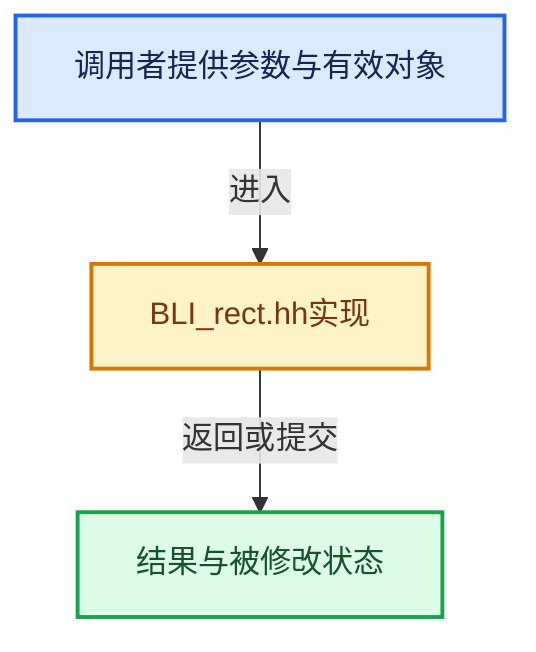

# 实现依赖专题：source/blender/blenlib/BLI_rect.hh

[方向导航](README.md) · [符号索引](../%E7%AC%A6%E5%8F%B7%E4%BE%9D%E8%B5%96%E4%B8%8E%E5%AE%9E%E7%8E%B0%E7%B4%A2%E5%BC%95.md)

本专题从正文实际调用进入，集中保存共享实现。函数有稳定锚点，可从调用处直接跳到对应完整函数；递归与互相调用通过回链组织。

## 本文件的实现关系






## 完整成员与函数实现

<a id="f-060eda013362b8e6"></a>

### `blender::BLI_rcti_cent_x_fl`

实现位置：[source/blender/blenlib/BLI_rect.hh](../../../../../source/blender/blenlib/BLI_rect.hh) · L178—L181。

接口参数：

- `const struct rcti *rct`

**教学注释版**

<!-- annotated:0c317eefe055b9 -->

```cpp
BLI_INLINE float BLI_rcti_cent_x_fl(const struct rcti *rct)
{
  return float(rct->xmin + rct->xmax) / 2.0f;
}
```

<details>
<summary>核对原始源码：source/blender/blenlib/BLI_rect.hh · L178—L181</summary>

<!-- original:0c317eefe055b9:source/blender/blenlib/BLI_rect.hh:178:181 -->

```cpp
BLI_INLINE float BLI_rcti_cent_x_fl(const struct rcti *rct)
{
  return float(rct->xmin + rct->xmax) / 2.0f;
}
```

</details>

**结果出口**

- `return float(rct->xmin + rct->xmax) / 2.0f;`

**继续追踪实现**

本实现没有需要继续展开的显式调用；检查返回表达式、对象转换和调用者前置条件。

<a id="f-101372c09be0eecb"></a>

### `blender::BLI_rcti_cent_y_fl`

实现位置：[source/blender/blenlib/BLI_rect.hh](../../../../../source/blender/blenlib/BLI_rect.hh) · L182—L185。

接口参数：

- `const struct rcti *rct`

**教学注释版**

<!-- annotated:d41895050d6215 -->

```cpp
BLI_INLINE float BLI_rcti_cent_y_fl(const struct rcti *rct)
{
  return float(rct->ymin + rct->ymax) / 2.0f;
}
```

<details>
<summary>核对原始源码：source/blender/blenlib/BLI_rect.hh · L182—L185</summary>

<!-- original:d41895050d6215:source/blender/blenlib/BLI_rect.hh:182:185 -->

```cpp
BLI_INLINE float BLI_rcti_cent_y_fl(const struct rcti *rct)
{
  return float(rct->ymin + rct->ymax) / 2.0f;
}
```

</details>

**结果出口**

- `return float(rct->ymin + rct->ymax) / 2.0f;`

**继续追踪实现**

本实现没有需要继续展开的显式调用；检查返回表达式、对象转换和调用者前置条件。

<a id="f-069bd0391ae1bb4f"></a>

### `blender::BLI_rcti_cent_x`

实现位置：[source/blender/blenlib/BLI_rect.hh](../../../../../source/blender/blenlib/BLI_rect.hh) · L186—L189。

接口参数：

- `const struct rcti *rct`

**教学注释版**

<!-- annotated:7dea81501ec124 -->

```cpp
BLI_INLINE int BLI_rcti_cent_x(const struct rcti *rct)
{
  return (rct->xmin + rct->xmax) / 2;
}
```

<details>
<summary>核对原始源码：source/blender/blenlib/BLI_rect.hh · L186—L189</summary>

<!-- original:7dea81501ec124:source/blender/blenlib/BLI_rect.hh:186:189 -->

```cpp
BLI_INLINE int BLI_rcti_cent_x(const struct rcti *rct)
{
  return (rct->xmin + rct->xmax) / 2;
}
```

</details>

**结果出口**

- `return (rct->xmin + rct->xmax) / 2;`

**继续追踪实现**

本实现没有需要继续展开的显式调用；检查返回表达式、对象转换和调用者前置条件。

<a id="f-de791c2f99e4cf3d"></a>

### `blender::BLI_rcti_cent_y`

实现位置：[source/blender/blenlib/BLI_rect.hh](../../../../../source/blender/blenlib/BLI_rect.hh) · L190—L193。

接口参数：

- `const struct rcti *rct`

**教学注释版**

<!-- annotated:32b6bf46b120a9 -->

```cpp
BLI_INLINE int BLI_rcti_cent_y(const struct rcti *rct)
{
  return (rct->ymin + rct->ymax) / 2;
}
```

<details>
<summary>核对原始源码：source/blender/blenlib/BLI_rect.hh · L190—L193</summary>

<!-- original:32b6bf46b120a9:source/blender/blenlib/BLI_rect.hh:190:193 -->

```cpp
BLI_INLINE int BLI_rcti_cent_y(const struct rcti *rct)
{
  return (rct->ymin + rct->ymax) / 2;
}
```

</details>

**结果出口**

- `return (rct->ymin + rct->ymax) / 2;`

**继续追踪实现**

本实现没有需要继续展开的显式调用；检查返回表达式、对象转换和调用者前置条件。

<a id="f-521da0a7a262e5c8"></a>

### `blender::BLI_rctf_cent_x`

实现位置：[source/blender/blenlib/BLI_rect.hh](../../../../../source/blender/blenlib/BLI_rect.hh) · L194—L197。

接口参数：

- `const struct rctf *rct`

**教学注释版**

<!-- annotated:e3868290573e02 -->

```cpp
BLI_INLINE float BLI_rctf_cent_x(const struct rctf *rct)
{
  return (rct->xmin + rct->xmax) / 2.0f;
}
```

<details>
<summary>核对原始源码：source/blender/blenlib/BLI_rect.hh · L194—L197</summary>

<!-- original:e3868290573e02:source/blender/blenlib/BLI_rect.hh:194:197 -->

```cpp
BLI_INLINE float BLI_rctf_cent_x(const struct rctf *rct)
{
  return (rct->xmin + rct->xmax) / 2.0f;
}
```

</details>

**结果出口**

- `return (rct->xmin + rct->xmax) / 2.0f;`

**继续追踪实现**

本实现没有需要继续展开的显式调用；检查返回表达式、对象转换和调用者前置条件。

<a id="f-5881beee11bc3403"></a>

### `blender::BLI_rctf_cent_y`

实现位置：[source/blender/blenlib/BLI_rect.hh](../../../../../source/blender/blenlib/BLI_rect.hh) · L198—L201。

接口参数：

- `const struct rctf *rct`

**教学注释版**

<!-- annotated:b42a29de666fa2 -->

```cpp
BLI_INLINE float BLI_rctf_cent_y(const struct rctf *rct)
{
  return (rct->ymin + rct->ymax) / 2.0f;
}
```

<details>
<summary>核对原始源码：source/blender/blenlib/BLI_rect.hh · L198—L201</summary>

<!-- original:b42a29de666fa2:source/blender/blenlib/BLI_rect.hh:198:201 -->

```cpp
BLI_INLINE float BLI_rctf_cent_y(const struct rctf *rct)
{
  return (rct->ymin + rct->ymax) / 2.0f;
}
```

</details>

**结果出口**

- `return (rct->ymin + rct->ymax) / 2.0f;`

**继续追踪实现**

本实现没有需要继续展开的显式调用；检查返回表达式、对象转换和调用者前置条件。

<a id="f-7a8fb2c54a829be6"></a>

### `blender::BLI_rcti_size_x`

实现位置：[source/blender/blenlib/BLI_rect.hh](../../../../../source/blender/blenlib/BLI_rect.hh) · L203—L206。

接口参数：

- `const struct rcti *rct`

**教学注释版**

<!-- annotated:4288a6d08e5b45 -->

```cpp
BLI_INLINE int BLI_rcti_size_x(const struct rcti *rct)
{
  return (rct->xmax - rct->xmin);
}
```

<details>
<summary>核对原始源码：source/blender/blenlib/BLI_rect.hh · L203—L206</summary>

<!-- original:4288a6d08e5b45:source/blender/blenlib/BLI_rect.hh:203:206 -->

```cpp
BLI_INLINE int BLI_rcti_size_x(const struct rcti *rct)
{
  return (rct->xmax - rct->xmin);
}
```

</details>

**结果出口**

- `return (rct->xmax - rct->xmin);`

**继续追踪实现**

本实现没有需要继续展开的显式调用；检查返回表达式、对象转换和调用者前置条件。

<a id="f-ac87d6c708d502ad"></a>

### `blender::BLI_rcti_size_y`

实现位置：[source/blender/blenlib/BLI_rect.hh](../../../../../source/blender/blenlib/BLI_rect.hh) · L207—L210。

接口参数：

- `const struct rcti *rct`

**教学注释版**

<!-- annotated:a35d64651aeb4b -->

```cpp
BLI_INLINE int BLI_rcti_size_y(const struct rcti *rct)
{
  return (rct->ymax - rct->ymin);
}
```

<details>
<summary>核对原始源码：source/blender/blenlib/BLI_rect.hh · L207—L210</summary>

<!-- original:a35d64651aeb4b:source/blender/blenlib/BLI_rect.hh:207:210 -->

```cpp
BLI_INLINE int BLI_rcti_size_y(const struct rcti *rct)
{
  return (rct->ymax - rct->ymin);
}
```

</details>

**结果出口**

- `return (rct->ymax - rct->ymin);`

**继续追踪实现**

本实现没有需要继续展开的显式调用；检查返回表达式、对象转换和调用者前置条件。

<a id="f-017b86a9d189e3ba"></a>

### `blender::BLI_rctf_size_x`

实现位置：[source/blender/blenlib/BLI_rect.hh](../../../../../source/blender/blenlib/BLI_rect.hh) · L211—L214。

接口参数：

- `const struct rctf *rct`

**教学注释版**

<!-- annotated:a742419882874d -->

```cpp
BLI_INLINE float BLI_rctf_size_x(const struct rctf *rct)
{
  return (rct->xmax - rct->xmin);
}
```

<details>
<summary>核对原始源码：source/blender/blenlib/BLI_rect.hh · L211—L214</summary>

<!-- original:a742419882874d:source/blender/blenlib/BLI_rect.hh:211:214 -->

```cpp
BLI_INLINE float BLI_rctf_size_x(const struct rctf *rct)
{
  return (rct->xmax - rct->xmin);
}
```

</details>

**结果出口**

- `return (rct->xmax - rct->xmin);`

**继续追踪实现**

本实现没有需要继续展开的显式调用；检查返回表达式、对象转换和调用者前置条件。

<a id="f-6d179bc3c1b71b0e"></a>

### `blender::BLI_rctf_size_y`

实现位置：[source/blender/blenlib/BLI_rect.hh](../../../../../source/blender/blenlib/BLI_rect.hh) · L215—L218。

接口参数：

- `const struct rctf *rct`

**教学注释版**

<!-- annotated:4b566dfba0f125 -->

```cpp
BLI_INLINE float BLI_rctf_size_y(const struct rctf *rct)
{
  return (rct->ymax - rct->ymin);
}
```

<details>
<summary>核对原始源码：source/blender/blenlib/BLI_rect.hh · L215—L218</summary>

<!-- original:4b566dfba0f125:source/blender/blenlib/BLI_rect.hh:215:218 -->

```cpp
BLI_INLINE float BLI_rctf_size_y(const struct rctf *rct)
{
  return (rct->ymax - rct->ymin);
}
```

</details>

**结果出口**

- `return (rct->ymax - rct->ymin);`

**继续追踪实现**

本实现没有需要继续展开的显式调用；检查返回表达式、对象转换和调用者前置条件。
