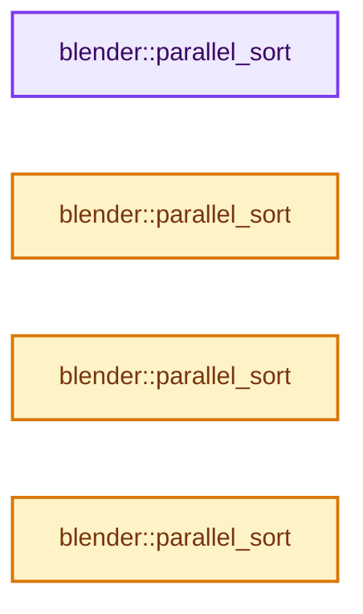
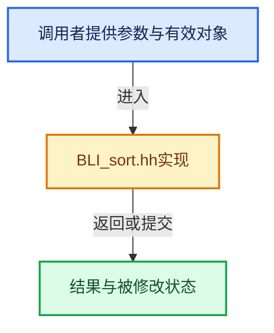

# 实现依赖专题：source/blender/blenlib/BLI_sort.hh

[方向导航](README.md) · [符号索引](../%E7%AC%A6%E5%8F%B7%E4%BE%9D%E8%B5%96%E4%B8%8E%E5%AE%9E%E7%8E%B0%E7%B4%A2%E5%BC%95.md)

本专题从正文实际调用进入，集中保存共享实现。函数有稳定锚点，可从调用处直接跳到对应完整函数；递归与互相调用通过回链组织。

## 本文件的实现关系






## 完整成员与函数实现

<a id="f-c7bb69e225bb6ec0"></a>

### `blender::parallel_sort`

实现位置：[source/blender/blenlib/BLI_sort.hh](../../../../../source/blender/blenlib/BLI_sort.hh) · L36—L40。

接口参数：

- `RandomAccessIterator begin`
- `RandomAccessIterator end`

**教学注释版**

<!-- annotated:82307c9d6fb698 -->

```cpp
template<typename RandomAccessIterator>
void parallel_sort(RandomAccessIterator begin, RandomAccessIterator end)
{
  std::sort<RandomAccessIterator>(begin, end);
}
```

<details>
<summary>核对原始源码：source/blender/blenlib/BLI_sort.hh · L36—L40</summary>

<!-- original:82307c9d6fb698:source/blender/blenlib/BLI_sort.hh:36:40 -->

```cpp
template<typename RandomAccessIterator>
void parallel_sort(RandomAccessIterator begin, RandomAccessIterator end)
{
  std::sort<RandomAccessIterator>(begin, end);
}
```

</details>

**继续追踪实现**

- `std::sort<RandomAccessIterator>` → [外部契约](https://eel.is/c++draft/)：这个边界按实际表达式及所属类型核对参数、返回值、寿命与失败行为。这里提供接口入口，不声称已解释该第三方版本的内部实现。

<a id="f-c4cdce306be83899"></a>

### `blender::parallel_sort`

实现位置：[source/blender/blenlib/BLI_sort.hh](../../../../../source/blender/blenlib/BLI_sort.hh) · L41—L45。

接口参数：

- `RandomAccessIterator begin`
- `RandomAccessIterator end`
- `const Compare &comp`

**教学注释版**

<!-- annotated:cbf9c3c3ce745a -->

```cpp
template<typename RandomAccessIterator, typename Compare>
void parallel_sort(RandomAccessIterator begin, RandomAccessIterator end, const Compare &comp)
{
  std::sort<RandomAccessIterator, Compare>(begin, end, comp);
}
```

<details>
<summary>核对原始源码：source/blender/blenlib/BLI_sort.hh · L41—L45</summary>

<!-- original:cbf9c3c3ce745a:source/blender/blenlib/BLI_sort.hh:41:45 -->

```cpp
template<typename RandomAccessIterator, typename Compare>
void parallel_sort(RandomAccessIterator begin, RandomAccessIterator end, const Compare &comp)
{
  std::sort<RandomAccessIterator, Compare>(begin, end, comp);
}
```

</details>

**继续追踪实现**

- `std::sort<RandomAccessIterator, Compare>` → [外部契约](https://eel.is/c++draft/)：这个边界按实际表达式及所属类型核对参数、返回值、寿命与失败行为。这里提供接口入口，不声称已解释该第三方版本的内部实现。

<a id="f-7cdbab466f203f4f"></a>

### `blender::parallel_sort`

实现位置：[source/blender/blenlib/BLI_sort.hh](../../../../../source/blender/blenlib/BLI_sort.hh) · L46—L49。

接口参数：

- `Range &range`

**教学注释版**

<!-- annotated:d269caebc89e38 -->

```cpp
template<typename Range> void parallel_sort(Range &range)
{
  std::sort(range.begin(), range.end());
}
```

<details>
<summary>核对原始源码：source/blender/blenlib/BLI_sort.hh · L46—L49</summary>

<!-- original:d269caebc89e38:source/blender/blenlib/BLI_sort.hh:46:49 -->

```cpp
template<typename Range> void parallel_sort(Range &range)
{
  std::sort(range.begin(), range.end());
}
```

</details>

**继续追踪实现**

- `std::sort` → [外部契约](https://eel.is/c++draft/)：这个边界按实际表达式及所属类型核对参数、返回值、寿命与失败行为。这里提供接口入口，不声称已解释该第三方版本的内部实现。
- `range.begin` → [blender::StringRefBase::begin · L233](15-StringRef%E5%AD%97%E7%AC%A6%E4%B8%B2%E8%A7%86%E5%9B%BE.md#f-0fa50fe40314532d)。
- `range.end` → [blender::StringRefBase::end · L238](15-StringRef%E5%AD%97%E7%AC%A6%E4%B8%B2%E8%A7%86%E5%9B%BE.md#f-6197aad1986222a5)。

<a id="f-e8a3491a7ba9b37f"></a>

### `blender::parallel_sort`

实现位置：[source/blender/blenlib/BLI_sort.hh](../../../../../source/blender/blenlib/BLI_sort.hh) · L50—L53。

接口参数：

- `Range &range`
- `const Compare &comp`

**教学注释版**

<!-- annotated:c24728f98feef7 -->

```cpp
template<typename Range, typename Compare> void parallel_sort(Range &range, const Compare &comp)
{
  std::sort(range.begin(), range.end(), comp);
}
```

<details>
<summary>核对原始源码：source/blender/blenlib/BLI_sort.hh · L50—L53</summary>

<!-- original:c24728f98feef7:source/blender/blenlib/BLI_sort.hh:50:53 -->

```cpp
template<typename Range, typename Compare> void parallel_sort(Range &range, const Compare &comp)
{
  std::sort(range.begin(), range.end(), comp);
}
```

</details>

**继续追踪实现**

- `std::sort` → [外部契约](https://eel.is/c++draft/)：这个边界按实际表达式及所属类型核对参数、返回值、寿命与失败行为。这里提供接口入口，不声称已解释该第三方版本的内部实现。
- `range.begin` → [blender::StringRefBase::begin · L233](15-StringRef%E5%AD%97%E7%AC%A6%E4%B8%B2%E8%A7%86%E5%9B%BE.md#f-0fa50fe40314532d)。
- `range.end` → [blender::StringRefBase::end · L238](15-StringRef%E5%AD%97%E7%AC%A6%E4%B8%B2%E8%A7%86%E5%9B%BE.md#f-6197aad1986222a5)。
