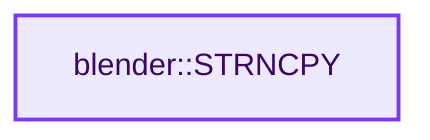
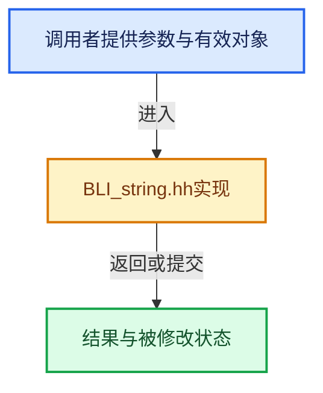

# 实现依赖专题：source/blender/blenlib/BLI_string.hh

[方向导航](README.md) · [符号索引](../%E7%AC%A6%E5%8F%B7%E4%BE%9D%E8%B5%96%E4%B8%8E%E5%AE%9E%E7%8E%B0%E7%B4%A2%E5%BC%95.md)

本专题从正文实际调用进入，集中保存共享实现。函数有稳定锚点，可从调用处直接跳到对应完整函数；递归与互相调用通过回链组织。

## 本文件的实现关系






<a id="m-81329fe9f9ee"></a>

## 宏 `STRNCPY_RLEN`

<!-- annotated:b2a20947a4af05 -->

```cpp
#define STRNCPY_RLEN(dst, src) BLI_strncpy_rlen(dst, src, ARRAY_SIZE(dst))
#define SNPRINTF(dst, format, ...) BLI_snprintf(dst, ARRAY_SIZE(dst), format, __VA_ARGS__)
```

<details>
<summary>核对原始源码：source/blender/blenlib/BLI_string.hh · L600—L601</summary>

<!-- original:b2a20947a4af05:source/blender/blenlib/BLI_string.hh:600:601 -->

```cpp
#define STRNCPY_RLEN(dst, src) BLI_strncpy_rlen(dst, src, ARRAY_SIZE(dst))
#define SNPRINTF(dst, format, ...) BLI_snprintf(dst, ARRAY_SIZE(dst), format, __VA_ARGS__)
```

</details>

宏在预处理阶段展开，参数替换、重复求值和条件编译应直接从该定义检查。与普通函数不同，宏不会自动提供参数类型检查；构建配置选择哪个定义需结合外围条件。

<a id="m-6193d55b5ab8"></a>

## 宏 `SNPRINTF`

<!-- annotated:ed2f8ce7a8aba9 -->

```cpp
#define SNPRINTF(dst, format, ...) BLI_snprintf(dst, ARRAY_SIZE(dst), format, __VA_ARGS__)
#define SNPRINTF_RLEN(dst, format, ...) \
```

<details>
<summary>核对原始源码：source/blender/blenlib/BLI_string.hh · L601—L602</summary>

<!-- original:ed2f8ce7a8aba9:source/blender/blenlib/BLI_string.hh:601:602 -->

```cpp
#define SNPRINTF(dst, format, ...) BLI_snprintf(dst, ARRAY_SIZE(dst), format, __VA_ARGS__)
#define SNPRINTF_RLEN(dst, format, ...) \
```

</details>

宏在预处理阶段展开，参数替换、重复求值和条件编译应直接从该定义检查。与普通函数不同，宏不会自动提供参数类型检查；构建配置选择哪个定义需结合外围条件。

<a id="m-228853ce5f7f"></a>

## 宏 `STRNLEN`

<!-- annotated:1007e77c54e97b -->

```cpp
#define STRNLEN(str) BLI_strnlen(str, ARRAY_SIZE(str))

```

<details>
<summary>核对原始源码：source/blender/blenlib/BLI_string.hh · L610—L611</summary>

<!-- original:1007e77c54e97b:source/blender/blenlib/BLI_string.hh:610:611 -->

```cpp
#define STRNLEN(str) BLI_strnlen(str, ARRAY_SIZE(str))

```

</details>

宏在预处理阶段展开，参数替换、重复求值和条件编译应直接从该定义检查。与普通函数不同，宏不会自动提供参数类型检查；构建配置选择哪个定义需结合外围条件。

<a id="m-101109e97582"></a>

## 宏 `STR_ELEM`

<!-- annotated:b0bebea6b5b319 -->

```cpp
#define STR_ELEM(...) VA_NARGS_CALL_OVERLOAD(_VA_STR_ELEM, __VA_ARGS__)

```

<details>
<summary>核对原始源码：source/blender/blenlib/BLI_string.hh · L658—L659</summary>

<!-- original:b0bebea6b5b319:source/blender/blenlib/BLI_string.hh:658:659 -->

```cpp
#define STR_ELEM(...) VA_NARGS_CALL_OVERLOAD(_VA_STR_ELEM, __VA_ARGS__)

```

</details>

宏在预处理阶段展开，参数替换、重复求值和条件编译应直接从该定义检查。与普通函数不同，宏不会自动提供参数类型检查；构建配置选择哪个定义需结合外围条件。

<a id="m-b560dcb5e1df"></a>

## 宏 `BLI_string_debug_size`

<!-- annotated:8e48654e3df903 -->

```cpp
#  define BLI_string_debug_size(str, str_maxncpy) memset(str, 0xff, sizeof(*(str)) * str_maxncpy)
/**
```

<details>
<summary>核对原始源码：source/blender/blenlib/BLI_string.hh · L666—L667</summary>

<!-- original:8e48654e3df903:source/blender/blenlib/BLI_string.hh:666:667 -->

```cpp
#  define BLI_string_debug_size(str, str_maxncpy) memset(str, 0xff, sizeof(*(str)) * str_maxncpy)
/**
```

</details>

宏在预处理阶段展开，参数替换、重复求值和条件编译应直接从该定义检查。与普通函数不同，宏不会自动提供参数类型检查；构建配置选择哪个定义需结合外围条件。

<a id="m-6b2ed5aaa6e2"></a>

## 宏 `BLI_string_debug_size`

<!-- annotated:af6171d9ac0b23 -->

```cpp
#  define BLI_string_debug_size(str, str_maxncpy) \
    if (0) { \
      (void)str, (void)str_maxncpy; \
    } \
    ((void)0)
#  define BLI_string_debug_size_after_nil(str, str_maxncpy) BLI_string_debug_size(str, str_maxncpy)
```

<details>
<summary>核对原始源码：source/blender/blenlib/BLI_string.hh · L673—L678</summary>

<!-- original:af6171d9ac0b23:source/blender/blenlib/BLI_string.hh:673:678 -->

```cpp
#  define BLI_string_debug_size(str, str_maxncpy) \
    if (0) { \
      (void)str, (void)str_maxncpy; \
    } \
    ((void)0)
#  define BLI_string_debug_size_after_nil(str, str_maxncpy) BLI_string_debug_size(str, str_maxncpy)
```

</details>

宏在预处理阶段展开，参数替换、重复求值和条件编译应直接从该定义检查。与普通函数不同，宏不会自动提供参数类型检查；构建配置选择哪个定义需结合外围条件。

## 完整成员与函数实现

<a id="f-6b2d861724026be6"></a>

### `blender::STRNCPY`

实现位置：[source/blender/blenlib/BLI_string.hh](../../../../../source/blender/blenlib/BLI_string.hh) · L690—L693。

接口参数：

- `char (&dst)[N]`
- `const char *src`

**教学注释版**

<!-- annotated:971e7c339e07d8 -->

```cpp
template<size_t N> inline char *STRNCPY(char (&dst)[N], const char *src)
{
  return BLI_strncpy(dst, src, N);
}
```

<details>
<summary>核对原始源码：source/blender/blenlib/BLI_string.hh · L690—L693</summary>

<!-- original:971e7c339e07d8:source/blender/blenlib/BLI_string.hh:690:693 -->

```cpp
template<size_t N> inline char *STRNCPY(char (&dst)[N], const char *src)
{
  return BLI_strncpy(dst, src, N);
}
```

</details>

**结果出口**

- `return BLI_strncpy(dst, src, N);`

**继续追踪实现**

- `BLI_strncpy` → [blender::BLI_strncpy · L70](%E4%BE%9D%E8%B5%96-string-1d986f.md#f-6324147b0d116da1)。
