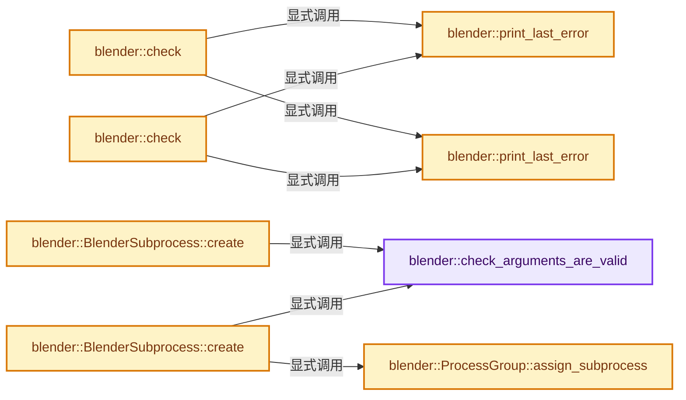

# 实现依赖专题：source/blender/blenlib/intern/BLI_subprocess.cc

[方向导航](README.md) · [符号索引](../%E7%AC%A6%E5%8F%B7%E4%BE%9D%E8%B5%96%E4%B8%8E%E5%AE%9E%E7%8E%B0%E7%B4%A2%E5%BC%95.md)

本专题从正文实际调用进入，集中保存共享实现。函数有稳定锚点，可从调用处直接跳到对应完整函数；递归与互相调用通过回链组织。

## 本文件的实现关系




<a id="m-67e09d9b52bf"></a>

## 宏 `CHECK`

<!-- annotated:cd94188f19f4f1 -->

```cpp
#    define CHECK(result) check((result), __func__, #result)
#    undef ERROR /* Defined in wingdi.h */
```

<details>
<summary>核对原始源码：source/blender/blenlib/intern/BLI_subprocess.cc · L58—L59</summary>

<!-- original:cd94188f19f4f1:source/blender/blenlib/intern/BLI_subprocess.cc:58:59 -->

```cpp
#    define CHECK(result) check((result), __func__, #result)
#    undef ERROR /* Defined in wingdi.h */
```

</details>

宏在预处理阶段展开，参数替换、重复求值和条件编译应直接从该定义检查。与普通函数不同，宏不会自动提供参数类型检查；构建配置选择哪个定义需结合外围条件。

<a id="m-0f40f9bff340"></a>

## 宏 `ERROR`

<!-- annotated:6028057001c2c9 -->

```cpp
#    define ERROR(msg) check(false, __func__, msg)

```

<details>
<summary>核对原始源码：source/blender/blenlib/intern/BLI_subprocess.cc · L60—L61</summary>

<!-- original:6028057001c2c9:source/blender/blenlib/intern/BLI_subprocess.cc:60:61 -->

```cpp
#    define ERROR(msg) check(false, __func__, msg)

```

</details>

宏在预处理阶段展开，参数替换、重复求值和条件编译应直接从该定义检查。与普通函数不同，宏不会自动提供参数类型检查；构建配置选择哪个定义需结合外围条件。

<a id="m-2c99c5049ec7"></a>

## 宏 `CHECK`

<!-- annotated:069be599ef4028 -->

```cpp
#    define CHECK(result) check((result), __func__, #result)
#    define ERROR(msg) check(-1, __func__, msg)
```

<details>
<summary>核对原始源码：source/blender/blenlib/intern/BLI_subprocess.cc · L265—L266</summary>

<!-- original:069be599ef4028:source/blender/blenlib/intern/BLI_subprocess.cc:265:266 -->

```cpp
#    define CHECK(result) check((result), __func__, #result)
#    define ERROR(msg) check(-1, __func__, msg)
```

</details>

宏在预处理阶段展开，参数替换、重复求值和条件编译应直接从该定义检查。与普通函数不同，宏不会自动提供参数类型检查；构建配置选择哪个定义需结合外围条件。

<a id="m-a0028d872226"></a>

## 宏 `ERROR`

<!-- annotated:31bdc4b2d99cea -->

```cpp
#    define ERROR(msg) check(-1, __func__, msg)

```

<details>
<summary>核对原始源码：source/blender/blenlib/intern/BLI_subprocess.cc · L266—L267</summary>

<!-- original:31bdc4b2d99cea:source/blender/blenlib/intern/BLI_subprocess.cc:266:267 -->

```cpp
#    define ERROR(msg) check(-1, __func__, msg)

```

</details>

宏在预处理阶段展开，参数替换、重复求值和条件编译应直接从该定义检查。与普通函数不同，宏不会自动提供参数类型检查；构建配置选择哪个定义需结合外围条件。

## 完整成员与函数实现

<a id="f-c37ba532bc4a4247"></a>

### `blender::check_arguments_are_valid`

实现位置：[source/blender/blenlib/intern/BLI_subprocess.cc](../../../../../source/blender/blenlib/intern/BLI_subprocess.cc) · L22—L33。

接口参数：

- `Span<StringRefNull> args`

**教学注释版**

<!-- annotated:3d02ed5402beef -->

```cpp
static bool check_arguments_are_valid(Span<StringRefNull> args)
{
  for (StringRefNull arg : args) {
    for (const char c : arg) {
      if (!std::isalnum(c) && !ELEM(c, '_', '-')) {
        return false;
      }
    }
  }

  return true;
}
```

<details>
<summary>核对原始源码：source/blender/blenlib/intern/BLI_subprocess.cc · L22—L33</summary>

<!-- original:3d02ed5402beef:source/blender/blenlib/intern/BLI_subprocess.cc:22:33 -->

```cpp
static bool check_arguments_are_valid(Span<StringRefNull> args)
{
  for (StringRefNull arg : args) {
    for (const char c : arg) {
      if (!std::isalnum(c) && !ELEM(c, '_', '-')) {
        return false;
      }
    }
  }

  return true;
}
```

</details>

**结果出口**

- `return false;`
- `return true;`

**继续追踪实现**

- `std::isalnum` → [外部契约](https://eel.is/c++draft/)：这个边界按实际表达式及所属类型核对参数、返回值、寿命与失败行为。这里提供接口入口，不声称已解释该第三方版本的内部实现。
- `ELEM` → [ELEM · L88](../05-%E5%87%A0%E4%BD%95%E5%AD%98%E5%82%A8%E4%B8%8E%E6%8B%93%E6%89%91%E6%98%A0%E5%B0%84/%E4%BE%9D%E8%B5%96-GHOST_utildefines-34b996.md#m-d28724a15928)；[ELEM · L135](%E4%BE%9D%E8%B5%96-BLI_utildefines-293a0a.md#m-d6572de7cae0)。宏定义由构建条件选择。

<a id="f-ced4d407bb82f4c3"></a>

### `blender::print_last_error`

实现位置：[source/blender/blenlib/intern/BLI_subprocess.cc](../../../../../source/blender/blenlib/intern/BLI_subprocess.cc) · L44—L48。

接口参数：

- `const char *function`
- `const char *msg`

**教学注释版**

<!-- annotated:1ba6a88f7759f9 -->

```cpp
static void print_last_error(const char *function, const char *msg)
{
  DWORD error_code = GetLastError();
  std::cerr << "ERROR (" << error_code << "): " << function << " : " << msg << std::endl;
}
```

<details>
<summary>核对原始源码：source/blender/blenlib/intern/BLI_subprocess.cc · L44—L48</summary>

<!-- original:1ba6a88f7759f9:source/blender/blenlib/intern/BLI_subprocess.cc:44:48 -->

```cpp
static void print_last_error(const char *function, const char *msg)
{
  DWORD error_code = GetLastError();
  std::cerr << "ERROR (" << error_code << "): " << function << " : " << msg << std::endl;
}
```

</details>

**继续追踪实现**

- `GetLastError` → [调用协议](../%E6%A8%A1%E6%9D%BF%E5%AE%8F%E4%B8%8E%E5%8A%A8%E6%80%81%E5%88%86%E6%B4%BE%E5%8D%8F%E8%AE%AE.md)：函数指针、局部可调用对象或未展开的宏；必须结合调用者环境。调用位置L46。

<a id="f-5e2096d4b4f0fab7"></a>

### `blender::check`

实现位置：[source/blender/blenlib/intern/BLI_subprocess.cc](../../../../../source/blender/blenlib/intern/BLI_subprocess.cc) · L50—L56。

接口参数：

- `bool result`
- `const char *function`
- `const char *msg`

**教学注释版**

<!-- annotated:74b33c279828f9 -->

```cpp
static void check(bool result, const char *function, const char *msg)
{
  if (!result) {
    print_last_error(function, msg);
    BLI_assert(false);
  }
}
```

<details>
<summary>核对原始源码：source/blender/blenlib/intern/BLI_subprocess.cc · L50—L56</summary>

<!-- original:74b33c279828f9:source/blender/blenlib/intern/BLI_subprocess.cc:50:56 -->

```cpp
static void check(bool result, const char *function, const char *msg)
{
  if (!result) {
    print_last_error(function, msg);
    BLI_assert(false);
  }
}
```

</details>

**继续追踪实现**

- `print_last_error` → [blender::print_last_error · L44](%E4%BE%9D%E8%B5%96-BLI_subprocess-32585a.md#f-ced4d407bb82f4c3)；[blender::print_last_error · L250](%E4%BE%9D%E8%B5%96-BLI_subprocess-32585a.md#f-1762d2ff30802252)。同名重载需按实参类型选择。
- `BLI_assert` → [BLI_assert · L48](%E4%BE%9D%E8%B5%96-BLI_assert-cc98e8.md#m-57a88495704d)；[BLI_assert · L63](%E4%BE%9D%E8%B5%96-BLI_assert-cc98e8.md#m-d07050020cb5)。宏定义由构建条件选择。

<a id="f-79dbcf38746cd8e1"></a>

### `blender::ProcessGroup::assign_subprocess`

实现位置：[source/blender/blenlib/intern/BLI_subprocess.cc](../../../../../source/blender/blenlib/intern/BLI_subprocess.cc) · L85—L88。

接口参数：

- `HANDLE subprocess`

**教学注释版**

<!-- annotated:b09359bf359b14 -->

```cpp
  void assign_subprocess(HANDLE subprocess)
  {
    CHECK(AssignProcessToJobObject(handle_, subprocess));
  }
```

<details>
<summary>核对原始源码：source/blender/blenlib/intern/BLI_subprocess.cc · L85—L88</summary>

<!-- original:b09359bf359b14:source/blender/blenlib/intern/BLI_subprocess.cc:85:88 -->

```cpp
  void assign_subprocess(HANDLE subprocess)
  {
    CHECK(AssignProcessToJobObject(handle_, subprocess));
  }
```

</details>

**继续追踪实现**

- `CHECK` → [CHECK · L58](%E4%BE%9D%E8%B5%96-BLI_subprocess-32585a.md#m-67e09d9b52bf)；[CHECK · L265](%E4%BE%9D%E8%B5%96-BLI_subprocess-32585a.md#m-2c99c5049ec7)。宏定义由构建条件选择。
- `AssignProcessToJobObject` → [调用协议](../%E6%A8%A1%E6%9D%BF%E5%AE%8F%E4%B8%8E%E5%8A%A8%E6%80%81%E5%88%86%E6%B4%BE%E5%8D%8F%E8%AE%AE.md)：函数指针、局部可调用对象或未展开的宏；必须结合调用者环境。调用位置L87。

<a id="f-5994dc38c23dce9f"></a>

### `blender::BlenderSubprocess::create`

实现位置：[source/blender/blenlib/intern/BLI_subprocess.cc](../../../../../source/blender/blenlib/intern/BLI_subprocess.cc) · L91—L144。

接口参数：

- `Span<StringRefNull> args`

**教学注释版**

<!-- annotated:721a2b7b30bd64 -->

```cpp
bool BlenderSubprocess::create(Span<StringRefNull> args)
{
  BLI_assert(handle_ == nullptr);

  if (!check_arguments_are_valid(args)) {
    BLI_assert(false);
    return false;
  }

  wchar_t path[FILE_MAX];
  if (!GetModuleFileNameW(nullptr, path, FILE_MAX)) {
    ERROR("GetModuleFileNameW");
    return false;
  }

  std::string args_str;
  for (StringRefNull arg : args) {
    args_str += arg + " ";
  }

  const int length_wc = MultiByteToWideChar(
      CP_UTF8, 0, args_str.c_str(), args_str.length(), nullptr, 0);
  std::wstring w_args(length_wc, 0);
  CHECK(MultiByteToWideChar(
      CP_UTF8, 0, args_str.c_str(), args_str.length(), w_args.data(), length_wc));

  STARTUPINFOW startup_info = {0};
  startup_info.cb = sizeof(startup_info);
  PROCESS_INFORMATION process_info = {0};
  if (!CreateProcessW(path,
                      /** Use data() since lpCommandLine must be mutable. */
                      w_args.data(),
                      nullptr,
                      nullptr,
                      false,
                      CREATE_BREAKAWAY_FROM_JOB,
                      nullptr,
                      nullptr,
                      &startup_info,
                      &process_info))
  {
    ERROR("CreateProcessW");
    return false;
  }

  handle_ = process_info.hProcess;
  CHECK(CloseHandle(process_info.hThread));

  static ProcessGroup group;
  /* Don't let the subprocess outlive its parent. */
  group.assign_subprocess(handle_);

  return true;
}
```

<details>
<summary>核对原始源码：source/blender/blenlib/intern/BLI_subprocess.cc · L91—L144</summary>

<!-- original:721a2b7b30bd64:source/blender/blenlib/intern/BLI_subprocess.cc:91:144 -->

```cpp
bool BlenderSubprocess::create(Span<StringRefNull> args)
{
  BLI_assert(handle_ == nullptr);

  if (!check_arguments_are_valid(args)) {
    BLI_assert(false);
    return false;
  }

  wchar_t path[FILE_MAX];
  if (!GetModuleFileNameW(nullptr, path, FILE_MAX)) {
    ERROR("GetModuleFileNameW");
    return false;
  }

  std::string args_str;
  for (StringRefNull arg : args) {
    args_str += arg + " ";
  }

  const int length_wc = MultiByteToWideChar(
      CP_UTF8, 0, args_str.c_str(), args_str.length(), nullptr, 0);
  std::wstring w_args(length_wc, 0);
  CHECK(MultiByteToWideChar(
      CP_UTF8, 0, args_str.c_str(), args_str.length(), w_args.data(), length_wc));

  STARTUPINFOW startup_info = {0};
  startup_info.cb = sizeof(startup_info);
  PROCESS_INFORMATION process_info = {0};
  if (!CreateProcessW(path,
                      /** Use data() since lpCommandLine must be mutable. */
                      w_args.data(),
                      nullptr,
                      nullptr,
                      false,
                      CREATE_BREAKAWAY_FROM_JOB,
                      nullptr,
                      nullptr,
                      &startup_info,
                      &process_info))
  {
    ERROR("CreateProcessW");
    return false;
  }

  handle_ = process_info.hProcess;
  CHECK(CloseHandle(process_info.hThread));

  static ProcessGroup group;
  /* Don't let the subprocess outlive its parent. */
  group.assign_subprocess(handle_);

  return true;
}
```

</details>

**沿实际写入检查状态**

- `args_str += arg + " ";`
- `startup_info.cb = sizeof(startup_info);`
- `handle_ = process_info.hProcess;`

**结果出口**

- `return false;`
- `return true;`

**继续追踪实现**

- `BLI_assert` → [BLI_assert · L48](%E4%BE%9D%E8%B5%96-BLI_assert-cc98e8.md#m-57a88495704d)；[BLI_assert · L63](%E4%BE%9D%E8%B5%96-BLI_assert-cc98e8.md#m-d07050020cb5)。宏定义由构建条件选择。
- `check_arguments_are_valid` → [blender::check_arguments_are_valid · L22](%E4%BE%9D%E8%B5%96-BLI_subprocess-32585a.md#f-c37ba532bc4a4247)。
- `GetModuleFileNameW` → [调用协议](../%E6%A8%A1%E6%9D%BF%E5%AE%8F%E4%B8%8E%E5%8A%A8%E6%80%81%E5%88%86%E6%B4%BE%E5%8D%8F%E8%AE%AE.md)：函数指针、局部可调用对象或未展开的宏；必须结合调用者环境。调用位置L101。
- `ERROR` → [ERROR · L60](%E4%BE%9D%E8%B5%96-BLI_subprocess-32585a.md#m-0f40f9bff340)；[ERROR · L266](%E4%BE%9D%E8%B5%96-BLI_subprocess-32585a.md#m-a0028d872226)。宏定义由构建条件选择。
- `MultiByteToWideChar` → [调用协议](../%E6%A8%A1%E6%9D%BF%E5%AE%8F%E4%B8%8E%E5%8A%A8%E6%80%81%E5%88%86%E6%B4%BE%E5%8D%8F%E8%AE%AE.md)：函数指针、局部可调用对象或未展开的宏；必须结合调用者环境。调用位置L111。
- `args_str.c_str` → [外部契约](https://eel.is/c++draft/)：这个边界按实际表达式及所属类型核对参数、返回值、寿命与失败行为。这里提供接口入口，不声称已解释该第三方版本的内部实现。
- `args_str.length` → [外部契约](https://eel.is/c++draft/)：这个边界按实际表达式及所属类型核对参数、返回值、寿命与失败行为。这里提供接口入口，不声称已解释该第三方版本的内部实现。
- `CHECK` → [CHECK · L58](%E4%BE%9D%E8%B5%96-BLI_subprocess-32585a.md#m-67e09d9b52bf)；[CHECK · L265](%E4%BE%9D%E8%B5%96-BLI_subprocess-32585a.md#m-2c99c5049ec7)。宏定义由构建条件选择。
- `w_args.data` → [外部契约](https://eel.is/c++draft/)：这个边界按实际表达式及所属类型核对参数、返回值、寿命与失败行为。这里提供接口入口，不声称已解释该第三方版本的内部实现。
- `CreateProcessW` → [调用协议](../%E6%A8%A1%E6%9D%BF%E5%AE%8F%E4%B8%8E%E5%8A%A8%E6%80%81%E5%88%86%E6%B4%BE%E5%8D%8F%E8%AE%AE.md)：函数指针、局部可调用对象或未展开的宏；必须结合调用者环境。调用位置L120。
- `CloseHandle` → [调用协议](../%E6%A8%A1%E6%9D%BF%E5%AE%8F%E4%B8%8E%E5%8A%A8%E6%80%81%E5%88%86%E6%B4%BE%E5%8D%8F%E8%AE%AE.md)：函数指针、局部可调用对象或未展开的宏；必须结合调用者环境。调用位置L137。
- `group.assign_subprocess` → [blender::ProcessGroup::assign_subprocess · L85](%E4%BE%9D%E8%B5%96-BLI_subprocess-32585a.md#f-79dbcf38746cd8e1)。

<a id="f-1762d2ff30802252"></a>

### `blender::print_last_error`

实现位置：[source/blender/blenlib/intern/BLI_subprocess.cc](../../../../../source/blender/blenlib/intern/BLI_subprocess.cc) · L250—L255。

接口参数：

- `const char *function`
- `const char *msg`

**教学注释版**

<!-- annotated:b180d06eae1c8c -->

```cpp
static void print_last_error(const char *function, const char *msg)
{
  int error_code = errno;
  std::string error_msg = "ERROR (" + std::to_string(error_code) + "): " + function + " : " + msg;
  perror(error_msg.c_str());
}
```

<details>
<summary>核对原始源码：source/blender/blenlib/intern/BLI_subprocess.cc · L250—L255</summary>

<!-- original:b180d06eae1c8c:source/blender/blenlib/intern/BLI_subprocess.cc:250:255 -->

```cpp
static void print_last_error(const char *function, const char *msg)
{
  int error_code = errno;
  std::string error_msg = "ERROR (" + std::to_string(error_code) + "): " + function + " : " + msg;
  perror(error_msg.c_str());
}
```

</details>

**继续追踪实现**

- `std::to_string` → [外部契约](https://eel.is/c++draft/)：这个边界按实际表达式及所属类型核对参数、返回值、寿命与失败行为。这里提供接口入口，不声称已解释该第三方版本的内部实现。
- `perror` → [调用协议](../%E6%A8%A1%E6%9D%BF%E5%AE%8F%E4%B8%8E%E5%8A%A8%E6%80%81%E5%88%86%E6%B4%BE%E5%8D%8F%E8%AE%AE.md)：函数指针、局部可调用对象或未展开的宏；必须结合调用者环境。调用位置L254。
- `error_msg.c_str` → [外部契约](https://eel.is/c++draft/)：这个边界按实际表达式及所属类型核对参数、返回值、寿命与失败行为。这里提供接口入口，不声称已解释该第三方版本的内部实现。

<a id="f-af801c412f160c15"></a>

### `blender::check`

实现位置：[source/blender/blenlib/intern/BLI_subprocess.cc](../../../../../source/blender/blenlib/intern/BLI_subprocess.cc) · L257—L263。

接口参数：

- `int result`
- `const char *function`
- `const char *msg`

**教学注释版**

<!-- annotated:33da5c004815ba -->

```cpp
static void check(int result, const char *function, const char *msg)
{
  if (result == -1) {
    print_last_error(function, msg);
    BLI_assert(false);
  }
}
```

<details>
<summary>核对原始源码：source/blender/blenlib/intern/BLI_subprocess.cc · L257—L263</summary>

<!-- original:33da5c004815ba:source/blender/blenlib/intern/BLI_subprocess.cc:257:263 -->

```cpp
static void check(int result, const char *function, const char *msg)
{
  if (result == -1) {
    print_last_error(function, msg);
    BLI_assert(false);
  }
}
```

</details>

**继续追踪实现**

- `print_last_error` → [blender::print_last_error · L44](%E4%BE%9D%E8%B5%96-BLI_subprocess-32585a.md#f-ced4d407bb82f4c3)；[blender::print_last_error · L250](%E4%BE%9D%E8%B5%96-BLI_subprocess-32585a.md#f-1762d2ff30802252)。同名重载需按实参类型选择。
- `BLI_assert` → [BLI_assert · L48](%E4%BE%9D%E8%B5%96-BLI_assert-cc98e8.md#m-57a88495704d)；[BLI_assert · L63](%E4%BE%9D%E8%B5%96-BLI_assert-cc98e8.md#m-d07050020cb5)。宏定义由构建条件选择。

<a id="f-928490ae13cb6ea1"></a>

### `blender::BlenderSubprocess::create`

实现位置：[source/blender/blenlib/intern/BLI_subprocess.cc](../../../../../source/blender/blenlib/intern/BLI_subprocess.cc) · L268—L314。

接口参数：

- `Span<StringRefNull> args`

**教学注释版**

<!-- annotated:bbfe87b711ec3f -->

```cpp
bool BlenderSubprocess::create(Span<StringRefNull> args)
{
  if (!check_arguments_are_valid(args)) {
    BLI_assert(false);
    return false;
  }

  char path[PATH_MAX + 1];
  const size_t len = readlink("/proc/self/exe", path, PATH_MAX);
  if (len == size_t(-1)) {
    ERROR("readlink");
    return false;
  }
  /* readlink doesn't append a null terminator. */
  path[len] = '\0';

  Vector<char *> char_args;
  for (StringRefNull arg : args) {
    // [讲解] char_args.append：在尾部建立新元素，必要时先扩大存储。
    char_args.append(const_cast<char *>(arg.data()));
  }
  char_args.append(nullptr);

  pid_ = fork();

  if (pid_ == -1) {
    ERROR("fork");
    return false;
  }
  if (pid_ > 0) {
    return true;
  }

  /* Child process initialization. */
  // [讲解] char_args.data：提供当前存储或有效范围的地址。
  execv(path, char_args.data());

  /* This should only be reached if `execvp` fails and stack isn't replaced. */
  ERROR("execv");

  /* Ensure outputs are flushed as `_exit` doesn't flush. */
  fflush(stdout);
  fflush(stderr);

  /* Use `_exit` instead of `exit` so Blender's `atexit` cleanup functions don't run. */
  _exit(errno);
  BLI_assert_unreachable();
  return false;
}
```

<details>
<summary>核对原始源码：source/blender/blenlib/intern/BLI_subprocess.cc · L268—L314</summary>

<!-- original:bbfe87b711ec3f:source/blender/blenlib/intern/BLI_subprocess.cc:268:314 -->

```cpp
bool BlenderSubprocess::create(Span<StringRefNull> args)
{
  if (!check_arguments_are_valid(args)) {
    BLI_assert(false);
    return false;
  }

  char path[PATH_MAX + 1];
  const size_t len = readlink("/proc/self/exe", path, PATH_MAX);
  if (len == size_t(-1)) {
    ERROR("readlink");
    return false;
  }
  /* readlink doesn't append a null terminator. */
  path[len] = '\0';

  Vector<char *> char_args;
  for (StringRefNull arg : args) {
    char_args.append(const_cast<char *>(arg.data()));
  }
  char_args.append(nullptr);

  pid_ = fork();

  if (pid_ == -1) {
    ERROR("fork");
    return false;
  }
  if (pid_ > 0) {
    return true;
  }

  /* Child process initialization. */
  execv(path, char_args.data());

  /* This should only be reached if `execvp` fails and stack isn't replaced. */
  ERROR("execv");

  /* Ensure outputs are flushed as `_exit` doesn't flush. */
  fflush(stdout);
  fflush(stderr);

  /* Use `_exit` instead of `exit` so Blender's `atexit` cleanup functions don't run. */
  _exit(errno);
  BLI_assert_unreachable();
  return false;
}
```

</details>

**沿实际写入检查状态**

- `path[len] = '\0';`
- `pid_ = fork();`

**结果出口**

- `return false;`
- `return true;`

**继续追踪实现**

- `check_arguments_are_valid` → [blender::check_arguments_are_valid · L22](%E4%BE%9D%E8%B5%96-BLI_subprocess-32585a.md#f-c37ba532bc4a4247)。
- `BLI_assert` → [BLI_assert · L48](%E4%BE%9D%E8%B5%96-BLI_assert-cc98e8.md#m-57a88495704d)；[BLI_assert · L63](%E4%BE%9D%E8%B5%96-BLI_assert-cc98e8.md#m-d07050020cb5)。宏定义由构建条件选择。
- `readlink` → [调用协议](../%E6%A8%A1%E6%9D%BF%E5%AE%8F%E4%B8%8E%E5%8A%A8%E6%80%81%E5%88%86%E6%B4%BE%E5%8D%8F%E8%AE%AE.md)：函数指针、局部可调用对象或未展开的宏；必须结合调用者环境。调用位置L276。
- `ERROR` → [ERROR · L60](%E4%BE%9D%E8%B5%96-BLI_subprocess-32585a.md#m-0f40f9bff340)；[ERROR · L266](%E4%BE%9D%E8%B5%96-BLI_subprocess-32585a.md#m-a0028d872226)。宏定义由构建条件选择。
- `char_args.append` → [blender::Vector::append · L498](11-Vector%E6%8F%92%E5%85%A5%E5%88%A0%E9%99%A4%E4%B8%8E%E9%87%8D%E6%8E%92.md#f-5bde268a69e443ec)；[blender::Vector::append · L502](11-Vector%E6%8F%92%E5%85%A5%E5%88%A0%E9%99%A4%E4%B8%8E%E9%87%8D%E6%8E%92.md#f-591e0b15e6308532)。同名重载需按实参类型选择。
- `arg.data` → [调用协议](../%E6%A8%A1%E6%9D%BF%E5%AE%8F%E4%B8%8E%E5%8A%A8%E6%80%81%E5%88%86%E6%B4%BE%E5%8D%8F%E8%AE%AE.md)：接收对象类型依赖auto、返回值或模板实例；不按同名猜测目标。调用位置L286。
- `fork` → [调用协议](../%E6%A8%A1%E6%9D%BF%E5%AE%8F%E4%B8%8E%E5%8A%A8%E6%80%81%E5%88%86%E6%B4%BE%E5%8D%8F%E8%AE%AE.md)：函数指针、局部可调用对象或未展开的宏；必须结合调用者环境。调用位置L290。
- `execv` → [调用协议](../%E6%A8%A1%E6%9D%BF%E5%AE%8F%E4%B8%8E%E5%8A%A8%E6%80%81%E5%88%86%E6%B4%BE%E5%8D%8F%E8%AE%AE.md)：函数指针、局部可调用对象或未展开的宏；必须结合调用者环境。调用位置L301。
- `char_args.data` → [blender::Vector::data · L954](12-Vector%E5%BC%82%E5%B8%B8%E5%AE%89%E5%85%A8%E4%B8%8E%E8%BE%B9%E7%95%8C.md#f-6e441591404715bc)；[blender::Vector::data · L962](12-Vector%E5%BC%82%E5%B8%B8%E5%AE%89%E5%85%A8%E4%B8%8E%E8%BE%B9%E7%95%8C.md#f-4bc78d4954c1021a)。同名重载需按实参类型选择。
- `fflush` → [调用协议](../%E6%A8%A1%E6%9D%BF%E5%AE%8F%E4%B8%8E%E5%8A%A8%E6%80%81%E5%88%86%E6%B4%BE%E5%8D%8F%E8%AE%AE.md)：函数指针、局部可调用对象或未展开的宏；必须结合调用者环境。调用位置L307。
- `_exit` → [调用协议](../%E6%A8%A1%E6%9D%BF%E5%AE%8F%E4%B8%8E%E5%8A%A8%E6%80%81%E5%88%86%E6%B4%BE%E5%8D%8F%E8%AE%AE.md)：函数指针、局部可调用对象或未展开的宏；必须结合调用者环境。调用位置L311。
- `BLI_assert_unreachable` → [BLI_assert_unreachable · L77](%E4%BE%9D%E8%B5%96-BLI_assert-cc98e8.md#m-7a2d91a67d8e)。宏定义由构建条件选择。
