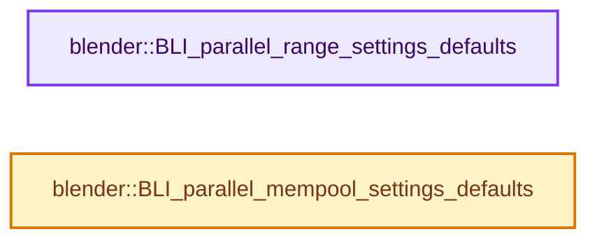
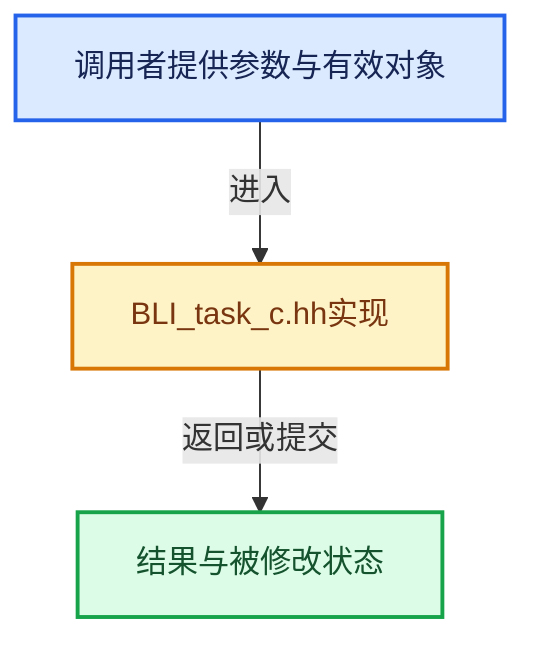

# 实现依赖专题：source/blender/blenlib/BLI_task_c.hh

[方向导航](README.md) · [符号索引](../%E7%AC%A6%E5%8F%B7%E4%BE%9D%E8%B5%96%E4%B8%8E%E5%AE%9E%E7%8E%B0%E7%B4%A2%E5%BC%95.md)

本专题从正文实际调用进入，集中保存共享实现。函数有稳定锚点，可从调用处直接跳到对应完整函数；递归与互相调用通过回链组织。

## 本文件的实现关系






## 完整成员与函数实现

<a id="f-3858ad801a98e123"></a>

### `blender::BLI_parallel_range_settings_defaults`

实现位置：[source/blender/blenlib/BLI_task_c.hh](../../../../../source/blender/blenlib/BLI_task_c.hh) · L218—L224。

接口参数：

- `TaskParallelSettings *settings`

**教学注释版**

<!-- annotated:125d668e8af45b -->

```cpp
BLI_INLINE void BLI_parallel_range_settings_defaults(TaskParallelSettings *settings)
{
  // [讲解] memset：填充字节，不调用T构造函数，也不保证任意类型的全零表示是合法或期望值。
  memset(settings, 0, sizeof(*settings));
  settings->use_threading = true;
  /* Use default heuristic to define actual chunk size. */
  settings->min_iter_per_thread = 0;
}
```

<details>
<summary>核对原始源码：source/blender/blenlib/BLI_task_c.hh · L218—L224</summary>

<!-- original:125d668e8af45b:source/blender/blenlib/BLI_task_c.hh:218:224 -->

```cpp
BLI_INLINE void BLI_parallel_range_settings_defaults(TaskParallelSettings *settings)
{
  memset(settings, 0, sizeof(*settings));
  settings->use_threading = true;
  /* Use default heuristic to define actual chunk size. */
  settings->min_iter_per_thread = 0;
}
```

</details>

**沿实际写入检查状态**

- `settings->use_threading = true;`
- `settings->min_iter_per_thread = 0;`

**继续追踪实现**

- `memset` → [外部契约](https://eel.is/c++draft/cstring.syn)：填充字节，不调用T构造函数，也不保证任意类型的全零表示是合法或期望值。

<a id="f-4663e9e152bb1f7d"></a>

### `blender::BLI_parallel_mempool_settings_defaults`

实现位置：[source/blender/blenlib/BLI_task_c.hh](../../../../../source/blender/blenlib/BLI_task_c.hh) · L226—L230。

接口参数：

- `TaskParallelSettings *settings`

**教学注释版**

<!-- annotated:56881b9fb3f4aa -->

```cpp
BLI_INLINE void BLI_parallel_mempool_settings_defaults(TaskParallelSettings *settings)
{
  // [讲解] memset：填充字节，不调用T构造函数，也不保证任意类型的全零表示是合法或期望值。
  memset(settings, 0, sizeof(*settings));
  settings->use_threading = true;
}
```

<details>
<summary>核对原始源码：source/blender/blenlib/BLI_task_c.hh · L226—L230</summary>

<!-- original:56881b9fb3f4aa:source/blender/blenlib/BLI_task_c.hh:226:230 -->

```cpp
BLI_INLINE void BLI_parallel_mempool_settings_defaults(TaskParallelSettings *settings)
{
  memset(settings, 0, sizeof(*settings));
  settings->use_threading = true;
}
```

</details>

**沿实际写入检查状态**

- `settings->use_threading = true;`

**继续追踪实现**

- `memset` → [外部契约](https://eel.is/c++draft/cstring.syn)：填充字节，不调用T构造函数，也不保证任意类型的全零表示是合法或期望值。
