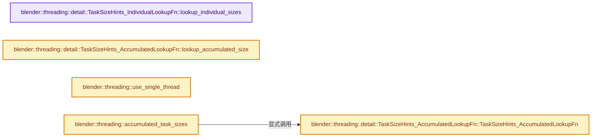
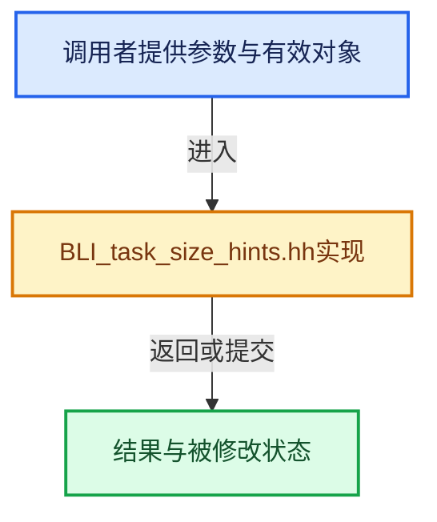

# 实现依赖专题：source/blender/blenlib/BLI_task_size_hints.hh

[方向导航](README.md) · [符号索引](../%E7%AC%A6%E5%8F%B7%E4%BE%9D%E8%B5%96%E4%B8%8E%E5%AE%9E%E7%8E%B0%E7%B4%A2%E5%BC%95.md)

本专题从正文实际调用进入，集中保存共享实现。函数有稳定锚点，可从调用处直接跳到对应完整函数；递归与互相调用通过回链组织。

## 本文件的实现关系






## 相关类型布局与成员入口

<a id="t-91f12014c9c0"></a>

### `blender::threading::TaskSizeHints::Type`

原始声明：[source/blender/blenlib/BLI_task_size_hints.hh](../../../../../source/blender/blenlib/BLI_task_size_hints.hh) · L26—L36。

以下保留类的数据声明与编译条件，成员函数实现通过后面的精确链接阅读。

<!-- annotated:7b82385ed1b6a4 -->

```cpp
  enum class Type {
    /** All tasks have the same size. */
    Static,
    /** All tasks can have different sizes and one has to look up the sizes one by one. */
    IndividualLookup,
    /**
     * All tasks can have different sizes but one can efficiently determine the size of a
     * consecutive range of tasks.
     */
    AccumulatedLookup,
  };
```

<details>
<summary>核对原始源码：source/blender/blenlib/BLI_task_size_hints.hh · L26—L36</summary>

<!-- original:7b82385ed1b6a4:source/blender/blenlib/BLI_task_size_hints.hh:26:36 -->

```cpp
  enum class Type {
    /** All tasks have the same size. */
    Static,
    /** All tasks can have different sizes and one has to look up the sizes one by one. */
    IndividualLookup,
    /**
     * All tasks can have different sizes but one can efficiently determine the size of a
     * consecutive range of tasks.
     */
    AccumulatedLookup,
  };
```

</details>


## 完整成员与函数实现

<a id="f-3734b4b56aa29ebf"></a>

### `blender::threading::detail::TaskSizeHints_IndividualLookupFn::lookup_individual_sizes`

实现位置：[source/blender/blenlib/BLI_task_size_hints.hh](../../../../../source/blender/blenlib/BLI_task_size_hints.hh) · L86—L89。

接口参数：

- `const IndexRange range`
- `MutableSpan<int64_t> r_sizes`

**教学注释版**

<!-- annotated:27b3b1a62dce36 -->

```cpp
  void lookup_individual_sizes(const IndexRange range, MutableSpan<int64_t> r_sizes) const override
  {
    fn_(range, r_sizes);
  }
```

<details>
<summary>核对原始源码：source/blender/blenlib/BLI_task_size_hints.hh · L86—L89</summary>

<!-- original:27b3b1a62dce36:source/blender/blenlib/BLI_task_size_hints.hh:86:89 -->

```cpp
  void lookup_individual_sizes(const IndexRange range, MutableSpan<int64_t> r_sizes) const override
  {
    fn_(range, r_sizes);
  }
```

</details>

**继续追踪实现**

- `fn_` → [调用协议](../%E6%A8%A1%E6%9D%BF%E5%AE%8F%E4%B8%8E%E5%8A%A8%E6%80%81%E5%88%86%E6%B4%BE%E5%8D%8F%E8%AE%AE.md)：函数指针、局部可调用对象或未展开的宏；必须结合调用者环境。调用位置L88。

<a id="f-9c32c58ecf8c380d"></a>

### `blender::threading::detail::TaskSizeHints_AccumulatedLookupFn::TaskSizeHints_AccumulatedLookupFn`

实现位置：[source/blender/blenlib/BLI_task_size_hints.hh](../../../../../source/blender/blenlib/BLI_task_size_hints.hh) · L98—L100。

接口参数：

- `Fn fn`

**教学注释版**

<!-- annotated:0f2b0382039c82 -->

```cpp
  TaskSizeHints_AccumulatedLookupFn(Fn fn) : TaskSizeHints_AccumulatedLookup(), fn_(std::move(fn))
  {
  }
```

<details>
<summary>核对原始源码：source/blender/blenlib/BLI_task_size_hints.hh · L98—L100</summary>

<!-- original:0f2b0382039c82:source/blender/blenlib/BLI_task_size_hints.hh:98:100 -->

```cpp
  TaskSizeHints_AccumulatedLookupFn(Fn fn) : TaskSizeHints_AccumulatedLookup(), fn_(std::move(fn))
  {
  }
```

</details>

**继续追踪实现**

本实现没有需要继续展开的显式调用；检查返回表达式、对象转换和调用者前置条件。

<a id="f-ca8741c0ff0a75fc"></a>

### `blender::threading::detail::TaskSizeHints_AccumulatedLookupFn::lookup_accumulated_size`

实现位置：[source/blender/blenlib/BLI_task_size_hints.hh](../../../../../source/blender/blenlib/BLI_task_size_hints.hh) · L102—L105。

接口参数：

- `const IndexRange range`

**教学注释版**

<!-- annotated:af7d76cc7d3333 -->

```cpp
  int64_t lookup_accumulated_size(const IndexRange range) const override
  {
    return fn_(range);
  }
```

<details>
<summary>核对原始源码：source/blender/blenlib/BLI_task_size_hints.hh · L102—L105</summary>

<!-- original:af7d76cc7d3333:source/blender/blenlib/BLI_task_size_hints.hh:102:105 -->

```cpp
  int64_t lookup_accumulated_size(const IndexRange range) const override
  {
    return fn_(range);
  }
```

</details>

**结果出口**

- `return fn_(range);`

**继续追踪实现**

- `fn_` → [调用协议](../%E6%A8%A1%E6%9D%BF%E5%AE%8F%E4%B8%8E%E5%8A%A8%E6%80%81%E5%88%86%E6%B4%BE%E5%8D%8F%E8%AE%AE.md)：函数指针、局部可调用对象或未展开的宏；必须结合调用者环境。调用位置L104。

<a id="f-312425a5f9a68a41"></a>

### `blender::threading::use_single_thread`

实现位置：[source/blender/blenlib/BLI_task_size_hints.hh](../../../../../source/blender/blenlib/BLI_task_size_hints.hh) · L110—L145。

接口参数：

- `const TaskSizeHints &size_hints`
- `const IndexRange range`
- `const int64_t threshold`

**教学注释版**

<!-- annotated:de02695cbdfd58 -->

```cpp
inline bool use_single_thread(const TaskSizeHints &size_hints,
                              const IndexRange range,
                              const int64_t threshold)
{
#ifdef __GNUC__ /* False positive warning with GCC. */
#  pragma GCC diagnostic push
#  pragma GCC diagnostic ignored "-Warray-bounds"
#endif
  switch (size_hints.type) {
    case TaskSizeHints::Type::Static: {
      const int64_t size = static_cast<const detail::TaskSizeHints_Static &>(size_hints).size;
      // [讲解] range.size：读取连续区间或分组的边界信息。
      return size * range.size() <= threshold;
    }
    case TaskSizeHints::Type::IndividualLookup: {
      const std::optional<int64_t> &full_size =
          static_cast<const detail::TaskSizeHints_IndividualLookup &>(size_hints).full_size;
      if (full_size.has_value()) {
        if (*full_size <= threshold) {
          return true;
        }
      }
      return false;
    }
    case TaskSizeHints::Type::AccumulatedLookup: {
      const int64_t accumulated_size =
          static_cast<const detail::TaskSizeHints_AccumulatedLookup &>(size_hints)
              .lookup_accumulated_size(range);
      return accumulated_size <= threshold;
    }
  }
#ifdef __GNUC__
#  pragma GCC diagnostic pop
#endif
  BLI_assert_unreachable();
  return true;
}
```

<details>
<summary>核对原始源码：source/blender/blenlib/BLI_task_size_hints.hh · L110—L145</summary>

<!-- original:de02695cbdfd58:source/blender/blenlib/BLI_task_size_hints.hh:110:145 -->

```cpp
inline bool use_single_thread(const TaskSizeHints &size_hints,
                              const IndexRange range,
                              const int64_t threshold)
{
#ifdef __GNUC__ /* False positive warning with GCC. */
#  pragma GCC diagnostic push
#  pragma GCC diagnostic ignored "-Warray-bounds"
#endif
  switch (size_hints.type) {
    case TaskSizeHints::Type::Static: {
      const int64_t size = static_cast<const detail::TaskSizeHints_Static &>(size_hints).size;
      return size * range.size() <= threshold;
    }
    case TaskSizeHints::Type::IndividualLookup: {
      const std::optional<int64_t> &full_size =
          static_cast<const detail::TaskSizeHints_IndividualLookup &>(size_hints).full_size;
      if (full_size.has_value()) {
        if (*full_size <= threshold) {
          return true;
        }
      }
      return false;
    }
    case TaskSizeHints::Type::AccumulatedLookup: {
      const int64_t accumulated_size =
          static_cast<const detail::TaskSizeHints_AccumulatedLookup &>(size_hints)
              .lookup_accumulated_size(range);
      return accumulated_size <= threshold;
    }
  }
#ifdef __GNUC__
#  pragma GCC diagnostic pop
#endif
  BLI_assert_unreachable();
  return true;
}
```

</details>

**结果出口**

- `return size * range.size() <= threshold;`
- `return true;`
- `return false;`
- `return accumulated_size <= threshold;`

**继续追踪实现**

- `range.size` → [blender::IndexRange::size · L156](04-IndexRange%E8%BF%9E%E7%BB%AD%E6%95%B4%E6%95%B0%E5%8C%BA%E9%97%B4.md#f-05f66c3ebb2fdfec)。
- `full_size.has_value` → [外部契约](https://eel.is/c++draft/)：这个边界按实际表达式及所属类型核对参数、返回值、寿命与失败行为。这里提供接口入口，不声称已解释该第三方版本的内部实现。
- `static_cast<const detail::TaskSizeHints_AccumulatedLookup &>(size_hints) .lookup_accumulated_size` → [调用协议](../%E6%A8%A1%E6%9D%BF%E5%AE%8F%E4%B8%8E%E5%8A%A8%E6%80%81%E5%88%86%E6%B4%BE%E5%8D%8F%E8%AE%AE.md)：接收对象类型依赖auto、返回值或模板实例；不按同名猜测目标。调用位置L135。
- `BLI_assert_unreachable` → [BLI_assert_unreachable · L77](%E4%BE%9D%E8%B5%96-BLI_assert-cc98e8.md#m-7a2d91a67d8e)。宏定义由构建条件选择。

<a id="f-6cdaf1aaed56993c"></a>

### `blender::threading::accumulated_task_sizes`

实现位置：[source/blender/blenlib/BLI_task_size_hints.hh](../../../../../source/blender/blenlib/BLI_task_size_hints.hh) · L177—L180。

接口参数：

- `Fn &&fn`

**教学注释版**

<!-- annotated:708673ef3fbee9 -->

```cpp
template<typename Fn> inline auto accumulated_task_sizes(Fn &&fn)
{
  // [讲解] std::forward<Fn>：在转发引用中恢复调用者传入的值类别；依赖推导类型，不能与无条件move互换。
  return detail::TaskSizeHints_AccumulatedLookupFn<decltype(fn)>(std::forward<Fn>(fn));
}
```

<details>
<summary>核对原始源码：source/blender/blenlib/BLI_task_size_hints.hh · L177—L180</summary>

<!-- original:708673ef3fbee9:source/blender/blenlib/BLI_task_size_hints.hh:177:180 -->

```cpp
template<typename Fn> inline auto accumulated_task_sizes(Fn &&fn)
{
  return detail::TaskSizeHints_AccumulatedLookupFn<decltype(fn)>(std::forward<Fn>(fn));
}
```

</details>

**结果出口**

- `return detail::TaskSizeHints_AccumulatedLookupFn<decltype(fn)>(std::forward<Fn>(fn));`

**继续追踪实现**

- `detail::TaskSizeHints_AccumulatedLookupFn<decltype(fn)>` → [blender::threading::detail::TaskSizeHints_AccumulatedLookupFn::TaskSizeHints_AccumulatedLookupFn · L98](%E4%BE%9D%E8%B5%96-BLI_task_size_hints-5d752d.md#f-9c32c58ecf8c380d)。
- `std::forward<Fn>` → [外部契约](https://eel.is/c++draft/utility.forward)：在转发引用中恢复调用者传入的值类别；依赖推导类型，不能与无条件move互换。
