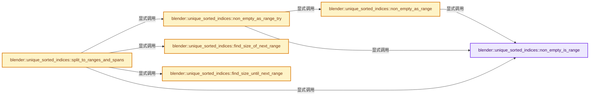
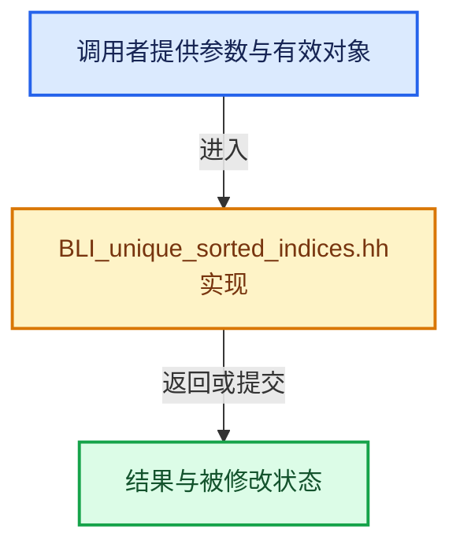

# 实现依赖专题：source/blender/blenlib/BLI_unique_sorted_indices.hh

[方向导航](README.md) · [符号索引](../%E7%AC%A6%E5%8F%B7%E4%BE%9D%E8%B5%96%E4%B8%8E%E5%AE%9E%E7%8E%B0%E7%B4%A2%E5%BC%95.md)

本专题从正文实际调用进入，集中保存共享实现。函数有稳定锚点，可从调用处直接跳到对应完整函数；递归与互相调用通过回链组织。

## 本文件的实现关系






## 完整成员与函数实现

<a id="f-f7e007562027c649"></a>

### `blender::unique_sorted_indices::non_empty_is_range`

实现位置：[source/blender/blenlib/BLI_unique_sorted_indices.hh](../../../../../source/blender/blenlib/BLI_unique_sorted_indices.hh) · L37—L41。

接口参数：

- `const Span<T> indices`

**教学注释版**

<!-- annotated:a9b1f9b31f0a81 -->

```cpp
template<typename T> inline bool non_empty_is_range(const Span<T> indices)
{
  // [讲解] indices.is_empty：查询视图长度或生成对应有效索引区间。
  BLI_assert(!indices.is_empty());
  // [讲解] indices.last：按视图边界访问元素。
  return indices.last() - indices.first() == indices.size() - 1;
}
```

<details>
<summary>核对原始源码：source/blender/blenlib/BLI_unique_sorted_indices.hh · L37—L41</summary>

<!-- original:a9b1f9b31f0a81:source/blender/blenlib/BLI_unique_sorted_indices.hh:37:41 -->

```cpp
template<typename T> inline bool non_empty_is_range(const Span<T> indices)
{
  BLI_assert(!indices.is_empty());
  return indices.last() - indices.first() == indices.size() - 1;
}
```

</details>

**结果出口**

- `return indices.last() - indices.first() == indices.size() - 1;`

**继续追踪实现**

- `BLI_assert` → [BLI_assert · L48](%E4%BE%9D%E8%B5%96-BLI_assert-cc98e8.md#m-57a88495704d)；[BLI_assert · L63](%E4%BE%9D%E8%B5%96-BLI_assert-cc98e8.md#m-d07050020cb5)。宏定义由构建条件选择。
- `indices.is_empty` → [blender::Span::is_empty · L264](05-Span%E5%8F%AA%E8%AF%BB%E8%BF%9E%E7%BB%AD%E8%A7%86%E5%9B%BE.md#f-8cc1d7ba8feb50e6)。
- `indices.last` → [blender::Span::last · L329](05-Span%E5%8F%AA%E8%AF%BB%E8%BF%9E%E7%BB%AD%E8%A7%86%E5%9B%BE.md#f-a92146c285596891)。
- `indices.first` → [blender::Span::first · L319](05-Span%E5%8F%AA%E8%AF%BB%E8%BF%9E%E7%BB%AD%E8%A7%86%E5%9B%BE.md#f-d8c9bcc3e9757248)。
- `indices.size` → [blender::Span::size · L256](05-Span%E5%8F%AA%E8%AF%BB%E8%BF%9E%E7%BB%AD%E8%A7%86%E5%9B%BE.md#f-5f80fa006089c998)。

<a id="f-b7ef3170137e93bb"></a>

### `blender::unique_sorted_indices::non_empty_as_range`

实现位置：[source/blender/blenlib/BLI_unique_sorted_indices.hh](../../../../../source/blender/blenlib/BLI_unique_sorted_indices.hh) · L46—L51。

接口参数：

- `const Span<T> indices`

**教学注释版**

<!-- annotated:93b3f25b275ee7 -->

```cpp
template<typename T> inline IndexRange non_empty_as_range(const Span<T> indices)
{
  // [讲解] indices.is_empty：查询视图长度或生成对应有效索引区间。
  BLI_assert(!indices.is_empty());
  BLI_assert(non_empty_is_range(indices));
  // [讲解] indices.first：按视图边界访问元素。
  return IndexRange(indices.first(), indices.size());
}
```

<details>
<summary>核对原始源码：source/blender/blenlib/BLI_unique_sorted_indices.hh · L46—L51</summary>

<!-- original:93b3f25b275ee7:source/blender/blenlib/BLI_unique_sorted_indices.hh:46:51 -->

```cpp
template<typename T> inline IndexRange non_empty_as_range(const Span<T> indices)
{
  BLI_assert(!indices.is_empty());
  BLI_assert(non_empty_is_range(indices));
  return IndexRange(indices.first(), indices.size());
}
```

</details>

**结果出口**

- `return IndexRange(indices.first(), indices.size());`

**继续追踪实现**

- `BLI_assert` → [BLI_assert · L48](%E4%BE%9D%E8%B5%96-BLI_assert-cc98e8.md#m-57a88495704d)；[BLI_assert · L63](%E4%BE%9D%E8%B5%96-BLI_assert-cc98e8.md#m-d07050020cb5)。宏定义由构建条件选择。
- `indices.is_empty` → [blender::Span::is_empty · L264](05-Span%E5%8F%AA%E8%AF%BB%E8%BF%9E%E7%BB%AD%E8%A7%86%E5%9B%BE.md#f-8cc1d7ba8feb50e6)。
- `non_empty_is_range` → [blender::unique_sorted_indices::non_empty_is_range · L37](%E4%BE%9D%E8%B5%96-BLI_unique_sorted_indices-4da7d3.md#f-f7e007562027c649)。
- `IndexRange` → [blender::IndexRange](%E4%BE%9D%E8%B5%96-BLI_index_range-7d7cc5.md#t-caa3466d6776)；[blender::gpu::shader::parser::IndexRange](../05-%E5%87%A0%E4%BD%95%E5%AD%98%E5%82%A8%E4%B8%8E%E6%8B%93%E6%89%91%E6%98%A0%E5%B0%84/%E4%BE%9D%E8%B5%96-utils-06433d.md#t-82d2bd4ea71c)；[blender::IndexRange](../05-%E5%87%A0%E4%BD%95%E5%AD%98%E5%82%A8%E4%B8%8E%E6%8B%93%E6%89%91%E6%98%A0%E5%B0%84/%E4%BE%9D%E8%B5%96-DNA_node_types-6708b9.md#t-0448cc889d39)。
- `indices.first` → [blender::Span::first · L319](05-Span%E5%8F%AA%E8%AF%BB%E8%BF%9E%E7%BB%AD%E8%A7%86%E5%9B%BE.md#f-d8c9bcc3e9757248)。
- `indices.size` → [blender::Span::size · L256](05-Span%E5%8F%AA%E8%AF%BB%E8%BF%9E%E7%BB%AD%E8%A7%86%E5%9B%BE.md#f-5f80fa006089c998)。

<a id="f-9f467a0ce0809788"></a>

### `blender::unique_sorted_indices::non_empty_as_range_try`

实现位置：[source/blender/blenlib/BLI_unique_sorted_indices.hh](../../../../../source/blender/blenlib/BLI_unique_sorted_indices.hh) · L56—L62。

接口参数：

- `const Span<T> indices`

**教学注释版**

<!-- annotated:7328a3a262accf -->

```cpp
template<typename T> inline std::optional<IndexRange> non_empty_as_range_try(const Span<T> indices)
{
  if (non_empty_is_range(indices)) {
    return non_empty_as_range(indices);
  }
  return std::nullopt;
}
```

<details>
<summary>核对原始源码：source/blender/blenlib/BLI_unique_sorted_indices.hh · L56—L62</summary>

<!-- original:7328a3a262accf:source/blender/blenlib/BLI_unique_sorted_indices.hh:56:62 -->

```cpp
template<typename T> inline std::optional<IndexRange> non_empty_as_range_try(const Span<T> indices)
{
  if (non_empty_is_range(indices)) {
    return non_empty_as_range(indices);
  }
  return std::nullopt;
}
```

</details>

**结果出口**

- `return non_empty_as_range(indices);`
- `return std::nullopt;`

**继续追踪实现**

- `non_empty_is_range` → [blender::unique_sorted_indices::non_empty_is_range · L37](%E4%BE%9D%E8%B5%96-BLI_unique_sorted_indices-4da7d3.md#f-f7e007562027c649)。
- `non_empty_as_range` → [blender::unique_sorted_indices::non_empty_as_range · L46](%E4%BE%9D%E8%B5%96-BLI_unique_sorted_indices-4da7d3.md#f-b7ef3170137e93bb)。

<a id="f-03df40e7fbf4ead3"></a>

### `blender::unique_sorted_indices::find_size_of_next_range`

实现位置：[source/blender/blenlib/BLI_unique_sorted_indices.hh](../../../../../source/blender/blenlib/BLI_unique_sorted_indices.hh) · L71—L78。

接口参数：

- `const Span<T> indices`

**教学注释版**

<!-- annotated:518e3d665e9859 -->

```cpp
template<typename T> inline int64_t find_size_of_next_range(const Span<T> indices)
{
  // [讲解] indices.is_empty：查询视图长度或生成对应有效索引区间。
  BLI_assert(!indices.is_empty());
  return binary_search::first_if(indices, [indices, offset = indices[0]](const T &value) {
    // [讲解] indices.begin：返回借用范围的地址。
    const int64_t index = &value - indices.begin();
    return value - offset > index;
  });
}
```

<details>
<summary>核对原始源码：source/blender/blenlib/BLI_unique_sorted_indices.hh · L71—L78</summary>

<!-- original:518e3d665e9859:source/blender/blenlib/BLI_unique_sorted_indices.hh:71:78 -->

```cpp
template<typename T> inline int64_t find_size_of_next_range(const Span<T> indices)
{
  BLI_assert(!indices.is_empty());
  return binary_search::first_if(indices, [indices, offset = indices[0]](const T &value) {
    const int64_t index = &value - indices.begin();
    return value - offset > index;
  });
}
```

</details>

**结果出口**

- `return binary_search::first_if(indices, [indices, offset = indices[0]](const T &value) {`
- `return value - offset > index;`

**继续追踪实现**

- `BLI_assert` → [BLI_assert · L48](%E4%BE%9D%E8%B5%96-BLI_assert-cc98e8.md#m-57a88495704d)；[BLI_assert · L63](%E4%BE%9D%E8%B5%96-BLI_assert-cc98e8.md#m-d07050020cb5)。宏定义由构建条件选择。
- `indices.is_empty` → [blender::Span::is_empty · L264](05-Span%E5%8F%AA%E8%AF%BB%E8%BF%9E%E7%BB%AD%E8%A7%86%E5%9B%BE.md#f-8cc1d7ba8feb50e6)。
- `binary_search::first_if` → [blender::binary_search::first_if · L20](%E4%BE%9D%E8%B5%96-BLI_binary_search-bd55e6.md#f-cb713f4689659e70)；[blender::binary_search::first_if · L44](%E4%BE%9D%E8%B5%96-BLI_binary_search-bd55e6.md#f-474927d7d21416b1)。同名重载需按实参类型选择。
- `indices.begin` → [blender::Span::begin · L224](05-Span%E5%8F%AA%E8%AF%BB%E8%BF%9E%E7%BB%AD%E8%A7%86%E5%9B%BE.md#f-415883b512284f46)。

<a id="f-9cf73551381960cc"></a>

### `blender::unique_sorted_indices::find_size_until_next_range`

实现位置：[source/blender/blenlib/BLI_unique_sorted_indices.hh](../../../../../source/blender/blenlib/BLI_unique_sorted_indices.hh) · L105—L125。

接口参数：

- `const Span<T> indices`
- `const int64_t min_range_size`

**教学注释版**

<!-- annotated:e7c03541e3038b -->

```cpp
template<typename T>
inline int64_t find_size_until_next_range(const Span<T> indices, const int64_t min_range_size)
{
  // [讲解] indices.is_empty：查询视图长度或生成对应有效索引区间。
  BLI_assert(!indices.is_empty());
  int64_t current_range_size = 1;
  int64_t last_value = indices[0];
  // [讲解] indices.index_range：查询视图长度或生成对应有效索引区间。
  for (const int64_t i : indices.index_range().drop_front(1)) {
    const T current_value = indices[i];
    if (current_value == last_value + 1) {
      current_range_size++;
      if (current_range_size >= min_range_size) {
        return i - min_range_size + 1;
      }
    }
    else {
      current_range_size = 1;
    }
    last_value = current_value;
  }
  // [讲解] indices.size：查询视图长度或生成对应有效索引区间。
  return indices.size();
}
```

<details>
<summary>核对原始源码：source/blender/blenlib/BLI_unique_sorted_indices.hh · L105—L125</summary>

<!-- original:e7c03541e3038b:source/blender/blenlib/BLI_unique_sorted_indices.hh:105:125 -->

```cpp
template<typename T>
inline int64_t find_size_until_next_range(const Span<T> indices, const int64_t min_range_size)
{
  BLI_assert(!indices.is_empty());
  int64_t current_range_size = 1;
  int64_t last_value = indices[0];
  for (const int64_t i : indices.index_range().drop_front(1)) {
    const T current_value = indices[i];
    if (current_value == last_value + 1) {
      current_range_size++;
      if (current_range_size >= min_range_size) {
        return i - min_range_size + 1;
      }
    }
    else {
      current_range_size = 1;
    }
    last_value = current_value;
  }
  return indices.size();
}
```

</details>

**沿实际写入检查状态**

- `current_range_size = 1;`
- `last_value = current_value;`

**结果出口**

- `return i - min_range_size + 1;`
- `return indices.size();`

**继续追踪实现**

- `BLI_assert` → [BLI_assert · L48](%E4%BE%9D%E8%B5%96-BLI_assert-cc98e8.md#m-57a88495704d)；[BLI_assert · L63](%E4%BE%9D%E8%B5%96-BLI_assert-cc98e8.md#m-d07050020cb5)。宏定义由构建条件选择。
- `indices.is_empty` → [blender::Span::is_empty · L264](05-Span%E5%8F%AA%E8%AF%BB%E8%BF%9E%E7%BB%AD%E8%A7%86%E5%9B%BE.md#f-8cc1d7ba8feb50e6)。
- `indices.index_range().drop_front` → [调用协议](../%E6%A8%A1%E6%9D%BF%E5%AE%8F%E4%B8%8E%E5%8A%A8%E6%80%81%E5%88%86%E6%B4%BE%E5%8D%8F%E8%AE%AE.md)：接收对象类型依赖auto、返回值或模板实例；不按同名猜测目标。调用位置L111。
- `indices.index_range` → [blender::Span::index_range · L405](05-Span%E5%8F%AA%E8%AF%BB%E8%BF%9E%E7%BB%AD%E8%A7%86%E5%9B%BE.md#f-caaa9b06e13e53e0)。
- `indices.size` → [blender::Span::size · L256](05-Span%E5%8F%AA%E8%AF%BB%E8%BF%9E%E7%BB%AD%E8%A7%86%E5%9B%BE.md#f-5f80fa006089c998)。

<a id="f-665f0eb091318a9c"></a>

### `blender::unique_sorted_indices::split_to_ranges_and_spans`

实现位置：[source/blender/blenlib/BLI_unique_sorted_indices.hh](../../../../../source/blender/blenlib/BLI_unique_sorted_indices.hh) · L133—L167。

接口参数：

- `const Span<T> indices`
- `const int64_t range_threshold`
- `Vector<std::variant<IndexRange, Span<T>>, InlineBufferSize> &r_segments`

**教学注释版**

<!-- annotated:2271634eecec0e -->

```cpp
template<typename T, int64_t InlineBufferSize>
inline int64_t split_to_ranges_and_spans(
    const Span<T> indices,
    const int64_t range_threshold,
    Vector<std::variant<IndexRange, Span<T>>, InlineBufferSize> &r_segments)
{
  BLI_assert(range_threshold >= 1);
  // [讲解] r_segments.size：用end_减begin_得到活元素数量。
  const int64_t old_segments_num = r_segments.size();
  Span<T> remaining_indices = indices;
  // [讲解] remaining_indices.is_empty：查询视图长度或生成对应有效索引区间。
  while (!remaining_indices.is_empty()) {
    if (const std::optional<IndexRange> range = non_empty_as_range_try(remaining_indices)) {
      /* All remaining indices are range. */
      // [讲解] r_segments.append：在尾部建立新元素，必要时先扩大存储。
      r_segments.append(*range);
      break;
    }
    // [讲解] remaining_indices.take_front：从两端裁去或选取一定数量元素形成新视图。
    if (non_empty_is_range(remaining_indices.take_front(range_threshold))) {
      /* Next segment is a range. Now find the place where the range ends. */
      const int64_t segment_size = find_size_of_next_range(remaining_indices);
      r_segments.append(IndexRange(remaining_indices[0], segment_size));
      // [讲解] remaining_indices.drop_front：从两端裁去或选取一定数量元素形成新视图。
      remaining_indices = remaining_indices.drop_front(segment_size);
      continue;
    }
    /* Next segment is just indices. Now find the place where the next range starts. */
    const int64_t segment_size = find_size_until_next_range(remaining_indices, range_threshold);
    const Span<T> segment_indices = remaining_indices.take_front(segment_size);
    if (const std::optional<IndexRange> range = non_empty_as_range_try(segment_indices)) {
      r_segments.append(*range);
    }
    else {
      r_segments.append(segment_indices);
    }
    remaining_indices = remaining_indices.drop_front(segment_size);
  }
  return r_segments.size() - old_segments_num;
}
```

<details>
<summary>核对原始源码：source/blender/blenlib/BLI_unique_sorted_indices.hh · L133—L167</summary>

<!-- original:2271634eecec0e:source/blender/blenlib/BLI_unique_sorted_indices.hh:133:167 -->

```cpp
template<typename T, int64_t InlineBufferSize>
inline int64_t split_to_ranges_and_spans(
    const Span<T> indices,
    const int64_t range_threshold,
    Vector<std::variant<IndexRange, Span<T>>, InlineBufferSize> &r_segments)
{
  BLI_assert(range_threshold >= 1);
  const int64_t old_segments_num = r_segments.size();
  Span<T> remaining_indices = indices;
  while (!remaining_indices.is_empty()) {
    if (const std::optional<IndexRange> range = non_empty_as_range_try(remaining_indices)) {
      /* All remaining indices are range. */
      r_segments.append(*range);
      break;
    }
    if (non_empty_is_range(remaining_indices.take_front(range_threshold))) {
      /* Next segment is a range. Now find the place where the range ends. */
      const int64_t segment_size = find_size_of_next_range(remaining_indices);
      r_segments.append(IndexRange(remaining_indices[0], segment_size));
      remaining_indices = remaining_indices.drop_front(segment_size);
      continue;
    }
    /* Next segment is just indices. Now find the place where the next range starts. */
    const int64_t segment_size = find_size_until_next_range(remaining_indices, range_threshold);
    const Span<T> segment_indices = remaining_indices.take_front(segment_size);
    if (const std::optional<IndexRange> range = non_empty_as_range_try(segment_indices)) {
      r_segments.append(*range);
    }
    else {
      r_segments.append(segment_indices);
    }
    remaining_indices = remaining_indices.drop_front(segment_size);
  }
  return r_segments.size() - old_segments_num;
}
```

</details>

**沿实际写入检查状态**

- `remaining_indices = remaining_indices.drop_front(segment_size);`

**结果出口**

- `return r_segments.size() - old_segments_num;`

**继续追踪实现**

- `BLI_assert` → [BLI_assert · L48](%E4%BE%9D%E8%B5%96-BLI_assert-cc98e8.md#m-57a88495704d)；[BLI_assert · L63](%E4%BE%9D%E8%B5%96-BLI_assert-cc98e8.md#m-d07050020cb5)。宏定义由构建条件选择。
- `r_segments.size` → [blender::Vector::size · L780](11-Vector%E6%8F%92%E5%85%A5%E5%88%A0%E9%99%A4%E4%B8%8E%E9%87%8D%E6%8E%92.md#f-714773731767349c)。
- `remaining_indices.is_empty` → [blender::Span::is_empty · L264](05-Span%E5%8F%AA%E8%AF%BB%E8%BF%9E%E7%BB%AD%E8%A7%86%E5%9B%BE.md#f-8cc1d7ba8feb50e6)。
- `non_empty_as_range_try` → [blender::unique_sorted_indices::non_empty_as_range_try · L56](%E4%BE%9D%E8%B5%96-BLI_unique_sorted_indices-4da7d3.md#f-9f467a0ce0809788)。
- `r_segments.append` → [blender::Vector::append · L498](11-Vector%E6%8F%92%E5%85%A5%E5%88%A0%E9%99%A4%E4%B8%8E%E9%87%8D%E6%8E%92.md#f-5bde268a69e443ec)；[blender::Vector::append · L502](11-Vector%E6%8F%92%E5%85%A5%E5%88%A0%E9%99%A4%E4%B8%8E%E9%87%8D%E6%8E%92.md#f-591e0b15e6308532)。同名重载需按实参类型选择。
- `non_empty_is_range` → [blender::unique_sorted_indices::non_empty_is_range · L37](%E4%BE%9D%E8%B5%96-BLI_unique_sorted_indices-4da7d3.md#f-f7e007562027c649)。
- `remaining_indices.take_front` → [blender::Span::take_front · L197](05-Span%E5%8F%AA%E8%AF%BB%E8%BF%9E%E7%BB%AD%E8%A7%86%E5%9B%BE.md#f-1556b8b4aac9d42f)。
- `find_size_of_next_range` → [blender::unique_sorted_indices::find_size_of_next_range · L71](%E4%BE%9D%E8%B5%96-BLI_unique_sorted_indices-4da7d3.md#f-03df40e7fbf4ead3)。
- `IndexRange` → [blender::IndexRange](%E4%BE%9D%E8%B5%96-BLI_index_range-7d7cc5.md#t-caa3466d6776)；[blender::gpu::shader::parser::IndexRange](../05-%E5%87%A0%E4%BD%95%E5%AD%98%E5%82%A8%E4%B8%8E%E6%8B%93%E6%89%91%E6%98%A0%E5%B0%84/%E4%BE%9D%E8%B5%96-utils-06433d.md#t-82d2bd4ea71c)；[blender::IndexRange](../05-%E5%87%A0%E4%BD%95%E5%AD%98%E5%82%A8%E4%B8%8E%E6%8B%93%E6%89%91%E6%98%A0%E5%B0%84/%E4%BE%9D%E8%B5%96-DNA_node_types-6708b9.md#t-0448cc889d39)。
- `remaining_indices.drop_front` → [blender::Span::drop_front · L175](05-Span%E5%8F%AA%E8%AF%BB%E8%BF%9E%E7%BB%AD%E8%A7%86%E5%9B%BE.md#f-932897accbde3413)。
- `find_size_until_next_range` → [blender::unique_sorted_indices::find_size_until_next_range · L105](%E4%BE%9D%E8%B5%96-BLI_unique_sorted_indices-4da7d3.md#f-9cf73551381960cc)。
