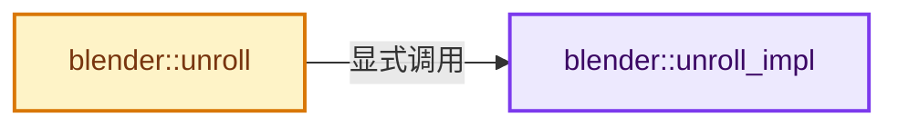
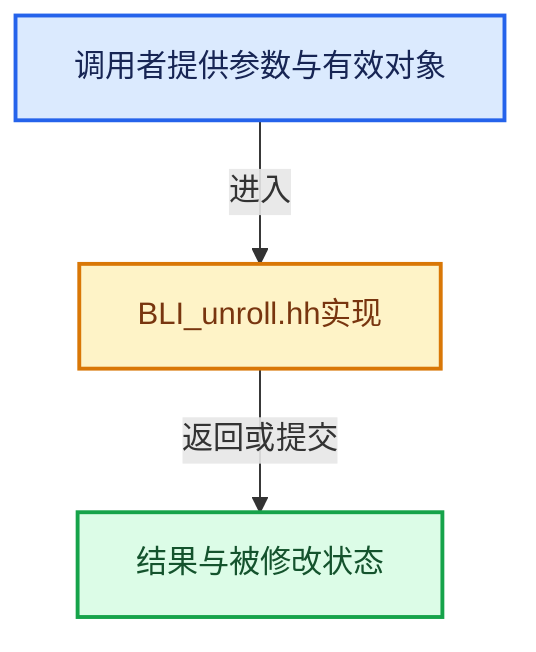

# 实现依赖专题：source/blender/blenlib/BLI_unroll.hh

[方向导航](README.md) · [符号索引](../%E7%AC%A6%E5%8F%B7%E4%BE%9D%E8%B5%96%E4%B8%8E%E5%AE%9E%E7%8E%B0%E7%B4%A2%E5%BC%95.md)

本专题从正文实际调用进入，集中保存共享实现。函数有稳定锚点，可从调用处直接跳到对应完整函数；递归与互相调用通过回链组织。

## 本文件的实现关系






## 完整成员与函数实现

<a id="f-29a45ad8c8a4e38a"></a>

### `blender::unroll_impl`

实现位置：[source/blender/blenlib/BLI_unroll.hh](../../../../../source/blender/blenlib/BLI_unroll.hh) · L16—L20。

接口参数：

- `Fn fn`
- `std::index_sequence<I...>`

**教学注释版**

<!-- annotated:be12ac50253be0 -->

```cpp
template<class Fn, size_t... I>
constexpr void unroll_impl(Fn fn, std::index_sequence<I...> /*indices*/)
{
  (fn(I), ...);
}
```

<details>
<summary>核对原始源码：source/blender/blenlib/BLI_unroll.hh · L16—L20</summary>

<!-- original:be12ac50253be0:source/blender/blenlib/BLI_unroll.hh:16:20 -->

```cpp
template<class Fn, size_t... I>
constexpr void unroll_impl(Fn fn, std::index_sequence<I...> /*indices*/)
{
  (fn(I), ...);
}
```

</details>

**继续追踪实现**

- `fn` → [调用协议](../%E6%A8%A1%E6%9D%BF%E5%AE%8F%E4%B8%8E%E5%8A%A8%E6%80%81%E5%88%86%E6%B4%BE%E5%8D%8F%E8%AE%AE.md)：局部可调用对象，须结合其初始化与捕获环境。调用位置L19。

<a id="f-c417075e14f42b3b"></a>

### `blender::unroll`

实现位置：[source/blender/blenlib/BLI_unroll.hh](../../../../../source/blender/blenlib/BLI_unroll.hh) · L27—L30。

接口参数：

- `Fn fn`

**教学注释版**

<!-- annotated:6a5c8df3fb4237 -->

```cpp
template<int N, class Fn> constexpr void unroll(Fn fn)
{
  unroll_impl(fn, std::make_index_sequence<N>());
}
```

<details>
<summary>核对原始源码：source/blender/blenlib/BLI_unroll.hh · L27—L30</summary>

<!-- original:6a5c8df3fb4237:source/blender/blenlib/BLI_unroll.hh:27:30 -->

```cpp
template<int N, class Fn> constexpr void unroll(Fn fn)
{
  unroll_impl(fn, std::make_index_sequence<N>());
}
```

</details>

**继续追踪实现**

- `unroll_impl` → [blender::unroll_impl · L16](%E4%BE%9D%E8%B5%96-BLI_unroll-d8590f.md#f-29a45ad8c8a4e38a)。
- `std::make_index_sequence<N>` → [外部契约](https://eel.is/c++draft/)：这个边界按实际表达式及所属类型核对参数、返回值、寿命与失败行为。这里提供接口入口，不声称已解释该第三方版本的内部实现。
