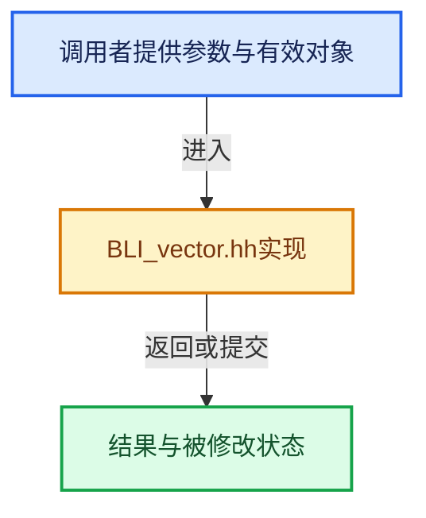

# 实现依赖专题：source/blender/blenlib/BLI_vector.hh

[方向导航](README.md) · [符号索引](../%E7%AC%A6%E5%8F%B7%E4%BE%9D%E8%B5%96%E4%B8%8E%E5%AE%9E%E7%8E%B0%E7%B4%A2%E5%BC%95.md)

本专题从正文实际调用进入，集中保存共享实现。函数有稳定锚点，可从调用处直接跳到对应完整函数；递归与互相调用通过回链组织。

## 本文件的实现关系





## 相关类型布局与成员入口

<a id="t-14451f176559"></a>

### `blender::Vector`

原始声明：[source/blender/blenlib/BLI_vector.hh](../../../../../source/blender/blenlib/BLI_vector.hh) · L76—L1152。

成员布局：

- `T begin_`
- `T end_`
- `T capacity_end_`
- `BLI_NO_UNIQUE_ADDRESS allocator_`
- `BLI_NO_UNIQUE_ADDRESS TypedBuffer`
- `int64_t debug_size_`

以下保留类的数据声明与编译条件，成员函数实现通过后面的精确链接阅读。

<!-- annotated:3e425f09085335 -->

```cpp
class Vector {
 public:
  using value_type = T;
  using pointer = T *;
  using const_pointer = const T *;
  using reference = T &;
  using const_reference = const T &;
  using iterator = T *;
  using const_iterator = const T *;
  using size_type = int64_t;
  using allocator_type = Allocator;

 private:
  /**
   * Use pointers instead of storing the size explicitly. This reduces the number of instructions
   * in `append`.
   *
   * The pointers might point to the memory in the inline buffer.
   */
  T *begin_;
  T *end_;
  T *capacity_end_;

  /** Used for allocations when the inline buffer is too small. */
  BLI_NO_UNIQUE_ADDRESS Allocator allocator_;

  /** A placeholder buffer that will remain uninitialized until it is used. */
  BLI_NO_UNIQUE_ADDRESS TypedBuffer<T, InlineBufferCapacity> inline_buffer_;

  /**
   * Store the size of the vector explicitly in debug builds. Otherwise you'd always have to call
   * the `size` function or do the math to compute it from the pointers manually. This is rather
   * annoying. Knowing the size of a vector is often quite essential when debugging some code.
   */
#ifndef NDEBUG
  int64_t debug_size_;
#  define UPDATE_VECTOR_SIZE(ptr) (ptr)->debug_size_ = int64_t((ptr)->end_ - (ptr)->begin_)
#else
#  define UPDATE_VECTOR_SIZE(ptr) ((void)0)
#endif

  /**
   * Be a friend with other vector instantiations. This is necessary to implement some memory
   * management logic.
   */
  template<typename OtherT, int64_t OtherInlineBufferCapacity, typename OtherAllocator>
  friend class Vector;

  /** Required in case `T` is an incomplete type. */
```

<details>
<summary>核对原始源码：source/blender/blenlib/BLI_vector.hh · L76—L124</summary>

<!-- original:3e425f09085335:source/blender/blenlib/BLI_vector.hh:76:124 -->

```cpp
class Vector {
 public:
  using value_type = T;
  using pointer = T *;
  using const_pointer = const T *;
  using reference = T &;
  using const_reference = const T &;
  using iterator = T *;
  using const_iterator = const T *;
  using size_type = int64_t;
  using allocator_type = Allocator;

 private:
  /**
   * Use pointers instead of storing the size explicitly. This reduces the number of instructions
   * in `append`.
   *
   * The pointers might point to the memory in the inline buffer.
   */
  T *begin_;
  T *end_;
  T *capacity_end_;

  /** Used for allocations when the inline buffer is too small. */
  BLI_NO_UNIQUE_ADDRESS Allocator allocator_;

  /** A placeholder buffer that will remain uninitialized until it is used. */
  BLI_NO_UNIQUE_ADDRESS TypedBuffer<T, InlineBufferCapacity> inline_buffer_;

  /**
   * Store the size of the vector explicitly in debug builds. Otherwise you'd always have to call
   * the `size` function or do the math to compute it from the pointers manually. This is rather
   * annoying. Knowing the size of a vector is often quite essential when debugging some code.
   */
#ifndef NDEBUG
  int64_t debug_size_;
#  define UPDATE_VECTOR_SIZE(ptr) (ptr)->debug_size_ = int64_t((ptr)->end_ - (ptr)->begin_)
#else
#  define UPDATE_VECTOR_SIZE(ptr) ((void)0)
#endif

  /**
   * Be a friend with other vector instantiations. This is necessary to implement some memory
   * management logic.
   */
  template<typename OtherT, int64_t OtherInlineBufferCapacity, typename OtherAllocator>
  friend class Vector;

  /** Required in case `T` is an incomplete type. */
```

</details>

<!-- annotated:df9f820b8c5be3 -->

```cpp

 public:
  /**
   * Create an empty vector.
   * This does not do any memory allocation.
   */
```

<details>
<summary>核对原始源码：source/blender/blenlib/BLI_vector.hh · L134—L139</summary>

<!-- original:df9f820b8c5be3:source/blender/blenlib/BLI_vector.hh:134:139 -->

```cpp

 public:
  /**
   * Create an empty vector.
   * This does not do any memory allocation.
   */
```

</details>

<!-- annotated:1b266a4983868e -->

```cpp

```

<details>
<summary>核对原始源码：source/blender/blenlib/BLI_vector.hh · L147—L147</summary>

<!-- original:1b266a4983868e:source/blender/blenlib/BLI_vector.hh:147:147 -->

```cpp

```

</details>

<!-- annotated:5a4b47d7ab60a6 -->

```cpp

  /**
   * Create a vector with a specific size.
   * The elements will be default constructed.
   * If T is trivially constructible, the elements in the vector are not touched.
   */
```

<details>
<summary>核对原始源码：source/blender/blenlib/BLI_vector.hh · L149—L154</summary>

<!-- original:5a4b47d7ab60a6:source/blender/blenlib/BLI_vector.hh:149:154 -->

```cpp

  /**
   * Create a vector with a specific size.
   * The elements will be default constructed.
   * If T is trivially constructible, the elements in the vector are not touched.
   */
```

</details>

<!-- annotated:24bcab37c650cc -->

```cpp

  /**
   * Create a vector filled with a specific value.
   */
```

<details>
<summary>核对原始源码：source/blender/blenlib/BLI_vector.hh · L160—L163</summary>

<!-- original:24bcab37c650cc:source/blender/blenlib/BLI_vector.hh:160:163 -->

```cpp

  /**
   * Create a vector filled with a specific value.
   */
```

</details>

<!-- annotated:3e8b8a36b503cf -->

```cpp

  /**
   * Create a vector from a span. The values in the vector are copy constructed.
   */
```

<details>
<summary>核对原始源码：source/blender/blenlib/BLI_vector.hh · L169—L172</summary>

<!-- original:3e8b8a36b503cf:source/blender/blenlib/BLI_vector.hh:169:172 -->

```cpp

  /**
   * Create a vector from a span. The values in the vector are copy constructed.
   */
```

</details>

<!-- annotated:5f10fb06ae15e0 -->

```cpp

```

<details>
<summary>核对原始源码：source/blender/blenlib/BLI_vector.hh · L183—L183</summary>

<!-- original:5f10fb06ae15e0:source/blender/blenlib/BLI_vector.hh:183:183 -->

```cpp

```

</details>

<!-- annotated:8e40f480010ae9 -->

```cpp

  /**
   * Create a vector that contains copies of the values in the initialized list.
   *
   * This allows you to write code like:
   * Vector<int> vec = {3, 4, 5};
   */
```

<details>
<summary>核对原始源码：source/blender/blenlib/BLI_vector.hh · L190—L196</summary>

<!-- original:8e40f480010ae9:source/blender/blenlib/BLI_vector.hh:190:196 -->

```cpp

  /**
   * Create a vector that contains copies of the values in the initialized list.
   *
   * This allows you to write code like:
   * Vector<int> vec = {3, 4, 5};
   */
```

</details>

<!-- annotated:369252058c6b6f -->

```cpp

```

<details>
<summary>核对原始源码：source/blender/blenlib/BLI_vector.hh · L203—L203</summary>

<!-- original:369252058c6b6f:source/blender/blenlib/BLI_vector.hh:203:203 -->

```cpp

```

</details>

<!-- annotated:c215363e5f1640 -->

```cpp

```

<details>
<summary>核对原始源码：source/blender/blenlib/BLI_vector.hh · L205—L205</summary>

<!-- original:c215363e5f1640:source/blender/blenlib/BLI_vector.hh:205:205 -->

```cpp

```

</details>

<!-- annotated:ec42297738d4fd -->

```cpp

```

<details>
<summary>核对原始源码：source/blender/blenlib/BLI_vector.hh · L212—L212</summary>

<!-- original:ec42297738d4fd:source/blender/blenlib/BLI_vector.hh:212:212 -->

```cpp

```

</details>

<!-- annotated:25c3d250832fd1 -->

```cpp

  /**
   * Create a copy of another vector. The other vector will not be changed. If the other vector has
   * less than InlineBufferCapacity elements, no allocation will be made.
   */
```

<details>
<summary>核对原始源码：source/blender/blenlib/BLI_vector.hh · L224—L228</summary>

<!-- original:25c3d250832fd1:source/blender/blenlib/BLI_vector.hh:224:228 -->

```cpp

  /**
   * Create a copy of another vector. The other vector will not be changed. If the other vector has
   * less than InlineBufferCapacity elements, no allocation will be made.
   */
```

</details>

<!-- annotated:58ae8945351073 -->

```cpp

  /**
   * Create a copy of a vector with a different InlineBufferCapacity. This needs to be handled
   * separately, so that the other one is a valid copy constructor.
   */
```

<details>
<summary>核对原始源码：source/blender/blenlib/BLI_vector.hh · L230—L234</summary>

<!-- original:58ae8945351073:source/blender/blenlib/BLI_vector.hh:230:234 -->

```cpp

  /**
   * Create a copy of a vector with a different InlineBufferCapacity. This needs to be handled
   * separately, so that the other one is a valid copy constructor.
   */
```

</details>

<!-- annotated:fac2e1c627d88c -->

```cpp

  /**
   * Steal the elements from another vector. This does not do an allocation. The other vector will
   * have zero elements afterwards.
   */
```

<details>
<summary>核对原始源码：source/blender/blenlib/BLI_vector.hh · L240—L244</summary>

<!-- original:fac2e1c627d88c:source/blender/blenlib/BLI_vector.hh:240:244 -->

```cpp

  /**
   * Steal the elements from another vector. This does not do an allocation. The other vector will
   * have zero elements afterwards.
   */
```

</details>

<!-- annotated:28451122d5c917 -->

```cpp

  /**
   * Initializes the #Vector from an existing buffer. The #Vector takes ownership of the buffer.
   * The caller is responsible to make sure that the buffer has been allocated with the same
   * allocator that the #Vector will use to deallocate it.
   */
```

<details>
<summary>核对原始源码：source/blender/blenlib/BLI_vector.hh · L308—L313</summary>

<!-- original:28451122d5c917:source/blender/blenlib/BLI_vector.hh:308:313 -->

```cpp

  /**
   * Initializes the #Vector from an existing buffer. The #Vector takes ownership of the buffer.
   * The caller is responsible to make sure that the buffer has been allocated with the same
   * allocator that the #Vector will use to deallocate it.
   */
```

</details>

<!-- annotated:02deb963403e5f -->

```cpp

```

<details>
<summary>核对原始源码：source/blender/blenlib/BLI_vector.hh · L329—L329</summary>

<!-- original:02deb963403e5f:source/blender/blenlib/BLI_vector.hh:329:329 -->

```cpp

```

</details>

<!-- annotated:2bb9a1882e06d1 -->

```cpp

```

<details>
<summary>核对原始源码：source/blender/blenlib/BLI_vector.hh · L337—L337</summary>

<!-- original:2bb9a1882e06d1:source/blender/blenlib/BLI_vector.hh:337:337 -->

```cpp

```

</details>

<!-- annotated:61e488181ceb4a -->

```cpp

```

<details>
<summary>核对原始源码：source/blender/blenlib/BLI_vector.hh · L342—L342</summary>

<!-- original:61e488181ceb4a:source/blender/blenlib/BLI_vector.hh:342:342 -->

```cpp

```

</details>

<!-- annotated:74060c9e03c2ab -->

```cpp

  /**
   * Get the value at the given index. This invokes undefined behavior when the index is out of
   * bounds.
   */
```

<details>
<summary>核对原始源码：source/blender/blenlib/BLI_vector.hh · L347—L351</summary>

<!-- original:74060c9e03c2ab:source/blender/blenlib/BLI_vector.hh:347:351 -->

```cpp

  /**
   * Get the value at the given index. This invokes undefined behavior when the index is out of
   * bounds.
   */
```

</details>

<!-- annotated:056601de7954d0 -->

```cpp

```

<details>
<summary>核对原始源码：source/blender/blenlib/BLI_vector.hh · L358—L358</summary>

<!-- original:056601de7954d0:source/blender/blenlib/BLI_vector.hh:358:358 -->

```cpp

```

</details>

<!-- annotated:0a76bd52b07000 -->

```cpp

```

<details>
<summary>核对原始源码：source/blender/blenlib/BLI_vector.hh · L365—L365</summary>

<!-- original:0a76bd52b07000:source/blender/blenlib/BLI_vector.hh:365:365 -->

```cpp

```

</details>

<!-- annotated:a5a46c0da27be2 -->

```cpp

```

<details>
<summary>核对原始源码：source/blender/blenlib/BLI_vector.hh · L370—L370</summary>

<!-- original:a5a46c0da27be2:source/blender/blenlib/BLI_vector.hh:370:370 -->

```cpp

```

</details>

<!-- annotated:17f0712b416213 -->

```cpp

```

<details>
<summary>核对原始源码：source/blender/blenlib/BLI_vector.hh · L375—L375</summary>

<!-- original:17f0712b416213:source/blender/blenlib/BLI_vector.hh:375:375 -->

```cpp

```

</details>

<!-- annotated:5237e93017c662 -->

```cpp

```

<details>
<summary>核对原始源码：source/blender/blenlib/BLI_vector.hh · L382—L382</summary>

<!-- original:5237e93017c662:source/blender/blenlib/BLI_vector.hh:382:382 -->

```cpp

```

</details>

<!-- annotated:036792ae947483 -->

```cpp

```

<details>
<summary>核对原始源码：source/blender/blenlib/BLI_vector.hh · L389—L389</summary>

<!-- original:036792ae947483:source/blender/blenlib/BLI_vector.hh:389:389 -->

```cpp

```

</details>

<!-- annotated:4ab173ff431081 -->

```cpp

```

<details>
<summary>核对原始源码：source/blender/blenlib/BLI_vector.hh · L394—L394</summary>

<!-- original:4ab173ff431081:source/blender/blenlib/BLI_vector.hh:394:394 -->

```cpp

```

</details>

<!-- annotated:fb688f2b9f7cbf -->

```cpp

  /**
   * Make sure that enough memory is allocated to hold min_capacity elements.
   * This won't necessarily make an allocation when min_capacity is small.
   * The actual size of the vector does not change.
   */
```

<details>
<summary>核对原始源码：source/blender/blenlib/BLI_vector.hh · L399—L404</summary>

<!-- original:fb688f2b9f7cbf:source/blender/blenlib/BLI_vector.hh:399:404 -->

```cpp

  /**
   * Make sure that enough memory is allocated to hold min_capacity elements.
   * This won't necessarily make an allocation when min_capacity is small.
   * The actual size of the vector does not change.
   */
```

</details>

<!-- annotated:cad7eb7a84fca8 -->

```cpp

  /**
   * Change the size of the vector so that it contains new_size elements.
   * If new_size is smaller than the old size, the elements at the end of the vector are
   * destructed. If new_size is larger than the old size, the new elements at the end are default
   * constructed. If T is trivially constructible, the memory is not touched by this function.
   */
```

<details>
<summary>核对原始源码：source/blender/blenlib/BLI_vector.hh · L411—L417</summary>

<!-- original:cad7eb7a84fca8:source/blender/blenlib/BLI_vector.hh:411:417 -->

```cpp

  /**
   * Change the size of the vector so that it contains new_size elements.
   * If new_size is smaller than the old size, the elements at the end of the vector are
   * destructed. If new_size is larger than the old size, the new elements at the end are default
   * constructed. If T is trivially constructible, the memory is not touched by this function.
   */
```

</details>

<!-- annotated:294dc06ab78b08 -->

```cpp

  /**
   * Change the size of the vector so that it contains new_size elements.
   * If new_size is smaller than the old size, the elements at the end of the vector are
   * destructed. If new_size is larger than the old size, the new elements will be copy constructed
   * from the given value.
   */
```

<details>
<summary>核对原始源码：source/blender/blenlib/BLI_vector.hh · L432—L438</summary>

<!-- original:294dc06ab78b08:source/blender/blenlib/BLI_vector.hh:432:438 -->

```cpp

  /**
   * Change the size of the vector so that it contains new_size elements.
   * If new_size is smaller than the old size, the elements at the end of the vector are
   * destructed. If new_size is larger than the old size, the new elements will be copy constructed
   * from the given value.
   */
```

</details>

<!-- annotated:816d51d8cbfcbf -->

```cpp

  /**
   * Reset the size of the vector so that it contains new_size elements.
   * All existing elements are destructed, and not copied if the data must be reallocated.
   */
```

<details>
<summary>核对原始源码：source/blender/blenlib/BLI_vector.hh · L453—L457</summary>

<!-- original:816d51d8cbfcbf:source/blender/blenlib/BLI_vector.hh:453:457 -->

```cpp

  /**
   * Reset the size of the vector so that it contains new_size elements.
   * All existing elements are destructed, and not copied if the data must be reallocated.
   */
```

</details>

<!-- annotated:a9da866831feb5 -->

```cpp

  /**
   * Afterwards the vector has 0 elements, but will still have
   * memory to be refilled again.
   */
```

<details>
<summary>核对原始源码：source/blender/blenlib/BLI_vector.hh · L463—L467</summary>

<!-- original:a9da866831feb5:source/blender/blenlib/BLI_vector.hh:463:467 -->

```cpp

  /**
   * Afterwards the vector has 0 elements, but will still have
   * memory to be refilled again.
   */
```

</details>

<!-- annotated:64f7f4cb7aa8ad -->

```cpp

  /**
   * Afterwards the vector has 0 elements and any allocated memory
   * will be freed.
   */
```

<details>
<summary>核对原始源码：source/blender/blenlib/BLI_vector.hh · L474—L478</summary>

<!-- original:64f7f4cb7aa8ad:source/blender/blenlib/BLI_vector.hh:474:478 -->

```cpp

  /**
   * Afterwards the vector has 0 elements and any allocated memory
   * will be freed.
   */
```

</details>

<!-- annotated:7e685cf67ca3c5 -->

```cpp

  /**
   * Insert a new element at the end of the vector.
   * This might cause a reallocation with the capacity is exceeded.
   *
   * This is similar to std::vector::push_back.
   */
```

<details>
<summary>核对原始源码：source/blender/blenlib/BLI_vector.hh · L491—L497</summary>

<!-- original:7e685cf67ca3c5:source/blender/blenlib/BLI_vector.hh:491:497 -->

```cpp

  /**
   * Insert a new element at the end of the vector.
   * This might cause a reallocation with the capacity is exceeded.
   *
   * This is similar to std::vector::push_back.
   */
```

</details>

<!-- annotated:b9eec4417c4896 -->

```cpp
  /* This is similar to `std::vector::emplace_back`. */
```

<details>
<summary>核对原始源码：source/blender/blenlib/BLI_vector.hh · L506—L506</summary>

<!-- original:b9eec4417c4896:source/blender/blenlib/BLI_vector.hh:506:506 -->

```cpp
  /* This is similar to `std::vector::emplace_back`. */
```

</details>

<!-- annotated:a6ce79b6412ded -->

```cpp

  /**
   * Append the value to the vector and return the index that can be used to access the newly
   * added value.
   */
```

<details>
<summary>核对原始源码：source/blender/blenlib/BLI_vector.hh · L512—L516</summary>

<!-- original:a6ce79b6412ded:source/blender/blenlib/BLI_vector.hh:512:516 -->

```cpp

  /**
   * Append the value to the vector and return the index that can be used to access the newly
   * added value.
   */
```

</details>

<!-- annotated:8c6dc1545f45d8 -->

```cpp

  /**
   * Append the value if it is not yet in the vector. This has to do a linear search to check if
   * the value is in the vector. Therefore, this should only be called when it is known that the
   * vector is small.
   */
```

<details>
<summary>核对原始源码：source/blender/blenlib/BLI_vector.hh · L531—L536</summary>

<!-- original:8c6dc1545f45d8:source/blender/blenlib/BLI_vector.hh:531:536 -->

```cpp

  /**
   * Append the value if it is not yet in the vector. This has to do a linear search to check if
   * the value is in the vector. Therefore, this should only be called when it is known that the
   * vector is small.
   */
```

</details>

<!-- annotated:ca69d19498a2d0 -->

```cpp

  /**
   * Append the value and assume that vector has enough memory reserved. This invokes undefined
   * behavior when not enough capacity has been reserved beforehand. Only use this in performance
   * critical code.
   */
```

<details>
<summary>核对原始源码：source/blender/blenlib/BLI_vector.hh · L543—L548</summary>

<!-- original:ca69d19498a2d0:source/blender/blenlib/BLI_vector.hh:543:548 -->

```cpp

  /**
   * Append the value and assume that vector has enough memory reserved. This invokes undefined
   * behavior when not enough capacity has been reserved beforehand. Only use this in performance
   * critical code.
   */
```

</details>

<!-- annotated:1774152668dd1a -->

```cpp

  /**
   * Insert the same element n times at the end of the vector.
   * This might result in a reallocation internally.
   */
```

<details>
<summary>核对原始源码：source/blender/blenlib/BLI_vector.hh · L564—L568</summary>

<!-- original:1774152668dd1a:source/blender/blenlib/BLI_vector.hh:564:568 -->

```cpp

  /**
   * Insert the same element n times at the end of the vector.
   * This might result in a reallocation internally.
   */
```

</details>

<!-- annotated:3c6610be5d9f6e -->

```cpp

  /**
   * Enlarges the size of the internal buffer that is considered to be initialized.
   * This invokes undefined behavior when the new size is larger than the capacity.
   * The method can be useful when you want to call constructors in the vector yourself.
   * This should only be done in very rare cases and has to be justified every time.
   */
```

<details>
<summary>核对原始源码：source/blender/blenlib/BLI_vector.hh · L576—L582</summary>

<!-- original:3c6610be5d9f6e:source/blender/blenlib/BLI_vector.hh:576:582 -->

```cpp

  /**
   * Enlarges the size of the internal buffer that is considered to be initialized.
   * This invokes undefined behavior when the new size is larger than the capacity.
   * The method can be useful when you want to call constructors in the vector yourself.
   * This should only be done in very rare cases and has to be justified every time.
   */
```

</details>

<!-- annotated:e5c5a911e2831e -->

```cpp

  /**
   * Copy the elements of another array to the end of this vector.
   *
   * This can be used to emulate parts of std::vector::insert.
   */
```

<details>
<summary>核对原始源码：source/blender/blenlib/BLI_vector.hh · L589—L594</summary>

<!-- original:e5c5a911e2831e:source/blender/blenlib/BLI_vector.hh:589:594 -->

```cpp

  /**
   * Copy the elements of another array to the end of this vector.
   *
   * This can be used to emulate parts of std::vector::insert.
   */
```

</details>

<!-- annotated:2081e50bcd9792 -->

```cpp

  /**
   * Moves the elements of another vector to the end of this vector.
   *
   * This may result in reallocation to fit other vector elements, other vector will keep it
   * buffer allocation, but it will become empty.
   * This can be used in vectors that manages resources, allowing acquiring resources from another
   * vector, preventing shared ownership of managed resources.
   */
```

<details>
<summary>核对原始源码：source/blender/blenlib/BLI_vector.hh · L604—L612</summary>

<!-- original:2081e50bcd9792:source/blender/blenlib/BLI_vector.hh:604:612 -->

```cpp

  /**
   * Moves the elements of another vector to the end of this vector.
   *
   * This may result in reallocation to fit other vector elements, other vector will keep it
   * buffer allocation, but it will become empty.
   * This can be used in vectors that manages resources, allowing acquiring resources from another
   * vector, preventing shared ownership of managed resources.
   */
```

</details>

<!-- annotated:fd7204b234763c -->

```cpp

  /**
   * Adds all elements from the array that are not already in the vector. This is an expensive
   * operation when the vector is large, but can be very cheap when it is known that the vector is
   * small.
   */
```

<details>
<summary>核对原始源码：source/blender/blenlib/BLI_vector.hh · L620—L625</summary>

<!-- original:fd7204b234763c:source/blender/blenlib/BLI_vector.hh:620:625 -->

```cpp

  /**
   * Adds all elements from the array that are not already in the vector. This is an expensive
   * operation when the vector is large, but can be very cheap when it is known that the vector is
   * small.
   */
```

</details>

<!-- annotated:059f73ab8c9714 -->

```cpp

  /**
   * Extend the vector without bounds checking. It is assumed that enough memory has been reserved
   * beforehand. Only use this in performance critical code.
   */
```

<details>
<summary>核对原始源码：source/blender/blenlib/BLI_vector.hh · L632—L636</summary>

<!-- original:059f73ab8c9714:source/blender/blenlib/BLI_vector.hh:632:636 -->

```cpp

  /**
   * Extend the vector without bounds checking. It is assumed that enough memory has been reserved
   * beforehand. Only use this in performance critical code.
   */
```

</details>

<!-- annotated:c3a701fefeb9bd -->

```cpp

```

<details>
<summary>核对原始源码：source/blender/blenlib/BLI_vector.hh · L649—L649</summary>

<!-- original:c3a701fefeb9bd:source/blender/blenlib/BLI_vector.hh:649:649 -->

```cpp

```

</details>

<!-- annotated:bb2001cb10e508 -->

```cpp

  /**
   * Insert elements into the vector at the specified position. This has a running time of O(n)
   * where n is the number of values that have to be moved. Undefined behavior is invoked when the
   * insert position is out of bounds.
   */
```

<details>
<summary>核对原始源码：source/blender/blenlib/BLI_vector.hh · L654—L659</summary>

<!-- original:bb2001cb10e508:source/blender/blenlib/BLI_vector.hh:654:659 -->

```cpp

  /**
   * Insert elements into the vector at the specified position. This has a running time of O(n)
   * where n is the number of values that have to be moved. Undefined behavior is invoked when the
   * insert position is out of bounds.
   */
```

</details>

<!-- annotated:fff4d9eaea5d36 -->

```cpp

  /**
   * Insert values at the beginning of the vector.
   * This has to move all the other elements, so it has a linear running time.
   */
```

<details>
<summary>核对原始源码：source/blender/blenlib/BLI_vector.hh · L723—L727</summary>

<!-- original:fff4d9eaea5d36:source/blender/blenlib/BLI_vector.hh:723:727 -->

```cpp

  /**
   * Insert values at the beginning of the vector.
   * This has to move all the other elements, so it has a linear running time.
   */
```

</details>

<!-- annotated:76317e7e3c0bbf -->

```cpp

  /**
   * Return a reference to the nth last element.
   * This invokes undefined behavior when the vector is too short.
   */
```

<details>
<summary>核对原始源码：source/blender/blenlib/BLI_vector.hh · L744—L748</summary>

<!-- original:76317e7e3c0bbf:source/blender/blenlib/BLI_vector.hh:744:748 -->

```cpp

  /**
   * Return a reference to the nth last element.
   * This invokes undefined behavior when the vector is too short.
   */
```

</details>

<!-- annotated:5df0415caa4b5e -->

```cpp

  /**
   * Return a reference to the first element in the vector.
   * This invokes undefined behavior when the vector is empty.
   */
```

<details>
<summary>核对原始源码：source/blender/blenlib/BLI_vector.hh · L761—L765</summary>

<!-- original:5df0415caa4b5e:source/blender/blenlib/BLI_vector.hh:761:765 -->

```cpp

  /**
   * Return a reference to the first element in the vector.
   * This invokes undefined behavior when the vector is empty.
   */
```

</details>

<!-- annotated:36aa8533572eaf -->

```cpp

  /**
   * Return how many values are currently stored in the vector.
   */
```

<details>
<summary>核对原始源码：source/blender/blenlib/BLI_vector.hh · L776—L779</summary>

<!-- original:36aa8533572eaf:source/blender/blenlib/BLI_vector.hh:776:779 -->

```cpp

  /**
   * Return how many values are currently stored in the vector.
   */
```

</details>

<!-- annotated:4dd446ffb0795b -->

```cpp

  /**
   * Returns true when the vector contains no elements, otherwise false.
   *
   * This is the same as std::vector::empty.
   */
```

<details>
<summary>核对原始源码：source/blender/blenlib/BLI_vector.hh · L786—L791</summary>

<!-- original:4dd446ffb0795b:source/blender/blenlib/BLI_vector.hh:786:791 -->

```cpp

  /**
   * Returns true when the vector contains no elements, otherwise false.
   *
   * This is the same as std::vector::empty.
   */
```

</details>

<!-- annotated:cf3f4f10dd8a19 -->

```cpp

  /**
   * Destructs the last element and decreases the size by one. This invokes undefined behavior when
   * the vector is empty.
   */
```

<details>
<summary>核对原始源码：source/blender/blenlib/BLI_vector.hh · L796—L800</summary>

<!-- original:cf3f4f10dd8a19:source/blender/blenlib/BLI_vector.hh:796:800 -->

```cpp

  /**
   * Destructs the last element and decreases the size by one. This invokes undefined behavior when
   * the vector is empty.
   */
```

</details>

<!-- annotated:400a0a153b2cca -->

```cpp

  /**
   * Remove the last element from the vector and return it. This invokes undefined behavior when
   * the vector is empty.
   *
   * This is similar to std::vector::pop_back.
   */
```

<details>
<summary>核对原始源码：source/blender/blenlib/BLI_vector.hh · L808—L814</summary>

<!-- original:400a0a153b2cca:source/blender/blenlib/BLI_vector.hh:808:814 -->

```cpp

  /**
   * Remove the last element from the vector and return it. This invokes undefined behavior when
   * the vector is empty.
   *
   * This is similar to std::vector::pop_back.
   */
```

</details>

<!-- annotated:73ea22bd4f9763 -->

```cpp

  /**
   * Delete any element in the vector. The empty space will be filled by the previously last
   * element. This takes O(1) time.
   */
```

<details>
<summary>核对原始源码：source/blender/blenlib/BLI_vector.hh · L824—L828</summary>

<!-- original:73ea22bd4f9763:source/blender/blenlib/BLI_vector.hh:824:828 -->

```cpp

  /**
   * Delete any element in the vector. The empty space will be filled by the previously last
   * element. This takes O(1) time.
   */
```

</details>

<!-- annotated:6dd7bd4ea53457 -->

```cpp

  /**
   * Finds the first occurrence of the value, removes it and copies the last element to the hole in
   * the vector. This takes O(n) time.
   */
```

<details>
<summary>核对原始源码：source/blender/blenlib/BLI_vector.hh · L842—L846</summary>

<!-- original:6dd7bd4ea53457:source/blender/blenlib/BLI_vector.hh:842:846 -->

```cpp

  /**
   * Finds the first occurrence of the value, removes it and copies the last element to the hole in
   * the vector. This takes O(n) time.
   */
```

</details>

<!-- annotated:20d39f73edc582 -->

```cpp

  /**
   * Remove the element at the given index and move all values coming after it one towards the
   * front. This takes O(n) time. If the order is not important, remove_and_reorder should be used
   * instead.
   *
   * This is similar to std::vector::erase.
   */
```

<details>
<summary>核对原始源码：source/blender/blenlib/BLI_vector.hh · L852—L859</summary>

<!-- original:20d39f73edc582:source/blender/blenlib/BLI_vector.hh:852:859 -->

```cpp

  /**
   * Remove the element at the given index and move all values coming after it one towards the
   * front. This takes O(n) time. If the order is not important, remove_and_reorder should be used
   * instead.
   *
   * This is similar to std::vector::erase.
   */
```

</details>

<!-- annotated:3eeeb29d03ecbf -->

```cpp

  /**
   * Remove a contiguous chunk of elements and move all values coming after it towards the front.
   * This takes O(n) time.
   *
   * This is similar to std::vector::erase.
   */
```

<details>
<summary>核对原始源码：source/blender/blenlib/BLI_vector.hh · L872—L878</summary>

<!-- original:3eeeb29d03ecbf:source/blender/blenlib/BLI_vector.hh:872:878 -->

```cpp

  /**
   * Remove a contiguous chunk of elements and move all values coming after it towards the front.
   * This takes O(n) time.
   *
   * This is similar to std::vector::erase.
   */
```

</details>

<!-- annotated:0aa9532803c111 -->

```cpp

  /**
   * Remove all values for which the given predicate is true and return the number of values
   * removed.
   *
   * This is similar to std::erase_if.
   */
```

<details>
<summary>核对原始源码：source/blender/blenlib/BLI_vector.hh · L893—L899</summary>

<!-- original:0aa9532803c111:source/blender/blenlib/BLI_vector.hh:893:899 -->

```cpp

  /**
   * Remove all values for which the given predicate is true and return the number of values
   * removed.
   *
   * This is similar to std::erase_if.
   */
```

</details>

<!-- annotated:3967aa8e674e88 -->

```cpp

  /**
   * Do a linear search to find the value in the vector.
   * When found, return the first index, otherwise return -1.
   */
```

<details>
<summary>核对原始源码：source/blender/blenlib/BLI_vector.hh · L908—L912</summary>

<!-- original:3967aa8e674e88:source/blender/blenlib/BLI_vector.hh:908:912 -->

```cpp

  /**
   * Do a linear search to find the value in the vector.
   * When found, return the first index, otherwise return -1.
   */
```

</details>

<!-- annotated:90a9f902cb9377 -->

```cpp

  /**
   * Do a linear search to find the value in the vector and return the found index. This invokes
   * undefined behavior when the value is not in the vector.
   */
```

<details>
<summary>核对原始源码：source/blender/blenlib/BLI_vector.hh · L922—L926</summary>

<!-- original:90a9f902cb9377:source/blender/blenlib/BLI_vector.hh:922:926 -->

```cpp

  /**
   * Do a linear search to find the value in the vector and return the found index. This invokes
   * undefined behavior when the value is not in the vector.
   */
```

</details>

<!-- annotated:bfb18de7882cc2 -->

```cpp

  /**
   * Do a linear search to see of the value is in the vector.
   * Return true when it exists, otherwise false.
   */
```

<details>
<summary>核对原始源码：source/blender/blenlib/BLI_vector.hh · L933—L937</summary>

<!-- original:bfb18de7882cc2:source/blender/blenlib/BLI_vector.hh:933:937 -->

```cpp

  /**
   * Do a linear search to see of the value is in the vector.
   * Return true when it exists, otherwise false.
   */
```

</details>

<!-- annotated:31c008f30bec1e -->

```cpp

  /**
   * Copies the given value to every element in the vector.
   */
```

<details>
<summary>核对原始源码：source/blender/blenlib/BLI_vector.hh · L942—L945</summary>

<!-- original:31c008f30bec1e:source/blender/blenlib/BLI_vector.hh:942:945 -->

```cpp

  /**
   * Copies the given value to every element in the vector.
   */
```

</details>

<!-- annotated:be87d7f1852489 -->

```cpp

  /**
   * Get access to the underlying array.
   */
```

<details>
<summary>核对原始源码：source/blender/blenlib/BLI_vector.hh · L950—L953</summary>

<!-- original:be87d7f1852489:source/blender/blenlib/BLI_vector.hh:950:953 -->

```cpp

  /**
   * Get access to the underlying array.
   */
```

</details>

<!-- annotated:6ed7a3e82e59d3 -->

```cpp

  /**
   * Get access to the underlying array.
   */
```

<details>
<summary>核对原始源码：source/blender/blenlib/BLI_vector.hh · L958—L961</summary>

<!-- original:6ed7a3e82e59d3:source/blender/blenlib/BLI_vector.hh:958:961 -->

```cpp

  /**
   * Get access to the underlying array.
   */
```

</details>

<!-- annotated:be7b08ea6d8683 -->

```cpp

```

<details>
<summary>核对原始源码：source/blender/blenlib/BLI_vector.hh · L966—L966</summary>

<!-- original:be7b08ea6d8683:source/blender/blenlib/BLI_vector.hh:966:966 -->

```cpp

```

</details>

<!-- annotated:d4e6ea3bce81a1 -->

```cpp

```

<details>
<summary>核对原始源码：source/blender/blenlib/BLI_vector.hh · L975—L975</summary>

<!-- original:d4e6ea3bce81a1:source/blender/blenlib/BLI_vector.hh:975:975 -->

```cpp

```

</details>

<!-- annotated:257521c06eb338 -->

```cpp

```

<details>
<summary>核对原始源码：source/blender/blenlib/BLI_vector.hh · L984—L984</summary>

<!-- original:257521c06eb338:source/blender/blenlib/BLI_vector.hh:984:984 -->

```cpp

```

</details>

<!-- annotated:05ec0bd6fc93e6 -->

```cpp

```

<details>
<summary>核对原始源码：source/blender/blenlib/BLI_vector.hh · L993—L993</summary>

<!-- original:05ec0bd6fc93e6:source/blender/blenlib/BLI_vector.hh:993:993 -->

```cpp

```

</details>

<!-- annotated:3b86887131f224 -->

```cpp

  /**
   * Get the current capacity of the vector, i.e. the maximum number of elements the vector can
   * hold, before it has to reallocate.
   */
```

<details>
<summary>核对原始源码：source/blender/blenlib/BLI_vector.hh · L1002—L1006</summary>

<!-- original:3b86887131f224:source/blender/blenlib/BLI_vector.hh:1002:1006 -->

```cpp

  /**
   * Get the current capacity of the vector, i.e. the maximum number of elements the vector can
   * hold, before it has to reallocate.
   */
```

</details>

<!-- annotated:00bceb9422b5bc -->

```cpp

```

<details>
<summary>核对原始源码：source/blender/blenlib/BLI_vector.hh · L1011—L1011</summary>

<!-- original:00bceb9422b5bc:source/blender/blenlib/BLI_vector.hh:1011:1011 -->

```cpp

```

</details>

<!-- annotated:0139e9c129e726 -->

```cpp

  /**
   * Get an index range that makes looping over all indices more convenient and less error prone.
   * Obviously, this should only be used when you actually need the index in the loop.
   *
   * Example:
   *  for (int64_t i : myvector.index_range()) {
   *    do_something(i, my_vector[i]);
   *  }
   */
```

<details>
<summary>核对原始源码：source/blender/blenlib/BLI_vector.hh · L1016—L1025</summary>

<!-- original:0139e9c129e726:source/blender/blenlib/BLI_vector.hh:1016:1025 -->

```cpp

  /**
   * Get an index range that makes looping over all indices more convenient and less error prone.
   * Obviously, this should only be used when you actually need the index in the loop.
   *
   * Example:
   *  for (int64_t i : myvector.index_range()) {
   *    do_something(i, my_vector[i]);
   *  }
   */
```

</details>

<!-- annotated:a8956429fe6b9f -->

```cpp

```

<details>
<summary>核对原始源码：source/blender/blenlib/BLI_vector.hh · L1030—L1030</summary>

<!-- original:a8956429fe6b9f:source/blender/blenlib/BLI_vector.hh:1030:1030 -->

```cpp

```

</details>

<!-- annotated:29b8d57cb80249 -->

```cpp

```

<details>
<summary>核对原始源码：source/blender/blenlib/BLI_vector.hh · L1035—L1035</summary>

<!-- original:29b8d57cb80249:source/blender/blenlib/BLI_vector.hh:1035:1035 -->

```cpp

```

</details>

<!-- annotated:193a35ccf94fd1 -->

```cpp

```

<details>
<summary>核对原始源码：source/blender/blenlib/BLI_vector.hh · L1040—L1040</summary>

<!-- original:193a35ccf94fd1:source/blender/blenlib/BLI_vector.hh:1040:1040 -->

```cpp

```

</details>

<!-- annotated:d1475968f4d761 -->

```cpp

```

<details>
<summary>核对原始源码：source/blender/blenlib/BLI_vector.hh · L1045—L1045</summary>

<!-- original:d1475968f4d761:source/blender/blenlib/BLI_vector.hh:1045:1045 -->

```cpp

```

</details>

<!-- annotated:3000b72f3dcb5f -->

```cpp

  /**
   * Release the underlying memory buffer from the #Vector. The caller is responsible for freeing
   * the pointer if it is non-null.
   *
   * If the values were stored in the inline-buffer, the values are copied to a newly allocated
   * array first. The caller does not have to any special handling in this case.
   *
   * The #Vector will be empty afterwards.
   */
```

<details>
<summary>核对原始源码：source/blender/blenlib/BLI_vector.hh · L1050—L1059</summary>

<!-- original:3000b72f3dcb5f:source/blender/blenlib/BLI_vector.hh:1050:1059 -->

```cpp

  /**
   * Release the underlying memory buffer from the #Vector. The caller is responsible for freeing
   * the pointer if it is non-null.
   *
   * If the values were stored in the inline-buffer, the values are copied to a newly allocated
   * array first. The caller does not have to any special handling in this case.
   *
   * The #Vector will be empty afterwards.
   */
```

</details>

<!-- annotated:748b5810b2de41 -->

```cpp

  /**
   * Print some debug information about the vector.
   */
```

<details>
<summary>核对原始源码：source/blender/blenlib/BLI_vector.hh · L1098—L1101</summary>

<!-- original:748b5810b2de41:source/blender/blenlib/BLI_vector.hh:1098:1101 -->

```cpp

  /**
   * Print some debug information about the vector.
   */
```

</details>

<!-- annotated:ff6c2ac694a3cb -->

```cpp

```

<details>
<summary>核对原始源码：source/blender/blenlib/BLI_vector.hh · L1107—L1107</summary>

<!-- original:ff6c2ac694a3cb:source/blender/blenlib/BLI_vector.hh:1107:1107 -->

```cpp

```

</details>

<!-- annotated:a77d27c028f9f7 -->

```cpp

 private:
```

<details>
<summary>核对原始源码：source/blender/blenlib/BLI_vector.hh · L1112—L1113</summary>

<!-- original:a77d27c028f9f7:source/blender/blenlib/BLI_vector.hh:1112:1113 -->

```cpp

 private:
```

</details>

<!-- annotated:9652e7372515d0 -->

```cpp

```

<details>
<summary>核对原始源码：source/blender/blenlib/BLI_vector.hh · L1120—L1120</summary>

<!-- original:9652e7372515d0:source/blender/blenlib/BLI_vector.hh:1120:1120 -->

```cpp

```

</details>

<!-- annotated:5596dc4d8c80bd -->

```cpp
};
```

<details>
<summary>核对原始源码：source/blender/blenlib/BLI_vector.hh · L1152—L1152</summary>

<!-- original:5596dc4d8c80bd:source/blender/blenlib/BLI_vector.hh:1152:1152 -->

```cpp
};
```

</details>

- [is_nothrow_move_constructible](09-Vector%E5%AD%98%E5%82%A8%E4%B8%8E%E5%86%85%E5%B5%8C%E7%BC%93%E5%86%B2.md#f-7cf894b15eff302e)
- [Vector](12-Vector%E5%BC%82%E5%B8%B8%E5%AE%89%E5%85%A8%E4%B8%8E%E8%BE%B9%E7%95%8C.md#f-ab20dffca18ad8b4)
- [Vector](12-Vector%E5%BC%82%E5%B8%B8%E5%AE%89%E5%85%A8%E4%B8%8E%E8%BE%B9%E7%95%8C.md#f-5206291d80a18329)
- [Vector](12-Vector%E5%BC%82%E5%B8%B8%E5%AE%89%E5%85%A8%E4%B8%8E%E8%BE%B9%E7%95%8C.md#f-cc29c46f5c02ab6d)
- [Vector](12-Vector%E5%BC%82%E5%B8%B8%E5%AE%89%E5%85%A8%E4%B8%8E%E8%BE%B9%E7%95%8C.md#f-a9d10aa4291b7089)
- [Vector](12-Vector%E5%BC%82%E5%B8%B8%E5%AE%89%E5%85%A8%E4%B8%8E%E8%BE%B9%E7%95%8C.md#f-935f899213b6ce94)
- [Vector](12-Vector%E5%BC%82%E5%B8%B8%E5%AE%89%E5%85%A8%E4%B8%8E%E8%BE%B9%E7%95%8C.md#f-f0b5338edc8805e1)
- [Vector](12-Vector%E5%BC%82%E5%B8%B8%E5%AE%89%E5%85%A8%E4%B8%8E%E8%BE%B9%E7%95%8C.md#f-3084fd15b4638b21)
- [Vector](12-Vector%E5%BC%82%E5%B8%B8%E5%AE%89%E5%85%A8%E4%B8%8E%E8%BE%B9%E7%95%8C.md#f-3cc8029c12867b7d)
- [Vector](12-Vector%E5%BC%82%E5%B8%B8%E5%AE%89%E5%85%A8%E4%B8%8E%E8%BE%B9%E7%95%8C.md#f-95a96a4e20e3631c)
- [Vector](12-Vector%E5%BC%82%E5%B8%B8%E5%AE%89%E5%85%A8%E4%B8%8E%E8%BE%B9%E7%95%8C.md#f-5e04fad7dcd1d026)
- [Vector](12-Vector%E5%BC%82%E5%B8%B8%E5%AE%89%E5%85%A8%E4%B8%8E%E8%BE%B9%E7%95%8C.md#f-9c6019eebde38e3d)
- [Vector](12-Vector%E5%BC%82%E5%B8%B8%E5%AE%89%E5%85%A8%E4%B8%8E%E8%BE%B9%E7%95%8C.md#f-f2eccc710679297d)
- [Vector](12-Vector%E5%BC%82%E5%B8%B8%E5%AE%89%E5%85%A8%E4%B8%8E%E8%BE%B9%E7%95%8C.md#f-b182708a81ce8fa3)
- [Vector](12-Vector%E5%BC%82%E5%B8%B8%E5%AE%89%E5%85%A8%E4%B8%8E%E8%BE%B9%E7%95%8C.md#f-827ffc9f66c8b8e2)
- [~Vector](12-Vector%E5%BC%82%E5%B8%B8%E5%AE%89%E5%85%A8%E4%B8%8E%E8%BE%B9%E7%95%8C.md#f-5bb542e876703c53)
- [operator=](12-Vector%E5%BC%82%E5%B8%B8%E5%AE%89%E5%85%A8%E4%B8%8E%E8%BE%B9%E7%95%8C.md#f-8a670c4671e6afbf)
- [operator=](12-Vector%E5%BC%82%E5%B8%B8%E5%AE%89%E5%85%A8%E4%B8%8E%E8%BE%B9%E7%95%8C.md#f-3bb029958591f4cd)
- [operator[]](10-Vector%E6%89%A9%E5%AE%B9%E4%B8%8E%E5%A2%9E%E9%95%BF.md#f-57bef91be0a315ba)
- [operator[]](10-Vector%E6%89%A9%E5%AE%B9%E4%B8%8E%E5%A2%9E%E9%95%BF.md#f-2799dcbf5e803bba)
- [() const](10-Vector%E6%89%A9%E5%AE%B9%E4%B8%8E%E5%A2%9E%E9%95%BF.md#f-6242156c039749d9)
- [()](10-Vector%E6%89%A9%E5%AE%B9%E4%B8%8E%E5%A2%9E%E9%95%BF.md#f-cc55237b756cff1f)
- [is_span_convertible_pointer_v](10-Vector%E6%89%A9%E5%AE%B9%E4%B8%8E%E5%A2%9E%E9%95%BF.md#f-500582cbfe82b04e)
- [is_span_convertible_pointer_v](10-Vector%E6%89%A9%E5%AE%B9%E4%B8%8E%E5%A2%9E%E9%95%BF.md#f-2ac8fbdcf3763d04)
- [as_span](10-Vector%E6%89%A9%E5%AE%B9%E4%B8%8E%E5%A2%9E%E9%95%BF.md#f-e2eed03cefcdd2ff)
- [as_mutable_span](10-Vector%E6%89%A9%E5%AE%B9%E4%B8%8E%E5%A2%9E%E9%95%BF.md#f-98b7994c0b2e3bae)
- [reserve](10-Vector%E6%89%A9%E5%AE%B9%E4%B8%8E%E5%A2%9E%E9%95%BF.md#f-4cf9c0f00e01102e)
- [resize](10-Vector%E6%89%A9%E5%AE%B9%E4%B8%8E%E5%A2%9E%E9%95%BF.md#f-059312cabb8abe3a)
- [resize](10-Vector%E6%89%A9%E5%AE%B9%E4%B8%8E%E5%A2%9E%E9%95%BF.md#f-ab8f94924ebe2d12)
- [reinitialize](10-Vector%E6%89%A9%E5%AE%B9%E4%B8%8E%E5%A2%9E%E9%95%BF.md#f-9249cd61747c1405)
- [clear](10-Vector%E6%89%A9%E5%AE%B9%E4%B8%8E%E5%A2%9E%E9%95%BF.md#f-d051bebff5275a43)
- [clear_and_shrink](10-Vector%E6%89%A9%E5%AE%B9%E4%B8%8E%E5%A2%9E%E9%95%BF.md#f-bc6dd407df52ad34)
- [append](11-Vector%E6%8F%92%E5%85%A5%E5%88%A0%E9%99%A4%E4%B8%8E%E9%87%8D%E6%8E%92.md#f-5bde268a69e443ec)
- [append](11-Vector%E6%8F%92%E5%85%A5%E5%88%A0%E9%99%A4%E4%B8%8E%E9%87%8D%E6%8E%92.md#f-591e0b15e6308532)
- [append_as](11-Vector%E6%8F%92%E5%85%A5%E5%88%A0%E9%99%A4%E4%B8%8E%E9%87%8D%E6%8E%92.md#f-44d7aa103502cef2)
- [append_and_get_index](11-Vector%E6%8F%92%E5%85%A5%E5%88%A0%E9%99%A4%E4%B8%8E%E9%87%8D%E6%8E%92.md#f-1de78b06c3aa90cd)
- [append_and_get_index](11-Vector%E6%8F%92%E5%85%A5%E5%88%A0%E9%99%A4%E4%B8%8E%E9%87%8D%E6%8E%92.md#f-91413faf22574850)
- [append_and_get_index_as](11-Vector%E6%8F%92%E5%85%A5%E5%88%A0%E9%99%A4%E4%B8%8E%E9%87%8D%E6%8E%92.md#f-c450f8d287116a44)
- [append_non_duplicates](11-Vector%E6%8F%92%E5%85%A5%E5%88%A0%E9%99%A4%E4%B8%8E%E9%87%8D%E6%8E%92.md#f-7741238254851c96)
- [append_unchecked](11-Vector%E6%8F%92%E5%85%A5%E5%88%A0%E9%99%A4%E4%B8%8E%E9%87%8D%E6%8E%92.md#f-b24d60bc615a7ccd)
- [append_unchecked](11-Vector%E6%8F%92%E5%85%A5%E5%88%A0%E9%99%A4%E4%B8%8E%E9%87%8D%E6%8E%92.md#f-415919ea0bfd674a)
- [append_unchecked_as](11-Vector%E6%8F%92%E5%85%A5%E5%88%A0%E9%99%A4%E4%B8%8E%E9%87%8D%E6%8E%92.md#f-f0d43149aa607529)
- [append_n_times](11-Vector%E6%8F%92%E5%85%A5%E5%88%A0%E9%99%A4%E4%B8%8E%E9%87%8D%E6%8E%92.md#f-8b696bc4bd1e57b2)
- [increase_size_by_unchecked](11-Vector%E6%8F%92%E5%85%A5%E5%88%A0%E9%99%A4%E4%B8%8E%E9%87%8D%E6%8E%92.md#f-b53f66d936e54628)
- [extend](11-Vector%E6%8F%92%E5%85%A5%E5%88%A0%E9%99%A4%E4%B8%8E%E9%87%8D%E6%8E%92.md#f-fe6fcb7d09beded9)
- [extend](11-Vector%E6%8F%92%E5%85%A5%E5%88%A0%E9%99%A4%E4%B8%8E%E9%87%8D%E6%8E%92.md#f-40095c219019e2f9)
- [extend](11-Vector%E6%8F%92%E5%85%A5%E5%88%A0%E9%99%A4%E4%B8%8E%E9%87%8D%E6%8E%92.md#f-4d2e556cd7412fe4)
- [extend_non_duplicates](11-Vector%E6%8F%92%E5%85%A5%E5%88%A0%E9%99%A4%E4%B8%8E%E9%87%8D%E6%8E%92.md#f-7a2e99100b1e5c91)
- [extend_unchecked](11-Vector%E6%8F%92%E5%85%A5%E5%88%A0%E9%99%A4%E4%B8%8E%E9%87%8D%E6%8E%92.md#f-2de7071f1c607c2b)
- [extend_unchecked](11-Vector%E6%8F%92%E5%85%A5%E5%88%A0%E9%99%A4%E4%B8%8E%E9%87%8D%E6%8E%92.md#f-426341a2f8c84626)
- [extend](11-Vector%E6%8F%92%E5%85%A5%E5%88%A0%E9%99%A4%E4%B8%8E%E9%87%8D%E6%8E%92.md#f-ae44ad8b3f05b082)
- [insert](11-Vector%E6%8F%92%E5%85%A5%E5%88%A0%E9%99%A4%E4%B8%8E%E9%87%8D%E6%8E%92.md#f-dc44511e282a0e11)
- [insert](11-Vector%E6%8F%92%E5%85%A5%E5%88%A0%E9%99%A4%E4%B8%8E%E9%87%8D%E6%8E%92.md#f-cc759c6bf2f684fd)
- [insert](11-Vector%E6%8F%92%E5%85%A5%E5%88%A0%E9%99%A4%E4%B8%8E%E9%87%8D%E6%8E%92.md#f-aa84192ea68b9354)
- [insert](11-Vector%E6%8F%92%E5%85%A5%E5%88%A0%E9%99%A4%E4%B8%8E%E9%87%8D%E6%8E%92.md#f-a0091ac806c762b7)
- [insert](11-Vector%E6%8F%92%E5%85%A5%E5%88%A0%E9%99%A4%E4%B8%8E%E9%87%8D%E6%8E%92.md#f-1b9c3c520da8d7ea)
- [prepend](11-Vector%E6%8F%92%E5%85%A5%E5%88%A0%E9%99%A4%E4%B8%8E%E9%87%8D%E6%8E%92.md#f-b76ad94949406774)
- [prepend](11-Vector%E6%8F%92%E5%85%A5%E5%88%A0%E9%99%A4%E4%B8%8E%E9%87%8D%E6%8E%92.md#f-345922747528a638)
- [prepend](11-Vector%E6%8F%92%E5%85%A5%E5%88%A0%E9%99%A4%E4%B8%8E%E9%87%8D%E6%8E%92.md#f-2db0a5bf574e2b8b)
- [prepend](11-Vector%E6%8F%92%E5%85%A5%E5%88%A0%E9%99%A4%E4%B8%8E%E9%87%8D%E6%8E%92.md#f-40f488096ace08d7)
- [last](11-Vector%E6%8F%92%E5%85%A5%E5%88%A0%E9%99%A4%E4%B8%8E%E9%87%8D%E6%8E%92.md#f-d32e1fd895e766b4)
- [last](11-Vector%E6%8F%92%E5%85%A5%E5%88%A0%E9%99%A4%E4%B8%8E%E9%87%8D%E6%8E%92.md#f-66b262993c080d9d)
- [first](11-Vector%E6%8F%92%E5%85%A5%E5%88%A0%E9%99%A4%E4%B8%8E%E9%87%8D%E6%8E%92.md#f-2dacb3f08535697d)
- [first](11-Vector%E6%8F%92%E5%85%A5%E5%88%A0%E9%99%A4%E4%B8%8E%E9%87%8D%E6%8E%92.md#f-1d394fd9ab82bf04)
- [size](11-Vector%E6%8F%92%E5%85%A5%E5%88%A0%E9%99%A4%E4%B8%8E%E9%87%8D%E6%8E%92.md#f-714773731767349c)
- [is_empty](11-Vector%E6%8F%92%E5%85%A5%E5%88%A0%E9%99%A4%E4%B8%8E%E9%87%8D%E6%8E%92.md#f-937bbd9cb80bdcc8)
- [remove_last](11-Vector%E6%8F%92%E5%85%A5%E5%88%A0%E9%99%A4%E4%B8%8E%E9%87%8D%E6%8E%92.md#f-eb628db49318cc2d)
- [pop_last](11-Vector%E6%8F%92%E5%85%A5%E5%88%A0%E9%99%A4%E4%B8%8E%E9%87%8D%E6%8E%92.md#f-e001e773e04130ce)
- [remove_and_reorder](11-Vector%E6%8F%92%E5%85%A5%E5%88%A0%E9%99%A4%E4%B8%8E%E9%87%8D%E6%8E%92.md#f-d33bba972e915909)
- [remove_first_occurrence_and_reorder](11-Vector%E6%8F%92%E5%85%A5%E5%88%A0%E9%99%A4%E4%B8%8E%E9%87%8D%E6%8E%92.md#f-9b94078deb4496a0)
- [remove](11-Vector%E6%8F%92%E5%85%A5%E5%88%A0%E9%99%A4%E4%B8%8E%E9%87%8D%E6%8E%92.md#f-d289325ebb7646a6)
- [remove](11-Vector%E6%8F%92%E5%85%A5%E5%88%A0%E9%99%A4%E4%B8%8E%E9%87%8D%E6%8E%92.md#f-25b0f2d5f71c417f)
- [remove_if](11-Vector%E6%8F%92%E5%85%A5%E5%88%A0%E9%99%A4%E4%B8%8E%E9%87%8D%E6%8E%92.md#f-3da7f50a7f2f34b7)
- [first_index_of_try](11-Vector%E6%8F%92%E5%85%A5%E5%88%A0%E9%99%A4%E4%B8%8E%E9%87%8D%E6%8E%92.md#f-0ce44a0b2bae5853)
- [first_index_of](11-Vector%E6%8F%92%E5%85%A5%E5%88%A0%E9%99%A4%E4%B8%8E%E9%87%8D%E6%8E%92.md#f-957f1fbe5a6868c8)
- [contains](12-Vector%E5%BC%82%E5%B8%B8%E5%AE%89%E5%85%A8%E4%B8%8E%E8%BE%B9%E7%95%8C.md#f-11ad8adb697ee04a)
- [fill](12-Vector%E5%BC%82%E5%B8%B8%E5%AE%89%E5%85%A8%E4%B8%8E%E8%BE%B9%E7%95%8C.md#f-da02b30aee138d05)
- [data](12-Vector%E5%BC%82%E5%B8%B8%E5%AE%89%E5%85%A8%E4%B8%8E%E8%BE%B9%E7%95%8C.md#f-6e441591404715bc)
- [data](12-Vector%E5%BC%82%E5%B8%B8%E5%AE%89%E5%85%A8%E4%B8%8E%E8%BE%B9%E7%95%8C.md#f-4bc78d4954c1021a)
- [begin](12-Vector%E5%BC%82%E5%B8%B8%E5%AE%89%E5%85%A8%E4%B8%8E%E8%BE%B9%E7%95%8C.md#f-64fb75a6663b953c)
- [end](12-Vector%E5%BC%82%E5%B8%B8%E5%AE%89%E5%85%A8%E4%B8%8E%E8%BE%B9%E7%95%8C.md#f-8a6033745be8f712)
- [begin](12-Vector%E5%BC%82%E5%B8%B8%E5%AE%89%E5%85%A8%E4%B8%8E%E8%BE%B9%E7%95%8C.md#f-7c6486a8b8e8f13f)
- [end](12-Vector%E5%BC%82%E5%B8%B8%E5%AE%89%E5%85%A8%E4%B8%8E%E8%BE%B9%E7%95%8C.md#f-ebb3ada259887677)
- [rbegin](12-Vector%E5%BC%82%E5%B8%B8%E5%AE%89%E5%85%A8%E4%B8%8E%E8%BE%B9%E7%95%8C.md#f-f1e523162dc4431e)
- [rend](12-Vector%E5%BC%82%E5%B8%B8%E5%AE%89%E5%85%A8%E4%B8%8E%E8%BE%B9%E7%95%8C.md#f-8470d766978ae8ff)
- [rbegin](12-Vector%E5%BC%82%E5%B8%B8%E5%AE%89%E5%85%A8%E4%B8%8E%E8%BE%B9%E7%95%8C.md#f-1081c5a8dbe3da6d)
- [rend](12-Vector%E5%BC%82%E5%B8%B8%E5%AE%89%E5%85%A8%E4%B8%8E%E8%BE%B9%E7%95%8C.md#f-e92566e309ba3774)
- [capacity](12-Vector%E5%BC%82%E5%B8%B8%E5%AE%89%E5%85%A8%E4%B8%8E%E8%BE%B9%E7%95%8C.md#f-1a73aecfff2e3366)
- [is_at_capacity](12-Vector%E5%BC%82%E5%B8%B8%E5%AE%89%E5%85%A8%E4%B8%8E%E8%BE%B9%E7%95%8C.md#f-8100f4f00d21e24a)
- [index_range](12-Vector%E5%BC%82%E5%B8%B8%E5%AE%89%E5%85%A8%E4%B8%8E%E8%BE%B9%E7%95%8C.md#f-ac29cf36ef185ab9)
- [hash](12-Vector%E5%BC%82%E5%B8%B8%E5%AE%89%E5%85%A8%E4%B8%8E%E8%BE%B9%E7%95%8C.md#f-339596212b3a522b)
- [hash_as](12-Vector%E5%BC%82%E5%B8%B8%E5%AE%89%E5%85%A8%E4%B8%8E%E8%BE%B9%E7%95%8C.md#f-d8f0d24dab0befb9)
- [operator==](12-Vector%E5%BC%82%E5%B8%B8%E5%AE%89%E5%85%A8%E4%B8%8E%E8%BE%B9%E7%95%8C.md#f-2a81db2985856401)
- [operator!=](12-Vector%E5%BC%82%E5%B8%B8%E5%AE%89%E5%85%A8%E4%B8%8E%E8%BE%B9%E7%95%8C.md#f-7136161a0ba80d49)
- [release](12-Vector%E5%BC%82%E5%B8%B8%E5%AE%89%E5%85%A8%E4%B8%8E%E8%BE%B9%E7%95%8C.md#f-beccf028a70f67dd)
- [print_stats](12-Vector%E5%BC%82%E5%B8%B8%E5%AE%89%E5%85%A8%E4%B8%8E%E8%BE%B9%E7%95%8C.md#f-49028d362a4125fe)
- [is_inline](12-Vector%E5%BC%82%E5%B8%B8%E5%AE%89%E5%85%A8%E4%B8%8E%E8%BE%B9%E7%95%8C.md#f-6bbcba0fedd158a9)
- [ensure_space_for_one](10-Vector%E6%89%A9%E5%AE%B9%E4%B8%8E%E5%A2%9E%E9%95%BF.md#f-eafa5315534c2edf)
- [realloc_to_at_least](10-Vector%E6%89%A9%E5%AE%B9%E4%B8%8E%E5%A2%9E%E9%95%BF.md#f-9189de35f17e7c08)

<a id="m-85858f378a28"></a>

## 宏 `UPDATE_VECTOR_SIZE`

<!-- annotated:7dac221b99e599 -->

```cpp
#  define UPDATE_VECTOR_SIZE(ptr) (ptr)->debug_size_ = int64_t((ptr)->end_ - (ptr)->begin_)
#else
```

<details>
<summary>核对原始源码：source/blender/blenlib/BLI_vector.hh · L112—L113</summary>

<!-- original:7dac221b99e599:source/blender/blenlib/BLI_vector.hh:112:113 -->

```cpp
#  define UPDATE_VECTOR_SIZE(ptr) (ptr)->debug_size_ = int64_t((ptr)->end_ - (ptr)->begin_)
#else
```

</details>

宏在预处理阶段展开，参数替换、重复求值和条件编译应直接从该定义检查。与普通函数不同，宏不会自动提供参数类型检查；构建配置选择哪个定义需结合外围条件。

<a id="m-fe457862705a"></a>

## 宏 `UPDATE_VECTOR_SIZE`

<!-- annotated:def8ae9a39722b -->

```cpp
#  define UPDATE_VECTOR_SIZE(ptr) ((void)0)
#endif
```

<details>
<summary>核对原始源码：source/blender/blenlib/BLI_vector.hh · L114—L115</summary>

<!-- original:def8ae9a39722b:source/blender/blenlib/BLI_vector.hh:114:115 -->

```cpp
#  define UPDATE_VECTOR_SIZE(ptr) ((void)0)
#endif
```

</details>

宏在预处理阶段展开，参数替换、重复求值和条件编译应直接从该定义检查。与普通函数不同，宏不会自动提供参数类型检查；构建配置选择哪个定义需结合外围条件。

## 完整成员与函数实现

## UPDATE_VECTOR_SIZE与调试镜像

NDEBUG未定义时，debug_size_是调试器便于显示的镜像，宏用end_减begin_更新它。真实size()仍来自指针差，不能把镜像当作另一套长度所有权。NDEBUG定义时宏展开为((void)0)，连传入表达式也不会为了更新镜像而执行。对象布局中的debug_size_同样受条件编译控制，因此调试与发布布局不可凭单一截图混用。
