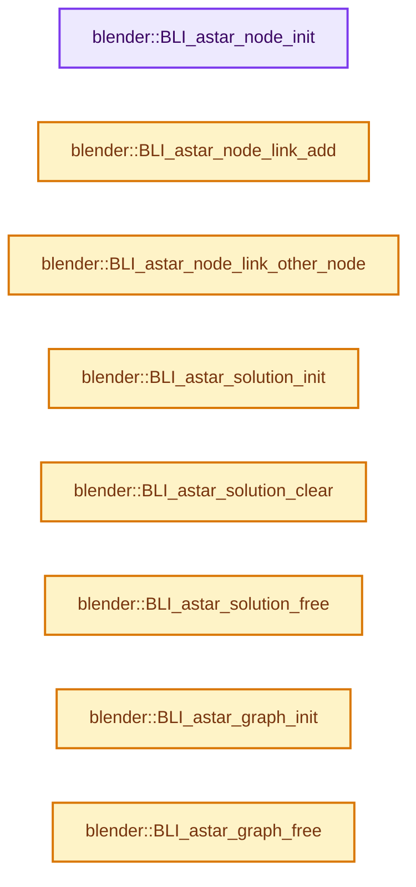
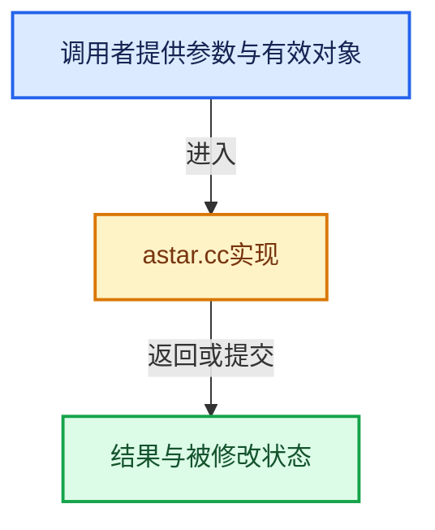

# 实现依赖专题：source/blender/blenlib/intern/astar.cc

[方向导航](README.md) · [符号索引](../%E7%AC%A6%E5%8F%B7%E4%BE%9D%E8%B5%96%E4%B8%8E%E5%AE%9E%E7%8E%B0%E7%B4%A2%E5%BC%95.md)

本专题从正文实际调用进入，集中保存共享实现。函数有稳定锚点，可从调用处直接跳到对应完整函数；递归与互相调用通过回链组织。

## 本文件的实现关系






## 完整成员与函数实现

<a id="f-36a5b8986def42d6"></a>

### `blender::BLI_astar_node_init`

实现位置：[source/blender/blenlib/intern/astar.cc](../../../../../source/blender/blenlib/intern/astar.cc) · L40—L43。

接口参数：

- `BLI_AStarGraph *as_graph`
- `const int node_index`
- `void *custom_data`

**教学注释版**

<!-- annotated:09efe17429b8e3 -->

```cpp
void BLI_astar_node_init(BLI_AStarGraph *as_graph, const int node_index, void *custom_data)
{
  as_graph->nodes[node_index].custom_data = custom_data;
}
```

<details>
<summary>核对原始源码：source/blender/blenlib/intern/astar.cc · L40—L43</summary>

<!-- original:09efe17429b8e3:source/blender/blenlib/intern/astar.cc:40:43 -->

```cpp
void BLI_astar_node_init(BLI_AStarGraph *as_graph, const int node_index, void *custom_data)
{
  as_graph->nodes[node_index].custom_data = custom_data;
}
```

</details>

**沿实际写入检查状态**

- `as_graph->nodes[node_index].custom_data = custom_data;`

**继续追踪实现**

本实现没有需要继续展开的显式调用；检查返回表达式、对象转换和调用者前置条件。

<a id="f-2303e6d509029f50"></a>

### `blender::BLI_astar_node_link_add`

实现位置：[source/blender/blenlib/intern/astar.cc](../../../../../source/blender/blenlib/intern/astar.cc) · L45—L64。

接口参数：

- `BLI_AStarGraph *as_graph`
- `const int node1_index`
- `const int node2_index`
- `const float cost`
- `void *custom_data`

**教学注释版**

<!-- annotated:cf66aa1f2c07e8 -->

```cpp
void BLI_astar_node_link_add(BLI_AStarGraph *as_graph,
                             const int node1_index,
                             const int node2_index,
                             const float cost,
                             void *custom_data)
{
  MemArena *mem = as_graph->mem;
  BLI_AStarGNLink *link = BLI_memarena_alloc<BLI_AStarGNLink>(mem);
  LinkData *ld = BLI_memarena_alloc<LinkData>(mem, 2);

  link->nodes[0] = node1_index;
  link->nodes[1] = node2_index;
  link->cost = cost;
  link->custom_data = custom_data;

  ld[0].data = ld[1].data = link;

  BLI_addtail(&(as_graph->nodes[node1_index].neighbor_links), &ld[0]);
  BLI_addtail(&(as_graph->nodes[node2_index].neighbor_links), &ld[1]);
}
```

<details>
<summary>核对原始源码：source/blender/blenlib/intern/astar.cc · L45—L64</summary>

<!-- original:cf66aa1f2c07e8:source/blender/blenlib/intern/astar.cc:45:64 -->

```cpp
void BLI_astar_node_link_add(BLI_AStarGraph *as_graph,
                             const int node1_index,
                             const int node2_index,
                             const float cost,
                             void *custom_data)
{
  MemArena *mem = as_graph->mem;
  BLI_AStarGNLink *link = BLI_memarena_alloc<BLI_AStarGNLink>(mem);
  LinkData *ld = BLI_memarena_alloc<LinkData>(mem, 2);

  link->nodes[0] = node1_index;
  link->nodes[1] = node2_index;
  link->cost = cost;
  link->custom_data = custom_data;

  ld[0].data = ld[1].data = link;

  BLI_addtail(&(as_graph->nodes[node1_index].neighbor_links), &ld[0]);
  BLI_addtail(&(as_graph->nodes[node2_index].neighbor_links), &ld[1]);
}
```

</details>

**沿实际写入检查状态**

- `link->nodes[0] = node1_index;`
- `link->nodes[1] = node2_index;`
- `link->cost = cost;`
- `link->custom_data = custom_data;`
- `ld[0].data = ld[1].data = link;`

**继续追踪实现**

- `BLI_memarena_alloc<BLI_AStarGNLink>` → [blender::BLI_memarena_alloc · L125](%E4%BE%9D%E8%B5%96-BLI_memarena-aea32a.md#f-ae79828c3629e134)。
- `BLI_memarena_alloc<LinkData>` → [blender::BLI_memarena_alloc · L125](%E4%BE%9D%E8%B5%96-BLI_memarena-aea32a.md#f-ae79828c3629e134)。
- `BLI_addtail` → [blender::BLI_addtail · L118](%E4%BE%9D%E8%B5%96-listbase-2816d9.md#f-4fb027713fa3115b)。

<a id="f-773c497bc470c66b"></a>

### `blender::BLI_astar_node_link_other_node`

实现位置：[source/blender/blenlib/intern/astar.cc](../../../../../source/blender/blenlib/intern/astar.cc) · L66—L69。

接口参数：

- `BLI_AStarGNLink *lnk`
- `const int idx`

**教学注释版**

<!-- annotated:4736f85cf68e58 -->

```cpp
int BLI_astar_node_link_other_node(BLI_AStarGNLink *lnk, const int idx)
{
  return (lnk->nodes[0] == idx) ? lnk->nodes[1] : lnk->nodes[0];
}
```

<details>
<summary>核对原始源码：source/blender/blenlib/intern/astar.cc · L66—L69</summary>

<!-- original:4736f85cf68e58:source/blender/blenlib/intern/astar.cc:66:69 -->

```cpp
int BLI_astar_node_link_other_node(BLI_AStarGNLink *lnk, const int idx)
{
  return (lnk->nodes[0] == idx) ? lnk->nodes[1] : lnk->nodes[0];
}
```

</details>

**结果出口**

- `return (lnk->nodes[0] == idx) ? lnk->nodes[1] : lnk->nodes[0];`

**继续追踪实现**

本实现没有需要继续展开的显式调用；检查返回表达式、对象转换和调用者前置条件。

<a id="f-652a518491b00bfc"></a>

### `blender::BLI_astar_solution_init`

实现位置：[source/blender/blenlib/intern/astar.cc](../../../../../source/blender/blenlib/intern/astar.cc) · L71—L93。

接口参数：

- `BLI_AStarGraph *as_graph`
- `BLI_AStarSolution *as_solution`
- `void *custom_data`

**教学注释版**

<!-- annotated:a0b4649cba4bac -->

```cpp
void BLI_astar_solution_init(BLI_AStarGraph *as_graph,
                             BLI_AStarSolution *as_solution,
                             void *custom_data)
{
  MemArena *mem = as_solution->mem;
  size_t node_num = size_t(as_graph->node_num);

  if (mem == nullptr) {
    mem = BLI_memarena_new(BLI_MEMARENA_STD_BUFSIZE, __func__);
    as_solution->mem = mem;
  }
  /* else memarena should be cleared */

  as_solution->steps = 0;
  as_solution->prev_nodes = BLI_memarena_alloc<int>(mem, node_num);
  as_solution->prev_links = BLI_memarena_alloc<BLI_AStarGNLink *>(mem, node_num);

  as_solution->custom_data = custom_data;

  as_solution->done_nodes = BLI_BITMAP_NEW_MEMARENA(mem, node_num);
  as_solution->g_costs = BLI_memarena_alloc<float>(mem, node_num);
  as_solution->g_steps = BLI_memarena_alloc<int>(mem, node_num);
}
```

<details>
<summary>核对原始源码：source/blender/blenlib/intern/astar.cc · L71—L93</summary>

<!-- original:a0b4649cba4bac:source/blender/blenlib/intern/astar.cc:71:93 -->

```cpp
void BLI_astar_solution_init(BLI_AStarGraph *as_graph,
                             BLI_AStarSolution *as_solution,
                             void *custom_data)
{
  MemArena *mem = as_solution->mem;
  size_t node_num = size_t(as_graph->node_num);

  if (mem == nullptr) {
    mem = BLI_memarena_new(BLI_MEMARENA_STD_BUFSIZE, __func__);
    as_solution->mem = mem;
  }
  /* else memarena should be cleared */

  as_solution->steps = 0;
  as_solution->prev_nodes = BLI_memarena_alloc<int>(mem, node_num);
  as_solution->prev_links = BLI_memarena_alloc<BLI_AStarGNLink *>(mem, node_num);

  as_solution->custom_data = custom_data;

  as_solution->done_nodes = BLI_BITMAP_NEW_MEMARENA(mem, node_num);
  as_solution->g_costs = BLI_memarena_alloc<float>(mem, node_num);
  as_solution->g_steps = BLI_memarena_alloc<int>(mem, node_num);
}
```

</details>

**沿实际写入检查状态**

- `mem = BLI_memarena_new(BLI_MEMARENA_STD_BUFSIZE, __func__);`
- `as_solution->mem = mem;`
- `as_solution->steps = 0;`
- `as_solution->prev_nodes = BLI_memarena_alloc<int>(mem, node_num);`
- `as_solution->prev_links = BLI_memarena_alloc<BLI_AStarGNLink *>(mem, node_num);`
- `as_solution->custom_data = custom_data;`
- `as_solution->done_nodes = BLI_BITMAP_NEW_MEMARENA(mem, node_num);`
- `as_solution->g_costs = BLI_memarena_alloc<float>(mem, node_num);`
- `as_solution->g_steps = BLI_memarena_alloc<int>(mem, node_num);`

**继续追踪实现**

- `BLI_memarena_new` → [blender::BLI_memarena_new · L73](%E4%BE%9D%E8%B5%96-BLI_memarena-aea32a.md#f-590ef4f6ab548c98)。
- `BLI_memarena_alloc<int>` → [blender::BLI_memarena_alloc · L125](%E4%BE%9D%E8%B5%96-BLI_memarena-aea32a.md#f-ae79828c3629e134)。
- `BLI_memarena_alloc<BLI_AStarGNLink *>` → [blender::BLI_memarena_alloc · L125](%E4%BE%9D%E8%B5%96-BLI_memarena-aea32a.md#f-ae79828c3629e134)。
- `BLI_BITMAP_NEW_MEMARENA` → [BLI_BITMAP_NEW_MEMARENA · L51](../02-%E5%93%88%E5%B8%8C%E8%A1%A8%E4%B8%8E%E5%85%B3%E8%81%94%E6%95%B0%E6%8D%AE%E7%BB%93%E6%9E%84/%E4%BE%9D%E8%B5%96-BLI_bitmap-693b86.md#m-60ea0b4a0a8b)。宏定义由构建条件选择。
- `BLI_memarena_alloc<float>` → [blender::BLI_memarena_alloc · L125](%E4%BE%9D%E8%B5%96-BLI_memarena-aea32a.md#f-ae79828c3629e134)。

<a id="f-ea07ce2674f40292"></a>

### `blender::BLI_astar_solution_clear`

实现位置：[source/blender/blenlib/intern/astar.cc](../../../../../source/blender/blenlib/intern/astar.cc) · L95—L110。

接口参数：

- `BLI_AStarSolution *as_solution`

**教学注释版**

<!-- annotated:38a00fbb9f27ec -->

```cpp
void BLI_astar_solution_clear(BLI_AStarSolution *as_solution)
{
  if (as_solution->mem) {
    BLI_memarena_clear(as_solution->mem);
  }

  as_solution->steps = 0;
  as_solution->prev_nodes = nullptr;
  as_solution->prev_links = nullptr;

  as_solution->custom_data = nullptr;

  as_solution->done_nodes = nullptr;
  as_solution->g_costs = nullptr;
  as_solution->g_steps = nullptr;
}
```

<details>
<summary>核对原始源码：source/blender/blenlib/intern/astar.cc · L95—L110</summary>

<!-- original:38a00fbb9f27ec:source/blender/blenlib/intern/astar.cc:95:110 -->

```cpp
void BLI_astar_solution_clear(BLI_AStarSolution *as_solution)
{
  if (as_solution->mem) {
    BLI_memarena_clear(as_solution->mem);
  }

  as_solution->steps = 0;
  as_solution->prev_nodes = nullptr;
  as_solution->prev_links = nullptr;

  as_solution->custom_data = nullptr;

  as_solution->done_nodes = nullptr;
  as_solution->g_costs = nullptr;
  as_solution->g_steps = nullptr;
}
```

</details>

**沿实际写入检查状态**

- `as_solution->steps = 0;`
- `as_solution->prev_nodes = nullptr;`
- `as_solution->prev_links = nullptr;`
- `as_solution->custom_data = nullptr;`
- `as_solution->done_nodes = nullptr;`
- `as_solution->g_costs = nullptr;`
- `as_solution->g_steps = nullptr;`

**继续追踪实现**

- `BLI_memarena_clear` → [blender::BLI_memarena_clear · L225](%E4%BE%9D%E8%B5%96-BLI_memarena-aea32a.md#f-58102a3c4f840caa)。

<a id="f-cd554a983e34fd1c"></a>

### `blender::BLI_astar_solution_free`

实现位置：[source/blender/blenlib/intern/astar.cc](../../../../../source/blender/blenlib/intern/astar.cc) · L112—L118。

接口参数：

- `BLI_AStarSolution *as_solution`

**教学注释版**

<!-- annotated:7532ff4fa221b6 -->

```cpp
void BLI_astar_solution_free(BLI_AStarSolution *as_solution)
{
  if (as_solution->mem) {
    BLI_memarena_free(as_solution->mem);
    as_solution->mem = nullptr;
  }
}
```

<details>
<summary>核对原始源码：source/blender/blenlib/intern/astar.cc · L112—L118</summary>

<!-- original:7532ff4fa221b6:source/blender/blenlib/intern/astar.cc:112:118 -->

```cpp
void BLI_astar_solution_free(BLI_AStarSolution *as_solution)
{
  if (as_solution->mem) {
    BLI_memarena_free(as_solution->mem);
    as_solution->mem = nullptr;
  }
}
```

</details>

**沿实际写入检查状态**

- `as_solution->mem = nullptr;`

**继续追踪实现**

- `BLI_memarena_free` → [blender::BLI_memarena_free · L103](%E4%BE%9D%E8%B5%96-BLI_memarena-aea32a.md#f-a655794ad41d1bdf)。

<a id="f-68ec2cb47a25fec2"></a>

### `blender::BLI_astar_graph_init`

实现位置：[source/blender/blenlib/intern/astar.cc](../../../../../source/blender/blenlib/intern/astar.cc) · L120—L134。

接口参数：

- `BLI_AStarGraph *as_graph`
- `const int node_num`
- `void *custom_data`

**教学注释版**

<!-- annotated:e20486e0877078 -->

```cpp
void BLI_astar_graph_init(BLI_AStarGraph *as_graph, const int node_num, void *custom_data)
{
  MemArena *mem = as_graph->mem;

  if (mem == nullptr) {
    mem = BLI_memarena_new(BLI_MEMARENA_STD_BUFSIZE, __func__);
    as_graph->mem = mem;
  }
  /* else memarena should be cleared */

  as_graph->node_num = node_num;
  as_graph->nodes = BLI_memarena_calloc<BLI_AStarGNode>(mem, size_t(node_num));

  as_graph->custom_data = custom_data;
}
```

<details>
<summary>核对原始源码：source/blender/blenlib/intern/astar.cc · L120—L134</summary>

<!-- original:e20486e0877078:source/blender/blenlib/intern/astar.cc:120:134 -->

```cpp
void BLI_astar_graph_init(BLI_AStarGraph *as_graph, const int node_num, void *custom_data)
{
  MemArena *mem = as_graph->mem;

  if (mem == nullptr) {
    mem = BLI_memarena_new(BLI_MEMARENA_STD_BUFSIZE, __func__);
    as_graph->mem = mem;
  }
  /* else memarena should be cleared */

  as_graph->node_num = node_num;
  as_graph->nodes = BLI_memarena_calloc<BLI_AStarGNode>(mem, size_t(node_num));

  as_graph->custom_data = custom_data;
}
```

</details>

**沿实际写入检查状态**

- `mem = BLI_memarena_new(BLI_MEMARENA_STD_BUFSIZE, __func__);`
- `as_graph->mem = mem;`
- `as_graph->node_num = node_num;`
- `as_graph->nodes = BLI_memarena_calloc<BLI_AStarGNode>(mem, size_t(node_num));`
- `as_graph->custom_data = custom_data;`

**继续追踪实现**

- `BLI_memarena_new` → [blender::BLI_memarena_new · L73](%E4%BE%9D%E8%B5%96-BLI_memarena-aea32a.md#f-590ef4f6ab548c98)。
- `BLI_memarena_calloc<BLI_AStarGNode>` → [blender::BLI_memarena_calloc · L170](%E4%BE%9D%E8%B5%96-BLI_memarena-aea32a.md#f-3bb0d5bc840ed647)。

<a id="f-1241ab9f8cdcb71d"></a>

### `blender::BLI_astar_graph_free`

实现位置：[source/blender/blenlib/intern/astar.cc](../../../../../source/blender/blenlib/intern/astar.cc) · L136—L142。

接口参数：

- `BLI_AStarGraph *as_graph`

**教学注释版**

<!-- annotated:f22a58d8d7d812 -->

```cpp
void BLI_astar_graph_free(BLI_AStarGraph *as_graph)
{
  if (as_graph->mem) {
    BLI_memarena_free(as_graph->mem);
    as_graph->mem = nullptr;
  }
}
```

<details>
<summary>核对原始源码：source/blender/blenlib/intern/astar.cc · L136—L142</summary>

<!-- original:f22a58d8d7d812:source/blender/blenlib/intern/astar.cc:136:142 -->

```cpp
void BLI_astar_graph_free(BLI_AStarGraph *as_graph)
{
  if (as_graph->mem) {
    BLI_memarena_free(as_graph->mem);
    as_graph->mem = nullptr;
  }
}
```

</details>

**沿实际写入检查状态**

- `as_graph->mem = nullptr;`

**继续追踪实现**

- `BLI_memarena_free` → [blender::BLI_memarena_free · L103](%E4%BE%9D%E8%B5%96-BLI_memarena-aea32a.md#f-a655794ad41d1bdf)。

<a id="f-1c57c1a827e43725"></a>

### `blender::BLI_astar_graph_solve`

实现位置：[source/blender/blenlib/intern/astar.cc](../../../../../source/blender/blenlib/intern/astar.cc) · L144—L227。

接口参数：

- `BLI_AStarGraph *as_graph`
- `const int node_index_src`
- `const int node_index_dst`
- `astar_f_cost f_cost_cb`
- `BLI_AStarSolution *r_solution`
- `const int max_steps`

**教学注释版**

<!-- annotated:6321ca3b12952b -->

```cpp
bool BLI_astar_graph_solve(BLI_AStarGraph *as_graph,
                           const int node_index_src,
                           const int node_index_dst,
                           astar_f_cost f_cost_cb,
                           BLI_AStarSolution *r_solution,
                           const int max_steps)
{
  HeapSimple *todo_nodes;

  BLI_bitmap *done_nodes = r_solution->done_nodes;
  int *prev_nodes = r_solution->prev_nodes;
  BLI_AStarGNLink **prev_links = r_solution->prev_links;
  float *g_costs = r_solution->g_costs;
  int *g_steps = r_solution->g_steps;

  r_solution->steps = 0;
  prev_nodes[node_index_src] = -1;
  BLI_bitmap_set_all(done_nodes, false, as_graph->node_num);
  std::fill_n(g_costs, as_graph->node_num, FLT_MAX);
  g_costs[node_index_src] = 0.0f;
  g_steps[node_index_src] = 0;

  if (node_index_src == node_index_dst) {
    return true;
  }

  todo_nodes = BLI_heapsimple_new();
  BLI_heapsimple_insert(
      todo_nodes,
      f_cost_cb(as_graph, r_solution, nullptr, -1, node_index_src, node_index_dst),
      POINTER_FROM_INT(node_index_src));

  while (!BLI_heapsimple_is_empty(todo_nodes)) {
    const int node_curr_idx = POINTER_AS_INT(BLI_heapsimple_pop_min(todo_nodes));
    BLI_AStarGNode *node_curr = &as_graph->nodes[node_curr_idx];
    LinkData *ld;

    if (BLI_BITMAP_TEST(done_nodes, node_curr_idx)) {
      /* Might happen, because we always add nodes to heap when evaluating them,
       * without ever removing them. */
      continue;
    }

    /* If we are limited in amount of steps to find a path, skip if we reached limit. */
    if (max_steps && g_steps[node_curr_idx] > max_steps) {
      continue;
    }

    if (node_curr_idx == node_index_dst) {
      /* Success! Path found... */
      r_solution->steps = g_steps[node_curr_idx] + 1;

      BLI_heapsimple_free(todo_nodes, nullptr);
      return true;
    }

    BLI_BITMAP_ENABLE(done_nodes, node_curr_idx);

    for (ld = node_curr->neighbor_links.first(); ld; ld = ld->next) {
      BLI_AStarGNLink *link = static_cast<BLI_AStarGNLink *>(ld->data);
      const int node_next_idx = BLI_astar_node_link_other_node(link, node_curr_idx);

      if (!BLI_BITMAP_TEST(done_nodes, node_next_idx)) {
        float g_cst = g_costs[node_curr_idx] + link->cost;

        if (g_cst < g_costs[node_next_idx]) {
          prev_nodes[node_next_idx] = node_curr_idx;
          prev_links[node_next_idx] = link;
          g_costs[node_next_idx] = g_cst;
          g_steps[node_next_idx] = g_steps[node_curr_idx] + 1;
          /* We might have this node already in heap, but since this 'instance'
           * will be evaluated first, no problem. */
          BLI_heapsimple_insert(
              todo_nodes,
              f_cost_cb(as_graph, r_solution, link, node_curr_idx, node_next_idx, node_index_dst),
              POINTER_FROM_INT(node_next_idx));
        }
      }
    }
  }

  BLI_heapsimple_free(todo_nodes, nullptr);
  return false;
}
```

<details>
<summary>核对原始源码：source/blender/blenlib/intern/astar.cc · L144—L227</summary>

<!-- original:6321ca3b12952b:source/blender/blenlib/intern/astar.cc:144:227 -->

```cpp
bool BLI_astar_graph_solve(BLI_AStarGraph *as_graph,
                           const int node_index_src,
                           const int node_index_dst,
                           astar_f_cost f_cost_cb,
                           BLI_AStarSolution *r_solution,
                           const int max_steps)
{
  HeapSimple *todo_nodes;

  BLI_bitmap *done_nodes = r_solution->done_nodes;
  int *prev_nodes = r_solution->prev_nodes;
  BLI_AStarGNLink **prev_links = r_solution->prev_links;
  float *g_costs = r_solution->g_costs;
  int *g_steps = r_solution->g_steps;

  r_solution->steps = 0;
  prev_nodes[node_index_src] = -1;
  BLI_bitmap_set_all(done_nodes, false, as_graph->node_num);
  std::fill_n(g_costs, as_graph->node_num, FLT_MAX);
  g_costs[node_index_src] = 0.0f;
  g_steps[node_index_src] = 0;

  if (node_index_src == node_index_dst) {
    return true;
  }

  todo_nodes = BLI_heapsimple_new();
  BLI_heapsimple_insert(
      todo_nodes,
      f_cost_cb(as_graph, r_solution, nullptr, -1, node_index_src, node_index_dst),
      POINTER_FROM_INT(node_index_src));

  while (!BLI_heapsimple_is_empty(todo_nodes)) {
    const int node_curr_idx = POINTER_AS_INT(BLI_heapsimple_pop_min(todo_nodes));
    BLI_AStarGNode *node_curr = &as_graph->nodes[node_curr_idx];
    LinkData *ld;

    if (BLI_BITMAP_TEST(done_nodes, node_curr_idx)) {
      /* Might happen, because we always add nodes to heap when evaluating them,
       * without ever removing them. */
      continue;
    }

    /* If we are limited in amount of steps to find a path, skip if we reached limit. */
    if (max_steps && g_steps[node_curr_idx] > max_steps) {
      continue;
    }

    if (node_curr_idx == node_index_dst) {
      /* Success! Path found... */
      r_solution->steps = g_steps[node_curr_idx] + 1;

      BLI_heapsimple_free(todo_nodes, nullptr);
      return true;
    }

    BLI_BITMAP_ENABLE(done_nodes, node_curr_idx);

    for (ld = node_curr->neighbor_links.first(); ld; ld = ld->next) {
      BLI_AStarGNLink *link = static_cast<BLI_AStarGNLink *>(ld->data);
      const int node_next_idx = BLI_astar_node_link_other_node(link, node_curr_idx);

      if (!BLI_BITMAP_TEST(done_nodes, node_next_idx)) {
        float g_cst = g_costs[node_curr_idx] + link->cost;

        if (g_cst < g_costs[node_next_idx]) {
          prev_nodes[node_next_idx] = node_curr_idx;
          prev_links[node_next_idx] = link;
          g_costs[node_next_idx] = g_cst;
          g_steps[node_next_idx] = g_steps[node_curr_idx] + 1;
          /* We might have this node already in heap, but since this 'instance'
           * will be evaluated first, no problem. */
          BLI_heapsimple_insert(
              todo_nodes,
              f_cost_cb(as_graph, r_solution, link, node_curr_idx, node_next_idx, node_index_dst),
              POINTER_FROM_INT(node_next_idx));
        }
      }
    }
  }

  BLI_heapsimple_free(todo_nodes, nullptr);
  return false;
}
```

</details>

**沿实际写入检查状态**

- `r_solution->steps = 0;`
- `prev_nodes[node_index_src] = -1;`
- `g_costs[node_index_src] = 0.0f;`
- `g_steps[node_index_src] = 0;`
- `todo_nodes = BLI_heapsimple_new();`
- `r_solution->steps = g_steps[node_curr_idx] + 1;`
- `prev_nodes[node_next_idx] = node_curr_idx;`
- `prev_links[node_next_idx] = link;`
- `g_costs[node_next_idx] = g_cst;`
- `g_steps[node_next_idx] = g_steps[node_curr_idx] + 1;`

**结果出口**

- `return true;`
- `return false;`

**继续追踪实现**

- `BLI_bitmap_set_all` → [blender::BLI_bitmap_set_all · L19](../02-%E5%93%88%E5%B8%8C%E8%A1%A8%E4%B8%8E%E5%85%B3%E8%81%94%E6%95%B0%E6%8D%AE%E7%BB%93%E6%9E%84/%E4%BE%9D%E8%B5%96-bitmap-56367d.md#f-a60aac2bf556a851)。
- `std::fill_n` → [外部契约](https://eel.is/c++draft/)：这个边界按实际表达式及所属类型核对参数、返回值、寿命与失败行为。这里提供接口入口，不声称已解释该第三方版本的内部实现。
- `BLI_heapsimple_new` → [blender::BLI_heapsimple_new · L151](%E4%BE%9D%E8%B5%96-BLI_heap_simple-50ae5b.md#f-af0c13b50154fff4)。
- `BLI_heapsimple_insert` → [blender::BLI_heapsimple_insert · L179](%E4%BE%9D%E8%B5%96-BLI_heap_simple-50ae5b.md#f-c4ee1de332620e54)。
- `f_cost_cb` → [调用协议](../%E6%A8%A1%E6%9D%BF%E5%AE%8F%E4%B8%8E%E5%8A%A8%E6%80%81%E5%88%86%E6%B4%BE%E5%8D%8F%E8%AE%AE.md)：局部可调用对象，须结合其初始化与捕获环境。调用位置L173。
- `POINTER_FROM_INT` → [POINTER_FROM_INT · L321](%E4%BE%9D%E8%B5%96-BLI_utildefines-293a0a.md#m-17841357bb5a)。宏定义由构建条件选择。
- `BLI_heapsimple_is_empty` → [blender::BLI_heapsimple_is_empty · L190](%E4%BE%9D%E8%B5%96-BLI_heap_simple-50ae5b.md#f-60afd1a8a46caf7d)。
- `POINTER_AS_INT` → [POINTER_AS_INT · L322](%E4%BE%9D%E8%B5%96-BLI_utildefines-293a0a.md#m-5c041fdc2f74)。宏定义由构建条件选择。
- `BLI_heapsimple_pop_min` → [blender::BLI_heapsimple_pop_min · L207](%E4%BE%9D%E8%B5%96-BLI_heap_simple-50ae5b.md#f-3a4fc124a9118a1e)。
- `BLI_BITMAP_TEST` → [BLI_BITMAP_TEST · L63](../02-%E5%93%88%E5%B8%8C%E8%A1%A8%E4%B8%8E%E5%85%B3%E8%81%94%E6%95%B0%E6%8D%AE%E7%BB%93%E6%9E%84/%E4%BE%9D%E8%B5%96-BLI_bitmap-693b86.md#m-631c4702a77d)。宏定义由构建条件选择。
- `BLI_heapsimple_free` → [blender::BLI_heapsimple_free · L156](%E4%BE%9D%E8%B5%96-BLI_heap_simple-50ae5b.md#f-f2457cb8cc09bc60)。
- `BLI_BITMAP_ENABLE` → [BLI_BITMAP_ENABLE · L80](../02-%E5%93%88%E5%B8%8C%E8%A1%A8%E4%B8%8E%E5%85%B3%E8%81%94%E6%95%B0%E6%8D%AE%E7%BB%93%E6%9E%84/%E4%BE%9D%E8%B5%96-BLI_bitmap-693b86.md#m-6b0abc936749)。宏定义由构建条件选择。
- `node_curr->neighbor_links.first` → [调用协议](../%E6%A8%A1%E6%9D%BF%E5%AE%8F%E4%B8%8E%E5%8A%A8%E6%80%81%E5%88%86%E6%B4%BE%E5%8D%8F%E8%AE%AE.md)：接收对象类型依赖auto、返回值或模板实例；不按同名猜测目标。调用位置L202。
- `BLI_astar_node_link_other_node` → [blender::BLI_astar_node_link_other_node · L66](%E4%BE%9D%E8%B5%96-astar-648a4a.md#f-773c497bc470c66b)。
