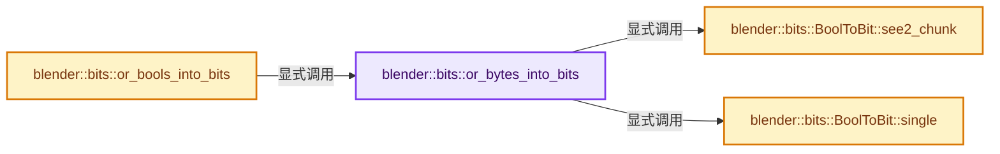
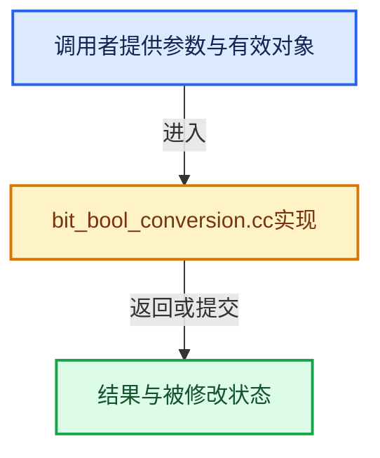

# 实现依赖专题：source/blender/blenlib/intern/bit_bool_conversion.cc

[方向导航](README.md) · [符号索引](../%E7%AC%A6%E5%8F%B7%E4%BE%9D%E8%B5%96%E4%B8%8E%E5%AE%9E%E7%8E%B0%E7%B4%A2%E5%BC%95.md)

本专题从正文实际调用进入，集中保存共享实现。函数有稳定锚点，可从调用处直接跳到对应完整函数；递归与互相调用通过回链组织。

## 本文件的实现关系






## 相关类型布局与成员入口

<a id="t-ef350913d66e"></a>

### `blender::bits::BoolToBit`

原始声明：[source/blender/blenlib/intern/bit_bool_conversion.cc](../../../../../source/blender/blenlib/intern/bit_bool_conversion.cc) · L67—L86。

以下保留类的数据声明与编译条件，成员函数实现通过后面的精确链接阅读。

<!-- annotated:fd69c06732156c -->

```cpp
struct BoolToBit {
```

<details>
<summary>核对原始源码：source/blender/blenlib/intern/bit_bool_conversion.cc · L67—L67</summary>

<!-- original:fd69c06732156c:source/blender/blenlib/intern/bit_bool_conversion.cc:67:67 -->

```cpp
struct BoolToBit {
```

</details>

<!-- annotated:fe54534783ccc8 -->

```cpp

#if BLI_HAVE_SSE2
```

<details>
<summary>核对原始源码：source/blender/blenlib/intern/bit_bool_conversion.cc · L72—L73</summary>

<!-- original:fe54534783ccc8:source/blender/blenlib/intern/bit_bool_conversion.cc:72:73 -->

```cpp

#if BLI_HAVE_SSE2
```

</details>

<!-- annotated:ceb17a57d1ad47 -->

```cpp
#endif
};
```

<details>
<summary>核对原始源码：source/blender/blenlib/intern/bit_bool_conversion.cc · L85—L86</summary>

<!-- original:ceb17a57d1ad47:source/blender/blenlib/intern/bit_bool_conversion.cc:85:86 -->

```cpp
#endif
};
```

</details>

- [single](%E4%BE%9D%E8%B5%96-bit_bool_conversion-6a719a.md#f-08318f2d0747602b)
- [see2_chunk](%E4%BE%9D%E8%B5%96-bit_bool_conversion-6a719a.md#f-c272b5fc07fb22dd)

## 完整成员与函数实现

<a id="f-edebee78332316de"></a>

### `blender::bits::or_bytes_into_bits`

实现位置：[source/blender/blenlib/intern/bit_bool_conversion.cc](../../../../../source/blender/blenlib/intern/bit_bool_conversion.cc) · L14—L65。

接口参数：

- `const Span<char> bytes`
- `MutableBitSpan r_bits`
- `const int64_t allowed_overshoot`
- `const ByteToBit &byte_to_bit`

**教学注释版**

<!-- annotated:75c445e2ba10d8 -->

```cpp
template<typename ByteToBit>
bool or_bytes_into_bits(const Span<char> bytes,
                        MutableBitSpan r_bits,
                        const int64_t allowed_overshoot,
                        const ByteToBit &byte_to_bit)
{
  // [讲解] bytes.size：查询视图长度或生成对应有效索引区间。
  BLI_assert(r_bits.size() >= bytes.size());
  // [讲解] bytes.is_empty：查询视图长度或生成对应有效索引区间。
  if (bytes.is_empty()) {
    return false;
  }

  int64_t byte_i = 0;
  // [讲解] bytes.data：返回借用范围的地址。
  const char *bytes_ = bytes.data();

  bool any_true = false;

/* Conversion from bytes to bits can be way faster with intrinsics. That's because instead of
 * processing one element at a time, we can process 16 at once. */
#if BLI_HAVE_SSE2
  int64_t iteration_end = bytes.size();
  if (iteration_end % 16 > 0) {
    if (allowed_overshoot >= 16) {
      iteration_end = (iteration_end + 16) & ~15;
    }
  }
  /* Iterate over chunks of bytes. */
  for (; byte_i + 16 <= iteration_end; byte_i += 16) {
    /* Load 16 bytes at once. */
    const __m128i group = _mm_loadu_si128(reinterpret_cast<const __m128i *>(bytes_ + byte_i));
    const uint16_t is_true_mask = byte_to_bit.see2_chunk(group);
    any_true |= is_true_mask != 0;

    const int start_bit_in_int = (r_bits.bit_range().start() + byte_i) & BitIndexMask;
    BitInt *start_bit_int = int_containing_bit(r_bits.data(), r_bits.bit_range().start() + byte_i);
    *start_bit_int |= BitInt(is_true_mask) << start_bit_in_int;

    if (start_bit_in_int > BitsPerInt - 16) {
      /* It's possible that the bits need inserted in two consecutive integers. */
      start_bit_int[1] |= BitInt(is_true_mask) >> (64 - start_bit_in_int);
    }
  }
#endif

  /* Process remaining bytes. */
  for (; byte_i < bytes.size(); byte_i++) {
    if (byte_to_bit.single(bytes_[byte_i])) {
      r_bits[byte_i].set();
      any_true = true;
    }
  }
  return any_true;
}
```

<details>
<summary>核对原始源码：source/blender/blenlib/intern/bit_bool_conversion.cc · L14—L65</summary>

<!-- original:75c445e2ba10d8:source/blender/blenlib/intern/bit_bool_conversion.cc:14:65 -->

```cpp
template<typename ByteToBit>
bool or_bytes_into_bits(const Span<char> bytes,
                        MutableBitSpan r_bits,
                        const int64_t allowed_overshoot,
                        const ByteToBit &byte_to_bit)
{
  BLI_assert(r_bits.size() >= bytes.size());
  if (bytes.is_empty()) {
    return false;
  }

  int64_t byte_i = 0;
  const char *bytes_ = bytes.data();

  bool any_true = false;

/* Conversion from bytes to bits can be way faster with intrinsics. That's because instead of
 * processing one element at a time, we can process 16 at once. */
#if BLI_HAVE_SSE2
  int64_t iteration_end = bytes.size();
  if (iteration_end % 16 > 0) {
    if (allowed_overshoot >= 16) {
      iteration_end = (iteration_end + 16) & ~15;
    }
  }
  /* Iterate over chunks of bytes. */
  for (; byte_i + 16 <= iteration_end; byte_i += 16) {
    /* Load 16 bytes at once. */
    const __m128i group = _mm_loadu_si128(reinterpret_cast<const __m128i *>(bytes_ + byte_i));
    const uint16_t is_true_mask = byte_to_bit.see2_chunk(group);
    any_true |= is_true_mask != 0;

    const int start_bit_in_int = (r_bits.bit_range().start() + byte_i) & BitIndexMask;
    BitInt *start_bit_int = int_containing_bit(r_bits.data(), r_bits.bit_range().start() + byte_i);
    *start_bit_int |= BitInt(is_true_mask) << start_bit_in_int;

    if (start_bit_in_int > BitsPerInt - 16) {
      /* It's possible that the bits need inserted in two consecutive integers. */
      start_bit_int[1] |= BitInt(is_true_mask) >> (64 - start_bit_in_int);
    }
  }
#endif

  /* Process remaining bytes. */
  for (; byte_i < bytes.size(); byte_i++) {
    if (byte_to_bit.single(bytes_[byte_i])) {
      r_bits[byte_i].set();
      any_true = true;
    }
  }
  return any_true;
}
```

</details>

**沿实际写入检查状态**

- `iteration_end = (iteration_end + 16) & ~15;`
- `any_true |= is_true_mask != 0;`
- `start_bit_int[1] |= BitInt(is_true_mask) >> (64 - start_bit_in_int);`
- `any_true = true;`

**结果出口**

- `return false;`
- `return any_true;`

**继续追踪实现**

- `BLI_assert` → [BLI_assert · L48](%E4%BE%9D%E8%B5%96-BLI_assert-cc98e8.md#m-57a88495704d)；[BLI_assert · L63](%E4%BE%9D%E8%B5%96-BLI_assert-cc98e8.md#m-d07050020cb5)。宏定义由构建条件选择。
- `r_bits.size` → [blender::bits::MutableBitSpan::size · L303](19-BitSpan%E4%B8%8EBitVector.md#f-9ffa8a62bb4f9736)。
- `bytes.size` → [blender::Span::size · L256](05-Span%E5%8F%AA%E8%AF%BB%E8%BF%9E%E7%BB%AD%E8%A7%86%E5%9B%BE.md#f-5f80fa006089c998)。
- `bytes.is_empty` → [blender::Span::is_empty · L264](05-Span%E5%8F%AA%E8%AF%BB%E8%BF%9E%E7%BB%AD%E8%A7%86%E5%9B%BE.md#f-8cc1d7ba8feb50e6)。
- `bytes.data` → [blender::Span::data · L219](05-Span%E5%8F%AA%E8%AF%BB%E8%BF%9E%E7%BB%AD%E8%A7%86%E5%9B%BE.md#f-10c5889198935800)。
- `_mm_loadu_si128` → [调用协议](../%E6%A8%A1%E6%9D%BF%E5%AE%8F%E4%B8%8E%E5%8A%A8%E6%80%81%E5%88%86%E6%B4%BE%E5%8D%8F%E8%AE%AE.md)：函数指针、局部可调用对象或未展开的宏；必须结合调用者环境。调用位置L42。
- `byte_to_bit.see2_chunk` → [blender::bits::BoolToBit::see2_chunk · L74](%E4%BE%9D%E8%B5%96-bit_bool_conversion-6a719a.md#f-c272b5fc07fb22dd)。
- `r_bits.bit_range().start` → [调用协议](../%E6%A8%A1%E6%9D%BF%E5%AE%8F%E4%B8%8E%E5%8A%A8%E6%80%81%E5%88%86%E6%B4%BE%E5%8D%8F%E8%AE%AE.md)：接收对象类型依赖auto、返回值或模板实例；不按同名猜测目标。调用位置L46。
- `r_bits.bit_range` → [blender::bits::MutableBitSpan::bit_range · L345](19-BitSpan%E4%B8%8EBitVector.md#f-0f66b0c373e90c42)。
- `int_containing_bit` → [blender::bits::int_containing_bit · L72](%E4%BE%9D%E8%B5%96-BLI_bit_ref-359167.md#f-dddfb68bb10f0356)；[blender::bits::int_containing_bit · L77](%E4%BE%9D%E8%B5%96-BLI_bit_ref-359167.md#f-6ea7b9235ac9dbab)。同名重载需按实参类型选择。
- `r_bits.data` → [blender::bits::MutableBitSpan::data · L340](19-BitSpan%E4%B8%8EBitVector.md#f-eacb49b07ccc79d2)。
- `BitInt` → [调用协议](../%E6%A8%A1%E6%9D%BF%E5%AE%8F%E4%B8%8E%E5%8A%A8%E6%80%81%E5%88%86%E6%B4%BE%E5%8D%8F%E8%AE%AE.md)：函数指针、局部可调用对象或未展开的宏；必须结合调用者环境。调用位置L48。
- `byte_to_bit.single` → [blender::bits::BoolToBit::single · L68](%E4%BE%9D%E8%B5%96-bit_bool_conversion-6a719a.md#f-08318f2d0747602b)。
- `r_bits[byte_i].set` → [调用协议](../%E6%A8%A1%E6%9D%BF%E5%AE%8F%E4%B8%8E%E5%8A%A8%E6%80%81%E5%88%86%E6%B4%BE%E5%8D%8F%E8%AE%AE.md)：接收对象类型依赖auto、返回值或模板实例；不按同名猜测目标。调用位置L60。

<a id="f-08318f2d0747602b"></a>

### `blender::bits::BoolToBit::single`

实现位置：[source/blender/blenlib/intern/bit_bool_conversion.cc](../../../../../source/blender/blenlib/intern/bit_bool_conversion.cc) · L68—L71。

接口参数：

- `const char c`

**教学注释版**

<!-- annotated:cf9b5113c92343 -->

```cpp
  static bool single(const char c)
  {
    return bool(c);
  }
```

<details>
<summary>核对原始源码：source/blender/blenlib/intern/bit_bool_conversion.cc · L68—L71</summary>

<!-- original:cf9b5113c92343:source/blender/blenlib/intern/bit_bool_conversion.cc:68:71 -->

```cpp
  static bool single(const char c)
  {
    return bool(c);
  }
```

</details>

**结果出口**

- `return bool(c);`

**继续追踪实现**

本实现没有需要继续展开的显式调用；检查返回表达式、对象转换和调用者前置条件。

<a id="f-c272b5fc07fb22dd"></a>

### `blender::bits::BoolToBit::see2_chunk`

实现位置：[source/blender/blenlib/intern/bit_bool_conversion.cc](../../../../../source/blender/blenlib/intern/bit_bool_conversion.cc) · L74—L84。

接口参数：

- `const __m128i chunk`

**教学注释版**

<!-- annotated:d6e2586dde0405 -->

```cpp
  static uint16_t see2_chunk(const __m128i chunk)
  {
    const __m128i zero_bytes = _mm_set1_epi8(0);
    /* Compare them all against zero. The result is a mask of the form [0x00, 0xff, 0xff, ...]. */
    const __m128i is_false_byte_mask = _mm_cmpeq_epi8(chunk, zero_bytes);
    /* Compress the byte-mask into a bit mask. This takes one bit from each byte. */
    const uint16_t is_false_mask = _mm_movemask_epi8(is_false_byte_mask);
    /* Now we have a bit mask where each bit corresponds to an input byte. */
    const uint16_t is_true_mask = ~is_false_mask;
    return is_true_mask;
  }
```

<details>
<summary>核对原始源码：source/blender/blenlib/intern/bit_bool_conversion.cc · L74—L84</summary>

<!-- original:d6e2586dde0405:source/blender/blenlib/intern/bit_bool_conversion.cc:74:84 -->

```cpp
  static uint16_t see2_chunk(const __m128i chunk)
  {
    const __m128i zero_bytes = _mm_set1_epi8(0);
    /* Compare them all against zero. The result is a mask of the form [0x00, 0xff, 0xff, ...]. */
    const __m128i is_false_byte_mask = _mm_cmpeq_epi8(chunk, zero_bytes);
    /* Compress the byte-mask into a bit mask. This takes one bit from each byte. */
    const uint16_t is_false_mask = _mm_movemask_epi8(is_false_byte_mask);
    /* Now we have a bit mask where each bit corresponds to an input byte. */
    const uint16_t is_true_mask = ~is_false_mask;
    return is_true_mask;
  }
```

</details>

**结果出口**

- `return is_true_mask;`

**继续追踪实现**

- `_mm_set1_epi8` → [调用协议](../%E6%A8%A1%E6%9D%BF%E5%AE%8F%E4%B8%8E%E5%8A%A8%E6%80%81%E5%88%86%E6%B4%BE%E5%8D%8F%E8%AE%AE.md)：函数指针、局部可调用对象或未展开的宏；必须结合调用者环境。调用位置L76。
- `_mm_cmpeq_epi8` → [调用协议](../%E6%A8%A1%E6%9D%BF%E5%AE%8F%E4%B8%8E%E5%8A%A8%E6%80%81%E5%88%86%E6%B4%BE%E5%8D%8F%E8%AE%AE.md)：函数指针、局部可调用对象或未展开的宏；必须结合调用者环境。调用位置L78。
- `_mm_movemask_epi8` → [调用协议](../%E6%A8%A1%E6%9D%BF%E5%AE%8F%E4%B8%8E%E5%8A%A8%E6%80%81%E5%88%86%E6%B4%BE%E5%8D%8F%E8%AE%AE.md)：函数指针、局部可调用对象或未展开的宏；必须结合调用者环境。调用位置L80。

<a id="f-6ecebb0659e9185a"></a>

### `blender::bits::or_bools_into_bits`

实现位置：[source/blender/blenlib/intern/bit_bool_conversion.cc](../../../../../source/blender/blenlib/intern/bit_bool_conversion.cc) · L88—L93。

接口参数：

- `const Span<bool> bools`
- `MutableBitSpan r_bits`
- `const int64_t allowed_overshoot`

**教学注释版**

<!-- annotated:a7047f7f118c71 -->

```cpp
bool or_bools_into_bits(const Span<bool> bools,
                        MutableBitSpan r_bits,
                        const int64_t allowed_overshoot)
{
  // [讲解] bools.cast<char>：按类型与布局约束重新解释视图。
  return or_bytes_into_bits(bools.cast<char>(), r_bits, allowed_overshoot, BoolToBit());
}
```

<details>
<summary>核对原始源码：source/blender/blenlib/intern/bit_bool_conversion.cc · L88—L93</summary>

<!-- original:a7047f7f118c71:source/blender/blenlib/intern/bit_bool_conversion.cc:88:93 -->

```cpp
bool or_bools_into_bits(const Span<bool> bools,
                        MutableBitSpan r_bits,
                        const int64_t allowed_overshoot)
{
  return or_bytes_into_bits(bools.cast<char>(), r_bits, allowed_overshoot, BoolToBit());
}
```

</details>

**结果出口**

- `return or_bytes_into_bits(bools.cast<char>(), r_bits, allowed_overshoot, BoolToBit());`

**继续追踪实现**

- `or_bytes_into_bits` → [blender::bits::or_bytes_into_bits · L14](%E4%BE%9D%E8%B5%96-bit_bool_conversion-6a719a.md#f-edebee78332316de)。
- `bools.cast<char>` → [blender::Span::cast · L422](05-Span%E5%8F%AA%E8%AF%BB%E8%BF%9E%E7%BB%AD%E8%A7%86%E5%9B%BE.md#f-e082d823028af8f6)。
- `BoolToBit` → [blender::bits::BoolToBit](%E4%BE%9D%E8%B5%96-bit_bool_conversion-6a719a.md#t-ef350913d66e)。
