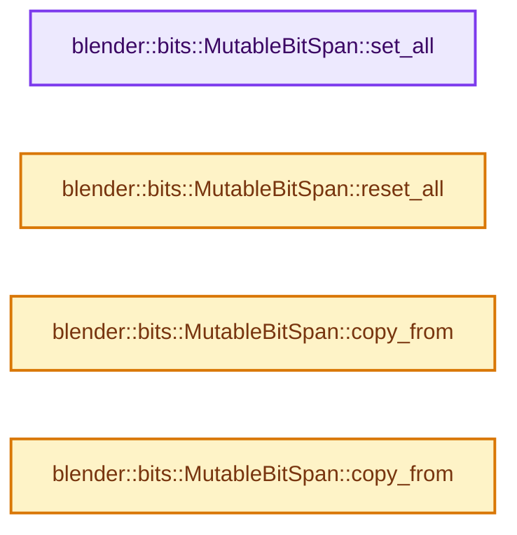
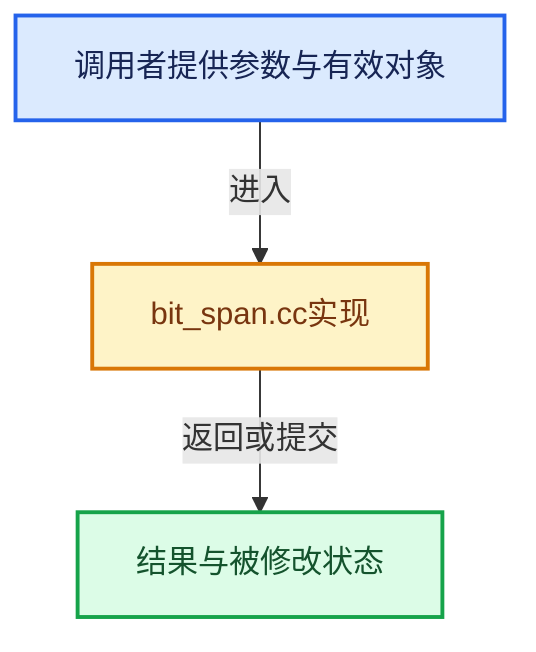

# 实现依赖专题：source/blender/blenlib/intern/bit_span.cc

[方向导航](README.md) · [符号索引](../%E7%AC%A6%E5%8F%B7%E4%BE%9D%E8%B5%96%E4%B8%8E%E5%AE%9E%E7%8E%B0%E7%B4%A2%E5%BC%95.md)

本专题从正文实际调用进入，集中保存共享实现。函数有稳定锚点，可从调用处直接跳到对应完整函数；递归与互相调用通过回链组织。

## 本文件的实现关系






## 完整成员与函数实现

<a id="f-3419fe1866a43f41"></a>

### `blender::bits::MutableBitSpan::set_all`

实现位置：[source/blender/blenlib/intern/bit_span.cc](../../../../../source/blender/blenlib/intern/bit_span.cc) · L16—L39。

**教学注释版**

<!-- annotated:9a7550fe545772 -->

```cpp
void MutableBitSpan::set_all()
{
  if (bit_range_.is_empty()) {
    return;
  }
  const AlignedIndexRanges ranges = split_index_range_by_alignment(bit_range_, BitsPerInt);
  {
    BitInt &first_int = *int_containing_bit(data_, bit_range_.start());
    const BitInt first_int_mask = mask_range_bits(ranges.prefix.start() & BitIndexMask,
                                                  ranges.prefix.size());
    first_int |= first_int_mask;
  }
  {
    BitInt *start = int_containing_bit(data_, ranges.aligned.start());
    const int64_t ints_to_fill = ranges.aligned.size() / BitsPerInt;
    constexpr BitInt fill_value = BitInt(-1);
    initialized_fill_n(start, ints_to_fill, fill_value);
  }
  {
    BitInt &last_int = *int_containing_bit(data_, bit_range_.one_after_last() - 1);
    const BitInt last_int_mask = mask_first_n_bits(ranges.suffix.size());
    last_int |= last_int_mask;
  }
}
```

<details>
<summary>核对原始源码：source/blender/blenlib/intern/bit_span.cc · L16—L39</summary>

<!-- original:9a7550fe545772:source/blender/blenlib/intern/bit_span.cc:16:39 -->

```cpp
void MutableBitSpan::set_all()
{
  if (bit_range_.is_empty()) {
    return;
  }
  const AlignedIndexRanges ranges = split_index_range_by_alignment(bit_range_, BitsPerInt);
  {
    BitInt &first_int = *int_containing_bit(data_, bit_range_.start());
    const BitInt first_int_mask = mask_range_bits(ranges.prefix.start() & BitIndexMask,
                                                  ranges.prefix.size());
    first_int |= first_int_mask;
  }
  {
    BitInt *start = int_containing_bit(data_, ranges.aligned.start());
    const int64_t ints_to_fill = ranges.aligned.size() / BitsPerInt;
    constexpr BitInt fill_value = BitInt(-1);
    initialized_fill_n(start, ints_to_fill, fill_value);
  }
  {
    BitInt &last_int = *int_containing_bit(data_, bit_range_.one_after_last() - 1);
    const BitInt last_int_mask = mask_first_n_bits(ranges.suffix.size());
    last_int |= last_int_mask;
  }
}
```

</details>

**沿实际写入检查状态**

- `first_int |= first_int_mask;`
- `last_int |= last_int_mask;`

**继续追踪实现**

- `bit_range_.is_empty` → [调用协议](../%E6%A8%A1%E6%9D%BF%E5%AE%8F%E4%B8%8E%E5%8A%A8%E6%80%81%E5%88%86%E6%B4%BE%E5%8D%8F%E8%AE%AE.md)：接收对象类型依赖auto、返回值或模板实例；不按同名猜测目标。调用位置L18。
- `split_index_range_by_alignment` → [blender::split_index_range_by_alignment · L16](%E4%BE%9D%E8%B5%96-index_range-982286.md#f-2d9a3529ce0f2331)。
- `int_containing_bit` → [blender::bits::int_containing_bit · L72](%E4%BE%9D%E8%B5%96-BLI_bit_ref-359167.md#f-dddfb68bb10f0356)；[blender::bits::int_containing_bit · L77](%E4%BE%9D%E8%B5%96-BLI_bit_ref-359167.md#f-6ea7b9235ac9dbab)。同名重载需按实参类型选择。
- `bit_range_.start` → [调用协议](../%E6%A8%A1%E6%9D%BF%E5%AE%8F%E4%B8%8E%E5%8A%A8%E6%80%81%E5%88%86%E6%B4%BE%E5%8D%8F%E8%AE%AE.md)：接收对象类型依赖auto、返回值或模板实例；不按同名猜测目标。调用位置L23。
- `mask_range_bits` → [blender::bits::mask_range_bits · L53](%E4%BE%9D%E8%B5%96-BLI_bit_ref-359167.md#f-ceb0021a5b4da156)。
- `ranges.prefix.start` → [调用协议](../%E6%A8%A1%E6%9D%BF%E5%AE%8F%E4%B8%8E%E5%8A%A8%E6%80%81%E5%88%86%E6%B4%BE%E5%8D%8F%E8%AE%AE.md)：接收对象类型依赖auto、返回值或模板实例；不按同名猜测目标。调用位置L24。
- `ranges.prefix.size` → [调用协议](../%E6%A8%A1%E6%9D%BF%E5%AE%8F%E4%B8%8E%E5%8A%A8%E6%80%81%E5%88%86%E6%B4%BE%E5%8D%8F%E8%AE%AE.md)：接收对象类型依赖auto、返回值或模板实例；不按同名猜测目标。调用位置L25。
- `ranges.aligned.start` → [调用协议](../%E6%A8%A1%E6%9D%BF%E5%AE%8F%E4%B8%8E%E5%8A%A8%E6%80%81%E5%88%86%E6%B4%BE%E5%8D%8F%E8%AE%AE.md)：接收对象类型依赖auto、返回值或模板实例；不按同名猜测目标。调用位置L29。
- `ranges.aligned.size` → [调用协议](../%E6%A8%A1%E6%9D%BF%E5%AE%8F%E4%B8%8E%E5%8A%A8%E6%80%81%E5%88%86%E6%B4%BE%E5%8D%8F%E8%AE%AE.md)：接收对象类型依赖auto、返回值或模板实例；不按同名猜测目标。调用位置L30。
- `BitInt` → [调用协议](../%E6%A8%A1%E6%9D%BF%E5%AE%8F%E4%B8%8E%E5%8A%A8%E6%80%81%E5%88%86%E6%B4%BE%E5%8D%8F%E8%AE%AE.md)：函数指针、局部可调用对象或未展开的宏；必须结合调用者环境。调用位置L31。
- `initialized_fill_n` → [blender::initialized_fill_n · L86](01-%E5%AF%B9%E8%B1%A1%E7%94%9F%E5%91%BD%E5%91%A8%E6%9C%9F%E4%B8%8E%E5%80%BC%E7%B1%BB%E5%88%AB.md#f-4af3bf5ccfdcee6c)。
- `bit_range_.one_after_last` → [调用协议](../%E6%A8%A1%E6%9D%BF%E5%AE%8F%E4%B8%8E%E5%8A%A8%E6%80%81%E5%88%86%E6%B4%BE%E5%8D%8F%E8%AE%AE.md)：接收对象类型依赖auto、返回值或模板实例；不按同名猜测目标。调用位置L35。
- `mask_first_n_bits` → [blender::bits::mask_first_n_bits · L38](%E4%BE%9D%E8%B5%96-BLI_bit_ref-359167.md#f-7c64d5504e3e9925)。
- `ranges.suffix.size` → [调用协议](../%E6%A8%A1%E6%9D%BF%E5%AE%8F%E4%B8%8E%E5%8A%A8%E6%80%81%E5%88%86%E6%B4%BE%E5%8D%8F%E8%AE%AE.md)：接收对象类型依赖auto、返回值或模板实例；不按同名猜测目标。调用位置L36。

<a id="f-db6f6242245cb907"></a>

### `blender::bits::MutableBitSpan::reset_all`

实现位置：[source/blender/blenlib/intern/bit_span.cc](../../../../../source/blender/blenlib/intern/bit_span.cc) · L41—L64。

**教学注释版**

<!-- annotated:18a161984666dd -->

```cpp
void MutableBitSpan::reset_all()
{
  if (bit_range_.is_empty()) {
    return;
  }
  const AlignedIndexRanges ranges = split_index_range_by_alignment(bit_range_, BitsPerInt);
  {
    BitInt &first_int = *int_containing_bit(data_, bit_range_.start());
    const BitInt first_int_mask = mask_range_bits(ranges.prefix.start() & BitIndexMask,
                                                  ranges.prefix.size());
    first_int &= ~first_int_mask;
  }
  {
    BitInt *start = int_containing_bit(data_, ranges.aligned.start());
    const int64_t ints_to_fill = ranges.aligned.size() / BitsPerInt;
    constexpr BitInt fill_value = 0;
    initialized_fill_n(start, ints_to_fill, fill_value);
  }
  {
    BitInt &last_int = *int_containing_bit(data_, bit_range_.one_after_last() - 1);
    const BitInt last_int_mask = mask_first_n_bits(ranges.suffix.size());
    last_int &= ~last_int_mask;
  }
}
```

<details>
<summary>核对原始源码：source/blender/blenlib/intern/bit_span.cc · L41—L64</summary>

<!-- original:18a161984666dd:source/blender/blenlib/intern/bit_span.cc:41:64 -->

```cpp
void MutableBitSpan::reset_all()
{
  if (bit_range_.is_empty()) {
    return;
  }
  const AlignedIndexRanges ranges = split_index_range_by_alignment(bit_range_, BitsPerInt);
  {
    BitInt &first_int = *int_containing_bit(data_, bit_range_.start());
    const BitInt first_int_mask = mask_range_bits(ranges.prefix.start() & BitIndexMask,
                                                  ranges.prefix.size());
    first_int &= ~first_int_mask;
  }
  {
    BitInt *start = int_containing_bit(data_, ranges.aligned.start());
    const int64_t ints_to_fill = ranges.aligned.size() / BitsPerInt;
    constexpr BitInt fill_value = 0;
    initialized_fill_n(start, ints_to_fill, fill_value);
  }
  {
    BitInt &last_int = *int_containing_bit(data_, bit_range_.one_after_last() - 1);
    const BitInt last_int_mask = mask_first_n_bits(ranges.suffix.size());
    last_int &= ~last_int_mask;
  }
}
```

</details>

**沿实际写入检查状态**

- `first_int &= ~first_int_mask;`
- `last_int &= ~last_int_mask;`

**继续追踪实现**

- `bit_range_.is_empty` → [调用协议](../%E6%A8%A1%E6%9D%BF%E5%AE%8F%E4%B8%8E%E5%8A%A8%E6%80%81%E5%88%86%E6%B4%BE%E5%8D%8F%E8%AE%AE.md)：接收对象类型依赖auto、返回值或模板实例；不按同名猜测目标。调用位置L43。
- `split_index_range_by_alignment` → [blender::split_index_range_by_alignment · L16](%E4%BE%9D%E8%B5%96-index_range-982286.md#f-2d9a3529ce0f2331)。
- `int_containing_bit` → [blender::bits::int_containing_bit · L72](%E4%BE%9D%E8%B5%96-BLI_bit_ref-359167.md#f-dddfb68bb10f0356)；[blender::bits::int_containing_bit · L77](%E4%BE%9D%E8%B5%96-BLI_bit_ref-359167.md#f-6ea7b9235ac9dbab)。同名重载需按实参类型选择。
- `bit_range_.start` → [调用协议](../%E6%A8%A1%E6%9D%BF%E5%AE%8F%E4%B8%8E%E5%8A%A8%E6%80%81%E5%88%86%E6%B4%BE%E5%8D%8F%E8%AE%AE.md)：接收对象类型依赖auto、返回值或模板实例；不按同名猜测目标。调用位置L48。
- `mask_range_bits` → [blender::bits::mask_range_bits · L53](%E4%BE%9D%E8%B5%96-BLI_bit_ref-359167.md#f-ceb0021a5b4da156)。
- `ranges.prefix.start` → [调用协议](../%E6%A8%A1%E6%9D%BF%E5%AE%8F%E4%B8%8E%E5%8A%A8%E6%80%81%E5%88%86%E6%B4%BE%E5%8D%8F%E8%AE%AE.md)：接收对象类型依赖auto、返回值或模板实例；不按同名猜测目标。调用位置L49。
- `ranges.prefix.size` → [调用协议](../%E6%A8%A1%E6%9D%BF%E5%AE%8F%E4%B8%8E%E5%8A%A8%E6%80%81%E5%88%86%E6%B4%BE%E5%8D%8F%E8%AE%AE.md)：接收对象类型依赖auto、返回值或模板实例；不按同名猜测目标。调用位置L50。
- `ranges.aligned.start` → [调用协议](../%E6%A8%A1%E6%9D%BF%E5%AE%8F%E4%B8%8E%E5%8A%A8%E6%80%81%E5%88%86%E6%B4%BE%E5%8D%8F%E8%AE%AE.md)：接收对象类型依赖auto、返回值或模板实例；不按同名猜测目标。调用位置L54。
- `ranges.aligned.size` → [调用协议](../%E6%A8%A1%E6%9D%BF%E5%AE%8F%E4%B8%8E%E5%8A%A8%E6%80%81%E5%88%86%E6%B4%BE%E5%8D%8F%E8%AE%AE.md)：接收对象类型依赖auto、返回值或模板实例；不按同名猜测目标。调用位置L55。
- `initialized_fill_n` → [blender::initialized_fill_n · L86](01-%E5%AF%B9%E8%B1%A1%E7%94%9F%E5%91%BD%E5%91%A8%E6%9C%9F%E4%B8%8E%E5%80%BC%E7%B1%BB%E5%88%AB.md#f-4af3bf5ccfdcee6c)。
- `bit_range_.one_after_last` → [调用协议](../%E6%A8%A1%E6%9D%BF%E5%AE%8F%E4%B8%8E%E5%8A%A8%E6%80%81%E5%88%86%E6%B4%BE%E5%8D%8F%E8%AE%AE.md)：接收对象类型依赖auto、返回值或模板实例；不按同名猜测目标。调用位置L60。
- `mask_first_n_bits` → [blender::bits::mask_first_n_bits · L38](%E4%BE%9D%E8%B5%96-BLI_bit_ref-359167.md#f-7c64d5504e3e9925)。
- `ranges.suffix.size` → [调用协议](../%E6%A8%A1%E6%9D%BF%E5%AE%8F%E4%B8%8E%E5%8A%A8%E6%80%81%E5%88%86%E6%B4%BE%E5%8D%8F%E8%AE%AE.md)：接收对象类型依赖auto、返回值或模板实例；不按同名猜测目标。调用位置L61。

<a id="f-4db1555ea817e479"></a>

### `blender::bits::MutableBitSpan::copy_from`

实现位置：[source/blender/blenlib/intern/bit_span.cc](../../../../../source/blender/blenlib/intern/bit_span.cc) · L66—L70。

接口参数：

- `const BitSpan other`

**教学注释版**

<!-- annotated:83a98f9875d8ba -->

```cpp
void MutableBitSpan::copy_from(const BitSpan other)
{
  BLI_assert(this->size() == other.size());
  copy_from_or(*this, other);
}
```

<details>
<summary>核对原始源码：source/blender/blenlib/intern/bit_span.cc · L66—L70</summary>

<!-- original:83a98f9875d8ba:source/blender/blenlib/intern/bit_span.cc:66:70 -->

```cpp
void MutableBitSpan::copy_from(const BitSpan other)
{
  BLI_assert(this->size() == other.size());
  copy_from_or(*this, other);
}
```

</details>

**继续追踪实现**

- `BLI_assert` → [BLI_assert · L48](%E4%BE%9D%E8%B5%96-BLI_assert-cc98e8.md#m-57a88495704d)；[BLI_assert · L63](%E4%BE%9D%E8%B5%96-BLI_assert-cc98e8.md#m-d07050020cb5)。宏定义由构建条件选择。
- `this->size` → [blender::bits::MutableBitSpan::size · L303](19-BitSpan%E4%B8%8EBitVector.md#f-9ffa8a62bb4f9736)。
- `other.size` → [blender::bits::BitSpan::size · L151](19-BitSpan%E4%B8%8EBitVector.md#f-619593bac6a150f5)。
- `copy_from_or` → [blender::bits::copy_from_or · L262](%E4%BE%9D%E8%B5%96-BLI_bit_span_ops-63a2e2.md#f-03881077569ddab8)。

<a id="f-a4a9e178cb3c407f"></a>

### `blender::bits::MutableBitSpan::copy_from`

实现位置：[source/blender/blenlib/intern/bit_span.cc](../../../../../source/blender/blenlib/intern/bit_span.cc) · L72—L76。

接口参数：

- `const BoundedBitSpan other`

**教学注释版**

<!-- annotated:b1aa55b046de49 -->

```cpp
void MutableBitSpan::copy_from(const BoundedBitSpan other)
{
  BLI_assert(this->size() == other.size());
  copy_from_or(*this, other);
}
```

<details>
<summary>核对原始源码：source/blender/blenlib/intern/bit_span.cc · L72—L76</summary>

<!-- original:b1aa55b046de49:source/blender/blenlib/intern/bit_span.cc:72:76 -->

```cpp
void MutableBitSpan::copy_from(const BoundedBitSpan other)
{
  BLI_assert(this->size() == other.size());
  copy_from_or(*this, other);
}
```

</details>

**继续追踪实现**

- `BLI_assert` → [BLI_assert · L48](%E4%BE%9D%E8%B5%96-BLI_assert-cc98e8.md#m-57a88495704d)；[BLI_assert · L63](%E4%BE%9D%E8%B5%96-BLI_assert-cc98e8.md#m-d07050020cb5)。宏定义由构建条件选择。
- `this->size` → [blender::bits::MutableBitSpan::size · L303](19-BitSpan%E4%B8%8EBitVector.md#f-9ffa8a62bb4f9736)。
- `other.size` → [调用协议](../%E6%A8%A1%E6%9D%BF%E5%AE%8F%E4%B8%8E%E5%8A%A8%E6%80%81%E5%88%86%E6%B4%BE%E5%8D%8F%E8%AE%AE.md)：由接收对象具体类型或运行时策略提供实现。调用位置L74。
- `copy_from_or` → [blender::bits::copy_from_or · L262](%E4%BE%9D%E8%B5%96-BLI_bit_span_ops-63a2e2.md#f-03881077569ddab8)。
