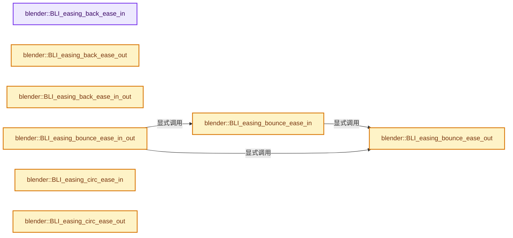
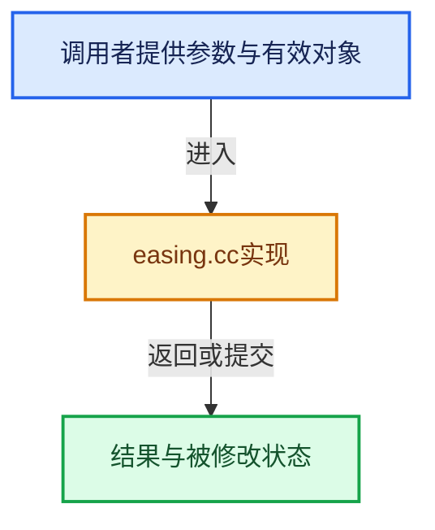

# 实现依赖专题：source/blender/blenlib/intern/easing.cc

[方向导航](README.md) · [符号索引](../%E7%AC%A6%E5%8F%B7%E4%BE%9D%E8%B5%96%E4%B8%8E%E5%AE%9E%E7%8E%B0%E7%B4%A2%E5%BC%95.md)

本专题从正文实际调用进入，集中保存共享实现。函数有稳定锚点，可从调用处直接跳到对应完整函数；递归与互相调用通过回链组织。

## 本文件的实现关系






## 完整成员与函数实现

<a id="f-28127cab1ca8d674"></a>

### `blender::BLI_easing_back_ease_in`

实现位置：[source/blender/blenlib/intern/easing.cc](../../../../../source/blender/blenlib/intern/easing.cc) · L20—L25。

接口参数：

- `float time`
- `float begin`
- `float change`
- `float duration`
- `float overshoot`

**教学注释版**

<!-- annotated:e04901a8accdd7 -->

```cpp
float BLI_easing_back_ease_in(
    float time, float begin, float change, float duration, float overshoot)
{
  time /= duration;
  return change * time * time * ((overshoot + 1) * time - overshoot) + begin;
}
```

<details>
<summary>核对原始源码：source/blender/blenlib/intern/easing.cc · L20—L25</summary>

<!-- original:e04901a8accdd7:source/blender/blenlib/intern/easing.cc:20:25 -->

```cpp
float BLI_easing_back_ease_in(
    float time, float begin, float change, float duration, float overshoot)
{
  time /= duration;
  return change * time * time * ((overshoot + 1) * time - overshoot) + begin;
}
```

</details>

**结果出口**

- `return change * time * time * ((overshoot + 1) * time - overshoot) + begin;`

**继续追踪实现**

本实现没有需要继续展开的显式调用；检查返回表达式、对象转换和调用者前置条件。

<a id="f-47e4bb1a6a4b8748"></a>

### `blender::BLI_easing_back_ease_out`

实现位置：[source/blender/blenlib/intern/easing.cc](../../../../../source/blender/blenlib/intern/easing.cc) · L27—L32。

接口参数：

- `float time`
- `float begin`
- `float change`
- `float duration`
- `float overshoot`

**教学注释版**

<!-- annotated:94c98ad97a51c2 -->

```cpp
float BLI_easing_back_ease_out(
    float time, float begin, float change, float duration, float overshoot)
{
  time = time / duration - 1;
  return change * (time * time * ((overshoot + 1) * time + overshoot) + 1) + begin;
}
```

<details>
<summary>核对原始源码：source/blender/blenlib/intern/easing.cc · L27—L32</summary>

<!-- original:94c98ad97a51c2:source/blender/blenlib/intern/easing.cc:27:32 -->

```cpp
float BLI_easing_back_ease_out(
    float time, float begin, float change, float duration, float overshoot)
{
  time = time / duration - 1;
  return change * (time * time * ((overshoot + 1) * time + overshoot) + 1) + begin;
}
```

</details>

**沿实际写入检查状态**

- `time = time / duration - 1;`

**结果出口**

- `return change * (time * time * ((overshoot + 1) * time + overshoot) + 1) + begin;`

**继续追踪实现**

本实现没有需要继续展开的显式调用；检查返回表达式、对象转换和调用者前置条件。

<a id="f-c8c0e1d059a63bef"></a>

### `blender::BLI_easing_back_ease_in_out`

实现位置：[source/blender/blenlib/intern/easing.cc](../../../../../source/blender/blenlib/intern/easing.cc) · L34—L43。

接口参数：

- `float time`
- `float begin`
- `float change`
- `float duration`
- `float overshoot`

**教学注释版**

<!-- annotated:198f441bde17a7 -->

```cpp
float BLI_easing_back_ease_in_out(
    float time, float begin, float change, float duration, float overshoot)
{
  overshoot *= 1.525f;
  if ((time /= duration / 2) < 1.0f) {
    return change / 2 * (time * time * ((overshoot + 1) * time - overshoot)) + begin;
  }
  time -= 2.0f;
  return change / 2 * (time * time * ((overshoot + 1) * time + overshoot) + 2) + begin;
}
```

<details>
<summary>核对原始源码：source/blender/blenlib/intern/easing.cc · L34—L43</summary>

<!-- original:198f441bde17a7:source/blender/blenlib/intern/easing.cc:34:43 -->

```cpp
float BLI_easing_back_ease_in_out(
    float time, float begin, float change, float duration, float overshoot)
{
  overshoot *= 1.525f;
  if ((time /= duration / 2) < 1.0f) {
    return change / 2 * (time * time * ((overshoot + 1) * time - overshoot)) + begin;
  }
  time -= 2.0f;
  return change / 2 * (time * time * ((overshoot + 1) * time + overshoot) + 2) + begin;
}
```

</details>

**沿实际写入检查状态**

- `overshoot *= 1.525f;`
- `time -= 2.0f;`

**结果出口**

- `return change / 2 * (time * time * ((overshoot + 1) * time - overshoot)) + begin;`
- `return change / 2 * (time * time * ((overshoot + 1) * time + overshoot) + 2) + begin;`

**继续追踪实现**

本实现没有需要继续展开的显式调用；检查返回表达式、对象转换和调用者前置条件。

<a id="f-bacdba7df4fb8745"></a>

### `blender::BLI_easing_bounce_ease_out`

实现位置：[source/blender/blenlib/intern/easing.cc](../../../../../source/blender/blenlib/intern/easing.cc) · L45—L61。

接口参数：

- `float time`
- `float begin`
- `float change`
- `float duration`

**教学注释版**

<!-- annotated:2d6d3720a5149a -->

```cpp
float BLI_easing_bounce_ease_out(float time, float begin, float change, float duration)
{
  time /= duration;
  if (time < (1 / 2.75f)) {
    return change * (7.5625f * time * time) + begin;
  }
  if (time < (2 / 2.75f)) {
    time -= (1.5f / 2.75f);
    return change * ((7.5625f * time) * time + 0.75f) + begin;
  }
  if (time < (2.5f / 2.75f)) {
    time -= (2.25f / 2.75f);
    return change * ((7.5625f * time) * time + 0.9375f) + begin;
  }
  time -= (2.625f / 2.75f);
  return change * ((7.5625f * time) * time + 0.984375f) + begin;
}
```

<details>
<summary>核对原始源码：source/blender/blenlib/intern/easing.cc · L45—L61</summary>

<!-- original:2d6d3720a5149a:source/blender/blenlib/intern/easing.cc:45:61 -->

```cpp
float BLI_easing_bounce_ease_out(float time, float begin, float change, float duration)
{
  time /= duration;
  if (time < (1 / 2.75f)) {
    return change * (7.5625f * time * time) + begin;
  }
  if (time < (2 / 2.75f)) {
    time -= (1.5f / 2.75f);
    return change * ((7.5625f * time) * time + 0.75f) + begin;
  }
  if (time < (2.5f / 2.75f)) {
    time -= (2.25f / 2.75f);
    return change * ((7.5625f * time) * time + 0.9375f) + begin;
  }
  time -= (2.625f / 2.75f);
  return change * ((7.5625f * time) * time + 0.984375f) + begin;
}
```

</details>

**沿实际写入检查状态**

- `time -= (1.5f / 2.75f);`
- `time -= (2.25f / 2.75f);`
- `time -= (2.625f / 2.75f);`

**结果出口**

- `return change * (7.5625f * time * time) + begin;`
- `return change * ((7.5625f * time) * time + 0.75f) + begin;`
- `return change * ((7.5625f * time) * time + 0.9375f) + begin;`
- `return change * ((7.5625f * time) * time + 0.984375f) + begin;`

**继续追踪实现**

本实现没有需要继续展开的显式调用；检查返回表达式、对象转换和调用者前置条件。

<a id="f-cb5ab50da67bfc6b"></a>

### `blender::BLI_easing_bounce_ease_in`

实现位置：[source/blender/blenlib/intern/easing.cc](../../../../../source/blender/blenlib/intern/easing.cc) · L63—L66。

接口参数：

- `float time`
- `float begin`
- `float change`
- `float duration`

**教学注释版**

<!-- annotated:e920dbde07dd4e -->

```cpp
float BLI_easing_bounce_ease_in(float time, float begin, float change, float duration)
{
  return change - BLI_easing_bounce_ease_out(duration - time, 0, change, duration) + begin;
}
```

<details>
<summary>核对原始源码：source/blender/blenlib/intern/easing.cc · L63—L66</summary>

<!-- original:e920dbde07dd4e:source/blender/blenlib/intern/easing.cc:63:66 -->

```cpp
float BLI_easing_bounce_ease_in(float time, float begin, float change, float duration)
{
  return change - BLI_easing_bounce_ease_out(duration - time, 0, change, duration) + begin;
}
```

</details>

**结果出口**

- `return change - BLI_easing_bounce_ease_out(duration - time, 0, change, duration) + begin;`

**继续追踪实现**

- `BLI_easing_bounce_ease_out` → [blender::BLI_easing_bounce_ease_out · L45](%E4%BE%9D%E8%B5%96-easing-90b817.md#f-bacdba7df4fb8745)。

<a id="f-324970010eadc540"></a>

### `blender::BLI_easing_bounce_ease_in_out`

实现位置：[source/blender/blenlib/intern/easing.cc](../../../../../source/blender/blenlib/intern/easing.cc) · L68—L75。

接口参数：

- `float time`
- `float begin`
- `float change`
- `float duration`

**教学注释版**

<!-- annotated:bb2d9820ecfa18 -->

```cpp
float BLI_easing_bounce_ease_in_out(float time, float begin, float change, float duration)
{
  if (time < duration / 2) {
    return BLI_easing_bounce_ease_in(time * 2, 0, change, duration) * 0.5f + begin;
  }
  return BLI_easing_bounce_ease_out(time * 2 - duration, 0, change, duration) * 0.5f +
         change * 0.5f + begin;
}
```

<details>
<summary>核对原始源码：source/blender/blenlib/intern/easing.cc · L68—L75</summary>

<!-- original:bb2d9820ecfa18:source/blender/blenlib/intern/easing.cc:68:75 -->

```cpp
float BLI_easing_bounce_ease_in_out(float time, float begin, float change, float duration)
{
  if (time < duration / 2) {
    return BLI_easing_bounce_ease_in(time * 2, 0, change, duration) * 0.5f + begin;
  }
  return BLI_easing_bounce_ease_out(time * 2 - duration, 0, change, duration) * 0.5f +
         change * 0.5f + begin;
}
```

</details>

**结果出口**

- `return BLI_easing_bounce_ease_in(time * 2, 0, change, duration) * 0.5f + begin;`
- `return BLI_easing_bounce_ease_out(time * 2 - duration, 0, change, duration) * 0.5f +`

**继续追踪实现**

- `BLI_easing_bounce_ease_in` → [blender::BLI_easing_bounce_ease_in · L63](%E4%BE%9D%E8%B5%96-easing-90b817.md#f-cb5ab50da67bfc6b)。
- `BLI_easing_bounce_ease_out` → [blender::BLI_easing_bounce_ease_out · L45](%E4%BE%9D%E8%B5%96-easing-90b817.md#f-bacdba7df4fb8745)。

<a id="f-42128ad5f9eb399e"></a>

### `blender::BLI_easing_circ_ease_in`

实现位置：[source/blender/blenlib/intern/easing.cc](../../../../../source/blender/blenlib/intern/easing.cc) · L77—L81。

接口参数：

- `float time`
- `float begin`
- `float change`
- `float duration`

**教学注释版**

<!-- annotated:5b85bc8501081b -->

```cpp
float BLI_easing_circ_ease_in(float time, float begin, float change, float duration)
{
  time /= duration;
  return -change * (sqrtf(1 - time * time) - 1) + begin;
}
```

<details>
<summary>核对原始源码：source/blender/blenlib/intern/easing.cc · L77—L81</summary>

<!-- original:5b85bc8501081b:source/blender/blenlib/intern/easing.cc:77:81 -->

```cpp
float BLI_easing_circ_ease_in(float time, float begin, float change, float duration)
{
  time /= duration;
  return -change * (sqrtf(1 - time * time) - 1) + begin;
}
```

</details>

**结果出口**

- `return -change * (sqrtf(1 - time * time) - 1) + begin;`

**继续追踪实现**

- `sqrtf` → [外部契约](https://eel.is/c++draft/)：这个边界按实际表达式及所属类型核对参数、返回值、寿命与失败行为。这里提供接口入口，不声称已解释该第三方版本的内部实现。

<a id="f-3d75ace5877f1342"></a>

### `blender::BLI_easing_circ_ease_out`

实现位置：[source/blender/blenlib/intern/easing.cc](../../../../../source/blender/blenlib/intern/easing.cc) · L83—L87。

接口参数：

- `float time`
- `float begin`
- `float change`
- `float duration`

**教学注释版**

<!-- annotated:0764e68a21f37c -->

```cpp
float BLI_easing_circ_ease_out(float time, float begin, float change, float duration)
{
  time = time / duration - 1;
  return change * sqrtf(1 - time * time) + begin;
}
```

<details>
<summary>核对原始源码：source/blender/blenlib/intern/easing.cc · L83—L87</summary>

<!-- original:0764e68a21f37c:source/blender/blenlib/intern/easing.cc:83:87 -->

```cpp
float BLI_easing_circ_ease_out(float time, float begin, float change, float duration)
{
  time = time / duration - 1;
  return change * sqrtf(1 - time * time) + begin;
}
```

</details>

**沿实际写入检查状态**

- `time = time / duration - 1;`

**结果出口**

- `return change * sqrtf(1 - time * time) + begin;`

**继续追踪实现**

- `sqrtf` → [外部契约](https://eel.is/c++draft/)：这个边界按实际表达式及所属类型核对参数、返回值、寿命与失败行为。这里提供接口入口，不声称已解释该第三方版本的内部实现。

<a id="f-f20d22436d3accf8"></a>

### `blender::BLI_easing_circ_ease_in_out`

实现位置：[source/blender/blenlib/intern/easing.cc](../../../../../source/blender/blenlib/intern/easing.cc) · L89—L96。

接口参数：

- `float time`
- `float begin`
- `float change`
- `float duration`

**教学注释版**

<!-- annotated:825e74dfc09e79 -->

```cpp
float BLI_easing_circ_ease_in_out(float time, float begin, float change, float duration)
{
  if ((time /= duration / 2) < 1.0f) {
    return -change / 2 * (sqrtf(1 - time * time) - 1) + begin;
  }
  time -= 2.0f;
  return change / 2 * (sqrtf(1 - time * time) + 1) + begin;
}
```

<details>
<summary>核对原始源码：source/blender/blenlib/intern/easing.cc · L89—L96</summary>

<!-- original:825e74dfc09e79:source/blender/blenlib/intern/easing.cc:89:96 -->

```cpp
float BLI_easing_circ_ease_in_out(float time, float begin, float change, float duration)
{
  if ((time /= duration / 2) < 1.0f) {
    return -change / 2 * (sqrtf(1 - time * time) - 1) + begin;
  }
  time -= 2.0f;
  return change / 2 * (sqrtf(1 - time * time) + 1) + begin;
}
```

</details>

**沿实际写入检查状态**

- `time -= 2.0f;`

**结果出口**

- `return -change / 2 * (sqrtf(1 - time * time) - 1) + begin;`
- `return change / 2 * (sqrtf(1 - time * time) + 1) + begin;`

**继续追踪实现**

- `sqrtf` → [外部契约](https://eel.is/c++draft/)：这个边界按实际表达式及所属类型核对参数、返回值、寿命与失败行为。这里提供接口入口，不声称已解释该第三方版本的内部实现。

<a id="f-12fb5ac6817bbf7a"></a>

### `blender::BLI_easing_cubic_ease_in`

实现位置：[source/blender/blenlib/intern/easing.cc](../../../../../source/blender/blenlib/intern/easing.cc) · L98—L102。

接口参数：

- `float time`
- `float begin`
- `float change`
- `float duration`

**教学注释版**

<!-- annotated:6928b4d914e5c1 -->

```cpp
float BLI_easing_cubic_ease_in(float time, float begin, float change, float duration)
{
  time /= duration;
  return change * time * time * time + begin;
}
```

<details>
<summary>核对原始源码：source/blender/blenlib/intern/easing.cc · L98—L102</summary>

<!-- original:6928b4d914e5c1:source/blender/blenlib/intern/easing.cc:98:102 -->

```cpp
float BLI_easing_cubic_ease_in(float time, float begin, float change, float duration)
{
  time /= duration;
  return change * time * time * time + begin;
}
```

</details>

**结果出口**

- `return change * time * time * time + begin;`

**继续追踪实现**

本实现没有需要继续展开的显式调用；检查返回表达式、对象转换和调用者前置条件。

<a id="f-0c147a037ee2cb51"></a>

### `blender::BLI_easing_cubic_ease_out`

实现位置：[source/blender/blenlib/intern/easing.cc](../../../../../source/blender/blenlib/intern/easing.cc) · L104—L108。

接口参数：

- `float time`
- `float begin`
- `float change`
- `float duration`

**教学注释版**

<!-- annotated:7f82d94bc0f3bf -->

```cpp
float BLI_easing_cubic_ease_out(float time, float begin, float change, float duration)
{
  time = time / duration - 1;
  return change * (time * time * time + 1) + begin;
}
```

<details>
<summary>核对原始源码：source/blender/blenlib/intern/easing.cc · L104—L108</summary>

<!-- original:7f82d94bc0f3bf:source/blender/blenlib/intern/easing.cc:104:108 -->

```cpp
float BLI_easing_cubic_ease_out(float time, float begin, float change, float duration)
{
  time = time / duration - 1;
  return change * (time * time * time + 1) + begin;
}
```

</details>

**沿实际写入检查状态**

- `time = time / duration - 1;`

**结果出口**

- `return change * (time * time * time + 1) + begin;`

**继续追踪实现**

本实现没有需要继续展开的显式调用；检查返回表达式、对象转换和调用者前置条件。

<a id="f-de3022122ebf1044"></a>

### `blender::BLI_easing_cubic_ease_in_out`

实现位置：[source/blender/blenlib/intern/easing.cc](../../../../../source/blender/blenlib/intern/easing.cc) · L110—L117。

接口参数：

- `float time`
- `float begin`
- `float change`
- `float duration`

**教学注释版**

<!-- annotated:a5ab245ff3a51f -->

```cpp
float BLI_easing_cubic_ease_in_out(float time, float begin, float change, float duration)
{
  if ((time /= duration / 2) < 1.0f) {
    return change / 2 * time * time * time + begin;
  }
  time -= 2.0f;
  return change / 2 * (time * time * time + 2) + begin;
}
```

<details>
<summary>核对原始源码：source/blender/blenlib/intern/easing.cc · L110—L117</summary>

<!-- original:a5ab245ff3a51f:source/blender/blenlib/intern/easing.cc:110:117 -->

```cpp
float BLI_easing_cubic_ease_in_out(float time, float begin, float change, float duration)
{
  if ((time /= duration / 2) < 1.0f) {
    return change / 2 * time * time * time + begin;
  }
  time -= 2.0f;
  return change / 2 * (time * time * time + 2) + begin;
}
```

</details>

**沿实际写入检查状态**

- `time -= 2.0f;`

**结果出口**

- `return change / 2 * time * time * time + begin;`
- `return change / 2 * (time * time * time + 2) + begin;`

**继续追踪实现**

本实现没有需要继续展开的显式调用；检查返回表达式、对象转换和调用者前置条件。

<a id="f-7d701e553b960938"></a>

### `blender::elastic_blend`

实现位置：[source/blender/blenlib/intern/easing.cc](../../../../../source/blender/blenlib/intern/easing.cc) · L124—L145。

接口参数：

- `float time`
- `float change`
- `float duration`
- `float amplitude`
- `float s`
- `float f`

**教学注释版**

<!-- annotated:9ba8b7b7d9ca5b -->

```cpp
static float elastic_blend(
    float time, float change, float duration, float amplitude, float s, float f)
{
  if (change) {
    /* Looks like a magic number,
     * but this is a part of the sine curve we need to blend from */
    const float t = fabsf(s);
    if (amplitude) {
      f *= amplitude / fabsf(change);
    }
    else {
      f = 0.0f;
    }

    if (fabsf(time * duration) < t) {
      float l = fabsf(time * duration) / t;
      f = (f * l) + (1.0f - l);
    }
  }

  return f;
}
```

<details>
<summary>核对原始源码：source/blender/blenlib/intern/easing.cc · L124—L145</summary>

<!-- original:9ba8b7b7d9ca5b:source/blender/blenlib/intern/easing.cc:124:145 -->

```cpp
static float elastic_blend(
    float time, float change, float duration, float amplitude, float s, float f)
{
  if (change) {
    /* Looks like a magic number,
     * but this is a part of the sine curve we need to blend from */
    const float t = fabsf(s);
    if (amplitude) {
      f *= amplitude / fabsf(change);
    }
    else {
      f = 0.0f;
    }

    if (fabsf(time * duration) < t) {
      float l = fabsf(time * duration) / t;
      f = (f * l) + (1.0f - l);
    }
  }

  return f;
}
```

</details>

**沿实际写入检查状态**

- `f *= amplitude / fabsf(change);`
- `f = 0.0f;`
- `f = (f * l) + (1.0f - l);`

**结果出口**

- `return f;`

**继续追踪实现**

- `fabsf` → [fabsf · L21](../05-%E5%87%A0%E4%BD%95%E5%AD%98%E5%82%A8%E4%B8%8E%E6%8B%93%E6%89%91%E6%98%A0%E5%B0%84/%E4%BE%9D%E8%B5%96-radial_tiling_shared-98abf9.md#m-02cc4c69cfb3)；[fabsf · L43](../05-%E5%87%A0%E4%BD%95%E5%AD%98%E5%82%A8%E4%B8%8E%E6%8B%93%E6%89%91%E6%98%A0%E5%B0%84/%E4%BE%9D%E8%B5%96-radial_tiling_shared-98abf9.md#m-04effe61803b)；[fabsf · L74](../05-%E5%87%A0%E4%BD%95%E5%AD%98%E5%82%A8%E4%B8%8E%E6%8B%93%E6%89%91%E6%98%A0%E5%B0%84/%E4%BE%9D%E8%B5%96-radial_tiling_shared-98abf9.md#m-927dd4eba7dc)；[fabsf · L25](%E4%BE%9D%E8%B5%96-radial_tiling_shared-7989a4.md#m-8348d6b3d08f)；[fabsf · L47](%E4%BE%9D%E8%B5%96-radial_tiling_shared-7989a4.md#m-13b7e0b6d84f)；[fabsf · L78](%E4%BE%9D%E8%B5%96-radial_tiling_shared-7989a4.md#m-326c83464a0d)；[fabsf · L21](../05-%E5%87%A0%E4%BD%95%E5%AD%98%E5%82%A8%E4%B8%8E%E6%8B%93%E6%89%91%E6%98%A0%E5%B0%84/%E4%BE%9D%E8%B5%96-node_radial_tiling_shared-b14bc2.md#m-7c3ee12fc119)；[fabsf · L43](../05-%E5%87%A0%E4%BD%95%E5%AD%98%E5%82%A8%E4%B8%8E%E6%8B%93%E6%89%91%E6%98%A0%E5%B0%84/%E4%BE%9D%E8%B5%96-node_radial_tiling_shared-b14bc2.md#m-9112db0e2dd1)；[fabsf · L74](../05-%E5%87%A0%E4%BD%95%E5%AD%98%E5%82%A8%E4%B8%8E%E6%8B%93%E6%89%91%E6%98%A0%E5%B0%84/%E4%BE%9D%E8%B5%96-node_radial_tiling_shared-b14bc2.md#m-ee4e61908a6f)；[fabsf · L167](../05-%E5%87%A0%E4%BD%95%E5%AD%98%E5%82%A8%E4%B8%8E%E6%8B%93%E6%89%91%E6%98%A0%E5%B0%84/%E4%BE%9D%E8%B5%96-compat-56205c.md#m-b039ee6c1601)；[fabsf · L265](../05-%E5%87%A0%E4%BD%95%E5%AD%98%E5%82%A8%E4%B8%8E%E6%8B%93%E6%89%91%E6%98%A0%E5%B0%84/%E4%BE%9D%E8%B5%96-compat-efe0e9.md#m-6b21869e9f3f)。宏定义由构建条件选择。

<a id="f-b40bf94a03ff2113"></a>

### `blender::BLI_easing_elastic_ease_in`

实现位置：[source/blender/blenlib/intern/easing.cc](../../../../../source/blender/blenlib/intern/easing.cc) · L148—L179。

接口参数：

- `float time`
- `float begin`
- `float change`
- `float duration`
- `float amplitude`
- `float period`

**教学注释版**

<!-- annotated:aa0ed5b1c5b1ce -->

```cpp
float BLI_easing_elastic_ease_in(
    float time, float begin, float change, float duration, float amplitude, float period)
{
  float s;
  float f = 1.0f;

  if (time == 0.0f) {
    return begin;
  }

  if ((time /= duration) == 1.0f) {
    return begin + change;
  }
  time -= 1.0f;
  if (!period) {
    period = duration * 0.3f;
  }
  if (!amplitude || amplitude < fabsf(change)) {
    s = period / 4;
#ifdef USE_ELASTIC_BLEND
    f = elastic_blend(time, change, duration, amplitude, s, f);
#endif
    amplitude = change;
  }
  else {
    s = period / (2 * float(M_PI)) * asinf(change / amplitude);
  }

  return (-f * (amplitude * powf(2, 10 * time) *
                sinf((time * duration - s) * (2 * float(M_PI)) / period))) +
         begin;
}
```

<details>
<summary>核对原始源码：source/blender/blenlib/intern/easing.cc · L148—L179</summary>

<!-- original:aa0ed5b1c5b1ce:source/blender/blenlib/intern/easing.cc:148:179 -->

```cpp
float BLI_easing_elastic_ease_in(
    float time, float begin, float change, float duration, float amplitude, float period)
{
  float s;
  float f = 1.0f;

  if (time == 0.0f) {
    return begin;
  }

  if ((time /= duration) == 1.0f) {
    return begin + change;
  }
  time -= 1.0f;
  if (!period) {
    period = duration * 0.3f;
  }
  if (!amplitude || amplitude < fabsf(change)) {
    s = period / 4;
#ifdef USE_ELASTIC_BLEND
    f = elastic_blend(time, change, duration, amplitude, s, f);
#endif
    amplitude = change;
  }
  else {
    s = period / (2 * float(M_PI)) * asinf(change / amplitude);
  }

  return (-f * (amplitude * powf(2, 10 * time) *
                sinf((time * duration - s) * (2 * float(M_PI)) / period))) +
         begin;
}
```

</details>

**沿实际写入检查状态**

- `time -= 1.0f;`
- `period = duration * 0.3f;`
- `s = period / 4;`
- `f = elastic_blend(time, change, duration, amplitude, s, f);`
- `amplitude = change;`
- `s = period / (2 * float(M_PI)) * asinf(change / amplitude);`

**结果出口**

- `return begin;`
- `return begin + change;`
- `return (-f * (amplitude * powf(2, 10 * time) *`

**继续追踪实现**

- `fabsf` → [fabsf · L21](../05-%E5%87%A0%E4%BD%95%E5%AD%98%E5%82%A8%E4%B8%8E%E6%8B%93%E6%89%91%E6%98%A0%E5%B0%84/%E4%BE%9D%E8%B5%96-radial_tiling_shared-98abf9.md#m-02cc4c69cfb3)；[fabsf · L43](../05-%E5%87%A0%E4%BD%95%E5%AD%98%E5%82%A8%E4%B8%8E%E6%8B%93%E6%89%91%E6%98%A0%E5%B0%84/%E4%BE%9D%E8%B5%96-radial_tiling_shared-98abf9.md#m-04effe61803b)；[fabsf · L74](../05-%E5%87%A0%E4%BD%95%E5%AD%98%E5%82%A8%E4%B8%8E%E6%8B%93%E6%89%91%E6%98%A0%E5%B0%84/%E4%BE%9D%E8%B5%96-radial_tiling_shared-98abf9.md#m-927dd4eba7dc)；[fabsf · L25](%E4%BE%9D%E8%B5%96-radial_tiling_shared-7989a4.md#m-8348d6b3d08f)；[fabsf · L47](%E4%BE%9D%E8%B5%96-radial_tiling_shared-7989a4.md#m-13b7e0b6d84f)；[fabsf · L78](%E4%BE%9D%E8%B5%96-radial_tiling_shared-7989a4.md#m-326c83464a0d)；[fabsf · L21](../05-%E5%87%A0%E4%BD%95%E5%AD%98%E5%82%A8%E4%B8%8E%E6%8B%93%E6%89%91%E6%98%A0%E5%B0%84/%E4%BE%9D%E8%B5%96-node_radial_tiling_shared-b14bc2.md#m-7c3ee12fc119)；[fabsf · L43](../05-%E5%87%A0%E4%BD%95%E5%AD%98%E5%82%A8%E4%B8%8E%E6%8B%93%E6%89%91%E6%98%A0%E5%B0%84/%E4%BE%9D%E8%B5%96-node_radial_tiling_shared-b14bc2.md#m-9112db0e2dd1)；[fabsf · L74](../05-%E5%87%A0%E4%BD%95%E5%AD%98%E5%82%A8%E4%B8%8E%E6%8B%93%E6%89%91%E6%98%A0%E5%B0%84/%E4%BE%9D%E8%B5%96-node_radial_tiling_shared-b14bc2.md#m-ee4e61908a6f)；[fabsf · L167](../05-%E5%87%A0%E4%BD%95%E5%AD%98%E5%82%A8%E4%B8%8E%E6%8B%93%E6%89%91%E6%98%A0%E5%B0%84/%E4%BE%9D%E8%B5%96-compat-56205c.md#m-b039ee6c1601)；[fabsf · L265](../05-%E5%87%A0%E4%BD%95%E5%AD%98%E5%82%A8%E4%B8%8E%E6%8B%93%E6%89%91%E6%98%A0%E5%B0%84/%E4%BE%9D%E8%B5%96-compat-efe0e9.md#m-6b21869e9f3f)。宏定义由构建条件选择。
- `elastic_blend` → [blender::elastic_blend · L124](%E4%BE%9D%E8%B5%96-easing-90b817.md#f-7d701e553b960938)。
- `asinf` → [asinf · L169](../05-%E5%87%A0%E4%BD%95%E5%AD%98%E5%82%A8%E4%B8%8E%E6%8B%93%E6%89%91%E6%98%A0%E5%B0%84/%E4%BE%9D%E8%B5%96-compat-56205c.md#m-dd90417fae94)；[asinf · L267](../05-%E5%87%A0%E4%BD%95%E5%AD%98%E5%82%A8%E4%B8%8E%E6%8B%93%E6%89%91%E6%98%A0%E5%B0%84/%E4%BE%9D%E8%B5%96-compat-efe0e9.md#m-e1a6a02d64f4)；[asinf · L47](../05-%E5%87%A0%E4%BD%95%E5%AD%98%E5%82%A8%E4%B8%8E%E6%8B%93%E6%89%91%E6%98%A0%E5%B0%84/%E4%BE%9D%E8%B5%96-GPU_shader_shared_utils-0adda3.md#m-8482af44681f)；[asinf · L68](../05-%E5%87%A0%E4%BD%95%E5%AD%98%E5%82%A8%E4%B8%8E%E6%8B%93%E6%89%91%E6%98%A0%E5%B0%84/%E4%BE%9D%E8%B5%96-GPU_shader_shared_utils-0adda3.md#m-8f1d94fadcd2)。宏定义由构建条件选择。
- `powf` → [powf · L188](../05-%E5%87%A0%E4%BD%95%E5%AD%98%E5%82%A8%E4%B8%8E%E6%8B%93%E6%89%91%E6%98%A0%E5%B0%84/%E4%BE%9D%E8%B5%96-compat-56205c.md#m-d8a2a165b5d3)；[powf · L264](../05-%E5%87%A0%E4%BD%95%E5%AD%98%E5%82%A8%E4%B8%8E%E6%8B%93%E6%89%91%E6%98%A0%E5%B0%84/%E4%BE%9D%E8%B5%96-compat-efe0e9.md#m-3de6a9230b53)；[powf · L95](../05-%E5%87%A0%E4%BD%95%E5%AD%98%E5%82%A8%E4%B8%8E%E6%8B%93%E6%89%91%E6%98%A0%E5%B0%84/%E4%BE%9D%E8%B5%96-compat-9e0a25.md#m-22a964b66221)；[powf · L93](../05-%E5%87%A0%E4%BD%95%E5%AD%98%E5%82%A8%E4%B8%8E%E6%8B%93%E6%89%91%E6%98%A0%E5%B0%84/%E4%BE%9D%E8%B5%96-compat-e9eab7.md#m-64340c9f6eb3)。宏定义由构建条件选择。
- `sinf` → [sinf · L27](../05-%E5%87%A0%E4%BD%95%E5%AD%98%E5%82%A8%E4%B8%8E%E6%8B%93%E6%89%91%E6%98%A0%E5%B0%84/%E4%BE%9D%E8%B5%96-radial_tiling_shared-98abf9.md#m-40547e913688)；[sinf · L49](../05-%E5%87%A0%E4%BD%95%E5%AD%98%E5%82%A8%E4%B8%8E%E6%8B%93%E6%89%91%E6%98%A0%E5%B0%84/%E4%BE%9D%E8%B5%96-radial_tiling_shared-98abf9.md#m-8908e5f49833)；[sinf · L80](../05-%E5%87%A0%E4%BD%95%E5%AD%98%E5%82%A8%E4%B8%8E%E6%8B%93%E6%89%91%E6%98%A0%E5%B0%84/%E4%BE%9D%E8%B5%96-radial_tiling_shared-98abf9.md#m-71130f6adcc4)；[sinf · L31](%E4%BE%9D%E8%B5%96-radial_tiling_shared-7989a4.md#m-a51a6c88deca)；[sinf · L53](%E4%BE%9D%E8%B5%96-radial_tiling_shared-7989a4.md#m-9a4db95358ff)；[sinf · L84](%E4%BE%9D%E8%B5%96-radial_tiling_shared-7989a4.md#m-d26cdafe5b93)；[sinf · L27](../05-%E5%87%A0%E4%BD%95%E5%AD%98%E5%82%A8%E4%B8%8E%E6%8B%93%E6%89%91%E6%98%A0%E5%B0%84/%E4%BE%9D%E8%B5%96-node_radial_tiling_shared-b14bc2.md#m-9f80b4d363af)；[sinf · L49](../05-%E5%87%A0%E4%BD%95%E5%AD%98%E5%82%A8%E4%B8%8E%E6%8B%93%E6%89%91%E6%98%A0%E5%B0%84/%E4%BE%9D%E8%B5%96-node_radial_tiling_shared-b14bc2.md#m-f52c29b37ed1)；[sinf · L80](../05-%E5%87%A0%E4%BD%95%E5%AD%98%E5%82%A8%E4%B8%8E%E6%8B%93%E6%89%91%E6%98%A0%E5%B0%84/%E4%BE%9D%E8%B5%96-node_radial_tiling_shared-b14bc2.md#m-7f1f234ef9ec)；[sinf · L187](../05-%E5%87%A0%E4%BD%95%E5%AD%98%E5%82%A8%E4%B8%8E%E6%8B%93%E6%89%91%E6%98%A0%E5%B0%84/%E4%BE%9D%E8%B5%96-compat-56205c.md#m-aab07e522dda)；[sinf · L287](../05-%E5%87%A0%E4%BD%95%E5%AD%98%E5%82%A8%E4%B8%8E%E6%8B%93%E6%89%91%E6%98%A0%E5%B0%84/%E4%BE%9D%E8%B5%96-compat-efe0e9.md#m-7009b99c07ca)；[sinf · L94](../05-%E5%87%A0%E4%BD%95%E5%AD%98%E5%82%A8%E4%B8%8E%E6%8B%93%E6%89%91%E6%98%A0%E5%B0%84/%E4%BE%9D%E8%B5%96-compat-9e0a25.md#m-4a1f5d760325)；[sinf · L92](../05-%E5%87%A0%E4%BD%95%E5%AD%98%E5%82%A8%E4%B8%8E%E6%8B%93%E6%89%91%E6%98%A0%E5%B0%84/%E4%BE%9D%E8%B5%96-compat-e9eab7.md#m-e63872738f13)；[sinf · L44](../05-%E5%87%A0%E4%BD%95%E5%AD%98%E5%82%A8%E4%B8%8E%E6%8B%93%E6%89%91%E6%98%A0%E5%B0%84/%E4%BE%9D%E8%B5%96-GPU_shader_shared_utils-0adda3.md#m-a916f31e38c4)；[sinf · L65](../05-%E5%87%A0%E4%BD%95%E5%AD%98%E5%82%A8%E4%B8%8E%E6%8B%93%E6%89%91%E6%98%A0%E5%B0%84/%E4%BE%9D%E8%B5%96-GPU_shader_shared_utils-0adda3.md#m-268edbf6d41e)。宏定义由构建条件选择。

<a id="f-85614f9d6c3a128d"></a>

### `blender::BLI_easing_elastic_ease_out`

实现位置：[source/blender/blenlib/intern/easing.cc](../../../../../source/blender/blenlib/intern/easing.cc) · L181—L211。

接口参数：

- `float time`
- `float begin`
- `float change`
- `float duration`
- `float amplitude`
- `float period`

**教学注释版**

<!-- annotated:32beebb778e626 -->

```cpp
float BLI_easing_elastic_ease_out(
    float time, float begin, float change, float duration, float amplitude, float period)
{
  float s;
  float f = 1.0f;

  if (time == 0.0f) {
    return begin;
  }
  if ((time /= duration) == 1.0f) {
    return begin + change;
  }
  time = -time;
  if (!period) {
    period = duration * 0.3f;
  }
  if (!amplitude || amplitude < fabsf(change)) {
    s = period / 4;
#ifdef USE_ELASTIC_BLEND
    f = elastic_blend(time, change, duration, amplitude, s, f);
#endif
    amplitude = change;
  }
  else {
    s = period / (2 * float(M_PI)) * asinf(change / amplitude);
  }

  return (f * (amplitude * powf(2, 10 * time) *
               sinf((time * duration - s) * (2 * float(M_PI)) / period))) +
         change + begin;
}
```

<details>
<summary>核对原始源码：source/blender/blenlib/intern/easing.cc · L181—L211</summary>

<!-- original:32beebb778e626:source/blender/blenlib/intern/easing.cc:181:211 -->

```cpp
float BLI_easing_elastic_ease_out(
    float time, float begin, float change, float duration, float amplitude, float period)
{
  float s;
  float f = 1.0f;

  if (time == 0.0f) {
    return begin;
  }
  if ((time /= duration) == 1.0f) {
    return begin + change;
  }
  time = -time;
  if (!period) {
    period = duration * 0.3f;
  }
  if (!amplitude || amplitude < fabsf(change)) {
    s = period / 4;
#ifdef USE_ELASTIC_BLEND
    f = elastic_blend(time, change, duration, amplitude, s, f);
#endif
    amplitude = change;
  }
  else {
    s = period / (2 * float(M_PI)) * asinf(change / amplitude);
  }

  return (f * (amplitude * powf(2, 10 * time) *
               sinf((time * duration - s) * (2 * float(M_PI)) / period))) +
         change + begin;
}
```

</details>

**沿实际写入检查状态**

- `time = -time;`
- `period = duration * 0.3f;`
- `s = period / 4;`
- `f = elastic_blend(time, change, duration, amplitude, s, f);`
- `amplitude = change;`
- `s = period / (2 * float(M_PI)) * asinf(change / amplitude);`

**结果出口**

- `return begin;`
- `return begin + change;`
- `return (f * (amplitude * powf(2, 10 * time) *`

**继续追踪实现**

- `fabsf` → [fabsf · L21](../05-%E5%87%A0%E4%BD%95%E5%AD%98%E5%82%A8%E4%B8%8E%E6%8B%93%E6%89%91%E6%98%A0%E5%B0%84/%E4%BE%9D%E8%B5%96-radial_tiling_shared-98abf9.md#m-02cc4c69cfb3)；[fabsf · L43](../05-%E5%87%A0%E4%BD%95%E5%AD%98%E5%82%A8%E4%B8%8E%E6%8B%93%E6%89%91%E6%98%A0%E5%B0%84/%E4%BE%9D%E8%B5%96-radial_tiling_shared-98abf9.md#m-04effe61803b)；[fabsf · L74](../05-%E5%87%A0%E4%BD%95%E5%AD%98%E5%82%A8%E4%B8%8E%E6%8B%93%E6%89%91%E6%98%A0%E5%B0%84/%E4%BE%9D%E8%B5%96-radial_tiling_shared-98abf9.md#m-927dd4eba7dc)；[fabsf · L25](%E4%BE%9D%E8%B5%96-radial_tiling_shared-7989a4.md#m-8348d6b3d08f)；[fabsf · L47](%E4%BE%9D%E8%B5%96-radial_tiling_shared-7989a4.md#m-13b7e0b6d84f)；[fabsf · L78](%E4%BE%9D%E8%B5%96-radial_tiling_shared-7989a4.md#m-326c83464a0d)；[fabsf · L21](../05-%E5%87%A0%E4%BD%95%E5%AD%98%E5%82%A8%E4%B8%8E%E6%8B%93%E6%89%91%E6%98%A0%E5%B0%84/%E4%BE%9D%E8%B5%96-node_radial_tiling_shared-b14bc2.md#m-7c3ee12fc119)；[fabsf · L43](../05-%E5%87%A0%E4%BD%95%E5%AD%98%E5%82%A8%E4%B8%8E%E6%8B%93%E6%89%91%E6%98%A0%E5%B0%84/%E4%BE%9D%E8%B5%96-node_radial_tiling_shared-b14bc2.md#m-9112db0e2dd1)；[fabsf · L74](../05-%E5%87%A0%E4%BD%95%E5%AD%98%E5%82%A8%E4%B8%8E%E6%8B%93%E6%89%91%E6%98%A0%E5%B0%84/%E4%BE%9D%E8%B5%96-node_radial_tiling_shared-b14bc2.md#m-ee4e61908a6f)；[fabsf · L167](../05-%E5%87%A0%E4%BD%95%E5%AD%98%E5%82%A8%E4%B8%8E%E6%8B%93%E6%89%91%E6%98%A0%E5%B0%84/%E4%BE%9D%E8%B5%96-compat-56205c.md#m-b039ee6c1601)；[fabsf · L265](../05-%E5%87%A0%E4%BD%95%E5%AD%98%E5%82%A8%E4%B8%8E%E6%8B%93%E6%89%91%E6%98%A0%E5%B0%84/%E4%BE%9D%E8%B5%96-compat-efe0e9.md#m-6b21869e9f3f)。宏定义由构建条件选择。
- `elastic_blend` → [blender::elastic_blend · L124](%E4%BE%9D%E8%B5%96-easing-90b817.md#f-7d701e553b960938)。
- `asinf` → [asinf · L169](../05-%E5%87%A0%E4%BD%95%E5%AD%98%E5%82%A8%E4%B8%8E%E6%8B%93%E6%89%91%E6%98%A0%E5%B0%84/%E4%BE%9D%E8%B5%96-compat-56205c.md#m-dd90417fae94)；[asinf · L267](../05-%E5%87%A0%E4%BD%95%E5%AD%98%E5%82%A8%E4%B8%8E%E6%8B%93%E6%89%91%E6%98%A0%E5%B0%84/%E4%BE%9D%E8%B5%96-compat-efe0e9.md#m-e1a6a02d64f4)；[asinf · L47](../05-%E5%87%A0%E4%BD%95%E5%AD%98%E5%82%A8%E4%B8%8E%E6%8B%93%E6%89%91%E6%98%A0%E5%B0%84/%E4%BE%9D%E8%B5%96-GPU_shader_shared_utils-0adda3.md#m-8482af44681f)；[asinf · L68](../05-%E5%87%A0%E4%BD%95%E5%AD%98%E5%82%A8%E4%B8%8E%E6%8B%93%E6%89%91%E6%98%A0%E5%B0%84/%E4%BE%9D%E8%B5%96-GPU_shader_shared_utils-0adda3.md#m-8f1d94fadcd2)。宏定义由构建条件选择。
- `powf` → [powf · L188](../05-%E5%87%A0%E4%BD%95%E5%AD%98%E5%82%A8%E4%B8%8E%E6%8B%93%E6%89%91%E6%98%A0%E5%B0%84/%E4%BE%9D%E8%B5%96-compat-56205c.md#m-d8a2a165b5d3)；[powf · L264](../05-%E5%87%A0%E4%BD%95%E5%AD%98%E5%82%A8%E4%B8%8E%E6%8B%93%E6%89%91%E6%98%A0%E5%B0%84/%E4%BE%9D%E8%B5%96-compat-efe0e9.md#m-3de6a9230b53)；[powf · L95](../05-%E5%87%A0%E4%BD%95%E5%AD%98%E5%82%A8%E4%B8%8E%E6%8B%93%E6%89%91%E6%98%A0%E5%B0%84/%E4%BE%9D%E8%B5%96-compat-9e0a25.md#m-22a964b66221)；[powf · L93](../05-%E5%87%A0%E4%BD%95%E5%AD%98%E5%82%A8%E4%B8%8E%E6%8B%93%E6%89%91%E6%98%A0%E5%B0%84/%E4%BE%9D%E8%B5%96-compat-e9eab7.md#m-64340c9f6eb3)。宏定义由构建条件选择。
- `sinf` → [sinf · L27](../05-%E5%87%A0%E4%BD%95%E5%AD%98%E5%82%A8%E4%B8%8E%E6%8B%93%E6%89%91%E6%98%A0%E5%B0%84/%E4%BE%9D%E8%B5%96-radial_tiling_shared-98abf9.md#m-40547e913688)；[sinf · L49](../05-%E5%87%A0%E4%BD%95%E5%AD%98%E5%82%A8%E4%B8%8E%E6%8B%93%E6%89%91%E6%98%A0%E5%B0%84/%E4%BE%9D%E8%B5%96-radial_tiling_shared-98abf9.md#m-8908e5f49833)；[sinf · L80](../05-%E5%87%A0%E4%BD%95%E5%AD%98%E5%82%A8%E4%B8%8E%E6%8B%93%E6%89%91%E6%98%A0%E5%B0%84/%E4%BE%9D%E8%B5%96-radial_tiling_shared-98abf9.md#m-71130f6adcc4)；[sinf · L31](%E4%BE%9D%E8%B5%96-radial_tiling_shared-7989a4.md#m-a51a6c88deca)；[sinf · L53](%E4%BE%9D%E8%B5%96-radial_tiling_shared-7989a4.md#m-9a4db95358ff)；[sinf · L84](%E4%BE%9D%E8%B5%96-radial_tiling_shared-7989a4.md#m-d26cdafe5b93)；[sinf · L27](../05-%E5%87%A0%E4%BD%95%E5%AD%98%E5%82%A8%E4%B8%8E%E6%8B%93%E6%89%91%E6%98%A0%E5%B0%84/%E4%BE%9D%E8%B5%96-node_radial_tiling_shared-b14bc2.md#m-9f80b4d363af)；[sinf · L49](../05-%E5%87%A0%E4%BD%95%E5%AD%98%E5%82%A8%E4%B8%8E%E6%8B%93%E6%89%91%E6%98%A0%E5%B0%84/%E4%BE%9D%E8%B5%96-node_radial_tiling_shared-b14bc2.md#m-f52c29b37ed1)；[sinf · L80](../05-%E5%87%A0%E4%BD%95%E5%AD%98%E5%82%A8%E4%B8%8E%E6%8B%93%E6%89%91%E6%98%A0%E5%B0%84/%E4%BE%9D%E8%B5%96-node_radial_tiling_shared-b14bc2.md#m-7f1f234ef9ec)；[sinf · L187](../05-%E5%87%A0%E4%BD%95%E5%AD%98%E5%82%A8%E4%B8%8E%E6%8B%93%E6%89%91%E6%98%A0%E5%B0%84/%E4%BE%9D%E8%B5%96-compat-56205c.md#m-aab07e522dda)；[sinf · L287](../05-%E5%87%A0%E4%BD%95%E5%AD%98%E5%82%A8%E4%B8%8E%E6%8B%93%E6%89%91%E6%98%A0%E5%B0%84/%E4%BE%9D%E8%B5%96-compat-efe0e9.md#m-7009b99c07ca)；[sinf · L94](../05-%E5%87%A0%E4%BD%95%E5%AD%98%E5%82%A8%E4%B8%8E%E6%8B%93%E6%89%91%E6%98%A0%E5%B0%84/%E4%BE%9D%E8%B5%96-compat-9e0a25.md#m-4a1f5d760325)；[sinf · L92](../05-%E5%87%A0%E4%BD%95%E5%AD%98%E5%82%A8%E4%B8%8E%E6%8B%93%E6%89%91%E6%98%A0%E5%B0%84/%E4%BE%9D%E8%B5%96-compat-e9eab7.md#m-e63872738f13)；[sinf · L44](../05-%E5%87%A0%E4%BD%95%E5%AD%98%E5%82%A8%E4%B8%8E%E6%8B%93%E6%89%91%E6%98%A0%E5%B0%84/%E4%BE%9D%E8%B5%96-GPU_shader_shared_utils-0adda3.md#m-a916f31e38c4)；[sinf · L65](../05-%E5%87%A0%E4%BD%95%E5%AD%98%E5%82%A8%E4%B8%8E%E6%8B%93%E6%89%91%E6%98%A0%E5%B0%84/%E4%BE%9D%E8%B5%96-GPU_shader_shared_utils-0adda3.md#m-268edbf6d41e)。宏定义由构建条件选择。

<a id="f-d2ce5d9e0db61844"></a>

### `blender::BLI_easing_elastic_ease_in_out`

实现位置：[source/blender/blenlib/intern/easing.cc](../../../../../source/blender/blenlib/intern/easing.cc) · L213—L252。

接口参数：

- `float time`
- `float begin`
- `float change`
- `float duration`
- `float amplitude`
- `float period`

**教学注释版**

<!-- annotated:9c4cfe8fa4bdca -->

```cpp
float BLI_easing_elastic_ease_in_out(
    float time, float begin, float change, float duration, float amplitude, float period)
{
  float s;
  float f = 1.0f;

  if (time == 0.0f) {
    return begin;
  }
  if ((time /= duration / 2) == 2.0f) {
    return begin + change;
  }
  time -= 1.0f;
  if (!period) {
    period = duration * (0.3f * 1.5f);
  }
  if (!amplitude || amplitude < fabsf(change)) {
    s = period / 4;
#ifdef USE_ELASTIC_BLEND
    f = elastic_blend(time, change, duration, amplitude, s, f);
#endif
    amplitude = change;
  }
  else {
    s = period / (2 * float(M_PI)) * asinf(change / amplitude);
  }

  if (time < 0.0f) {
    f *= -0.5f;
    return (f * (amplitude * powf(2, 10 * time) *
                 sinf((time * duration - s) * (2 * float(M_PI)) / period))) +
           begin;
  }

  time = -time;
  f *= 0.5f;
  return (f * (amplitude * powf(2, 10 * time) *
               sinf((time * duration - s) * (2 * float(M_PI)) / period))) +
         change + begin;
}
```

<details>
<summary>核对原始源码：source/blender/blenlib/intern/easing.cc · L213—L252</summary>

<!-- original:9c4cfe8fa4bdca:source/blender/blenlib/intern/easing.cc:213:252 -->

```cpp
float BLI_easing_elastic_ease_in_out(
    float time, float begin, float change, float duration, float amplitude, float period)
{
  float s;
  float f = 1.0f;

  if (time == 0.0f) {
    return begin;
  }
  if ((time /= duration / 2) == 2.0f) {
    return begin + change;
  }
  time -= 1.0f;
  if (!period) {
    period = duration * (0.3f * 1.5f);
  }
  if (!amplitude || amplitude < fabsf(change)) {
    s = period / 4;
#ifdef USE_ELASTIC_BLEND
    f = elastic_blend(time, change, duration, amplitude, s, f);
#endif
    amplitude = change;
  }
  else {
    s = period / (2 * float(M_PI)) * asinf(change / amplitude);
  }

  if (time < 0.0f) {
    f *= -0.5f;
    return (f * (amplitude * powf(2, 10 * time) *
                 sinf((time * duration - s) * (2 * float(M_PI)) / period))) +
           begin;
  }

  time = -time;
  f *= 0.5f;
  return (f * (amplitude * powf(2, 10 * time) *
               sinf((time * duration - s) * (2 * float(M_PI)) / period))) +
         change + begin;
}
```

</details>

**沿实际写入检查状态**

- `time -= 1.0f;`
- `period = duration * (0.3f * 1.5f);`
- `s = period / 4;`
- `f = elastic_blend(time, change, duration, amplitude, s, f);`
- `amplitude = change;`
- `s = period / (2 * float(M_PI)) * asinf(change / amplitude);`
- `f *= -0.5f;`
- `time = -time;`
- `f *= 0.5f;`

**结果出口**

- `return begin;`
- `return begin + change;`
- `return (f * (amplitude * powf(2, 10 * time) *`

**继续追踪实现**

- `fabsf` → [fabsf · L21](../05-%E5%87%A0%E4%BD%95%E5%AD%98%E5%82%A8%E4%B8%8E%E6%8B%93%E6%89%91%E6%98%A0%E5%B0%84/%E4%BE%9D%E8%B5%96-radial_tiling_shared-98abf9.md#m-02cc4c69cfb3)；[fabsf · L43](../05-%E5%87%A0%E4%BD%95%E5%AD%98%E5%82%A8%E4%B8%8E%E6%8B%93%E6%89%91%E6%98%A0%E5%B0%84/%E4%BE%9D%E8%B5%96-radial_tiling_shared-98abf9.md#m-04effe61803b)；[fabsf · L74](../05-%E5%87%A0%E4%BD%95%E5%AD%98%E5%82%A8%E4%B8%8E%E6%8B%93%E6%89%91%E6%98%A0%E5%B0%84/%E4%BE%9D%E8%B5%96-radial_tiling_shared-98abf9.md#m-927dd4eba7dc)；[fabsf · L25](%E4%BE%9D%E8%B5%96-radial_tiling_shared-7989a4.md#m-8348d6b3d08f)；[fabsf · L47](%E4%BE%9D%E8%B5%96-radial_tiling_shared-7989a4.md#m-13b7e0b6d84f)；[fabsf · L78](%E4%BE%9D%E8%B5%96-radial_tiling_shared-7989a4.md#m-326c83464a0d)；[fabsf · L21](../05-%E5%87%A0%E4%BD%95%E5%AD%98%E5%82%A8%E4%B8%8E%E6%8B%93%E6%89%91%E6%98%A0%E5%B0%84/%E4%BE%9D%E8%B5%96-node_radial_tiling_shared-b14bc2.md#m-7c3ee12fc119)；[fabsf · L43](../05-%E5%87%A0%E4%BD%95%E5%AD%98%E5%82%A8%E4%B8%8E%E6%8B%93%E6%89%91%E6%98%A0%E5%B0%84/%E4%BE%9D%E8%B5%96-node_radial_tiling_shared-b14bc2.md#m-9112db0e2dd1)；[fabsf · L74](../05-%E5%87%A0%E4%BD%95%E5%AD%98%E5%82%A8%E4%B8%8E%E6%8B%93%E6%89%91%E6%98%A0%E5%B0%84/%E4%BE%9D%E8%B5%96-node_radial_tiling_shared-b14bc2.md#m-ee4e61908a6f)；[fabsf · L167](../05-%E5%87%A0%E4%BD%95%E5%AD%98%E5%82%A8%E4%B8%8E%E6%8B%93%E6%89%91%E6%98%A0%E5%B0%84/%E4%BE%9D%E8%B5%96-compat-56205c.md#m-b039ee6c1601)；[fabsf · L265](../05-%E5%87%A0%E4%BD%95%E5%AD%98%E5%82%A8%E4%B8%8E%E6%8B%93%E6%89%91%E6%98%A0%E5%B0%84/%E4%BE%9D%E8%B5%96-compat-efe0e9.md#m-6b21869e9f3f)。宏定义由构建条件选择。
- `elastic_blend` → [blender::elastic_blend · L124](%E4%BE%9D%E8%B5%96-easing-90b817.md#f-7d701e553b960938)。
- `asinf` → [asinf · L169](../05-%E5%87%A0%E4%BD%95%E5%AD%98%E5%82%A8%E4%B8%8E%E6%8B%93%E6%89%91%E6%98%A0%E5%B0%84/%E4%BE%9D%E8%B5%96-compat-56205c.md#m-dd90417fae94)；[asinf · L267](../05-%E5%87%A0%E4%BD%95%E5%AD%98%E5%82%A8%E4%B8%8E%E6%8B%93%E6%89%91%E6%98%A0%E5%B0%84/%E4%BE%9D%E8%B5%96-compat-efe0e9.md#m-e1a6a02d64f4)；[asinf · L47](../05-%E5%87%A0%E4%BD%95%E5%AD%98%E5%82%A8%E4%B8%8E%E6%8B%93%E6%89%91%E6%98%A0%E5%B0%84/%E4%BE%9D%E8%B5%96-GPU_shader_shared_utils-0adda3.md#m-8482af44681f)；[asinf · L68](../05-%E5%87%A0%E4%BD%95%E5%AD%98%E5%82%A8%E4%B8%8E%E6%8B%93%E6%89%91%E6%98%A0%E5%B0%84/%E4%BE%9D%E8%B5%96-GPU_shader_shared_utils-0adda3.md#m-8f1d94fadcd2)。宏定义由构建条件选择。
- `powf` → [powf · L188](../05-%E5%87%A0%E4%BD%95%E5%AD%98%E5%82%A8%E4%B8%8E%E6%8B%93%E6%89%91%E6%98%A0%E5%B0%84/%E4%BE%9D%E8%B5%96-compat-56205c.md#m-d8a2a165b5d3)；[powf · L264](../05-%E5%87%A0%E4%BD%95%E5%AD%98%E5%82%A8%E4%B8%8E%E6%8B%93%E6%89%91%E6%98%A0%E5%B0%84/%E4%BE%9D%E8%B5%96-compat-efe0e9.md#m-3de6a9230b53)；[powf · L95](../05-%E5%87%A0%E4%BD%95%E5%AD%98%E5%82%A8%E4%B8%8E%E6%8B%93%E6%89%91%E6%98%A0%E5%B0%84/%E4%BE%9D%E8%B5%96-compat-9e0a25.md#m-22a964b66221)；[powf · L93](../05-%E5%87%A0%E4%BD%95%E5%AD%98%E5%82%A8%E4%B8%8E%E6%8B%93%E6%89%91%E6%98%A0%E5%B0%84/%E4%BE%9D%E8%B5%96-compat-e9eab7.md#m-64340c9f6eb3)。宏定义由构建条件选择。
- `sinf` → [sinf · L27](../05-%E5%87%A0%E4%BD%95%E5%AD%98%E5%82%A8%E4%B8%8E%E6%8B%93%E6%89%91%E6%98%A0%E5%B0%84/%E4%BE%9D%E8%B5%96-radial_tiling_shared-98abf9.md#m-40547e913688)；[sinf · L49](../05-%E5%87%A0%E4%BD%95%E5%AD%98%E5%82%A8%E4%B8%8E%E6%8B%93%E6%89%91%E6%98%A0%E5%B0%84/%E4%BE%9D%E8%B5%96-radial_tiling_shared-98abf9.md#m-8908e5f49833)；[sinf · L80](../05-%E5%87%A0%E4%BD%95%E5%AD%98%E5%82%A8%E4%B8%8E%E6%8B%93%E6%89%91%E6%98%A0%E5%B0%84/%E4%BE%9D%E8%B5%96-radial_tiling_shared-98abf9.md#m-71130f6adcc4)；[sinf · L31](%E4%BE%9D%E8%B5%96-radial_tiling_shared-7989a4.md#m-a51a6c88deca)；[sinf · L53](%E4%BE%9D%E8%B5%96-radial_tiling_shared-7989a4.md#m-9a4db95358ff)；[sinf · L84](%E4%BE%9D%E8%B5%96-radial_tiling_shared-7989a4.md#m-d26cdafe5b93)；[sinf · L27](../05-%E5%87%A0%E4%BD%95%E5%AD%98%E5%82%A8%E4%B8%8E%E6%8B%93%E6%89%91%E6%98%A0%E5%B0%84/%E4%BE%9D%E8%B5%96-node_radial_tiling_shared-b14bc2.md#m-9f80b4d363af)；[sinf · L49](../05-%E5%87%A0%E4%BD%95%E5%AD%98%E5%82%A8%E4%B8%8E%E6%8B%93%E6%89%91%E6%98%A0%E5%B0%84/%E4%BE%9D%E8%B5%96-node_radial_tiling_shared-b14bc2.md#m-f52c29b37ed1)；[sinf · L80](../05-%E5%87%A0%E4%BD%95%E5%AD%98%E5%82%A8%E4%B8%8E%E6%8B%93%E6%89%91%E6%98%A0%E5%B0%84/%E4%BE%9D%E8%B5%96-node_radial_tiling_shared-b14bc2.md#m-7f1f234ef9ec)；[sinf · L187](../05-%E5%87%A0%E4%BD%95%E5%AD%98%E5%82%A8%E4%B8%8E%E6%8B%93%E6%89%91%E6%98%A0%E5%B0%84/%E4%BE%9D%E8%B5%96-compat-56205c.md#m-aab07e522dda)；[sinf · L287](../05-%E5%87%A0%E4%BD%95%E5%AD%98%E5%82%A8%E4%B8%8E%E6%8B%93%E6%89%91%E6%98%A0%E5%B0%84/%E4%BE%9D%E8%B5%96-compat-efe0e9.md#m-7009b99c07ca)；[sinf · L94](../05-%E5%87%A0%E4%BD%95%E5%AD%98%E5%82%A8%E4%B8%8E%E6%8B%93%E6%89%91%E6%98%A0%E5%B0%84/%E4%BE%9D%E8%B5%96-compat-9e0a25.md#m-4a1f5d760325)；[sinf · L92](../05-%E5%87%A0%E4%BD%95%E5%AD%98%E5%82%A8%E4%B8%8E%E6%8B%93%E6%89%91%E6%98%A0%E5%B0%84/%E4%BE%9D%E8%B5%96-compat-e9eab7.md#m-e63872738f13)；[sinf · L44](../05-%E5%87%A0%E4%BD%95%E5%AD%98%E5%82%A8%E4%B8%8E%E6%8B%93%E6%89%91%E6%98%A0%E5%B0%84/%E4%BE%9D%E8%B5%96-GPU_shader_shared_utils-0adda3.md#m-a916f31e38c4)；[sinf · L65](../05-%E5%87%A0%E4%BD%95%E5%AD%98%E5%82%A8%E4%B8%8E%E6%8B%93%E6%89%91%E6%98%A0%E5%B0%84/%E4%BE%9D%E8%B5%96-GPU_shader_shared_utils-0adda3.md#m-268edbf6d41e)。宏定义由构建条件选择。

<a id="f-2467722cfc428f14"></a>

### `blender::BLI_easing_expo_ease_in`

实现位置：[source/blender/blenlib/intern/easing.cc](../../../../../source/blender/blenlib/intern/easing.cc) · L257—L263。

接口参数：

- `float time`
- `float begin`
- `float change`
- `float duration`

**教学注释版**

<!-- annotated:efe87e0c03fde2 -->

```cpp
float BLI_easing_expo_ease_in(float time, float begin, float change, float duration)
{
  if (time == 0.0) {
    return begin;
  }
  return change * (powf(2, 10 * (time / duration - 1)) - pow_min) * pow_scale + begin;
}
```

<details>
<summary>核对原始源码：source/blender/blenlib/intern/easing.cc · L257—L263</summary>

<!-- original:efe87e0c03fde2:source/blender/blenlib/intern/easing.cc:257:263 -->

```cpp
float BLI_easing_expo_ease_in(float time, float begin, float change, float duration)
{
  if (time == 0.0) {
    return begin;
  }
  return change * (powf(2, 10 * (time / duration - 1)) - pow_min) * pow_scale + begin;
}
```

</details>

**结果出口**

- `return begin;`
- `return change * (powf(2, 10 * (time / duration - 1)) - pow_min) * pow_scale + begin;`

**继续追踪实现**

- `powf` → [powf · L188](../05-%E5%87%A0%E4%BD%95%E5%AD%98%E5%82%A8%E4%B8%8E%E6%8B%93%E6%89%91%E6%98%A0%E5%B0%84/%E4%BE%9D%E8%B5%96-compat-56205c.md#m-d8a2a165b5d3)；[powf · L264](../05-%E5%87%A0%E4%BD%95%E5%AD%98%E5%82%A8%E4%B8%8E%E6%8B%93%E6%89%91%E6%98%A0%E5%B0%84/%E4%BE%9D%E8%B5%96-compat-efe0e9.md#m-3de6a9230b53)；[powf · L95](../05-%E5%87%A0%E4%BD%95%E5%AD%98%E5%82%A8%E4%B8%8E%E6%8B%93%E6%89%91%E6%98%A0%E5%B0%84/%E4%BE%9D%E8%B5%96-compat-9e0a25.md#m-22a964b66221)；[powf · L93](../05-%E5%87%A0%E4%BD%95%E5%AD%98%E5%82%A8%E4%B8%8E%E6%8B%93%E6%89%91%E6%98%A0%E5%B0%84/%E4%BE%9D%E8%B5%96-compat-e9eab7.md#m-64340c9f6eb3)。宏定义由构建条件选择。

<a id="f-0de3d0f3b6409a15"></a>

### `blender::BLI_easing_expo_ease_out`

实现位置：[source/blender/blenlib/intern/easing.cc](../../../../../source/blender/blenlib/intern/easing.cc) · L265—L271。

接口参数：

- `float time`
- `float begin`
- `float change`
- `float duration`

**教学注释版**

<!-- annotated:36d39213d3ef14 -->

```cpp
float BLI_easing_expo_ease_out(float time, float begin, float change, float duration)
{
  if (time == 0.0) {
    return begin;
  }
  return change * (1 - (powf(2, -10 * time / duration) - pow_min) * pow_scale) + begin;
}
```

<details>
<summary>核对原始源码：source/blender/blenlib/intern/easing.cc · L265—L271</summary>

<!-- original:36d39213d3ef14:source/blender/blenlib/intern/easing.cc:265:271 -->

```cpp
float BLI_easing_expo_ease_out(float time, float begin, float change, float duration)
{
  if (time == 0.0) {
    return begin;
  }
  return change * (1 - (powf(2, -10 * time / duration) - pow_min) * pow_scale) + begin;
}
```

</details>

**结果出口**

- `return begin;`
- `return change * (1 - (powf(2, -10 * time / duration) - pow_min) * pow_scale) + begin;`

**继续追踪实现**

- `powf` → [powf · L188](../05-%E5%87%A0%E4%BD%95%E5%AD%98%E5%82%A8%E4%B8%8E%E6%8B%93%E6%89%91%E6%98%A0%E5%B0%84/%E4%BE%9D%E8%B5%96-compat-56205c.md#m-d8a2a165b5d3)；[powf · L264](../05-%E5%87%A0%E4%BD%95%E5%AD%98%E5%82%A8%E4%B8%8E%E6%8B%93%E6%89%91%E6%98%A0%E5%B0%84/%E4%BE%9D%E8%B5%96-compat-efe0e9.md#m-3de6a9230b53)；[powf · L95](../05-%E5%87%A0%E4%BD%95%E5%AD%98%E5%82%A8%E4%B8%8E%E6%8B%93%E6%89%91%E6%98%A0%E5%B0%84/%E4%BE%9D%E8%B5%96-compat-9e0a25.md#m-22a964b66221)；[powf · L93](../05-%E5%87%A0%E4%BD%95%E5%AD%98%E5%82%A8%E4%B8%8E%E6%8B%93%E6%89%91%E6%98%A0%E5%B0%84/%E4%BE%9D%E8%B5%96-compat-e9eab7.md#m-64340c9f6eb3)。宏定义由构建条件选择。

<a id="f-1129c547d23f0d11"></a>

### `blender::BLI_easing_expo_ease_in_out`

实现位置：[source/blender/blenlib/intern/easing.cc](../../../../../source/blender/blenlib/intern/easing.cc) · L273—L282。

接口参数：

- `float time`
- `float begin`
- `float change`
- `float duration`

**教学注释版**

<!-- annotated:d0470b3ea02d12 -->

```cpp
float BLI_easing_expo_ease_in_out(float time, float begin, float change, float duration)
{
  float duration_half = duration / 2.0f;
  float change_half = change / 2.0f;
  if (time <= duration_half) {
    return BLI_easing_expo_ease_in(time, begin, change_half, duration_half);
  }
  return BLI_easing_expo_ease_out(
      time - duration_half, begin + change_half, change_half, duration_half);
}
```

<details>
<summary>核对原始源码：source/blender/blenlib/intern/easing.cc · L273—L282</summary>

<!-- original:d0470b3ea02d12:source/blender/blenlib/intern/easing.cc:273:282 -->

```cpp
float BLI_easing_expo_ease_in_out(float time, float begin, float change, float duration)
{
  float duration_half = duration / 2.0f;
  float change_half = change / 2.0f;
  if (time <= duration_half) {
    return BLI_easing_expo_ease_in(time, begin, change_half, duration_half);
  }
  return BLI_easing_expo_ease_out(
      time - duration_half, begin + change_half, change_half, duration_half);
}
```

</details>

**结果出口**

- `return BLI_easing_expo_ease_in(time, begin, change_half, duration_half);`
- `return BLI_easing_expo_ease_out(`

**继续追踪实现**

- `BLI_easing_expo_ease_in` → [blender::BLI_easing_expo_ease_in · L257](%E4%BE%9D%E8%B5%96-easing-90b817.md#f-2467722cfc428f14)。
- `BLI_easing_expo_ease_out` → [blender::BLI_easing_expo_ease_out · L265](%E4%BE%9D%E8%B5%96-easing-90b817.md#f-0de3d0f3b6409a15)。

<a id="f-f767bed48a7bf7ec"></a>

### `blender::BLI_easing_linear_ease`

实现位置：[source/blender/blenlib/intern/easing.cc](../../../../../source/blender/blenlib/intern/easing.cc) · L284—L287。

接口参数：

- `float time`
- `float begin`
- `float change`
- `float duration`

**教学注释版**

<!-- annotated:a254eb6d456ebb -->

```cpp
float BLI_easing_linear_ease(float time, float begin, float change, float duration)
{
  return change * time / duration + begin;
}
```

<details>
<summary>核对原始源码：source/blender/blenlib/intern/easing.cc · L284—L287</summary>

<!-- original:a254eb6d456ebb:source/blender/blenlib/intern/easing.cc:284:287 -->

```cpp
float BLI_easing_linear_ease(float time, float begin, float change, float duration)
{
  return change * time / duration + begin;
}
```

</details>

**结果出口**

- `return change * time / duration + begin;`

**继续追踪实现**

本实现没有需要继续展开的显式调用；检查返回表达式、对象转换和调用者前置条件。

<a id="f-3721f7d055826b2f"></a>

### `blender::BLI_easing_quad_ease_in`

实现位置：[source/blender/blenlib/intern/easing.cc](../../../../../source/blender/blenlib/intern/easing.cc) · L289—L293。

接口参数：

- `float time`
- `float begin`
- `float change`
- `float duration`

**教学注释版**

<!-- annotated:f7b6a69b704395 -->

```cpp
float BLI_easing_quad_ease_in(float time, float begin, float change, float duration)
{
  time /= duration;
  return change * time * time + begin;
}
```

<details>
<summary>核对原始源码：source/blender/blenlib/intern/easing.cc · L289—L293</summary>

<!-- original:f7b6a69b704395:source/blender/blenlib/intern/easing.cc:289:293 -->

```cpp
float BLI_easing_quad_ease_in(float time, float begin, float change, float duration)
{
  time /= duration;
  return change * time * time + begin;
}
```

</details>

**结果出口**

- `return change * time * time + begin;`

**继续追踪实现**

本实现没有需要继续展开的显式调用；检查返回表达式、对象转换和调用者前置条件。

<a id="f-5901153bf085a5d0"></a>

### `blender::BLI_easing_quad_ease_out`

实现位置：[source/blender/blenlib/intern/easing.cc](../../../../../source/blender/blenlib/intern/easing.cc) · L295—L299。

接口参数：

- `float time`
- `float begin`
- `float change`
- `float duration`

**教学注释版**

<!-- annotated:9ee104ea19cb09 -->

```cpp
float BLI_easing_quad_ease_out(float time, float begin, float change, float duration)
{
  time /= duration;
  return -change * time * (time - 2) + begin;
}
```

<details>
<summary>核对原始源码：source/blender/blenlib/intern/easing.cc · L295—L299</summary>

<!-- original:9ee104ea19cb09:source/blender/blenlib/intern/easing.cc:295:299 -->

```cpp
float BLI_easing_quad_ease_out(float time, float begin, float change, float duration)
{
  time /= duration;
  return -change * time * (time - 2) + begin;
}
```

</details>

**结果出口**

- `return -change * time * (time - 2) + begin;`

**继续追踪实现**

本实现没有需要继续展开的显式调用；检查返回表达式、对象转换和调用者前置条件。

<a id="f-14638d6c8699078c"></a>

### `blender::BLI_easing_quad_ease_in_out`

实现位置：[source/blender/blenlib/intern/easing.cc](../../../../../source/blender/blenlib/intern/easing.cc) · L301—L308。

接口参数：

- `float time`
- `float begin`
- `float change`
- `float duration`

**教学注释版**

<!-- annotated:ba2cdd673d54a5 -->

```cpp
float BLI_easing_quad_ease_in_out(float time, float begin, float change, float duration)
{
  if ((time /= duration / 2) < 1.0f) {
    return change / 2 * time * time + begin;
  }
  time -= 1.0f;
  return -change / 2 * (time * (time - 2) - 1) + begin;
}
```

<details>
<summary>核对原始源码：source/blender/blenlib/intern/easing.cc · L301—L308</summary>

<!-- original:ba2cdd673d54a5:source/blender/blenlib/intern/easing.cc:301:308 -->

```cpp
float BLI_easing_quad_ease_in_out(float time, float begin, float change, float duration)
{
  if ((time /= duration / 2) < 1.0f) {
    return change / 2 * time * time + begin;
  }
  time -= 1.0f;
  return -change / 2 * (time * (time - 2) - 1) + begin;
}
```

</details>

**沿实际写入检查状态**

- `time -= 1.0f;`

**结果出口**

- `return change / 2 * time * time + begin;`
- `return -change / 2 * (time * (time - 2) - 1) + begin;`

**继续追踪实现**

本实现没有需要继续展开的显式调用；检查返回表达式、对象转换和调用者前置条件。

<a id="f-fd2b8e31fc7676be"></a>

### `blender::BLI_easing_quart_ease_in`

实现位置：[source/blender/blenlib/intern/easing.cc](../../../../../source/blender/blenlib/intern/easing.cc) · L310—L314。

接口参数：

- `float time`
- `float begin`
- `float change`
- `float duration`

**教学注释版**

<!-- annotated:714b126b374dd2 -->

```cpp
float BLI_easing_quart_ease_in(float time, float begin, float change, float duration)
{
  time /= duration;
  return change * time * time * time * time + begin;
}
```

<details>
<summary>核对原始源码：source/blender/blenlib/intern/easing.cc · L310—L314</summary>

<!-- original:714b126b374dd2:source/blender/blenlib/intern/easing.cc:310:314 -->

```cpp
float BLI_easing_quart_ease_in(float time, float begin, float change, float duration)
{
  time /= duration;
  return change * time * time * time * time + begin;
}
```

</details>

**结果出口**

- `return change * time * time * time * time + begin;`

**继续追踪实现**

本实现没有需要继续展开的显式调用；检查返回表达式、对象转换和调用者前置条件。

<a id="f-c488032134cdafef"></a>

### `blender::BLI_easing_quart_ease_out`

实现位置：[source/blender/blenlib/intern/easing.cc](../../../../../source/blender/blenlib/intern/easing.cc) · L316—L320。

接口参数：

- `float time`
- `float begin`
- `float change`
- `float duration`

**教学注释版**

<!-- annotated:d2ee1cb3ebed48 -->

```cpp
float BLI_easing_quart_ease_out(float time, float begin, float change, float duration)
{
  time = time / duration - 1;
  return -change * (time * time * time * time - 1) + begin;
}
```

<details>
<summary>核对原始源码：source/blender/blenlib/intern/easing.cc · L316—L320</summary>

<!-- original:d2ee1cb3ebed48:source/blender/blenlib/intern/easing.cc:316:320 -->

```cpp
float BLI_easing_quart_ease_out(float time, float begin, float change, float duration)
{
  time = time / duration - 1;
  return -change * (time * time * time * time - 1) + begin;
}
```

</details>

**沿实际写入检查状态**

- `time = time / duration - 1;`

**结果出口**

- `return -change * (time * time * time * time - 1) + begin;`

**继续追踪实现**

本实现没有需要继续展开的显式调用；检查返回表达式、对象转换和调用者前置条件。

<a id="f-81cf7fc94c0e42ca"></a>

### `blender::BLI_easing_quart_ease_in_out`

实现位置：[source/blender/blenlib/intern/easing.cc](../../../../../source/blender/blenlib/intern/easing.cc) · L322—L329。

接口参数：

- `float time`
- `float begin`
- `float change`
- `float duration`

**教学注释版**

<!-- annotated:db128e86bafdd5 -->

```cpp
float BLI_easing_quart_ease_in_out(float time, float begin, float change, float duration)
{
  if ((time /= duration / 2) < 1.0f) {
    return change / 2 * time * time * time * time + begin;
  }
  time -= 2.0f;
  return -change / 2 * (time * time * time * time - 2) + begin;
}
```

<details>
<summary>核对原始源码：source/blender/blenlib/intern/easing.cc · L322—L329</summary>

<!-- original:db128e86bafdd5:source/blender/blenlib/intern/easing.cc:322:329 -->

```cpp
float BLI_easing_quart_ease_in_out(float time, float begin, float change, float duration)
{
  if ((time /= duration / 2) < 1.0f) {
    return change / 2 * time * time * time * time + begin;
  }
  time -= 2.0f;
  return -change / 2 * (time * time * time * time - 2) + begin;
}
```

</details>

**沿实际写入检查状态**

- `time -= 2.0f;`

**结果出口**

- `return change / 2 * time * time * time * time + begin;`
- `return -change / 2 * (time * time * time * time - 2) + begin;`

**继续追踪实现**

本实现没有需要继续展开的显式调用；检查返回表达式、对象转换和调用者前置条件。

<a id="f-8270b79ceb275ec0"></a>

### `blender::BLI_easing_quint_ease_in`

实现位置：[source/blender/blenlib/intern/easing.cc](../../../../../source/blender/blenlib/intern/easing.cc) · L331—L335。

接口参数：

- `float time`
- `float begin`
- `float change`
- `float duration`

**教学注释版**

<!-- annotated:13a28b32e52159 -->

```cpp
float BLI_easing_quint_ease_in(float time, float begin, float change, float duration)
{
  time /= duration;
  return change * time * time * time * time * time + begin;
}
```

<details>
<summary>核对原始源码：source/blender/blenlib/intern/easing.cc · L331—L335</summary>

<!-- original:13a28b32e52159:source/blender/blenlib/intern/easing.cc:331:335 -->

```cpp
float BLI_easing_quint_ease_in(float time, float begin, float change, float duration)
{
  time /= duration;
  return change * time * time * time * time * time + begin;
}
```

</details>

**结果出口**

- `return change * time * time * time * time * time + begin;`

**继续追踪实现**

本实现没有需要继续展开的显式调用；检查返回表达式、对象转换和调用者前置条件。

<a id="f-e170adbf629de048"></a>

### `blender::BLI_easing_quint_ease_out`

实现位置：[source/blender/blenlib/intern/easing.cc](../../../../../source/blender/blenlib/intern/easing.cc) · L336—L340。

接口参数：

- `float time`
- `float begin`
- `float change`
- `float duration`

**教学注释版**

<!-- annotated:b77259da94bbf6 -->

```cpp
float BLI_easing_quint_ease_out(float time, float begin, float change, float duration)
{
  time = time / duration - 1;
  return change * (time * time * time * time * time + 1) + begin;
}
```

<details>
<summary>核对原始源码：source/blender/blenlib/intern/easing.cc · L336—L340</summary>

<!-- original:b77259da94bbf6:source/blender/blenlib/intern/easing.cc:336:340 -->

```cpp
float BLI_easing_quint_ease_out(float time, float begin, float change, float duration)
{
  time = time / duration - 1;
  return change * (time * time * time * time * time + 1) + begin;
}
```

</details>

**沿实际写入检查状态**

- `time = time / duration - 1;`

**结果出口**

- `return change * (time * time * time * time * time + 1) + begin;`

**继续追踪实现**

本实现没有需要继续展开的显式调用；检查返回表达式、对象转换和调用者前置条件。

<a id="f-a2c5445c692e86d4"></a>

### `blender::BLI_easing_quint_ease_in_out`

实现位置：[source/blender/blenlib/intern/easing.cc](../../../../../source/blender/blenlib/intern/easing.cc) · L341—L348。

接口参数：

- `float time`
- `float begin`
- `float change`
- `float duration`

**教学注释版**

<!-- annotated:75a3d1bc840b76 -->

```cpp
float BLI_easing_quint_ease_in_out(float time, float begin, float change, float duration)
{
  if ((time /= duration / 2) < 1.0f) {
    return change / 2 * time * time * time * time * time + begin;
  }
  time -= 2.0f;
  return change / 2 * (time * time * time * time * time + 2) + begin;
}
```

<details>
<summary>核对原始源码：source/blender/blenlib/intern/easing.cc · L341—L348</summary>

<!-- original:75a3d1bc840b76:source/blender/blenlib/intern/easing.cc:341:348 -->

```cpp
float BLI_easing_quint_ease_in_out(float time, float begin, float change, float duration)
{
  if ((time /= duration / 2) < 1.0f) {
    return change / 2 * time * time * time * time * time + begin;
  }
  time -= 2.0f;
  return change / 2 * (time * time * time * time * time + 2) + begin;
}
```

</details>

**沿实际写入检查状态**

- `time -= 2.0f;`

**结果出口**

- `return change / 2 * time * time * time * time * time + begin;`
- `return change / 2 * (time * time * time * time * time + 2) + begin;`

**继续追踪实现**

本实现没有需要继续展开的显式调用；检查返回表达式、对象转换和调用者前置条件。

<a id="f-c6841b043468f4db"></a>

### `blender::BLI_easing_sine_ease_in`

实现位置：[source/blender/blenlib/intern/easing.cc](../../../../../source/blender/blenlib/intern/easing.cc) · L350—L353。

接口参数：

- `float time`
- `float begin`
- `float change`
- `float duration`

**教学注释版**

<!-- annotated:19bc68c9dcbd9c -->

```cpp
float BLI_easing_sine_ease_in(float time, float begin, float change, float duration)
{
  return -change * cosf(time / duration * float(M_PI_2)) + change + begin;
}
```

<details>
<summary>核对原始源码：source/blender/blenlib/intern/easing.cc · L350—L353</summary>

<!-- original:19bc68c9dcbd9c:source/blender/blenlib/intern/easing.cc:350:353 -->

```cpp
float BLI_easing_sine_ease_in(float time, float begin, float change, float duration)
{
  return -change * cosf(time / duration * float(M_PI_2)) + change + begin;
}
```

</details>

**结果出口**

- `return -change * cosf(time / duration * float(M_PI_2)) + change + begin;`

**继续追踪实现**

- `cosf` → [cosf · L20](../05-%E5%87%A0%E4%BD%95%E5%AD%98%E5%82%A8%E4%B8%8E%E6%8B%93%E6%89%91%E6%98%A0%E5%B0%84/%E4%BE%9D%E8%B5%96-radial_tiling_shared-98abf9.md#m-cee9ebf67d86)；[cosf · L42](../05-%E5%87%A0%E4%BD%95%E5%AD%98%E5%82%A8%E4%B8%8E%E6%8B%93%E6%89%91%E6%98%A0%E5%B0%84/%E4%BE%9D%E8%B5%96-radial_tiling_shared-98abf9.md#m-346533627567)；[cosf · L73](../05-%E5%87%A0%E4%BD%95%E5%AD%98%E5%82%A8%E4%B8%8E%E6%8B%93%E6%89%91%E6%98%A0%E5%B0%84/%E4%BE%9D%E8%B5%96-radial_tiling_shared-98abf9.md#m-e01b94a43b72)；[cosf · L24](%E4%BE%9D%E8%B5%96-radial_tiling_shared-7989a4.md#m-c317cb08dec6)；[cosf · L46](%E4%BE%9D%E8%B5%96-radial_tiling_shared-7989a4.md#m-93325b515297)；[cosf · L77](%E4%BE%9D%E8%B5%96-radial_tiling_shared-7989a4.md#m-d3058af0b490)；[cosf · L20](../05-%E5%87%A0%E4%BD%95%E5%AD%98%E5%82%A8%E4%B8%8E%E6%8B%93%E6%89%91%E6%98%A0%E5%B0%84/%E4%BE%9D%E8%B5%96-node_radial_tiling_shared-b14bc2.md#m-4c6aea22a560)；[cosf · L42](../05-%E5%87%A0%E4%BD%95%E5%AD%98%E5%82%A8%E4%B8%8E%E6%8B%93%E6%89%91%E6%98%A0%E5%B0%84/%E4%BE%9D%E8%B5%96-node_radial_tiling_shared-b14bc2.md#m-1fd6a5414477)；[cosf · L73](../05-%E5%87%A0%E4%BD%95%E5%AD%98%E5%82%A8%E4%B8%8E%E6%8B%93%E6%89%91%E6%98%A0%E5%B0%84/%E4%BE%9D%E8%B5%96-node_radial_tiling_shared-b14bc2.md#m-de2402f85270)；[cosf · L186](../05-%E5%87%A0%E4%BD%95%E5%AD%98%E5%82%A8%E4%B8%8E%E6%8B%93%E6%89%91%E6%98%A0%E5%B0%84/%E4%BE%9D%E8%B5%96-compat-56205c.md#m-7fdbd99009e0)；[cosf · L288](../05-%E5%87%A0%E4%BD%95%E5%AD%98%E5%82%A8%E4%B8%8E%E6%8B%93%E6%89%91%E6%98%A0%E5%B0%84/%E4%BE%9D%E8%B5%96-compat-efe0e9.md#m-68fe984e8b68)；[cosf · L93](../05-%E5%87%A0%E4%BD%95%E5%AD%98%E5%82%A8%E4%B8%8E%E6%8B%93%E6%89%91%E6%98%A0%E5%B0%84/%E4%BE%9D%E8%B5%96-compat-9e0a25.md#m-21bb557a23f1)；[cosf · L91](../05-%E5%87%A0%E4%BD%95%E5%AD%98%E5%82%A8%E4%B8%8E%E6%8B%93%E6%89%91%E6%98%A0%E5%B0%84/%E4%BE%9D%E8%B5%96-compat-e9eab7.md#m-7721be419a49)；[cosf · L43](../05-%E5%87%A0%E4%BD%95%E5%AD%98%E5%82%A8%E4%B8%8E%E6%8B%93%E6%89%91%E6%98%A0%E5%B0%84/%E4%BE%9D%E8%B5%96-GPU_shader_shared_utils-0adda3.md#m-25d02fd11b3b)；[cosf · L64](../05-%E5%87%A0%E4%BD%95%E5%AD%98%E5%82%A8%E4%B8%8E%E6%8B%93%E6%89%91%E6%98%A0%E5%B0%84/%E4%BE%9D%E8%B5%96-GPU_shader_shared_utils-0adda3.md#m-698fc51ccda3)。宏定义由构建条件选择。

<a id="f-7815798dc1986fed"></a>

### `blender::BLI_easing_sine_ease_out`

实现位置：[source/blender/blenlib/intern/easing.cc](../../../../../source/blender/blenlib/intern/easing.cc) · L355—L358。

接口参数：

- `float time`
- `float begin`
- `float change`
- `float duration`

**教学注释版**

<!-- annotated:5c191624719029 -->

```cpp
float BLI_easing_sine_ease_out(float time, float begin, float change, float duration)
{
  return change * sinf(time / duration * float(M_PI_2)) + begin;
}
```

<details>
<summary>核对原始源码：source/blender/blenlib/intern/easing.cc · L355—L358</summary>

<!-- original:5c191624719029:source/blender/blenlib/intern/easing.cc:355:358 -->

```cpp
float BLI_easing_sine_ease_out(float time, float begin, float change, float duration)
{
  return change * sinf(time / duration * float(M_PI_2)) + begin;
}
```

</details>

**结果出口**

- `return change * sinf(time / duration * float(M_PI_2)) + begin;`

**继续追踪实现**

- `sinf` → [sinf · L27](../05-%E5%87%A0%E4%BD%95%E5%AD%98%E5%82%A8%E4%B8%8E%E6%8B%93%E6%89%91%E6%98%A0%E5%B0%84/%E4%BE%9D%E8%B5%96-radial_tiling_shared-98abf9.md#m-40547e913688)；[sinf · L49](../05-%E5%87%A0%E4%BD%95%E5%AD%98%E5%82%A8%E4%B8%8E%E6%8B%93%E6%89%91%E6%98%A0%E5%B0%84/%E4%BE%9D%E8%B5%96-radial_tiling_shared-98abf9.md#m-8908e5f49833)；[sinf · L80](../05-%E5%87%A0%E4%BD%95%E5%AD%98%E5%82%A8%E4%B8%8E%E6%8B%93%E6%89%91%E6%98%A0%E5%B0%84/%E4%BE%9D%E8%B5%96-radial_tiling_shared-98abf9.md#m-71130f6adcc4)；[sinf · L31](%E4%BE%9D%E8%B5%96-radial_tiling_shared-7989a4.md#m-a51a6c88deca)；[sinf · L53](%E4%BE%9D%E8%B5%96-radial_tiling_shared-7989a4.md#m-9a4db95358ff)；[sinf · L84](%E4%BE%9D%E8%B5%96-radial_tiling_shared-7989a4.md#m-d26cdafe5b93)；[sinf · L27](../05-%E5%87%A0%E4%BD%95%E5%AD%98%E5%82%A8%E4%B8%8E%E6%8B%93%E6%89%91%E6%98%A0%E5%B0%84/%E4%BE%9D%E8%B5%96-node_radial_tiling_shared-b14bc2.md#m-9f80b4d363af)；[sinf · L49](../05-%E5%87%A0%E4%BD%95%E5%AD%98%E5%82%A8%E4%B8%8E%E6%8B%93%E6%89%91%E6%98%A0%E5%B0%84/%E4%BE%9D%E8%B5%96-node_radial_tiling_shared-b14bc2.md#m-f52c29b37ed1)；[sinf · L80](../05-%E5%87%A0%E4%BD%95%E5%AD%98%E5%82%A8%E4%B8%8E%E6%8B%93%E6%89%91%E6%98%A0%E5%B0%84/%E4%BE%9D%E8%B5%96-node_radial_tiling_shared-b14bc2.md#m-7f1f234ef9ec)；[sinf · L187](../05-%E5%87%A0%E4%BD%95%E5%AD%98%E5%82%A8%E4%B8%8E%E6%8B%93%E6%89%91%E6%98%A0%E5%B0%84/%E4%BE%9D%E8%B5%96-compat-56205c.md#m-aab07e522dda)；[sinf · L287](../05-%E5%87%A0%E4%BD%95%E5%AD%98%E5%82%A8%E4%B8%8E%E6%8B%93%E6%89%91%E6%98%A0%E5%B0%84/%E4%BE%9D%E8%B5%96-compat-efe0e9.md#m-7009b99c07ca)；[sinf · L94](../05-%E5%87%A0%E4%BD%95%E5%AD%98%E5%82%A8%E4%B8%8E%E6%8B%93%E6%89%91%E6%98%A0%E5%B0%84/%E4%BE%9D%E8%B5%96-compat-9e0a25.md#m-4a1f5d760325)；[sinf · L92](../05-%E5%87%A0%E4%BD%95%E5%AD%98%E5%82%A8%E4%B8%8E%E6%8B%93%E6%89%91%E6%98%A0%E5%B0%84/%E4%BE%9D%E8%B5%96-compat-e9eab7.md#m-e63872738f13)；[sinf · L44](../05-%E5%87%A0%E4%BD%95%E5%AD%98%E5%82%A8%E4%B8%8E%E6%8B%93%E6%89%91%E6%98%A0%E5%B0%84/%E4%BE%9D%E8%B5%96-GPU_shader_shared_utils-0adda3.md#m-a916f31e38c4)；[sinf · L65](../05-%E5%87%A0%E4%BD%95%E5%AD%98%E5%82%A8%E4%B8%8E%E6%8B%93%E6%89%91%E6%98%A0%E5%B0%84/%E4%BE%9D%E8%B5%96-GPU_shader_shared_utils-0adda3.md#m-268edbf6d41e)。宏定义由构建条件选择。

<a id="f-20c33aaf5decd6d0"></a>

### `blender::BLI_easing_sine_ease_in_out`

实现位置：[source/blender/blenlib/intern/easing.cc](../../../../../source/blender/blenlib/intern/easing.cc) · L360—L363。

接口参数：

- `float time`
- `float begin`
- `float change`
- `float duration`

**教学注释版**

<!-- annotated:32715883ac8fb8 -->

```cpp
float BLI_easing_sine_ease_in_out(float time, float begin, float change, float duration)
{
  return -change / 2 * (cosf(float(M_PI) * time / duration) - 1) + begin;
}
```

<details>
<summary>核对原始源码：source/blender/blenlib/intern/easing.cc · L360—L363</summary>

<!-- original:32715883ac8fb8:source/blender/blenlib/intern/easing.cc:360:363 -->

```cpp
float BLI_easing_sine_ease_in_out(float time, float begin, float change, float duration)
{
  return -change / 2 * (cosf(float(M_PI) * time / duration) - 1) + begin;
}
```

</details>

**结果出口**

- `return -change / 2 * (cosf(float(M_PI) * time / duration) - 1) + begin;`

**继续追踪实现**

- `cosf` → [cosf · L20](../05-%E5%87%A0%E4%BD%95%E5%AD%98%E5%82%A8%E4%B8%8E%E6%8B%93%E6%89%91%E6%98%A0%E5%B0%84/%E4%BE%9D%E8%B5%96-radial_tiling_shared-98abf9.md#m-cee9ebf67d86)；[cosf · L42](../05-%E5%87%A0%E4%BD%95%E5%AD%98%E5%82%A8%E4%B8%8E%E6%8B%93%E6%89%91%E6%98%A0%E5%B0%84/%E4%BE%9D%E8%B5%96-radial_tiling_shared-98abf9.md#m-346533627567)；[cosf · L73](../05-%E5%87%A0%E4%BD%95%E5%AD%98%E5%82%A8%E4%B8%8E%E6%8B%93%E6%89%91%E6%98%A0%E5%B0%84/%E4%BE%9D%E8%B5%96-radial_tiling_shared-98abf9.md#m-e01b94a43b72)；[cosf · L24](%E4%BE%9D%E8%B5%96-radial_tiling_shared-7989a4.md#m-c317cb08dec6)；[cosf · L46](%E4%BE%9D%E8%B5%96-radial_tiling_shared-7989a4.md#m-93325b515297)；[cosf · L77](%E4%BE%9D%E8%B5%96-radial_tiling_shared-7989a4.md#m-d3058af0b490)；[cosf · L20](../05-%E5%87%A0%E4%BD%95%E5%AD%98%E5%82%A8%E4%B8%8E%E6%8B%93%E6%89%91%E6%98%A0%E5%B0%84/%E4%BE%9D%E8%B5%96-node_radial_tiling_shared-b14bc2.md#m-4c6aea22a560)；[cosf · L42](../05-%E5%87%A0%E4%BD%95%E5%AD%98%E5%82%A8%E4%B8%8E%E6%8B%93%E6%89%91%E6%98%A0%E5%B0%84/%E4%BE%9D%E8%B5%96-node_radial_tiling_shared-b14bc2.md#m-1fd6a5414477)；[cosf · L73](../05-%E5%87%A0%E4%BD%95%E5%AD%98%E5%82%A8%E4%B8%8E%E6%8B%93%E6%89%91%E6%98%A0%E5%B0%84/%E4%BE%9D%E8%B5%96-node_radial_tiling_shared-b14bc2.md#m-de2402f85270)；[cosf · L186](../05-%E5%87%A0%E4%BD%95%E5%AD%98%E5%82%A8%E4%B8%8E%E6%8B%93%E6%89%91%E6%98%A0%E5%B0%84/%E4%BE%9D%E8%B5%96-compat-56205c.md#m-7fdbd99009e0)；[cosf · L288](../05-%E5%87%A0%E4%BD%95%E5%AD%98%E5%82%A8%E4%B8%8E%E6%8B%93%E6%89%91%E6%98%A0%E5%B0%84/%E4%BE%9D%E8%B5%96-compat-efe0e9.md#m-68fe984e8b68)；[cosf · L93](../05-%E5%87%A0%E4%BD%95%E5%AD%98%E5%82%A8%E4%B8%8E%E6%8B%93%E6%89%91%E6%98%A0%E5%B0%84/%E4%BE%9D%E8%B5%96-compat-9e0a25.md#m-21bb557a23f1)；[cosf · L91](../05-%E5%87%A0%E4%BD%95%E5%AD%98%E5%82%A8%E4%B8%8E%E6%8B%93%E6%89%91%E6%98%A0%E5%B0%84/%E4%BE%9D%E8%B5%96-compat-e9eab7.md#m-7721be419a49)；[cosf · L43](../05-%E5%87%A0%E4%BD%95%E5%AD%98%E5%82%A8%E4%B8%8E%E6%8B%93%E6%89%91%E6%98%A0%E5%B0%84/%E4%BE%9D%E8%B5%96-GPU_shader_shared_utils-0adda3.md#m-25d02fd11b3b)；[cosf · L64](../05-%E5%87%A0%E4%BD%95%E5%AD%98%E5%82%A8%E4%B8%8E%E6%8B%93%E6%89%91%E6%98%A0%E5%B0%84/%E4%BE%9D%E8%B5%96-GPU_shader_shared_utils-0adda3.md#m-698fc51ccda3)。宏定义由构建条件选择。
