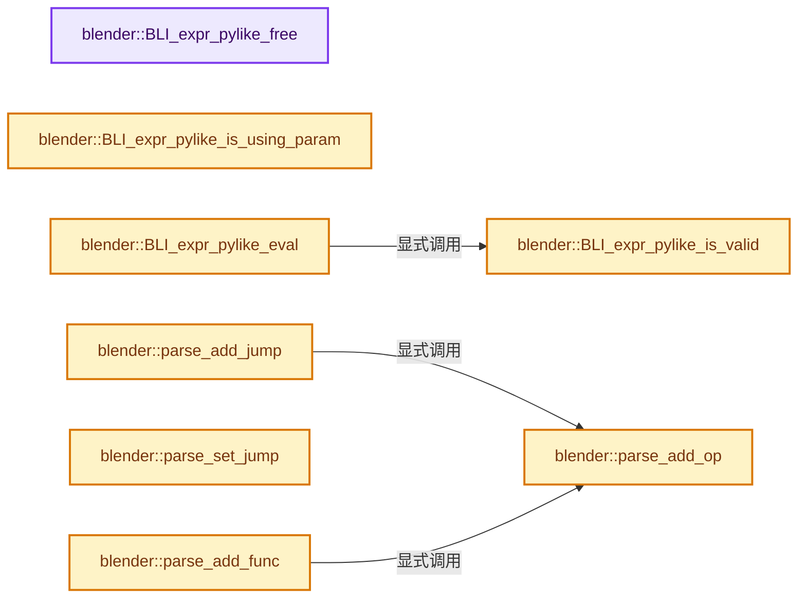

# 实现依赖专题：source/blender/blenlib/intern/expr_pylike_eval.cc

[方向导航](README.md) · [符号索引](../%E7%AC%A6%E5%8F%B7%E4%BE%9D%E8%B5%96%E4%B8%8E%E5%AE%9E%E7%8E%B0%E7%B4%A2%E5%BC%95.md)

本专题从正文实际调用进入，集中保存共享实现。函数有稳定锚点，可从调用处直接跳到对应完整函数；递归与互相调用通过回链组织。

## 本文件的实现关系




<a id="m-254d25f3bb5d"></a>

## 宏 `MAKE_CHAR2`

<!-- annotated:cc1add0d3d653e -->

```cpp
#define MAKE_CHAR2(a, b) (((a) << 8) | (b))

```

<details>
<summary>核对原始源码：source/blender/blenlib/intern/expr_pylike_eval.cc · L450—L451</summary>

<!-- original:cc1add0d3d653e:source/blender/blenlib/intern/expr_pylike_eval.cc:450:451 -->

```cpp
#define MAKE_CHAR2(a, b) (((a) << 8) | (b))

```

</details>

宏在预处理阶段展开，参数替换、重复求值和条件编译应直接从该定义检查。与普通函数不同，宏不会自动提供参数类型检查；构建配置选择哪个定义需结合外围条件。

<a id="m-a0de9bdd1ce5"></a>

## 宏 `CHECK_ERROR`

<!-- annotated:1aa20e3f883b04 -->

```cpp
#define CHECK_ERROR(condition) \
  if (!(condition)) { \
    return false; \
  } \
  ((void)0)

```

<details>
<summary>核对原始源码：source/blender/blenlib/intern/expr_pylike_eval.cc · L452—L457</summary>

<!-- original:1aa20e3f883b04:source/blender/blenlib/intern/expr_pylike_eval.cc:452:457 -->

```cpp
#define CHECK_ERROR(condition) \
  if (!(condition)) { \
    return false; \
  } \
  ((void)0)

```

</details>

宏在预处理阶段展开，参数替换、重复求值和条件编译应直接从该定义检查。与普通函数不同，宏不会自动提供参数类型检查；构建配置选择哪个定义需结合外围条件。

## 完整成员与函数实现

<a id="f-ef454d4707f27b54"></a>

### `blender::BLI_expr_pylike_free`

实现位置：[source/blender/blenlib/intern/expr_pylike_eval.cc](../../../../../source/blender/blenlib/intern/expr_pylike_eval.cc) · L112—L115。

接口参数：

- `ExprPyLike_Parsed *expr`

**教学注释版**

<!-- annotated:4bad1685b19258 -->

```cpp
void BLI_expr_pylike_free(ExprPyLike_Parsed *expr)
{
  MEM_delete(expr);
}
```

<details>
<summary>核对原始源码：source/blender/blenlib/intern/expr_pylike_eval.cc · L112—L115</summary>

<!-- original:4bad1685b19258:source/blender/blenlib/intern/expr_pylike_eval.cc:112:115 -->

```cpp
void BLI_expr_pylike_free(ExprPyLike_Parsed *expr)
{
  MEM_delete(expr);
}
```

</details>

**继续追踪实现**

- `MEM_delete` → [MEM_delete · L400](../03-%E5%86%85%E5%AD%98%E5%88%86%E9%85%8D%E4%B8%8E%E8%BF%90%E8%A1%8C%E6%97%B6%E7%B1%BB%E5%9E%8B/%E4%BE%9D%E8%B5%96-MEM_guardedalloc-b54eca.md#f-9049ffdd1682887c)。

<a id="f-c994be5524037aae"></a>

### `blender::BLI_expr_pylike_is_valid`

实现位置：[source/blender/blenlib/intern/expr_pylike_eval.cc](../../../../../source/blender/blenlib/intern/expr_pylike_eval.cc) · L117—L120。

接口参数：

- `const ExprPyLike_Parsed *expr`

**教学注释版**

<!-- annotated:e37787bfe825e6 -->

```cpp
bool BLI_expr_pylike_is_valid(const ExprPyLike_Parsed *expr)
{
  return expr != nullptr && expr->ops.size() > 0;
}
```

<details>
<summary>核对原始源码：source/blender/blenlib/intern/expr_pylike_eval.cc · L117—L120</summary>

<!-- original:e37787bfe825e6:source/blender/blenlib/intern/expr_pylike_eval.cc:117:120 -->

```cpp
bool BLI_expr_pylike_is_valid(const ExprPyLike_Parsed *expr)
{
  return expr != nullptr && expr->ops.size() > 0;
}
```

</details>

**结果出口**

- `return expr != nullptr && expr->ops.size() > 0;`

**继续追踪实现**

- `expr->ops.size` → [调用协议](../%E6%A8%A1%E6%9D%BF%E5%AE%8F%E4%B8%8E%E5%8A%A8%E6%80%81%E5%88%86%E6%B4%BE%E5%8D%8F%E8%AE%AE.md)：接收对象类型依赖auto、返回值或模板实例；不按同名猜测目标。调用位置L119。

<a id="f-005b9ec316e045ed"></a>

### `blender::BLI_expr_pylike_is_using_param`

实现位置：[source/blender/blenlib/intern/expr_pylike_eval.cc](../../../../../source/blender/blenlib/intern/expr_pylike_eval.cc) · L127—L142。

接口参数：

- `const ExprPyLike_Parsed *expr`
- `int index`

**教学注释版**

<!-- annotated:cb659b4fdea722 -->

```cpp
bool BLI_expr_pylike_is_using_param(const ExprPyLike_Parsed *expr, int index)
{
  int i;

  if (expr == nullptr) {
    return false;
  }

  for (i = 0; i < expr->ops.size(); i++) {
    if (expr->ops[i].opcode == OPCODE_PARAMETER && expr->ops[i].arg.ival == index) {
      return true;
    }
  }

  return false;
}
```

<details>
<summary>核对原始源码：source/blender/blenlib/intern/expr_pylike_eval.cc · L127—L142</summary>

<!-- original:cb659b4fdea722:source/blender/blenlib/intern/expr_pylike_eval.cc:127:142 -->

```cpp
bool BLI_expr_pylike_is_using_param(const ExprPyLike_Parsed *expr, int index)
{
  int i;

  if (expr == nullptr) {
    return false;
  }

  for (i = 0; i < expr->ops.size(); i++) {
    if (expr->ops[i].opcode == OPCODE_PARAMETER && expr->ops[i].arg.ival == index) {
      return true;
    }
  }

  return false;
}
```

</details>

**结果出口**

- `return false;`
- `return true;`

**继续追踪实现**

- `expr->ops.size` → [调用协议](../%E6%A8%A1%E6%9D%BF%E5%AE%8F%E4%B8%8E%E5%8A%A8%E6%80%81%E5%88%86%E6%B4%BE%E5%8D%8F%E8%AE%AE.md)：接收对象类型依赖auto、返回值或模板实例；不按同名猜测目标。调用位置L135。

<a id="f-07017475a965a239"></a>

### `blender::BLI_expr_pylike_eval`

实现位置：[source/blender/blenlib/intern/expr_pylike_eval.cc](../../../../../source/blender/blenlib/intern/expr_pylike_eval.cc) · L150—L270。

接口参数：

- `ExprPyLike_Parsed *expr`
- `const double *param_values`
- `int param_values_len`
- `double *r_result`

**教学注释版**

<!-- annotated:3c79a1d43bb5b7 -->

```cpp
eExprPyLike_EvalStatus BLI_expr_pylike_eval(ExprPyLike_Parsed *expr,
                                            const double *param_values,
                                            int param_values_len,
                                            double *r_result)
{
  *r_result = 0.0;

  if (!BLI_expr_pylike_is_valid(expr)) {
    return EXPR_PYLIKE_INVALID;
  }

#define FAIL_IF(condition) \
  if (condition) { \
    return EXPR_PYLIKE_FATAL_ERROR; \
  } \
  ((void)0)

  /* Check the stack requirement is at least remotely sane and allocate on the actual stack. */
  FAIL_IF(expr->max_stack <= 0 || expr->max_stack > 1000);

  double *stack = BLI_array_alloca(stack, expr->max_stack);

  /* Evaluate expression. */
  ExprOp *ops = expr->ops.data();
  int sp = 0, pc;

  feclearexcept(FE_ALL_EXCEPT);

  for (pc = 0; pc >= 0 && pc < expr->ops.size(); pc++) {
    switch (ops[pc].opcode) {
      /* Arithmetic */
      case OPCODE_CONST:
        FAIL_IF(sp >= expr->max_stack);
        stack[sp++] = ops[pc].arg.dval;
        break;
      case OPCODE_PARAMETER:
        FAIL_IF(sp >= expr->max_stack || ops[pc].arg.ival >= param_values_len);
        stack[sp++] = param_values[ops[pc].arg.ival];
        break;
      case OPCODE_FUNC1:
        FAIL_IF(sp < 1);
        stack[sp - 1] = ops[pc].arg.func1(stack[sp - 1]);
        break;
      case OPCODE_FUNC2:
        FAIL_IF(sp < 2);
        stack[sp - 2] = ops[pc].arg.func2(stack[sp - 2], stack[sp - 1]);
        sp--;
        break;
      case OPCODE_FUNC3:
        FAIL_IF(sp < 3);
        stack[sp - 3] = ops[pc].arg.func3(stack[sp - 3], stack[sp - 2], stack[sp - 1]);
        sp -= 2;
        break;
      case OPCODE_MIN:
        FAIL_IF(sp < ops[pc].arg.ival);
        for (int j = 1; j < ops[pc].arg.ival; j++, sp--) {
          CLAMP_MAX(stack[sp - 2], stack[sp - 1]);
        }
        break;
      case OPCODE_MAX:
        FAIL_IF(sp < ops[pc].arg.ival);
        for (int j = 1; j < ops[pc].arg.ival; j++, sp--) {
          CLAMP_MIN(stack[sp - 2], stack[sp - 1]);
        }
        break;

      /* Jumps */
      case OPCODE_JMP:
        pc += ops[pc].jmp_offset;
        break;
      case OPCODE_JMP_ELSE:
        FAIL_IF(sp < 1);
        if (!stack[--sp]) {
          pc += ops[pc].jmp_offset;
        }
        break;
      case OPCODE_JMP_OR:
      case OPCODE_JMP_AND:
        FAIL_IF(sp < 1);
        if (!stack[sp - 1] == !(ops[pc].opcode == OPCODE_JMP_OR)) {
          pc += ops[pc].jmp_offset;
        }
        else {
          sp--;
        }
        break;

      /* For chaining comparisons, i.e. "a < b < c" as "a < b and b < c" */
      case OPCODE_CMP_CHAIN:
        FAIL_IF(sp < 2);
        /* If comparison fails, return 0 and jump to end. */
        if (!ops[pc].arg.func2(stack[sp - 2], stack[sp - 1])) {
          stack[sp - 2] = 0.0;
          pc += ops[pc].jmp_offset;
        }
        /* Otherwise keep b on the stack and proceed. */
        else {
          stack[sp - 2] = stack[sp - 1];
        }
        sp--;
        break;

      default:
        return EXPR_PYLIKE_FATAL_ERROR;
    }
  }

  FAIL_IF(sp != 1 || pc != expr->ops.size());

#undef FAIL_IF

  *r_result = stack[0];

  /* Detect floating point evaluation errors. */
  int flags = fetestexcept(FE_DIVBYZERO | FE_INVALID);
  if (flags) {
    return (flags & FE_INVALID) ? EXPR_PYLIKE_MATH_ERROR : EXPR_PYLIKE_DIV_BY_ZERO;
  }

  return EXPR_PYLIKE_SUCCESS;
}
```

<details>
<summary>核对原始源码：source/blender/blenlib/intern/expr_pylike_eval.cc · L150—L270</summary>

<!-- original:3c79a1d43bb5b7:source/blender/blenlib/intern/expr_pylike_eval.cc:150:270 -->

```cpp
eExprPyLike_EvalStatus BLI_expr_pylike_eval(ExprPyLike_Parsed *expr,
                                            const double *param_values,
                                            int param_values_len,
                                            double *r_result)
{
  *r_result = 0.0;

  if (!BLI_expr_pylike_is_valid(expr)) {
    return EXPR_PYLIKE_INVALID;
  }

#define FAIL_IF(condition) \
  if (condition) { \
    return EXPR_PYLIKE_FATAL_ERROR; \
  } \
  ((void)0)

  /* Check the stack requirement is at least remotely sane and allocate on the actual stack. */
  FAIL_IF(expr->max_stack <= 0 || expr->max_stack > 1000);

  double *stack = BLI_array_alloca(stack, expr->max_stack);

  /* Evaluate expression. */
  ExprOp *ops = expr->ops.data();
  int sp = 0, pc;

  feclearexcept(FE_ALL_EXCEPT);

  for (pc = 0; pc >= 0 && pc < expr->ops.size(); pc++) {
    switch (ops[pc].opcode) {
      /* Arithmetic */
      case OPCODE_CONST:
        FAIL_IF(sp >= expr->max_stack);
        stack[sp++] = ops[pc].arg.dval;
        break;
      case OPCODE_PARAMETER:
        FAIL_IF(sp >= expr->max_stack || ops[pc].arg.ival >= param_values_len);
        stack[sp++] = param_values[ops[pc].arg.ival];
        break;
      case OPCODE_FUNC1:
        FAIL_IF(sp < 1);
        stack[sp - 1] = ops[pc].arg.func1(stack[sp - 1]);
        break;
      case OPCODE_FUNC2:
        FAIL_IF(sp < 2);
        stack[sp - 2] = ops[pc].arg.func2(stack[sp - 2], stack[sp - 1]);
        sp--;
        break;
      case OPCODE_FUNC3:
        FAIL_IF(sp < 3);
        stack[sp - 3] = ops[pc].arg.func3(stack[sp - 3], stack[sp - 2], stack[sp - 1]);
        sp -= 2;
        break;
      case OPCODE_MIN:
        FAIL_IF(sp < ops[pc].arg.ival);
        for (int j = 1; j < ops[pc].arg.ival; j++, sp--) {
          CLAMP_MAX(stack[sp - 2], stack[sp - 1]);
        }
        break;
      case OPCODE_MAX:
        FAIL_IF(sp < ops[pc].arg.ival);
        for (int j = 1; j < ops[pc].arg.ival; j++, sp--) {
          CLAMP_MIN(stack[sp - 2], stack[sp - 1]);
        }
        break;

      /* Jumps */
      case OPCODE_JMP:
        pc += ops[pc].jmp_offset;
        break;
      case OPCODE_JMP_ELSE:
        FAIL_IF(sp < 1);
        if (!stack[--sp]) {
          pc += ops[pc].jmp_offset;
        }
        break;
      case OPCODE_JMP_OR:
      case OPCODE_JMP_AND:
        FAIL_IF(sp < 1);
        if (!stack[sp - 1] == !(ops[pc].opcode == OPCODE_JMP_OR)) {
          pc += ops[pc].jmp_offset;
        }
        else {
          sp--;
        }
        break;

      /* For chaining comparisons, i.e. "a < b < c" as "a < b and b < c" */
      case OPCODE_CMP_CHAIN:
        FAIL_IF(sp < 2);
        /* If comparison fails, return 0 and jump to end. */
        if (!ops[pc].arg.func2(stack[sp - 2], stack[sp - 1])) {
          stack[sp - 2] = 0.0;
          pc += ops[pc].jmp_offset;
        }
        /* Otherwise keep b on the stack and proceed. */
        else {
          stack[sp - 2] = stack[sp - 1];
        }
        sp--;
        break;

      default:
        return EXPR_PYLIKE_FATAL_ERROR;
    }
  }

  FAIL_IF(sp != 1 || pc != expr->ops.size());

#undef FAIL_IF

  *r_result = stack[0];

  /* Detect floating point evaluation errors. */
  int flags = fetestexcept(FE_DIVBYZERO | FE_INVALID);
  if (flags) {
    return (flags & FE_INVALID) ? EXPR_PYLIKE_MATH_ERROR : EXPR_PYLIKE_DIV_BY_ZERO;
  }

  return EXPR_PYLIKE_SUCCESS;
}
```

</details>

**沿实际写入检查状态**

- `sp -= 2;`
- `pc += ops[pc].jmp_offset;`

**结果出口**

- `return EXPR_PYLIKE_INVALID;`
- `return EXPR_PYLIKE_FATAL_ERROR; \`
- `return EXPR_PYLIKE_FATAL_ERROR;`
- `return (flags & FE_INVALID) ? EXPR_PYLIKE_MATH_ERROR : EXPR_PYLIKE_DIV_BY_ZERO;`
- `return EXPR_PYLIKE_SUCCESS;`

**继续追踪实现**

- `BLI_expr_pylike_is_valid` → [blender::BLI_expr_pylike_is_valid · L117](%E4%BE%9D%E8%B5%96-expr_pylike_eval-bd9286.md#f-c994be5524037aae)。
- `FAIL_IF` → [调用协议](../%E6%A8%A1%E6%9D%BF%E5%AE%8F%E4%B8%8E%E5%8A%A8%E6%80%81%E5%88%86%E6%B4%BE%E5%8D%8F%E8%AE%AE.md)：函数指针、局部可调用对象或未展开的宏；必须结合调用者环境。调用位置L168。
- `BLI_array_alloca` → [BLI_array_alloca · L18](%E4%BE%9D%E8%B5%96-BLI_alloca-c79275.md#m-6f2643116b59)。宏定义由构建条件选择。
- `expr->ops.data` → [调用协议](../%E6%A8%A1%E6%9D%BF%E5%AE%8F%E4%B8%8E%E5%8A%A8%E6%80%81%E5%88%86%E6%B4%BE%E5%8D%8F%E8%AE%AE.md)：接收对象类型依赖auto、返回值或模板实例；不按同名猜测目标。调用位置L173。
- `feclearexcept` → [调用协议](../%E6%A8%A1%E6%9D%BF%E5%AE%8F%E4%B8%8E%E5%8A%A8%E6%80%81%E5%88%86%E6%B4%BE%E5%8D%8F%E8%AE%AE.md)：函数指针、局部可调用对象或未展开的宏；必须结合调用者环境。调用位置L176。
- `expr->ops.size` → [调用协议](../%E6%A8%A1%E6%9D%BF%E5%AE%8F%E4%B8%8E%E5%8A%A8%E6%80%81%E5%88%86%E6%B4%BE%E5%8D%8F%E8%AE%AE.md)：接收对象类型依赖auto、返回值或模板实例；不按同名猜测目标。调用位置L178。
- `ops[pc].arg.func1` → [调用协议](../%E6%A8%A1%E6%9D%BF%E5%AE%8F%E4%B8%8E%E5%8A%A8%E6%80%81%E5%88%86%E6%B4%BE%E5%8D%8F%E8%AE%AE.md)：接收对象类型依赖auto、返回值或模板实例；不按同名猜测目标。调用位置L191。
- `ops[pc].arg.func2` → [调用协议](../%E6%A8%A1%E6%9D%BF%E5%AE%8F%E4%B8%8E%E5%8A%A8%E6%80%81%E5%88%86%E6%B4%BE%E5%8D%8F%E8%AE%AE.md)：接收对象类型依赖auto、返回值或模板实例；不按同名猜测目标。调用位置L195。
- `ops[pc].arg.func3` → [调用协议](../%E6%A8%A1%E6%9D%BF%E5%AE%8F%E4%B8%8E%E5%8A%A8%E6%80%81%E5%88%86%E6%B4%BE%E5%8D%8F%E8%AE%AE.md)：接收对象类型依赖auto、返回值或模板实例；不按同名猜测目标。调用位置L200。
- `CLAMP_MAX` → [CLAMP_MAX · L211](%E4%BE%9D%E8%B5%96-BLI_utildefines-293a0a.md#m-ff513c0bdcc5)。宏定义由构建条件选择。
- `CLAMP_MIN` → [CLAMP_MIN · L219](%E4%BE%9D%E8%B5%96-BLI_utildefines-293a0a.md#m-fd63318fbafb)。宏定义由构建条件选择。
- `fetestexcept` → [调用协议](../%E6%A8%A1%E6%9D%BF%E5%AE%8F%E4%B8%8E%E5%8A%A8%E6%80%81%E5%88%86%E6%B4%BE%E5%8D%8F%E8%AE%AE.md)：函数指针、局部可调用对象或未展开的宏；必须结合调用者环境。调用位置L264。

<a id="f-5f5c93c6016e0529"></a>

### `blender::parse_add_op`

实现位置：[source/blender/blenlib/intern/expr_pylike_eval.cc](../../../../../source/blender/blenlib/intern/expr_pylike_eval.cc) · L512—L523。

接口参数：

- `ExprParseState *state`
- `eOpCode code`
- `int stack_delta`

**教学注释版**

<!-- annotated:c390d560ee9ed8 -->

```cpp
static ExprOp *parse_add_op(ExprParseState *state, eOpCode code, int stack_delta)
{
  /* track evaluation stack depth */
  state->stack_ptr += stack_delta;
  CLAMP_MIN(state->stack_ptr, 0);
  CLAMP_MIN(state->max_stack, state->stack_ptr);

  /* allocate the new instruction */
  ExprOp op{code};
  state->ops.append(op);
  return &state->ops.last();
}
```

<details>
<summary>核对原始源码：source/blender/blenlib/intern/expr_pylike_eval.cc · L512—L523</summary>

<!-- original:c390d560ee9ed8:source/blender/blenlib/intern/expr_pylike_eval.cc:512:523 -->

```cpp
static ExprOp *parse_add_op(ExprParseState *state, eOpCode code, int stack_delta)
{
  /* track evaluation stack depth */
  state->stack_ptr += stack_delta;
  CLAMP_MIN(state->stack_ptr, 0);
  CLAMP_MIN(state->max_stack, state->stack_ptr);

  /* allocate the new instruction */
  ExprOp op{code};
  state->ops.append(op);
  return &state->ops.last();
}
```

</details>

**沿实际写入检查状态**

- `state->stack_ptr += stack_delta;`

**结果出口**

- `return &state->ops.last();`

**继续追踪实现**

- `CLAMP_MIN` → [CLAMP_MIN · L219](%E4%BE%9D%E8%B5%96-BLI_utildefines-293a0a.md#m-fd63318fbafb)。宏定义由构建条件选择。
- `state->ops.append` → [调用协议](../%E6%A8%A1%E6%9D%BF%E5%AE%8F%E4%B8%8E%E5%8A%A8%E6%80%81%E5%88%86%E6%B4%BE%E5%8D%8F%E8%AE%AE.md)：接收对象类型依赖auto、返回值或模板实例；不按同名猜测目标。调用位置L521。
- `state->ops.last` → [调用协议](../%E6%A8%A1%E6%9D%BF%E5%AE%8F%E4%B8%8E%E5%8A%A8%E6%80%81%E5%88%86%E6%B4%BE%E5%8D%8F%E8%AE%AE.md)：接收对象类型依赖auto、返回值或模板实例；不按同名猜测目标。调用位置L522。

<a id="f-4ce675d4a344bef8"></a>

### `blender::parse_add_jump`

实现位置：[source/blender/blenlib/intern/expr_pylike_eval.cc](../../../../../source/blender/blenlib/intern/expr_pylike_eval.cc) · L526—L530。

接口参数：

- `ExprParseState *state`
- `eOpCode code`

**教学注释版**

<!-- annotated:104cc0667da26a -->

```cpp
static int parse_add_jump(ExprParseState *state, eOpCode code)
{
  parse_add_op(state, code, -1);
  return state->last_jmp = state->ops.size();
}
```

<details>
<summary>核对原始源码：source/blender/blenlib/intern/expr_pylike_eval.cc · L526—L530</summary>

<!-- original:104cc0667da26a:source/blender/blenlib/intern/expr_pylike_eval.cc:526:530 -->

```cpp
static int parse_add_jump(ExprParseState *state, eOpCode code)
{
  parse_add_op(state, code, -1);
  return state->last_jmp = state->ops.size();
}
```

</details>

**结果出口**

- `return state->last_jmp = state->ops.size();`

**继续追踪实现**

- `parse_add_op` → [blender::parse_add_op · L512](%E4%BE%9D%E8%B5%96-expr_pylike_eval-bd9286.md#f-5f5c93c6016e0529)。
- `state->ops.size` → [调用协议](../%E6%A8%A1%E6%9D%BF%E5%AE%8F%E4%B8%8E%E5%8A%A8%E6%80%81%E5%88%86%E6%B4%BE%E5%8D%8F%E8%AE%AE.md)：接收对象类型依赖auto、返回值或模板实例；不按同名猜测目标。调用位置L529。

<a id="f-2476b64eb9c4e616"></a>

### `blender::parse_set_jump`

实现位置：[source/blender/blenlib/intern/expr_pylike_eval.cc](../../../../../source/blender/blenlib/intern/expr_pylike_eval.cc) · L533—L537。

接口参数：

- `ExprParseState *state`
- `int jump`

**教学注释版**

<!-- annotated:8322031e376548 -->

```cpp
static void parse_set_jump(ExprParseState *state, int jump)
{
  state->last_jmp = state->ops.size();
  state->ops[jump - 1].jmp_offset = state->ops.size() - jump;
}
```

<details>
<summary>核对原始源码：source/blender/blenlib/intern/expr_pylike_eval.cc · L533—L537</summary>

<!-- original:8322031e376548:source/blender/blenlib/intern/expr_pylike_eval.cc:533:537 -->

```cpp
static void parse_set_jump(ExprParseState *state, int jump)
{
  state->last_jmp = state->ops.size();
  state->ops[jump - 1].jmp_offset = state->ops.size() - jump;
}
```

</details>

**沿实际写入检查状态**

- `state->last_jmp = state->ops.size();`

**继续追踪实现**

- `state->ops.size` → [调用协议](../%E6%A8%A1%E6%9D%BF%E5%AE%8F%E4%B8%8E%E5%8A%A8%E6%80%81%E5%88%86%E6%B4%BE%E5%8D%8F%E8%AE%AE.md)：接收对象类型依赖auto、返回值或模板实例；不按同名猜测目标。调用位置L535。

<a id="f-c6fe0b93332e6317"></a>

### `blender::parse_add_func`

实现位置：[source/blender/blenlib/intern/expr_pylike_eval.cc](../../../../../source/blender/blenlib/intern/expr_pylike_eval.cc) · L540—L610。

接口参数：

- `ExprParseState *state`
- `std::variant<UnaryOpFunc, BinaryOpFunc, TernaryOpFunc> funcptr`

**教学注释版**

<!-- annotated:2b9554ea53a373 -->

```cpp
static bool parse_add_func(ExprParseState *state,
                           std::variant<UnaryOpFunc, BinaryOpFunc, TernaryOpFunc> funcptr)
{
  ExprOp *prev_ops = state->ops.end();
  int jmp_gap = state->ops.size() - state->last_jmp;

  feclearexcept(FE_ALL_EXCEPT);

  if (std::holds_alternative<UnaryOpFunc>(funcptr)) {
    UnaryOpFunc func = std::get<UnaryOpFunc>(funcptr);

    if (jmp_gap >= 1 && prev_ops[-1].opcode == OPCODE_CONST) {
      /* volatile because some compilers overly aggressive optimize this call out.
       * see D6012 for details. */
      volatile double result = func(prev_ops[-1].arg.dval);

      if (fetestexcept(FE_DIVBYZERO | FE_INVALID) == 0) {
        prev_ops[-1].arg.dval = result;
        return true;
      }
    }

    parse_add_op(state, OPCODE_FUNC1, 0)->arg.func1 = func;
  }
  else if (std::holds_alternative<BinaryOpFunc>(funcptr)) {
    BinaryOpFunc func = std::get<BinaryOpFunc>(funcptr);

    if (jmp_gap >= 2 && prev_ops[-2].opcode == OPCODE_CONST && prev_ops[-1].opcode == OPCODE_CONST)
    {
      /* volatile because some compilers overly aggressive optimize this call out.
       * see D6012 for details. */
      volatile double result = func(prev_ops[-2].arg.dval, prev_ops[-1].arg.dval);

      if (fetestexcept(FE_DIVBYZERO | FE_INVALID) == 0) {
        prev_ops[-2].arg.dval = result;
        state->ops.resize(state->ops.size() - 1);
        state->stack_ptr--;
        return true;
      }
    }

    parse_add_op(state, OPCODE_FUNC2, -1)->arg.func2 = func;
  }
  else if (std::holds_alternative<TernaryOpFunc>(funcptr)) {
    TernaryOpFunc func = std::get<TernaryOpFunc>(funcptr);

    if (jmp_gap >= 3 && prev_ops[-3].opcode == OPCODE_CONST &&
        prev_ops[-2].opcode == OPCODE_CONST && prev_ops[-1].opcode == OPCODE_CONST)
    {
      /* volatile because some compilers overly aggressive optimize this call out.
       * see D6012 for details. */
      volatile double result = func(
          prev_ops[-3].arg.dval, prev_ops[-2].arg.dval, prev_ops[-1].arg.dval);

      if (fetestexcept(FE_DIVBYZERO | FE_INVALID) == 0) {
        prev_ops[-3].arg.dval = result;
        state->ops.resize(state->ops.size() - 2);
        state->stack_ptr -= 2;
        return true;
      }
    }

    parse_add_op(state, OPCODE_FUNC3, -2)->arg.func3 = func;
  }
  else {
    BLI_assert(false);
    return false;
  }

  return true;
}
```

<details>
<summary>核对原始源码：source/blender/blenlib/intern/expr_pylike_eval.cc · L540—L610</summary>

<!-- original:2b9554ea53a373:source/blender/blenlib/intern/expr_pylike_eval.cc:540:610 -->

```cpp
static bool parse_add_func(ExprParseState *state,
                           std::variant<UnaryOpFunc, BinaryOpFunc, TernaryOpFunc> funcptr)
{
  ExprOp *prev_ops = state->ops.end();
  int jmp_gap = state->ops.size() - state->last_jmp;

  feclearexcept(FE_ALL_EXCEPT);

  if (std::holds_alternative<UnaryOpFunc>(funcptr)) {
    UnaryOpFunc func = std::get<UnaryOpFunc>(funcptr);

    if (jmp_gap >= 1 && prev_ops[-1].opcode == OPCODE_CONST) {
      /* volatile because some compilers overly aggressive optimize this call out.
       * see D6012 for details. */
      volatile double result = func(prev_ops[-1].arg.dval);

      if (fetestexcept(FE_DIVBYZERO | FE_INVALID) == 0) {
        prev_ops[-1].arg.dval = result;
        return true;
      }
    }

    parse_add_op(state, OPCODE_FUNC1, 0)->arg.func1 = func;
  }
  else if (std::holds_alternative<BinaryOpFunc>(funcptr)) {
    BinaryOpFunc func = std::get<BinaryOpFunc>(funcptr);

    if (jmp_gap >= 2 && prev_ops[-2].opcode == OPCODE_CONST && prev_ops[-1].opcode == OPCODE_CONST)
    {
      /* volatile because some compilers overly aggressive optimize this call out.
       * see D6012 for details. */
      volatile double result = func(prev_ops[-2].arg.dval, prev_ops[-1].arg.dval);

      if (fetestexcept(FE_DIVBYZERO | FE_INVALID) == 0) {
        prev_ops[-2].arg.dval = result;
        state->ops.resize(state->ops.size() - 1);
        state->stack_ptr--;
        return true;
      }
    }

    parse_add_op(state, OPCODE_FUNC2, -1)->arg.func2 = func;
  }
  else if (std::holds_alternative<TernaryOpFunc>(funcptr)) {
    TernaryOpFunc func = std::get<TernaryOpFunc>(funcptr);

    if (jmp_gap >= 3 && prev_ops[-3].opcode == OPCODE_CONST &&
        prev_ops[-2].opcode == OPCODE_CONST && prev_ops[-1].opcode == OPCODE_CONST)
    {
      /* volatile because some compilers overly aggressive optimize this call out.
       * see D6012 for details. */
      volatile double result = func(
          prev_ops[-3].arg.dval, prev_ops[-2].arg.dval, prev_ops[-1].arg.dval);

      if (fetestexcept(FE_DIVBYZERO | FE_INVALID) == 0) {
        prev_ops[-3].arg.dval = result;
        state->ops.resize(state->ops.size() - 2);
        state->stack_ptr -= 2;
        return true;
      }
    }

    parse_add_op(state, OPCODE_FUNC3, -2)->arg.func3 = func;
  }
  else {
    BLI_assert(false);
    return false;
  }

  return true;
}
```

</details>

**沿实际写入检查状态**

- `prev_ops[-1].arg.dval = result;`
- `prev_ops[-2].arg.dval = result;`
- `prev_ops[-3].arg.dval = result;`
- `state->stack_ptr -= 2;`

**结果出口**

- `return true;`
- `return false;`

**继续追踪实现**

- `state->ops.end` → [调用协议](../%E6%A8%A1%E6%9D%BF%E5%AE%8F%E4%B8%8E%E5%8A%A8%E6%80%81%E5%88%86%E6%B4%BE%E5%8D%8F%E8%AE%AE.md)：接收对象类型依赖auto、返回值或模板实例；不按同名猜测目标。调用位置L543。
- `state->ops.size` → [调用协议](../%E6%A8%A1%E6%9D%BF%E5%AE%8F%E4%B8%8E%E5%8A%A8%E6%80%81%E5%88%86%E6%B4%BE%E5%8D%8F%E8%AE%AE.md)：接收对象类型依赖auto、返回值或模板实例；不按同名猜测目标。调用位置L544。
- `feclearexcept` → [调用协议](../%E6%A8%A1%E6%9D%BF%E5%AE%8F%E4%B8%8E%E5%8A%A8%E6%80%81%E5%88%86%E6%B4%BE%E5%8D%8F%E8%AE%AE.md)：函数指针、局部可调用对象或未展开的宏；必须结合调用者环境。调用位置L546。
- `std::holds_alternative<UnaryOpFunc>` → [外部契约](https://eel.is/c++draft/)：这个边界按实际表达式及所属类型核对参数、返回值、寿命与失败行为。这里提供接口入口，不声称已解释该第三方版本的内部实现。
- `std::get<UnaryOpFunc>` → [外部契约](https://eel.is/c++draft/)：这个边界按实际表达式及所属类型核对参数、返回值、寿命与失败行为。这里提供接口入口，不声称已解释该第三方版本的内部实现。
- `func` → [调用协议](../%E6%A8%A1%E6%9D%BF%E5%AE%8F%E4%B8%8E%E5%8A%A8%E6%80%81%E5%88%86%E6%B4%BE%E5%8D%8F%E8%AE%AE.md)：局部可调用对象，须结合其初始化与捕获环境。调用位置L554。
- `fetestexcept` → [调用协议](../%E6%A8%A1%E6%9D%BF%E5%AE%8F%E4%B8%8E%E5%8A%A8%E6%80%81%E5%88%86%E6%B4%BE%E5%8D%8F%E8%AE%AE.md)：函数指针、局部可调用对象或未展开的宏；必须结合调用者环境。调用位置L556。
- `parse_add_op` → [blender::parse_add_op · L512](%E4%BE%9D%E8%B5%96-expr_pylike_eval-bd9286.md#f-5f5c93c6016e0529)。
- `std::holds_alternative<BinaryOpFunc>` → [外部契约](https://eel.is/c++draft/)：这个边界按实际表达式及所属类型核对参数、返回值、寿命与失败行为。这里提供接口入口，不声称已解释该第三方版本的内部实现。
- `std::get<BinaryOpFunc>` → [外部契约](https://eel.is/c++draft/)：这个边界按实际表达式及所属类型核对参数、返回值、寿命与失败行为。这里提供接口入口，不声称已解释该第三方版本的内部实现。
- `state->ops.resize` → [调用协议](../%E6%A8%A1%E6%9D%BF%E5%AE%8F%E4%B8%8E%E5%8A%A8%E6%80%81%E5%88%86%E6%B4%BE%E5%8D%8F%E8%AE%AE.md)：接收对象类型依赖auto、返回值或模板实例；不按同名猜测目标。调用位置L575。
- `std::holds_alternative<TernaryOpFunc>` → [外部契约](https://eel.is/c++draft/)：这个边界按实际表达式及所属类型核对参数、返回值、寿命与失败行为。这里提供接口入口，不声称已解释该第三方版本的内部实现。
- `std::get<TernaryOpFunc>` → [外部契约](https://eel.is/c++draft/)：这个边界按实际表达式及所属类型核对参数、返回值、寿命与失败行为。这里提供接口入口，不声称已解释该第三方版本的内部实现。
- `BLI_assert` → [BLI_assert · L48](%E4%BE%9D%E8%B5%96-BLI_assert-cc98e8.md#m-57a88495704d)；[BLI_assert · L63](%E4%BE%9D%E8%B5%96-BLI_assert-cc98e8.md#m-d07050020cb5)。宏定义由构建条件选择。

<a id="f-8178bb447a00b8f5"></a>

### `blender::parse_next_token`

实现位置：[source/blender/blenlib/intern/expr_pylike_eval.cc](../../../../../source/blender/blenlib/intern/expr_pylike_eval.cc) · L613—L710。

接口参数：

- `ExprParseState *state`

**教学注释版**

<!-- annotated:8e1ad1d40842fa -->

```cpp
static bool parse_next_token(ExprParseState *state)
{
  /* Skip white-space. */
  while (isspace(*state->cur)) {
    state->cur++;
  }

  /* End of string. */
  if (*state->cur == 0) {
    state->token = 0;
    return true;
  }

  /* Floating point numbers. */
  if (isdigit(*state->cur) || (state->cur[0] == '.' && isdigit(state->cur[1]))) {
    char *end, *out = state->tokenbuf.data();
    bool is_float = false;

    while (isdigit(*state->cur)) {
      *out++ = *state->cur++;
    }

    if (*state->cur == '.') {
      is_float = true;
      *out++ = *state->cur++;

      while (isdigit(*state->cur)) {
        *out++ = *state->cur++;
      }
    }

    if (ELEM(*state->cur, 'e', 'E')) {
      is_float = true;
      *out++ = *state->cur++;

      if (ELEM(*state->cur, '+', '-')) {
        *out++ = *state->cur++;
      }

      CHECK_ERROR(isdigit(*state->cur));

      while (isdigit(*state->cur)) {
        *out++ = *state->cur++;
      }
    }

    *out = 0;

    /* Forbid C-style octal constants. */
    if (!is_float && state->tokenbuf[0] == '0') {
      for (char *p = state->tokenbuf.data() + 1; *p; p++) {
        if (*p != '0') {
          return false;
        }
      }
    }

    state->token = TOKEN_NUMBER;
    state->tokenval = strtod(state->tokenbuf.data(), &end);
    return (end == out);
  }

  /* ?= tokens */
  if (state->cur[1] == '=' && strchr(token_eq_characters, state->cur[0])) {
    state->token = MAKE_CHAR2(state->cur[0], state->cur[1]);
    state->cur += 2;
    return true;
  }

  /* Special characters (single character tokens) */
  if (strchr(token_characters, *state->cur)) {
    state->token = *state->cur++;
    return true;
  }

  /* Identifiers */
  if (isalpha(*state->cur) || ELEM(*state->cur, '_')) {
    char *out = state->tokenbuf.data();

    while (isalnum(*state->cur) || ELEM(*state->cur, '_')) {
      *out++ = *state->cur++;
    }

    *out = 0;

    for (int i = 0; keyword_list[i].name; i++) {
      if (STREQ(state->tokenbuf.data(), keyword_list[i].name)) {
        state->token = keyword_list[i].token;
        return true;
      }
    }

    state->token = TOKEN_ID;
    return true;
  }

  return false;
}
```

<details>
<summary>核对原始源码：source/blender/blenlib/intern/expr_pylike_eval.cc · L613—L710</summary>

<!-- original:8e1ad1d40842fa:source/blender/blenlib/intern/expr_pylike_eval.cc:613:710 -->

```cpp
static bool parse_next_token(ExprParseState *state)
{
  /* Skip white-space. */
  while (isspace(*state->cur)) {
    state->cur++;
  }

  /* End of string. */
  if (*state->cur == 0) {
    state->token = 0;
    return true;
  }

  /* Floating point numbers. */
  if (isdigit(*state->cur) || (state->cur[0] == '.' && isdigit(state->cur[1]))) {
    char *end, *out = state->tokenbuf.data();
    bool is_float = false;

    while (isdigit(*state->cur)) {
      *out++ = *state->cur++;
    }

    if (*state->cur == '.') {
      is_float = true;
      *out++ = *state->cur++;

      while (isdigit(*state->cur)) {
        *out++ = *state->cur++;
      }
    }

    if (ELEM(*state->cur, 'e', 'E')) {
      is_float = true;
      *out++ = *state->cur++;

      if (ELEM(*state->cur, '+', '-')) {
        *out++ = *state->cur++;
      }

      CHECK_ERROR(isdigit(*state->cur));

      while (isdigit(*state->cur)) {
        *out++ = *state->cur++;
      }
    }

    *out = 0;

    /* Forbid C-style octal constants. */
    if (!is_float && state->tokenbuf[0] == '0') {
      for (char *p = state->tokenbuf.data() + 1; *p; p++) {
        if (*p != '0') {
          return false;
        }
      }
    }

    state->token = TOKEN_NUMBER;
    state->tokenval = strtod(state->tokenbuf.data(), &end);
    return (end == out);
  }

  /* ?= tokens */
  if (state->cur[1] == '=' && strchr(token_eq_characters, state->cur[0])) {
    state->token = MAKE_CHAR2(state->cur[0], state->cur[1]);
    state->cur += 2;
    return true;
  }

  /* Special characters (single character tokens) */
  if (strchr(token_characters, *state->cur)) {
    state->token = *state->cur++;
    return true;
  }

  /* Identifiers */
  if (isalpha(*state->cur) || ELEM(*state->cur, '_')) {
    char *out = state->tokenbuf.data();

    while (isalnum(*state->cur) || ELEM(*state->cur, '_')) {
      *out++ = *state->cur++;
    }

    *out = 0;

    for (int i = 0; keyword_list[i].name; i++) {
      if (STREQ(state->tokenbuf.data(), keyword_list[i].name)) {
        state->token = keyword_list[i].token;
        return true;
      }
    }

    state->token = TOKEN_ID;
    return true;
  }

  return false;
}
```

</details>

**沿实际写入检查状态**

- `state->token = 0;`
- `is_float = true;`
- `state->token = TOKEN_NUMBER;`
- `state->tokenval = strtod(state->tokenbuf.data(), &end);`
- `state->token = MAKE_CHAR2(state->cur[0], state->cur[1]);`
- `state->cur += 2;`
- `state->token = *state->cur++;`
- `state->token = keyword_list[i].token;`
- `state->token = TOKEN_ID;`

**结果出口**

- `return true;`
- `return false;`
- `return (end == out);`

**继续追踪实现**

- `isspace` → [调用协议](../%E6%A8%A1%E6%9D%BF%E5%AE%8F%E4%B8%8E%E5%8A%A8%E6%80%81%E5%88%86%E6%B4%BE%E5%8D%8F%E8%AE%AE.md)：函数指针、局部可调用对象或未展开的宏；必须结合调用者环境。调用位置L616。
- `isdigit` → [调用协议](../%E6%A8%A1%E6%9D%BF%E5%AE%8F%E4%B8%8E%E5%8A%A8%E6%80%81%E5%88%86%E6%B4%BE%E5%8D%8F%E8%AE%AE.md)：函数指针、局部可调用对象或未展开的宏；必须结合调用者环境。调用位置L627。
- `state->tokenbuf.data` → [调用协议](../%E6%A8%A1%E6%9D%BF%E5%AE%8F%E4%B8%8E%E5%8A%A8%E6%80%81%E5%88%86%E6%B4%BE%E5%8D%8F%E8%AE%AE.md)：接收对象类型依赖auto、返回值或模板实例；不按同名猜测目标。调用位置L628。
- `ELEM` → [ELEM · L88](../05-%E5%87%A0%E4%BD%95%E5%AD%98%E5%82%A8%E4%B8%8E%E6%8B%93%E6%89%91%E6%98%A0%E5%B0%84/%E4%BE%9D%E8%B5%96-GHOST_utildefines-34b996.md#m-d28724a15928)；[ELEM · L135](%E4%BE%9D%E8%B5%96-BLI_utildefines-293a0a.md#m-d6572de7cae0)。宏定义由构建条件选择。
- `CHECK_ERROR` → [CHECK_ERROR · L452](%E4%BE%9D%E8%B5%96-expr_pylike_eval-bd9286.md#m-a0de9bdd1ce5)。宏定义由构建条件选择。
- `strtod` → [调用协议](../%E6%A8%A1%E6%9D%BF%E5%AE%8F%E4%B8%8E%E5%8A%A8%E6%80%81%E5%88%86%E6%B4%BE%E5%8D%8F%E8%AE%AE.md)：函数指针、局部可调用对象或未展开的宏；必须结合调用者环境。调用位置L671。
- `strchr` → [调用协议](../%E6%A8%A1%E6%9D%BF%E5%AE%8F%E4%B8%8E%E5%8A%A8%E6%80%81%E5%88%86%E6%B4%BE%E5%8D%8F%E8%AE%AE.md)：函数指针、局部可调用对象或未展开的宏；必须结合调用者环境。调用位置L676。
- `MAKE_CHAR2` → [MAKE_CHAR2 · L450](%E4%BE%9D%E8%B5%96-expr_pylike_eval-bd9286.md#m-254d25f3bb5d)。宏定义由构建条件选择。
- `isalpha` → [调用协议](../%E6%A8%A1%E6%9D%BF%E5%AE%8F%E4%B8%8E%E5%8A%A8%E6%80%81%E5%88%86%E6%B4%BE%E5%8D%8F%E8%AE%AE.md)：函数指针、局部可调用对象或未展开的宏；必须结合调用者环境。调用位置L689。
- `isalnum` → [调用协议](../%E6%A8%A1%E6%9D%BF%E5%AE%8F%E4%B8%8E%E5%8A%A8%E6%80%81%E5%88%86%E6%B4%BE%E5%8D%8F%E8%AE%AE.md)：函数指针、局部可调用对象或未展开的宏；必须结合调用者环境。调用位置L692。
- `STREQ` → [STREQ · L112](../05-%E5%87%A0%E4%BD%95%E5%AD%98%E5%82%A8%E4%B8%8E%E6%8B%93%E6%89%91%E6%98%A0%E5%B0%84/%E4%BE%9D%E8%B5%96-GHOST_utildefines-34b996.md#m-9549fb6aafd2)；[STREQ · L451](%E4%BE%9D%E8%B5%96-BLI_utildefines-293a0a.md#m-c7b745bcfad2)；[STREQ · L55](../05-%E5%87%A0%E4%BD%95%E5%AD%98%E5%82%A8%E4%B8%8E%E6%8B%93%E6%89%91%E6%98%A0%E5%B0%84/%E4%BE%9D%E8%B5%96-clog-a0bec8.md#m-96e78f386894)。宏定义由构建条件选择。

<a id="f-a4e0aed52e8e2484"></a>

### `blender::parse_function_args`

实现位置：[source/blender/blenlib/intern/expr_pylike_eval.cc](../../../../../source/blender/blenlib/intern/expr_pylike_eval.cc) · L720—L752。

接口参数：

- `ExprParseState *state`

**教学注释版**

<!-- annotated:555caba4900be9 -->

```cpp
static int parse_function_args(ExprParseState *state)
{
  if (!parse_next_token(state) || state->token != '(' || !parse_next_token(state)) {
    return -1;
  }

  int arg_count = 0;

  for (;;) {
    if (!parse_expr(state)) {
      return -1;
    }

    arg_count++;

    switch (state->token) {
      case ',':
        if (!parse_next_token(state)) {
          return -1;
        }
        break;

      case ')':
        if (!parse_next_token(state)) {
          return -1;
        }
        return arg_count;

      default:
        return -1;
    }
  }
}
```

<details>
<summary>核对原始源码：source/blender/blenlib/intern/expr_pylike_eval.cc · L720—L752</summary>

<!-- original:555caba4900be9:source/blender/blenlib/intern/expr_pylike_eval.cc:720:752 -->

```cpp
static int parse_function_args(ExprParseState *state)
{
  if (!parse_next_token(state) || state->token != '(' || !parse_next_token(state)) {
    return -1;
  }

  int arg_count = 0;

  for (;;) {
    if (!parse_expr(state)) {
      return -1;
    }

    arg_count++;

    switch (state->token) {
      case ',':
        if (!parse_next_token(state)) {
          return -1;
        }
        break;

      case ')':
        if (!parse_next_token(state)) {
          return -1;
        }
        return arg_count;

      default:
        return -1;
    }
  }
}
```

</details>

**结果出口**

- `return -1;`
- `return arg_count;`

**继续追踪实现**

- `parse_next_token` → [blender::parse_next_token · L613](%E4%BE%9D%E8%B5%96-expr_pylike_eval-bd9286.md#f-8178bb447a00b8f5)。
- `parse_expr` → [blender::parse_expr · L980](%E4%BE%9D%E8%B5%96-expr_pylike_eval-bd9286.md#f-a96f503738295b05)。

<a id="f-ef87ec728b175727"></a>

### `blender::parse_unary`

实现位置：[source/blender/blenlib/intern/expr_pylike_eval.cc](../../../../../source/blender/blenlib/intern/expr_pylike_eval.cc) · L754—L838。

接口参数：

- `ExprParseState *state`

**教学注释版**

<!-- annotated:945a6128c7b1a6 -->

```cpp
static bool parse_unary(ExprParseState *state)
{
  int i;

  switch (state->token) {
    case '+':
      return parse_next_token(state) && parse_unary(state);

    case '-':
      CHECK_ERROR(parse_next_token(state) && parse_unary(state));
      parse_add_func(state, op_negate);
      return true;

    case '(':
      return parse_next_token(state) && parse_expr(state) && state->token == ')' &&
             parse_next_token(state);

    case TOKEN_NUMBER:
      parse_add_op(state, OPCODE_CONST, 1)->arg.dval = state->tokenval;
      return parse_next_token(state);

    case TOKEN_ID:
      /* Parameters: search in reverse order in case of duplicate names -
       * the last one should win. */
      for (i = state->param_names_len - 1; i >= 0; i--) {
        if (STREQ(state->tokenbuf.data(), state->param_names[i])) {
          parse_add_op(state, OPCODE_PARAMETER, 1)->arg.ival = i;
          return parse_next_token(state);
        }
      }

      /* Ordinary builtin constants. */
      for (i = 0; builtin_consts[i].name; i++) {
        if (STREQ(state->tokenbuf.data(), builtin_consts[i].name)) {
          parse_add_op(state, OPCODE_CONST, 1)->arg.dval = builtin_consts[i].value;
          return parse_next_token(state);
        }
      }

      /* Ordinary builtin functions. */
      for (i = 0; builtin_ops[i].name; i++) {
        if (STREQ(state->tokenbuf.data(), builtin_ops[i].name)) {
          int args = parse_function_args(state);

          /* Search for other arg count versions if necessary. */
          if (args != builtin_ops[i].arg_count()) {
            for (int j = i + 1; builtin_ops[j].name; j++) {
              if (builtin_ops[j].arg_count() == args &&
                  STREQ(builtin_ops[j].name, builtin_ops[i].name))
              {
                i = j;
                break;
              }
            }
          }

          CHECK_ERROR(builtin_ops[i].name && builtin_ops[i].arg_count() == args);

          return parse_add_func(state, builtin_ops[i].funcptr);
        }
      }

      /* Specially supported functions. */
      if (STREQ(state->tokenbuf.data(), "min")) {
        int count = parse_function_args(state);
        CHECK_ERROR(count > 0);

        parse_add_op(state, OPCODE_MIN, 1 - count)->arg.ival = count;
        return true;
      }

      if (STREQ(state->tokenbuf.data(), "max")) {
        int count = parse_function_args(state);
        CHECK_ERROR(count > 0);

        parse_add_op(state, OPCODE_MAX, 1 - count)->arg.ival = count;
        return true;
      }

      return false;

    default:
      return false;
  }
}
```

<details>
<summary>核对原始源码：source/blender/blenlib/intern/expr_pylike_eval.cc · L754—L838</summary>

<!-- original:945a6128c7b1a6:source/blender/blenlib/intern/expr_pylike_eval.cc:754:838 -->

```cpp
static bool parse_unary(ExprParseState *state)
{
  int i;

  switch (state->token) {
    case '+':
      return parse_next_token(state) && parse_unary(state);

    case '-':
      CHECK_ERROR(parse_next_token(state) && parse_unary(state));
      parse_add_func(state, op_negate);
      return true;

    case '(':
      return parse_next_token(state) && parse_expr(state) && state->token == ')' &&
             parse_next_token(state);

    case TOKEN_NUMBER:
      parse_add_op(state, OPCODE_CONST, 1)->arg.dval = state->tokenval;
      return parse_next_token(state);

    case TOKEN_ID:
      /* Parameters: search in reverse order in case of duplicate names -
       * the last one should win. */
      for (i = state->param_names_len - 1; i >= 0; i--) {
        if (STREQ(state->tokenbuf.data(), state->param_names[i])) {
          parse_add_op(state, OPCODE_PARAMETER, 1)->arg.ival = i;
          return parse_next_token(state);
        }
      }

      /* Ordinary builtin constants. */
      for (i = 0; builtin_consts[i].name; i++) {
        if (STREQ(state->tokenbuf.data(), builtin_consts[i].name)) {
          parse_add_op(state, OPCODE_CONST, 1)->arg.dval = builtin_consts[i].value;
          return parse_next_token(state);
        }
      }

      /* Ordinary builtin functions. */
      for (i = 0; builtin_ops[i].name; i++) {
        if (STREQ(state->tokenbuf.data(), builtin_ops[i].name)) {
          int args = parse_function_args(state);

          /* Search for other arg count versions if necessary. */
          if (args != builtin_ops[i].arg_count()) {
            for (int j = i + 1; builtin_ops[j].name; j++) {
              if (builtin_ops[j].arg_count() == args &&
                  STREQ(builtin_ops[j].name, builtin_ops[i].name))
              {
                i = j;
                break;
              }
            }
          }

          CHECK_ERROR(builtin_ops[i].name && builtin_ops[i].arg_count() == args);

          return parse_add_func(state, builtin_ops[i].funcptr);
        }
      }

      /* Specially supported functions. */
      if (STREQ(state->tokenbuf.data(), "min")) {
        int count = parse_function_args(state);
        CHECK_ERROR(count > 0);

        parse_add_op(state, OPCODE_MIN, 1 - count)->arg.ival = count;
        return true;
      }

      if (STREQ(state->tokenbuf.data(), "max")) {
        int count = parse_function_args(state);
        CHECK_ERROR(count > 0);

        parse_add_op(state, OPCODE_MAX, 1 - count)->arg.ival = count;
        return true;
      }

      return false;

    default:
      return false;
  }
}
```

</details>

**沿实际写入检查状态**

- `i = j;`

**结果出口**

- `return parse_next_token(state) && parse_unary(state);`
- `return true;`
- `return parse_next_token(state) && parse_expr(state) && state->token == ')' &&`
- `return parse_next_token(state);`
- `return parse_add_func(state, builtin_ops[i].funcptr);`
- `return false;`

**继续追踪实现**

- `parse_next_token` → [blender::parse_next_token · L613](%E4%BE%9D%E8%B5%96-expr_pylike_eval-bd9286.md#f-8178bb447a00b8f5)。
- `parse_unary` → [blender::parse_unary · L754](%E4%BE%9D%E8%B5%96-expr_pylike_eval-bd9286.md#f-ef87ec728b175727)。
- `CHECK_ERROR` → [CHECK_ERROR · L452](%E4%BE%9D%E8%B5%96-expr_pylike_eval-bd9286.md#m-a0de9bdd1ce5)。宏定义由构建条件选择。
- `parse_add_func` → [blender::parse_add_func · L540](%E4%BE%9D%E8%B5%96-expr_pylike_eval-bd9286.md#f-c6fe0b93332e6317)。
- `parse_expr` → [blender::parse_expr · L980](%E4%BE%9D%E8%B5%96-expr_pylike_eval-bd9286.md#f-a96f503738295b05)。
- `parse_add_op` → [blender::parse_add_op · L512](%E4%BE%9D%E8%B5%96-expr_pylike_eval-bd9286.md#f-5f5c93c6016e0529)。
- `STREQ` → [STREQ · L112](../05-%E5%87%A0%E4%BD%95%E5%AD%98%E5%82%A8%E4%B8%8E%E6%8B%93%E6%89%91%E6%98%A0%E5%B0%84/%E4%BE%9D%E8%B5%96-GHOST_utildefines-34b996.md#m-9549fb6aafd2)；[STREQ · L451](%E4%BE%9D%E8%B5%96-BLI_utildefines-293a0a.md#m-c7b745bcfad2)；[STREQ · L55](../05-%E5%87%A0%E4%BD%95%E5%AD%98%E5%82%A8%E4%B8%8E%E6%8B%93%E6%89%91%E6%98%A0%E5%B0%84/%E4%BE%9D%E8%B5%96-clog-a0bec8.md#m-96e78f386894)。宏定义由构建条件选择。
- `state->tokenbuf.data` → [调用协议](../%E6%A8%A1%E6%9D%BF%E5%AE%8F%E4%B8%8E%E5%8A%A8%E6%80%81%E5%88%86%E6%B4%BE%E5%8D%8F%E8%AE%AE.md)：接收对象类型依赖auto、返回值或模板实例；不按同名猜测目标。调用位置L779。
- `parse_function_args` → [blender::parse_function_args · L720](%E4%BE%9D%E8%B5%96-expr_pylike_eval-bd9286.md#f-a4e0aed52e8e2484)。
- `builtin_ops[i].arg_count` → [调用协议](../%E6%A8%A1%E6%9D%BF%E5%AE%8F%E4%B8%8E%E5%8A%A8%E6%80%81%E5%88%86%E6%B4%BE%E5%8D%8F%E8%AE%AE.md)：接收对象类型依赖auto、返回值或模板实例；不按同名猜测目标。调用位置L799。
- `builtin_ops[j].arg_count` → [调用协议](../%E6%A8%A1%E6%9D%BF%E5%AE%8F%E4%B8%8E%E5%8A%A8%E6%80%81%E5%88%86%E6%B4%BE%E5%8D%8F%E8%AE%AE.md)：接收对象类型依赖auto、返回值或模板实例；不按同名猜测目标。调用位置L801。

<a id="f-256fcaffb09393a5"></a>

### `blender::parse_mul`

实现位置：[source/blender/blenlib/intern/expr_pylike_eval.cc](../../../../../source/blender/blenlib/intern/expr_pylike_eval.cc) · L840—L860。

接口参数：

- `ExprParseState *state`

**教学注释版**

<!-- annotated:7a801b3961680c -->

```cpp
static bool parse_mul(ExprParseState *state)
{
  CHECK_ERROR(parse_unary(state));

  for (;;) {
    switch (state->token) {
      case '*':
        CHECK_ERROR(parse_next_token(state) && parse_unary(state));
        parse_add_func(state, op_mul);
        break;

      case '/':
        CHECK_ERROR(parse_next_token(state) && parse_unary(state));
        parse_add_func(state, op_div);
        break;

      default:
        return true;
    }
  }
}
```

<details>
<summary>核对原始源码：source/blender/blenlib/intern/expr_pylike_eval.cc · L840—L860</summary>

<!-- original:7a801b3961680c:source/blender/blenlib/intern/expr_pylike_eval.cc:840:860 -->

```cpp
static bool parse_mul(ExprParseState *state)
{
  CHECK_ERROR(parse_unary(state));

  for (;;) {
    switch (state->token) {
      case '*':
        CHECK_ERROR(parse_next_token(state) && parse_unary(state));
        parse_add_func(state, op_mul);
        break;

      case '/':
        CHECK_ERROR(parse_next_token(state) && parse_unary(state));
        parse_add_func(state, op_div);
        break;

      default:
        return true;
    }
  }
}
```

</details>

**结果出口**

- `return true;`

**继续追踪实现**

- `CHECK_ERROR` → [CHECK_ERROR · L452](%E4%BE%9D%E8%B5%96-expr_pylike_eval-bd9286.md#m-a0de9bdd1ce5)。宏定义由构建条件选择。
- `parse_unary` → [blender::parse_unary · L754](%E4%BE%9D%E8%B5%96-expr_pylike_eval-bd9286.md#f-ef87ec728b175727)。
- `parse_next_token` → [blender::parse_next_token · L613](%E4%BE%9D%E8%B5%96-expr_pylike_eval-bd9286.md#f-8178bb447a00b8f5)。
- `parse_add_func` → [blender::parse_add_func · L540](%E4%BE%9D%E8%B5%96-expr_pylike_eval-bd9286.md#f-c6fe0b93332e6317)。

<a id="f-c2827111ae5489d6"></a>

### `blender::parse_add`

实现位置：[source/blender/blenlib/intern/expr_pylike_eval.cc](../../../../../source/blender/blenlib/intern/expr_pylike_eval.cc) · L862—L882。

接口参数：

- `ExprParseState *state`

**教学注释版**

<!-- annotated:d807aa0e7aa72d -->

```cpp
static bool parse_add(ExprParseState *state)
{
  CHECK_ERROR(parse_mul(state));

  for (;;) {
    switch (state->token) {
      case '+':
        CHECK_ERROR(parse_next_token(state) && parse_mul(state));
        parse_add_func(state, op_add);
        break;

      case '-':
        CHECK_ERROR(parse_next_token(state) && parse_mul(state));
        parse_add_func(state, op_sub);
        break;

      default:
        return true;
    }
  }
}
```

<details>
<summary>核对原始源码：source/blender/blenlib/intern/expr_pylike_eval.cc · L862—L882</summary>

<!-- original:d807aa0e7aa72d:source/blender/blenlib/intern/expr_pylike_eval.cc:862:882 -->

```cpp
static bool parse_add(ExprParseState *state)
{
  CHECK_ERROR(parse_mul(state));

  for (;;) {
    switch (state->token) {
      case '+':
        CHECK_ERROR(parse_next_token(state) && parse_mul(state));
        parse_add_func(state, op_add);
        break;

      case '-':
        CHECK_ERROR(parse_next_token(state) && parse_mul(state));
        parse_add_func(state, op_sub);
        break;

      default:
        return true;
    }
  }
}
```

</details>

**结果出口**

- `return true;`

**继续追踪实现**

- `CHECK_ERROR` → [CHECK_ERROR · L452](%E4%BE%9D%E8%B5%96-expr_pylike_eval-bd9286.md#m-a0de9bdd1ce5)。宏定义由构建条件选择。
- `parse_mul` → [blender::parse_mul · L840](%E4%BE%9D%E8%B5%96-expr_pylike_eval-bd9286.md#f-256fcaffb09393a5)。
- `parse_next_token` → [blender::parse_next_token · L613](%E4%BE%9D%E8%B5%96-expr_pylike_eval-bd9286.md#f-8178bb447a00b8f5)。
- `parse_add_func` → [blender::parse_add_func · L540](%E4%BE%9D%E8%B5%96-expr_pylike_eval-bd9286.md#f-c6fe0b93332e6317)。

<a id="f-48acb8de66f7555b"></a>

### `blender::parse_get_cmp_func`

实现位置：[source/blender/blenlib/intern/expr_pylike_eval.cc](../../../../../source/blender/blenlib/intern/expr_pylike_eval.cc) · L884—L902。

接口参数：

- `short token`

**教学注释版**

<!-- annotated:ae8f3f72b5c18d -->

```cpp
static BinaryOpFunc parse_get_cmp_func(short token)
{
  switch (token) {
    case TOKEN_EQ:
      return op_eq;
    case TOKEN_NE:
      return op_ne;
    case '>':
      return op_gt;
    case TOKEN_GE:
      return op_ge;
    case '<':
      return op_lt;
    case TOKEN_LE:
      return op_le;
    default:
      return nullptr;
  }
}
```

<details>
<summary>核对原始源码：source/blender/blenlib/intern/expr_pylike_eval.cc · L884—L902</summary>

<!-- original:ae8f3f72b5c18d:source/blender/blenlib/intern/expr_pylike_eval.cc:884:902 -->

```cpp
static BinaryOpFunc parse_get_cmp_func(short token)
{
  switch (token) {
    case TOKEN_EQ:
      return op_eq;
    case TOKEN_NE:
      return op_ne;
    case '>':
      return op_gt;
    case TOKEN_GE:
      return op_ge;
    case '<':
      return op_lt;
    case TOKEN_LE:
      return op_le;
    default:
      return nullptr;
  }
}
```

</details>

**结果出口**

- `return op_eq;`
- `return op_ne;`
- `return op_gt;`
- `return op_ge;`
- `return op_lt;`
- `return op_le;`
- `return nullptr;`

**继续追踪实现**

本实现没有需要继续展开的显式调用；检查返回表达式、对象转换和调用者前置条件。

<a id="f-277926f3b4e1286f"></a>

### `blender::parse_cmp_chain`

实现位置：[source/blender/blenlib/intern/expr_pylike_eval.cc](../../../../../source/blender/blenlib/intern/expr_pylike_eval.cc) · L904—L922。

接口参数：

- `ExprParseState *state`
- `BinaryOpFunc cur_func`

**教学注释版**

<!-- annotated:38f7edad30d9cf -->

```cpp
static bool parse_cmp_chain(ExprParseState *state, BinaryOpFunc cur_func)
{
  BinaryOpFunc next_func = parse_get_cmp_func(state->token);

  if (next_func) {
    parse_add_op(state, OPCODE_CMP_CHAIN, -1)->arg.func2 = cur_func;
    int jump = state->last_jmp = state->ops.size();

    CHECK_ERROR(parse_next_token(state) && parse_add(state));
    CHECK_ERROR(parse_cmp_chain(state, next_func));

    parse_set_jump(state, jump);
  }
  else {
    parse_add_func(state, cur_func);
  }

  return true;
}
```

<details>
<summary>核对原始源码：source/blender/blenlib/intern/expr_pylike_eval.cc · L904—L922</summary>

<!-- original:38f7edad30d9cf:source/blender/blenlib/intern/expr_pylike_eval.cc:904:922 -->

```cpp
static bool parse_cmp_chain(ExprParseState *state, BinaryOpFunc cur_func)
{
  BinaryOpFunc next_func = parse_get_cmp_func(state->token);

  if (next_func) {
    parse_add_op(state, OPCODE_CMP_CHAIN, -1)->arg.func2 = cur_func;
    int jump = state->last_jmp = state->ops.size();

    CHECK_ERROR(parse_next_token(state) && parse_add(state));
    CHECK_ERROR(parse_cmp_chain(state, next_func));

    parse_set_jump(state, jump);
  }
  else {
    parse_add_func(state, cur_func);
  }

  return true;
}
```

</details>

**结果出口**

- `return true;`

**继续追踪实现**

- `parse_get_cmp_func` → [blender::parse_get_cmp_func · L884](%E4%BE%9D%E8%B5%96-expr_pylike_eval-bd9286.md#f-48acb8de66f7555b)。
- `parse_add_op` → [blender::parse_add_op · L512](%E4%BE%9D%E8%B5%96-expr_pylike_eval-bd9286.md#f-5f5c93c6016e0529)。
- `state->ops.size` → [调用协议](../%E6%A8%A1%E6%9D%BF%E5%AE%8F%E4%B8%8E%E5%8A%A8%E6%80%81%E5%88%86%E6%B4%BE%E5%8D%8F%E8%AE%AE.md)：接收对象类型依赖auto、返回值或模板实例；不按同名猜测目标。调用位置L910。
- `CHECK_ERROR` → [CHECK_ERROR · L452](%E4%BE%9D%E8%B5%96-expr_pylike_eval-bd9286.md#m-a0de9bdd1ce5)。宏定义由构建条件选择。
- `parse_next_token` → [blender::parse_next_token · L613](%E4%BE%9D%E8%B5%96-expr_pylike_eval-bd9286.md#f-8178bb447a00b8f5)。
- `parse_add` → [blender::parse_add · L862](%E4%BE%9D%E8%B5%96-expr_pylike_eval-bd9286.md#f-c2827111ae5489d6)。
- `parse_cmp_chain` → [blender::parse_cmp_chain · L904](%E4%BE%9D%E8%B5%96-expr_pylike_eval-bd9286.md#f-277926f3b4e1286f)。
- `parse_set_jump` → [blender::parse_set_jump · L533](%E4%BE%9D%E8%B5%96-expr_pylike_eval-bd9286.md#f-2476b64eb9c4e616)。
- `parse_add_func` → [blender::parse_add_func · L540](%E4%BE%9D%E8%B5%96-expr_pylike_eval-bd9286.md#f-c6fe0b93332e6317)。

<a id="f-6c1286d35d7fac5b"></a>

### `blender::parse_cmp`

实现位置：[source/blender/blenlib/intern/expr_pylike_eval.cc](../../../../../source/blender/blenlib/intern/expr_pylike_eval.cc) · L924—L937。

接口参数：

- `ExprParseState *state`

**教学注释版**

<!-- annotated:ed35adf044a775 -->

```cpp
static bool parse_cmp(ExprParseState *state)
{
  CHECK_ERROR(parse_add(state));

  BinaryOpFunc func = parse_get_cmp_func(state->token);

  if (func) {
    CHECK_ERROR(parse_next_token(state) && parse_add(state));

    return parse_cmp_chain(state, func);
  }

  return true;
}
```

<details>
<summary>核对原始源码：source/blender/blenlib/intern/expr_pylike_eval.cc · L924—L937</summary>

<!-- original:ed35adf044a775:source/blender/blenlib/intern/expr_pylike_eval.cc:924:937 -->

```cpp
static bool parse_cmp(ExprParseState *state)
{
  CHECK_ERROR(parse_add(state));

  BinaryOpFunc func = parse_get_cmp_func(state->token);

  if (func) {
    CHECK_ERROR(parse_next_token(state) && parse_add(state));

    return parse_cmp_chain(state, func);
  }

  return true;
}
```

</details>

**结果出口**

- `return parse_cmp_chain(state, func);`
- `return true;`

**继续追踪实现**

- `CHECK_ERROR` → [CHECK_ERROR · L452](%E4%BE%9D%E8%B5%96-expr_pylike_eval-bd9286.md#m-a0de9bdd1ce5)。宏定义由构建条件选择。
- `parse_add` → [blender::parse_add · L862](%E4%BE%9D%E8%B5%96-expr_pylike_eval-bd9286.md#f-c2827111ae5489d6)。
- `parse_get_cmp_func` → [blender::parse_get_cmp_func · L884](%E4%BE%9D%E8%B5%96-expr_pylike_eval-bd9286.md#f-48acb8de66f7555b)。
- `parse_next_token` → [blender::parse_next_token · L613](%E4%BE%9D%E8%B5%96-expr_pylike_eval-bd9286.md#f-8178bb447a00b8f5)。
- `parse_cmp_chain` → [blender::parse_cmp_chain · L904](%E4%BE%9D%E8%B5%96-expr_pylike_eval-bd9286.md#f-277926f3b4e1286f)。

<a id="f-777b1eb4c083f0d8"></a>

### `blender::parse_not`

实现位置：[source/blender/blenlib/intern/expr_pylike_eval.cc](../../../../../source/blender/blenlib/intern/expr_pylike_eval.cc) · L939—L948。

接口参数：

- `ExprParseState *state`

**教学注释版**

<!-- annotated:e51e9f78d2b15a -->

```cpp
static bool parse_not(ExprParseState *state)
{
  if (state->token == TOKEN_NOT) {
    CHECK_ERROR(parse_next_token(state) && parse_not(state));
    parse_add_func(state, op_not);
    return true;
  }

  return parse_cmp(state);
}
```

<details>
<summary>核对原始源码：source/blender/blenlib/intern/expr_pylike_eval.cc · L939—L948</summary>

<!-- original:e51e9f78d2b15a:source/blender/blenlib/intern/expr_pylike_eval.cc:939:948 -->

```cpp
static bool parse_not(ExprParseState *state)
{
  if (state->token == TOKEN_NOT) {
    CHECK_ERROR(parse_next_token(state) && parse_not(state));
    parse_add_func(state, op_not);
    return true;
  }

  return parse_cmp(state);
}
```

</details>

**结果出口**

- `return true;`
- `return parse_cmp(state);`

**继续追踪实现**

- `CHECK_ERROR` → [CHECK_ERROR · L452](%E4%BE%9D%E8%B5%96-expr_pylike_eval-bd9286.md#m-a0de9bdd1ce5)。宏定义由构建条件选择。
- `parse_next_token` → [blender::parse_next_token · L613](%E4%BE%9D%E8%B5%96-expr_pylike_eval-bd9286.md#f-8178bb447a00b8f5)。
- `parse_not` → [blender::parse_not · L939](%E4%BE%9D%E8%B5%96-expr_pylike_eval-bd9286.md#f-777b1eb4c083f0d8)。
- `parse_add_func` → [blender::parse_add_func · L540](%E4%BE%9D%E8%B5%96-expr_pylike_eval-bd9286.md#f-c6fe0b93332e6317)。
- `parse_cmp` → [blender::parse_cmp · L924](%E4%BE%9D%E8%B5%96-expr_pylike_eval-bd9286.md#f-6c1286d35d7fac5b)。

<a id="f-4a238a3d7a8fa23a"></a>

### `blender::parse_and`

实现位置：[source/blender/blenlib/intern/expr_pylike_eval.cc](../../../../../source/blender/blenlib/intern/expr_pylike_eval.cc) · L950—L963。

接口参数：

- `ExprParseState *state`

**教学注释版**

<!-- annotated:360e5c4b3fe924 -->

```cpp
static bool parse_and(ExprParseState *state)
{
  CHECK_ERROR(parse_not(state));

  if (state->token == TOKEN_AND) {
    int jump = parse_add_jump(state, OPCODE_JMP_AND);

    CHECK_ERROR(parse_next_token(state) && parse_and(state));

    parse_set_jump(state, jump);
  }

  return true;
}
```

<details>
<summary>核对原始源码：source/blender/blenlib/intern/expr_pylike_eval.cc · L950—L963</summary>

<!-- original:360e5c4b3fe924:source/blender/blenlib/intern/expr_pylike_eval.cc:950:963 -->

```cpp
static bool parse_and(ExprParseState *state)
{
  CHECK_ERROR(parse_not(state));

  if (state->token == TOKEN_AND) {
    int jump = parse_add_jump(state, OPCODE_JMP_AND);

    CHECK_ERROR(parse_next_token(state) && parse_and(state));

    parse_set_jump(state, jump);
  }

  return true;
}
```

</details>

**结果出口**

- `return true;`

**继续追踪实现**

- `CHECK_ERROR` → [CHECK_ERROR · L452](%E4%BE%9D%E8%B5%96-expr_pylike_eval-bd9286.md#m-a0de9bdd1ce5)。宏定义由构建条件选择。
- `parse_not` → [blender::parse_not · L939](%E4%BE%9D%E8%B5%96-expr_pylike_eval-bd9286.md#f-777b1eb4c083f0d8)。
- `parse_add_jump` → [blender::parse_add_jump · L526](%E4%BE%9D%E8%B5%96-expr_pylike_eval-bd9286.md#f-4ce675d4a344bef8)。
- `parse_next_token` → [blender::parse_next_token · L613](%E4%BE%9D%E8%B5%96-expr_pylike_eval-bd9286.md#f-8178bb447a00b8f5)。
- `parse_and` → [blender::parse_and · L950](%E4%BE%9D%E8%B5%96-expr_pylike_eval-bd9286.md#f-4a238a3d7a8fa23a)。
- `parse_set_jump` → [blender::parse_set_jump · L533](%E4%BE%9D%E8%B5%96-expr_pylike_eval-bd9286.md#f-2476b64eb9c4e616)。

<a id="f-2af749e490618035"></a>

### `blender::parse_or`

实现位置：[source/blender/blenlib/intern/expr_pylike_eval.cc](../../../../../source/blender/blenlib/intern/expr_pylike_eval.cc) · L965—L978。

接口参数：

- `ExprParseState *state`

**教学注释版**

<!-- annotated:2bdee7c27fb311 -->

```cpp
static bool parse_or(ExprParseState *state)
{
  CHECK_ERROR(parse_and(state));

  if (state->token == TOKEN_OR) {
    int jump = parse_add_jump(state, OPCODE_JMP_OR);

    CHECK_ERROR(parse_next_token(state) && parse_or(state));

    parse_set_jump(state, jump);
  }

  return true;
}
```

<details>
<summary>核对原始源码：source/blender/blenlib/intern/expr_pylike_eval.cc · L965—L978</summary>

<!-- original:2bdee7c27fb311:source/blender/blenlib/intern/expr_pylike_eval.cc:965:978 -->

```cpp
static bool parse_or(ExprParseState *state)
{
  CHECK_ERROR(parse_and(state));

  if (state->token == TOKEN_OR) {
    int jump = parse_add_jump(state, OPCODE_JMP_OR);

    CHECK_ERROR(parse_next_token(state) && parse_or(state));

    parse_set_jump(state, jump);
  }

  return true;
}
```

</details>

**结果出口**

- `return true;`

**继续追踪实现**

- `CHECK_ERROR` → [CHECK_ERROR · L452](%E4%BE%9D%E8%B5%96-expr_pylike_eval-bd9286.md#m-a0de9bdd1ce5)。宏定义由构建条件选择。
- `parse_and` → [blender::parse_and · L950](%E4%BE%9D%E8%B5%96-expr_pylike_eval-bd9286.md#f-4a238a3d7a8fa23a)。
- `parse_add_jump` → [blender::parse_add_jump · L526](%E4%BE%9D%E8%B5%96-expr_pylike_eval-bd9286.md#f-4ce675d4a344bef8)。
- `parse_next_token` → [blender::parse_next_token · L613](%E4%BE%9D%E8%B5%96-expr_pylike_eval-bd9286.md#f-8178bb447a00b8f5)。
- `parse_or` → [blender::parse_or · L965](%E4%BE%9D%E8%B5%96-expr_pylike_eval-bd9286.md#f-2af749e490618035)。
- `parse_set_jump` → [blender::parse_set_jump · L533](%E4%BE%9D%E8%B5%96-expr_pylike_eval-bd9286.md#f-2476b64eb9c4e616)。

<a id="f-a96f503738295b05"></a>

### `blender::parse_expr`

实现位置：[source/blender/blenlib/intern/expr_pylike_eval.cc](../../../../../source/blender/blenlib/intern/expr_pylike_eval.cc) · L980—L1032。

接口参数：

- `ExprParseState *state`

**教学注释版**

<!-- annotated:025a2992a15c2d -->

```cpp
static bool parse_expr(ExprParseState *state)
{
  /* Temporarily set the constant expression evaluation barrier */
  int prev_last_jmp = state->last_jmp;
  int start = state->last_jmp = state->ops.size();

  CHECK_ERROR(parse_or(state));

  if (state->token == TOKEN_IF) {
    /* Ternary IF expression in python requires swapping the
     * main body with condition, so stash the body opcodes. */
    const int size = state->ops.size() - start;

    Vector<ExprOp> body(size);
    // [讲解] body.data：提供当前存储或有效范围的地址。
    std::copy_n(state->ops.data() + start, size, body.data());

    state->ops.resize(start);
    state->last_jmp = start;
    state->stack_ptr--;

    /* Parse condition. */
    if (!parse_next_token(state) || !parse_or(state) || state->token != TOKEN_ELSE ||
        !parse_next_token(state))
    {
      return false;
    }

    int jmp_else = parse_add_jump(state, OPCODE_JMP_ELSE);

    /* Add body back. */
    const size_t body_offset = state->ops.size();
    state->ops.resize(body_offset + size);
    std::copy_n(body.data(), size, state->ops.data() + body_offset);
    // [讲解] body.clear_and_shrink：销毁全部元素，释放外部缓冲，并恢复到空的内嵌存储状态。
    body.clear_and_shrink();

    state->stack_ptr++;

    int jmp_end = parse_add_jump(state, OPCODE_JMP);

    /* Parse the `else` block. */
    parse_set_jump(state, jmp_else);

    CHECK_ERROR(parse_expr(state));

    parse_set_jump(state, jmp_end);
  }
  /* If no actual jumps happened, restore previous barrier */
  else if (state->last_jmp == start) {
    state->last_jmp = prev_last_jmp;
  }

  return true;
}
```

<details>
<summary>核对原始源码：source/blender/blenlib/intern/expr_pylike_eval.cc · L980—L1032</summary>

<!-- original:025a2992a15c2d:source/blender/blenlib/intern/expr_pylike_eval.cc:980:1032 -->

```cpp
static bool parse_expr(ExprParseState *state)
{
  /* Temporarily set the constant expression evaluation barrier */
  int prev_last_jmp = state->last_jmp;
  int start = state->last_jmp = state->ops.size();

  CHECK_ERROR(parse_or(state));

  if (state->token == TOKEN_IF) {
    /* Ternary IF expression in python requires swapping the
     * main body with condition, so stash the body opcodes. */
    const int size = state->ops.size() - start;

    Vector<ExprOp> body(size);
    std::copy_n(state->ops.data() + start, size, body.data());

    state->ops.resize(start);
    state->last_jmp = start;
    state->stack_ptr--;

    /* Parse condition. */
    if (!parse_next_token(state) || !parse_or(state) || state->token != TOKEN_ELSE ||
        !parse_next_token(state))
    {
      return false;
    }

    int jmp_else = parse_add_jump(state, OPCODE_JMP_ELSE);

    /* Add body back. */
    const size_t body_offset = state->ops.size();
    state->ops.resize(body_offset + size);
    std::copy_n(body.data(), size, state->ops.data() + body_offset);
    body.clear_and_shrink();

    state->stack_ptr++;

    int jmp_end = parse_add_jump(state, OPCODE_JMP);

    /* Parse the `else` block. */
    parse_set_jump(state, jmp_else);

    CHECK_ERROR(parse_expr(state));

    parse_set_jump(state, jmp_end);
  }
  /* If no actual jumps happened, restore previous barrier */
  else if (state->last_jmp == start) {
    state->last_jmp = prev_last_jmp;
  }

  return true;
}
```

</details>

**沿实际写入检查状态**

- `state->last_jmp = start;`
- `state->last_jmp = prev_last_jmp;`

**结果出口**

- `return false;`
- `return true;`

**继续追踪实现**

- `state->ops.size` → [调用协议](../%E6%A8%A1%E6%9D%BF%E5%AE%8F%E4%B8%8E%E5%8A%A8%E6%80%81%E5%88%86%E6%B4%BE%E5%8D%8F%E8%AE%AE.md)：接收对象类型依赖auto、返回值或模板实例；不按同名猜测目标。调用位置L984。
- `CHECK_ERROR` → [CHECK_ERROR · L452](%E4%BE%9D%E8%B5%96-expr_pylike_eval-bd9286.md#m-a0de9bdd1ce5)。宏定义由构建条件选择。
- `parse_or` → [blender::parse_or · L965](%E4%BE%9D%E8%B5%96-expr_pylike_eval-bd9286.md#f-2af749e490618035)。
- `std::copy_n` → [外部契约](https://eel.is/c++draft/)：这个边界按实际表达式及所属类型核对参数、返回值、寿命与失败行为。这里提供接口入口，不声称已解释该第三方版本的内部实现。
- `state->ops.data` → [调用协议](../%E6%A8%A1%E6%9D%BF%E5%AE%8F%E4%B8%8E%E5%8A%A8%E6%80%81%E5%88%86%E6%B4%BE%E5%8D%8F%E8%AE%AE.md)：接收对象类型依赖auto、返回值或模板实例；不按同名猜测目标。调用位置L994。
- `body.data` → [blender::Vector::data · L954](12-Vector%E5%BC%82%E5%B8%B8%E5%AE%89%E5%85%A8%E4%B8%8E%E8%BE%B9%E7%95%8C.md#f-6e441591404715bc)；[blender::Vector::data · L962](12-Vector%E5%BC%82%E5%B8%B8%E5%AE%89%E5%85%A8%E4%B8%8E%E8%BE%B9%E7%95%8C.md#f-4bc78d4954c1021a)。同名重载需按实参类型选择。
- `state->ops.resize` → [调用协议](../%E6%A8%A1%E6%9D%BF%E5%AE%8F%E4%B8%8E%E5%8A%A8%E6%80%81%E5%88%86%E6%B4%BE%E5%8D%8F%E8%AE%AE.md)：接收对象类型依赖auto、返回值或模板实例；不按同名猜测目标。调用位置L996。
- `parse_next_token` → [blender::parse_next_token · L613](%E4%BE%9D%E8%B5%96-expr_pylike_eval-bd9286.md#f-8178bb447a00b8f5)。
- `parse_add_jump` → [blender::parse_add_jump · L526](%E4%BE%9D%E8%B5%96-expr_pylike_eval-bd9286.md#f-4ce675d4a344bef8)。
- `body.clear_and_shrink` → [blender::Vector::clear_and_shrink · L479](10-Vector%E6%89%A9%E5%AE%B9%E4%B8%8E%E5%A2%9E%E9%95%BF.md#f-bc6dd407df52ad34)。
- `parse_set_jump` → [blender::parse_set_jump · L533](%E4%BE%9D%E8%B5%96-expr_pylike_eval-bd9286.md#f-2476b64eb9c4e616)。
- `parse_expr` → [blender::parse_expr · L980](%E4%BE%9D%E8%B5%96-expr_pylike_eval-bd9286.md#f-a96f503738295b05)。

<a id="f-79c977bc0b2189b7"></a>

### `blender::BLI_expr_pylike_parse`

实现位置：[source/blender/blenlib/intern/expr_pylike_eval.cc](../../../../../source/blender/blenlib/intern/expr_pylike_eval.cc) · L1040—L1068。

接口参数：

- `const char *expression`
- `const char **param_names`
- `int param_names_len`

**教学注释版**

<!-- annotated:7cd7f694248efc -->

```cpp
ExprPyLike_Parsed *BLI_expr_pylike_parse(const char *expression,
                                         const char **param_names,
                                         int param_names_len)
{
  /* Prepare the parser state. */
  ExprParseState state;

  state.cur = state.expr = expression;

  state.param_names_len = param_names_len;
  state.param_names = param_names;

  state.tokenbuf.resize(strlen(expression) + 1);

  /* Parse the expression. */
  ExprPyLike_Parsed *expr = MEM_new<ExprPyLike_Parsed>("ExprPyLike_Parsed(empty)");

  if (parse_next_token(&state) && parse_expr(&state) && state.token == 0) {
    BLI_assert(state.stack_ptr == 1);

    expr->max_stack = state.max_stack;
    // [讲解] std::move：把表达式转换成可供移动重载选择的值类别；不保证真的移动，不结束源对象寿命，对const值可能选择复制。
    expr->ops = std::move(state.ops);
  }
  else {
    /* Always return a non-nullptr object so that parse failure can be cached. */
  }

  return expr;
}
```

<details>
<summary>核对原始源码：source/blender/blenlib/intern/expr_pylike_eval.cc · L1040—L1068</summary>

<!-- original:7cd7f694248efc:source/blender/blenlib/intern/expr_pylike_eval.cc:1040:1068 -->

```cpp
ExprPyLike_Parsed *BLI_expr_pylike_parse(const char *expression,
                                         const char **param_names,
                                         int param_names_len)
{
  /* Prepare the parser state. */
  ExprParseState state;

  state.cur = state.expr = expression;

  state.param_names_len = param_names_len;
  state.param_names = param_names;

  state.tokenbuf.resize(strlen(expression) + 1);

  /* Parse the expression. */
  ExprPyLike_Parsed *expr = MEM_new<ExprPyLike_Parsed>("ExprPyLike_Parsed(empty)");

  if (parse_next_token(&state) && parse_expr(&state) && state.token == 0) {
    BLI_assert(state.stack_ptr == 1);

    expr->max_stack = state.max_stack;
    expr->ops = std::move(state.ops);
  }
  else {
    /* Always return a non-nullptr object so that parse failure can be cached. */
  }

  return expr;
}
```

</details>

**沿实际写入检查状态**

- `state.cur = state.expr = expression;`
- `state.param_names_len = param_names_len;`
- `state.param_names = param_names;`
- `expr->max_stack = state.max_stack;`
- `expr->ops = std::move(state.ops);`

**结果出口**

- `return expr;`

**继续追踪实现**

- `state.tokenbuf.resize` → [调用协议](../%E6%A8%A1%E6%9D%BF%E5%AE%8F%E4%B8%8E%E5%8A%A8%E6%80%81%E5%88%86%E6%B4%BE%E5%8D%8F%E8%AE%AE.md)：接收对象类型依赖auto、返回值或模板实例；不按同名猜测目标。调用位置L1052。
- `strlen` → [外部契约](https://eel.is/c++draft/)：这个边界按实际表达式及所属类型核对参数、返回值、寿命与失败行为。这里提供接口入口，不声称已解释该第三方版本的内部实现。
- `MEM_new<ExprPyLike_Parsed>` → [MEM_new · L351](../03-%E5%86%85%E5%AD%98%E5%88%86%E9%85%8D%E4%B8%8E%E8%BF%90%E8%A1%8C%E6%97%B6%E7%B1%BB%E5%9E%8B/%E4%BE%9D%E8%B5%96-MEM_guardedalloc-b54eca.md#f-115f9b6784f89912)。
- `parse_next_token` → [blender::parse_next_token · L613](%E4%BE%9D%E8%B5%96-expr_pylike_eval-bd9286.md#f-8178bb447a00b8f5)。
- `parse_expr` → [blender::parse_expr · L980](%E4%BE%9D%E8%B5%96-expr_pylike_eval-bd9286.md#f-a96f503738295b05)。
- `BLI_assert` → [BLI_assert · L48](%E4%BE%9D%E8%B5%96-BLI_assert-cc98e8.md#m-57a88495704d)；[BLI_assert · L63](%E4%BE%9D%E8%B5%96-BLI_assert-cc98e8.md#m-d07050020cb5)。宏定义由构建条件选择。
- `std::move` → [外部契约](https://eel.is/c++draft/utility.forward)：把表达式转换成可供移动重载选择的值类别；不保证真的移动，不结束源对象寿命，对const值可能选择复制。
