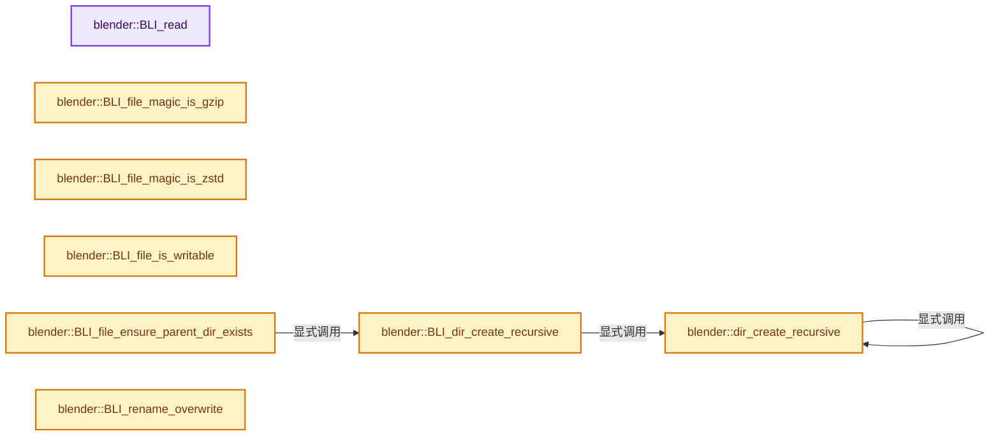
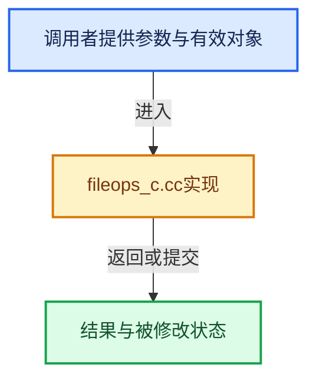

# 实现依赖专题：source/blender/blenlib/intern/fileops_c.cc

[方向导航](README.md) · [符号索引](../%E7%AC%A6%E5%8F%B7%E4%BE%9D%E8%B5%96%E4%B8%8E%E5%AE%9E%E7%8E%B0%E7%B4%A2%E5%BC%95.md)

本专题从正文实际调用进入，集中保存共享实现。函数有稳定锚点，可从调用处直接跳到对应完整函数；递归与互相调用通过回链组织。

## 本文件的实现关系






## 完整成员与函数实现

<a id="f-79f42e0d965e29d7"></a>

### `blender::BLI_read`

实现位置：[source/blender/blenlib/intern/fileops_c.cc](../../../../../source/blender/blenlib/intern/fileops_c.cc) · L98—L146。

接口参数：

- `int fd`
- `void *buf`
- `size_t nbytes`

**教学注释版**

<!-- annotated:27035efcc0855a -->

```cpp
int64_t BLI_read(int fd, void *buf, size_t nbytes)
{
  /* Define our own read as `read` is not guaranteed to read the number of bytes requested.
   * This happens rarely but was observed with larger than 2GB files on Linux, see: #113473.
   *
   * Even though this is a loop, the most common code-path will exit with "Success" case.
   * In the case where read more data than the file contains, it will loop twice,
   * exiting on EOF with the second iteration. */
  int64_t nbytes_read_total = 0;
  while (true) {
    int64_t nbytes_read = read(fd,
                               buf,
#ifdef WIN32
                               /* Read must not exceed INT_MAX on WIN32, clamp. */
                               // [讲解] std::min<size_t>：按比较关系选取较小值；截断范围时还需先满足非负和可表示范围，min本身不会证明边界安全。
                               std::min<size_t>(nbytes, INT_MAX)
#else
                               nbytes
#endif
    );
    if (nbytes_read == nbytes) {
      /* Success (common case). */
      return nbytes_read_total + nbytes_read;
    }
    if (nbytes_read == 0) {
      /* EOF (common case for the second iteration when reading more data than `fd` contains). */
      return nbytes_read_total;
    }
    if (nbytes_read < 0) {
      /* Error. */
      return nbytes_read;
    }

    if (nbytes_read > nbytes) [[unlikely]] {
      /* Badly behaving LIBC, reading more bytes than requested should never happen.
       * Possibly an invalid internal state/corruption, only check to prevent an eternal loop. */
      BLI_assert_unreachable();
      /* Set the IO-error so there is some indication an error occurred. */
      if (errno == 0) {
        errno = EIO;
      }
      return -1;
    }

    /* If this is reached, fewer bytes were read than were requested. */
    buf = static_cast<void *>((static_cast<char *>(buf)) + nbytes_read);
    nbytes_read_total += nbytes_read;
    nbytes -= nbytes_read;
  }
}
```

<details>
<summary>核对原始源码：source/blender/blenlib/intern/fileops_c.cc · L98—L146</summary>

<!-- original:27035efcc0855a:source/blender/blenlib/intern/fileops_c.cc:98:146 -->

```cpp
int64_t BLI_read(int fd, void *buf, size_t nbytes)
{
  /* Define our own read as `read` is not guaranteed to read the number of bytes requested.
   * This happens rarely but was observed with larger than 2GB files on Linux, see: #113473.
   *
   * Even though this is a loop, the most common code-path will exit with "Success" case.
   * In the case where read more data than the file contains, it will loop twice,
   * exiting on EOF with the second iteration. */
  int64_t nbytes_read_total = 0;
  while (true) {
    int64_t nbytes_read = read(fd,
                               buf,
#ifdef WIN32
                               /* Read must not exceed INT_MAX on WIN32, clamp. */
                               std::min<size_t>(nbytes, INT_MAX)
#else
                               nbytes
#endif
    );
    if (nbytes_read == nbytes) {
      /* Success (common case). */
      return nbytes_read_total + nbytes_read;
    }
    if (nbytes_read == 0) {
      /* EOF (common case for the second iteration when reading more data than `fd` contains). */
      return nbytes_read_total;
    }
    if (nbytes_read < 0) {
      /* Error. */
      return nbytes_read;
    }

    if (nbytes_read > nbytes) [[unlikely]] {
      /* Badly behaving LIBC, reading more bytes than requested should never happen.
       * Possibly an invalid internal state/corruption, only check to prevent an eternal loop. */
      BLI_assert_unreachable();
      /* Set the IO-error so there is some indication an error occurred. */
      if (errno == 0) {
        errno = EIO;
      }
      return -1;
    }

    /* If this is reached, fewer bytes were read than were requested. */
    buf = static_cast<void *>((static_cast<char *>(buf)) + nbytes_read);
    nbytes_read_total += nbytes_read;
    nbytes -= nbytes_read;
  }
}
```

</details>

**沿实际写入检查状态**

- `errno = EIO;`
- `buf = static_cast<void *>((static_cast<char *>(buf)) + nbytes_read);`
- `nbytes_read_total += nbytes_read;`
- `nbytes -= nbytes_read;`

**结果出口**

- `return nbytes_read_total + nbytes_read;`
- `return nbytes_read_total;`
- `return nbytes_read;`
- `return -1;`

**继续追踪实现**

- `read` → [调用协议](../%E6%A8%A1%E6%9D%BF%E5%AE%8F%E4%B8%8E%E5%8A%A8%E6%80%81%E5%88%86%E6%B4%BE%E5%8D%8F%E8%AE%AE.md)：函数指针、局部可调用对象或未展开的宏；必须结合调用者环境。调用位置L108。
- `std::min<size_t>` → [外部契约](https://eel.is/c++draft/alg.min.max)：按比较关系选取较小值；截断范围时还需先满足非负和可表示范围，min本身不会证明边界安全。
- `BLI_assert_unreachable` → [BLI_assert_unreachable · L77](%E4%BE%9D%E8%B5%96-BLI_assert-cc98e8.md#m-7a2d91a67d8e)。宏定义由构建条件选择。

<a id="f-b599299ecf75f7ee"></a>

### `blender::BLI_file_magic_is_gzip`

实现位置：[source/blender/blenlib/intern/fileops_c.cc](../../../../../source/blender/blenlib/intern/fileops_c.cc) · L259—L264。

接口参数：

- `const char header[4]`

**教学注释版**

<!-- annotated:5ba22b24da84ca -->

```cpp
bool BLI_file_magic_is_gzip(const char header[4])
{
  /* GZIP itself starts with the magic bytes 0x1f 0x8b.
   * The third byte indicates the compression method, which is 0x08 for DEFLATE. */
  return header[0] == 0x1f && header[1] == 0x8b && header[2] == 0x08;
}
```

<details>
<summary>核对原始源码：source/blender/blenlib/intern/fileops_c.cc · L259—L264</summary>

<!-- original:5ba22b24da84ca:source/blender/blenlib/intern/fileops_c.cc:259:264 -->

```cpp
bool BLI_file_magic_is_gzip(const char header[4])
{
  /* GZIP itself starts with the magic bytes 0x1f 0x8b.
   * The third byte indicates the compression method, which is 0x08 for DEFLATE. */
  return header[0] == 0x1f && header[1] == 0x8b && header[2] == 0x08;
}
```

</details>

**结果出口**

- `return header[0] == 0x1f && header[1] == 0x8b && header[2] == 0x08;`

**继续追踪实现**

本实现没有需要继续展开的显式调用；检查返回表达式、对象转换和调用者前置条件。

<a id="f-3aab416cabcae88e"></a>

### `blender::BLI_file_magic_is_zstd`

实现位置：[source/blender/blenlib/intern/fileops_c.cc](../../../../../source/blender/blenlib/intern/fileops_c.cc) · L266—L291。

接口参数：

- `const char header[4]`

**教学注释版**

<!-- annotated:ea05e3e774a01d -->

```cpp
bool BLI_file_magic_is_zstd(const char header[4])
{
  /* ZSTD files consist of concatenated frames, each either a ZSTD frame or a skippable frame.
   * Both types of frames start with a magic number: `0xFD2FB528` for ZSTD frames and `0x184D2A5`
   * for skippable frames, with the * being anything from 0 to F.
   *
   * To check whether a file is ZSTD-compressed, we just check whether the first frame matches
   * either. Seeking through the file until a ZSTD frame is found would make things more
   * complicated and the probability of a false positive is rather low anyways.
   *
   * Note that LZ4 uses a compatible format, so even though its compressed frames have a
   * different magic number, a valid LZ4 file might also start with a skippable frame matching
   * the second check here.
   *
   * For more details, see https://github.com/facebook/zstd/blob/dev/doc/zstd_compression_format.md
   */

  uint32_t magic = *(reinterpret_cast<uint32_t *>(const_cast<char *>(header)));
  if (magic == 0xFD2FB528) {
    return true;
  }
  if ((magic >> 4) == 0x184D2A5) {
    return true;
  }
  return false;
}
```

<details>
<summary>核对原始源码：source/blender/blenlib/intern/fileops_c.cc · L266—L291</summary>

<!-- original:ea05e3e774a01d:source/blender/blenlib/intern/fileops_c.cc:266:291 -->

```cpp
bool BLI_file_magic_is_zstd(const char header[4])
{
  /* ZSTD files consist of concatenated frames, each either a ZSTD frame or a skippable frame.
   * Both types of frames start with a magic number: `0xFD2FB528` for ZSTD frames and `0x184D2A5`
   * for skippable frames, with the * being anything from 0 to F.
   *
   * To check whether a file is ZSTD-compressed, we just check whether the first frame matches
   * either. Seeking through the file until a ZSTD frame is found would make things more
   * complicated and the probability of a false positive is rather low anyways.
   *
   * Note that LZ4 uses a compatible format, so even though its compressed frames have a
   * different magic number, a valid LZ4 file might also start with a skippable frame matching
   * the second check here.
   *
   * For more details, see https://github.com/facebook/zstd/blob/dev/doc/zstd_compression_format.md
   */

  uint32_t magic = *(reinterpret_cast<uint32_t *>(const_cast<char *>(header)));
  if (magic == 0xFD2FB528) {
    return true;
  }
  if ((magic >> 4) == 0x184D2A5) {
    return true;
  }
  return false;
}
```

</details>

**结果出口**

- `return true;`
- `return false;`

**继续追踪实现**

本实现没有需要继续展开的显式调用；检查返回表达式、对象转换和调用者前置条件。

<a id="f-04afb731359c2724"></a>

### `blender::BLI_file_is_writable`

实现位置：[source/blender/blenlib/intern/fileops_c.cc](../../../../../source/blender/blenlib/intern/fileops_c.cc) · L293—L316。

接口参数：

- `const char *filepath`

**教学注释版**

<!-- annotated:2601310d9a8e75 -->

```cpp
bool BLI_file_is_writable(const char *filepath)
{
  bool writable;
  if (BLI_access(filepath, W_OK) == 0) {
    /* File exists and I can write to it. */
    writable = true;
  }
  else if (errno != ENOENT) {
    /* Most likely file or containing directory cannot be accessed. */
    writable = false;
  }
  else {
    /* File doesn't exist -- check I can create it in parent directory. */
    char parent[FILE_MAX];
    BLI_path_split_dir_part(filepath, parent, sizeof(parent));
#ifdef WIN32
    /* Windows does not have X_OK. */
    writable = BLI_access(parent, W_OK) == 0;
#else
    writable = BLI_access(parent, X_OK | W_OK) == 0;
#endif
  }
  return writable;
}
```

<details>
<summary>核对原始源码：source/blender/blenlib/intern/fileops_c.cc · L293—L316</summary>

<!-- original:2601310d9a8e75:source/blender/blenlib/intern/fileops_c.cc:293:316 -->

```cpp
bool BLI_file_is_writable(const char *filepath)
{
  bool writable;
  if (BLI_access(filepath, W_OK) == 0) {
    /* File exists and I can write to it. */
    writable = true;
  }
  else if (errno != ENOENT) {
    /* Most likely file or containing directory cannot be accessed. */
    writable = false;
  }
  else {
    /* File doesn't exist -- check I can create it in parent directory. */
    char parent[FILE_MAX];
    BLI_path_split_dir_part(filepath, parent, sizeof(parent));
#ifdef WIN32
    /* Windows does not have X_OK. */
    writable = BLI_access(parent, W_OK) == 0;
#else
    writable = BLI_access(parent, X_OK | W_OK) == 0;
#endif
  }
  return writable;
}
```

</details>

**沿实际写入检查状态**

- `writable = true;`
- `writable = false;`
- `writable = BLI_access(parent, W_OK) == 0;`
- `writable = BLI_access(parent, X_OK | W_OK) == 0;`

**结果出口**

- `return writable;`

**继续追踪实现**

- `BLI_access` → [blender::BLI_access · L622](%E4%BE%9D%E8%B5%96-fileops_c-add581.md#f-00750a60825fff2c)；[blender::BLI_access · L1206](%E4%BE%9D%E8%B5%96-fileops_c-add581.md#f-23224ec3502629a0)。同名重载需按实参类型选择。
- `BLI_path_split_dir_part` → [BLI_path_split_dir_part · L1661](%E4%BE%9D%E8%B5%96-path_utils-b4d26a.md#f-ba2c2e768a1d47e7)。

<a id="f-5d0902b9e8b511f0"></a>

### `blender::dir_create_recursive`

实现位置：[source/blender/blenlib/intern/fileops_c.cc](../../../../../source/blender/blenlib/intern/fileops_c.cc) · L356—L414。

接口参数：

- `const char *dirname`
- `const int len`

**教学注释版**

<!-- annotated:f59e7e00dd8cd8 -->

```cpp
static bool dir_create_recursive(const char *dirname, const int len)
{
  BLI_assert(strlen(dirname) == len);
  /* Caller must ensure the path doesn't have trailing slashes. */
  BLI_assert_msg(len && !BLI_path_slash_is_native_compat(dirname[len - 1]),
                 "Paths must not end with a slash!");
  BLI_assert_msg(!((len >= 3) && BLI_path_slash_is_native_compat(dirname[len - 3]) &&
                   STREQ(dirname + (len - 2), "..")),
                 "Paths containing \"..\" components must be normalized first!");

  bool ret = true;
  char *dirname_parent_end = const_cast<char *>(BLI_path_parent_dir_end(dirname, len));
  if (dirname_parent_end) {
    const char dirname_parent_end_value = *dirname_parent_end;
    *dirname_parent_end = '\0';
#ifdef WIN32
    /* Check special case `c:\foo`, don't try create `c:`, harmless but unnecessary. */
    if (dirname[0] && !BLI_path_is_win32_drive_only(dirname))
#endif
    {
      const int mode = BLI_file_stat_mode(dirname);
      if (mode != 0) {
        if (!S_ISDIR(mode)) {
          ret = false;
        }
      }
      else if (!dir_create_recursive(dirname, dirname_parent_end - dirname)) {
        ret = false;
      }
    }
    *dirname_parent_end = dirname_parent_end_value;
  }
  if (ret) {
    /* Ignore errors when the directory was created (probably by another process) in between the
     * earlier call to BLI_exists() and this call to mkdir. Since this function only creates a
     * directory if it doesn't exist yet, this is actually not seen as an error, even though
     * mkdir() failed. */
#ifdef WIN32
    if (umkdir(dirname) == -1) {
      if (GetLastError() == ERROR_ALREADY_EXISTS && BLI_is_dir(dirname)) {
        return true;
      }

      /* Any other error should bubble up as an actual error. */
      ret = false;
    }
#else
    if (mkdir(dirname, 0777) != 0) {
      if (errno == EEXIST && BLI_is_dir(dirname)) {
        return true;
      }

      /* Any other error should bubble up as an actual error. */
      ret = false;
    }
#endif
  }
  return ret;
}
```

<details>
<summary>核对原始源码：source/blender/blenlib/intern/fileops_c.cc · L356—L414</summary>

<!-- original:f59e7e00dd8cd8:source/blender/blenlib/intern/fileops_c.cc:356:414 -->

```cpp
static bool dir_create_recursive(const char *dirname, const int len)
{
  BLI_assert(strlen(dirname) == len);
  /* Caller must ensure the path doesn't have trailing slashes. */
  BLI_assert_msg(len && !BLI_path_slash_is_native_compat(dirname[len - 1]),
                 "Paths must not end with a slash!");
  BLI_assert_msg(!((len >= 3) && BLI_path_slash_is_native_compat(dirname[len - 3]) &&
                   STREQ(dirname + (len - 2), "..")),
                 "Paths containing \"..\" components must be normalized first!");

  bool ret = true;
  char *dirname_parent_end = const_cast<char *>(BLI_path_parent_dir_end(dirname, len));
  if (dirname_parent_end) {
    const char dirname_parent_end_value = *dirname_parent_end;
    *dirname_parent_end = '\0';
#ifdef WIN32
    /* Check special case `c:\foo`, don't try create `c:`, harmless but unnecessary. */
    if (dirname[0] && !BLI_path_is_win32_drive_only(dirname))
#endif
    {
      const int mode = BLI_file_stat_mode(dirname);
      if (mode != 0) {
        if (!S_ISDIR(mode)) {
          ret = false;
        }
      }
      else if (!dir_create_recursive(dirname, dirname_parent_end - dirname)) {
        ret = false;
      }
    }
    *dirname_parent_end = dirname_parent_end_value;
  }
  if (ret) {
    /* Ignore errors when the directory was created (probably by another process) in between the
     * earlier call to BLI_exists() and this call to mkdir. Since this function only creates a
     * directory if it doesn't exist yet, this is actually not seen as an error, even though
     * mkdir() failed. */
#ifdef WIN32
    if (umkdir(dirname) == -1) {
      if (GetLastError() == ERROR_ALREADY_EXISTS && BLI_is_dir(dirname)) {
        return true;
      }

      /* Any other error should bubble up as an actual error. */
      ret = false;
    }
#else
    if (mkdir(dirname, 0777) != 0) {
      if (errno == EEXIST && BLI_is_dir(dirname)) {
        return true;
      }

      /* Any other error should bubble up as an actual error. */
      ret = false;
    }
#endif
  }
  return ret;
}
```

</details>

**沿实际写入检查状态**

- `ret = false;`

**结果出口**

- `return true;`
- `return ret;`

**继续追踪实现**

- `BLI_assert` → [BLI_assert · L48](%E4%BE%9D%E8%B5%96-BLI_assert-cc98e8.md#m-57a88495704d)；[BLI_assert · L63](%E4%BE%9D%E8%B5%96-BLI_assert-cc98e8.md#m-d07050020cb5)。宏定义由构建条件选择。
- `strlen` → [外部契约](https://eel.is/c++draft/)：这个边界按实际表达式及所属类型核对参数、返回值、寿命与失败行为。这里提供接口入口，不声称已解释该第三方版本的内部实现。
- `BLI_assert_msg` → [BLI_assert_msg · L55](%E4%BE%9D%E8%B5%96-BLI_assert-cc98e8.md#m-695eed20dceb)；[BLI_assert_msg · L64](%E4%BE%9D%E8%B5%96-BLI_assert-cc98e8.md#m-7de5563de4db)。宏定义由构建条件选择。
- `BLI_path_slash_is_native_compat` → [blender::BLI_path_slash_is_native_compat · L765](%E4%BE%9D%E8%B5%96-BLI_path_utils-130405.md#f-e95b7b29f428577d)。
- `STREQ` → [STREQ · L112](../05-%E5%87%A0%E4%BD%95%E5%AD%98%E5%82%A8%E4%B8%8E%E6%8B%93%E6%89%91%E6%98%A0%E5%B0%84/%E4%BE%9D%E8%B5%96-GHOST_utildefines-34b996.md#m-9549fb6aafd2)；[STREQ · L451](%E4%BE%9D%E8%B5%96-BLI_utildefines-293a0a.md#m-c7b745bcfad2)；[STREQ · L55](../05-%E5%87%A0%E4%BD%95%E5%AD%98%E5%82%A8%E4%B8%8E%E6%8B%93%E6%89%91%E6%98%A0%E5%B0%84/%E4%BE%9D%E8%B5%96-clog-a0bec8.md#m-96e78f386894)。宏定义由构建条件选择。
- `BLI_path_parent_dir_end` → [BLI_path_parent_dir_end · L876](%E4%BE%9D%E8%B5%96-path_utils-b4d26a.md#f-e133a6d6f695e1a3)。
- `BLI_path_is_win32_drive_only` → [BLI_path_is_win32_drive_only · L581](%E4%BE%9D%E8%B5%96-path_utils-b4d26a.md#f-0eeec757f986689a)。
- `BLI_file_stat_mode` → [blender::BLI_file_stat_mode · L362](%E4%BE%9D%E8%B5%96-storage-bda15e.md#f-15c3e43aa155e679)。
- `S_ISDIR` → [S_ISDIR · L55](../05-%E5%87%A0%E4%BD%95%E5%AD%98%E5%82%A8%E4%B8%8E%E6%8B%93%E6%89%91%E6%98%A0%E5%B0%84/%E4%BE%9D%E8%B5%96-path-126dbb.md#m-a2912a12b5f6)；[S_ISDIR · L41](%E4%BE%9D%E8%B5%96-BLI_winstuff-71eba1.md#m-de05ffa6850f)。宏定义由构建条件选择。
- `dir_create_recursive` → [blender::dir_create_recursive · L356](%E4%BE%9D%E8%B5%96-fileops_c-add581.md#f-5d0902b9e8b511f0)。
- `umkdir` → [umkdir · L94](../05-%E5%87%A0%E4%BD%95%E5%AD%98%E5%82%A8%E4%B8%8E%E6%8B%93%E6%89%91%E6%98%A0%E5%B0%84/%E4%BE%9D%E8%B5%96-utf_winfunc-288522.md#f-295a9e438a24c42f)。
- `GetLastError` → [调用协议](../%E6%A8%A1%E6%9D%BF%E5%AE%8F%E4%B8%8E%E5%8A%A8%E6%80%81%E5%88%86%E6%B4%BE%E5%8D%8F%E8%AE%AE.md)：函数指针、局部可调用对象或未展开的宏；必须结合调用者环境。调用位置L395。
- `BLI_is_dir` → [blender::BLI_is_dir · L457](%E4%BE%9D%E8%B5%96-storage-bda15e.md#f-eedeb1fd6a515977)。
- `mkdir` → [调用协议](../%E6%A8%A1%E6%9D%BF%E5%AE%8F%E4%B8%8E%E5%8A%A8%E6%80%81%E5%88%86%E6%B4%BE%E5%8D%8F%E8%AE%AE.md)：函数指针、局部可调用对象或未展开的宏；必须结合调用者环境。调用位置L403。

<a id="f-27fbfd7ad143739e"></a>

### `blender::BLI_dir_create_recursive`

实现位置：[source/blender/blenlib/intern/fileops_c.cc](../../../../../source/blender/blenlib/intern/fileops_c.cc) · L416—L452。

接口参数：

- `const char *dirname`

**教学注释版**

<!-- annotated:6d78a325f382ae -->

```cpp
bool BLI_dir_create_recursive(const char *dirname)
{
  const int mode = BLI_file_stat_mode(dirname);
  if (mode != 0) {
    /* The file exists, either it's a directory (ok), or not,
     * in which case this function can't do anything useful
     * (the caller could remove it and re-run this function). */
    return S_ISDIR(mode) ? true : false;
  }

  char dirname_static_buf[FILE_MAX];
  char *dirname_mut = dirname_static_buf;

  size_t len = strlen(dirname);
  if (len >= sizeof(dirname_static_buf)) {
    dirname_mut = MEM_new_array_zeroed<char>(len + 1, __func__);
  }
  // [讲解] memcpy：复制字节，源与目标不应重叠。类型生命周期、对齐和可复制表示须由调用者证明，不是任意对象的复制构造。
  memcpy(dirname_mut, dirname, len + 1);

  /* Strip trailing chars, important for first entering #dir_create_recursive
   * when then ensures this is the case for recursive calls. */
  while ((len > 0) && BLI_path_slash_is_native_compat(dirname_mut[len - 1])) {
    len--;
  }
  dirname_mut[len] = '\0';

  const bool ret = (len > 0) && dir_create_recursive(dirname_mut, len);

  /* Ensure the string was properly restored. */
  BLI_assert(memcmp(dirname, dirname_mut, len) == 0);

  if (dirname_mut != dirname_static_buf) {
    MEM_delete(dirname_mut);
  }

  return ret;
}
```

<details>
<summary>核对原始源码：source/blender/blenlib/intern/fileops_c.cc · L416—L452</summary>

<!-- original:6d78a325f382ae:source/blender/blenlib/intern/fileops_c.cc:416:452 -->

```cpp
bool BLI_dir_create_recursive(const char *dirname)
{
  const int mode = BLI_file_stat_mode(dirname);
  if (mode != 0) {
    /* The file exists, either it's a directory (ok), or not,
     * in which case this function can't do anything useful
     * (the caller could remove it and re-run this function). */
    return S_ISDIR(mode) ? true : false;
  }

  char dirname_static_buf[FILE_MAX];
  char *dirname_mut = dirname_static_buf;

  size_t len = strlen(dirname);
  if (len >= sizeof(dirname_static_buf)) {
    dirname_mut = MEM_new_array_zeroed<char>(len + 1, __func__);
  }
  memcpy(dirname_mut, dirname, len + 1);

  /* Strip trailing chars, important for first entering #dir_create_recursive
   * when then ensures this is the case for recursive calls. */
  while ((len > 0) && BLI_path_slash_is_native_compat(dirname_mut[len - 1])) {
    len--;
  }
  dirname_mut[len] = '\0';

  const bool ret = (len > 0) && dir_create_recursive(dirname_mut, len);

  /* Ensure the string was properly restored. */
  BLI_assert(memcmp(dirname, dirname_mut, len) == 0);

  if (dirname_mut != dirname_static_buf) {
    MEM_delete(dirname_mut);
  }

  return ret;
}
```

</details>

**沿实际写入检查状态**

- `dirname_mut = MEM_new_array_zeroed<char>(len + 1, __func__);`
- `dirname_mut[len] = '\0';`

**结果出口**

- `return S_ISDIR(mode) ? true : false;`
- `return ret;`

**继续追踪实现**

- `BLI_file_stat_mode` → [blender::BLI_file_stat_mode · L362](%E4%BE%9D%E8%B5%96-storage-bda15e.md#f-15c3e43aa155e679)。
- `S_ISDIR` → [S_ISDIR · L55](../05-%E5%87%A0%E4%BD%95%E5%AD%98%E5%82%A8%E4%B8%8E%E6%8B%93%E6%89%91%E6%98%A0%E5%B0%84/%E4%BE%9D%E8%B5%96-path-126dbb.md#m-a2912a12b5f6)；[S_ISDIR · L41](%E4%BE%9D%E8%B5%96-BLI_winstuff-71eba1.md#m-de05ffa6850f)。宏定义由构建条件选择。
- `strlen` → [外部契约](https://eel.is/c++draft/)：这个边界按实际表达式及所属类型核对参数、返回值、寿命与失败行为。这里提供接口入口，不声称已解释该第三方版本的内部实现。
- `MEM_new_array_zeroed<char>` → [MEM_new_array_zeroed · L566](../03-%E5%86%85%E5%AD%98%E5%88%86%E9%85%8D%E4%B8%8E%E8%BF%90%E8%A1%8C%E6%97%B6%E7%B1%BB%E5%9E%8B/%E4%BE%9D%E8%B5%96-MEM_guardedalloc-b54eca.md#f-3a0cf63fb5216500)；[MEM_new_array_zeroed · L119](../03-%E5%86%85%E5%AD%98%E5%88%86%E9%85%8D%E4%B8%8E%E8%BF%90%E8%A1%8C%E6%97%B6%E7%B1%BB%E5%9E%8B/%E4%BE%9D%E8%B5%96-mallocn-afdcd4.md#f-6825557da566fdbe)。同名重载需按实参类型选择。
- `memcpy` → [外部契约](https://eel.is/c++draft/cstring.syn)：复制字节，源与目标不应重叠。类型生命周期、对齐和可复制表示须由调用者证明，不是任意对象的复制构造。
- `BLI_path_slash_is_native_compat` → [blender::BLI_path_slash_is_native_compat · L765](%E4%BE%9D%E8%B5%96-BLI_path_utils-130405.md#f-e95b7b29f428577d)。
- `dir_create_recursive` → [blender::dir_create_recursive · L356](%E4%BE%9D%E8%B5%96-fileops_c-add581.md#f-5d0902b9e8b511f0)。
- `BLI_assert` → [BLI_assert · L48](%E4%BE%9D%E8%B5%96-BLI_assert-cc98e8.md#m-57a88495704d)；[BLI_assert · L63](%E4%BE%9D%E8%B5%96-BLI_assert-cc98e8.md#m-d07050020cb5)。宏定义由构建条件选择。
- `memcmp` → [外部契约](https://eel.is/c++draft/)：这个边界按实际表达式及所属类型核对参数、返回值、寿命与失败行为。这里提供接口入口，不声称已解释该第三方版本的内部实现。
- `MEM_delete` → [MEM_delete · L400](../03-%E5%86%85%E5%AD%98%E5%88%86%E9%85%8D%E4%B8%8E%E8%BF%90%E8%A1%8C%E6%97%B6%E7%B1%BB%E5%9E%8B/%E4%BE%9D%E8%B5%96-MEM_guardedalloc-b54eca.md#f-9049ffdd1682887c)。

<a id="f-4a52b353b2b7ba32"></a>

### `blender::BLI_file_ensure_parent_dir_exists`

实现位置：[source/blender/blenlib/intern/fileops_c.cc](../../../../../source/blender/blenlib/intern/fileops_c.cc) · L454—L461。

接口参数：

- `const char *filepath`

**教学注释版**

<!-- annotated:08132e8e9304e9 -->

```cpp
bool BLI_file_ensure_parent_dir_exists(const char *filepath)
{
  char di[FILE_MAX];
  BLI_path_split_dir_part(filepath, di, sizeof(di));

  /* Make if the dir doesn't exist. */
  return BLI_dir_create_recursive(di);
}
```

<details>
<summary>核对原始源码：source/blender/blenlib/intern/fileops_c.cc · L454—L461</summary>

<!-- original:08132e8e9304e9:source/blender/blenlib/intern/fileops_c.cc:454:461 -->

```cpp
bool BLI_file_ensure_parent_dir_exists(const char *filepath)
{
  char di[FILE_MAX];
  BLI_path_split_dir_part(filepath, di, sizeof(di));

  /* Make if the dir doesn't exist. */
  return BLI_dir_create_recursive(di);
}
```

</details>

**结果出口**

- `return BLI_dir_create_recursive(di);`

**继续追踪实现**

- `BLI_path_split_dir_part` → [BLI_path_split_dir_part · L1661](%E4%BE%9D%E8%B5%96-path_utils-b4d26a.md#f-ba2c2e768a1d47e7)。
- `BLI_dir_create_recursive` → [blender::BLI_dir_create_recursive · L416](%E4%BE%9D%E8%B5%96-fileops_c-add581.md#f-27fbfd7ad143739e)。

<a id="f-16e0fa382642af67"></a>

### `blender::BLI_rename_overwrite`

实现位置：[source/blender/blenlib/intern/fileops_c.cc](../../../../../source/blender/blenlib/intern/fileops_c.cc) · L530—L549。

接口参数：

- `const char *from`
- `const char *to`

**教学注释版**

<!-- annotated:9d6fa05240bddd -->

```cpp
int BLI_rename_overwrite(const char *from, const char *to)
{
  if (!BLI_exists(from)) {
    return 1;
  }

#ifdef WIN32
  /* `urename` from `utfconv` intern utils uses `MoveFileExW`, which allows to replace an existing
   * file, but not an existing directory, even if empty. This will only delete empty directories.
   */
  if (BLI_is_dir(to)) {
    if (BLI_delete(to, true, false)) {
      return 1;
    }
  }
  return urename(from, to, true);
#else
  return rename(from, to);
#endif
}
```

<details>
<summary>核对原始源码：source/blender/blenlib/intern/fileops_c.cc · L530—L549</summary>

<!-- original:9d6fa05240bddd:source/blender/blenlib/intern/fileops_c.cc:530:549 -->

```cpp
int BLI_rename_overwrite(const char *from, const char *to)
{
  if (!BLI_exists(from)) {
    return 1;
  }

#ifdef WIN32
  /* `urename` from `utfconv` intern utils uses `MoveFileExW`, which allows to replace an existing
   * file, but not an existing directory, even if empty. This will only delete empty directories.
   */
  if (BLI_is_dir(to)) {
    if (BLI_delete(to, true, false)) {
      return 1;
    }
  }
  return urename(from, to, true);
#else
  return rename(from, to);
#endif
}
```

</details>

**结果出口**

- `return 1;`
- `return urename(from, to, true);`
- `return rename(from, to);`

**继续追踪实现**

- `BLI_exists` → [blender::BLI_exists · L404](%E4%BE%9D%E8%B5%96-storage-bda15e.md#f-a84afb14d0277334)。
- `BLI_is_dir` → [blender::BLI_is_dir · L457](%E4%BE%9D%E8%B5%96-storage-bda15e.md#f-eedeb1fd6a515977)。
- `BLI_delete` → [blender::BLI_delete · L755](%E4%BE%9D%E8%B5%96-fileops_c-add581.md#f-52bb2cf47a5d315b)；[blender::BLI_delete · L1213](%E4%BE%9D%E8%B5%96-fileops_c-add581.md#f-53fbcac7274c6ffe)。同名重载需按实参类型选择。
- `urename` → [urename · L75](../05-%E5%87%A0%E4%BD%95%E5%AD%98%E5%82%A8%E4%B8%8E%E6%8B%93%E6%89%91%E6%98%A0%E5%B0%84/%E4%BE%9D%E8%B5%96-utf_winfunc-288522.md#f-4831fd3a5c036305)。
- `rename` → [blender::AssetLibraryListItemCommon::rename · L51](../05-%E5%87%A0%E4%BD%95%E5%AD%98%E5%82%A8%E4%B8%8E%E6%8B%93%E6%89%91%E6%98%A0%E5%B0%84/%E4%BE%9D%E8%B5%96-custom_asset_library_list_ui-3bf05c.md#f-cdb8ed027f5958c6)。

<a id="f-937a53f441a4f39d"></a>

### `blender::callLocalErrorCallBack`

实现位置：[source/blender/blenlib/intern/fileops_c.cc](../../../../../source/blender/blenlib/intern/fileops_c.cc) · L553—L556。

接口参数：

- `const char *err`

**教学注释版**

<!-- annotated:f4e2c1408f21a9 -->

```cpp
static void callLocalErrorCallBack(const char *err)
{
  printf("%s\n", err);
}
```

<details>
<summary>核对原始源码：source/blender/blenlib/intern/fileops_c.cc · L553—L556</summary>

<!-- original:f4e2c1408f21a9:source/blender/blenlib/intern/fileops_c.cc:553:556 -->

```cpp
static void callLocalErrorCallBack(const char *err)
{
  printf("%s\n", err);
}
```

</details>

**继续追踪实现**

- `printf` → [外部契约](https://eel.is/c++draft/)：这个边界按实际表达式及所属类型核对参数、返回值、寿命与失败行为。这里提供接口入口，不声称已解释该第三方版本的内部实现。

<a id="f-c6d3cebeeea3cab3"></a>

### `blender::BLI_fopen`

实现位置：[source/blender/blenlib/intern/fileops_c.cc](../../../../../source/blender/blenlib/intern/fileops_c.cc) · L558—L563。

接口参数：

- `const char *filepath`
- `const char *mode`

**教学注释版**

<!-- annotated:d9cb2caa5a6635 -->

```cpp
FILE *BLI_fopen(const char *filepath, const char *mode)
{
  BLI_assert(!BLI_path_is_rel(filepath));

  return ufopen(filepath, mode);
}
```

<details>
<summary>核对原始源码：source/blender/blenlib/intern/fileops_c.cc · L558—L563</summary>

<!-- original:d9cb2caa5a6635:source/blender/blenlib/intern/fileops_c.cc:558:563 -->

```cpp
FILE *BLI_fopen(const char *filepath, const char *mode)
{
  BLI_assert(!BLI_path_is_rel(filepath));

  return ufopen(filepath, mode);
}
```

</details>

**结果出口**

- `return ufopen(filepath, mode);`

**继续追踪实现**

- `BLI_assert` → [BLI_assert · L48](%E4%BE%9D%E8%B5%96-BLI_assert-cc98e8.md#m-57a88495704d)；[BLI_assert · L63](%E4%BE%9D%E8%B5%96-BLI_assert-cc98e8.md#m-d07050020cb5)。宏定义由构建条件选择。
- `BLI_path_is_rel` → [BLI_path_is_rel · L536](%E4%BE%9D%E8%B5%96-path_utils-b4d26a.md#f-d938443d331ba72c)。
- `ufopen` → [ufopen · L19](../05-%E5%87%A0%E4%BD%95%E5%AD%98%E5%82%A8%E4%B8%8E%E6%8B%93%E6%89%91%E6%98%A0%E5%B0%84/%E4%BE%9D%E8%B5%96-utf_winfunc-288522.md#f-e9a6cb27a0d23a44)。

<a id="f-5889504ee4df97d2"></a>

### `blender::BLI_open`

实现位置：[source/blender/blenlib/intern/fileops_c.cc](../../../../../source/blender/blenlib/intern/fileops_c.cc) · L615—L620。

接口参数：

- `const char *filepath`
- `int oflag`
- `int pmode`

**教学注释版**

<!-- annotated:cf4bfbbefbda93 -->

```cpp
int BLI_open(const char *filepath, int oflag, int pmode)
{
  BLI_assert(!BLI_path_is_rel(filepath));

  return uopen(filepath, oflag, pmode);
}
```

<details>
<summary>核对原始源码：source/blender/blenlib/intern/fileops_c.cc · L615—L620</summary>

<!-- original:cf4bfbbefbda93:source/blender/blenlib/intern/fileops_c.cc:615:620 -->

```cpp
int BLI_open(const char *filepath, int oflag, int pmode)
{
  BLI_assert(!BLI_path_is_rel(filepath));

  return uopen(filepath, oflag, pmode);
}
```

</details>

**结果出口**

- `return uopen(filepath, oflag, pmode);`

**继续追踪实现**

- `BLI_assert` → [BLI_assert · L48](%E4%BE%9D%E8%B5%96-BLI_assert-cc98e8.md#m-57a88495704d)；[BLI_assert · L63](%E4%BE%9D%E8%B5%96-BLI_assert-cc98e8.md#m-d07050020cb5)。宏定义由构建条件选择。
- `BLI_path_is_rel` → [BLI_path_is_rel · L536](%E4%BE%9D%E8%B5%96-path_utils-b4d26a.md#f-d938443d331ba72c)。
- `uopen` → [uopen · L41](../05-%E5%87%A0%E4%BD%95%E5%AD%98%E5%82%A8%E4%B8%8E%E6%8B%93%E6%89%91%E6%98%A0%E5%B0%84/%E4%BE%9D%E8%B5%96-utf_winfunc-288522.md#f-2adf8254be5dbf1c)。

<a id="f-00750a60825fff2c"></a>

### `blender::BLI_access`

实现位置：[source/blender/blenlib/intern/fileops_c.cc](../../../../../source/blender/blenlib/intern/fileops_c.cc) · L622—L627。

接口参数：

- `const char *filepath`
- `int mode`

**教学注释版**

<!-- annotated:27d48f0ebd7ed3 -->

```cpp
int BLI_access(const char *filepath, int mode)
{
  BLI_assert(!BLI_path_is_rel(filepath));

  return uaccess(filepath, mode);
}
```

<details>
<summary>核对原始源码：source/blender/blenlib/intern/fileops_c.cc · L622—L627</summary>

<!-- original:27d48f0ebd7ed3:source/blender/blenlib/intern/fileops_c.cc:622:627 -->

```cpp
int BLI_access(const char *filepath, int mode)
{
  BLI_assert(!BLI_path_is_rel(filepath));

  return uaccess(filepath, mode);
}
```

</details>

**结果出口**

- `return uaccess(filepath, mode);`

**继续追踪实现**

- `BLI_assert` → [BLI_assert · L48](%E4%BE%9D%E8%B5%96-BLI_assert-cc98e8.md#m-57a88495704d)；[BLI_assert · L63](%E4%BE%9D%E8%B5%96-BLI_assert-cc98e8.md#m-d07050020cb5)。宏定义由构建条件选择。
- `BLI_path_is_rel` → [BLI_path_is_rel · L536](%E4%BE%9D%E8%B5%96-path_utils-b4d26a.md#f-d938443d331ba72c)。
- `uaccess` → [uaccess · L61](../05-%E5%87%A0%E4%BD%95%E5%AD%98%E5%82%A8%E4%B8%8E%E6%8B%93%E6%89%91%E6%98%A0%E5%B0%84/%E4%BE%9D%E8%B5%96-utf_winfunc-288522.md#f-1221c4c0f3617d8b)。

<a id="f-84ee4a4ca3b96b95"></a>

### `blender::delete_unique`

实现位置：[source/blender/blenlib/intern/fileops_c.cc](../../../../../source/blender/blenlib/intern/fileops_c.cc) · L691—L713。

接口参数：

- `const char *path`
- `const bool dir`

**教学注释版**

<!-- annotated:941872be15bc65 -->

```cpp
static bool delete_unique(const char *path, const bool dir)
{
  bool err;

  UTF16_ENCODE(path);

  if (dir) {
    err = !RemoveDirectoryW(path_16);
    if (err) {
      printf("Unable to remove directory\n");
    }
  }
  else {
    err = !DeleteFileW(path_16);
    if (err) {
      callLocalErrorCallBack("Unable to delete file");
    }
  }

  UTF16_UN_ENCODE(path);

  return err;
}
```

<details>
<summary>核对原始源码：source/blender/blenlib/intern/fileops_c.cc · L691—L713</summary>

<!-- original:941872be15bc65:source/blender/blenlib/intern/fileops_c.cc:691:713 -->

```cpp
static bool delete_unique(const char *path, const bool dir)
{
  bool err;

  UTF16_ENCODE(path);

  if (dir) {
    err = !RemoveDirectoryW(path_16);
    if (err) {
      printf("Unable to remove directory\n");
    }
  }
  else {
    err = !DeleteFileW(path_16);
    if (err) {
      callLocalErrorCallBack("Unable to delete file");
    }
  }

  UTF16_UN_ENCODE(path);

  return err;
}
```

</details>

**沿实际写入检查状态**

- `err = !RemoveDirectoryW(path_16);`
- `err = !DeleteFileW(path_16);`

**结果出口**

- `return err;`

**继续追踪实现**

- `UTF16_ENCODE` → [UTF16_ENCODE · L80](../05-%E5%87%A0%E4%BD%95%E5%AD%98%E5%82%A8%E4%B8%8E%E6%8B%93%E6%89%91%E6%98%A0%E5%B0%84/%E4%BE%9D%E8%B5%96-utfconv-431f5d.md#m-525fa4c6da9a)。宏定义由构建条件选择。
- `RemoveDirectoryW` → [调用协议](../%E6%A8%A1%E6%9D%BF%E5%AE%8F%E4%B8%8E%E5%8A%A8%E6%80%81%E5%88%86%E6%B4%BE%E5%8D%8F%E8%AE%AE.md)：函数指针、局部可调用对象或未展开的宏；必须结合调用者环境。调用位置L698。
- `printf` → [外部契约](https://eel.is/c++draft/)：这个边界按实际表达式及所属类型核对参数、返回值、寿命与失败行为。这里提供接口入口，不声称已解释该第三方版本的内部实现。
- `DeleteFileW` → [调用协议](../%E6%A8%A1%E6%9D%BF%E5%AE%8F%E4%B8%8E%E5%8A%A8%E6%80%81%E5%88%86%E6%B4%BE%E5%8D%8F%E8%AE%AE.md)：函数指针、局部可调用对象或未展开的宏；必须结合调用者环境。调用位置L704。
- `callLocalErrorCallBack` → [blender::callLocalErrorCallBack · L553](%E4%BE%9D%E8%B5%96-fileops_c-add581.md#f-937a53f441a4f39d)。
- `UTF16_UN_ENCODE` → [UTF16_UN_ENCODE · L84](../05-%E5%87%A0%E4%BD%95%E5%AD%98%E5%82%A8%E4%B8%8E%E6%8B%93%E6%89%91%E6%98%A0%E5%B0%84/%E4%BE%9D%E8%B5%96-utfconv-431f5d.md#m-0b666190cfed)。宏定义由构建条件选择。

<a id="f-41569d6c9f5846dc"></a>

### `blender::delete_recursive`

实现位置：[source/blender/blenlib/intern/fileops_c.cc](../../../../../source/blender/blenlib/intern/fileops_c.cc) · L715—L753。

接口参数：

- `const char *dir`

**教学注释版**

<!-- annotated:6aab29e760612d -->

```cpp
static bool delete_recursive(const char *dir)
{
  struct direntry *filelist, *fl;
  bool err = false;
  uint filelist_num, i;

  i = filelist_num = BLI_filelist_dir_contents(dir, &filelist);
  fl = filelist;
  while (i--) {
    if (FILENAME_IS_CURRPAR(fl->relname)) {
      /* Skip! */
    }
    else if (S_ISDIR(fl->type)) {
      char path[FILE_MAXDIR];

      /* dir listing produces dir path without trailing slash... */
      STRNCPY(path, fl->path);
      BLI_path_slash_ensure(path, sizeof(path));

      if (delete_recursive(path)) {
        err = true;
      }
    }
    else {
      if (delete_unique(fl->path, false)) {
        err = true;
      }
    }
    fl++;
  }

  if (!err && delete_unique(dir, true)) {
    err = true;
  }

  BLI_filelist_free(filelist, filelist_num);

  return err;
}
```

<details>
<summary>核对原始源码：source/blender/blenlib/intern/fileops_c.cc · L715—L753</summary>

<!-- original:6aab29e760612d:source/blender/blenlib/intern/fileops_c.cc:715:753 -->

```cpp
static bool delete_recursive(const char *dir)
{
  struct direntry *filelist, *fl;
  bool err = false;
  uint filelist_num, i;

  i = filelist_num = BLI_filelist_dir_contents(dir, &filelist);
  fl = filelist;
  while (i--) {
    if (FILENAME_IS_CURRPAR(fl->relname)) {
      /* Skip! */
    }
    else if (S_ISDIR(fl->type)) {
      char path[FILE_MAXDIR];

      /* dir listing produces dir path without trailing slash... */
      STRNCPY(path, fl->path);
      BLI_path_slash_ensure(path, sizeof(path));

      if (delete_recursive(path)) {
        err = true;
      }
    }
    else {
      if (delete_unique(fl->path, false)) {
        err = true;
      }
    }
    fl++;
  }

  if (!err && delete_unique(dir, true)) {
    err = true;
  }

  BLI_filelist_free(filelist, filelist_num);

  return err;
}
```

</details>

**沿实际写入检查状态**

- `i = filelist_num = BLI_filelist_dir_contents(dir, &filelist);`
- `fl = filelist;`
- `err = true;`

**结果出口**

- `return err;`

**继续追踪实现**

- `BLI_filelist_dir_contents` → [blender::BLI_filelist_dir_contents · L230](%E4%BE%9D%E8%B5%96-BLI_filelist-84464e.md#f-4e2c9b3e1fe3857e)。
- `FILENAME_IS_CURRPAR` → [FILENAME_IS_CURRPAR · L823](%E4%BE%9D%E8%B5%96-BLI_path_utils-130405.md#m-f41bcdb4516d)。宏定义由构建条件选择。
- `S_ISDIR` → [S_ISDIR · L55](../05-%E5%87%A0%E4%BD%95%E5%AD%98%E5%82%A8%E4%B8%8E%E6%8B%93%E6%89%91%E6%98%A0%E5%B0%84/%E4%BE%9D%E8%B5%96-path-126dbb.md#m-a2912a12b5f6)；[S_ISDIR · L41](%E4%BE%9D%E8%B5%96-BLI_winstuff-71eba1.md#m-de05ffa6850f)。宏定义由构建条件选择。
- `STRNCPY` → [blender::STRNCPY · L690](%E4%BE%9D%E8%B5%96-BLI_string-b43058.md#f-6b2d861724026be6)。
- `BLI_path_slash_ensure` → [BLI_path_slash_ensure · L2021](%E4%BE%9D%E8%B5%96-path_utils-b4d26a.md#f-5a6c9abc494fe6dd)。
- `delete_recursive` → [blender::delete_recursive · L715](%E4%BE%9D%E8%B5%96-fileops_c-add581.md#f-41569d6c9f5846dc)。
- `delete_unique` → [blender::delete_unique · L691](%E4%BE%9D%E8%B5%96-fileops_c-add581.md#f-84ee4a4ca3b96b95)。
- `BLI_filelist_free` → [blender::BLI_filelist_free · L381](%E4%BE%9D%E8%B5%96-BLI_filelist-84464e.md#f-f6982952b7b56e40)。

<a id="f-52bb2cf47a5d315b"></a>

### `blender::BLI_delete`

实现位置：[source/blender/blenlib/intern/fileops_c.cc](../../../../../source/blender/blenlib/intern/fileops_c.cc) · L755—L772。

接口参数：

- `const char *path`
- `bool dir`
- `bool recursive`

**教学注释版**

<!-- annotated:b4b4ff6dd917ba -->

```cpp
int BLI_delete(const char *path, bool dir, bool recursive)
{
  int err;

  BLI_assert(!BLI_path_is_rel(path));

  /* Not an error but avoid ambiguous arguments (recursive file deletion isn't meaningful). */
  BLI_assert(!(dir == false && recursive == true));

  if (recursive) {
    err = delete_recursive(path);
  }
  else {
    err = delete_unique(path, dir);
  }

  return err;
}
```

<details>
<summary>核对原始源码：source/blender/blenlib/intern/fileops_c.cc · L755—L772</summary>

<!-- original:b4b4ff6dd917ba:source/blender/blenlib/intern/fileops_c.cc:755:772 -->

```cpp
int BLI_delete(const char *path, bool dir, bool recursive)
{
  int err;

  BLI_assert(!BLI_path_is_rel(path));

  /* Not an error but avoid ambiguous arguments (recursive file deletion isn't meaningful). */
  BLI_assert(!(dir == false && recursive == true));

  if (recursive) {
    err = delete_recursive(path);
  }
  else {
    err = delete_unique(path, dir);
  }

  return err;
}
```

</details>

**沿实际写入检查状态**

- `err = delete_recursive(path);`
- `err = delete_unique(path, dir);`

**结果出口**

- `return err;`

**继续追踪实现**

- `BLI_assert` → [BLI_assert · L48](%E4%BE%9D%E8%B5%96-BLI_assert-cc98e8.md#m-57a88495704d)；[BLI_assert · L63](%E4%BE%9D%E8%B5%96-BLI_assert-cc98e8.md#m-d07050020cb5)。宏定义由构建条件选择。
- `BLI_path_is_rel` → [BLI_path_is_rel · L536](%E4%BE%9D%E8%B5%96-path_utils-b4d26a.md#f-d938443d331ba72c)。
- `delete_recursive` → [blender::delete_recursive · L715](%E4%BE%9D%E8%B5%96-fileops_c-add581.md#f-41569d6c9f5846dc)。
- `delete_unique` → [blender::delete_unique · L691](%E4%BE%9D%E8%B5%96-fileops_c-add581.md#f-84ee4a4ca3b96b95)。

<a id="f-51520a372db7b956"></a>

### `blender::path_has_trailing_slash`

实现位置：[source/blender/blenlib/intern/fileops_c.cc](../../../../../source/blender/blenlib/intern/fileops_c.cc) · L899—L906。

接口参数：

- `const char *path`

**教学注释版**

<!-- annotated:d6f31b081bba4a -->

```cpp
[[maybe_unused]] static bool path_has_trailing_slash(const char *path)
{
  const int path_len = strlen(path);
  if (path_len == 0) {
    return false;
  }
  return BLI_path_slash_is_native_compat(path[path_len - 1]);
}
```

<details>
<summary>核对原始源码：source/blender/blenlib/intern/fileops_c.cc · L899—L906</summary>

<!-- original:d6f31b081bba4a:source/blender/blenlib/intern/fileops_c.cc:899:906 -->

```cpp
[[maybe_unused]] static bool path_has_trailing_slash(const char *path)
{
  const int path_len = strlen(path);
  if (path_len == 0) {
    return false;
  }
  return BLI_path_slash_is_native_compat(path[path_len - 1]);
}
```

</details>

**结果出口**

- `return false;`
- `return BLI_path_slash_is_native_compat(path[path_len - 1]);`

**继续追踪实现**

- `strlen` → [外部契约](https://eel.is/c++draft/)：这个边界按实际表达式及所属类型核对参数、返回值、寿命与失败行为。这里提供接口入口，不声称已解释该第三方版本的内部实现。
- `BLI_path_slash_is_native_compat` → [blender::BLI_path_slash_is_native_compat · L765](%E4%BE%9D%E8%B5%96-BLI_path_utils-130405.md#f-e95b7b29f428577d)。

<a id="f-1ae6318e2c09763d"></a>

### `blender::path_len_no_trailing_slash`

实现位置：[source/blender/blenlib/intern/fileops_c.cc](../../../../../source/blender/blenlib/intern/fileops_c.cc) · L908—L920。

接口参数：

- `const char *path`

**教学注释版**

<!-- annotated:559a53db48f738 -->

```cpp
static size_t path_len_no_trailing_slash(const char *path)
{
  int len = strlen(path);
  int len_found = len;
  while (len) {
    len--;
    if (!BLI_path_slash_is_native_compat(path[len])) {
      break;
    }
    len_found = len;
  }
  return len_found;
}
```

<details>
<summary>核对原始源码：source/blender/blenlib/intern/fileops_c.cc · L908—L920</summary>

<!-- original:559a53db48f738:source/blender/blenlib/intern/fileops_c.cc:908:920 -->

```cpp
static size_t path_len_no_trailing_slash(const char *path)
{
  int len = strlen(path);
  int len_found = len;
  while (len) {
    len--;
    if (!BLI_path_slash_is_native_compat(path[len])) {
      break;
    }
    len_found = len;
  }
  return len_found;
}
```

</details>

**沿实际写入检查状态**

- `len_found = len;`

**结果出口**

- `return len_found;`

**继续追踪实现**

- `strlen` → [外部契约](https://eel.is/c++draft/)：这个边界按实际表达式及所属类型核对参数、返回值、寿命与失败行为。这里提供接口入口，不声称已解释该第三方版本的内部实现。
- `BLI_path_slash_is_native_compat` → [blender::BLI_path_slash_is_native_compat · L765](%E4%BE%9D%E8%B5%96-BLI_path_utils-130405.md#f-e95b7b29f428577d)。

<a id="f-98ed66ed86164d27"></a>

### `blender::strbuf_init`

实现位置：[source/blender/blenlib/intern/fileops_c.cc](../../../../../source/blender/blenlib/intern/fileops_c.cc) · L935—L943。

接口参数：

- `StrBuf *buf`
- `const char *str`
- `size_t str_len`
- `size_t str_len_alloc`

**教学注释版**

<!-- annotated:48129891b98ccf -->

```cpp
static void strbuf_init(StrBuf *buf, const char *str, size_t str_len, size_t str_len_alloc)
{
  // [讲解] std::max：按比较关系选取较大值。本讲解中的增长公式同时满足最低请求和几何增长；若保存返回引用，还需注意实参寿命。
  str_len_alloc = std::max(str_len + 1, str_len_alloc);
  // [讲解] malloc：取得原始存储，失败可返回空指针；不构造C++对象。必须与匹配释放接口及对象寿命管理结合。
  buf->str = static_cast<char *>(malloc(str_len_alloc));
  // [讲解] memcpy：复制字节，源与目标不应重叠。类型生命周期、对齐和可复制表示须由调用者证明，不是任意对象的复制构造。
  memcpy(buf->str, str, str_len);
  buf->str[str_len] = '\0';
  buf->str_len = str_len;
  buf->str_len_alloc = str_len_alloc;
}
```

<details>
<summary>核对原始源码：source/blender/blenlib/intern/fileops_c.cc · L935—L943</summary>

<!-- original:48129891b98ccf:source/blender/blenlib/intern/fileops_c.cc:935:943 -->

```cpp
static void strbuf_init(StrBuf *buf, const char *str, size_t str_len, size_t str_len_alloc)
{
  str_len_alloc = std::max(str_len + 1, str_len_alloc);
  buf->str = static_cast<char *>(malloc(str_len_alloc));
  memcpy(buf->str, str, str_len);
  buf->str[str_len] = '\0';
  buf->str_len = str_len;
  buf->str_len_alloc = str_len_alloc;
}
```

</details>

**沿实际写入检查状态**

- `str_len_alloc = std::max(str_len + 1, str_len_alloc);`
- `buf->str = static_cast<char *>(malloc(str_len_alloc));`
- `buf->str[str_len] = '\0';`
- `buf->str_len = str_len;`
- `buf->str_len_alloc = str_len_alloc;`

**继续追踪实现**

- `std::max` → [外部契约](https://eel.is/c++draft/alg.min.max)：按比较关系选取较大值。本讲解中的增长公式同时满足最低请求和几何增长；若保存返回引用，还需注意实参寿命。
- `malloc` → [外部契约](https://eel.is/c++draft/c.malloc)：取得原始存储，失败可返回空指针；不构造C++对象。必须与匹配释放接口及对象寿命管理结合。
- `memcpy` → [外部契约](https://eel.is/c++draft/cstring.syn)：复制字节，源与目标不应重叠。类型生命周期、对齐和可复制表示须由调用者证明，不是任意对象的复制构造。

<a id="f-ecc07c4f655eac83"></a>

### `blender::strbuf_free`

实现位置：[source/blender/blenlib/intern/fileops_c.cc](../../../../../source/blender/blenlib/intern/fileops_c.cc) · L945—L948。

接口参数：

- `StrBuf *buf`

**教学注释版**

<!-- annotated:43e8eea2bb87e0 -->

```cpp
static void strbuf_free(StrBuf *buf)
{
  // [讲解] free：归还相匹配的C分配存储，不自动执行C++析构；不可用于Windows的_aligned_malloc结果。
  free(buf->str);
}
```

<details>
<summary>核对原始源码：source/blender/blenlib/intern/fileops_c.cc · L945—L948</summary>

<!-- original:43e8eea2bb87e0:source/blender/blenlib/intern/fileops_c.cc:945:948 -->

```cpp
static void strbuf_free(StrBuf *buf)
{
  free(buf->str);
}
```

</details>

**继续追踪实现**

- `free` → [外部契约](https://eel.is/c++draft/c.malloc)：归还相匹配的C分配存储，不自动执行C++析构；不可用于Windows的_aligned_malloc结果。

<a id="f-bb5e229332dd9278"></a>

### `blender::strbuf_append_path`

实现位置：[source/blender/blenlib/intern/fileops_c.cc](../../../../../source/blender/blenlib/intern/fileops_c.cc) · L953—L972。

接口参数：

- `StrBuf *buf`
- `const char *filename`

**教学注释版**

<!-- annotated:df39594fb3e392 -->

```cpp
static void strbuf_append_path(StrBuf *buf, const char *filename)
{
  BLI_assert(strlen(buf->str) == buf->str_len);
  BLI_assert(!path_has_trailing_slash(buf->str));
  bool has_slash = (buf->str_len > 0 &&
                    BLI_path_slash_is_native_compat(buf->str[buf->str_len - 1]));
  const size_t filename_len = strlen(filename);
  const size_t len = buf->str_len + (has_slash ? 0 : 1) + filename_len;

  if (buf->str_len_alloc < len) {
    // [讲解] realloc：可能取得新地址并释放旧分配；成功后旧地址失效，失败行为与C++对象迁移不同，不可直接替代非平凡对象迁移。
    buf->str = static_cast<char *>(realloc(static_cast<void *>(buf->str), len + 1));
    buf->str_len_alloc = len;
  }
  if (has_slash == false) {
    buf->str[buf->str_len++] = SEP;
  }
  // [讲解] memcpy：复制字节，源与目标不应重叠。类型生命周期、对齐和可复制表示须由调用者证明，不是任意对象的复制构造。
  memcpy(buf->str + buf->str_len, filename, filename_len + 1);
  buf->str_len += filename_len;
  BLI_assert(buf->str_len <= buf->str_len_alloc);
}
```

<details>
<summary>核对原始源码：source/blender/blenlib/intern/fileops_c.cc · L953—L972</summary>

<!-- original:df39594fb3e392:source/blender/blenlib/intern/fileops_c.cc:953:972 -->

```cpp
static void strbuf_append_path(StrBuf *buf, const char *filename)
{
  BLI_assert(strlen(buf->str) == buf->str_len);
  BLI_assert(!path_has_trailing_slash(buf->str));
  bool has_slash = (buf->str_len > 0 &&
                    BLI_path_slash_is_native_compat(buf->str[buf->str_len - 1]));
  const size_t filename_len = strlen(filename);
  const size_t len = buf->str_len + (has_slash ? 0 : 1) + filename_len;

  if (buf->str_len_alloc < len) {
    buf->str = static_cast<char *>(realloc(static_cast<void *>(buf->str), len + 1));
    buf->str_len_alloc = len;
  }
  if (has_slash == false) {
    buf->str[buf->str_len++] = SEP;
  }
  memcpy(buf->str + buf->str_len, filename, filename_len + 1);
  buf->str_len += filename_len;
  BLI_assert(buf->str_len <= buf->str_len_alloc);
}
```

</details>

**沿实际写入检查状态**

- `buf->str = static_cast<char *>(realloc(static_cast<void *>(buf->str), len + 1));`
- `buf->str_len_alloc = len;`
- `buf->str_len += filename_len;`

**继续追踪实现**

- `BLI_assert` → [BLI_assert · L48](%E4%BE%9D%E8%B5%96-BLI_assert-cc98e8.md#m-57a88495704d)；[BLI_assert · L63](%E4%BE%9D%E8%B5%96-BLI_assert-cc98e8.md#m-d07050020cb5)。宏定义由构建条件选择。
- `strlen` → [外部契约](https://eel.is/c++draft/)：这个边界按实际表达式及所属类型核对参数、返回值、寿命与失败行为。这里提供接口入口，不声称已解释该第三方版本的内部实现。
- `path_has_trailing_slash` → [blender::path_has_trailing_slash · L899](%E4%BE%9D%E8%B5%96-fileops_c-add581.md#f-51520a372db7b956)。
- `BLI_path_slash_is_native_compat` → [blender::BLI_path_slash_is_native_compat · L765](%E4%BE%9D%E8%B5%96-BLI_path_utils-130405.md#f-e95b7b29f428577d)。
- `realloc` → [外部契约](https://eel.is/c++draft/c.malloc)：可能取得新地址并释放旧分配；成功后旧地址失效，失败行为与C++对象迁移不同，不可直接替代非平凡对象迁移。
- `memcpy` → [外部契约](https://eel.is/c++draft/cstring.syn)：复制字节，源与目标不应重叠。类型生命周期、对齐和可复制表示须由调用者证明，不是任意对象的复制构造。

<a id="f-40ba78012624c5e3"></a>

### `blender::strbuf_trim`

实现位置：[source/blender/blenlib/intern/fileops_c.cc](../../../../../source/blender/blenlib/intern/fileops_c.cc) · L974—L979。

接口参数：

- `StrBuf *buf`
- `size_t len`

**教学注释版**

<!-- annotated:0953ac2ec13806 -->

```cpp
static void strbuf_trim(StrBuf *buf, size_t len)
{
  BLI_assert(len <= buf->str_len);
  buf->str_len = len;
  buf->str[len] = '\0';
}
```

<details>
<summary>核对原始源码：source/blender/blenlib/intern/fileops_c.cc · L974—L979</summary>

<!-- original:0953ac2ec13806:source/blender/blenlib/intern/fileops_c.cc:974:979 -->

```cpp
static void strbuf_trim(StrBuf *buf, size_t len)
{
  BLI_assert(len <= buf->str_len);
  buf->str_len = len;
  buf->str[len] = '\0';
}
```

</details>

**沿实际写入检查状态**

- `buf->str_len = len;`
- `buf->str[len] = '\0';`

**继续追踪实现**

- `BLI_assert` → [BLI_assert · L48](%E4%BE%9D%E8%B5%96-BLI_assert-cc98e8.md#m-57a88495704d)；[BLI_assert · L63](%E4%BE%9D%E8%B5%96-BLI_assert-cc98e8.md#m-d07050020cb5)。宏定义由构建条件选择。

<a id="f-712eb888bbb56f7b"></a>

### `blender::recursive_operation_impl`

实现位置：[source/blender/blenlib/intern/fileops_c.cc](../../../../../source/blender/blenlib/intern/fileops_c.cc) · L983—L1112。

接口参数：

- `StrBuf *src_buf`
- `StrBuf *dst_buf`
- `RecursiveOp_Callback callback_dir_pre`
- `RecursiveOp_Callback callback_file`
- `RecursiveOp_Callback callback_dir_post`

**教学注释版**

<!-- annotated:c5202099b9634d -->

```cpp
static int recursive_operation_impl(StrBuf *src_buf,
                                    StrBuf *dst_buf,
                                    RecursiveOp_Callback callback_dir_pre,
                                    RecursiveOp_Callback callback_file,
                                    RecursiveOp_Callback callback_dir_post)
{
  /* NOTE(@ideasman42): This function must *not* use any `MEM_*` functions
   * as it's used to purge temporary files on when the processed is aborted,
   * in this case the `MEM_*` state may have already been freed (e.g. memory usage tracking)
   * causing freed memory access, potentially crashing. This constraint doesn't apply to the
   * callbacks themselves - unless they might also be called when aborting. */
  struct stat st;
  int ret = 0;

  dirent **dirlist = nullptr;
  int dirlist_num = 0;

  /* Check there's no trailing slash in file paths. */
  BLI_assert(!path_has_trailing_slash(src_buf->str));
  BLI_assert(!(dst_buf && path_has_trailing_slash(dst_buf->str)));

  do { /* once */

    ret = lstat(src_buf->str, &st);
    if (ret < 0) {
      /* source wasn't found, nothing to operate with */
      break;
    }

    if (!S_ISDIR(st.st_mode)) {
      /* source isn't a directory, can't do recursive walking for it,
       * so just call file callback and leave */
      if (callback_file != nullptr) {
        ret = callback_file(src_buf->str, dst_buf ? dst_buf->str : nullptr);
        if (ret != RecursiveOp_Callback_OK) {
          ret = -1;
        }
      }
      break;
    }

    dirlist_num = scandir(src_buf->str, &dirlist, nullptr, alphasort);
    if (dirlist_num < 0) {
      /* error opening directory for listing */
      perror("scandir");
      ret = -1;
      break;
    }

    if (callback_dir_pre != nullptr) {
      ret = callback_dir_pre(src_buf->str, dst_buf ? dst_buf->str : nullptr);
      if (ret != RecursiveOp_Callback_OK) {
        if (ret == RecursiveOp_Callback_StopRecurs) {
          /* callback requested not to perform recursive walking, not an error */
          ret = 0;
        }
        else {
          ret = -1;
        }
        break;
      }
    }
    const size_t src_len = src_buf->str_len;
    const size_t dst_len = dst_buf ? dst_buf->str_len : 0;

    for (int i = 0; i < dirlist_num; i++) {
      const dirent *const dirent = dirlist[i];

      if (FILENAME_IS_CURRPAR(dirent->d_name)) {
        continue;
      }

      strbuf_append_path(src_buf, dirent->d_name);
      if (dst_buf) {
        strbuf_append_path(dst_buf, dirent->d_name);
      }

      bool is_dir;

#  ifdef __HAIKU__
      {
        struct stat st_dir;
        lstat(src_buf->str, &st_dir);
        is_dir = S_ISDIR(st_dir.st_mode);
      }
#  else
      is_dir = (dirent->d_type == DT_DIR);
#  endif

      if (is_dir) {
        /* Recurse into sub-directories. */
        ret = recursive_operation_impl(
            src_buf, dst_buf, callback_dir_pre, callback_file, callback_dir_post);
      }
      else if (callback_file != nullptr) {
        ret = callback_file(src_buf->str, dst_buf ? dst_buf->str : nullptr);
        if (ret != RecursiveOp_Callback_OK) {
          ret = -1;
        }
      }
      strbuf_trim(src_buf, src_len);
      if (dst_buf) {
        strbuf_trim(dst_buf, dst_len);
      }

      if (ret != 0) {
        break;
      }
    }
    if (ret != 0) {
      break;
    }

    if (callback_dir_post != nullptr) {
      ret = callback_dir_post(src_buf->str, dst_buf ? dst_buf->str : nullptr);
      if (ret != RecursiveOp_Callback_OK) {
        ret = -1;
      }
    }
  } while (false);

  if (dirlist != nullptr) {
    for (int i = 0; i < dirlist_num; i++) {
      // [讲解] free：归还相匹配的C分配存储，不自动执行C++析构；不可用于Windows的_aligned_malloc结果。
      free(dirlist[i]);
    }
    free(dirlist);
  }

  return ret;
}
```

<details>
<summary>核对原始源码：source/blender/blenlib/intern/fileops_c.cc · L983—L1112</summary>

<!-- original:c5202099b9634d:source/blender/blenlib/intern/fileops_c.cc:983:1112 -->

```cpp
static int recursive_operation_impl(StrBuf *src_buf,
                                    StrBuf *dst_buf,
                                    RecursiveOp_Callback callback_dir_pre,
                                    RecursiveOp_Callback callback_file,
                                    RecursiveOp_Callback callback_dir_post)
{
  /* NOTE(@ideasman42): This function must *not* use any `MEM_*` functions
   * as it's used to purge temporary files on when the processed is aborted,
   * in this case the `MEM_*` state may have already been freed (e.g. memory usage tracking)
   * causing freed memory access, potentially crashing. This constraint doesn't apply to the
   * callbacks themselves - unless they might also be called when aborting. */
  struct stat st;
  int ret = 0;

  dirent **dirlist = nullptr;
  int dirlist_num = 0;

  /* Check there's no trailing slash in file paths. */
  BLI_assert(!path_has_trailing_slash(src_buf->str));
  BLI_assert(!(dst_buf && path_has_trailing_slash(dst_buf->str)));

  do { /* once */

    ret = lstat(src_buf->str, &st);
    if (ret < 0) {
      /* source wasn't found, nothing to operate with */
      break;
    }

    if (!S_ISDIR(st.st_mode)) {
      /* source isn't a directory, can't do recursive walking for it,
       * so just call file callback and leave */
      if (callback_file != nullptr) {
        ret = callback_file(src_buf->str, dst_buf ? dst_buf->str : nullptr);
        if (ret != RecursiveOp_Callback_OK) {
          ret = -1;
        }
      }
      break;
    }

    dirlist_num = scandir(src_buf->str, &dirlist, nullptr, alphasort);
    if (dirlist_num < 0) {
      /* error opening directory for listing */
      perror("scandir");
      ret = -1;
      break;
    }

    if (callback_dir_pre != nullptr) {
      ret = callback_dir_pre(src_buf->str, dst_buf ? dst_buf->str : nullptr);
      if (ret != RecursiveOp_Callback_OK) {
        if (ret == RecursiveOp_Callback_StopRecurs) {
          /* callback requested not to perform recursive walking, not an error */
          ret = 0;
        }
        else {
          ret = -1;
        }
        break;
      }
    }
    const size_t src_len = src_buf->str_len;
    const size_t dst_len = dst_buf ? dst_buf->str_len : 0;

    for (int i = 0; i < dirlist_num; i++) {
      const dirent *const dirent = dirlist[i];

      if (FILENAME_IS_CURRPAR(dirent->d_name)) {
        continue;
      }

      strbuf_append_path(src_buf, dirent->d_name);
      if (dst_buf) {
        strbuf_append_path(dst_buf, dirent->d_name);
      }

      bool is_dir;

#  ifdef __HAIKU__
      {
        struct stat st_dir;
        lstat(src_buf->str, &st_dir);
        is_dir = S_ISDIR(st_dir.st_mode);
      }
#  else
      is_dir = (dirent->d_type == DT_DIR);
#  endif

      if (is_dir) {
        /* Recurse into sub-directories. */
        ret = recursive_operation_impl(
            src_buf, dst_buf, callback_dir_pre, callback_file, callback_dir_post);
      }
      else if (callback_file != nullptr) {
        ret = callback_file(src_buf->str, dst_buf ? dst_buf->str : nullptr);
        if (ret != RecursiveOp_Callback_OK) {
          ret = -1;
        }
      }
      strbuf_trim(src_buf, src_len);
      if (dst_buf) {
        strbuf_trim(dst_buf, dst_len);
      }

      if (ret != 0) {
        break;
      }
    }
    if (ret != 0) {
      break;
    }

    if (callback_dir_post != nullptr) {
      ret = callback_dir_post(src_buf->str, dst_buf ? dst_buf->str : nullptr);
      if (ret != RecursiveOp_Callback_OK) {
        ret = -1;
      }
    }
  } while (false);

  if (dirlist != nullptr) {
    for (int i = 0; i < dirlist_num; i++) {
      free(dirlist[i]);
    }
    free(dirlist);
  }

  return ret;
}
```

</details>

**沿实际写入检查状态**

- `ret = lstat(src_buf->str, &st);`
- `ret = callback_file(src_buf->str, dst_buf ? dst_buf->str : nullptr);`
- `ret = -1;`
- `dirlist_num = scandir(src_buf->str, &dirlist, nullptr, alphasort);`
- `ret = callback_dir_pre(src_buf->str, dst_buf ? dst_buf->str : nullptr);`
- `ret = 0;`
- `is_dir = S_ISDIR(st_dir.st_mode);`
- `is_dir = (dirent->d_type == DT_DIR);`
- `ret = recursive_operation_impl(`
- `ret = callback_dir_post(src_buf->str, dst_buf ? dst_buf->str : nullptr);`

**结果出口**

- `return ret;`

**继续追踪实现**

- `BLI_assert` → [BLI_assert · L48](%E4%BE%9D%E8%B5%96-BLI_assert-cc98e8.md#m-57a88495704d)；[BLI_assert · L63](%E4%BE%9D%E8%B5%96-BLI_assert-cc98e8.md#m-d07050020cb5)。宏定义由构建条件选择。
- `path_has_trailing_slash` → [blender::path_has_trailing_slash · L899](%E4%BE%9D%E8%B5%96-fileops_c-add581.md#f-51520a372db7b956)。
- `lstat` → [调用协议](../%E6%A8%A1%E6%9D%BF%E5%AE%8F%E4%B8%8E%E5%8A%A8%E6%80%81%E5%88%86%E6%B4%BE%E5%8D%8F%E8%AE%AE.md)：函数指针、局部可调用对象或未展开的宏；必须结合调用者环境。调用位置L1006。
- `S_ISDIR` → [S_ISDIR · L55](../05-%E5%87%A0%E4%BD%95%E5%AD%98%E5%82%A8%E4%B8%8E%E6%8B%93%E6%89%91%E6%98%A0%E5%B0%84/%E4%BE%9D%E8%B5%96-path-126dbb.md#m-a2912a12b5f6)；[S_ISDIR · L41](%E4%BE%9D%E8%B5%96-BLI_winstuff-71eba1.md#m-de05ffa6850f)。宏定义由构建条件选择。
- `callback_file` → [调用协议](../%E6%A8%A1%E6%9D%BF%E5%AE%8F%E4%B8%8E%E5%8A%A8%E6%80%81%E5%88%86%E6%B4%BE%E5%8D%8F%E8%AE%AE.md)：局部可调用对象，须结合其初始化与捕获环境。调用位置L1016。
- `scandir` → [调用协议](../%E6%A8%A1%E6%9D%BF%E5%AE%8F%E4%B8%8E%E5%8A%A8%E6%80%81%E5%88%86%E6%B4%BE%E5%8D%8F%E8%AE%AE.md)：函数指针、局部可调用对象或未展开的宏；必须结合调用者环境。调用位置L1024。
- `perror` → [调用协议](../%E6%A8%A1%E6%9D%BF%E5%AE%8F%E4%B8%8E%E5%8A%A8%E6%80%81%E5%88%86%E6%B4%BE%E5%8D%8F%E8%AE%AE.md)：函数指针、局部可调用对象或未展开的宏；必须结合调用者环境。调用位置L1027。
- `callback_dir_pre` → [调用协议](../%E6%A8%A1%E6%9D%BF%E5%AE%8F%E4%B8%8E%E5%8A%A8%E6%80%81%E5%88%86%E6%B4%BE%E5%8D%8F%E8%AE%AE.md)：局部可调用对象，须结合其初始化与捕获环境。调用位置L1033。
- `FILENAME_IS_CURRPAR` → [FILENAME_IS_CURRPAR · L823](%E4%BE%9D%E8%B5%96-BLI_path_utils-130405.md#m-f41bcdb4516d)。宏定义由构建条件选择。
- `strbuf_append_path` → [blender::strbuf_append_path · L953](%E4%BE%9D%E8%B5%96-fileops_c-add581.md#f-bb5e229332dd9278)。
- `recursive_operation_impl` → [blender::recursive_operation_impl · L983](%E4%BE%9D%E8%B5%96-fileops_c-add581.md#f-712eb888bbb56f7b)。
- `strbuf_trim` → [blender::strbuf_trim · L974](%E4%BE%9D%E8%B5%96-fileops_c-add581.md#f-40ba78012624c5e3)。
- `callback_dir_post` → [调用协议](../%E6%A8%A1%E6%9D%BF%E5%AE%8F%E4%B8%8E%E5%8A%A8%E6%80%81%E5%88%86%E6%B4%BE%E5%8D%8F%E8%AE%AE.md)：局部可调用对象，须结合其初始化与捕获环境。调用位置L1097。
- `free` → [外部契约](https://eel.is/c++draft/c.malloc)：归还相匹配的C分配存储，不自动执行C++析构；不可用于Windows的_aligned_malloc结果。

<a id="f-11e4a39d43355ebf"></a>

### `blender::recursive_operation`

实现位置：[source/blender/blenlib/intern/fileops_c.cc](../../../../../source/blender/blenlib/intern/fileops_c.cc) · L1130—L1161。

接口参数：

- `const char *path_src`
- `const char *path_dst`
- `RecursiveOp_Callback callback_dir_pre`
- `RecursiveOp_Callback callback_file`
- `RecursiveOp_Callback callback_dir_post`

**教学注释版**

<!-- annotated:90cff929053463 -->

```cpp
static int recursive_operation(const char *path_src,
                               const char *path_dst,
                               RecursiveOp_Callback callback_dir_pre,
                               RecursiveOp_Callback callback_file,
                               RecursiveOp_Callback callback_dir_post)

{
  StrBuf src_buf_stack = {};
  StrBuf dst_buf_stack = {};
  StrBuf *src_buf = &src_buf_stack;
  StrBuf *dst_buf = path_dst ? &dst_buf_stack : nullptr;
#  ifndef NDEBUG
  /* Don't over allocate to ensure resizing works as expected. */
  const size_t str_len_over_alloc = 0;
#  else
  const size_t str_len_over_alloc = FILE_MAX;
#  endif

  strbuf_init(src_buf, path_src, path_len_no_trailing_slash(path_src), str_len_over_alloc);
  if (dst_buf) {
    strbuf_init(dst_buf, path_dst, path_len_no_trailing_slash(path_dst), str_len_over_alloc);
  }

  const int result = recursive_operation_impl(
      src_buf, dst_buf, callback_dir_pre, callback_file, callback_dir_post);

  strbuf_free(src_buf);
  if (dst_buf) {
    strbuf_free(dst_buf);
  }
  return result;
}
```

<details>
<summary>核对原始源码：source/blender/blenlib/intern/fileops_c.cc · L1130—L1161</summary>

<!-- original:90cff929053463:source/blender/blenlib/intern/fileops_c.cc:1130:1161 -->

```cpp
static int recursive_operation(const char *path_src,
                               const char *path_dst,
                               RecursiveOp_Callback callback_dir_pre,
                               RecursiveOp_Callback callback_file,
                               RecursiveOp_Callback callback_dir_post)

{
  StrBuf src_buf_stack = {};
  StrBuf dst_buf_stack = {};
  StrBuf *src_buf = &src_buf_stack;
  StrBuf *dst_buf = path_dst ? &dst_buf_stack : nullptr;
#  ifndef NDEBUG
  /* Don't over allocate to ensure resizing works as expected. */
  const size_t str_len_over_alloc = 0;
#  else
  const size_t str_len_over_alloc = FILE_MAX;
#  endif

  strbuf_init(src_buf, path_src, path_len_no_trailing_slash(path_src), str_len_over_alloc);
  if (dst_buf) {
    strbuf_init(dst_buf, path_dst, path_len_no_trailing_slash(path_dst), str_len_over_alloc);
  }

  const int result = recursive_operation_impl(
      src_buf, dst_buf, callback_dir_pre, callback_file, callback_dir_post);

  strbuf_free(src_buf);
  if (dst_buf) {
    strbuf_free(dst_buf);
  }
  return result;
}
```

</details>

**结果出口**

- `return result;`

**继续追踪实现**

- `strbuf_init` → [blender::strbuf_init · L935](%E4%BE%9D%E8%B5%96-fileops_c-add581.md#f-98ed66ed86164d27)。
- `path_len_no_trailing_slash` → [blender::path_len_no_trailing_slash · L908](%E4%BE%9D%E8%B5%96-fileops_c-add581.md#f-1ae6318e2c09763d)。
- `recursive_operation_impl` → [blender::recursive_operation_impl · L983](%E4%BE%9D%E8%B5%96-fileops_c-add581.md#f-712eb888bbb56f7b)。
- `strbuf_free` → [blender::strbuf_free · L945](%E4%BE%9D%E8%B5%96-fileops_c-add581.md#f-ecc07c4f655eac83)。

<a id="f-d834ce38c568c49a"></a>

### `blender::BLI_fopen`

实现位置：[source/blender/blenlib/intern/fileops_c.cc](../../../../../source/blender/blenlib/intern/fileops_c.cc) · L1185—L1190。

接口参数：

- `const char *filepath`
- `const char *mode`

**教学注释版**

<!-- annotated:a587f995797ef0 -->

```cpp
FILE *BLI_fopen(const char *filepath, const char *mode)
{
  BLI_assert(!BLI_path_is_rel(filepath));

  return fopen(filepath, mode);
}
```

<details>
<summary>核对原始源码：source/blender/blenlib/intern/fileops_c.cc · L1185—L1190</summary>

<!-- original:a587f995797ef0:source/blender/blenlib/intern/fileops_c.cc:1185:1190 -->

```cpp
FILE *BLI_fopen(const char *filepath, const char *mode)
{
  BLI_assert(!BLI_path_is_rel(filepath));

  return fopen(filepath, mode);
}
```

</details>

**结果出口**

- `return fopen(filepath, mode);`

**继续追踪实现**

- `BLI_assert` → [BLI_assert · L48](%E4%BE%9D%E8%B5%96-BLI_assert-cc98e8.md#m-57a88495704d)；[BLI_assert · L63](%E4%BE%9D%E8%B5%96-BLI_assert-cc98e8.md#m-d07050020cb5)。宏定义由构建条件选择。
- `BLI_path_is_rel` → [BLI_path_is_rel · L536](%E4%BE%9D%E8%B5%96-path_utils-b4d26a.md#f-d938443d331ba72c)。
- `fopen` → [调用协议](../%E6%A8%A1%E6%9D%BF%E5%AE%8F%E4%B8%8E%E5%8A%A8%E6%80%81%E5%88%86%E6%B4%BE%E5%8D%8F%E8%AE%AE.md)：函数指针、局部可调用对象或未展开的宏；必须结合调用者环境。调用位置L1189。

<a id="f-6144d5d080b79e94"></a>

### `blender::BLI_open`

实现位置：[source/blender/blenlib/intern/fileops_c.cc](../../../../../source/blender/blenlib/intern/fileops_c.cc) · L1199—L1204。

接口参数：

- `const char *filepath`
- `int oflag`
- `int pmode`

**教学注释版**

<!-- annotated:195d1ba0ce0875 -->

```cpp
int BLI_open(const char *filepath, int oflag, int pmode)
{
  BLI_assert(!BLI_path_is_rel(filepath));

  return open(filepath, oflag, pmode);
}
```

<details>
<summary>核对原始源码：source/blender/blenlib/intern/fileops_c.cc · L1199—L1204</summary>

<!-- original:195d1ba0ce0875:source/blender/blenlib/intern/fileops_c.cc:1199:1204 -->

```cpp
int BLI_open(const char *filepath, int oflag, int pmode)
{
  BLI_assert(!BLI_path_is_rel(filepath));

  return open(filepath, oflag, pmode);
}
```

</details>

**结果出口**

- `return open(filepath, oflag, pmode);`

**继续追踪实现**

- `BLI_assert` → [BLI_assert · L48](%E4%BE%9D%E8%B5%96-BLI_assert-cc98e8.md#m-57a88495704d)；[BLI_assert · L63](%E4%BE%9D%E8%B5%96-BLI_assert-cc98e8.md#m-d07050020cb5)。宏定义由构建条件选择。
- `BLI_path_is_rel` → [BLI_path_is_rel · L536](%E4%BE%9D%E8%B5%96-path_utils-b4d26a.md#f-d938443d331ba72c)。
- `open` → [blender::fstream::open · L27](%E4%BE%9D%E8%B5%96-fileops-0f6fa9.md#f-e6919dfaec3f96e6)。

<a id="f-23224ec3502629a0"></a>

### `blender::BLI_access`

实现位置：[source/blender/blenlib/intern/fileops_c.cc](../../../../../source/blender/blenlib/intern/fileops_c.cc) · L1206—L1211。

接口参数：

- `const char *filepath`
- `int mode`

**教学注释版**

<!-- annotated:e2ddce53c5cb93 -->

```cpp
int BLI_access(const char *filepath, int mode)
{
  BLI_assert(!BLI_path_is_rel(filepath));

  return access(filepath, mode);
}
```

<details>
<summary>核对原始源码：source/blender/blenlib/intern/fileops_c.cc · L1206—L1211</summary>

<!-- original:e2ddce53c5cb93:source/blender/blenlib/intern/fileops_c.cc:1206:1211 -->

```cpp
int BLI_access(const char *filepath, int mode)
{
  BLI_assert(!BLI_path_is_rel(filepath));

  return access(filepath, mode);
}
```

</details>

**结果出口**

- `return access(filepath, mode);`

**继续追踪实现**

- `BLI_assert` → [BLI_assert · L48](%E4%BE%9D%E8%B5%96-BLI_assert-cc98e8.md#m-57a88495704d)；[BLI_assert · L63](%E4%BE%9D%E8%B5%96-BLI_assert-cc98e8.md#m-d07050020cb5)。宏定义由构建条件选择。
- `BLI_path_is_rel` → [BLI_path_is_rel · L536](%E4%BE%9D%E8%B5%96-path_utils-b4d26a.md#f-d938443d331ba72c)。
- `access` → [调用协议](../%E6%A8%A1%E6%9D%BF%E5%AE%8F%E4%B8%8E%E5%8A%A8%E6%80%81%E5%88%86%E6%B4%BE%E5%8D%8F%E8%AE%AE.md)：函数指针、局部可调用对象或未展开的宏；必须结合调用者环境。调用位置L1210。

<a id="f-53fbcac7274c6ffe"></a>

### `blender::BLI_delete`

实现位置：[source/blender/blenlib/intern/fileops_c.cc](../../../../../source/blender/blenlib/intern/fileops_c.cc) · L1213—L1226。

接口参数：

- `const char *path`
- `bool dir`
- `bool recursive`

**教学注释版**

<!-- annotated:6da27edf949e7c -->

```cpp
int BLI_delete(const char *path, bool dir, bool recursive)
{
  BLI_assert(!BLI_path_is_rel(path));
  /* Not an error but avoid ambiguous arguments (recursive file deletion isn't meaningful). */
  BLI_assert(!(dir == false && recursive == true));

  if (recursive) {
    return recursive_operation(path, nullptr, nullptr, delete_single_file, delete_callback_post);
  }
  if (dir) {
    return rmdir(path);
  }
  return remove(path);
}
```

<details>
<summary>核对原始源码：source/blender/blenlib/intern/fileops_c.cc · L1213—L1226</summary>

<!-- original:6da27edf949e7c:source/blender/blenlib/intern/fileops_c.cc:1213:1226 -->

```cpp
int BLI_delete(const char *path, bool dir, bool recursive)
{
  BLI_assert(!BLI_path_is_rel(path));
  /* Not an error but avoid ambiguous arguments (recursive file deletion isn't meaningful). */
  BLI_assert(!(dir == false && recursive == true));

  if (recursive) {
    return recursive_operation(path, nullptr, nullptr, delete_single_file, delete_callback_post);
  }
  if (dir) {
    return rmdir(path);
  }
  return remove(path);
}
```

</details>

**结果出口**

- `return recursive_operation(path, nullptr, nullptr, delete_single_file, delete_callback_post);`
- `return rmdir(path);`
- `return remove(path);`

**继续追踪实现**

- `BLI_assert` → [BLI_assert · L48](%E4%BE%9D%E8%B5%96-BLI_assert-cc98e8.md#m-57a88495704d)；[BLI_assert · L63](%E4%BE%9D%E8%B5%96-BLI_assert-cc98e8.md#m-d07050020cb5)。宏定义由构建条件选择。
- `BLI_path_is_rel` → [BLI_path_is_rel · L536](%E4%BE%9D%E8%B5%96-path_utils-b4d26a.md#f-d938443d331ba72c)。
- `recursive_operation` → [blender::recursive_operation · L1130](%E4%BE%9D%E8%B5%96-fileops_c-add581.md#f-11e4a39d43355ebf)。
- `rmdir` → [调用协议](../%E6%A8%A1%E6%9D%BF%E5%AE%8F%E4%B8%8E%E5%8A%A8%E6%80%81%E5%88%86%E6%B4%BE%E5%8D%8F%E8%AE%AE.md)：函数指针、局部可调用对象或未展开的宏；必须结合调用者环境。调用位置L1223。
- `remove` → [blender::GLVaoCache::remove · L119](../05-%E5%87%A0%E4%BD%95%E5%AD%98%E5%82%A8%E4%B8%8E%E6%8B%93%E6%89%91%E6%98%A0%E5%B0%84/%E4%BE%9D%E8%B5%96-gl_batch-d8877a.md#f-d4b662c914d2cf92)。
