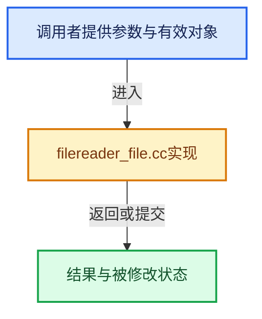

# 实现依赖专题：source/blender/blenlib/intern/filereader_file.cc

[方向导航](README.md) · [符号索引](../%E7%AC%A6%E5%8F%B7%E4%BE%9D%E8%B5%96%E4%B8%8E%E5%AE%9E%E7%8E%B0%E7%B4%A2%E5%BC%95.md)

本专题从正文实际调用进入，集中保存共享实现。函数有稳定锚点，可从调用处直接跳到对应完整函数；递归与互相调用通过回链组织。

## 本文件的实现关系





## 完整成员与函数实现

<a id="f-2f1415144f29527a"></a>

### `blender::BLI_filereader_new_file`

实现位置：[source/blender/blenlib/intern/filereader_file.cc](../../../../../source/blender/blenlib/intern/filereader_file.cc) · L56—L67。

接口参数：

- `int filedes`

**教学注释版**

<!-- annotated:e7aa8fe7fbb20f -->

```cpp
FileReader *BLI_filereader_new_file(int filedes)
{
  RawFileReader *rawfile = MEM_new_zeroed<RawFileReader>(__func__);

  rawfile->filedes = filedes;

  rawfile->reader.read = file_read;
  rawfile->reader.seek = file_seek;
  rawfile->reader.close = file_close;

  return reinterpret_cast<FileReader *>(rawfile);
}
```

<details>
<summary>核对原始源码：source/blender/blenlib/intern/filereader_file.cc · L56—L67</summary>

<!-- original:e7aa8fe7fbb20f:source/blender/blenlib/intern/filereader_file.cc:56:67 -->

```cpp
FileReader *BLI_filereader_new_file(int filedes)
{
  RawFileReader *rawfile = MEM_new_zeroed<RawFileReader>(__func__);

  rawfile->filedes = filedes;

  rawfile->reader.read = file_read;
  rawfile->reader.seek = file_seek;
  rawfile->reader.close = file_close;

  return reinterpret_cast<FileReader *>(rawfile);
}
```

</details>

**沿实际写入检查状态**

- `rawfile->filedes = filedes;`
- `rawfile->reader.read = file_read;`
- `rawfile->reader.seek = file_seek;`
- `rawfile->reader.close = file_close;`

**结果出口**

- `return reinterpret_cast<FileReader *>(rawfile);`

**继续追踪实现**

- `MEM_new_zeroed<RawFileReader>` → [MEM_new_zeroed · L550](../03-%E5%86%85%E5%AD%98%E5%88%86%E9%85%8D%E4%B8%8E%E8%BF%90%E8%A1%8C%E6%97%B6%E7%B1%BB%E5%9E%8B/%E4%BE%9D%E8%B5%96-MEM_guardedalloc-b54eca.md#f-eeb1e2a7f57dd231)；[MEM_new_zeroed · L114](../03-%E5%86%85%E5%AD%98%E5%88%86%E9%85%8D%E4%B8%8E%E8%BF%90%E8%A1%8C%E6%97%B6%E7%B1%BB%E5%9E%8B/%E4%BE%9D%E8%B5%96-mallocn-afdcd4.md#f-e04cf01c64c8b180)。同名重载需按实参类型选择。
