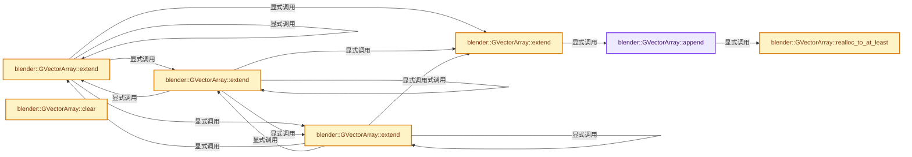
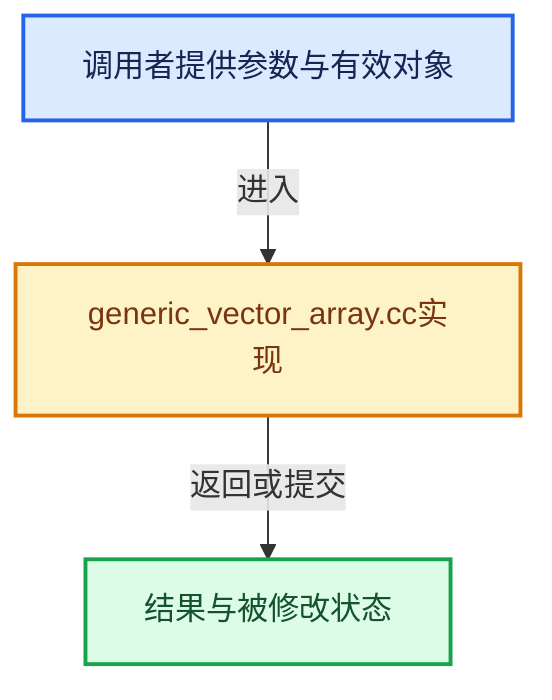

# 实现依赖专题：source/blender/blenlib/intern/generic_vector_array.cc

[方向导航](README.md) · [符号索引](../%E7%AC%A6%E5%8F%B7%E4%BE%9D%E8%B5%96%E4%B8%8E%E5%AE%9E%E7%8E%B0%E7%B4%A2%E5%BC%95.md)

本专题从正文实际调用进入，集中保存共享实现。函数有稳定锚点，可从调用处直接跳到对应完整函数；递归与互相调用通过回链组织。

## 本文件的实现关系






## 完整成员与函数实现

<a id="f-0cb0cf008e99799f"></a>

### `blender::GVectorArray::append`

实现位置：[source/blender/blenlib/intern/generic_vector_array.cc](../../../../../source/blender/blenlib/intern/generic_vector_array.cc) · L28—L38。

接口参数：

- `const int64_t index`
- `const void *value`

**教学注释版**

<!-- annotated:5e62c080ed1cd1 -->

```cpp
void GVectorArray::append(const int64_t index, const void *value)
{
  Item &item = items_[index];
  if (item.length == item.capacity) {
    this->realloc_to_at_least(item, item.capacity + 1);
  }

  void *dst = POINTER_OFFSET(item.start, element_size_ * item.length);
  type_.copy_construct(value, dst);
  item.length++;
}
```

<details>
<summary>核对原始源码：source/blender/blenlib/intern/generic_vector_array.cc · L28—L38</summary>

<!-- original:5e62c080ed1cd1:source/blender/blenlib/intern/generic_vector_array.cc:28:38 -->

```cpp
void GVectorArray::append(const int64_t index, const void *value)
{
  Item &item = items_[index];
  if (item.length == item.capacity) {
    this->realloc_to_at_least(item, item.capacity + 1);
  }

  void *dst = POINTER_OFFSET(item.start, element_size_ * item.length);
  type_.copy_construct(value, dst);
  item.length++;
}
```

</details>

**继续追踪实现**

- `this->realloc_to_at_least` → [blender::GVectorArray::realloc_to_at_least · L91](%E4%BE%9D%E8%B5%96-generic_vector_array-7f86fb.md#f-c55b649e30bc35d3)。
- `POINTER_OFFSET` → [POINTER_OFFSET · L316](%E4%BE%9D%E8%B5%96-BLI_utildefines-293a0a.md#m-c812e199f26c)。宏定义由构建条件选择。
- `type_.copy_construct` → [调用协议](../%E6%A8%A1%E6%9D%BF%E5%AE%8F%E4%B8%8E%E5%8A%A8%E6%80%81%E5%88%86%E6%B4%BE%E5%8D%8F%E8%AE%AE.md)：接收对象类型依赖auto、返回值或模板实例；不按同名猜测目标。调用位置L36。

<a id="f-ab171f7ecd886747"></a>

### `blender::GVectorArray::extend`

实现位置：[source/blender/blenlib/intern/generic_vector_array.cc](../../../../../source/blender/blenlib/intern/generic_vector_array.cc) · L40—L49。

接口参数：

- `const int64_t index`
- `const GVArray &values`

**教学注释版**

<!-- annotated:1935848d627689 -->

```cpp
void GVectorArray::extend(const int64_t index, const GVArray &values)
{
  BLI_assert(values.type() == type_);
  for (const int i : IndexRange(values.size())) {
    BUFFER_FOR_CPP_TYPE_VALUE(type_, buffer);
    values.get(i, buffer);
    this->append(index, buffer);
    type_.destruct(buffer);
  }
}
```

<details>
<summary>核对原始源码：source/blender/blenlib/intern/generic_vector_array.cc · L40—L49</summary>

<!-- original:1935848d627689:source/blender/blenlib/intern/generic_vector_array.cc:40:49 -->

```cpp
void GVectorArray::extend(const int64_t index, const GVArray &values)
{
  BLI_assert(values.type() == type_);
  for (const int i : IndexRange(values.size())) {
    BUFFER_FOR_CPP_TYPE_VALUE(type_, buffer);
    values.get(i, buffer);
    this->append(index, buffer);
    type_.destruct(buffer);
  }
}
```

</details>

**继续追踪实现**

- `BLI_assert` → [BLI_assert · L48](%E4%BE%9D%E8%B5%96-BLI_assert-cc98e8.md#m-57a88495704d)；[BLI_assert · L63](%E4%BE%9D%E8%B5%96-BLI_assert-cc98e8.md#m-d07050020cb5)。宏定义由构建条件选择。
- `values.type` → [blender::GVArrayImpl::type · L646](../04-%E8%99%9A%E6%8B%9F%E6%95%B0%E7%BB%84%E4%B8%8E%E7%B4%A2%E5%BC%95%E9%80%89%E6%8B%A9/05-GVArray%E8%BF%90%E8%A1%8C%E6%97%B6%E7%B1%BB%E5%9E%8B.md#f-cd6180e689f8f58f)；[blender::GVArrayCommon::type · L744](../04-%E8%99%9A%E6%8B%9F%E6%95%B0%E7%BB%84%E4%B8%8E%E7%B4%A2%E5%BC%95%E9%80%89%E6%8B%A9/05-GVArray%E8%BF%90%E8%A1%8C%E6%97%B6%E7%B1%BB%E5%9E%8B.md#f-3b02e0dea8c95656)；[blender::AttributeOwner::type · L65](../05-%E5%87%A0%E4%BD%95%E5%AD%98%E5%82%A8%E4%B8%8E%E6%8B%93%E6%89%91%E6%98%A0%E5%B0%84/%E4%BE%9D%E8%B5%96-attribute-2d9c29.md#f-bb6f5c58325d639c)。同名重载需按实参类型选择。
- `IndexRange` → [blender::IndexRange](%E4%BE%9D%E8%B5%96-BLI_index_range-7d7cc5.md#t-caa3466d6776)；[blender::gpu::shader::parser::IndexRange](../05-%E5%87%A0%E4%BD%95%E5%AD%98%E5%82%A8%E4%B8%8E%E6%8B%93%E6%89%91%E6%98%A0%E5%B0%84/%E4%BE%9D%E8%B5%96-utils-06433d.md#t-82d2bd4ea71c)；[blender::IndexRange](../05-%E5%87%A0%E4%BD%95%E5%AD%98%E5%82%A8%E4%B8%8E%E6%8B%93%E6%89%91%E6%98%A0%E5%B0%84/%E4%BE%9D%E8%B5%96-DNA_node_types-6708b9.md#t-0448cc889d39)。
- `values.size` → [blender::Bounds<T>::size · L543](../12-%E7%A9%BA%E9%97%B4%E6%95%B0%E6%8D%AE%E7%BB%93%E6%9E%84%E4%B8%8E%E5%87%A0%E4%BD%95%E7%AE%97%E6%B3%95/07-Bounds%E4%B8%8EBVH%E5%AF%B9%E6%AF%94.md#f-fcce88c0824fcd97)；[blender::GVArrayImpl::size · L651](../04-%E8%99%9A%E6%8B%9F%E6%95%B0%E7%BB%84%E4%B8%8E%E7%B4%A2%E5%BC%95%E9%80%89%E6%8B%A9/05-GVArray%E8%BF%90%E8%A1%8C%E6%97%B6%E7%B1%BB%E5%9E%8B.md#f-f23d3d1f3b110f1e)；[blender::GVArrayCommon::size · L759](../04-%E8%99%9A%E6%8B%9F%E6%95%B0%E7%BB%84%E4%B8%8E%E7%B4%A2%E5%BC%95%E9%80%89%E6%8B%A9/05-GVArray%E8%BF%90%E8%A1%8C%E6%97%B6%E7%B1%BB%E5%9E%8B.md#f-0856784f4e4fd3c9)；[blender::StringRefBase::size · L196](15-StringRef%E5%AD%97%E7%AC%A6%E4%B8%B2%E8%A7%86%E5%9B%BE.md#f-60d4631c74931d2e)；[blender::KDTreeNew<T>::size · L493](../12-%E7%A9%BA%E9%97%B4%E6%95%B0%E6%8D%AE%E7%BB%93%E6%9E%84%E4%B8%8E%E5%87%A0%E4%BD%95%E7%AE%97%E6%B3%95/05-K%E8%BF%91%E9%82%BB%E4%B8%8E%E8%8C%83%E5%9B%B4%E6%9F%A5%E8%AF%A2.md#f-233c05ce6d5c8d39)；[blender::MainAllIDsIterator::size · L1291](../05-%E5%87%A0%E4%BD%95%E5%AD%98%E5%82%A8%E4%B8%8E%E6%8B%93%E6%89%91%E6%98%A0%E5%B0%84/%E4%BE%9D%E8%B5%96-main-ffa8b3.md#f-520d1311c646452f)；[blender::GLSourcesBaked::size · L1541](../05-%E5%87%A0%E4%BD%95%E5%AD%98%E5%82%A8%E4%B8%8E%E6%8B%93%E6%89%91%E6%98%A0%E5%B0%84/%E4%BE%9D%E8%B5%96-gl_shader-766737.md#f-5b5b539d533c6792)。同名重载需按实参类型选择。
- `BUFFER_FOR_CPP_TYPE_VALUE` → [BUFFER_FOR_CPP_TYPE_VALUE · L460](../03-%E5%86%85%E5%AD%98%E5%88%86%E9%85%8D%E4%B8%8E%E8%BF%90%E8%A1%8C%E6%97%B6%E7%B1%BB%E5%9E%8B/%E4%BE%9D%E8%B5%96-BLI_cpp_type-7649cc.md#m-ef0157733591)。宏定义由构建条件选择。
- `values.get` → [blender::GVArray_For_GVVectorArrayIndex::get · L13](%E4%BE%9D%E8%B5%96-generic_virtual_vector_array-1f8a09.md#f-ebe7bbbaf4a9e27a)；[blender::GVArrayImpl::get · L55](../04-%E8%99%9A%E6%8B%9F%E6%95%B0%E7%BB%84%E4%B8%8E%E7%B4%A2%E5%BC%95%E9%80%89%E6%8B%A9/05-GVArray%E8%BF%90%E8%A1%8C%E6%97%B6%E7%B1%BB%E5%9E%8B.md#f-c7354dce945e059b)；[blender::GVArrayImpl_For_GSpan::get · L128](../04-%E8%99%9A%E6%8B%9F%E6%95%B0%E7%BB%84%E4%B8%8E%E7%B4%A2%E5%BC%95%E9%80%89%E6%8B%A9/05-GVArray%E8%BF%90%E8%A1%8C%E6%97%B6%E7%B1%BB%E5%9E%8B.md#f-f1934587bbbfdc36)；[blender::GVArrayImpl_For_SingleValueRef::get · L190](../04-%E8%99%9A%E6%8B%9F%E6%95%B0%E7%BB%84%E4%B8%8E%E7%B4%A2%E5%BC%95%E9%80%89%E6%8B%A9/05-GVArray%E8%BF%90%E8%A1%8C%E6%97%B6%E7%B1%BB%E5%9E%8B.md#f-9bd488af126f8344)。同名重载需按实参类型选择。
- `this->append` → [blender::GVectorArray::append · L28](%E4%BE%9D%E8%B5%96-generic_vector_array-7f86fb.md#f-0cb0cf008e99799f)。
- `type_.destruct` → [调用协议](../%E6%A8%A1%E6%9D%BF%E5%AE%8F%E4%B8%8E%E5%8A%A8%E6%80%81%E5%88%86%E6%B4%BE%E5%8D%8F%E8%AE%AE.md)：接收对象类型依赖auto、返回值或模板实例；不按同名猜测目标。调用位置L47。

<a id="f-ae44e66d66025ddb"></a>

### `blender::GVectorArray::extend`

实现位置：[source/blender/blenlib/intern/generic_vector_array.cc](../../../../../source/blender/blenlib/intern/generic_vector_array.cc) · L51—L54。

接口参数：

- `const int64_t index`
- `const GSpan values`

**教学注释版**

<!-- annotated:1c1434da325ad6 -->

```cpp
void GVectorArray::extend(const int64_t index, const GSpan values)
{
  this->extend(index, GVArray::from_span(values));
}
```

<details>
<summary>核对原始源码：source/blender/blenlib/intern/generic_vector_array.cc · L51—L54</summary>

<!-- original:1c1434da325ad6:source/blender/blenlib/intern/generic_vector_array.cc:51:54 -->

```cpp
void GVectorArray::extend(const int64_t index, const GSpan values)
{
  this->extend(index, GVArray::from_span(values));
}
```

</details>

**继续追踪实现**

- `this->extend` → [blender::GVectorArray::extend · L40](%E4%BE%9D%E8%B5%96-generic_vector_array-7f86fb.md#f-ab171f7ecd886747)；[blender::GVectorArray::extend · L51](%E4%BE%9D%E8%B5%96-generic_vector_array-7f86fb.md#f-ae44e66d66025ddb)；[blender::GVectorArray::extend · L56](%E4%BE%9D%E8%B5%96-generic_vector_array-7f86fb.md#f-7639b9749271836a)；[blender::GVectorArray::extend · L64](%E4%BE%9D%E8%B5%96-generic_vector_array-7f86fb.md#f-143a931e4ab0a657)。同名重载需按实参类型选择。
- `GVArray::from_span` → [blender::GVArray::from_span · L895](../04-%E8%99%9A%E6%8B%9F%E6%95%B0%E7%BB%84%E4%B8%8E%E7%B4%A2%E5%BC%95%E9%80%89%E6%8B%A9/05-GVArray%E8%BF%90%E8%A1%8C%E6%97%B6%E7%B1%BB%E5%9E%8B.md#f-e8b978ca15febb67)。

<a id="f-7639b9749271836a"></a>

### `blender::GVectorArray::extend`

实现位置：[source/blender/blenlib/intern/generic_vector_array.cc](../../../../../source/blender/blenlib/intern/generic_vector_array.cc) · L56—L62。

接口参数：

- `const IndexMask &mask`
- `const GVVectorArray &values`

**教学注释版**

<!-- annotated:5afc2f0082adf7 -->

```cpp
void GVectorArray::extend(const IndexMask &mask, const GVVectorArray &values)
{
  mask.foreach_index([&](const int64_t i) {
    GVArray_For_GVVectorArrayIndex array{values, i};
    this->extend(i, GVArray(&array));
  });
}
```

<details>
<summary>核对原始源码：source/blender/blenlib/intern/generic_vector_array.cc · L56—L62</summary>

<!-- original:5afc2f0082adf7:source/blender/blenlib/intern/generic_vector_array.cc:56:62 -->

```cpp
void GVectorArray::extend(const IndexMask &mask, const GVVectorArray &values)
{
  mask.foreach_index([&](const int64_t i) {
    GVArray_For_GVVectorArrayIndex array{values, i};
    this->extend(i, GVArray(&array));
  });
}
```

</details>

**继续追踪实现**

- `mask.foreach_index` → [blender::index_mask::IndexMask::foreach_index · L855](../04-%E8%99%9A%E6%8B%9F%E6%95%B0%E7%BB%84%E4%B8%8E%E7%B4%A2%E5%BC%95%E9%80%89%E6%8B%A9/09-%E5%88%86%E6%AE%B5%E5%AD%98%E5%82%A8%E4%B8%8E%E9%81%8D%E5%8E%86.md#f-cd6cd317e2e2812c)。
- `this->extend` → [blender::GVectorArray::extend · L40](%E4%BE%9D%E8%B5%96-generic_vector_array-7f86fb.md#f-ab171f7ecd886747)；[blender::GVectorArray::extend · L51](%E4%BE%9D%E8%B5%96-generic_vector_array-7f86fb.md#f-ae44e66d66025ddb)；[blender::GVectorArray::extend · L56](%E4%BE%9D%E8%B5%96-generic_vector_array-7f86fb.md#f-7639b9749271836a)；[blender::GVectorArray::extend · L64](%E4%BE%9D%E8%B5%96-generic_vector_array-7f86fb.md#f-143a931e4ab0a657)。同名重载需按实参类型选择。
- `GVArray` → [blender::GVArray::GVArray · L626](../04-%E8%99%9A%E6%8B%9F%E6%95%B0%E7%BB%84%E4%B8%8E%E7%B4%A2%E5%BC%95%E9%80%89%E6%8B%A9/05-GVArray%E8%BF%90%E8%A1%8C%E6%97%B6%E7%B1%BB%E5%9E%8B.md#f-fac576444532110b)。

<a id="f-143a931e4ab0a657"></a>

### `blender::GVectorArray::extend`

实现位置：[source/blender/blenlib/intern/generic_vector_array.cc](../../../../../source/blender/blenlib/intern/generic_vector_array.cc) · L64—L68。

接口参数：

- `const IndexMask &mask`
- `const GVectorArray &values`

**教学注释版**

<!-- annotated:a7b152e84f81a3 -->

```cpp
void GVectorArray::extend(const IndexMask &mask, const GVectorArray &values)
{
  GVVectorArray_For_GVectorArray virtual_values{values};
  this->extend(mask, virtual_values);
}
```

<details>
<summary>核对原始源码：source/blender/blenlib/intern/generic_vector_array.cc · L64—L68</summary>

<!-- original:a7b152e84f81a3:source/blender/blenlib/intern/generic_vector_array.cc:64:68 -->

```cpp
void GVectorArray::extend(const IndexMask &mask, const GVectorArray &values)
{
  GVVectorArray_For_GVectorArray virtual_values{values};
  this->extend(mask, virtual_values);
}
```

</details>

**继续追踪实现**

- `this->extend` → [blender::GVectorArray::extend · L40](%E4%BE%9D%E8%B5%96-generic_vector_array-7f86fb.md#f-ab171f7ecd886747)；[blender::GVectorArray::extend · L51](%E4%BE%9D%E8%B5%96-generic_vector_array-7f86fb.md#f-ae44e66d66025ddb)；[blender::GVectorArray::extend · L56](%E4%BE%9D%E8%B5%96-generic_vector_array-7f86fb.md#f-7639b9749271836a)；[blender::GVectorArray::extend · L64](%E4%BE%9D%E8%B5%96-generic_vector_array-7f86fb.md#f-143a931e4ab0a657)。同名重载需按实参类型选择。

<a id="f-c1d1074690264f12"></a>

### `blender::GVectorArray::clear`

实现位置：[source/blender/blenlib/intern/generic_vector_array.cc](../../../../../source/blender/blenlib/intern/generic_vector_array.cc) · L70—L77。

接口参数：

- `const IndexMask &mask`

**教学注释版**

<!-- annotated:aa77019e7b8c46 -->

```cpp
void GVectorArray::clear(const IndexMask &mask)
{
  mask.foreach_index([&](const int64_t i) {
    Item &item = items_[i];
    type_.destruct_n(item.start, item.length);
    item.length = 0;
  });
}
```

<details>
<summary>核对原始源码：source/blender/blenlib/intern/generic_vector_array.cc · L70—L77</summary>

<!-- original:aa77019e7b8c46:source/blender/blenlib/intern/generic_vector_array.cc:70:77 -->

```cpp
void GVectorArray::clear(const IndexMask &mask)
{
  mask.foreach_index([&](const int64_t i) {
    Item &item = items_[i];
    type_.destruct_n(item.start, item.length);
    item.length = 0;
  });
}
```

</details>

**沿实际写入检查状态**

- `item.length = 0;`

**继续追踪实现**

- `mask.foreach_index` → [blender::index_mask::IndexMask::foreach_index · L855](../04-%E8%99%9A%E6%8B%9F%E6%95%B0%E7%BB%84%E4%B8%8E%E7%B4%A2%E5%BC%95%E9%80%89%E6%8B%A9/09-%E5%88%86%E6%AE%B5%E5%AD%98%E5%82%A8%E4%B8%8E%E9%81%8D%E5%8E%86.md#f-cd6cd317e2e2812c)。
- `type_.destruct_n` → [调用协议](../%E6%A8%A1%E6%9D%BF%E5%AE%8F%E4%B8%8E%E5%8A%A8%E6%80%81%E5%88%86%E6%B4%BE%E5%8D%8F%E8%AE%AE.md)：接收对象类型依赖auto、返回值或模板实例；不按同名猜测目标。调用位置L74。

<a id="f-c55b649e30bc35d3"></a>

### `blender::GVectorArray::realloc_to_at_least`

实现位置：[source/blender/blenlib/intern/generic_vector_array.cc](../../../../../source/blender/blenlib/intern/generic_vector_array.cc) · L91—L100。

接口参数：

- `Item &item`
- `int64_t min_capacity`

**教学注释版**

<!-- annotated:75ceb7d014a3aa -->

```cpp
void GVectorArray::realloc_to_at_least(Item &item, int64_t min_capacity)
{
  // [讲解] std::max：按比较关系选取较大值。本讲解中的增长公式同时满足最低请求和几何增长；若保存返回引用，还需注意实参寿命。
  const int64_t new_capacity = std::max(min_capacity, item.length * 2);

  void *new_buffer = allocator_.allocate(element_size_ * new_capacity, type_.alignment);
  type_.relocate_assign_n(item.start, new_buffer, item.length);

  item.start = new_buffer;
  item.capacity = new_capacity;
}
```

<details>
<summary>核对原始源码：source/blender/blenlib/intern/generic_vector_array.cc · L91—L100</summary>

<!-- original:75ceb7d014a3aa:source/blender/blenlib/intern/generic_vector_array.cc:91:100 -->

```cpp
void GVectorArray::realloc_to_at_least(Item &item, int64_t min_capacity)
{
  const int64_t new_capacity = std::max(min_capacity, item.length * 2);

  void *new_buffer = allocator_.allocate(element_size_ * new_capacity, type_.alignment);
  type_.relocate_assign_n(item.start, new_buffer, item.length);

  item.start = new_buffer;
  item.capacity = new_capacity;
}
```

</details>

**沿实际写入检查状态**

- `item.start = new_buffer;`
- `item.capacity = new_capacity;`

**继续追踪实现**

- `std::max` → [外部契约](https://eel.is/c++draft/alg.min.max)：按比较关系选取较大值。本讲解中的增长公式同时满足最低请求和几何增长；若保存返回引用，还需注意实参寿命。
- `allocator_.allocate` → [调用协议](../%E6%A8%A1%E6%9D%BF%E5%AE%8F%E4%B8%8E%E5%8A%A8%E6%80%81%E5%88%86%E6%B4%BE%E5%8D%8F%E8%AE%AE.md)：接收对象类型依赖auto、返回值或模板实例；不按同名猜测目标。调用位置L95。
- `type_.relocate_assign_n` → [调用协议](../%E6%A8%A1%E6%9D%BF%E5%AE%8F%E4%B8%8E%E5%8A%A8%E6%80%81%E5%88%86%E6%B4%BE%E5%8D%8F%E8%AE%AE.md)：接收对象类型依赖auto、返回值或模板实例；不按同名猜测目标。调用位置L96。
