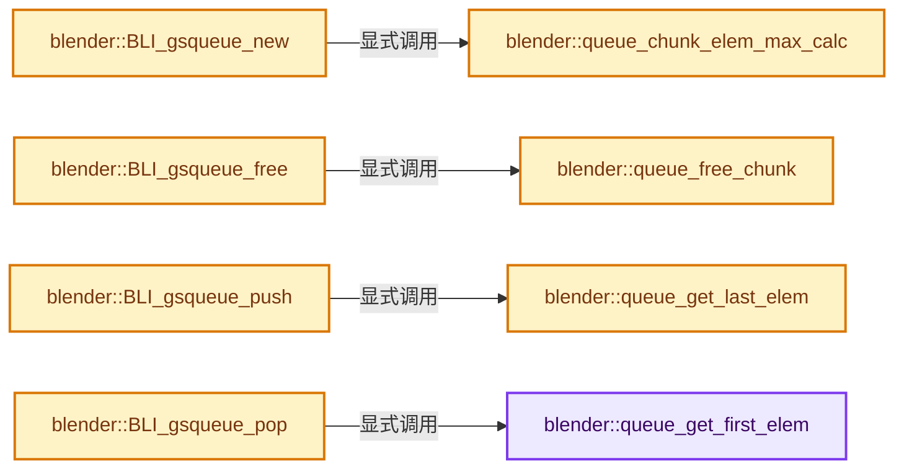
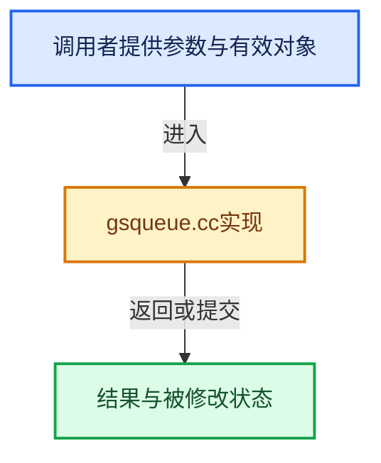

# 实现依赖专题：source/blender/blenlib/intern/gsqueue.cc

[方向导航](README.md) · [符号索引](../%E7%AC%A6%E5%8F%B7%E4%BE%9D%E8%B5%96%E4%B8%8E%E5%AE%9E%E7%8E%B0%E7%B4%A2%E5%BC%95.md)

本专题从正文实际调用进入，集中保存共享实现。函数有稳定锚点，可从调用处直接跳到对应完整函数；递归与互相调用通过回链组织。

## 本文件的实现关系






## 完整成员与函数实现

<a id="f-6d1debf9fe0b6106"></a>

### `blender::queue_get_first_elem`

实现位置：[source/blender/blenlib/intern/gsqueue.cc](../../../../../source/blender/blenlib/intern/gsqueue.cc) · L44—L48。

接口参数：

- `GSQueue *queue`

**教学注释版**

<!-- annotated:312b9a5d4e3b7b -->

```cpp
static void *queue_get_first_elem(GSQueue *queue)
{
  return (static_cast<char *>((queue)->chunk_first->data)) +
         ((queue)->elem_size * (queue)->chunk_first_index);
}
```

<details>
<summary>核对原始源码：source/blender/blenlib/intern/gsqueue.cc · L44—L48</summary>

<!-- original:312b9a5d4e3b7b:source/blender/blenlib/intern/gsqueue.cc:44:48 -->

```cpp
static void *queue_get_first_elem(GSQueue *queue)
{
  return (static_cast<char *>((queue)->chunk_first->data)) +
         ((queue)->elem_size * (queue)->chunk_first_index);
}
```

</details>

**结果出口**

- `return (static_cast<char *>((queue)->chunk_first->data)) +`

**继续追踪实现**

本实现没有需要继续展开的显式调用；检查返回表达式、对象转换和调用者前置条件。

<a id="f-1d9362345d3374c6"></a>

### `blender::queue_get_last_elem`

实现位置：[source/blender/blenlib/intern/gsqueue.cc](../../../../../source/blender/blenlib/intern/gsqueue.cc) · L50—L54。

接口参数：

- `GSQueue *queue`

**教学注释版**

<!-- annotated:93447d9535c383 -->

```cpp
static void *queue_get_last_elem(GSQueue *queue)
{
  return (static_cast<char *>((queue)->chunk_last->data)) +
         ((queue)->elem_size * (queue)->chunk_last_index);
}
```

<details>
<summary>核对原始源码：source/blender/blenlib/intern/gsqueue.cc · L50—L54</summary>

<!-- original:93447d9535c383:source/blender/blenlib/intern/gsqueue.cc:50:54 -->

```cpp
static void *queue_get_last_elem(GSQueue *queue)
{
  return (static_cast<char *>((queue)->chunk_last->data)) +
         ((queue)->elem_size * (queue)->chunk_last_index);
}
```

</details>

**结果出口**

- `return (static_cast<char *>((queue)->chunk_last->data)) +`

**继续追踪实现**

本实现没有需要继续展开的显式调用；检查返回表达式、对象转换和调用者前置条件。

<a id="f-48dd81f89a15062c"></a>

### `blender::queue_chunk_elem_max_calc`

实现位置：[source/blender/blenlib/intern/gsqueue.cc](../../../../../source/blender/blenlib/intern/gsqueue.cc) · L59—L74。

接口参数：

- `const size_t elem_size`
- `size_t chunk_size`

**教学注释版**

<!-- annotated:41b920f4754b20 -->

```cpp
static size_t queue_chunk_elem_max_calc(const size_t elem_size, size_t chunk_size)
{
  /* get at least this number of elems per chunk */
  const size_t elem_size_min = elem_size * CHUNK_ELEM_MIN;

  BLI_assert((elem_size != 0) && (chunk_size != 0));

  while (chunk_size <= elem_size_min) [[unlikely]] {
    chunk_size <<= 1;
  }

  /* account for slop-space */
  chunk_size -= (sizeof(QueueChunk) + MEM_SIZE_OVERHEAD);

  return chunk_size / elem_size;
}
```

<details>
<summary>核对原始源码：source/blender/blenlib/intern/gsqueue.cc · L59—L74</summary>

<!-- original:41b920f4754b20:source/blender/blenlib/intern/gsqueue.cc:59:74 -->

```cpp
static size_t queue_chunk_elem_max_calc(const size_t elem_size, size_t chunk_size)
{
  /* get at least this number of elems per chunk */
  const size_t elem_size_min = elem_size * CHUNK_ELEM_MIN;

  BLI_assert((elem_size != 0) && (chunk_size != 0));

  while (chunk_size <= elem_size_min) [[unlikely]] {
    chunk_size <<= 1;
  }

  /* account for slop-space */
  chunk_size -= (sizeof(QueueChunk) + MEM_SIZE_OVERHEAD);

  return chunk_size / elem_size;
}
```

</details>

**沿实际写入检查状态**

- `chunk_size -= (sizeof(QueueChunk) + MEM_SIZE_OVERHEAD);`

**结果出口**

- `return chunk_size / elem_size;`

**继续追踪实现**

- `BLI_assert` → [BLI_assert · L48](%E4%BE%9D%E8%B5%96-BLI_assert-cc98e8.md#m-57a88495704d)；[BLI_assert · L63](%E4%BE%9D%E8%B5%96-BLI_assert-cc98e8.md#m-d07050020cb5)。宏定义由构建条件选择。

<a id="f-0784ba179c50f4a9"></a>

### `blender::BLI_gsqueue_new`

实现位置：[source/blender/blenlib/intern/gsqueue.cc](../../../../../source/blender/blenlib/intern/gsqueue.cc) · L76—L86。

接口参数：

- `const size_t elem_size`

**教学注释版**

<!-- annotated:bf20a50f735072 -->

```cpp
GSQueue *BLI_gsqueue_new(const size_t elem_size)
{
  GSQueue *queue = MEM_new_zeroed<GSQueue>("BLI_gsqueue_new");

  queue->chunk_elem_max = queue_chunk_elem_max_calc(elem_size, CHUNK_SIZE_DEFAULT);
  queue->elem_size = elem_size;
  /* force init */
  queue->chunk_last_index = queue->chunk_elem_max - 1;

  return queue;
}
```

<details>
<summary>核对原始源码：source/blender/blenlib/intern/gsqueue.cc · L76—L86</summary>

<!-- original:bf20a50f735072:source/blender/blenlib/intern/gsqueue.cc:76:86 -->

```cpp
GSQueue *BLI_gsqueue_new(const size_t elem_size)
{
  GSQueue *queue = MEM_new_zeroed<GSQueue>("BLI_gsqueue_new");

  queue->chunk_elem_max = queue_chunk_elem_max_calc(elem_size, CHUNK_SIZE_DEFAULT);
  queue->elem_size = elem_size;
  /* force init */
  queue->chunk_last_index = queue->chunk_elem_max - 1;

  return queue;
}
```

</details>

**沿实际写入检查状态**

- `queue->chunk_elem_max = queue_chunk_elem_max_calc(elem_size, CHUNK_SIZE_DEFAULT);`
- `queue->elem_size = elem_size;`
- `queue->chunk_last_index = queue->chunk_elem_max - 1;`

**结果出口**

- `return queue;`

**继续追踪实现**

- `MEM_new_zeroed<GSQueue>` → [MEM_new_zeroed · L550](../03-%E5%86%85%E5%AD%98%E5%88%86%E9%85%8D%E4%B8%8E%E8%BF%90%E8%A1%8C%E6%97%B6%E7%B1%BB%E5%9E%8B/%E4%BE%9D%E8%B5%96-MEM_guardedalloc-b54eca.md#f-eeb1e2a7f57dd231)；[MEM_new_zeroed · L114](../03-%E5%86%85%E5%AD%98%E5%88%86%E9%85%8D%E4%B8%8E%E8%BF%90%E8%A1%8C%E6%97%B6%E7%B1%BB%E5%9E%8B/%E4%BE%9D%E8%B5%96-mallocn-afdcd4.md#f-e04cf01c64c8b180)。同名重载需按实参类型选择。
- `queue_chunk_elem_max_calc` → [blender::queue_chunk_elem_max_calc · L59](%E4%BE%9D%E8%B5%96-gsqueue-c29474.md#f-48dd81f89a15062c)。

<a id="f-d0034cb9a671f4aa"></a>

### `blender::queue_free_chunk`

实现位置：[source/blender/blenlib/intern/gsqueue.cc](../../../../../source/blender/blenlib/intern/gsqueue.cc) · L88—L95。

接口参数：

- `QueueChunk *data`

**教学注释版**

<!-- annotated:9a03bd321fd44f -->

```cpp
static void queue_free_chunk(QueueChunk *data)
{
  while (data) {
    QueueChunk *data_next = data->next;
    MEM_delete(data);
    data = data_next;
  }
}
```

<details>
<summary>核对原始源码：source/blender/blenlib/intern/gsqueue.cc · L88—L95</summary>

<!-- original:9a03bd321fd44f:source/blender/blenlib/intern/gsqueue.cc:88:95 -->

```cpp
static void queue_free_chunk(QueueChunk *data)
{
  while (data) {
    QueueChunk *data_next = data->next;
    MEM_delete(data);
    data = data_next;
  }
}
```

</details>

**沿实际写入检查状态**

- `data = data_next;`

**继续追踪实现**

- `MEM_delete` → [MEM_delete · L400](../03-%E5%86%85%E5%AD%98%E5%88%86%E9%85%8D%E4%B8%8E%E8%BF%90%E8%A1%8C%E6%97%B6%E7%B1%BB%E5%9E%8B/%E4%BE%9D%E8%B5%96-MEM_guardedalloc-b54eca.md#f-9049ffdd1682887c)。

<a id="f-d0db7f08e5e50100"></a>

### `blender::BLI_gsqueue_free`

实现位置：[source/blender/blenlib/intern/gsqueue.cc](../../../../../source/blender/blenlib/intern/gsqueue.cc) · L97—L102。

接口参数：

- `GSQueue *queue`

**教学注释版**

<!-- annotated:c69a8ae9b0a848 -->

```cpp
void BLI_gsqueue_free(GSQueue *queue)
{
  queue_free_chunk(queue->chunk_first);
  queue_free_chunk(queue->chunk_free);
  MEM_delete(queue);
}
```

<details>
<summary>核对原始源码：source/blender/blenlib/intern/gsqueue.cc · L97—L102</summary>

<!-- original:c69a8ae9b0a848:source/blender/blenlib/intern/gsqueue.cc:97:102 -->

```cpp
void BLI_gsqueue_free(GSQueue *queue)
{
  queue_free_chunk(queue->chunk_first);
  queue_free_chunk(queue->chunk_free);
  MEM_delete(queue);
}
```

</details>

**继续追踪实现**

- `queue_free_chunk` → [blender::queue_free_chunk · L88](%E4%BE%9D%E8%B5%96-gsqueue-c29474.md#f-d0034cb9a671f4aa)。
- `MEM_delete` → [MEM_delete · L400](../03-%E5%86%85%E5%AD%98%E5%88%86%E9%85%8D%E4%B8%8E%E8%BF%90%E8%A1%8C%E6%97%B6%E7%B1%BB%E5%9E%8B/%E4%BE%9D%E8%B5%96-MEM_guardedalloc-b54eca.md#f-9049ffdd1682887c)。

<a id="f-5c4c4af2669da17b"></a>

### `blender::BLI_gsqueue_push`

实现位置：[source/blender/blenlib/intern/gsqueue.cc](../../../../../source/blender/blenlib/intern/gsqueue.cc) · L104—L137。

接口参数：

- `GSQueue *queue`
- `const void *item`

**教学注释版**

<!-- annotated:18e2f296aaf84b -->

```cpp
void BLI_gsqueue_push(GSQueue *queue, const void *item)
{
  queue->chunk_last_index++;
  queue->elem_num++;

  if (queue->chunk_last_index == queue->chunk_elem_max) [[unlikely]] {
    QueueChunk *chunk;
    if (queue->chunk_free) {
      chunk = queue->chunk_free;
      queue->chunk_free = chunk->next;
    }
    else {
      chunk = static_cast<QueueChunk *>(MEM_new_uninitialized(
          sizeof(*chunk) + (queue->elem_size * queue->chunk_elem_max), __func__));
    }

    chunk->next = nullptr;

    if (queue->chunk_last == nullptr) {
      queue->chunk_first = chunk;
    }
    else {
      queue->chunk_last->next = chunk;
    }

    queue->chunk_last = chunk;
    queue->chunk_last_index = 0;
  }

  BLI_assert(queue->chunk_last_index < queue->chunk_elem_max);

  /* Return last of queue */
  // [讲解] memcpy：复制字节，源与目标不应重叠。类型生命周期、对齐和可复制表示须由调用者证明，不是任意对象的复制构造。
  memcpy(queue_get_last_elem(queue), item, queue->elem_size);
}
```

<details>
<summary>核对原始源码：source/blender/blenlib/intern/gsqueue.cc · L104—L137</summary>

<!-- original:18e2f296aaf84b:source/blender/blenlib/intern/gsqueue.cc:104:137 -->

```cpp
void BLI_gsqueue_push(GSQueue *queue, const void *item)
{
  queue->chunk_last_index++;
  queue->elem_num++;

  if (queue->chunk_last_index == queue->chunk_elem_max) [[unlikely]] {
    QueueChunk *chunk;
    if (queue->chunk_free) {
      chunk = queue->chunk_free;
      queue->chunk_free = chunk->next;
    }
    else {
      chunk = static_cast<QueueChunk *>(MEM_new_uninitialized(
          sizeof(*chunk) + (queue->elem_size * queue->chunk_elem_max), __func__));
    }

    chunk->next = nullptr;

    if (queue->chunk_last == nullptr) {
      queue->chunk_first = chunk;
    }
    else {
      queue->chunk_last->next = chunk;
    }

    queue->chunk_last = chunk;
    queue->chunk_last_index = 0;
  }

  BLI_assert(queue->chunk_last_index < queue->chunk_elem_max);

  /* Return last of queue */
  memcpy(queue_get_last_elem(queue), item, queue->elem_size);
}
```

</details>

**沿实际写入检查状态**

- `chunk = queue->chunk_free;`
- `queue->chunk_free = chunk->next;`
- `chunk = static_cast<QueueChunk *>(MEM_new_uninitialized(`
- `chunk->next = nullptr;`
- `queue->chunk_first = chunk;`
- `queue->chunk_last->next = chunk;`
- `queue->chunk_last = chunk;`
- `queue->chunk_last_index = 0;`

**继续追踪实现**

- `MEM_new_uninitialized` → [MEM_new_uninitialized · L590](../03-%E5%86%85%E5%AD%98%E5%88%86%E9%85%8D%E4%B8%8E%E8%BF%90%E8%A1%8C%E6%97%B6%E7%B1%BB%E5%9E%8B/%E4%BE%9D%E8%B5%96-MEM_guardedalloc-b54eca.md#f-c773b2e5b8fe70e4)；[MEM_new_uninitialized · L124](../03-%E5%86%85%E5%AD%98%E5%88%86%E9%85%8D%E4%B8%8E%E8%BF%90%E8%A1%8C%E6%97%B6%E7%B1%BB%E5%9E%8B/%E4%BE%9D%E8%B5%96-mallocn-afdcd4.md#f-28a7e00a1e67f699)。同名重载需按实参类型选择。
- `BLI_assert` → [BLI_assert · L48](%E4%BE%9D%E8%B5%96-BLI_assert-cc98e8.md#m-57a88495704d)；[BLI_assert · L63](%E4%BE%9D%E8%B5%96-BLI_assert-cc98e8.md#m-d07050020cb5)。宏定义由构建条件选择。
- `memcpy` → [外部契约](https://eel.is/c++draft/cstring.syn)：复制字节，源与目标不应重叠。类型生命周期、对齐和可复制表示须由调用者证明，不是任意对象的复制构造。
- `queue_get_last_elem` → [blender::queue_get_last_elem · L50](%E4%BE%9D%E8%B5%96-gsqueue-c29474.md#f-1d9362345d3374c6)。

<a id="f-090155cf38b544eb"></a>

### `blender::BLI_gsqueue_pop`

实现位置：[source/blender/blenlib/intern/gsqueue.cc](../../../../../source/blender/blenlib/intern/gsqueue.cc) · L139—L160。

接口参数：

- `GSQueue *queue`
- `void *r_item`

**教学注释版**

<!-- annotated:c933ba54a38775 -->

```cpp
void BLI_gsqueue_pop(GSQueue *queue, void *r_item)
{
  BLI_assert(BLI_gsqueue_is_empty(queue) == false);

  // [讲解] memcpy：复制字节，源与目标不应重叠。类型生命周期、对齐和可复制表示须由调用者证明，不是任意对象的复制构造。
  memcpy(r_item, queue_get_first_elem(queue), queue->elem_size);
  queue->chunk_first_index++;
  queue->elem_num--;

  if (queue->chunk_first_index == queue->chunk_elem_max || queue->elem_num == 0) [[unlikely]] {
    QueueChunk *chunk_free = queue->chunk_first;

    queue->chunk_first = queue->chunk_first->next;
    queue->chunk_first_index = 0;
    if (queue->chunk_first == nullptr) {
      queue->chunk_last = nullptr;
      queue->chunk_last_index = queue->chunk_elem_max - 1;
    }

    chunk_free->next = queue->chunk_free;
    queue->chunk_free = chunk_free;
  }
}
```

<details>
<summary>核对原始源码：source/blender/blenlib/intern/gsqueue.cc · L139—L160</summary>

<!-- original:c933ba54a38775:source/blender/blenlib/intern/gsqueue.cc:139:160 -->

```cpp
void BLI_gsqueue_pop(GSQueue *queue, void *r_item)
{
  BLI_assert(BLI_gsqueue_is_empty(queue) == false);

  memcpy(r_item, queue_get_first_elem(queue), queue->elem_size);
  queue->chunk_first_index++;
  queue->elem_num--;

  if (queue->chunk_first_index == queue->chunk_elem_max || queue->elem_num == 0) [[unlikely]] {
    QueueChunk *chunk_free = queue->chunk_first;

    queue->chunk_first = queue->chunk_first->next;
    queue->chunk_first_index = 0;
    if (queue->chunk_first == nullptr) {
      queue->chunk_last = nullptr;
      queue->chunk_last_index = queue->chunk_elem_max - 1;
    }

    chunk_free->next = queue->chunk_free;
    queue->chunk_free = chunk_free;
  }
}
```

</details>

**沿实际写入检查状态**

- `queue->chunk_first = queue->chunk_first->next;`
- `queue->chunk_first_index = 0;`
- `queue->chunk_last = nullptr;`
- `queue->chunk_last_index = queue->chunk_elem_max - 1;`
- `chunk_free->next = queue->chunk_free;`
- `queue->chunk_free = chunk_free;`

**继续追踪实现**

- `BLI_assert` → [BLI_assert · L48](%E4%BE%9D%E8%B5%96-BLI_assert-cc98e8.md#m-57a88495704d)；[BLI_assert · L63](%E4%BE%9D%E8%B5%96-BLI_assert-cc98e8.md#m-d07050020cb5)。宏定义由构建条件选择。
- `BLI_gsqueue_is_empty` → [blender::BLI_gsqueue_is_empty · L167](%E4%BE%9D%E8%B5%96-gsqueue-c29474.md#f-5373757860133915)。
- `memcpy` → [外部契约](https://eel.is/c++draft/cstring.syn)：复制字节，源与目标不应重叠。类型生命周期、对齐和可复制表示须由调用者证明，不是任意对象的复制构造。
- `queue_get_first_elem` → [blender::queue_get_first_elem · L44](%E4%BE%9D%E8%B5%96-gsqueue-c29474.md#f-6d1debf9fe0b6106)。

<a id="f-5373757860133915"></a>

### `blender::BLI_gsqueue_is_empty`

实现位置：[source/blender/blenlib/intern/gsqueue.cc](../../../../../source/blender/blenlib/intern/gsqueue.cc) · L167—L170。

接口参数：

- `const GSQueue *queue`

**教学注释版**

<!-- annotated:6ee56128eaffae -->

```cpp
bool BLI_gsqueue_is_empty(const GSQueue *queue)
{
  return (queue->chunk_first == nullptr);
}
```

<details>
<summary>核对原始源码：source/blender/blenlib/intern/gsqueue.cc · L167—L170</summary>

<!-- original:6ee56128eaffae:source/blender/blenlib/intern/gsqueue.cc:167:170 -->

```cpp
bool BLI_gsqueue_is_empty(const GSQueue *queue)
{
  return (queue->chunk_first == nullptr);
}
```

</details>

**结果出口**

- `return (queue->chunk_first == nullptr);`

**继续追踪实现**

本实现没有需要继续展开的显式调用；检查返回表达式、对象转换和调用者前置条件。
