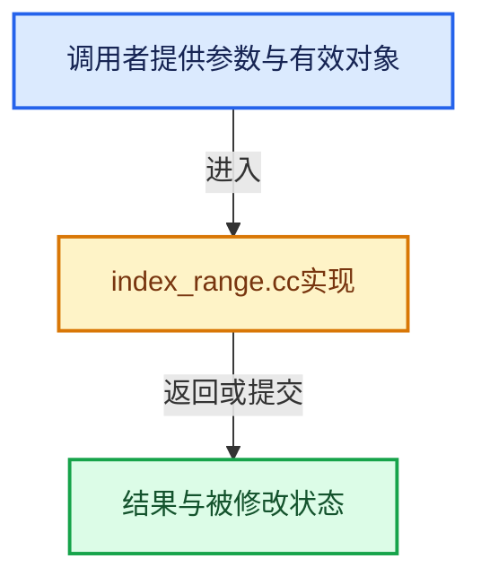

# 实现依赖专题：source/blender/blenlib/intern/index_range.cc

[方向导航](README.md) · [符号索引](../%E7%AC%A6%E5%8F%B7%E4%BE%9D%E8%B5%96%E4%B8%8E%E5%AE%9E%E7%8E%B0%E7%B4%A2%E5%BC%95.md)

本专题从正文实际调用进入，集中保存共享实现。函数有稳定锚点，可从调用处直接跳到对应完整函数；递归与互相调用通过回链组织。

## 本文件的实现关系





## 完整成员与函数实现

<a id="f-2d9a3529ce0f2331"></a>

### `blender::split_index_range_by_alignment`

实现位置：[source/blender/blenlib/intern/index_range.cc](../../../../../source/blender/blenlib/intern/index_range.cc) · L16—L44。

接口参数：

- `const IndexRange range`
- `const int64_t alignment`

**教学注释版**

<!-- annotated:1858dc2c6f612c -->

```cpp
AlignedIndexRanges split_index_range_by_alignment(const IndexRange range, const int64_t alignment)
{
  BLI_assert(is_power_of_2(alignment));
  const int64_t mask = alignment - 1;

  AlignedIndexRanges aligned_ranges;

  // [讲解] range.start：读取连续区间或分组的边界信息。
  const int64_t start_chunk = range.start() & ~mask;
  // [讲解] range.one_after_last：读取连续区间或分组的边界信息。
  const int64_t end_chunk = range.one_after_last() & ~mask;
  if (start_chunk == end_chunk) {
    aligned_ranges.prefix = range;
  }
  else {
    int64_t prefix_size = 0;
    int64_t suffix_size = 0;
    if (range.start() != start_chunk) {
      prefix_size = alignment - (range.start() & mask);
    }
    if (range.one_after_last() != end_chunk) {
      suffix_size = range.one_after_last() - end_chunk;
    }
    aligned_ranges.prefix = IndexRange(range.start(), prefix_size);
    aligned_ranges.suffix = IndexRange(end_chunk, suffix_size);
    aligned_ranges.aligned = IndexRange(aligned_ranges.prefix.one_after_last(),
                                        // [讲解] range.size：读取连续区间或分组的边界信息。
                                        range.size() - prefix_size - suffix_size);
  }

  return aligned_ranges;
}
```

<details>
<summary>核对原始源码：source/blender/blenlib/intern/index_range.cc · L16—L44</summary>

<!-- original:1858dc2c6f612c:source/blender/blenlib/intern/index_range.cc:16:44 -->

```cpp
AlignedIndexRanges split_index_range_by_alignment(const IndexRange range, const int64_t alignment)
{
  BLI_assert(is_power_of_2(alignment));
  const int64_t mask = alignment - 1;

  AlignedIndexRanges aligned_ranges;

  const int64_t start_chunk = range.start() & ~mask;
  const int64_t end_chunk = range.one_after_last() & ~mask;
  if (start_chunk == end_chunk) {
    aligned_ranges.prefix = range;
  }
  else {
    int64_t prefix_size = 0;
    int64_t suffix_size = 0;
    if (range.start() != start_chunk) {
      prefix_size = alignment - (range.start() & mask);
    }
    if (range.one_after_last() != end_chunk) {
      suffix_size = range.one_after_last() - end_chunk;
    }
    aligned_ranges.prefix = IndexRange(range.start(), prefix_size);
    aligned_ranges.suffix = IndexRange(end_chunk, suffix_size);
    aligned_ranges.aligned = IndexRange(aligned_ranges.prefix.one_after_last(),
                                        range.size() - prefix_size - suffix_size);
  }

  return aligned_ranges;
}
```

</details>

**沿实际写入检查状态**

- `aligned_ranges.prefix = range;`
- `prefix_size = alignment - (range.start() & mask);`
- `suffix_size = range.one_after_last() - end_chunk;`
- `aligned_ranges.prefix = IndexRange(range.start(), prefix_size);`
- `aligned_ranges.suffix = IndexRange(end_chunk, suffix_size);`
- `aligned_ranges.aligned = IndexRange(aligned_ranges.prefix.one_after_last(),`

**结果出口**

- `return aligned_ranges;`

**继续追踪实现**

- `BLI_assert` → [BLI_assert · L48](%E4%BE%9D%E8%B5%96-BLI_assert-cc98e8.md#m-57a88495704d)；[BLI_assert · L63](%E4%BE%9D%E8%B5%96-BLI_assert-cc98e8.md#m-d07050020cb5)。宏定义由构建条件选择。
- `is_power_of_2` → [blender::is_power_of_2 · L170](%E4%BE%9D%E8%B5%96-BLI_utildefines-293a0a.md#f-276f4f171955e1e9)。
- `range.start` → [blender::IndexRange::start · L243](04-IndexRange%E8%BF%9E%E7%BB%AD%E6%95%B4%E6%95%B0%E5%8C%BA%E9%97%B4.md#f-99d2195bd9cfd1f0)。
- `range.one_after_last` → [blender::IndexRange::one_after_last · L235](04-IndexRange%E8%BF%9E%E7%BB%AD%E6%95%B4%E6%95%B0%E5%8C%BA%E9%97%B4.md#f-ed04bec9c731fc86)。
- `IndexRange` → [blender::IndexRange](%E4%BE%9D%E8%B5%96-BLI_index_range-7d7cc5.md#t-caa3466d6776)；[blender::gpu::shader::parser::IndexRange](../05-%E5%87%A0%E4%BD%95%E5%AD%98%E5%82%A8%E4%B8%8E%E6%8B%93%E6%89%91%E6%98%A0%E5%B0%84/%E4%BE%9D%E8%B5%96-utils-06433d.md#t-82d2bd4ea71c)；[blender::IndexRange](../05-%E5%87%A0%E4%BD%95%E5%AD%98%E5%82%A8%E4%B8%8E%E6%8B%93%E6%89%91%E6%98%A0%E5%B0%84/%E4%BE%9D%E8%B5%96-DNA_node_types-6708b9.md#t-0448cc889d39)。
- `aligned_ranges.prefix.one_after_last` → [调用协议](../%E6%A8%A1%E6%9D%BF%E5%AE%8F%E4%B8%8E%E5%8A%A8%E6%80%81%E5%88%86%E6%B4%BE%E5%8D%8F%E8%AE%AE.md)：接收对象类型依赖auto、返回值或模板实例；不按同名猜测目标。调用位置L39。
- `range.size` → [blender::IndexRange::size · L156](04-IndexRange%E8%BF%9E%E7%BB%AD%E6%95%B4%E6%95%B0%E5%8C%BA%E9%97%B4.md#f-05f66c3ebb2fdfec)。
