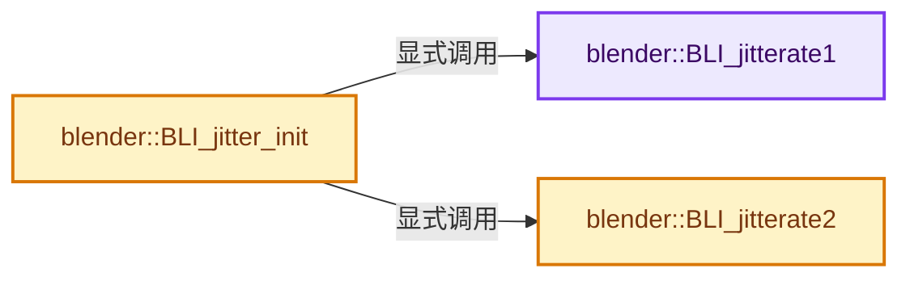
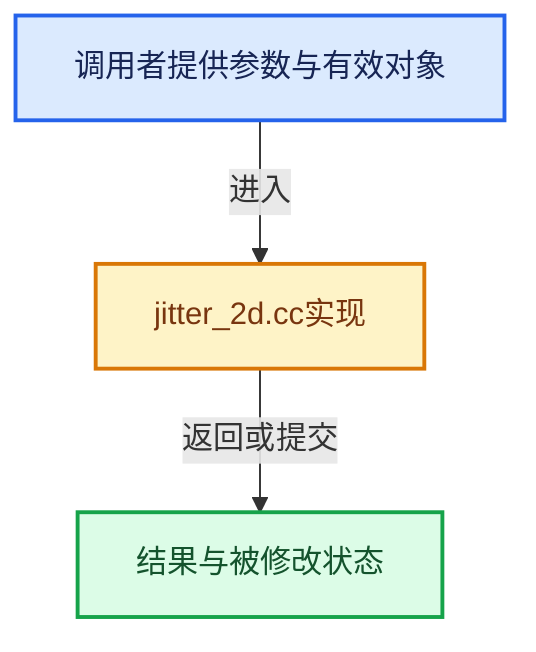

# 实现依赖专题：source/blender/blenlib/intern/jitter_2d.cc

[方向导航](README.md) · [符号索引](../%E7%AC%A6%E5%8F%B7%E4%BE%9D%E8%B5%96%E4%B8%8E%E5%AE%9E%E7%8E%B0%E7%B4%A2%E5%BC%95.md)

本专题从正文实际调用进入，集中保存共享实现。函数有稳定锚点，可从调用处直接跳到对应完整函数；递归与互相调用通过回链组织。

## 本文件的实现关系






## 完整成员与函数实现

<a id="f-448acb6346acbd67"></a>

### `blender::BLI_jitterate1`

实现位置：[source/blender/blenlib/intern/jitter_2d.cc](../../../../../source/blender/blenlib/intern/jitter_2d.cc) · L21—L77。

接口参数：

- `float (*jit1)[2]`
- `float (*jit2)[2]`
- `int num`
- `float radius1`

**教学注释版**

<!-- annotated:fe01e6578c42c7 -->

```cpp
void BLI_jitterate1(float (*jit1)[2], float (*jit2)[2], int num, float radius1)
{
  int i, j, k;
  float vecx, vecy, dvecx, dvecy, x, y, len;

  for (i = num - 1; i >= 0; i--) {
    dvecx = dvecy = 0.0;
    x = jit1[i][0];
    y = jit1[i][1];
    for (j = num - 1; j >= 0; j--) {
      if (i != j) {
        vecx = jit1[j][0] - x - 1.0f;
        vecy = jit1[j][1] - y - 1.0f;
        for (k = 3; k > 0; k--) {
          if (fabsf(vecx) < radius1 && fabsf(vecy) < radius1) {
            len = sqrtf(vecx * vecx + vecy * vecy);
            if (len > 0 && len < radius1) {
              len = len / radius1;
              dvecx += vecx / len;
              dvecy += vecy / len;
            }
          }
          vecx += 1.0f;

          if (fabsf(vecx) < radius1 && fabsf(vecy) < radius1) {
            len = sqrtf(vecx * vecx + vecy * vecy);
            if (len > 0 && len < radius1) {
              len = len / radius1;
              dvecx += vecx / len;
              dvecy += vecy / len;
            }
          }
          vecx += 1.0f;

          if (fabsf(vecx) < radius1 && fabsf(vecy) < radius1) {
            len = sqrtf(vecx * vecx + vecy * vecy);
            if (len > 0 && len < radius1) {
              len = len / radius1;
              dvecx += vecx / len;
              dvecy += vecy / len;
            }
          }
          vecx -= 2.0f;
          vecy += 1.0f;
        }
      }
    }

    x -= dvecx / 18.0f;
    y -= dvecy / 18.0f;
    x -= floorf(x);
    y -= floorf(y);
    jit2[i][0] = x;
    jit2[i][1] = y;
  }
  // [讲解] memcpy：复制字节，源与目标不应重叠。类型生命周期、对齐和可复制表示须由调用者证明，不是任意对象的复制构造。
  memcpy(jit1, jit2, 2 * uint(num) * sizeof(float));
}
```

<details>
<summary>核对原始源码：source/blender/blenlib/intern/jitter_2d.cc · L21—L77</summary>

<!-- original:fe01e6578c42c7:source/blender/blenlib/intern/jitter_2d.cc:21:77 -->

```cpp
void BLI_jitterate1(float (*jit1)[2], float (*jit2)[2], int num, float radius1)
{
  int i, j, k;
  float vecx, vecy, dvecx, dvecy, x, y, len;

  for (i = num - 1; i >= 0; i--) {
    dvecx = dvecy = 0.0;
    x = jit1[i][0];
    y = jit1[i][1];
    for (j = num - 1; j >= 0; j--) {
      if (i != j) {
        vecx = jit1[j][0] - x - 1.0f;
        vecy = jit1[j][1] - y - 1.0f;
        for (k = 3; k > 0; k--) {
          if (fabsf(vecx) < radius1 && fabsf(vecy) < radius1) {
            len = sqrtf(vecx * vecx + vecy * vecy);
            if (len > 0 && len < radius1) {
              len = len / radius1;
              dvecx += vecx / len;
              dvecy += vecy / len;
            }
          }
          vecx += 1.0f;

          if (fabsf(vecx) < radius1 && fabsf(vecy) < radius1) {
            len = sqrtf(vecx * vecx + vecy * vecy);
            if (len > 0 && len < radius1) {
              len = len / radius1;
              dvecx += vecx / len;
              dvecy += vecy / len;
            }
          }
          vecx += 1.0f;

          if (fabsf(vecx) < radius1 && fabsf(vecy) < radius1) {
            len = sqrtf(vecx * vecx + vecy * vecy);
            if (len > 0 && len < radius1) {
              len = len / radius1;
              dvecx += vecx / len;
              dvecy += vecy / len;
            }
          }
          vecx -= 2.0f;
          vecy += 1.0f;
        }
      }
    }

    x -= dvecx / 18.0f;
    y -= dvecy / 18.0f;
    x -= floorf(x);
    y -= floorf(y);
    jit2[i][0] = x;
    jit2[i][1] = y;
  }
  memcpy(jit1, jit2, 2 * uint(num) * sizeof(float));
}
```

</details>

**沿实际写入检查状态**

- `dvecx = dvecy = 0.0;`
- `x = jit1[i][0];`
- `y = jit1[i][1];`
- `vecx = jit1[j][0] - x - 1.0f;`
- `vecy = jit1[j][1] - y - 1.0f;`
- `len = sqrtf(vecx * vecx + vecy * vecy);`
- `len = len / radius1;`
- `dvecx += vecx / len;`
- `dvecy += vecy / len;`
- `vecx += 1.0f;`
- `vecx -= 2.0f;`
- `vecy += 1.0f;`
- `x -= dvecx / 18.0f;`
- `y -= dvecy / 18.0f;`
- `x -= floorf(x);`
- `y -= floorf(y);`
- `jit2[i][0] = x;`
- `jit2[i][1] = y;`

**继续追踪实现**

- `fabsf` → [fabsf · L21](../05-%E5%87%A0%E4%BD%95%E5%AD%98%E5%82%A8%E4%B8%8E%E6%8B%93%E6%89%91%E6%98%A0%E5%B0%84/%E4%BE%9D%E8%B5%96-radial_tiling_shared-98abf9.md#m-02cc4c69cfb3)；[fabsf · L43](../05-%E5%87%A0%E4%BD%95%E5%AD%98%E5%82%A8%E4%B8%8E%E6%8B%93%E6%89%91%E6%98%A0%E5%B0%84/%E4%BE%9D%E8%B5%96-radial_tiling_shared-98abf9.md#m-04effe61803b)；[fabsf · L74](../05-%E5%87%A0%E4%BD%95%E5%AD%98%E5%82%A8%E4%B8%8E%E6%8B%93%E6%89%91%E6%98%A0%E5%B0%84/%E4%BE%9D%E8%B5%96-radial_tiling_shared-98abf9.md#m-927dd4eba7dc)；[fabsf · L25](%E4%BE%9D%E8%B5%96-radial_tiling_shared-7989a4.md#m-8348d6b3d08f)；[fabsf · L47](%E4%BE%9D%E8%B5%96-radial_tiling_shared-7989a4.md#m-13b7e0b6d84f)；[fabsf · L78](%E4%BE%9D%E8%B5%96-radial_tiling_shared-7989a4.md#m-326c83464a0d)；[fabsf · L21](../05-%E5%87%A0%E4%BD%95%E5%AD%98%E5%82%A8%E4%B8%8E%E6%8B%93%E6%89%91%E6%98%A0%E5%B0%84/%E4%BE%9D%E8%B5%96-node_radial_tiling_shared-b14bc2.md#m-7c3ee12fc119)；[fabsf · L43](../05-%E5%87%A0%E4%BD%95%E5%AD%98%E5%82%A8%E4%B8%8E%E6%8B%93%E6%89%91%E6%98%A0%E5%B0%84/%E4%BE%9D%E8%B5%96-node_radial_tiling_shared-b14bc2.md#m-9112db0e2dd1)；[fabsf · L74](../05-%E5%87%A0%E4%BD%95%E5%AD%98%E5%82%A8%E4%B8%8E%E6%8B%93%E6%89%91%E6%98%A0%E5%B0%84/%E4%BE%9D%E8%B5%96-node_radial_tiling_shared-b14bc2.md#m-ee4e61908a6f)；[fabsf · L167](../05-%E5%87%A0%E4%BD%95%E5%AD%98%E5%82%A8%E4%B8%8E%E6%8B%93%E6%89%91%E6%98%A0%E5%B0%84/%E4%BE%9D%E8%B5%96-compat-56205c.md#m-b039ee6c1601)；[fabsf · L265](../05-%E5%87%A0%E4%BD%95%E5%AD%98%E5%82%A8%E4%B8%8E%E6%8B%93%E6%89%91%E6%98%A0%E5%B0%84/%E4%BE%9D%E8%B5%96-compat-efe0e9.md#m-6b21869e9f3f)。宏定义由构建条件选择。
- `sqrtf` → [外部契约](https://eel.is/c++draft/)：这个边界按实际表达式及所属类型核对参数、返回值、寿命与失败行为。这里提供接口入口，不声称已解释该第三方版本的内部实现。
- `floorf` → [floorf · L22](../05-%E5%87%A0%E4%BD%95%E5%AD%98%E5%82%A8%E4%B8%8E%E6%8B%93%E6%89%91%E6%98%A0%E5%B0%84/%E4%BE%9D%E8%B5%96-radial_tiling_shared-98abf9.md#m-fb64dda1b0f0)；[floorf · L44](../05-%E5%87%A0%E4%BD%95%E5%AD%98%E5%82%A8%E4%B8%8E%E6%8B%93%E6%89%91%E6%98%A0%E5%B0%84/%E4%BE%9D%E8%B5%96-radial_tiling_shared-98abf9.md#m-25e4a157b53d)；[floorf · L75](../05-%E5%87%A0%E4%BD%95%E5%AD%98%E5%82%A8%E4%B8%8E%E6%8B%93%E6%89%91%E6%98%A0%E5%B0%84/%E4%BE%9D%E8%B5%96-radial_tiling_shared-98abf9.md#m-e128f662cbe8)；[floorf · L26](%E4%BE%9D%E8%B5%96-radial_tiling_shared-7989a4.md#m-ebadf845d492)；[floorf · L48](%E4%BE%9D%E8%B5%96-radial_tiling_shared-7989a4.md#m-efe0b148573a)；[floorf · L79](%E4%BE%9D%E8%B5%96-radial_tiling_shared-7989a4.md#m-9df2f26758e8)；[floorf · L22](../05-%E5%87%A0%E4%BD%95%E5%AD%98%E5%82%A8%E4%B8%8E%E6%8B%93%E6%89%91%E6%98%A0%E5%B0%84/%E4%BE%9D%E8%B5%96-node_radial_tiling_shared-b14bc2.md#m-6b2e29ad4b19)；[floorf · L44](../05-%E5%87%A0%E4%BD%95%E5%AD%98%E5%82%A8%E4%B8%8E%E6%8B%93%E6%89%91%E6%98%A0%E5%B0%84/%E4%BE%9D%E8%B5%96-node_radial_tiling_shared-b14bc2.md#m-f90222d9b445)；[floorf · L75](../05-%E5%87%A0%E4%BD%95%E5%AD%98%E5%82%A8%E4%B8%8E%E6%8B%93%E6%89%91%E6%98%A0%E5%B0%84/%E4%BE%9D%E8%B5%96-node_radial_tiling_shared-b14bc2.md#m-938380992bb5)；[floorf · L172](../05-%E5%87%A0%E4%BD%95%E5%AD%98%E5%82%A8%E4%B8%8E%E6%8B%93%E6%89%91%E6%98%A0%E5%B0%84/%E4%BE%9D%E8%B5%96-compat-56205c.md#m-176475a253a6)；[floorf · L270](../05-%E5%87%A0%E4%BD%95%E5%AD%98%E5%82%A8%E4%B8%8E%E6%8B%93%E6%89%91%E6%98%A0%E5%B0%84/%E4%BE%9D%E8%B5%96-compat-efe0e9.md#m-fb37dbc77698)；[floorf · L49](../05-%E5%87%A0%E4%BD%95%E5%AD%98%E5%82%A8%E4%B8%8E%E6%8B%93%E6%89%91%E6%98%A0%E5%B0%84/%E4%BE%9D%E8%B5%96-GPU_shader_shared_utils-0adda3.md#m-e7115fdd7560)；[floorf · L70](../05-%E5%87%A0%E4%BD%95%E5%AD%98%E5%82%A8%E4%B8%8E%E6%8B%93%E6%89%91%E6%98%A0%E5%B0%84/%E4%BE%9D%E8%B5%96-GPU_shader_shared_utils-0adda3.md#m-aee5f6a438e4)。宏定义由构建条件选择。
- `memcpy` → [外部契约](https://eel.is/c++draft/cstring.syn)：复制字节，源与目标不应重叠。类型生命周期、对齐和可复制表示须由调用者证明，不是任意对象的复制构造。

<a id="f-ea1f41c34facd5aa"></a>

### `blender::BLI_jitterate2`

实现位置：[source/blender/blenlib/intern/jitter_2d.cc](../../../../../source/blender/blenlib/intern/jitter_2d.cc) · L79—L127。

接口参数：

- `float (*jit1)[2]`
- `float (*jit2)[2]`
- `int num`
- `float radius2`

**教学注释版**

<!-- annotated:d432ed787d9cc7 -->

```cpp
void BLI_jitterate2(float (*jit1)[2], float (*jit2)[2], int num, float radius2)
{
  int i, j;
  float vecx, vecy, dvecx, dvecy, x, y;

  for (i = num - 1; i >= 0; i--) {
    dvecx = dvecy = 0.0;
    x = jit1[i][0];
    y = jit1[i][1];
    for (j = num - 1; j >= 0; j--) {
      if (i != j) {
        vecx = jit1[j][0] - x - 1.0f;
        vecy = jit1[j][1] - y - 1.0f;

        if (fabsf(vecx) < radius2) {
          dvecx += vecx * radius2;
        }
        vecx += 1.0f;
        if (fabsf(vecx) < radius2) {
          dvecx += vecx * radius2;
        }
        vecx += 1.0f;
        if (fabsf(vecx) < radius2) {
          dvecx += vecx * radius2;
        }

        if (fabsf(vecy) < radius2) {
          dvecy += vecy * radius2;
        }
        vecy += 1.0f;
        if (fabsf(vecy) < radius2) {
          dvecy += vecy * radius2;
        }
        vecy += 1.0f;
        if (fabsf(vecy) < radius2) {
          dvecy += vecy * radius2;
        }
      }
    }

    x -= dvecx / 2.0f;
    y -= dvecy / 2.0f;
    x -= floorf(x);
    y -= floorf(y);
    jit2[i][0] = x;
    jit2[i][1] = y;
  }
  // [讲解] memcpy：复制字节，源与目标不应重叠。类型生命周期、对齐和可复制表示须由调用者证明，不是任意对象的复制构造。
  memcpy(jit1, jit2, uint(num) * sizeof(float[2]));
}
```

<details>
<summary>核对原始源码：source/blender/blenlib/intern/jitter_2d.cc · L79—L127</summary>

<!-- original:d432ed787d9cc7:source/blender/blenlib/intern/jitter_2d.cc:79:127 -->

```cpp
void BLI_jitterate2(float (*jit1)[2], float (*jit2)[2], int num, float radius2)
{
  int i, j;
  float vecx, vecy, dvecx, dvecy, x, y;

  for (i = num - 1; i >= 0; i--) {
    dvecx = dvecy = 0.0;
    x = jit1[i][0];
    y = jit1[i][1];
    for (j = num - 1; j >= 0; j--) {
      if (i != j) {
        vecx = jit1[j][0] - x - 1.0f;
        vecy = jit1[j][1] - y - 1.0f;

        if (fabsf(vecx) < radius2) {
          dvecx += vecx * radius2;
        }
        vecx += 1.0f;
        if (fabsf(vecx) < radius2) {
          dvecx += vecx * radius2;
        }
        vecx += 1.0f;
        if (fabsf(vecx) < radius2) {
          dvecx += vecx * radius2;
        }

        if (fabsf(vecy) < radius2) {
          dvecy += vecy * radius2;
        }
        vecy += 1.0f;
        if (fabsf(vecy) < radius2) {
          dvecy += vecy * radius2;
        }
        vecy += 1.0f;
        if (fabsf(vecy) < radius2) {
          dvecy += vecy * radius2;
        }
      }
    }

    x -= dvecx / 2.0f;
    y -= dvecy / 2.0f;
    x -= floorf(x);
    y -= floorf(y);
    jit2[i][0] = x;
    jit2[i][1] = y;
  }
  memcpy(jit1, jit2, uint(num) * sizeof(float[2]));
}
```

</details>

**沿实际写入检查状态**

- `dvecx = dvecy = 0.0;`
- `x = jit1[i][0];`
- `y = jit1[i][1];`
- `vecx = jit1[j][0] - x - 1.0f;`
- `vecy = jit1[j][1] - y - 1.0f;`
- `dvecx += vecx * radius2;`
- `vecx += 1.0f;`
- `dvecy += vecy * radius2;`
- `vecy += 1.0f;`
- `x -= dvecx / 2.0f;`
- `y -= dvecy / 2.0f;`
- `x -= floorf(x);`
- `y -= floorf(y);`
- `jit2[i][0] = x;`
- `jit2[i][1] = y;`

**继续追踪实现**

- `fabsf` → [fabsf · L21](../05-%E5%87%A0%E4%BD%95%E5%AD%98%E5%82%A8%E4%B8%8E%E6%8B%93%E6%89%91%E6%98%A0%E5%B0%84/%E4%BE%9D%E8%B5%96-radial_tiling_shared-98abf9.md#m-02cc4c69cfb3)；[fabsf · L43](../05-%E5%87%A0%E4%BD%95%E5%AD%98%E5%82%A8%E4%B8%8E%E6%8B%93%E6%89%91%E6%98%A0%E5%B0%84/%E4%BE%9D%E8%B5%96-radial_tiling_shared-98abf9.md#m-04effe61803b)；[fabsf · L74](../05-%E5%87%A0%E4%BD%95%E5%AD%98%E5%82%A8%E4%B8%8E%E6%8B%93%E6%89%91%E6%98%A0%E5%B0%84/%E4%BE%9D%E8%B5%96-radial_tiling_shared-98abf9.md#m-927dd4eba7dc)；[fabsf · L25](%E4%BE%9D%E8%B5%96-radial_tiling_shared-7989a4.md#m-8348d6b3d08f)；[fabsf · L47](%E4%BE%9D%E8%B5%96-radial_tiling_shared-7989a4.md#m-13b7e0b6d84f)；[fabsf · L78](%E4%BE%9D%E8%B5%96-radial_tiling_shared-7989a4.md#m-326c83464a0d)；[fabsf · L21](../05-%E5%87%A0%E4%BD%95%E5%AD%98%E5%82%A8%E4%B8%8E%E6%8B%93%E6%89%91%E6%98%A0%E5%B0%84/%E4%BE%9D%E8%B5%96-node_radial_tiling_shared-b14bc2.md#m-7c3ee12fc119)；[fabsf · L43](../05-%E5%87%A0%E4%BD%95%E5%AD%98%E5%82%A8%E4%B8%8E%E6%8B%93%E6%89%91%E6%98%A0%E5%B0%84/%E4%BE%9D%E8%B5%96-node_radial_tiling_shared-b14bc2.md#m-9112db0e2dd1)；[fabsf · L74](../05-%E5%87%A0%E4%BD%95%E5%AD%98%E5%82%A8%E4%B8%8E%E6%8B%93%E6%89%91%E6%98%A0%E5%B0%84/%E4%BE%9D%E8%B5%96-node_radial_tiling_shared-b14bc2.md#m-ee4e61908a6f)；[fabsf · L167](../05-%E5%87%A0%E4%BD%95%E5%AD%98%E5%82%A8%E4%B8%8E%E6%8B%93%E6%89%91%E6%98%A0%E5%B0%84/%E4%BE%9D%E8%B5%96-compat-56205c.md#m-b039ee6c1601)；[fabsf · L265](../05-%E5%87%A0%E4%BD%95%E5%AD%98%E5%82%A8%E4%B8%8E%E6%8B%93%E6%89%91%E6%98%A0%E5%B0%84/%E4%BE%9D%E8%B5%96-compat-efe0e9.md#m-6b21869e9f3f)。宏定义由构建条件选择。
- `floorf` → [floorf · L22](../05-%E5%87%A0%E4%BD%95%E5%AD%98%E5%82%A8%E4%B8%8E%E6%8B%93%E6%89%91%E6%98%A0%E5%B0%84/%E4%BE%9D%E8%B5%96-radial_tiling_shared-98abf9.md#m-fb64dda1b0f0)；[floorf · L44](../05-%E5%87%A0%E4%BD%95%E5%AD%98%E5%82%A8%E4%B8%8E%E6%8B%93%E6%89%91%E6%98%A0%E5%B0%84/%E4%BE%9D%E8%B5%96-radial_tiling_shared-98abf9.md#m-25e4a157b53d)；[floorf · L75](../05-%E5%87%A0%E4%BD%95%E5%AD%98%E5%82%A8%E4%B8%8E%E6%8B%93%E6%89%91%E6%98%A0%E5%B0%84/%E4%BE%9D%E8%B5%96-radial_tiling_shared-98abf9.md#m-e128f662cbe8)；[floorf · L26](%E4%BE%9D%E8%B5%96-radial_tiling_shared-7989a4.md#m-ebadf845d492)；[floorf · L48](%E4%BE%9D%E8%B5%96-radial_tiling_shared-7989a4.md#m-efe0b148573a)；[floorf · L79](%E4%BE%9D%E8%B5%96-radial_tiling_shared-7989a4.md#m-9df2f26758e8)；[floorf · L22](../05-%E5%87%A0%E4%BD%95%E5%AD%98%E5%82%A8%E4%B8%8E%E6%8B%93%E6%89%91%E6%98%A0%E5%B0%84/%E4%BE%9D%E8%B5%96-node_radial_tiling_shared-b14bc2.md#m-6b2e29ad4b19)；[floorf · L44](../05-%E5%87%A0%E4%BD%95%E5%AD%98%E5%82%A8%E4%B8%8E%E6%8B%93%E6%89%91%E6%98%A0%E5%B0%84/%E4%BE%9D%E8%B5%96-node_radial_tiling_shared-b14bc2.md#m-f90222d9b445)；[floorf · L75](../05-%E5%87%A0%E4%BD%95%E5%AD%98%E5%82%A8%E4%B8%8E%E6%8B%93%E6%89%91%E6%98%A0%E5%B0%84/%E4%BE%9D%E8%B5%96-node_radial_tiling_shared-b14bc2.md#m-938380992bb5)；[floorf · L172](../05-%E5%87%A0%E4%BD%95%E5%AD%98%E5%82%A8%E4%B8%8E%E6%8B%93%E6%89%91%E6%98%A0%E5%B0%84/%E4%BE%9D%E8%B5%96-compat-56205c.md#m-176475a253a6)；[floorf · L270](../05-%E5%87%A0%E4%BD%95%E5%AD%98%E5%82%A8%E4%B8%8E%E6%8B%93%E6%89%91%E6%98%A0%E5%B0%84/%E4%BE%9D%E8%B5%96-compat-efe0e9.md#m-fb37dbc77698)；[floorf · L49](../05-%E5%87%A0%E4%BD%95%E5%AD%98%E5%82%A8%E4%B8%8E%E6%8B%93%E6%89%91%E6%98%A0%E5%B0%84/%E4%BE%9D%E8%B5%96-GPU_shader_shared_utils-0adda3.md#m-e7115fdd7560)；[floorf · L70](../05-%E5%87%A0%E4%BD%95%E5%AD%98%E5%82%A8%E4%B8%8E%E6%8B%93%E6%89%91%E6%98%A0%E5%B0%84/%E4%BE%9D%E8%B5%96-GPU_shader_shared_utils-0adda3.md#m-aee5f6a438e4)。宏定义由构建条件选择。
- `memcpy` → [外部契约](https://eel.is/c++draft/cstring.syn)：复制字节，源与目标不应重叠。类型生命周期、对齐和可复制表示须由调用者证明，不是任意对象的复制构造。

<a id="f-4973891f06af9586"></a>

### `blender::BLI_jitter_init`

实现位置：[source/blender/blenlib/intern/jitter_2d.cc](../../../../../source/blender/blenlib/intern/jitter_2d.cc) · L129—L174。

接口参数：

- `float (*jitarr)[2]`
- `int num`

**教学注释版**

<!-- annotated:c4fab9ce60be4a -->

```cpp
void BLI_jitter_init(float (*jitarr)[2], int num)
{
  float (*jit2)[2];
  float number_fl, number_fl_sqrt;
  float x, rad1, rad2, rad3;
  RNG *rng;
  int i;

  if (num == 0) {
    return;
  }

  number_fl = float(num);
  number_fl_sqrt = sqrtf(number_fl);

  jit2 = MEM_new_array_uninitialized<float[2]>(2 + size_t(num), "initjit");
  rad1 = 1.0f / number_fl_sqrt;
  rad2 = 1.0f / number_fl;
  rad3 = number_fl_sqrt / number_fl;

  rng = BLI_rng_new(31415926 + uint(num));

  x = 0;
  for (i = 0; i < num; i++) {
    jitarr[i][0] = x + rad1 * float(0.5 - BLI_rng_get_double(rng));
    jitarr[i][1] = float(i) / number_fl + rad1 * float(0.5 - BLI_rng_get_double(rng));
    x += rad3;
    x -= floorf(x);
  }

  BLI_rng_free(rng);

  for (i = 0; i < 24; i++) {
    BLI_jitterate1(jitarr, jit2, num, rad1);
    BLI_jitterate1(jitarr, jit2, num, rad1);
    BLI_jitterate2(jitarr, jit2, num, rad2);
  }

  MEM_delete(jit2);

  /* Finally, move jitter to be centered around (0, 0). */
  for (i = 0; i < num; i++) {
    jitarr[i][0] -= 0.5f;
    jitarr[i][1] -= 0.5f;
  }
}
```

<details>
<summary>核对原始源码：source/blender/blenlib/intern/jitter_2d.cc · L129—L174</summary>

<!-- original:c4fab9ce60be4a:source/blender/blenlib/intern/jitter_2d.cc:129:174 -->

```cpp
void BLI_jitter_init(float (*jitarr)[2], int num)
{
  float (*jit2)[2];
  float number_fl, number_fl_sqrt;
  float x, rad1, rad2, rad3;
  RNG *rng;
  int i;

  if (num == 0) {
    return;
  }

  number_fl = float(num);
  number_fl_sqrt = sqrtf(number_fl);

  jit2 = MEM_new_array_uninitialized<float[2]>(2 + size_t(num), "initjit");
  rad1 = 1.0f / number_fl_sqrt;
  rad2 = 1.0f / number_fl;
  rad3 = number_fl_sqrt / number_fl;

  rng = BLI_rng_new(31415926 + uint(num));

  x = 0;
  for (i = 0; i < num; i++) {
    jitarr[i][0] = x + rad1 * float(0.5 - BLI_rng_get_double(rng));
    jitarr[i][1] = float(i) / number_fl + rad1 * float(0.5 - BLI_rng_get_double(rng));
    x += rad3;
    x -= floorf(x);
  }

  BLI_rng_free(rng);

  for (i = 0; i < 24; i++) {
    BLI_jitterate1(jitarr, jit2, num, rad1);
    BLI_jitterate1(jitarr, jit2, num, rad1);
    BLI_jitterate2(jitarr, jit2, num, rad2);
  }

  MEM_delete(jit2);

  /* Finally, move jitter to be centered around (0, 0). */
  for (i = 0; i < num; i++) {
    jitarr[i][0] -= 0.5f;
    jitarr[i][1] -= 0.5f;
  }
}
```

</details>

**沿实际写入检查状态**

- `number_fl = float(num);`
- `number_fl_sqrt = sqrtf(number_fl);`
- `jit2 = MEM_new_array_uninitialized<float[2]>(2 + size_t(num), "initjit");`
- `rad1 = 1.0f / number_fl_sqrt;`
- `rad2 = 1.0f / number_fl;`
- `rad3 = number_fl_sqrt / number_fl;`
- `rng = BLI_rng_new(31415926 + uint(num));`
- `x = 0;`
- `jitarr[i][0] = x + rad1 * float(0.5 - BLI_rng_get_double(rng));`
- `jitarr[i][1] = float(i) / number_fl + rad1 * float(0.5 - BLI_rng_get_double(rng));`
- `x += rad3;`
- `x -= floorf(x);`
- `jitarr[i][0] -= 0.5f;`
- `jitarr[i][1] -= 0.5f;`

**继续追踪实现**

- `sqrtf` → [外部契约](https://eel.is/c++draft/)：这个边界按实际表达式及所属类型核对参数、返回值、寿命与失败行为。这里提供接口入口，不声称已解释该第三方版本的内部实现。
- `MEM_new_array_uninitialized<float[2]>` → [MEM_new_array_uninitialized · L608](../03-%E5%86%85%E5%AD%98%E5%88%86%E9%85%8D%E4%B8%8E%E8%BF%90%E8%A1%8C%E6%97%B6%E7%B1%BB%E5%9E%8B/%E4%BE%9D%E8%B5%96-MEM_guardedalloc-b54eca.md#f-b7103eae8eb57b05)；[MEM_new_array_uninitialized · L129](../03-%E5%86%85%E5%AD%98%E5%88%86%E9%85%8D%E4%B8%8E%E8%BF%90%E8%A1%8C%E6%97%B6%E7%B1%BB%E5%9E%8B/%E4%BE%9D%E8%B5%96-mallocn-afdcd4.md#f-bf6ef4ddcfb6e5df)。同名重载需按实参类型选择。
- `BLI_rng_new` → [调用协议](../%E6%A8%A1%E6%9D%BF%E5%AE%8F%E4%B8%8E%E5%8A%A8%E6%80%81%E5%88%86%E6%B4%BE%E5%8D%8F%E8%AE%AE.md)：函数指针、局部可调用对象或未展开的宏；必须结合调用者环境。调用位置L149。
- `BLI_rng_get_double` → [RNG::BLI_rng_get_double · L85](%E4%BE%9D%E8%B5%96-rand-171ca2.md#f-84f75c207b68570c)。
- `floorf` → [floorf · L22](../05-%E5%87%A0%E4%BD%95%E5%AD%98%E5%82%A8%E4%B8%8E%E6%8B%93%E6%89%91%E6%98%A0%E5%B0%84/%E4%BE%9D%E8%B5%96-radial_tiling_shared-98abf9.md#m-fb64dda1b0f0)；[floorf · L44](../05-%E5%87%A0%E4%BD%95%E5%AD%98%E5%82%A8%E4%B8%8E%E6%8B%93%E6%89%91%E6%98%A0%E5%B0%84/%E4%BE%9D%E8%B5%96-radial_tiling_shared-98abf9.md#m-25e4a157b53d)；[floorf · L75](../05-%E5%87%A0%E4%BD%95%E5%AD%98%E5%82%A8%E4%B8%8E%E6%8B%93%E6%89%91%E6%98%A0%E5%B0%84/%E4%BE%9D%E8%B5%96-radial_tiling_shared-98abf9.md#m-e128f662cbe8)；[floorf · L26](%E4%BE%9D%E8%B5%96-radial_tiling_shared-7989a4.md#m-ebadf845d492)；[floorf · L48](%E4%BE%9D%E8%B5%96-radial_tiling_shared-7989a4.md#m-efe0b148573a)；[floorf · L79](%E4%BE%9D%E8%B5%96-radial_tiling_shared-7989a4.md#m-9df2f26758e8)；[floorf · L22](../05-%E5%87%A0%E4%BD%95%E5%AD%98%E5%82%A8%E4%B8%8E%E6%8B%93%E6%89%91%E6%98%A0%E5%B0%84/%E4%BE%9D%E8%B5%96-node_radial_tiling_shared-b14bc2.md#m-6b2e29ad4b19)；[floorf · L44](../05-%E5%87%A0%E4%BD%95%E5%AD%98%E5%82%A8%E4%B8%8E%E6%8B%93%E6%89%91%E6%98%A0%E5%B0%84/%E4%BE%9D%E8%B5%96-node_radial_tiling_shared-b14bc2.md#m-f90222d9b445)；[floorf · L75](../05-%E5%87%A0%E4%BD%95%E5%AD%98%E5%82%A8%E4%B8%8E%E6%8B%93%E6%89%91%E6%98%A0%E5%B0%84/%E4%BE%9D%E8%B5%96-node_radial_tiling_shared-b14bc2.md#m-938380992bb5)；[floorf · L172](../05-%E5%87%A0%E4%BD%95%E5%AD%98%E5%82%A8%E4%B8%8E%E6%8B%93%E6%89%91%E6%98%A0%E5%B0%84/%E4%BE%9D%E8%B5%96-compat-56205c.md#m-176475a253a6)；[floorf · L270](../05-%E5%87%A0%E4%BD%95%E5%AD%98%E5%82%A8%E4%B8%8E%E6%8B%93%E6%89%91%E6%98%A0%E5%B0%84/%E4%BE%9D%E8%B5%96-compat-efe0e9.md#m-fb37dbc77698)；[floorf · L49](../05-%E5%87%A0%E4%BD%95%E5%AD%98%E5%82%A8%E4%B8%8E%E6%8B%93%E6%89%91%E6%98%A0%E5%B0%84/%E4%BE%9D%E8%B5%96-GPU_shader_shared_utils-0adda3.md#m-e7115fdd7560)；[floorf · L70](../05-%E5%87%A0%E4%BD%95%E5%AD%98%E5%82%A8%E4%B8%8E%E6%8B%93%E6%89%91%E6%98%A0%E5%B0%84/%E4%BE%9D%E8%B5%96-GPU_shader_shared_utils-0adda3.md#m-aee5f6a438e4)。宏定义由构建条件选择。
- `BLI_rng_free` → [RNG::BLI_rng_free · L55](%E4%BE%9D%E8%B5%96-rand-171ca2.md#f-366aa1dd842611e9)。
- `BLI_jitterate1` → [blender::BLI_jitterate1 · L21](%E4%BE%9D%E8%B5%96-jitter_2d-649056.md#f-448acb6346acbd67)。
- `BLI_jitterate2` → [blender::BLI_jitterate2 · L79](%E4%BE%9D%E8%B5%96-jitter_2d-649056.md#f-ea1f41c34facd5aa)。
- `MEM_delete` → [MEM_delete · L400](../03-%E5%86%85%E5%AD%98%E5%88%86%E9%85%8D%E4%B8%8E%E8%BF%90%E8%A1%8C%E6%97%B6%E7%B1%BB%E5%9E%8B/%E4%BE%9D%E8%B5%96-MEM_guardedalloc-b54eca.md#f-9049ffdd1682887c)。
