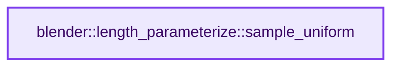
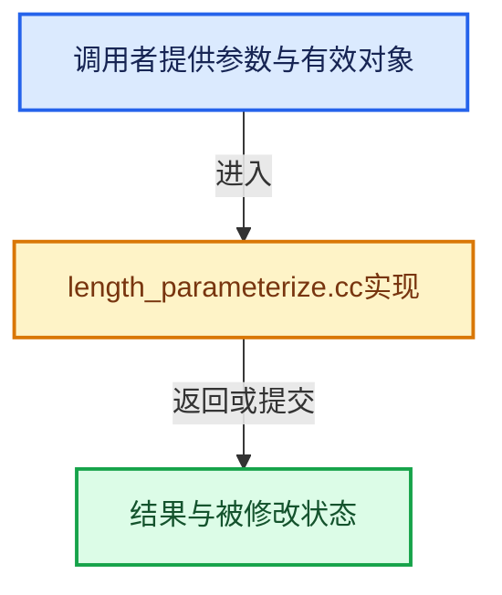

# 实现依赖专题：source/blender/blenlib/intern/length_parameterize.cc

[方向导航](README.md) · [符号索引](../%E7%AC%A6%E5%8F%B7%E4%BE%9D%E8%B5%96%E4%B8%8E%E5%AE%9E%E7%8E%B0%E7%B4%A2%E5%BC%95.md)

本专题从正文实际调用进入，集中保存共享实现。函数有稳定锚点，可从调用处直接跳到对应完整函数；递归与互相调用通过回链组织。

## 本文件的实现关系






## 完整成员与函数实现

<a id="f-f8dff656792f6adb"></a>

### `blender::length_parameterize::sample_uniform`

实现位置：[source/blender/blenlib/intern/length_parameterize.cc](../../../../../source/blender/blenlib/intern/length_parameterize.cc) · L15—L42。

接口参数：

- `const Span<float> accumulated_segment_lengths`
- `const bool include_last_point`
- `MutableSpan<int> r_segment_indices`
- `MutableSpan<float> r_factors`

**教学注释版**

<!-- annotated:bee37dcc5141f8 -->

```cpp
void sample_uniform(const Span<float> accumulated_segment_lengths,
                    const bool include_last_point,
                    MutableSpan<int> r_segment_indices,
                    MutableSpan<float> r_factors)
{
  // [讲解] r_segment_indices.size：查询视图长度或生成对应有效索引区间。
  const int count = r_segment_indices.size();
  BLI_assert(count > 0);
  BLI_assert(accumulated_segment_lengths.size() >= 1);
  BLI_assert(
      // [讲解] accumulated_segment_lengths.begin：返回借用范围的地址。
      std::is_sorted(accumulated_segment_lengths.begin(), accumulated_segment_lengths.end()));

  if (count == 1) {
    r_segment_indices[0] = 0;
    r_factors[0] = 0.0f;
    return;
  }
  // [讲解] accumulated_segment_lengths.last：按视图边界访问元素。
  const float total_length = accumulated_segment_lengths.last();
  const float step_length = total_length / (count - include_last_point);
  threading::parallel_for(IndexRange(count), 512, [&](const IndexRange range) {
    SampleSegmentHint hint;
    for (const int i : range) {
      /* Use minimum to avoid issues with floating point accuracy. */
      // [讲解] std::min：按比较关系选取较小值；截断范围时还需先满足非负和可表示范围，min本身不会证明边界安全。
      const float sample_length = std::min(total_length, i * step_length);
      sample_at_length(
          accumulated_segment_lengths, sample_length, r_segment_indices[i], r_factors[i], &hint);
    }
  });
}
```

<details>
<summary>核对原始源码：source/blender/blenlib/intern/length_parameterize.cc · L15—L42</summary>

<!-- original:bee37dcc5141f8:source/blender/blenlib/intern/length_parameterize.cc:15:42 -->

```cpp
void sample_uniform(const Span<float> accumulated_segment_lengths,
                    const bool include_last_point,
                    MutableSpan<int> r_segment_indices,
                    MutableSpan<float> r_factors)
{
  const int count = r_segment_indices.size();
  BLI_assert(count > 0);
  BLI_assert(accumulated_segment_lengths.size() >= 1);
  BLI_assert(
      std::is_sorted(accumulated_segment_lengths.begin(), accumulated_segment_lengths.end()));

  if (count == 1) {
    r_segment_indices[0] = 0;
    r_factors[0] = 0.0f;
    return;
  }
  const float total_length = accumulated_segment_lengths.last();
  const float step_length = total_length / (count - include_last_point);
  threading::parallel_for(IndexRange(count), 512, [&](const IndexRange range) {
    SampleSegmentHint hint;
    for (const int i : range) {
      /* Use minimum to avoid issues with floating point accuracy. */
      const float sample_length = std::min(total_length, i * step_length);
      sample_at_length(
          accumulated_segment_lengths, sample_length, r_segment_indices[i], r_factors[i], &hint);
    }
  });
}
```

</details>

**沿实际写入检查状态**

- `r_segment_indices[0] = 0;`
- `r_factors[0] = 0.0f;`

**继续追踪实现**

- `r_segment_indices.size` → [blender::MutableSpan::size · L499](06-MutableSpan%E5%8F%AF%E5%86%99%E8%A7%86%E5%9B%BE.md#f-1de6a66839c304a8)；[blender::gpu::shader::parser::MutableSpan::size · L87](../05-%E5%87%A0%E4%BD%95%E5%AD%98%E5%82%A8%E4%B8%8E%E6%8B%93%E6%89%91%E6%98%A0%E5%B0%84/%E4%BE%9D%E8%B5%96-utils-06433d.md#f-5e684af6ee7990e9)。同名重载需按实参类型选择。
- `BLI_assert` → [BLI_assert · L48](%E4%BE%9D%E8%B5%96-BLI_assert-cc98e8.md#m-57a88495704d)；[BLI_assert · L63](%E4%BE%9D%E8%B5%96-BLI_assert-cc98e8.md#m-d07050020cb5)。宏定义由构建条件选择。
- `accumulated_segment_lengths.size` → [blender::Span::size · L256](05-Span%E5%8F%AA%E8%AF%BB%E8%BF%9E%E7%BB%AD%E8%A7%86%E5%9B%BE.md#f-5f80fa006089c998)。
- `std::is_sorted` → [外部契约](https://eel.is/c++draft/)：这个边界按实际表达式及所属类型核对参数、返回值、寿命与失败行为。这里提供接口入口，不声称已解释该第三方版本的内部实现。
- `accumulated_segment_lengths.begin` → [blender::Span::begin · L224](05-Span%E5%8F%AA%E8%AF%BB%E8%BF%9E%E7%BB%AD%E8%A7%86%E5%9B%BE.md#f-415883b512284f46)。
- `accumulated_segment_lengths.end` → [blender::Span::end · L228](05-Span%E5%8F%AA%E8%AF%BB%E8%BF%9E%E7%BB%AD%E8%A7%86%E5%9B%BE.md#f-a7d8b9e494c291a7)。
- `accumulated_segment_lengths.last` → [blender::Span::last · L329](05-Span%E5%8F%AA%E8%AF%BB%E8%BF%9E%E7%BB%AD%E8%A7%86%E5%9B%BE.md#f-a92146c285596891)。
- `threading::parallel_for` → [blender::threading::parallel_for · L68](../11-Depsgraph%E4%B8%8E%E5%B9%B6%E8%A1%8C%E4%BB%BB%E5%8A%A1%E7%B3%BB%E7%BB%9F/07-%E4%BB%BB%E5%8A%A1%E6%B1%A0%E4%B8%8ETBB%E6%8E%A5%E5%85%A5.md#f-838294754c24426c)。
- `IndexRange` → [blender::IndexRange](%E4%BE%9D%E8%B5%96-BLI_index_range-7d7cc5.md#t-caa3466d6776)；[blender::gpu::shader::parser::IndexRange](../05-%E5%87%A0%E4%BD%95%E5%AD%98%E5%82%A8%E4%B8%8E%E6%8B%93%E6%89%91%E6%98%A0%E5%B0%84/%E4%BE%9D%E8%B5%96-utils-06433d.md#t-82d2bd4ea71c)；[blender::IndexRange](../05-%E5%87%A0%E4%BD%95%E5%AD%98%E5%82%A8%E4%B8%8E%E6%8B%93%E6%89%91%E6%98%A0%E5%B0%84/%E4%BE%9D%E8%B5%96-DNA_node_types-6708b9.md#t-0448cc889d39)。
- `std::min` → [外部契约](https://eel.is/c++draft/alg.min.max)：按比较关系选取较小值；截断范围时还需先满足非负和可表示范围，min本身不会证明边界安全。
- `sample_at_length` → [blender::length_parameterize::sample_at_length · L97](%E4%BE%9D%E8%B5%96-BLI_length_parameterize-d76620.md#f-4f136286e9947282)。
