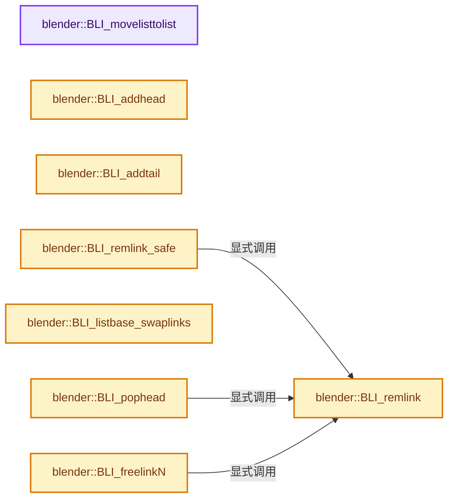
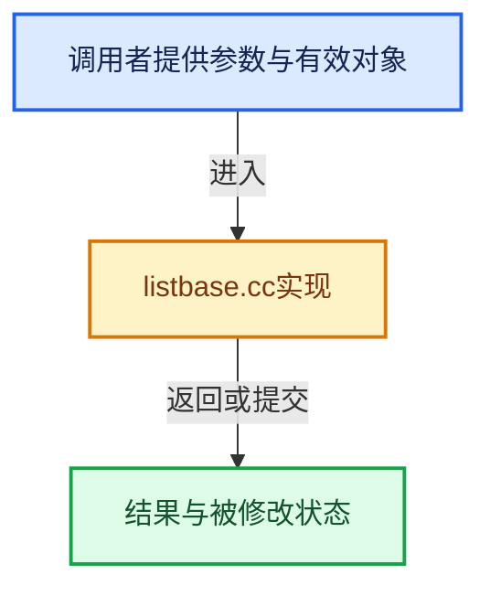

# 实现依赖专题：source/blender/blenlib/intern/listbase.cc

[方向导航](README.md) · [符号索引](../%E7%AC%A6%E5%8F%B7%E4%BE%9D%E8%B5%96%E4%B8%8E%E5%AE%9E%E7%8E%B0%E7%B4%A2%E5%BC%95.md)

本专题从正文实际调用进入，集中保存共享实现。函数有稳定锚点，可从调用处直接跳到对应完整函数；递归与互相调用通过回链组织。

## 本文件的实现关系






## 完整成员与函数实现

<a id="f-c7a706073038a4be"></a>

### `blender::BLI_movelisttolist`

实现位置：[source/blender/blenlib/intern/listbase.cc](../../../../../source/blender/blenlib/intern/listbase.cc) · L32—L48。

接口参数：

- `ListBase *dst`
- `ListBase *src`

**教学注释版**

<!-- annotated:b4ac9acd579f97 -->

```cpp
void BLI_movelisttolist(ListBase *dst, ListBase *src)
{
  if (src->first_ == nullptr) {
    return;
  }

  if (dst->first_ == nullptr) {
    dst->first_ = src->first_;
    dst->last_ = src->last_;
  }
  else {
    (static_cast<Link *>(dst->last_))->next = static_cast<Link *>(src->first_);
    (static_cast<Link *>(src->first_))->prev = static_cast<Link *>(dst->last_);
    dst->last_ = src->last_;
  }
  src->first_ = src->last_ = nullptr;
}
```

<details>
<summary>核对原始源码：source/blender/blenlib/intern/listbase.cc · L32—L48</summary>

<!-- original:b4ac9acd579f97:source/blender/blenlib/intern/listbase.cc:32:48 -->

```cpp
void BLI_movelisttolist(ListBase *dst, ListBase *src)
{
  if (src->first_ == nullptr) {
    return;
  }

  if (dst->first_ == nullptr) {
    dst->first_ = src->first_;
    dst->last_ = src->last_;
  }
  else {
    (static_cast<Link *>(dst->last_))->next = static_cast<Link *>(src->first_);
    (static_cast<Link *>(src->first_))->prev = static_cast<Link *>(dst->last_);
    dst->last_ = src->last_;
  }
  src->first_ = src->last_ = nullptr;
}
```

</details>

**沿实际写入检查状态**

- `dst->first_ = src->first_;`
- `dst->last_ = src->last_;`
- `src->first_ = src->last_ = nullptr;`

**继续追踪实现**

本实现没有需要继续展开的显式调用；检查返回表达式、对象转换和调用者前置条件。

<a id="f-fed3ad483fcdfeb9"></a>

### `blender::BLI_addhead`

实现位置：[source/blender/blenlib/intern/listbase.cc](../../../../../source/blender/blenlib/intern/listbase.cc) · L98—L116。

接口参数：

- `ListBase *listbase`
- `void *vlink`

**教学注释版**

<!-- annotated:18319b361bd6c5 -->

```cpp
void BLI_addhead(ListBase *listbase, void *vlink)
{
  Link *link = static_cast<Link *>(vlink);

  if (link == nullptr) {
    return;
  }

  link->next = static_cast<Link *>(listbase->first_);
  link->prev = nullptr;

  if (listbase->first_) {
    (static_cast<Link *>(listbase->first_))->prev = link;
  }
  if (listbase->last_ == nullptr) {
    listbase->last_ = link;
  }
  listbase->first_ = link;
}
```

<details>
<summary>核对原始源码：source/blender/blenlib/intern/listbase.cc · L98—L116</summary>

<!-- original:18319b361bd6c5:source/blender/blenlib/intern/listbase.cc:98:116 -->

```cpp
void BLI_addhead(ListBase *listbase, void *vlink)
{
  Link *link = static_cast<Link *>(vlink);

  if (link == nullptr) {
    return;
  }

  link->next = static_cast<Link *>(listbase->first_);
  link->prev = nullptr;

  if (listbase->first_) {
    (static_cast<Link *>(listbase->first_))->prev = link;
  }
  if (listbase->last_ == nullptr) {
    listbase->last_ = link;
  }
  listbase->first_ = link;
}
```

</details>

**沿实际写入检查状态**

- `link->next = static_cast<Link *>(listbase->first_);`
- `link->prev = nullptr;`
- `listbase->last_ = link;`
- `listbase->first_ = link;`

**继续追踪实现**

本实现没有需要继续展开的显式调用；检查返回表达式、对象转换和调用者前置条件。

<a id="f-4fb027713fa3115b"></a>

### `blender::BLI_addtail`

实现位置：[source/blender/blenlib/intern/listbase.cc](../../../../../source/blender/blenlib/intern/listbase.cc) · L118—L136。

接口参数：

- `ListBase *listbase`
- `void *vlink`

**教学注释版**

<!-- annotated:6c5665ebad8cf3 -->

```cpp
void BLI_addtail(ListBase *listbase, void *vlink)
{
  Link *link = static_cast<Link *>(vlink);

  if (link == nullptr) {
    return;
  }

  link->next = nullptr;
  link->prev = static_cast<Link *>(listbase->last_);

  if (listbase->last_) {
    (static_cast<Link *>(listbase->last_))->next = link;
  }
  if (listbase->first_ == nullptr) {
    listbase->first_ = link;
  }
  listbase->last_ = link;
}
```

<details>
<summary>核对原始源码：source/blender/blenlib/intern/listbase.cc · L118—L136</summary>

<!-- original:6c5665ebad8cf3:source/blender/blenlib/intern/listbase.cc:118:136 -->

```cpp
void BLI_addtail(ListBase *listbase, void *vlink)
{
  Link *link = static_cast<Link *>(vlink);

  if (link == nullptr) {
    return;
  }

  link->next = nullptr;
  link->prev = static_cast<Link *>(listbase->last_);

  if (listbase->last_) {
    (static_cast<Link *>(listbase->last_))->next = link;
  }
  if (listbase->first_ == nullptr) {
    listbase->first_ = link;
  }
  listbase->last_ = link;
}
```

</details>

**沿实际写入检查状态**

- `link->next = nullptr;`
- `link->prev = static_cast<Link *>(listbase->last_);`
- `listbase->first_ = link;`
- `listbase->last_ = link;`

**继续追踪实现**

本实现没有需要继续展开的显式调用；检查返回表达式、对象转换和调用者前置条件。

<a id="f-120d80f281ca4cb7"></a>

### `blender::BLI_remlink`

实现位置：[source/blender/blenlib/intern/listbase.cc](../../../../../source/blender/blenlib/intern/listbase.cc) · L138—L159。

接口参数：

- `ListBase *listbase`
- `void *vlink`

**教学注释版**

<!-- annotated:24dafbaaeeaba4 -->

```cpp
void BLI_remlink(ListBase *listbase, void *vlink)
{
  Link *link = static_cast<Link *>(vlink);

  if (link == nullptr) {
    return;
  }

  if (link->next) {
    link->next->prev = link->prev;
  }
  if (link->prev) {
    link->prev->next = link->next;
  }

  if (listbase->last_ == link) {
    listbase->last_ = link->prev;
  }
  if (listbase->first_ == link) {
    listbase->first_ = link->next;
  }
}
```

<details>
<summary>核对原始源码：source/blender/blenlib/intern/listbase.cc · L138—L159</summary>

<!-- original:24dafbaaeeaba4:source/blender/blenlib/intern/listbase.cc:138:159 -->

```cpp
void BLI_remlink(ListBase *listbase, void *vlink)
{
  Link *link = static_cast<Link *>(vlink);

  if (link == nullptr) {
    return;
  }

  if (link->next) {
    link->next->prev = link->prev;
  }
  if (link->prev) {
    link->prev->next = link->next;
  }

  if (listbase->last_ == link) {
    listbase->last_ = link->prev;
  }
  if (listbase->first_ == link) {
    listbase->first_ = link->next;
  }
}
```

</details>

**沿实际写入检查状态**

- `link->next->prev = link->prev;`
- `link->prev->next = link->next;`
- `listbase->last_ = link->prev;`
- `listbase->first_ = link->next;`

**继续追踪实现**

本实现没有需要继续展开的显式调用；检查返回表达式、对象转换和调用者前置条件。

<a id="f-2f9636b631270d33"></a>

### `blender::BLI_remlink_safe`

实现位置：[source/blender/blenlib/intern/listbase.cc](../../../../../source/blender/blenlib/intern/listbase.cc) · L161—L169。

接口参数：

- `ListBase *listbase`
- `void *vlink`

**教学注释版**

<!-- annotated:f24b673a934c63 -->

```cpp
bool BLI_remlink_safe(ListBase *listbase, void *vlink)
{
  if (BLI_findindex(listbase, vlink) != -1) {
    BLI_remlink(listbase, vlink);
    return true;
  }

  return false;
}
```

<details>
<summary>核对原始源码：source/blender/blenlib/intern/listbase.cc · L161—L169</summary>

<!-- original:f24b673a934c63:source/blender/blenlib/intern/listbase.cc:161:169 -->

```cpp
bool BLI_remlink_safe(ListBase *listbase, void *vlink)
{
  if (BLI_findindex(listbase, vlink) != -1) {
    BLI_remlink(listbase, vlink);
    return true;
  }

  return false;
}
```

</details>

**结果出口**

- `return true;`
- `return false;`

**继续追踪实现**

- `BLI_findindex` → [blender::BLI_findindex · L593](%E4%BE%9D%E8%B5%96-listbase-2816d9.md#f-cb9036f12bd486b7)。
- `BLI_remlink` → [blender::BLI_remlink · L138](%E4%BE%9D%E8%B5%96-listbase-2816d9.md#f-120d80f281ca4cb7)。

<a id="f-7603d3f980be3243"></a>

### `blender::BLI_listbase_swaplinks`

实现位置：[source/blender/blenlib/intern/listbase.cc](../../../../../source/blender/blenlib/intern/listbase.cc) · L171—L222。

接口参数：

- `ListBase *listbase`
- `void *vlinka`
- `void *vlinkb`

**教学注释版**

<!-- annotated:51516097a1ada8 -->

```cpp
void BLI_listbase_swaplinks(ListBase *listbase, void *vlinka, void *vlinkb)
{
  Link *linka = static_cast<Link *>(vlinka);
  Link *linkb = static_cast<Link *>(vlinkb);

  if (!linka || !linkb) {
    return;
  }

  if (linkb->next == linka) {
    std::swap(linka, linkb);
  }

  if (linka->next == linkb) {
    linka->next = linkb->next;
    linkb->prev = linka->prev;
    linka->prev = linkb;
    linkb->next = linka;
  }
  else { /* Non-contiguous items, we can safely swap. */
    std::swap(linka->prev, linkb->prev);
    std::swap(linka->next, linkb->next);
  }

  /* Update neighbors of linka and linkb. */
  if (linka->prev) {
    linka->prev->next = linka;
  }
  if (linka->next) {
    linka->next->prev = linka;
  }
  if (linkb->prev) {
    linkb->prev->next = linkb;
  }
  if (linkb->next) {
    linkb->next->prev = linkb;
  }

  if (listbase->last_ == linka) {
    listbase->last_ = linkb;
  }
  else if (listbase->last_ == linkb) {
    listbase->last_ = linka;
  }

  if (listbase->first_ == linka) {
    listbase->first_ = linkb;
  }
  else if (listbase->first_ == linkb) {
    listbase->first_ = linka;
  }
}
```

<details>
<summary>核对原始源码：source/blender/blenlib/intern/listbase.cc · L171—L222</summary>

<!-- original:51516097a1ada8:source/blender/blenlib/intern/listbase.cc:171:222 -->

```cpp
void BLI_listbase_swaplinks(ListBase *listbase, void *vlinka, void *vlinkb)
{
  Link *linka = static_cast<Link *>(vlinka);
  Link *linkb = static_cast<Link *>(vlinkb);

  if (!linka || !linkb) {
    return;
  }

  if (linkb->next == linka) {
    std::swap(linka, linkb);
  }

  if (linka->next == linkb) {
    linka->next = linkb->next;
    linkb->prev = linka->prev;
    linka->prev = linkb;
    linkb->next = linka;
  }
  else { /* Non-contiguous items, we can safely swap. */
    std::swap(linka->prev, linkb->prev);
    std::swap(linka->next, linkb->next);
  }

  /* Update neighbors of linka and linkb. */
  if (linka->prev) {
    linka->prev->next = linka;
  }
  if (linka->next) {
    linka->next->prev = linka;
  }
  if (linkb->prev) {
    linkb->prev->next = linkb;
  }
  if (linkb->next) {
    linkb->next->prev = linkb;
  }

  if (listbase->last_ == linka) {
    listbase->last_ = linkb;
  }
  else if (listbase->last_ == linkb) {
    listbase->last_ = linka;
  }

  if (listbase->first_ == linka) {
    listbase->first_ = linkb;
  }
  else if (listbase->first_ == linkb) {
    listbase->first_ = linka;
  }
}
```

</details>

**沿实际写入检查状态**

- `linka->next = linkb->next;`
- `linkb->prev = linka->prev;`
- `linka->prev = linkb;`
- `linkb->next = linka;`
- `linka->prev->next = linka;`
- `linka->next->prev = linka;`
- `linkb->prev->next = linkb;`
- `linkb->next->prev = linkb;`
- `listbase->last_ = linkb;`
- `listbase->last_ = linka;`
- `listbase->first_ = linkb;`
- `listbase->first_ = linka;`

**继续追踪实现**

- `std::swap` → [外部契约](https://eel.is/c++draft/)：这个边界按实际表达式及所属类型核对参数、返回值、寿命与失败行为。这里提供接口入口，不声称已解释该第三方版本的内部实现。

<a id="f-c1491382e532f81c"></a>

### `blender::BLI_pophead`

实现位置：[source/blender/blenlib/intern/listbase.cc](../../../../../source/blender/blenlib/intern/listbase.cc) · L259—L266。

接口参数：

- `ListBase *listbase`

**教学注释版**

<!-- annotated:a4acb56d4aa85b -->

```cpp
void *BLI_pophead(ListBase *listbase)
{
  Link *link = static_cast<Link *>(listbase->first_);
  if (link) {
    BLI_remlink(listbase, link);
  }
  return link;
}
```

<details>
<summary>核对原始源码：source/blender/blenlib/intern/listbase.cc · L259—L266</summary>

<!-- original:a4acb56d4aa85b:source/blender/blenlib/intern/listbase.cc:259:266 -->

```cpp
void *BLI_pophead(ListBase *listbase)
{
  Link *link = static_cast<Link *>(listbase->first_);
  if (link) {
    BLI_remlink(listbase, link);
  }
  return link;
}
```

</details>

**结果出口**

- `return link;`

**继续追踪实现**

- `BLI_remlink` → [blender::BLI_remlink · L138](%E4%BE%9D%E8%B5%96-listbase-2816d9.md#f-120d80f281ca4cb7)。

<a id="f-c7719591852af7da"></a>

### `blender::BLI_freelinkN`

实现位置：[source/blender/blenlib/intern/listbase.cc](../../../../../source/blender/blenlib/intern/listbase.cc) · L277—L287。

接口参数：

- `ListBase *listbase`
- `void *vlink`

**教学注释版**

<!-- annotated:c2edf6f56d37f2 -->

```cpp
void BLI_freelinkN(ListBase *listbase, void *vlink)
{
  Link *link = static_cast<Link *>(vlink);

  if (link == nullptr) {
    return;
  }

  BLI_remlink(listbase, link);
  MEM_delete(link);
}
```

<details>
<summary>核对原始源码：source/blender/blenlib/intern/listbase.cc · L277—L287</summary>

<!-- original:c2edf6f56d37f2:source/blender/blenlib/intern/listbase.cc:277:287 -->

```cpp
void BLI_freelinkN(ListBase *listbase, void *vlink)
{
  Link *link = static_cast<Link *>(vlink);

  if (link == nullptr) {
    return;
  }

  BLI_remlink(listbase, link);
  MEM_delete(link);
}
```

</details>

**继续追踪实现**

- `BLI_remlink` → [blender::BLI_remlink · L138](%E4%BE%9D%E8%B5%96-listbase-2816d9.md#f-120d80f281ca4cb7)。
- `MEM_delete` → [MEM_delete · L400](../03-%E5%86%85%E5%AD%98%E5%88%86%E9%85%8D%E4%B8%8E%E8%BF%90%E8%A1%8C%E6%97%B6%E7%B1%BB%E5%9E%8B/%E4%BE%9D%E8%B5%96-MEM_guardedalloc-b54eca.md#f-9049ffdd1682887c)。

<a id="f-e713128364f26ada"></a>

### `blender::listbase_double_from_single`

实现位置：[source/blender/blenlib/intern/listbase.cc](../../../../../source/blender/blenlib/intern/listbase.cc) · L292—L301。

接口参数：

- `Link *iter`
- `ListBase *listbase`

**教学注释版**

<!-- annotated:0cb390fcb35be4 -->

```cpp
static void listbase_double_from_single(Link *iter, ListBase *listbase)
{
  Link *prev = nullptr;
  listbase->first_ = iter;
  do {
    iter->prev = prev;
    prev = iter;
  } while ((iter = iter->next));
  listbase->last_ = prev;
}
```

<details>
<summary>核对原始源码：source/blender/blenlib/intern/listbase.cc · L292—L301</summary>

<!-- original:0cb390fcb35be4:source/blender/blenlib/intern/listbase.cc:292:301 -->

```cpp
static void listbase_double_from_single(Link *iter, ListBase *listbase)
{
  Link *prev = nullptr;
  listbase->first_ = iter;
  do {
    iter->prev = prev;
    prev = iter;
  } while ((iter = iter->next));
  listbase->last_ = prev;
}
```

</details>

**沿实际写入检查状态**

- `listbase->first_ = iter;`
- `iter->prev = prev;`
- `prev = iter;`
- `listbase->last_ = prev;`

**继续追踪实现**

本实现没有需要继续展开的显式调用；检查返回表达式、对象转换和调用者前置条件。

<a id="f-03f9b3ff7a56175f"></a>

### `blender::BLI_listbase_sort`

实现位置：[source/blender/blenlib/intern/listbase.cc](../../../../../source/blender/blenlib/intern/listbase.cc) · L319—L326。

接口参数：

- `ListBase *listbase`
- `int (*cmp)(const void *, const void *)`
- `const void *`
- `const void *`

**教学注释版**

<!-- annotated:0384783db7421a -->

```cpp
void BLI_listbase_sort(ListBase *listbase, int (*cmp)(const void *, const void *))
{
  if (listbase->first_ != listbase->last_) {
    Link *head = static_cast<Link *>(listbase->first_);
    head = listbase_sort_fn(head, cmp);
    listbase_double_from_single(head, listbase);
  }
}
```

<details>
<summary>核对原始源码：source/blender/blenlib/intern/listbase.cc · L319—L326</summary>

<!-- original:0384783db7421a:source/blender/blenlib/intern/listbase.cc:319:326 -->

```cpp
void BLI_listbase_sort(ListBase *listbase, int (*cmp)(const void *, const void *))
{
  if (listbase->first_ != listbase->last_) {
    Link *head = static_cast<Link *>(listbase->first_);
    head = listbase_sort_fn(head, cmp);
    listbase_double_from_single(head, listbase);
  }
}
```

</details>

**沿实际写入检查状态**

- `head = listbase_sort_fn(head, cmp);`

**继续追踪实现**

- `listbase_sort_fn` → [调用协议](../%E6%A8%A1%E6%9D%BF%E5%AE%8F%E4%B8%8E%E5%8A%A8%E6%80%81%E5%88%86%E6%B4%BE%E5%8D%8F%E8%AE%AE.md)：函数指针、局部可调用对象或未展开的宏；必须结合调用者环境。调用位置L323。
- `listbase_double_from_single` → [blender::listbase_double_from_single · L292](%E4%BE%9D%E8%B5%96-listbase-2816d9.md#f-e713128364f26ada)。

<a id="f-d9b7a8867f0726c4"></a>

### `blender::BLI_listbase_sort_r`

实现位置：[source/blender/blenlib/intern/listbase.cc](../../../../../source/blender/blenlib/intern/listbase.cc) · L328—L337。

接口参数：

- `ListBase *listbase`
- `int (*cmp)(void *, const void *, const void *)`
- `void *`
- `const void *`
- `const void *`
- `void *thunk`

**教学注释版**

<!-- annotated:612ebd8b00793e -->

```cpp
void BLI_listbase_sort_r(ListBase *listbase,
                         int (*cmp)(void *, const void *, const void *),
                         void *thunk)
{
  if (listbase->first_ != listbase->last_) {
    Link *head = static_cast<Link *>(listbase->first_);
    head = listbase_sort_fn_r(head, cmp, thunk);
    listbase_double_from_single(head, listbase);
  }
}
```

<details>
<summary>核对原始源码：source/blender/blenlib/intern/listbase.cc · L328—L337</summary>

<!-- original:612ebd8b00793e:source/blender/blenlib/intern/listbase.cc:328:337 -->

```cpp
void BLI_listbase_sort_r(ListBase *listbase,
                         int (*cmp)(void *, const void *, const void *),
                         void *thunk)
{
  if (listbase->first_ != listbase->last_) {
    Link *head = static_cast<Link *>(listbase->first_);
    head = listbase_sort_fn_r(head, cmp, thunk);
    listbase_double_from_single(head, listbase);
  }
}
```

</details>

**沿实际写入检查状态**

- `head = listbase_sort_fn_r(head, cmp, thunk);`

**继续追踪实现**

- `listbase_sort_fn_r` → [调用协议](../%E6%A8%A1%E6%9D%BF%E5%AE%8F%E4%B8%8E%E5%8A%A8%E6%80%81%E5%88%86%E6%B4%BE%E5%8D%8F%E8%AE%AE.md)：函数指针、局部可调用对象或未展开的宏；必须结合调用者环境。调用位置L334。
- `listbase_double_from_single` → [blender::listbase_double_from_single · L292](%E4%BE%9D%E8%B5%96-listbase-2816d9.md#f-e713128364f26ada)。

<a id="f-fb34ee702e68c1d5"></a>

### `blender::BLI_insertlinkafter`

实现位置：[source/blender/blenlib/intern/listbase.cc](../../../../../source/blender/blenlib/intern/listbase.cc) · L339—L376。

接口参数：

- `ListBase *listbase`
- `void *vprevlink`
- `void *vnewlink`

**教学注释版**

<!-- annotated:b65007b118d2e3 -->

```cpp
void BLI_insertlinkafter(ListBase *listbase, void *vprevlink, void *vnewlink)
{
  Link *prevlink = static_cast<Link *>(vprevlink);
  Link *newlink = static_cast<Link *>(vnewlink);

  /* newlink before nextlink */
  if (newlink == nullptr) {
    return;
  }

  /* empty list */
  if (listbase->first_ == nullptr) {
    listbase->first_ = newlink;
    listbase->last_ = newlink;
    return;
  }

  /* insert at head of list */
  if (prevlink == nullptr) {
    newlink->prev = nullptr;
    newlink->next = static_cast<Link *>(listbase->first_);
    newlink->next->prev = newlink;
    listbase->first_ = newlink;
    return;
  }

  /* at end of list */
  if (listbase->last_ == prevlink) {
    listbase->last_ = newlink;
  }

  newlink->next = prevlink->next;
  newlink->prev = prevlink;
  prevlink->next = newlink;
  if (newlink->next) {
    newlink->next->prev = newlink;
  }
}
```

<details>
<summary>核对原始源码：source/blender/blenlib/intern/listbase.cc · L339—L376</summary>

<!-- original:b65007b118d2e3:source/blender/blenlib/intern/listbase.cc:339:376 -->

```cpp
void BLI_insertlinkafter(ListBase *listbase, void *vprevlink, void *vnewlink)
{
  Link *prevlink = static_cast<Link *>(vprevlink);
  Link *newlink = static_cast<Link *>(vnewlink);

  /* newlink before nextlink */
  if (newlink == nullptr) {
    return;
  }

  /* empty list */
  if (listbase->first_ == nullptr) {
    listbase->first_ = newlink;
    listbase->last_ = newlink;
    return;
  }

  /* insert at head of list */
  if (prevlink == nullptr) {
    newlink->prev = nullptr;
    newlink->next = static_cast<Link *>(listbase->first_);
    newlink->next->prev = newlink;
    listbase->first_ = newlink;
    return;
  }

  /* at end of list */
  if (listbase->last_ == prevlink) {
    listbase->last_ = newlink;
  }

  newlink->next = prevlink->next;
  newlink->prev = prevlink;
  prevlink->next = newlink;
  if (newlink->next) {
    newlink->next->prev = newlink;
  }
}
```

</details>

**沿实际写入检查状态**

- `listbase->first_ = newlink;`
- `listbase->last_ = newlink;`
- `newlink->prev = nullptr;`
- `newlink->next = static_cast<Link *>(listbase->first_);`
- `newlink->next->prev = newlink;`
- `newlink->next = prevlink->next;`
- `newlink->prev = prevlink;`
- `prevlink->next = newlink;`

**继续追踪实现**

本实现没有需要继续展开的显式调用；检查返回表达式、对象转换和调用者前置条件。

<a id="f-b9a49151feaf9c08"></a>

### `blender::BLI_insertlinkbefore`

实现位置：[source/blender/blenlib/intern/listbase.cc](../../../../../source/blender/blenlib/intern/listbase.cc) · L378—L415。

接口参数：

- `ListBase *listbase`
- `void *vnextlink`
- `void *vnewlink`

**教学注释版**

<!-- annotated:580c7b826803ec -->

```cpp
void BLI_insertlinkbefore(ListBase *listbase, void *vnextlink, void *vnewlink)
{
  Link *nextlink = static_cast<Link *>(vnextlink);
  Link *newlink = static_cast<Link *>(vnewlink);

  /* newlink before nextlink */
  if (newlink == nullptr) {
    return;
  }

  /* empty list */
  if (listbase->first_ == nullptr) {
    listbase->first_ = newlink;
    listbase->last_ = newlink;
    return;
  }

  /* insert at end of list */
  if (nextlink == nullptr) {
    newlink->prev = static_cast<Link *>(listbase->last_);
    newlink->next = nullptr;
    (static_cast<Link *>(listbase->last_))->next = newlink;
    listbase->last_ = newlink;
    return;
  }

  /* at beginning of list */
  if (listbase->first_ == nextlink) {
    listbase->first_ = newlink;
  }

  newlink->next = nextlink;
  newlink->prev = nextlink->prev;
  nextlink->prev = newlink;
  if (newlink->prev) {
    newlink->prev->next = newlink;
  }
}
```

<details>
<summary>核对原始源码：source/blender/blenlib/intern/listbase.cc · L378—L415</summary>

<!-- original:580c7b826803ec:source/blender/blenlib/intern/listbase.cc:378:415 -->

```cpp
void BLI_insertlinkbefore(ListBase *listbase, void *vnextlink, void *vnewlink)
{
  Link *nextlink = static_cast<Link *>(vnextlink);
  Link *newlink = static_cast<Link *>(vnewlink);

  /* newlink before nextlink */
  if (newlink == nullptr) {
    return;
  }

  /* empty list */
  if (listbase->first_ == nullptr) {
    listbase->first_ = newlink;
    listbase->last_ = newlink;
    return;
  }

  /* insert at end of list */
  if (nextlink == nullptr) {
    newlink->prev = static_cast<Link *>(listbase->last_);
    newlink->next = nullptr;
    (static_cast<Link *>(listbase->last_))->next = newlink;
    listbase->last_ = newlink;
    return;
  }

  /* at beginning of list */
  if (listbase->first_ == nextlink) {
    listbase->first_ = newlink;
  }

  newlink->next = nextlink;
  newlink->prev = nextlink->prev;
  nextlink->prev = newlink;
  if (newlink->prev) {
    newlink->prev->next = newlink;
  }
}
```

</details>

**沿实际写入检查状态**

- `listbase->first_ = newlink;`
- `listbase->last_ = newlink;`
- `newlink->prev = static_cast<Link *>(listbase->last_);`
- `newlink->next = nullptr;`
- `newlink->next = nextlink;`
- `newlink->prev = nextlink->prev;`
- `nextlink->prev = newlink;`
- `newlink->prev->next = newlink;`

**继续追踪实现**

本实现没有需要继续展开的显式调用；检查返回表达式、对象转换和调用者前置条件。

<a id="f-72de346b2b873764"></a>

### `blender::BLI_insertlinkreplace`

实现位置：[source/blender/blenlib/intern/listbase.cc](../../../../../source/blender/blenlib/intern/listbase.cc) · L417—L441。

接口参数：

- `ListBase *listbase`
- `void *vreplacelink`
- `void *vnewlink`

**教学注释版**

<!-- annotated:f879303d394c3f -->

```cpp
void BLI_insertlinkreplace(ListBase *listbase, void *vreplacelink, void *vnewlink)
{
  Link *l_old = static_cast<Link *>(vreplacelink);
  Link *l_new = static_cast<Link *>(vnewlink);

  /* update adjacent links */
  if (l_old->next != nullptr) {
    l_old->next->prev = l_new;
  }
  if (l_old->prev != nullptr) {
    l_old->prev->next = l_new;
  }

  /* set direct links */
  l_new->next = l_old->next;
  l_new->prev = l_old->prev;

  /* update list */
  if (listbase->first_ == l_old) {
    listbase->first_ = l_new;
  }
  if (listbase->last_ == l_old) {
    listbase->last_ = l_new;
  }
}
```

<details>
<summary>核对原始源码：source/blender/blenlib/intern/listbase.cc · L417—L441</summary>

<!-- original:f879303d394c3f:source/blender/blenlib/intern/listbase.cc:417:441 -->

```cpp
void BLI_insertlinkreplace(ListBase *listbase, void *vreplacelink, void *vnewlink)
{
  Link *l_old = static_cast<Link *>(vreplacelink);
  Link *l_new = static_cast<Link *>(vnewlink);

  /* update adjacent links */
  if (l_old->next != nullptr) {
    l_old->next->prev = l_new;
  }
  if (l_old->prev != nullptr) {
    l_old->prev->next = l_new;
  }

  /* set direct links */
  l_new->next = l_old->next;
  l_new->prev = l_old->prev;

  /* update list */
  if (listbase->first_ == l_old) {
    listbase->first_ = l_new;
  }
  if (listbase->last_ == l_old) {
    listbase->last_ = l_new;
  }
}
```

</details>

**沿实际写入检查状态**

- `l_old->next->prev = l_new;`
- `l_old->prev->next = l_new;`
- `l_new->next = l_old->next;`
- `l_new->prev = l_old->prev;`
- `listbase->first_ = l_new;`
- `listbase->last_ = l_new;`

**继续追踪实现**

本实现没有需要继续展开的显式调用；检查返回表达式、对象转换和调用者前置条件。

<a id="f-0c7d7fe45f4066b2"></a>

### `blender::BLI_freelist`

实现位置：[source/blender/blenlib/intern/listbase.cc](../../../../../source/blender/blenlib/intern/listbase.cc) · L490—L502。

接口参数：

- `ListBase *listbase`

**教学注释版**

<!-- annotated:a3b176cfce68b3 -->

```cpp
void BLI_freelist(ListBase *listbase)
{
  Link *link, *next;

  link = static_cast<Link *>(listbase->first_);
  while (link) {
    next = link->next;
    // [讲解] free：归还相匹配的C分配存储，不自动执行C++析构；不可用于Windows的_aligned_malloc结果。
    free(link);
    link = next;
  }

  BLI_listbase_clear(listbase);
}
```

<details>
<summary>核对原始源码：source/blender/blenlib/intern/listbase.cc · L490—L502</summary>

<!-- original:a3b176cfce68b3:source/blender/blenlib/intern/listbase.cc:490:502 -->

```cpp
void BLI_freelist(ListBase *listbase)
{
  Link *link, *next;

  link = static_cast<Link *>(listbase->first_);
  while (link) {
    next = link->next;
    free(link);
    link = next;
  }

  BLI_listbase_clear(listbase);
}
```

</details>

**沿实际写入检查状态**

- `link = static_cast<Link *>(listbase->first_);`
- `next = link->next;`
- `link = next;`

**继续追踪实现**

- `free` → [外部契约](https://eel.is/c++draft/c.malloc)：归还相匹配的C分配存储，不自动执行C++析构；不可用于Windows的_aligned_malloc结果。
- `BLI_listbase_clear` → [blender::BLI_listbase_clear · L306](%E4%BE%9D%E8%B5%96-BLI_listbase-7dbed3.md#f-e7175128de2ddae7)。

<a id="f-c250f5cf55fbcbe4"></a>

### `blender::BLI_freelistN`

实现位置：[source/blender/blenlib/intern/listbase.cc](../../../../../source/blender/blenlib/intern/listbase.cc) · L504—L516。

接口参数：

- `ListBase *listbase`

**教学注释版**

<!-- annotated:801755e9ae79a1 -->

```cpp
void BLI_freelistN(ListBase *listbase)
{
  Link *link, *next;

  link = static_cast<Link *>(listbase->first_);
  while (link) {
    next = link->next;
    MEM_delete(link);
    link = next;
  }

  BLI_listbase_clear(listbase);
}
```

<details>
<summary>核对原始源码：source/blender/blenlib/intern/listbase.cc · L504—L516</summary>

<!-- original:801755e9ae79a1:source/blender/blenlib/intern/listbase.cc:504:516 -->

```cpp
void BLI_freelistN(ListBase *listbase)
{
  Link *link, *next;

  link = static_cast<Link *>(listbase->first_);
  while (link) {
    next = link->next;
    MEM_delete(link);
    link = next;
  }

  BLI_listbase_clear(listbase);
}
```

</details>

**沿实际写入检查状态**

- `link = static_cast<Link *>(listbase->first_);`
- `next = link->next;`
- `link = next;`

**继续追踪实现**

- `MEM_delete` → [MEM_delete · L400](../03-%E5%86%85%E5%AD%98%E5%88%86%E9%85%8D%E4%B8%8E%E8%BF%90%E8%A1%8C%E6%97%B6%E7%B1%BB%E5%9E%8B/%E4%BE%9D%E8%B5%96-MEM_guardedalloc-b54eca.md#f-9049ffdd1682887c)。
- `BLI_listbase_clear` → [blender::BLI_listbase_clear · L306](%E4%BE%9D%E8%B5%96-BLI_listbase-7dbed3.md#f-e7175128de2ddae7)。

<a id="f-8e9896af547c33c3"></a>

### `blender::BLI_listbase_count_at_most`

实现位置：[source/blender/blenlib/intern/listbase.cc](../../../../../source/blender/blenlib/intern/listbase.cc) · L518—L529。

接口参数：

- `const ListBase *listbase`
- `const int count_max`

**教学注释版**

<!-- annotated:702dd3f814a512 -->

```cpp
int BLI_listbase_count_at_most(const ListBase *listbase, const int count_max)
{
  Link *link;
  int count = 0;

  for (link = static_cast<Link *>(listbase->first_); link && count != count_max; link = link->next)
  {
    count++;
  }

  return count;
}
```

<details>
<summary>核对原始源码：source/blender/blenlib/intern/listbase.cc · L518—L529</summary>

<!-- original:702dd3f814a512:source/blender/blenlib/intern/listbase.cc:518:529 -->

```cpp
int BLI_listbase_count_at_most(const ListBase *listbase, const int count_max)
{
  Link *link;
  int count = 0;

  for (link = static_cast<Link *>(listbase->first_); link && count != count_max; link = link->next)
  {
    count++;
  }

  return count;
}
```

</details>

**结果出口**

- `return count;`

**继续追踪实现**

本实现没有需要继续展开的显式调用；检查返回表达式、对象转换和调用者前置条件。

<a id="f-da3c4037e01d7006"></a>

### `blender::BLI_listbase_count`

实现位置：[source/blender/blenlib/intern/listbase.cc](../../../../../source/blender/blenlib/intern/listbase.cc) · L531—L539。

接口参数：

- `const ListBase *listbase`

**教学注释版**

<!-- annotated:76be9ad39561fb -->

```cpp
int BLI_listbase_count(const ListBase *listbase)
{
  int count = 0;
  LISTBASE_FOREACH (Link *, link, listbase) {
    count++;
  }

  return count;
}
```

<details>
<summary>核对原始源码：source/blender/blenlib/intern/listbase.cc · L531—L539</summary>

<!-- original:76be9ad39561fb:source/blender/blenlib/intern/listbase.cc:531:539 -->

```cpp
int BLI_listbase_count(const ListBase *listbase)
{
  int count = 0;
  LISTBASE_FOREACH (Link *, link, listbase) {
    count++;
  }

  return count;
}
```

</details>

**结果出口**

- `return count;`

**继续追踪实现**

本实现没有需要继续展开的显式调用；检查返回表达式、对象转换和调用者前置条件。

<a id="f-6d3fd65974b4e808"></a>

### `blender::BLI_findlink`

实现位置：[source/blender/blenlib/intern/listbase.cc](../../../../../source/blender/blenlib/intern/listbase.cc) · L541—L554。

接口参数：

- `const ListBase *listbase`
- `int number`

**教学注释版**

<!-- annotated:750e5302606122 -->

```cpp
void *BLI_findlink(const ListBase *listbase, int number)
{
  Link *link = nullptr;

  if (number >= 0) {
    link = static_cast<Link *>(listbase->first_);
    while (link != nullptr && number != 0) {
      number--;
      link = link->next;
    }
  }

  return link;
}
```

<details>
<summary>核对原始源码：source/blender/blenlib/intern/listbase.cc · L541—L554</summary>

<!-- original:750e5302606122:source/blender/blenlib/intern/listbase.cc:541:554 -->

```cpp
void *BLI_findlink(const ListBase *listbase, int number)
{
  Link *link = nullptr;

  if (number >= 0) {
    link = static_cast<Link *>(listbase->first_);
    while (link != nullptr && number != 0) {
      number--;
      link = link->next;
    }
  }

  return link;
}
```

</details>

**沿实际写入检查状态**

- `link = static_cast<Link *>(listbase->first_);`
- `link = link->next;`

**结果出口**

- `return link;`

**继续追踪实现**

本实现没有需要继续展开的显式调用；检查返回表达式、对象转换和调用者前置条件。

<a id="f-cb9036f12bd486b7"></a>

### `blender::BLI_findindex`

实现位置：[source/blender/blenlib/intern/listbase.cc](../../../../../source/blender/blenlib/intern/listbase.cc) · L593—L613。

接口参数：

- `const ListBase *listbase`
- `const void *vlink`

**教学注释版**

<!-- annotated:d73f28d7d35d3a -->

```cpp
int BLI_findindex(const ListBase *listbase, const void *vlink)
{
  Link *link = nullptr;
  int number = 0;

  if (vlink == nullptr) {
    return -1;
  }

  link = static_cast<Link *>(listbase->first_);
  while (link) {
    if (link == vlink) {
      return number;
    }

    number++;
    link = link->next;
  }

  return -1;
}
```

<details>
<summary>核对原始源码：source/blender/blenlib/intern/listbase.cc · L593—L613</summary>

<!-- original:d73f28d7d35d3a:source/blender/blenlib/intern/listbase.cc:593:613 -->

```cpp
int BLI_findindex(const ListBase *listbase, const void *vlink)
{
  Link *link = nullptr;
  int number = 0;

  if (vlink == nullptr) {
    return -1;
  }

  link = static_cast<Link *>(listbase->first_);
  while (link) {
    if (link == vlink) {
      return number;
    }

    number++;
    link = link->next;
  }

  return -1;
}
```

</details>

**沿实际写入检查状态**

- `link = static_cast<Link *>(listbase->first_);`
- `link = link->next;`

**结果出口**

- `return -1;`
- `return number;`

**继续追踪实现**

本实现没有需要继续展开的显式调用；检查返回表达式、对象转换和调用者前置条件。

<a id="f-d913b13b2651348e"></a>

### `blender::BLI_findstring`

实现位置：[source/blender/blenlib/intern/listbase.cc](../../../../../source/blender/blenlib/intern/listbase.cc) · L615—L632。

接口参数：

- `const ListBase *listbase`
- `const char *id`
- `const int offset`

**教学注释版**

<!-- annotated:077239cc00fa55 -->

```cpp
void *BLI_findstring(const ListBase *listbase, const char *id, const int offset)
{
  const char *id_iter;

  if (id == nullptr) {
    return nullptr;
  }

  LISTBASE_FOREACH (Link *, link, listbase) {
    id_iter = (reinterpret_cast<const char *>(link)) + offset;

    if (id[0] == id_iter[0] && STREQ(id, id_iter)) {
      return link;
    }
  }

  return nullptr;
}
```

<details>
<summary>核对原始源码：source/blender/blenlib/intern/listbase.cc · L615—L632</summary>

<!-- original:077239cc00fa55:source/blender/blenlib/intern/listbase.cc:615:632 -->

```cpp
void *BLI_findstring(const ListBase *listbase, const char *id, const int offset)
{
  const char *id_iter;

  if (id == nullptr) {
    return nullptr;
  }

  LISTBASE_FOREACH (Link *, link, listbase) {
    id_iter = (reinterpret_cast<const char *>(link)) + offset;

    if (id[0] == id_iter[0] && STREQ(id, id_iter)) {
      return link;
    }
  }

  return nullptr;
}
```

</details>

**沿实际写入检查状态**

- `id_iter = (reinterpret_cast<const char *>(link)) + offset;`

**结果出口**

- `return nullptr;`
- `return link;`

**继续追踪实现**

- `STREQ` → [STREQ · L112](../05-%E5%87%A0%E4%BD%95%E5%AD%98%E5%82%A8%E4%B8%8E%E6%8B%93%E6%89%91%E6%98%A0%E5%B0%84/%E4%BE%9D%E8%B5%96-GHOST_utildefines-34b996.md#m-9549fb6aafd2)；[STREQ · L451](%E4%BE%9D%E8%B5%96-BLI_utildefines-293a0a.md#m-c7b745bcfad2)；[STREQ · L55](../05-%E5%87%A0%E4%BD%95%E5%AD%98%E5%82%A8%E4%B8%8E%E6%8B%93%E6%89%91%E6%98%A0%E5%B0%84/%E4%BE%9D%E8%B5%96-clog-a0bec8.md#m-96e78f386894)。宏定义由构建条件选择。

<a id="f-ed1c80fab7778e7f"></a>

### `blender::BLI_rfindstring`

实现位置：[source/blender/blenlib/intern/listbase.cc](../../../../../source/blender/blenlib/intern/listbase.cc) · L633—L644。

接口参数：

- `const ListBase *listbase`
- `const char *id`
- `const int offset`

**教学注释版**

<!-- annotated:5d6f8bde14ca89 -->

```cpp
void *BLI_rfindstring(const ListBase *listbase, const char *id, const int offset)
{
  /* Same as #BLI_findstring but find reverse. */
  LISTBASE_FOREACH_BACKWARD (Link *, link, listbase) {
    const char *id_iter = (reinterpret_cast<const char *>(link)) + offset;
    if (id[0] == id_iter[0] && STREQ(id, id_iter)) {
      return link;
    }
  }

  return nullptr;
}
```

<details>
<summary>核对原始源码：source/blender/blenlib/intern/listbase.cc · L633—L644</summary>

<!-- original:5d6f8bde14ca89:source/blender/blenlib/intern/listbase.cc:633:644 -->

```cpp
void *BLI_rfindstring(const ListBase *listbase, const char *id, const int offset)
{
  /* Same as #BLI_findstring but find reverse. */
  LISTBASE_FOREACH_BACKWARD (Link *, link, listbase) {
    const char *id_iter = (reinterpret_cast<const char *>(link)) + offset;
    if (id[0] == id_iter[0] && STREQ(id, id_iter)) {
      return link;
    }
  }

  return nullptr;
}
```

</details>

**结果出口**

- `return link;`
- `return nullptr;`

**继续追踪实现**

- `STREQ` → [STREQ · L112](../05-%E5%87%A0%E4%BD%95%E5%AD%98%E5%82%A8%E4%B8%8E%E6%8B%93%E6%89%91%E6%98%A0%E5%B0%84/%E4%BE%9D%E8%B5%96-GHOST_utildefines-34b996.md#m-9549fb6aafd2)；[STREQ · L451](%E4%BE%9D%E8%B5%96-BLI_utildefines-293a0a.md#m-c7b745bcfad2)；[STREQ · L55](../05-%E5%87%A0%E4%BD%95%E5%AD%98%E5%82%A8%E4%B8%8E%E6%8B%93%E6%89%91%E6%98%A0%E5%B0%84/%E4%BE%9D%E8%B5%96-clog-a0bec8.md#m-96e78f386894)。宏定义由构建条件选择。

<a id="f-e5c6fafceec3bd39"></a>

### `blender::BLI_listbase_findafter_string`

实现位置：[source/blender/blenlib/intern/listbase.cc](../../../../../source/blender/blenlib/intern/listbase.cc) · L645—L656。

接口参数：

- `Link *link`
- `const char *id`
- `const int offset`

**教学注释版**

<!-- annotated:cf31aebedcd3c3 -->

```cpp
void *BLI_listbase_findafter_string(Link *link, const char *id, const int offset)
{
  /* Same as #BLI_findstring but start searching after given link. */
  for (link = link->next; link; link = link->next) {
    const char *id_iter = (reinterpret_cast<const char *>(link)) + offset;
    if (id[0] == id_iter[0] && STREQ(id, id_iter)) {
      return link;
    }
  }

  return nullptr;
}
```

<details>
<summary>核对原始源码：source/blender/blenlib/intern/listbase.cc · L645—L656</summary>

<!-- original:cf31aebedcd3c3:source/blender/blenlib/intern/listbase.cc:645:656 -->

```cpp
void *BLI_listbase_findafter_string(Link *link, const char *id, const int offset)
{
  /* Same as #BLI_findstring but start searching after given link. */
  for (link = link->next; link; link = link->next) {
    const char *id_iter = (reinterpret_cast<const char *>(link)) + offset;
    if (id[0] == id_iter[0] && STREQ(id, id_iter)) {
      return link;
    }
  }

  return nullptr;
}
```

</details>

**结果出口**

- `return link;`
- `return nullptr;`

**继续追踪实现**

- `STREQ` → [STREQ · L112](../05-%E5%87%A0%E4%BD%95%E5%AD%98%E5%82%A8%E4%B8%8E%E6%8B%93%E6%89%91%E6%98%A0%E5%B0%84/%E4%BE%9D%E8%B5%96-GHOST_utildefines-34b996.md#m-9549fb6aafd2)；[STREQ · L451](%E4%BE%9D%E8%B5%96-BLI_utildefines-293a0a.md#m-c7b745bcfad2)；[STREQ · L55](../05-%E5%87%A0%E4%BD%95%E5%AD%98%E5%82%A8%E4%B8%8E%E6%8B%93%E6%89%91%E6%98%A0%E5%B0%84/%E4%BE%9D%E8%B5%96-clog-a0bec8.md#m-96e78f386894)。宏定义由构建条件选择。

<a id="f-0d8dced905b325f3"></a>

### `blender::BLI_findstring_ptr`

实现位置：[source/blender/blenlib/intern/listbase.cc](../../../../../source/blender/blenlib/intern/listbase.cc) · L658—L673。

接口参数：

- `const ListBase *listbase`
- `const char *id`
- `const int offset`

**教学注释版**

<!-- annotated:98247ee76f48d9 -->

```cpp
void *BLI_findstring_ptr(const ListBase *listbase, const char *id, const int offset)
{
  const char *id_iter;

  LISTBASE_FOREACH (Link *, link, listbase) {
    /* Exact copy of BLI_findstring(), except for this line, and the check for potential nullptr
     * below. */
    id_iter = *(reinterpret_cast<const char **>(
        const_cast<char *>(((reinterpret_cast<const char *>(link)) + offset))));
    if (id_iter && id[0] == id_iter[0] && STREQ(id, id_iter)) {
      return link;
    }
  }

  return nullptr;
}
```

<details>
<summary>核对原始源码：source/blender/blenlib/intern/listbase.cc · L658—L673</summary>

<!-- original:98247ee76f48d9:source/blender/blenlib/intern/listbase.cc:658:673 -->

```cpp
void *BLI_findstring_ptr(const ListBase *listbase, const char *id, const int offset)
{
  const char *id_iter;

  LISTBASE_FOREACH (Link *, link, listbase) {
    /* Exact copy of BLI_findstring(), except for this line, and the check for potential nullptr
     * below. */
    id_iter = *(reinterpret_cast<const char **>(
        const_cast<char *>(((reinterpret_cast<const char *>(link)) + offset))));
    if (id_iter && id[0] == id_iter[0] && STREQ(id, id_iter)) {
      return link;
    }
  }

  return nullptr;
}
```

</details>

**沿实际写入检查状态**

- `id_iter = *(reinterpret_cast<const char **>(`

**结果出口**

- `return link;`
- `return nullptr;`

**继续追踪实现**

- `STREQ` → [STREQ · L112](../05-%E5%87%A0%E4%BD%95%E5%AD%98%E5%82%A8%E4%B8%8E%E6%8B%93%E6%89%91%E6%98%A0%E5%B0%84/%E4%BE%9D%E8%B5%96-GHOST_utildefines-34b996.md#m-9549fb6aafd2)；[STREQ · L451](%E4%BE%9D%E8%B5%96-BLI_utildefines-293a0a.md#m-c7b745bcfad2)；[STREQ · L55](../05-%E5%87%A0%E4%BD%95%E5%AD%98%E5%82%A8%E4%B8%8E%E6%8B%93%E6%89%91%E6%98%A0%E5%B0%84/%E4%BE%9D%E8%B5%96-clog-a0bec8.md#m-96e78f386894)。宏定义由构建条件选择。

<a id="f-f5b0f844f742fd0a"></a>

### `blender::BLI_listbase_findafter_string_ptr`

实现位置：[source/blender/blenlib/intern/listbase.cc](../../../../../source/blender/blenlib/intern/listbase.cc) · L693—L708。

接口参数：

- `Link *link`
- `const char *id`
- `const int offset`

**教学注释版**

<!-- annotated:ff97a57d5e1725 -->

```cpp
void *BLI_listbase_findafter_string_ptr(Link *link, const char *id, const int offset)
{
  const char *id_iter;

  for (link = link->next; link; link = link->next) {
    /* Exact copy of BLI_findstring(), except for this line, and the check for potential nullptr
     * below. */
    id_iter = *(reinterpret_cast<const char **>(
        const_cast<char *>(((reinterpret_cast<const char *>(link)) + offset))));
    if (id_iter && id[0] == id_iter[0] && STREQ(id, id_iter)) {
      return link;
    }
  }

  return nullptr;
}
```

<details>
<summary>核对原始源码：source/blender/blenlib/intern/listbase.cc · L693—L708</summary>

<!-- original:ff97a57d5e1725:source/blender/blenlib/intern/listbase.cc:693:708 -->

```cpp
void *BLI_listbase_findafter_string_ptr(Link *link, const char *id, const int offset)
{
  const char *id_iter;

  for (link = link->next; link; link = link->next) {
    /* Exact copy of BLI_findstring(), except for this line, and the check for potential nullptr
     * below. */
    id_iter = *(reinterpret_cast<const char **>(
        const_cast<char *>(((reinterpret_cast<const char *>(link)) + offset))));
    if (id_iter && id[0] == id_iter[0] && STREQ(id, id_iter)) {
      return link;
    }
  }

  return nullptr;
}
```

</details>

**沿实际写入检查状态**

- `id_iter = *(reinterpret_cast<const char **>(`

**结果出口**

- `return link;`
- `return nullptr;`

**继续追踪实现**

- `STREQ` → [STREQ · L112](../05-%E5%87%A0%E4%BD%95%E5%AD%98%E5%82%A8%E4%B8%8E%E6%8B%93%E6%89%91%E6%98%A0%E5%B0%84/%E4%BE%9D%E8%B5%96-GHOST_utildefines-34b996.md#m-9549fb6aafd2)；[STREQ · L451](%E4%BE%9D%E8%B5%96-BLI_utildefines-293a0a.md#m-c7b745bcfad2)；[STREQ · L55](../05-%E5%87%A0%E4%BD%95%E5%AD%98%E5%82%A8%E4%B8%8E%E6%8B%93%E6%89%91%E6%98%A0%E5%B0%84/%E4%BE%9D%E8%B5%96-clog-a0bec8.md#m-96e78f386894)。宏定义由构建条件选择。

<a id="f-3093e95bd403c099"></a>

### `blender::BLI_findptr`

实现位置：[source/blender/blenlib/intern/listbase.cc](../../../../../source/blender/blenlib/intern/listbase.cc) · L710—L721。

接口参数：

- `const ListBase *listbase`
- `const void *ptr`
- `const int offset`

**教学注释版**

<!-- annotated:e5d4a43af0f861 -->

```cpp
void *BLI_findptr(const ListBase *listbase, const void *ptr, const int offset)
{
  LISTBASE_FOREACH (Link *, link, listbase) {
    /* Exact copy of #BLI_findstring(), except for this line. */
    const void *ptr_iter = *(reinterpret_cast<const void **>(
        const_cast<char *>(((reinterpret_cast<const char *>(link)) + offset))));
    if (ptr == ptr_iter) {
      return link;
    }
  }
  return nullptr;
}
```

<details>
<summary>核对原始源码：source/blender/blenlib/intern/listbase.cc · L710—L721</summary>

<!-- original:e5d4a43af0f861:source/blender/blenlib/intern/listbase.cc:710:721 -->

```cpp
void *BLI_findptr(const ListBase *listbase, const void *ptr, const int offset)
{
  LISTBASE_FOREACH (Link *, link, listbase) {
    /* Exact copy of #BLI_findstring(), except for this line. */
    const void *ptr_iter = *(reinterpret_cast<const void **>(
        const_cast<char *>(((reinterpret_cast<const char *>(link)) + offset))));
    if (ptr == ptr_iter) {
      return link;
    }
  }
  return nullptr;
}
```

</details>

**结果出口**

- `return link;`
- `return nullptr;`

**继续追踪实现**

本实现没有需要继续展开的显式调用；检查返回表达式、对象转换和调用者前置条件。

<a id="f-c6ffcf13ea08751b"></a>

### `blender::BLI_listbase_bytes_find`

实现位置：[source/blender/blenlib/intern/listbase.cc](../../../../../source/blender/blenlib/intern/listbase.cc) · L737—L751。

接口参数：

- `const ListBase *listbase`
- `const void *bytes`
- `const size_t bytes_size`
- `const int offset`

**教学注释版**

<!-- annotated:38689f345d0464 -->

```cpp
void *BLI_listbase_bytes_find(const ListBase *listbase,
                              const void *bytes,
                              const size_t bytes_size,
                              const int offset)
{
  LISTBASE_FOREACH (Link *, link, listbase) {
    const void *ptr_iter = static_cast<const void *>((reinterpret_cast<const char *>(link)) +
                                                     offset);
    if (memcmp(bytes, ptr_iter, bytes_size) == 0) {
      return link;
    }
  }

  return nullptr;
}
```

<details>
<summary>核对原始源码：source/blender/blenlib/intern/listbase.cc · L737—L751</summary>

<!-- original:38689f345d0464:source/blender/blenlib/intern/listbase.cc:737:751 -->

```cpp
void *BLI_listbase_bytes_find(const ListBase *listbase,
                              const void *bytes,
                              const size_t bytes_size,
                              const int offset)
{
  LISTBASE_FOREACH (Link *, link, listbase) {
    const void *ptr_iter = static_cast<const void *>((reinterpret_cast<const char *>(link)) +
                                                     offset);
    if (memcmp(bytes, ptr_iter, bytes_size) == 0) {
      return link;
    }
  }

  return nullptr;
}
```

</details>

**结果出口**

- `return link;`
- `return nullptr;`

**继续追踪实现**

- `memcmp` → [外部契约](https://eel.is/c++draft/)：这个边界按实际表达式及所属类型核对参数、返回值、寿命与失败行为。这里提供接口入口，不声称已解释该第三方版本的内部实现。

<a id="f-d4aa1fef45257fa2"></a>

### `blender::BLI_listbase_string_or_index_find`

实现位置：[source/blender/blenlib/intern/listbase.cc](../../../../../source/blender/blenlib/intern/listbase.cc) · L768—L792。

接口参数：

- `const ListBase *listbase`
- `const char *string`
- `const size_t string_offset`
- `const int index`

**教学注释版**

<!-- annotated:1dba147bceb391 -->

```cpp
void *BLI_listbase_string_or_index_find(const ListBase *listbase,
                                        const char *string,
                                        const size_t string_offset,
                                        const int index)
{
  Link *link = nullptr;
  Link *link_at_index = nullptr;

  int index_iter;
  for (link = static_cast<Link *>(listbase->first_), index_iter = 0; link;
       link = link->next, index_iter++)
  {
    if (string != nullptr && string[0] != '\0') {
      const char *string_iter = (reinterpret_cast<const char *>(link)) + string_offset;

      if (string[0] == string_iter[0] && STREQ(string, string_iter)) {
        return link;
      }
    }
    if (index_iter == index) {
      link_at_index = link;
    }
  }
  return link_at_index;
}
```

<details>
<summary>核对原始源码：source/blender/blenlib/intern/listbase.cc · L768—L792</summary>

<!-- original:1dba147bceb391:source/blender/blenlib/intern/listbase.cc:768:792 -->

```cpp
void *BLI_listbase_string_or_index_find(const ListBase *listbase,
                                        const char *string,
                                        const size_t string_offset,
                                        const int index)
{
  Link *link = nullptr;
  Link *link_at_index = nullptr;

  int index_iter;
  for (link = static_cast<Link *>(listbase->first_), index_iter = 0; link;
       link = link->next, index_iter++)
  {
    if (string != nullptr && string[0] != '\0') {
      const char *string_iter = (reinterpret_cast<const char *>(link)) + string_offset;

      if (string[0] == string_iter[0] && STREQ(string, string_iter)) {
        return link;
      }
    }
    if (index_iter == index) {
      link_at_index = link;
    }
  }
  return link_at_index;
}
```

</details>

**沿实际写入检查状态**

- `link = link->next, index_iter++)`
- `link_at_index = link;`

**结果出口**

- `return link;`
- `return link_at_index;`

**继续追踪实现**

- `STREQ` → [STREQ · L112](../05-%E5%87%A0%E4%BD%95%E5%AD%98%E5%82%A8%E4%B8%8E%E6%8B%93%E6%89%91%E6%98%A0%E5%B0%84/%E4%BE%9D%E8%B5%96-GHOST_utildefines-34b996.md#m-9549fb6aafd2)；[STREQ · L451](%E4%BE%9D%E8%B5%96-BLI_utildefines-293a0a.md#m-c7b745bcfad2)；[STREQ · L55](../05-%E5%87%A0%E4%BD%95%E5%AD%98%E5%82%A8%E4%B8%8E%E6%8B%93%E6%89%91%E6%98%A0%E5%B0%84/%E4%BE%9D%E8%B5%96-clog-a0bec8.md#m-96e78f386894)。宏定义由构建条件选择。

<a id="f-b6cdfea192154a79"></a>

### `blender::BLI_findstringindex`

实现位置：[source/blender/blenlib/intern/listbase.cc](../../../../../source/blender/blenlib/intern/listbase.cc) · L794—L812。

接口参数：

- `const ListBase *listbase`
- `const char *id`
- `const int offset`

**教学注释版**

<!-- annotated:2768c1fbef111e -->

```cpp
int BLI_findstringindex(const ListBase *listbase, const char *id, const int offset)
{
  Link *link = nullptr;
  const char *id_iter;
  int i = 0;

  link = static_cast<Link *>(listbase->first_);
  while (link) {
    id_iter = (reinterpret_cast<const char *>(link)) + offset;

    if (id[0] == id_iter[0] && STREQ(id, id_iter)) {
      return i;
    }
    i++;
    link = link->next;
  }

  return -1;
}
```

<details>
<summary>核对原始源码：source/blender/blenlib/intern/listbase.cc · L794—L812</summary>

<!-- original:2768c1fbef111e:source/blender/blenlib/intern/listbase.cc:794:812 -->

```cpp
int BLI_findstringindex(const ListBase *listbase, const char *id, const int offset)
{
  Link *link = nullptr;
  const char *id_iter;
  int i = 0;

  link = static_cast<Link *>(listbase->first_);
  while (link) {
    id_iter = (reinterpret_cast<const char *>(link)) + offset;

    if (id[0] == id_iter[0] && STREQ(id, id_iter)) {
      return i;
    }
    i++;
    link = link->next;
  }

  return -1;
}
```

</details>

**沿实际写入检查状态**

- `link = static_cast<Link *>(listbase->first_);`
- `id_iter = (reinterpret_cast<const char *>(link)) + offset;`
- `link = link->next;`

**结果出口**

- `return i;`
- `return -1;`

**继续追踪实现**

- `STREQ` → [STREQ · L112](../05-%E5%87%A0%E4%BD%95%E5%AD%98%E5%82%A8%E4%B8%8E%E6%8B%93%E6%89%91%E6%98%A0%E5%B0%84/%E4%BE%9D%E8%B5%96-GHOST_utildefines-34b996.md#m-9549fb6aafd2)；[STREQ · L451](%E4%BE%9D%E8%B5%96-BLI_utildefines-293a0a.md#m-c7b745bcfad2)；[STREQ · L55](../05-%E5%87%A0%E4%BD%95%E5%AD%98%E5%82%A8%E4%B8%8E%E6%8B%93%E6%89%91%E6%98%A0%E5%B0%84/%E4%BE%9D%E8%B5%96-clog-a0bec8.md#m-96e78f386894)。宏定义由构建条件选择。

<a id="f-54d83055e6f726c5"></a>

### `blender::BLI_listbase_from_link`

实现位置：[source/blender/blenlib/intern/listbase.cc](../../../../../source/blender/blenlib/intern/listbase.cc) · L814—L832。

接口参数：

- `Link *some_link`

**教学注释版**

<!-- annotated:798af0d5320541 -->

```cpp
ListBase BLI_listbase_from_link(Link *some_link)
{
  ListBase list = {some_link, some_link};
  if (some_link == nullptr) {
    return list;
  }

  /* Find the first element. */
  while ((static_cast<Link *>(list.first_))->prev != nullptr) {
    list.first_ = (static_cast<Link *>(list.first_))->prev;
  }

  /* Find the last element. */
  while ((static_cast<Link *>(list.last_))->next != nullptr) {
    list.last_ = (static_cast<Link *>(list.last_))->next;
  }

  return list;
}
```

<details>
<summary>核对原始源码：source/blender/blenlib/intern/listbase.cc · L814—L832</summary>

<!-- original:798af0d5320541:source/blender/blenlib/intern/listbase.cc:814:832 -->

```cpp
ListBase BLI_listbase_from_link(Link *some_link)
{
  ListBase list = {some_link, some_link};
  if (some_link == nullptr) {
    return list;
  }

  /* Find the first element. */
  while ((static_cast<Link *>(list.first_))->prev != nullptr) {
    list.first_ = (static_cast<Link *>(list.first_))->prev;
  }

  /* Find the last element. */
  while ((static_cast<Link *>(list.last_))->next != nullptr) {
    list.last_ = (static_cast<Link *>(list.last_))->next;
  }

  return list;
}
```

</details>

**沿实际写入检查状态**

- `list.first_ = (static_cast<Link *>(list.first_))->prev;`
- `list.last_ = (static_cast<Link *>(list.last_))->next;`

**结果出口**

- `return list;`

**继续追踪实现**

本实现没有需要继续展开的显式调用；检查返回表达式、对象转换和调用者前置条件。

<a id="f-d840cb64a1b265dc"></a>

### `blender::BLI_duplicatelist`

实现位置：[source/blender/blenlib/intern/listbase.cc](../../../../../source/blender/blenlib/intern/listbase.cc) · L834—L848。

接口参数：

- `ListBase *dst`
- `const ListBase *src`

**教学注释版**

<!-- annotated:89f65ebb5ee2a6 -->

```cpp
void BLI_duplicatelist(ListBase *dst, const ListBase *src)
{
  Link *dst_link, *src_link;

  /* in this order, to ensure it works if dst == src */
  src_link = static_cast<Link *>(src->first_);
  dst->first_ = dst->last_ = nullptr;

  while (src_link) {
    dst_link = MEM_dupalloc(src_link);
    BLI_addtail(dst, dst_link);

    src_link = src_link->next;
  }
}
```

<details>
<summary>核对原始源码：source/blender/blenlib/intern/listbase.cc · L834—L848</summary>

<!-- original:89f65ebb5ee2a6:source/blender/blenlib/intern/listbase.cc:834:848 -->

```cpp
void BLI_duplicatelist(ListBase *dst, const ListBase *src)
{
  Link *dst_link, *src_link;

  /* in this order, to ensure it works if dst == src */
  src_link = static_cast<Link *>(src->first_);
  dst->first_ = dst->last_ = nullptr;

  while (src_link) {
    dst_link = MEM_dupalloc(src_link);
    BLI_addtail(dst, dst_link);

    src_link = src_link->next;
  }
}
```

</details>

**沿实际写入检查状态**

- `src_link = static_cast<Link *>(src->first_);`
- `dst->first_ = dst->last_ = nullptr;`
- `dst_link = MEM_dupalloc(src_link);`
- `src_link = src_link->next;`

**继续追踪实现**

- `MEM_dupalloc` → [MEM_dupalloc · L627](../03-%E5%86%85%E5%AD%98%E5%88%86%E9%85%8D%E4%B8%8E%E8%BF%90%E8%A1%8C%E6%97%B6%E7%B1%BB%E5%9E%8B/%E4%BE%9D%E8%B5%96-MEM_guardedalloc-b54eca.md#f-78a72b71e3c57010)。
- `BLI_addtail` → [blender::BLI_addtail · L118](%E4%BE%9D%E8%B5%96-listbase-2816d9.md#f-4fb027713fa3115b)。

<a id="f-caee456a62eb2622"></a>

### `blender::BLI_listbase_reverse`

实现位置：[source/blender/blenlib/intern/listbase.cc](../../../../../source/blender/blenlib/intern/listbase.cc) · L850—L867。

接口参数：

- `ListBase *lb`

**教学注释版**

<!-- annotated:b213fff269a387 -->

```cpp
void BLI_listbase_reverse(ListBase *lb)
{
  Link *curr = static_cast<Link *>(lb->first_);
  Link *prev = nullptr;
  Link *next = nullptr;
  while (curr) {
    next = curr->next;
    curr->next = prev;
    curr->prev = next;
    prev = curr;
    curr = next;
  }

  /* swap first/last */
  curr = static_cast<Link *>(lb->first_);
  lb->first_ = lb->last_;
  lb->last_ = curr;
}
```

<details>
<summary>核对原始源码：source/blender/blenlib/intern/listbase.cc · L850—L867</summary>

<!-- original:b213fff269a387:source/blender/blenlib/intern/listbase.cc:850:867 -->

```cpp
void BLI_listbase_reverse(ListBase *lb)
{
  Link *curr = static_cast<Link *>(lb->first_);
  Link *prev = nullptr;
  Link *next = nullptr;
  while (curr) {
    next = curr->next;
    curr->next = prev;
    curr->prev = next;
    prev = curr;
    curr = next;
  }

  /* swap first/last */
  curr = static_cast<Link *>(lb->first_);
  lb->first_ = lb->last_;
  lb->last_ = curr;
}
```

</details>

**沿实际写入检查状态**

- `next = curr->next;`
- `curr->next = prev;`
- `curr->prev = next;`
- `prev = curr;`
- `curr = next;`
- `curr = static_cast<Link *>(lb->first_);`
- `lb->first_ = lb->last_;`
- `lb->last_ = curr;`

**继续追踪实现**

本实现没有需要继续展开的显式调用；检查返回表达式、对象转换和调用者前置条件。

<a id="f-a3f8fad9ff74a185"></a>

### `blender::BLI_genericNodeN`

实现位置：[source/blender/blenlib/intern/listbase.cc](../../../../../source/blender/blenlib/intern/listbase.cc) · L936—L949。

接口参数：

- `void *data`

**教学注释版**

<!-- annotated:985cb081c21930 -->

```cpp
LinkData *BLI_genericNodeN(void *data)
{
  LinkData *ld;

  if (data == nullptr) {
    return nullptr;
  }

  /* create new link, and make it hold the given data */
  ld = MEM_new_zeroed<LinkData>(__func__);
  ld->data = data;

  return ld;
}
```

<details>
<summary>核对原始源码：source/blender/blenlib/intern/listbase.cc · L936—L949</summary>

<!-- original:985cb081c21930:source/blender/blenlib/intern/listbase.cc:936:949 -->

```cpp
LinkData *BLI_genericNodeN(void *data)
{
  LinkData *ld;

  if (data == nullptr) {
    return nullptr;
  }

  /* create new link, and make it hold the given data */
  ld = MEM_new_zeroed<LinkData>(__func__);
  ld->data = data;

  return ld;
}
```

</details>

**沿实际写入检查状态**

- `ld = MEM_new_zeroed<LinkData>(__func__);`
- `ld->data = data;`

**结果出口**

- `return nullptr;`
- `return ld;`

**继续追踪实现**

- `MEM_new_zeroed<LinkData>` → [MEM_new_zeroed · L550](../03-%E5%86%85%E5%AD%98%E5%88%86%E9%85%8D%E4%B8%8E%E8%BF%90%E8%A1%8C%E6%97%B6%E7%B1%BB%E5%9E%8B/%E4%BE%9D%E8%B5%96-MEM_guardedalloc-b54eca.md#f-eeb1e2a7f57dd231)；[MEM_new_zeroed · L114](../03-%E5%86%85%E5%AD%98%E5%88%86%E9%85%8D%E4%B8%8E%E8%BF%90%E8%A1%8C%E6%97%B6%E7%B1%BB%E5%9E%8B/%E4%BE%9D%E8%B5%96-mallocn-afdcd4.md#f-e04cf01c64c8b180)。同名重载需按实参类型选择。
