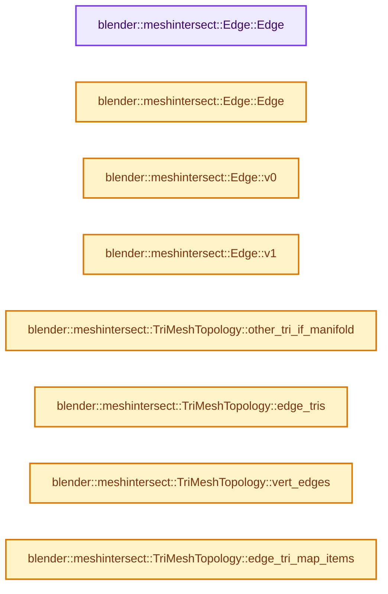

# 实现依赖专题：source/blender/blenlib/intern/mesh_boolean.cc

[方向导航](README.md) · [符号索引](../%E7%AC%A6%E5%8F%B7%E4%BE%9D%E8%B5%96%E4%B8%8E%E5%AE%9E%E7%8E%B0%E7%B4%A2%E5%BC%95.md)

本专题从正文实际调用进入，集中保存共享实现。函数有稳定锚点，可从调用处直接跳到对应完整函数；递归与互相调用通过回链组织。

## 本文件的实现关系




## 完整成员与函数实现

<a id="f-f9d2c1efc458be61"></a>

### `blender::meshintersect::Edge::Edge`

实现位置：[source/blender/blenlib/intern/mesh_boolean.cc](../../../../../source/blender/blenlib/intern/mesh_boolean.cc) · L57—L57。

**教学注释版**

<!-- annotated:0f31d65dc7968b -->

```cpp
  Edge() = default;
```

<details>
<summary>核对原始源码：source/blender/blenlib/intern/mesh_boolean.cc · L57—L57</summary>

<!-- original:0f31d65dc7968b:source/blender/blenlib/intern/mesh_boolean.cc:57:57 -->

```cpp
  Edge() = default;
```

</details>

**继续追踪实现**

本实现没有需要继续展开的显式调用；检查返回表达式、对象转换和调用者前置条件。

<a id="f-001f134bc54b1eb6"></a>

### `blender::meshintersect::Edge::Edge`

实现位置：[source/blender/blenlib/intern/mesh_boolean.cc](../../../../../source/blender/blenlib/intern/mesh_boolean.cc) · L58—L68。

接口参数：

- `const Vert *v0`
- `const Vert *v1`

**教学注释版**

<!-- annotated:6bc01474e2f4de -->

```cpp
  Edge(const Vert *v0, const Vert *v1)
  {
    if (v0->id <= v1->id) {
      v_[0] = v0;
      v_[1] = v1;
    }
    else {
      v_[0] = v1;
      v_[1] = v0;
    }
  }
```

<details>
<summary>核对原始源码：source/blender/blenlib/intern/mesh_boolean.cc · L58—L68</summary>

<!-- original:6bc01474e2f4de:source/blender/blenlib/intern/mesh_boolean.cc:58:68 -->

```cpp
  Edge(const Vert *v0, const Vert *v1)
  {
    if (v0->id <= v1->id) {
      v_[0] = v0;
      v_[1] = v1;
    }
    else {
      v_[0] = v1;
      v_[1] = v0;
    }
  }
```

</details>

**沿实际写入检查状态**

- `v_[0] = v0;`
- `v_[1] = v1;`
- `v_[0] = v1;`
- `v_[1] = v0;`

**继续追踪实现**

本实现没有需要继续展开的显式调用；检查返回表达式、对象转换和调用者前置条件。

<a id="f-de6a163e18973eae"></a>

### `blender::meshintersect::Edge::v0`

实现位置：[source/blender/blenlib/intern/mesh_boolean.cc](../../../../../source/blender/blenlib/intern/mesh_boolean.cc) · L70—L73。

**教学注释版**

<!-- annotated:70969a02dbb586 -->

```cpp
  const Vert *v0() const
  {
    return v_[0];
  }
```

<details>
<summary>核对原始源码：source/blender/blenlib/intern/mesh_boolean.cc · L70—L73</summary>

<!-- original:70969a02dbb586:source/blender/blenlib/intern/mesh_boolean.cc:70:73 -->

```cpp
  const Vert *v0() const
  {
    return v_[0];
  }
```

</details>

**结果出口**

- `return v_[0];`

**继续追踪实现**

本实现没有需要继续展开的显式调用；检查返回表达式、对象转换和调用者前置条件。

<a id="f-dec7079c2ab509fa"></a>

### `blender::meshintersect::Edge::v1`

实现位置：[source/blender/blenlib/intern/mesh_boolean.cc](../../../../../source/blender/blenlib/intern/mesh_boolean.cc) · L75—L78。

**教学注释版**

<!-- annotated:3c5eb5b3362eec -->

```cpp
  const Vert *v1() const
  {
    return v_[1];
  }
```

<details>
<summary>核对原始源码：source/blender/blenlib/intern/mesh_boolean.cc · L75—L78</summary>

<!-- original:3c5eb5b3362eec:source/blender/blenlib/intern/mesh_boolean.cc:75:78 -->

```cpp
  const Vert *v1() const
  {
    return v_[1];
  }
```

</details>

**结果出口**

- `return v_[1];`

**继续追踪实现**

本实现没有需要继续展开的显式调用；检查返回表达式、对象转换和调用者前置条件。

<a id="f-4689c0c9053990ac"></a>

### `blender::meshintersect::TriMeshTopology::other_tri_if_manifold`

实现位置：[source/blender/blenlib/intern/mesh_boolean.cc](../../../../../source/blender/blenlib/intern/mesh_boolean.cc) · L138—L145。

接口参数：

- `Edge e`
- `int t`

**教学注释版**

<!-- annotated:10a8160eeff97b -->

```cpp
  int other_tri_if_manifold(Edge e, int t) const
  {
    // [讲解] edge_tri_.lookup_ptr：按键查找对应项。
    const auto *p = edge_tri_.lookup_ptr(e);
    if (p != nullptr && (*p)->size() == 2) {
      return ((**p)[0] == t) ? (**p)[1] : (**p)[0];
    }
    return NO_INDEX;
  }
```

<details>
<summary>核对原始源码：source/blender/blenlib/intern/mesh_boolean.cc · L138—L145</summary>

<!-- original:10a8160eeff97b:source/blender/blenlib/intern/mesh_boolean.cc:138:145 -->

```cpp
  int other_tri_if_manifold(Edge e, int t) const
  {
    const auto *p = edge_tri_.lookup_ptr(e);
    if (p != nullptr && (*p)->size() == 2) {
      return ((**p)[0] == t) ? (**p)[1] : (**p)[0];
    }
    return NO_INDEX;
  }
```

</details>

**结果出口**

- `return ((**p)[0] == t) ? (**p)[1] : (**p)[0];`
- `return NO_INDEX;`

**继续追踪实现**

- `edge_tri_.lookup_ptr` → [blender::Map::lookup_ptr · L508](../02-%E5%93%88%E5%B8%8C%E8%A1%A8%E4%B8%8E%E5%85%B3%E8%81%94%E6%95%B0%E6%8D%AE%E7%BB%93%E6%9E%84/04-Map%E6%9F%A5%E6%89%BE%E4%B8%8E%E9%94%AE%E8%AE%BF%E9%97%AE.md#f-90844510a761dcb2)；[blender::Map::lookup_ptr · L512](../02-%E5%93%88%E5%B8%8C%E8%A1%A8%E4%B8%8E%E5%85%B3%E8%81%94%E6%95%B0%E6%8D%AE%E7%BB%93%E6%9E%84/04-Map%E6%9F%A5%E6%89%BE%E4%B8%8E%E9%94%AE%E8%AE%BF%E9%97%AE.md#f-ce017485b88f4b2c)。同名重载需按实参类型选择。
- `(*p)->size` → [调用协议](../%E6%A8%A1%E6%9D%BF%E5%AE%8F%E4%B8%8E%E5%8A%A8%E6%80%81%E5%88%86%E6%B4%BE%E5%8D%8F%E8%AE%AE.md)：接收对象类型依赖auto、返回值或模板实例；不按同名猜测目标。调用位置L141。

<a id="f-37d7e0b9caba9a9f"></a>

### `blender::meshintersect::TriMeshTopology::edge_tris`

实现位置：[source/blender/blenlib/intern/mesh_boolean.cc](../../../../../source/blender/blenlib/intern/mesh_boolean.cc) · L148—L151。

接口参数：

- `Edge e`

**教学注释版**

<!-- annotated:69d4349ce886ce -->

```cpp
  const Vector<int> *edge_tris(Edge e) const
  {
    // [讲解] edge_tri_.lookup_default：按键查找对应项。
    return edge_tri_.lookup_default(e, nullptr);
  }
```

<details>
<summary>核对原始源码：source/blender/blenlib/intern/mesh_boolean.cc · L148—L151</summary>

<!-- original:69d4349ce886ce:source/blender/blenlib/intern/mesh_boolean.cc:148:151 -->

```cpp
  const Vector<int> *edge_tris(Edge e) const
  {
    return edge_tri_.lookup_default(e, nullptr);
  }
```

</details>

**结果出口**

- `return edge_tri_.lookup_default(e, nullptr);`

**继续追踪实现**

- `edge_tri_.lookup_default` → [blender::Map::lookup_default · L570](../02-%E5%93%88%E5%B8%8C%E8%A1%A8%E4%B8%8E%E5%85%B3%E8%81%94%E6%95%B0%E6%8D%AE%E7%BB%93%E6%9E%84/05-Map%E6%8F%92%E5%85%A5%E4%B8%8E%E5%9B%9E%E8%B0%83.md#f-40294aaf345f6a8b)。

<a id="f-557e2d1e3ae8f6ab"></a>

### `blender::meshintersect::TriMeshTopology::vert_edges`

实现位置：[source/blender/blenlib/intern/mesh_boolean.cc](../../../../../source/blender/blenlib/intern/mesh_boolean.cc) · L155—L158。

接口参数：

- `const Vert *v`

**教学注释版**

<!-- annotated:c04daa2cfae29a -->

```cpp
  Span<Edge> vert_edges(const Vert *v) const
  {
    // [讲解] vert_edges_.lookup：按键查找对应项。
    return vert_edges_.lookup(v);
  }
```

<details>
<summary>核对原始源码：source/blender/blenlib/intern/mesh_boolean.cc · L155—L158</summary>

<!-- original:c04daa2cfae29a:source/blender/blenlib/intern/mesh_boolean.cc:155:158 -->

```cpp
  Span<Edge> vert_edges(const Vert *v) const
  {
    return vert_edges_.lookup(v);
  }
```

</details>

**结果出口**

- `return vert_edges_.lookup(v);`

**继续追踪实现**

- `vert_edges_.lookup` → [blender::Map::lookup · L545](../02-%E5%93%88%E5%B8%8C%E8%A1%A8%E4%B8%8E%E5%85%B3%E8%81%94%E6%95%B0%E6%8D%AE%E7%BB%93%E6%9E%84/04-Map%E6%9F%A5%E6%89%BE%E4%B8%8E%E9%94%AE%E8%AE%BF%E9%97%AE.md#f-f25ef95f1454656d)；[blender::Map::lookup · L549](../02-%E5%93%88%E5%B8%8C%E8%A1%A8%E4%B8%8E%E5%85%B3%E8%81%94%E6%95%B0%E6%8D%AE%E7%BB%93%E6%9E%84/04-Map%E6%9F%A5%E6%89%BE%E4%B8%8E%E9%94%AE%E8%AE%BF%E9%97%AE.md#f-742f9454fa7ea4b9)。同名重载需按实参类型选择。

<a id="f-771d708de9f393e0"></a>

### `blender::meshintersect::TriMeshTopology::edge_tri_map_items`

实现位置：[source/blender/blenlib/intern/mesh_boolean.cc](../../../../../source/blender/blenlib/intern/mesh_boolean.cc) · L160—L163。

**教学注释版**

<!-- annotated:5718359ffc7013 -->

```cpp
  Map<Edge, Vector<int> *>::ItemIterator edge_tri_map_items() const
  {
    return edge_tri_.items();
  }
```

<details>
<summary>核对原始源码：source/blender/blenlib/intern/mesh_boolean.cc · L160—L163</summary>

<!-- original:5718359ffc7013:source/blender/blenlib/intern/mesh_boolean.cc:160:163 -->

```cpp
  Map<Edge, Vector<int> *>::ItemIterator edge_tri_map_items() const
  {
    return edge_tri_.items();
  }
```

</details>

**结果出口**

- `return edge_tri_.items();`

**继续追踪实现**

- `edge_tri_.items` → [blender::Map::items · L902](../02-%E5%93%88%E5%B8%8C%E8%A1%A8%E4%B8%8E%E5%85%B3%E8%81%94%E6%95%B0%E6%8D%AE%E7%BB%93%E6%9E%84/06-%E5%88%A0%E9%99%A4%E5%A2%93%E7%A2%91%E4%B8%8E%E5%80%BC%E9%94%80%E6%AF%81.md#f-9ef4f6f70cba8f81)；[blender::Map::items · L913](../02-%E5%93%88%E5%B8%8C%E8%A1%A8%E4%B8%8E%E5%85%B3%E8%81%94%E6%95%B0%E6%8D%AE%E7%BB%93%E6%9E%84/06-%E5%88%A0%E9%99%A4%E5%A2%93%E7%A2%91%E4%B8%8E%E5%80%BC%E9%94%80%E6%AF%81.md#f-0a69f4e73db8973e)；[blender::Map::items · L926](../02-%E5%93%88%E5%B8%8C%E8%A1%A8%E4%B8%8E%E5%85%B3%E8%81%94%E6%95%B0%E6%8D%AE%E7%BB%93%E6%9E%84/06-%E5%88%A0%E9%99%A4%E5%A2%93%E7%A2%91%E4%B8%8E%E5%80%BC%E9%94%80%E6%AF%81.md#f-092add737130dcfb)；[blender::Map::items · L927](../02-%E5%93%88%E5%B8%8C%E8%A1%A8%E4%B8%8E%E5%85%B3%E8%81%94%E6%95%B0%E6%8D%AE%E7%BB%93%E6%9E%84/06-%E5%88%A0%E9%99%A4%E5%A2%93%E7%A2%91%E4%B8%8E%E5%80%BC%E9%94%80%E6%AF%81.md#f-4bfc999f60cdede4)。同名重载需按实参类型选择。

<a id="f-6a67464575fec1d3"></a>

### `blender::meshintersect::Patch::Patch`

实现位置：[source/blender/blenlib/intern/mesh_boolean.cc](../../../../../source/blender/blenlib/intern/mesh_boolean.cc) · L243—L243。

**教学注释版**

<!-- annotated:7ff867a057d8f9 -->

```cpp
  Patch() = default;
```

<details>
<summary>核对原始源码：source/blender/blenlib/intern/mesh_boolean.cc · L243—L243</summary>

<!-- original:7ff867a057d8f9:source/blender/blenlib/intern/mesh_boolean.cc:243:243 -->

```cpp
  Patch() = default;
```

</details>

**继续追踪实现**

本实现没有需要继续展开的显式调用；检查返回表达式、对象转换和调用者前置条件。

<a id="f-47f69a3555d7660b"></a>

### `blender::meshintersect::Patch::tot_tri`

实现位置：[source/blender/blenlib/intern/mesh_boolean.cc](../../../../../source/blender/blenlib/intern/mesh_boolean.cc) · L250—L253。

**教学注释版**

<!-- annotated:0012b376d82cb8 -->

```cpp
  int tot_tri() const
  {
    // [讲解] tri_.size：用end_减begin_得到活元素数量。
    return tri_.size();
  }
```

<details>
<summary>核对原始源码：source/blender/blenlib/intern/mesh_boolean.cc · L250—L253</summary>

<!-- original:0012b376d82cb8:source/blender/blenlib/intern/mesh_boolean.cc:250:253 -->

```cpp
  int tot_tri() const
  {
    return tri_.size();
  }
```

</details>

**结果出口**

- `return tri_.size();`

**继续追踪实现**

- `tri_.size` → [blender::Vector::size · L780](11-Vector%E6%8F%92%E5%85%A5%E5%88%A0%E9%99%A4%E4%B8%8E%E9%87%8D%E6%8E%92.md#f-714773731767349c)。

<a id="f-173a07df854d3b28"></a>

### `blender::meshintersect::Patch::tri`

实现位置：[source/blender/blenlib/intern/mesh_boolean.cc](../../../../../source/blender/blenlib/intern/mesh_boolean.cc) · L255—L258。

接口参数：

- `int i`

**教学注释版**

<!-- annotated:705e25a26f929d -->

```cpp
  int tri(int i) const
  {
    return tri_[i];
  }
```

<details>
<summary>核对原始源码：source/blender/blenlib/intern/mesh_boolean.cc · L255—L258</summary>

<!-- original:705e25a26f929d:source/blender/blenlib/intern/mesh_boolean.cc:255:258 -->

```cpp
  int tri(int i) const
  {
    return tri_[i];
  }
```

</details>

**结果出口**

- `return tri_[i];`

**继续追踪实现**

本实现没有需要继续展开的显式调用；检查返回表达式、对象转换和调用者前置条件。

<a id="f-d2874b890836bad6"></a>

### `blender::meshintersect::Patch::tris`

实现位置：[source/blender/blenlib/intern/mesh_boolean.cc](../../../../../source/blender/blenlib/intern/mesh_boolean.cc) · L265—L268。

**教学注释版**

<!-- annotated:0885dbf20ac896 -->

```cpp
  Span<int> tris() const
  {
    return Span<int>(tri_);
  }
```

<details>
<summary>核对原始源码：source/blender/blenlib/intern/mesh_boolean.cc · L265—L268</summary>

<!-- original:0885dbf20ac896:source/blender/blenlib/intern/mesh_boolean.cc:265:268 -->

```cpp
  Span<int> tris() const
  {
    return Span<int>(tri_);
  }
```

</details>

**结果出口**

- `return Span<int>(tri_);`

**继续追踪实现**

- `Span<int>` → [blender::Span](%E4%BE%9D%E8%B5%96-BLI_span-6aa95f.md#t-8765a8e0c1d5)；[blender::Span](%E4%BE%9D%E8%B5%96-BLI_index_range-7d7cc5.md#t-86091874a1c0)；[blender::Span](../05-%E5%87%A0%E4%BD%95%E5%AD%98%E5%82%A8%E4%B8%8E%E6%8B%93%E6%89%91%E6%98%A0%E5%B0%84/%E4%BE%9D%E8%B5%96-DNA_pointcloud_types-cfb82c.md#t-112aa6ed842c)；[blender::Span](../05-%E5%87%A0%E4%BD%95%E5%AD%98%E5%82%A8%E4%B8%8E%E6%8B%93%E6%89%91%E6%98%A0%E5%B0%84/%E4%BE%9D%E8%B5%96-DNA_node_types-6708b9.md#t-49ec6fbb9b69)；[blender::Span](../05-%E5%87%A0%E4%BD%95%E5%AD%98%E5%82%A8%E4%B8%8E%E6%8B%93%E6%89%91%E6%98%A0%E5%B0%84/%E4%BE%9D%E8%B5%96-DNA_mesh_types-81f02e.md#t-184fd48fb638)；[blender::Span](../05-%E5%87%A0%E4%BD%95%E5%AD%98%E5%82%A8%E4%B8%8E%E6%8B%93%E6%89%91%E6%98%A0%E5%B0%84/%E4%BE%9D%E8%B5%96-DNA_anim_types-39c5d9.md#t-d841071994c2)；[blender::Span](../05-%E5%87%A0%E4%BD%95%E5%AD%98%E5%82%A8%E4%B8%8E%E6%8B%93%E6%89%91%E6%98%A0%E5%B0%84/%E4%BE%9D%E8%B5%96-RNA_path_fwd-79c989.md#t-4dbb08969e41)。

<a id="f-a355e5ac4f664ee7"></a>

### `blender::meshintersect::PatchesInfo::tri_patch`

实现位置：[source/blender/blenlib/intern/mesh_boolean.cc](../../../../../source/blender/blenlib/intern/mesh_boolean.cc) · L309—L312。

接口参数：

- `int t`

**教学注释版**

<!-- annotated:b4e62d72549af8 -->

```cpp
  int tri_patch(int t) const
  {
    return tri_patch_[t];
  }
```

<details>
<summary>核对原始源码：source/blender/blenlib/intern/mesh_boolean.cc · L309—L312</summary>

<!-- original:b4e62d72549af8:source/blender/blenlib/intern/mesh_boolean.cc:309:312 -->

```cpp
  int tri_patch(int t) const
  {
    return tri_patch_[t];
  }
```

</details>

**结果出口**

- `return tri_patch_[t];`

**继续追踪实现**

本实现没有需要继续展开的显式调用；检查返回表达式、对象转换和调用者前置条件。

<a id="f-23638c7353d9dee3"></a>

### `blender::meshintersect::PatchesInfo::add_patch`

实现位置：[source/blender/blenlib/intern/mesh_boolean.cc](../../../../../source/blender/blenlib/intern/mesh_boolean.cc) · L314—L318。

**教学注释版**

<!-- annotated:94da46887c3bcd -->

```cpp
  int add_patch()
  {
    // [讲解] patch_.append_and_get_index：在尾部建立新元素，必要时先扩大存储。
    int patch_index = patch_.append_and_get_index(Patch());
    return patch_index;
  }
```

<details>
<summary>核对原始源码：source/blender/blenlib/intern/mesh_boolean.cc · L314—L318</summary>

<!-- original:94da46887c3bcd:source/blender/blenlib/intern/mesh_boolean.cc:314:318 -->

```cpp
  int add_patch()
  {
    int patch_index = patch_.append_and_get_index(Patch());
    return patch_index;
  }
```

</details>

**结果出口**

- `return patch_index;`

**继续追踪实现**

- `patch_.append_and_get_index` → [blender::Vector::append_and_get_index · L517](11-Vector%E6%8F%92%E5%85%A5%E5%88%A0%E9%99%A4%E4%B8%8E%E9%87%8D%E6%8E%92.md#f-1de78b06c3aa90cd)；[blender::Vector::append_and_get_index · L521](11-Vector%E6%8F%92%E5%85%A5%E5%88%A0%E9%99%A4%E4%B8%8E%E9%87%8D%E6%8E%92.md#f-91413faf22574850)。同名重载需按实参类型选择。
- `Patch` → [blender::meshintersect::Patch::Patch · L243](%E4%BE%9D%E8%B5%96-mesh_boolean-f80b18.md#f-6a67464575fec1d3)。

<a id="f-d6b7ad0e7542dc63"></a>

### `blender::meshintersect::PatchesInfo::grow_patch`

实现位置：[source/blender/blenlib/intern/mesh_boolean.cc](../../../../../source/blender/blenlib/intern/mesh_boolean.cc) · L320—L324。

接口参数：

- `int patch_index`
- `int t`

**教学注释版**

<!-- annotated:9b0b4216bc6424 -->

```cpp
  void grow_patch(int patch_index, int t)
  {
    tri_patch_[t] = patch_index;
    patch_[patch_index].add_tri(t);
  }
```

<details>
<summary>核对原始源码：source/blender/blenlib/intern/mesh_boolean.cc · L320—L324</summary>

<!-- original:9b0b4216bc6424:source/blender/blenlib/intern/mesh_boolean.cc:320:324 -->

```cpp
  void grow_patch(int patch_index, int t)
  {
    tri_patch_[t] = patch_index;
    patch_[patch_index].add_tri(t);
  }
```

</details>

**沿实际写入检查状态**

- `tri_patch_[t] = patch_index;`

**继续追踪实现**

- `patch_[patch_index].add_tri` → [调用协议](../%E6%A8%A1%E6%9D%BF%E5%AE%8F%E4%B8%8E%E5%8A%A8%E6%80%81%E5%88%86%E6%B4%BE%E5%8D%8F%E8%AE%AE.md)：接收对象类型依赖auto、返回值或模板实例；不按同名猜测目标。调用位置L323。

<a id="f-9f541212f22eecf9"></a>

### `blender::meshintersect::PatchesInfo::tri_is_assigned`

实现位置：[source/blender/blenlib/intern/mesh_boolean.cc](../../../../../source/blender/blenlib/intern/mesh_boolean.cc) · L326—L329。

接口参数：

- `int t`

**教学注释版**

<!-- annotated:91450ad81ce226 -->

```cpp
  bool tri_is_assigned(int t) const
  {
    return tri_patch_[t] != NO_INDEX;
  }
```

<details>
<summary>核对原始源码：source/blender/blenlib/intern/mesh_boolean.cc · L326—L329</summary>

<!-- original:91450ad81ce226:source/blender/blenlib/intern/mesh_boolean.cc:326:329 -->

```cpp
  bool tri_is_assigned(int t) const
  {
    return tri_patch_[t] != NO_INDEX;
  }
```

</details>

**结果出口**

- `return tri_patch_[t] != NO_INDEX;`

**继续追踪实现**

本实现没有需要继续展开的显式调用；检查返回表达式、对象转换和调用者前置条件。

<a id="f-f893200725c2c6ba"></a>

### `blender::meshintersect::PatchesInfo::patch`

实现位置：[source/blender/blenlib/intern/mesh_boolean.cc](../../../../../source/blender/blenlib/intern/mesh_boolean.cc) · L331—L334。

接口参数：

- `int patch_index`

**教学注释版**

<!-- annotated:0b75dc97fc1336 -->

```cpp
  const Patch &patch(int patch_index) const
  {
    return patch_[patch_index];
  }
```

<details>
<summary>核对原始源码：source/blender/blenlib/intern/mesh_boolean.cc · L331—L334</summary>

<!-- original:0b75dc97fc1336:source/blender/blenlib/intern/mesh_boolean.cc:331:334 -->

```cpp
  const Patch &patch(int patch_index) const
  {
    return patch_[patch_index];
  }
```

</details>

**结果出口**

- `return patch_[patch_index];`

**继续追踪实现**

本实现没有需要继续展开的显式调用；检查返回表达式、对象转换和调用者前置条件。

<a id="f-53b3f86ce853789d"></a>

### `blender::meshintersect::PatchesInfo::patch`

实现位置：[source/blender/blenlib/intern/mesh_boolean.cc](../../../../../source/blender/blenlib/intern/mesh_boolean.cc) · L336—L339。

接口参数：

- `int patch_index`

**教学注释版**

<!-- annotated:cc5f2258e2f369 -->

```cpp
  Patch &patch(int patch_index)
  {
    return patch_[patch_index];
  }
```

<details>
<summary>核对原始源码：source/blender/blenlib/intern/mesh_boolean.cc · L336—L339</summary>

<!-- original:cc5f2258e2f369:source/blender/blenlib/intern/mesh_boolean.cc:336:339 -->

```cpp
  Patch &patch(int patch_index)
  {
    return patch_[patch_index];
  }
```

</details>

**结果出口**

- `return patch_[patch_index];`

**继续追踪实现**

本实现没有需要继续展开的显式调用；检查返回表达式、对象转换和调用者前置条件。

<a id="f-0b230ce427834f27"></a>

### `blender::meshintersect::PatchesInfo::tot_patch`

实现位置：[source/blender/blenlib/intern/mesh_boolean.cc](../../../../../source/blender/blenlib/intern/mesh_boolean.cc) · L341—L344。

**教学注释版**

<!-- annotated:92ab3deadfbd77 -->

```cpp
  int tot_patch() const
  {
    // [讲解] patch_.size：用end_减begin_得到活元素数量。
    return patch_.size();
  }
```

<details>
<summary>核对原始源码：source/blender/blenlib/intern/mesh_boolean.cc · L341—L344</summary>

<!-- original:92ab3deadfbd77:source/blender/blenlib/intern/mesh_boolean.cc:341:344 -->

```cpp
  int tot_patch() const
  {
    return patch_.size();
  }
```

</details>

**结果出口**

- `return patch_.size();`

**继续追踪实现**

- `patch_.size` → [blender::Vector::size · L780](11-Vector%E6%8F%92%E5%85%A5%E5%88%A0%E9%99%A4%E4%B8%8E%E9%87%8D%E6%8E%92.md#f-714773731767349c)。

<a id="f-b734fa8b9ed1b8d4"></a>

### `blender::meshintersect::PatchesInfo::index_range`

实现位置：[source/blender/blenlib/intern/mesh_boolean.cc](../../../../../source/blender/blenlib/intern/mesh_boolean.cc) · L346—L349。

**教学注释版**

<!-- annotated:ac8acd32970826 -->

```cpp
  IndexRange index_range() const
  {
    // [讲解] patch_.size：用end_减begin_得到活元素数量。
    return IndexRange(patch_.size());
  }
```

<details>
<summary>核对原始源码：source/blender/blenlib/intern/mesh_boolean.cc · L346—L349</summary>

<!-- original:ac8acd32970826:source/blender/blenlib/intern/mesh_boolean.cc:346:349 -->

```cpp
  IndexRange index_range() const
  {
    return IndexRange(patch_.size());
  }
```

</details>

**结果出口**

- `return IndexRange(patch_.size());`

**继续追踪实现**

- `IndexRange` → [blender::IndexRange](%E4%BE%9D%E8%B5%96-BLI_index_range-7d7cc5.md#t-caa3466d6776)；[blender::gpu::shader::parser::IndexRange](../05-%E5%87%A0%E4%BD%95%E5%AD%98%E5%82%A8%E4%B8%8E%E6%8B%93%E6%89%91%E6%98%A0%E5%B0%84/%E4%BE%9D%E8%B5%96-utils-06433d.md#t-82d2bd4ea71c)；[blender::IndexRange](../05-%E5%87%A0%E4%BD%95%E5%AD%98%E5%82%A8%E4%B8%8E%E6%8B%93%E6%89%91%E6%98%A0%E5%B0%84/%E4%BE%9D%E8%B5%96-DNA_node_types-6708b9.md#t-0448cc889d39)。
- `patch_.size` → [blender::Vector::size · L780](11-Vector%E6%8F%92%E5%85%A5%E5%88%A0%E9%99%A4%E4%B8%8E%E9%87%8D%E6%8E%92.md#f-714773731767349c)。

<a id="f-677ca4984b39a3ed"></a>

### `blender::meshintersect::PatchesInfo::add_new_patch_patch_edge`

实现位置：[source/blender/blenlib/intern/mesh_boolean.cc](../../../../../source/blender/blenlib/intern/mesh_boolean.cc) · L371—L375。

接口参数：

- `int p1`
- `int p2`
- `Edge e`

**教学注释版**

<!-- annotated:720b63ae20565c -->

```cpp
  void add_new_patch_patch_edge(int p1, int p2, Edge e)
  {
    // [讲解] pp_edge_.add_new：按哈希与相等关系加入键或键值。
    pp_edge_.add_new(std::pair<int, int>(p1, p2), e);
    pp_edge_.add_new(std::pair<int, int>(p2, p1), e);
  }
```

<details>
<summary>核对原始源码：source/blender/blenlib/intern/mesh_boolean.cc · L371—L375</summary>

<!-- original:720b63ae20565c:source/blender/blenlib/intern/mesh_boolean.cc:371:375 -->

```cpp
  void add_new_patch_patch_edge(int p1, int p2, Edge e)
  {
    pp_edge_.add_new(std::pair<int, int>(p1, p2), e);
    pp_edge_.add_new(std::pair<int, int>(p2, p1), e);
  }
```

</details>

**继续追踪实现**

- `pp_edge_.add_new` → [blender::Map::add_new · L265](../02-%E5%93%88%E5%B8%8C%E8%A1%A8%E4%B8%8E%E5%85%B3%E8%81%94%E6%95%B0%E6%8D%AE%E7%BB%93%E6%9E%84/02-Map%E6%80%BB%E4%BD%93%E5%B8%83%E5%B1%80.md#f-521ff0865e8229d0)；[blender::Map::add_new · L269](../02-%E5%93%88%E5%B8%8C%E8%A1%A8%E4%B8%8E%E5%85%B3%E8%81%94%E6%95%B0%E6%8D%AE%E7%BB%93%E6%9E%84/02-Map%E6%80%BB%E4%BD%93%E5%B8%83%E5%B1%80.md#f-d89cee0e3d2848a0)；[blender::Map::add_new · L273](../02-%E5%93%88%E5%B8%8C%E8%A1%A8%E4%B8%8E%E5%85%B3%E8%81%94%E6%95%B0%E6%8D%AE%E7%BB%93%E6%9E%84/02-Map%E6%80%BB%E4%BD%93%E5%B8%83%E5%B1%80.md#f-c13142c32e703ebd)；[blender::Map::add_new · L277](../02-%E5%93%88%E5%B8%8C%E8%A1%A8%E4%B8%8E%E5%85%B3%E8%81%94%E6%95%B0%E6%8D%AE%E7%BB%93%E6%9E%84/04-Map%E6%9F%A5%E6%89%BE%E4%B8%8E%E9%94%AE%E8%AE%BF%E9%97%AE.md#f-da1e537f229db040)。同名重载需按实参类型选择。
- `std::pair<int, int>` → [外部契约](https://eel.is/c++draft/)：这个边界按实际表达式及所属类型核对参数、返回值、寿命与失败行为。这里提供接口入口，不声称已解释该第三方版本的内部实现。

<a id="f-9dfd58c759f8c9d6"></a>

### `blender::meshintersect::PatchesInfo::patch_patch_edge`

实现位置：[source/blender/blenlib/intern/mesh_boolean.cc](../../../../../source/blender/blenlib/intern/mesh_boolean.cc) · L377—L380。

接口参数：

- `int p1`
- `int p2`

**教学注释版**

<!-- annotated:2896a6debb1cfb -->

```cpp
  Edge patch_patch_edge(int p1, int p2)
  {
    // [讲解] pp_edge_.lookup_default：按键查找对应项。
    return pp_edge_.lookup_default(std::pair<int, int>(p1, p2), Edge());
  }
```

<details>
<summary>核对原始源码：source/blender/blenlib/intern/mesh_boolean.cc · L377—L380</summary>

<!-- original:2896a6debb1cfb:source/blender/blenlib/intern/mesh_boolean.cc:377:380 -->

```cpp
  Edge patch_patch_edge(int p1, int p2)
  {
    return pp_edge_.lookup_default(std::pair<int, int>(p1, p2), Edge());
  }
```

</details>

**结果出口**

- `return pp_edge_.lookup_default(std::pair<int, int>(p1, p2), Edge());`

**继续追踪实现**

- `pp_edge_.lookup_default` → [blender::Map::lookup_default · L570](../02-%E5%93%88%E5%B8%8C%E8%A1%A8%E4%B8%8E%E5%85%B3%E8%81%94%E6%95%B0%E6%8D%AE%E7%BB%93%E6%9E%84/05-Map%E6%8F%92%E5%85%A5%E4%B8%8E%E5%9B%9E%E8%B0%83.md#f-40294aaf345f6a8b)。
- `std::pair<int, int>` → [外部契约](https://eel.is/c++draft/)：这个边界按实际表达式及所属类型核对参数、返回值、寿命与失败行为。这里提供接口入口，不声称已解释该第三方版本的内部实现。
- `Edge` → [blender::meshintersect::Edge::Edge · L57](%E4%BE%9D%E8%B5%96-mesh_boolean-f80b18.md#f-f9d2c1efc458be61)；[blender::meshintersect::Edge::Edge · L58](%E4%BE%9D%E8%B5%96-mesh_boolean-f80b18.md#f-001f134bc54b1eb6)。同名重载需按实参类型选择。

<a id="f-7846b75320f29160"></a>

### `blender::meshintersect::PatchesInfo::patch_patch_edge_map`

实现位置：[source/blender/blenlib/intern/mesh_boolean.cc](../../../../../source/blender/blenlib/intern/mesh_boolean.cc) · L382—L385。

**教学注释版**

<!-- annotated:ec4fcbeed6e417 -->

```cpp
  const Map<std::pair<int, int>, Edge> &patch_patch_edge_map()
  {
    return pp_edge_;
  }
```

<details>
<summary>核对原始源码：source/blender/blenlib/intern/mesh_boolean.cc · L382—L385</summary>

<!-- original:ec4fcbeed6e417:source/blender/blenlib/intern/mesh_boolean.cc:382:385 -->

```cpp
  const Map<std::pair<int, int>, Edge> &patch_patch_edge_map()
  {
    return pp_edge_;
  }
```

</details>

**结果出口**

- `return pp_edge_;`

**继续追踪实现**

本实现没有需要继续展开的显式调用；检查返回表达式、对象转换和调用者前置条件。

<a id="f-89cf03ea8f6e1b14"></a>

### `blender::meshintersect::Cell::Cell`

实现位置：[source/blender/blenlib/intern/mesh_boolean.cc](../../../../../source/blender/blenlib/intern/mesh_boolean.cc) · L407—L407。

**教学注释版**

<!-- annotated:f3d088e95f9df6 -->

```cpp
  Cell() = default;
```

<details>
<summary>核对原始源码：source/blender/blenlib/intern/mesh_boolean.cc · L407—L407</summary>

<!-- original:f3d088e95f9df6:source/blender/blenlib/intern/mesh_boolean.cc:407:407 -->

```cpp
  Cell() = default;
```

</details>

**继续追踪实现**

本实现没有需要继续展开的显式调用；检查返回表达式、对象转换和调用者前置条件。

<a id="f-f9a4583201cace8e"></a>

### `blender::meshintersect::Cell::add_patch`

实现位置：[source/blender/blenlib/intern/mesh_boolean.cc](../../../../../source/blender/blenlib/intern/mesh_boolean.cc) · L409—L413。

接口参数：

- `int p`

**教学注释版**

<!-- annotated:b4b62b4d3f9a1c -->

```cpp
  void add_patch(int p)
  {
    // [讲解] patches_.add：按哈希与相等关系加入键或键值。
    patches_.add(p);
    zero_volume_ = false; /* If it was true before, it no longer is. */
  }
```

<details>
<summary>核对原始源码：source/blender/blenlib/intern/mesh_boolean.cc · L409—L413</summary>

<!-- original:b4b62b4d3f9a1c:source/blender/blenlib/intern/mesh_boolean.cc:409:413 -->

```cpp
  void add_patch(int p)
  {
    patches_.add(p);
    zero_volume_ = false; /* If it was true before, it no longer is. */
  }
```

</details>

**沿实际写入检查状态**

- `zero_volume_ = false; /* If it was true before, it no longer is. */`

**继续追踪实现**

- `patches_.add` → [blender::Set::add · L248](../02-%E5%93%88%E5%B8%8C%E8%A1%A8%E4%B8%8E%E5%85%B3%E8%81%94%E6%95%B0%E6%8D%AE%E7%BB%93%E6%9E%84/08-Set%E4%B8%8E%E9%9B%86%E5%90%88%E8%AF%AD%E4%B9%89.md#f-c7498809c2327fba)；[blender::Set::add · L252](../02-%E5%93%88%E5%B8%8C%E8%A1%A8%E4%B8%8E%E5%85%B3%E8%81%94%E6%95%B0%E6%8D%AE%E7%BB%93%E6%9E%84/08-Set%E4%B8%8E%E9%9B%86%E5%90%88%E8%AF%AD%E4%B9%89.md#f-e3ac8d1c52c03c2b)。同名重载需按实参类型选择。

<a id="f-9daa5c61aaad8085"></a>

### `blender::meshintersect::Cell::patches`

实现位置：[source/blender/blenlib/intern/mesh_boolean.cc](../../../../../source/blender/blenlib/intern/mesh_boolean.cc) · L415—L418。

**教学注释版**

<!-- annotated:796bfb51fcce9e -->

```cpp
  const Set<int> &patches() const
  {
    return patches_;
  }
```

<details>
<summary>核对原始源码：source/blender/blenlib/intern/mesh_boolean.cc · L415—L418</summary>

<!-- original:796bfb51fcce9e:source/blender/blenlib/intern/mesh_boolean.cc:415:418 -->

```cpp
  const Set<int> &patches() const
  {
    return patches_;
  }
```

</details>

**结果出口**

- `return patches_;`

**继续追踪实现**

本实现没有需要继续展开的显式调用；检查返回表达式、对象转换和调用者前置条件。

<a id="f-8ed923c40813815f"></a>

### `blender::meshintersect::Cell::patch_other`

实现位置：[source/blender/blenlib/intern/mesh_boolean.cc](../../../../../source/blender/blenlib/intern/mesh_boolean.cc) · L421—L432。

接口参数：

- `int p`

**教学注释版**

<!-- annotated:e5ad61ba34e82a -->

```cpp
  int patch_other(int p) const
  {
    // [讲解] patches_.size：查询活项数量或键是否存在。
    if (patches_.size() != 2) {
      return NO_INDEX;
    }
    for (int pother : patches_) {
      if (pother != p) {
        return pother;
      }
    }
    return NO_INDEX;
  }
```

<details>
<summary>核对原始源码：source/blender/blenlib/intern/mesh_boolean.cc · L421—L432</summary>

<!-- original:e5ad61ba34e82a:source/blender/blenlib/intern/mesh_boolean.cc:421:432 -->

```cpp
  int patch_other(int p) const
  {
    if (patches_.size() != 2) {
      return NO_INDEX;
    }
    for (int pother : patches_) {
      if (pother != p) {
        return pother;
      }
    }
    return NO_INDEX;
  }
```

</details>

**结果出口**

- `return NO_INDEX;`
- `return pother;`

**继续追踪实现**

- `patches_.size` → [blender::Set::size · L606](../02-%E5%93%88%E5%B8%8C%E8%A1%A8%E4%B8%8E%E5%85%B3%E8%81%94%E6%95%B0%E6%8D%AE%E7%BB%93%E6%9E%84/08-Set%E4%B8%8E%E9%9B%86%E5%90%88%E8%AF%AD%E4%B9%89.md#f-4f8f88fffeb44b15)。

<a id="f-e1bc0b70a5d7ad5d"></a>

### `blender::meshintersect::Cell::winding`

实现位置：[source/blender/blenlib/intern/mesh_boolean.cc](../../../../../source/blender/blenlib/intern/mesh_boolean.cc) · L434—L437。

**教学注释版**

<!-- annotated:d10317071f9118 -->

```cpp
  Span<int> winding() const
  {
    return Span<int>(winding_);
  }
```

<details>
<summary>核对原始源码：source/blender/blenlib/intern/mesh_boolean.cc · L434—L437</summary>

<!-- original:d10317071f9118:source/blender/blenlib/intern/mesh_boolean.cc:434:437 -->

```cpp
  Span<int> winding() const
  {
    return Span<int>(winding_);
  }
```

</details>

**结果出口**

- `return Span<int>(winding_);`

**继续追踪实现**

- `Span<int>` → [blender::Span](%E4%BE%9D%E8%B5%96-BLI_span-6aa95f.md#t-8765a8e0c1d5)；[blender::Span](%E4%BE%9D%E8%B5%96-BLI_index_range-7d7cc5.md#t-86091874a1c0)；[blender::Span](../05-%E5%87%A0%E4%BD%95%E5%AD%98%E5%82%A8%E4%B8%8E%E6%8B%93%E6%89%91%E6%98%A0%E5%B0%84/%E4%BE%9D%E8%B5%96-DNA_pointcloud_types-cfb82c.md#t-112aa6ed842c)；[blender::Span](../05-%E5%87%A0%E4%BD%95%E5%AD%98%E5%82%A8%E4%B8%8E%E6%8B%93%E6%89%91%E6%98%A0%E5%B0%84/%E4%BE%9D%E8%B5%96-DNA_node_types-6708b9.md#t-49ec6fbb9b69)；[blender::Span](../05-%E5%87%A0%E4%BD%95%E5%AD%98%E5%82%A8%E4%B8%8E%E6%8B%93%E6%89%91%E6%98%A0%E5%B0%84/%E4%BE%9D%E8%B5%96-DNA_mesh_types-81f02e.md#t-184fd48fb638)；[blender::Span](../05-%E5%87%A0%E4%BD%95%E5%AD%98%E5%82%A8%E4%B8%8E%E6%8B%93%E6%89%91%E6%98%A0%E5%B0%84/%E4%BE%9D%E8%B5%96-DNA_anim_types-39c5d9.md#t-d841071994c2)；[blender::Span](../05-%E5%87%A0%E4%BD%95%E5%AD%98%E5%82%A8%E4%B8%8E%E6%8B%93%E6%89%91%E6%98%A0%E5%B0%84/%E4%BE%9D%E8%B5%96-RNA_path_fwd-79c989.md#t-4dbb08969e41)。

<a id="f-46ece2bae0566b3d"></a>

### `blender::meshintersect::Cell::seed_ambient_winding`

实现位置：[source/blender/blenlib/intern/mesh_boolean.cc](../../../../../source/blender/blenlib/intern/mesh_boolean.cc) · L444—L448。

**教学注释版**

<!-- annotated:0e44bf34c3d8dc -->

```cpp
  void seed_ambient_winding()
  {
    // [讲解] winding_.fill：对现有元素赋同一个值。
    winding_.fill(0);
    winding_assigned_ = true;
  }
```

<details>
<summary>核对原始源码：source/blender/blenlib/intern/mesh_boolean.cc · L444—L448</summary>

<!-- original:0e44bf34c3d8dc:source/blender/blenlib/intern/mesh_boolean.cc:444:448 -->

```cpp
  void seed_ambient_winding()
  {
    winding_.fill(0);
    winding_assigned_ = true;
  }
```

</details>

**沿实际写入检查状态**

- `winding_assigned_ = true;`

**继续追踪实现**

- `winding_.fill` → [blender::Array::fill · L283](08-Array%E5%A4%8D%E5%88%B6%E7%A7%BB%E5%8A%A8%E4%B8%8E%E9%94%80%E6%AF%81.md#f-7c4a16a0c445ca41)。

<a id="f-272da6b221d524af"></a>

### `blender::meshintersect::Cell::set_winding_and_in_output_volume`

实现位置：[source/blender/blenlib/intern/mesh_boolean.cc](../../../../../source/blender/blenlib/intern/mesh_boolean.cc) · L450—L461。

接口参数：

- `const Cell &from_cell`
- `int shape`
- `int delta`
- `BoolOpType bool_optype`

**教学注释版**

<!-- annotated:c5b14ac1395274 -->

```cpp
  void set_winding_and_in_output_volume(const Cell &from_cell,
                                        int shape,
                                        int delta,
                                        BoolOpType bool_optype)
  {
    // [讲解] winding_.begin：提供数组的借用访问入口。
    std::copy(from_cell.winding().begin(), from_cell.winding().end(), winding_.begin());
    if (shape >= 0) {
      winding_[shape] += delta;
    }
    winding_assigned_ = true;
    in_output_volume_ = apply_bool_op(bool_optype, winding_);
  }
```

<details>
<summary>核对原始源码：source/blender/blenlib/intern/mesh_boolean.cc · L450—L461</summary>

<!-- original:c5b14ac1395274:source/blender/blenlib/intern/mesh_boolean.cc:450:461 -->

```cpp
  void set_winding_and_in_output_volume(const Cell &from_cell,
                                        int shape,
                                        int delta,
                                        BoolOpType bool_optype)
  {
    std::copy(from_cell.winding().begin(), from_cell.winding().end(), winding_.begin());
    if (shape >= 0) {
      winding_[shape] += delta;
    }
    winding_assigned_ = true;
    in_output_volume_ = apply_bool_op(bool_optype, winding_);
  }
```

</details>

**沿实际写入检查状态**

- `winding_[shape] += delta;`
- `winding_assigned_ = true;`
- `in_output_volume_ = apply_bool_op(bool_optype, winding_);`

**继续追踪实现**

- `std::copy` → [外部契约](https://eel.is/c++draft/)：这个边界按实际表达式及所属类型核对参数、返回值、寿命与失败行为。这里提供接口入口，不声称已解释该第三方版本的内部实现。
- `from_cell.winding().begin` → [调用协议](../%E6%A8%A1%E6%9D%BF%E5%AE%8F%E4%B8%8E%E5%8A%A8%E6%80%81%E5%88%86%E6%B4%BE%E5%8D%8F%E8%AE%AE.md)：接收对象类型依赖auto、返回值或模板实例；不按同名猜测目标。调用位置L455。
- `from_cell.winding` → [blender::meshintersect::Cell::winding · L434](%E4%BE%9D%E8%B5%96-mesh_boolean-f80b18.md#f-e1bc0b70a5d7ad5d)。
- `from_cell.winding().end` → [调用协议](../%E6%A8%A1%E6%9D%BF%E5%AE%8F%E4%B8%8E%E5%8A%A8%E6%80%81%E5%88%86%E6%B4%BE%E5%8D%8F%E8%AE%AE.md)：接收对象类型依赖auto、返回值或模板实例；不按同名猜测目标。调用位置L455。
- `winding_.begin` → [blender::Array::begin · L332](08-Array%E5%A4%8D%E5%88%B6%E7%A7%BB%E5%8A%A8%E4%B8%8E%E9%94%80%E6%AF%81.md#f-c8883b490929edac)；[blender::Array::begin · L341](08-Array%E5%A4%8D%E5%88%B6%E7%A7%BB%E5%8A%A8%E4%B8%8E%E9%94%80%E6%AF%81.md#f-62d7e9ae6a7826e8)。同名重载需按实参类型选择。
- `apply_bool_op` → [blender::meshintersect::apply_bool_op · L2268](%E4%BE%9D%E8%B5%96-mesh_boolean-f80b18.md#f-aa6d534b79847c8c)。

<a id="f-4d46155f948e6094"></a>

### `blender::meshintersect::Cell::in_output_volume`

实现位置：[source/blender/blenlib/intern/mesh_boolean.cc](../../../../../source/blender/blenlib/intern/mesh_boolean.cc) · L463—L466。

**教学注释版**

<!-- annotated:09e2fd0806624f -->

```cpp
  bool in_output_volume() const
  {
    return in_output_volume_;
  }
```

<details>
<summary>核对原始源码：source/blender/blenlib/intern/mesh_boolean.cc · L463—L466</summary>

<!-- original:09e2fd0806624f:source/blender/blenlib/intern/mesh_boolean.cc:463:466 -->

```cpp
  bool in_output_volume() const
  {
    return in_output_volume_;
  }
```

</details>

**结果出口**

- `return in_output_volume_;`

**继续追踪实现**

本实现没有需要继续展开的显式调用；检查返回表达式、对象转换和调用者前置条件。

<a id="f-4e5701b51317c243"></a>

### `blender::meshintersect::Cell::winding_assigned`

实现位置：[source/blender/blenlib/intern/mesh_boolean.cc](../../../../../source/blender/blenlib/intern/mesh_boolean.cc) · L468—L471。

**教学注释版**

<!-- annotated:fb7c23519b4028 -->

```cpp
  bool winding_assigned() const
  {
    return winding_assigned_;
  }
```

<details>
<summary>核对原始源码：source/blender/blenlib/intern/mesh_boolean.cc · L468—L471</summary>

<!-- original:fb7c23519b4028:source/blender/blenlib/intern/mesh_boolean.cc:468:471 -->

```cpp
  bool winding_assigned() const
  {
    return winding_assigned_;
  }
```

</details>

**结果出口**

- `return winding_assigned_;`

**继续追踪实现**

本实现没有需要继续展开的显式调用；检查返回表达式、对象转换和调用者前置条件。

<a id="f-637bc82757936d70"></a>

### `blender::meshintersect::Cell::zero_volume`

实现位置：[source/blender/blenlib/intern/mesh_boolean.cc](../../../../../source/blender/blenlib/intern/mesh_boolean.cc) · L473—L476。

**教学注释版**

<!-- annotated:2fa72b7d2bec27 -->

```cpp
  bool zero_volume() const
  {
    return zero_volume_;
  }
```

<details>
<summary>核对原始源码：source/blender/blenlib/intern/mesh_boolean.cc · L473—L476</summary>

<!-- original:2fa72b7d2bec27:source/blender/blenlib/intern/mesh_boolean.cc:473:476 -->

```cpp
  bool zero_volume() const
  {
    return zero_volume_;
  }
```

</details>

**结果出口**

- `return zero_volume_;`

**继续追踪实现**

本实现没有需要继续展开的显式调用；检查返回表达式、对象转换和调用者前置条件。

<a id="f-5bd1d41138d80939"></a>

### `blender::meshintersect::Cell::merged_to`

实现位置：[source/blender/blenlib/intern/mesh_boolean.cc](../../../../../source/blender/blenlib/intern/mesh_boolean.cc) · L478—L481。

**教学注释版**

<!-- annotated:48662ca3a472fe -->

```cpp
  int merged_to() const
  {
    return merged_to_;
  }
```

<details>
<summary>核对原始源码：source/blender/blenlib/intern/mesh_boolean.cc · L478—L481</summary>

<!-- original:48662ca3a472fe:source/blender/blenlib/intern/mesh_boolean.cc:478:481 -->

```cpp
  int merged_to() const
  {
    return merged_to_;
  }
```

</details>

**结果出口**

- `return merged_to_;`

**继续追踪实现**

本实现没有需要继续展开的显式调用；检查返回表达式、对象转换和调用者前置条件。

<a id="f-fec773b6244b5fb6"></a>

### `blender::meshintersect::Cell::set_merged_to`

实现位置：[source/blender/blenlib/intern/mesh_boolean.cc](../../../../../source/blender/blenlib/intern/mesh_boolean.cc) · L483—L486。

接口参数：

- `int c`

**教学注释版**

<!-- annotated:2cb4a5f820a8c1 -->

```cpp
  void set_merged_to(int c)
  {
    merged_to_ = c;
  }
```

<details>
<summary>核对原始源码：source/blender/blenlib/intern/mesh_boolean.cc · L483—L486</summary>

<!-- original:2cb4a5f820a8c1:source/blender/blenlib/intern/mesh_boolean.cc:483:486 -->

```cpp
  void set_merged_to(int c)
  {
    merged_to_ = c;
  }
```

</details>

**沿实际写入检查状态**

- `merged_to_ = c;`

**继续追踪实现**

本实现没有需要继续展开的显式调用；检查返回表达式、对象转换和调用者前置条件。

<a id="f-17ff82221fe37328"></a>

### `blender::meshintersect::tris_have_same_verts`

实现位置：[source/blender/blenlib/intern/mesh_boolean.cc](../../../../../source/blender/blenlib/intern/mesh_boolean.cc) · L510—L528。

接口参数：

- `const IMesh &mesh`
- `int t1`
- `int t2`

**教学注释版**

<!-- annotated:918c5024b69bd9 -->

```cpp
static bool tris_have_same_verts(const IMesh &mesh, int t1, int t2)
{
  const Face &tri1 = *mesh.face(t1);
  const Face &tri2 = *mesh.face(t2);
  BLI_assert(tri1.size() == 3 && tri2.size() == 3);
  if (tri1.vert[0] == tri2.vert[0]) {
    return ((tri1.vert[1] == tri2.vert[1] && tri1.vert[2] == tri2.vert[2]) ||
            (tri1.vert[1] == tri2.vert[2] && tri1.vert[2] == tri2.vert[1]));
  }
  if (tri1.vert[0] == tri2.vert[1]) {
    return ((tri1.vert[1] == tri2.vert[0] && tri1.vert[2] == tri2.vert[2]) ||
            (tri1.vert[1] == tri2.vert[2] && tri1.vert[2] == tri2.vert[0]));
  }
  if (tri1.vert[0] == tri2.vert[2]) {
    return ((tri1.vert[1] == tri2.vert[0] && tri1.vert[2] == tri2.vert[1]) ||
            (tri1.vert[1] == tri2.vert[1] && tri1.vert[2] == tri2.vert[0]));
  }
  return false;
}
```

<details>
<summary>核对原始源码：source/blender/blenlib/intern/mesh_boolean.cc · L510—L528</summary>

<!-- original:918c5024b69bd9:source/blender/blenlib/intern/mesh_boolean.cc:510:528 -->

```cpp
static bool tris_have_same_verts(const IMesh &mesh, int t1, int t2)
{
  const Face &tri1 = *mesh.face(t1);
  const Face &tri2 = *mesh.face(t2);
  BLI_assert(tri1.size() == 3 && tri2.size() == 3);
  if (tri1.vert[0] == tri2.vert[0]) {
    return ((tri1.vert[1] == tri2.vert[1] && tri1.vert[2] == tri2.vert[2]) ||
            (tri1.vert[1] == tri2.vert[2] && tri1.vert[2] == tri2.vert[1]));
  }
  if (tri1.vert[0] == tri2.vert[1]) {
    return ((tri1.vert[1] == tri2.vert[0] && tri1.vert[2] == tri2.vert[2]) ||
            (tri1.vert[1] == tri2.vert[2] && tri1.vert[2] == tri2.vert[0]));
  }
  if (tri1.vert[0] == tri2.vert[2]) {
    return ((tri1.vert[1] == tri2.vert[0] && tri1.vert[2] == tri2.vert[1]) ||
            (tri1.vert[1] == tri2.vert[1] && tri1.vert[2] == tri2.vert[0]));
  }
  return false;
}
```

</details>

**结果出口**

- `return ((tri1.vert[1] == tri2.vert[1] && tri1.vert[2] == tri2.vert[2]) ||`
- `return ((tri1.vert[1] == tri2.vert[0] && tri1.vert[2] == tri2.vert[2]) ||`
- `return ((tri1.vert[1] == tri2.vert[0] && tri1.vert[2] == tri2.vert[1]) ||`
- `return false;`

**继续追踪实现**

- `mesh.face` → [blender::meshintersect::IMesh::face · L253](%E4%BE%9D%E8%B5%96-BLI_mesh_intersect-db7f59.md#f-02419d5b631de370)。
- `BLI_assert` → [BLI_assert · L48](%E4%BE%9D%E8%B5%96-BLI_assert-cc98e8.md#m-57a88495704d)；[BLI_assert · L63](%E4%BE%9D%E8%B5%96-BLI_assert-cc98e8.md#m-d07050020cb5)。宏定义由构建条件选择。
- `tri1.size` → [blender::meshintersect::Face::size · L156](%E4%BE%9D%E8%B5%96-BLI_mesh_intersect-db7f59.md#f-ae8917c425c3684c)。
- `tri2.size` → [blender::meshintersect::Face::size · L156](%E4%BE%9D%E8%B5%96-BLI_mesh_intersect-db7f59.md#f-ae8917c425c3684c)。

<a id="f-4411070fec96a764"></a>

### `blender::meshintersect::Cell::check_for_zero_volume`

实现位置：[source/blender/blenlib/intern/mesh_boolean.cc](../../../../../source/blender/blenlib/intern/mesh_boolean.cc) · L535—L557。

接口参数：

- `const PatchesInfo &pinfo`
- `const IMesh &mesh`

**教学注释版**

<!-- annotated:cab014e4f171c4 -->

```cpp
void Cell::check_for_zero_volume(const PatchesInfo &pinfo, const IMesh &mesh)
{
  // [讲解] patches_.size：查询活项数量或键是否存在。
  if (patches_.size() == 2) {
    int p1_index = NO_INDEX;
    int p2_index = NO_INDEX;
    for (int p : patches_) {
      if (p1_index == NO_INDEX) {
        p1_index = p;
      }
      else {
        p2_index = p;
      }
    }
    BLI_assert(p1_index != NO_INDEX && p2_index != NO_INDEX);
    const Patch &p1 = pinfo.patch(p1_index);
    const Patch &p2 = pinfo.patch(p2_index);
    if (p1.tot_tri() == 1 && p2.tot_tri() == 1) {
      if (tris_have_same_verts(mesh, p1.tri(0), p2.tri(0))) {
        zero_volume_ = true;
      }
    }
  }
}
```

<details>
<summary>核对原始源码：source/blender/blenlib/intern/mesh_boolean.cc · L535—L557</summary>

<!-- original:cab014e4f171c4:source/blender/blenlib/intern/mesh_boolean.cc:535:557 -->

```cpp
void Cell::check_for_zero_volume(const PatchesInfo &pinfo, const IMesh &mesh)
{
  if (patches_.size() == 2) {
    int p1_index = NO_INDEX;
    int p2_index = NO_INDEX;
    for (int p : patches_) {
      if (p1_index == NO_INDEX) {
        p1_index = p;
      }
      else {
        p2_index = p;
      }
    }
    BLI_assert(p1_index != NO_INDEX && p2_index != NO_INDEX);
    const Patch &p1 = pinfo.patch(p1_index);
    const Patch &p2 = pinfo.patch(p2_index);
    if (p1.tot_tri() == 1 && p2.tot_tri() == 1) {
      if (tris_have_same_verts(mesh, p1.tri(0), p2.tri(0))) {
        zero_volume_ = true;
      }
    }
  }
}
```

</details>

**沿实际写入检查状态**

- `p1_index = p;`
- `p2_index = p;`
- `zero_volume_ = true;`

**继续追踪实现**

- `patches_.size` → [blender::Set::size · L606](../02-%E5%93%88%E5%B8%8C%E8%A1%A8%E4%B8%8E%E5%85%B3%E8%81%94%E6%95%B0%E6%8D%AE%E7%BB%93%E6%9E%84/08-Set%E4%B8%8E%E9%9B%86%E5%90%88%E8%AF%AD%E4%B9%89.md#f-4f8f88fffeb44b15)。
- `BLI_assert` → [BLI_assert · L48](%E4%BE%9D%E8%B5%96-BLI_assert-cc98e8.md#m-57a88495704d)；[BLI_assert · L63](%E4%BE%9D%E8%B5%96-BLI_assert-cc98e8.md#m-d07050020cb5)。宏定义由构建条件选择。
- `pinfo.patch` → [blender::meshintersect::PatchesInfo::patch · L331](%E4%BE%9D%E8%B5%96-mesh_boolean-f80b18.md#f-f893200725c2c6ba)；[blender::meshintersect::PatchesInfo::patch · L336](%E4%BE%9D%E8%B5%96-mesh_boolean-f80b18.md#f-53b3f86ce853789d)。同名重载需按实参类型选择。
- `p1.tot_tri` → [blender::meshintersect::Patch::tot_tri · L250](%E4%BE%9D%E8%B5%96-mesh_boolean-f80b18.md#f-47f69a3555d7660b)。
- `p2.tot_tri` → [blender::meshintersect::Patch::tot_tri · L250](%E4%BE%9D%E8%B5%96-mesh_boolean-f80b18.md#f-47f69a3555d7660b)。
- `tris_have_same_verts` → [blender::meshintersect::tris_have_same_verts · L510](%E4%BE%9D%E8%B5%96-mesh_boolean-f80b18.md#f-17ff82221fe37328)。
- `p1.tri` → [blender::meshintersect::Patch::tri · L255](%E4%BE%9D%E8%B5%96-mesh_boolean-f80b18.md#f-173a07df854d3b28)。
- `p2.tri` → [blender::meshintersect::Patch::tri · L255](%E4%BE%9D%E8%B5%96-mesh_boolean-f80b18.md#f-173a07df854d3b28)。

<a id="f-801c7120a93bc5e6"></a>

### `blender::meshintersect::CellsInfo::add_cell`

实现位置：[source/blender/blenlib/intern/mesh_boolean.cc](../../../../../source/blender/blenlib/intern/mesh_boolean.cc) · L566—L570。

**教学注释版**

<!-- annotated:f1882873bc5152 -->

```cpp
  int add_cell()
  {
    // [讲解] cell_.append_and_get_index：在尾部建立新元素，必要时先扩大存储。
    int index = cell_.append_and_get_index(Cell());
    return index;
  }
```

<details>
<summary>核对原始源码：source/blender/blenlib/intern/mesh_boolean.cc · L566—L570</summary>

<!-- original:f1882873bc5152:source/blender/blenlib/intern/mesh_boolean.cc:566:570 -->

```cpp
  int add_cell()
  {
    int index = cell_.append_and_get_index(Cell());
    return index;
  }
```

</details>

**结果出口**

- `return index;`

**继续追踪实现**

- `cell_.append_and_get_index` → [blender::Vector::append_and_get_index · L517](11-Vector%E6%8F%92%E5%85%A5%E5%88%A0%E9%99%A4%E4%B8%8E%E9%87%8D%E6%8E%92.md#f-1de78b06c3aa90cd)；[blender::Vector::append_and_get_index · L521](11-Vector%E6%8F%92%E5%85%A5%E5%88%A0%E9%99%A4%E4%B8%8E%E9%87%8D%E6%8E%92.md#f-91413faf22574850)。同名重载需按实参类型选择。
- `Cell` → [blender::meshintersect::Cell::Cell · L407](%E4%BE%9D%E8%B5%96-mesh_boolean-f80b18.md#f-89cf03ea8f6e1b14)。

<a id="f-ac6c30b6998348c8"></a>

### `blender::meshintersect::CellsInfo::cell`

实现位置：[source/blender/blenlib/intern/mesh_boolean.cc](../../../../../source/blender/blenlib/intern/mesh_boolean.cc) · L572—L575。

接口参数：

- `int c`

**教学注释版**

<!-- annotated:8c0ea40803bc64 -->

```cpp
  Cell &cell(int c)
  {
    return cell_[c];
  }
```

<details>
<summary>核对原始源码：source/blender/blenlib/intern/mesh_boolean.cc · L572—L575</summary>

<!-- original:8c0ea40803bc64:source/blender/blenlib/intern/mesh_boolean.cc:572:575 -->

```cpp
  Cell &cell(int c)
  {
    return cell_[c];
  }
```

</details>

**结果出口**

- `return cell_[c];`

**继续追踪实现**

本实现没有需要继续展开的显式调用；检查返回表达式、对象转换和调用者前置条件。

<a id="f-1c52e8b9c9e6f4e0"></a>

### `blender::meshintersect::CellsInfo::cell`

实现位置：[source/blender/blenlib/intern/mesh_boolean.cc](../../../../../source/blender/blenlib/intern/mesh_boolean.cc) · L577—L580。

接口参数：

- `int c`

**教学注释版**

<!-- annotated:d19aad70330668 -->

```cpp
  const Cell &cell(int c) const
  {
    return cell_[c];
  }
```

<details>
<summary>核对原始源码：source/blender/blenlib/intern/mesh_boolean.cc · L577—L580</summary>

<!-- original:d19aad70330668:source/blender/blenlib/intern/mesh_boolean.cc:577:580 -->

```cpp
  const Cell &cell(int c) const
  {
    return cell_[c];
  }
```

</details>

**结果出口**

- `return cell_[c];`

**继续追踪实现**

本实现没有需要继续展开的显式调用；检查返回表达式、对象转换和调用者前置条件。

<a id="f-3d979daa00e03815"></a>

### `blender::meshintersect::CellsInfo::tot_cell`

实现位置：[source/blender/blenlib/intern/mesh_boolean.cc](../../../../../source/blender/blenlib/intern/mesh_boolean.cc) · L582—L585。

**教学注释版**

<!-- annotated:1ab1282d88d903 -->

```cpp
  int tot_cell() const
  {
    // [讲解] cell_.size：用end_减begin_得到活元素数量。
    return cell_.size();
  }
```

<details>
<summary>核对原始源码：source/blender/blenlib/intern/mesh_boolean.cc · L582—L585</summary>

<!-- original:1ab1282d88d903:source/blender/blenlib/intern/mesh_boolean.cc:582:585 -->

```cpp
  int tot_cell() const
  {
    return cell_.size();
  }
```

</details>

**结果出口**

- `return cell_.size();`

**继续追踪实现**

- `cell_.size` → [blender::Vector::size · L780](11-Vector%E6%8F%92%E5%85%A5%E5%88%A0%E9%99%A4%E4%B8%8E%E9%87%8D%E6%8E%92.md#f-714773731767349c)。

<a id="f-d889952c60b1a6f0"></a>

### `blender::meshintersect::CellsInfo::index_range`

实现位置：[source/blender/blenlib/intern/mesh_boolean.cc](../../../../../source/blender/blenlib/intern/mesh_boolean.cc) · L587—L590。

**教学注释版**

<!-- annotated:beb4dfc40e26b4 -->

```cpp
  IndexRange index_range() const
  {
    return cell_.index_range();
  }
```

<details>
<summary>核对原始源码：source/blender/blenlib/intern/mesh_boolean.cc · L587—L590</summary>

<!-- original:beb4dfc40e26b4:source/blender/blenlib/intern/mesh_boolean.cc:587:590 -->

```cpp
  IndexRange index_range() const
  {
    return cell_.index_range();
  }
```

</details>

**结果出口**

- `return cell_.index_range();`

**继续追踪实现**

- `cell_.index_range` → [blender::Vector::index_range · L1026](12-Vector%E5%BC%82%E5%B8%B8%E5%AE%89%E5%85%A8%E4%B8%8E%E8%BE%B9%E7%95%8C.md#f-ac29cf36ef185ab9)。

<a id="f-7b3e688ee870c6b2"></a>

### `blender::meshintersect::CellsInfo::init_windings`

实现位置：[source/blender/blenlib/intern/mesh_boolean.cc](../../../../../source/blender/blenlib/intern/mesh_boolean.cc) · L612—L617。

接口参数：

- `int winding_len`

**教学注释版**

<!-- annotated:3f880595142295 -->

```cpp
  void init_windings(int winding_len)
  {
    for (Cell &cell : cell_) {
      cell.init_winding(winding_len);
    }
  }
```

<details>
<summary>核对原始源码：source/blender/blenlib/intern/mesh_boolean.cc · L612—L617</summary>

<!-- original:3f880595142295:source/blender/blenlib/intern/mesh_boolean.cc:612:617 -->

```cpp
  void init_windings(int winding_len)
  {
    for (Cell &cell : cell_) {
      cell.init_winding(winding_len);
    }
  }
```

</details>

**继续追踪实现**

- `cell.init_winding` → [调用协议](../%E6%A8%A1%E6%9D%BF%E5%AE%8F%E4%B8%8E%E5%8A%A8%E6%80%81%E5%88%86%E6%B4%BE%E5%8D%8F%E8%AE%AE.md)：接收对象类型依赖auto、返回值或模板实例；不按同名猜测目标。调用位置L615。

<a id="f-fda51625037f4fa6"></a>

### `blender::meshintersect::write_obj_cell_patch`

实现位置：[source/blender/blenlib/intern/mesh_boolean.cc](../../../../../source/blender/blenlib/intern/mesh_boolean.cc) · L623—L688。

接口参数：

- `const IMesh &m`
- `const CellsInfo &cinfo`
- `const PatchesInfo &pinfo`
- `bool cells_only`
- `const std::string &name`

**教学注释版**

<!-- annotated:eb655c1da75028 -->

```cpp
static void write_obj_cell_patch(const IMesh &m,
                                 const CellsInfo &cinfo,
                                 const PatchesInfo &pinfo,
                                 bool cells_only,
                                 const std::string &name)
{
  /* Would like to use #BKE_tempdir_base() here, but that brings in dependence on kernel library.
   * This is just for developer debugging anyway,
   * and should never be called in production Blender. */
#  ifdef _WIN_32
  const char *objdir = BLI_dir_home();
  if (objdir == nullptr) {
    std::cout << "Could not access home directory\n";
    return;
  }
#  else
  const char *objdir = "/tmp/";
#  endif

  std::string fname = std::string(objdir) + name + std::string("_cellpatch.obj");
  std::ofstream f;
  f.open(fname);
  if (!f) {
    std::cout << "Could not open file " << fname << "\n";
    return;
  }

  /* Copy IMesh so can populate verts. */
  IMesh mm = m;
  mm.populate_vert();
  f << "o cellpatch\n";
  for (const Vert *v : mm.vertices()) {
    const double3 dv = v->co;
    f << "v " << dv[0] << " " << dv[1] << " " << dv[2] << "\n";
  }
  if (!cells_only) {
    for (int p : pinfo.index_range()) {
      f << "g patch" << p << "\n";
      const Patch &patch = pinfo.patch(p);
      for (int t : patch.tris()) {
        const Face &tri = *mm.face(t);
        f << "f ";
        for (const Vert *v : tri) {
          f << mm.lookup_vert(v) + 1 << " ";
        }
        f << "\n";
      }
    }
  }
  for (int c : cinfo.index_range()) {
    f << "g cell" << c << "\n";
    const Cell &cell = cinfo.cell(c);
    for (int p : cell.patches()) {
      const Patch &patch = pinfo.patch(p);
      for (int t : patch.tris()) {
        const Face &tri = *mm.face(t);
        f << "f ";
        for (const Vert *v : tri) {
          f << mm.lookup_vert(v) + 1 << " ";
        }
        f << "\n";
      }
    }
  }
  f.close();
}
```

<details>
<summary>核对原始源码：source/blender/blenlib/intern/mesh_boolean.cc · L623—L688</summary>

<!-- original:eb655c1da75028:source/blender/blenlib/intern/mesh_boolean.cc:623:688 -->

```cpp
static void write_obj_cell_patch(const IMesh &m,
                                 const CellsInfo &cinfo,
                                 const PatchesInfo &pinfo,
                                 bool cells_only,
                                 const std::string &name)
{
  /* Would like to use #BKE_tempdir_base() here, but that brings in dependence on kernel library.
   * This is just for developer debugging anyway,
   * and should never be called in production Blender. */
#  ifdef _WIN_32
  const char *objdir = BLI_dir_home();
  if (objdir == nullptr) {
    std::cout << "Could not access home directory\n";
    return;
  }
#  else
  const char *objdir = "/tmp/";
#  endif

  std::string fname = std::string(objdir) + name + std::string("_cellpatch.obj");
  std::ofstream f;
  f.open(fname);
  if (!f) {
    std::cout << "Could not open file " << fname << "\n";
    return;
  }

  /* Copy IMesh so can populate verts. */
  IMesh mm = m;
  mm.populate_vert();
  f << "o cellpatch\n";
  for (const Vert *v : mm.vertices()) {
    const double3 dv = v->co;
    f << "v " << dv[0] << " " << dv[1] << " " << dv[2] << "\n";
  }
  if (!cells_only) {
    for (int p : pinfo.index_range()) {
      f << "g patch" << p << "\n";
      const Patch &patch = pinfo.patch(p);
      for (int t : patch.tris()) {
        const Face &tri = *mm.face(t);
        f << "f ";
        for (const Vert *v : tri) {
          f << mm.lookup_vert(v) + 1 << " ";
        }
        f << "\n";
      }
    }
  }
  for (int c : cinfo.index_range()) {
    f << "g cell" << c << "\n";
    const Cell &cell = cinfo.cell(c);
    for (int p : cell.patches()) {
      const Patch &patch = pinfo.patch(p);
      for (int t : patch.tris()) {
        const Face &tri = *mm.face(t);
        f << "f ";
        for (const Vert *v : tri) {
          f << mm.lookup_vert(v) + 1 << " ";
        }
        f << "\n";
      }
    }
  }
  f.close();
}
```

</details>

**继续追踪实现**

- `BLI_dir_home` → [blender::BLI_dir_home · L99](%E4%BE%9D%E8%B5%96-storage-bda15e.md#f-ecbf67fd9338348e)。
- `std::string` → [外部契约](https://eel.is/c++draft/)：这个边界按实际表达式及所属类型核对参数、返回值、寿命与失败行为。这里提供接口入口，不声称已解释该第三方版本的内部实现。
- `f.open` → [外部契约](https://eel.is/c++draft/)：这个边界按实际表达式及所属类型核对参数、返回值、寿命与失败行为。这里提供接口入口，不声称已解释该第三方版本的内部实现。
- `mm.populate_vert` → [blender::meshintersect::IMesh::populate_vert · L545](%E4%BE%9D%E8%B5%96-mesh_intersect-3f2f20.md#f-baabda882eb3bd9b)；[blender::meshintersect::IMesh::populate_vert · L554](%E4%BE%9D%E8%B5%96-mesh_intersect-3f2f20.md#f-0ab095211800b44d)。同名重载需按实参类型选择。
- `mm.vertices` → [blender::meshintersect::IMesh::vertices · L308](%E4%BE%9D%E8%B5%96-BLI_mesh_intersect-db7f59.md#f-014a20eb33ef6510)。
- `pinfo.index_range` → [blender::meshintersect::PatchesInfo::index_range · L346](%E4%BE%9D%E8%B5%96-mesh_boolean-f80b18.md#f-b734fa8b9ed1b8d4)。
- `pinfo.patch` → [blender::meshintersect::PatchesInfo::patch · L331](%E4%BE%9D%E8%B5%96-mesh_boolean-f80b18.md#f-f893200725c2c6ba)；[blender::meshintersect::PatchesInfo::patch · L336](%E4%BE%9D%E8%B5%96-mesh_boolean-f80b18.md#f-53b3f86ce853789d)。同名重载需按实参类型选择。
- `patch.tris` → [blender::meshintersect::Patch::tris · L265](%E4%BE%9D%E8%B5%96-mesh_boolean-f80b18.md#f-d2874b890836bad6)。
- `mm.face` → [blender::meshintersect::IMesh::face · L253](%E4%BE%9D%E8%B5%96-BLI_mesh_intersect-db7f59.md#f-02419d5b631de370)。
- `mm.lookup_vert` → [blender::meshintersect::IMesh::lookup_vert · L291](%E4%BE%9D%E8%B5%96-BLI_mesh_intersect-db7f59.md#f-537622ab267fbb35)。
- `cinfo.index_range` → [blender::meshintersect::CellsInfo::index_range · L587](%E4%BE%9D%E8%B5%96-mesh_boolean-f80b18.md#f-d889952c60b1a6f0)。
- `cinfo.cell` → [blender::meshintersect::CellsInfo::cell · L572](%E4%BE%9D%E8%B5%96-mesh_boolean-f80b18.md#f-ac6c30b6998348c8)；[blender::meshintersect::CellsInfo::cell · L577](%E4%BE%9D%E8%B5%96-mesh_boolean-f80b18.md#f-1c52e8b9c9e6f4e0)。同名重载需按实参类型选择。
- `cell.patches` → [blender::meshintersect::Cell::patches · L415](%E4%BE%9D%E8%B5%96-mesh_boolean-f80b18.md#f-9daa5c61aaad8085)。
- `f.close` → [外部契约](https://eel.is/c++draft/)：这个边界按实际表达式及所属类型核对参数、返回值、寿命与失败行为。这里提供接口入口，不声称已解释该第三方版本的内部实现。

<a id="f-15211ac80b4058ca"></a>

### `blender::meshintersect::merge_cells`

实现位置：[source/blender/blenlib/intern/mesh_boolean.cc](../../../../../source/blender/blenlib/intern/mesh_boolean.cc) · L690—L713。

接口参数：

- `int merge_to`
- `int merge_from`
- `CellsInfo &cinfo`
- `PatchesInfo &pinfo`

**教学注释版**

<!-- annotated:f8e8fbd33e4eee -->

```cpp
static void merge_cells(int merge_to, int merge_from, CellsInfo &cinfo, PatchesInfo &pinfo)
{
  if (merge_to == merge_from) {
    return;
  }
  Cell &merge_from_cell = cinfo.cell(merge_from);
  Cell &merge_to_cell = cinfo.cell(merge_to);
  int final_merge_to = merge_to;
  while (merge_to_cell.merged_to() != NO_INDEX) {
    final_merge_to = merge_to_cell.merged_to();
    merge_to_cell = cinfo.cell(final_merge_to);
  }
  for (int cell_p : merge_from_cell.patches()) {
    merge_to_cell.add_patch(cell_p);
    Patch &patch = pinfo.patch(cell_p);
    if (patch.cell_above == merge_from) {
      patch.cell_above = merge_to;
    }
    if (patch.cell_below == merge_from) {
      patch.cell_below = merge_to;
    }
  }
  merge_from_cell.set_merged_to(final_merge_to);
}
```

<details>
<summary>核对原始源码：source/blender/blenlib/intern/mesh_boolean.cc · L690—L713</summary>

<!-- original:f8e8fbd33e4eee:source/blender/blenlib/intern/mesh_boolean.cc:690:713 -->

```cpp
static void merge_cells(int merge_to, int merge_from, CellsInfo &cinfo, PatchesInfo &pinfo)
{
  if (merge_to == merge_from) {
    return;
  }
  Cell &merge_from_cell = cinfo.cell(merge_from);
  Cell &merge_to_cell = cinfo.cell(merge_to);
  int final_merge_to = merge_to;
  while (merge_to_cell.merged_to() != NO_INDEX) {
    final_merge_to = merge_to_cell.merged_to();
    merge_to_cell = cinfo.cell(final_merge_to);
  }
  for (int cell_p : merge_from_cell.patches()) {
    merge_to_cell.add_patch(cell_p);
    Patch &patch = pinfo.patch(cell_p);
    if (patch.cell_above == merge_from) {
      patch.cell_above = merge_to;
    }
    if (patch.cell_below == merge_from) {
      patch.cell_below = merge_to;
    }
  }
  merge_from_cell.set_merged_to(final_merge_to);
}
```

</details>

**沿实际写入检查状态**

- `final_merge_to = merge_to_cell.merged_to();`
- `merge_to_cell = cinfo.cell(final_merge_to);`
- `patch.cell_above = merge_to;`
- `patch.cell_below = merge_to;`

**继续追踪实现**

- `cinfo.cell` → [blender::meshintersect::CellsInfo::cell · L572](%E4%BE%9D%E8%B5%96-mesh_boolean-f80b18.md#f-ac6c30b6998348c8)；[blender::meshintersect::CellsInfo::cell · L577](%E4%BE%9D%E8%B5%96-mesh_boolean-f80b18.md#f-1c52e8b9c9e6f4e0)。同名重载需按实参类型选择。
- `merge_to_cell.merged_to` → [blender::meshintersect::Cell::merged_to · L478](%E4%BE%9D%E8%B5%96-mesh_boolean-f80b18.md#f-5bd1d41138d80939)。
- `merge_from_cell.patches` → [blender::meshintersect::Cell::patches · L415](%E4%BE%9D%E8%B5%96-mesh_boolean-f80b18.md#f-9daa5c61aaad8085)。
- `merge_to_cell.add_patch` → [blender::meshintersect::Cell::add_patch · L409](%E4%BE%9D%E8%B5%96-mesh_boolean-f80b18.md#f-f9a4583201cace8e)。
- `pinfo.patch` → [blender::meshintersect::PatchesInfo::patch · L331](%E4%BE%9D%E8%B5%96-mesh_boolean-f80b18.md#f-f893200725c2c6ba)；[blender::meshintersect::PatchesInfo::patch · L336](%E4%BE%9D%E8%B5%96-mesh_boolean-f80b18.md#f-53b3f86ce853789d)。同名重载需按实参类型选择。
- `merge_from_cell.set_merged_to` → [blender::meshintersect::Cell::set_merged_to · L483](%E4%BE%9D%E8%B5%96-mesh_boolean-f80b18.md#f-fec773b6244b5fb6)。

<a id="f-84f8853c3d0e4239"></a>

### `blender::meshintersect::find_patches`

实现位置：[source/blender/blenlib/intern/mesh_boolean.cc](../../../../../source/blender/blenlib/intern/mesh_boolean.cc) · L718—L823。

接口参数：

- `const IMesh &tm`
- `const TriMeshTopology &tmtopo`

**教学注释版**

<!-- annotated:93a75ca48c1002 -->

```cpp
static PatchesInfo find_patches(const IMesh &tm, const TriMeshTopology &tmtopo)
{
  const int dbg_level = 0;
  if (dbg_level > 0) {
    std::cout << "\nFIND_PATCHES\n";
  }
  int ntri = tm.face_size();
  PatchesInfo pinfo(ntri);
  /* Algorithm: Grow patches across manifold edges as long as there are unassigned triangles. */
  Stack<int> cur_patch_grow;

  /* Create an Array containing indices of adjacent faces. */
  Array<std::array<int, 3>> t_others(tm.face_size());
  threading::parallel_for(tm.face_index_range(), 2048, [&](IndexRange range) {
    for (int t : range) {
      const Face &tri = *tm.face(t);
      for (int i = 0; i < 3; ++i) {
        Edge e(tri[i], tri[(i + 1) % 3]);
        t_others[t][i] = tmtopo.other_tri_if_manifold(e, t);
      }
    }
  });
  for (int t : tm.face_index_range()) {
    if (pinfo.tri_patch(t) == -1) {
      cur_patch_grow.push(t);
      int cur_patch_index = pinfo.add_patch();
      while (!cur_patch_grow.is_empty()) {
        int tcand = cur_patch_grow.pop();
        if (dbg_level > 1) {
          std::cout << "pop tcand = " << tcand << "; assigned = " << pinfo.tri_is_assigned(tcand)
                    << "\n";
        }
        if (pinfo.tri_is_assigned(tcand)) {
          continue;
        }
        if (dbg_level > 1) {
          std::cout << "grow patch from seed tcand=" << tcand << "\n";
        }
        pinfo.grow_patch(cur_patch_index, tcand);
        const Face &tri = *tm.face(tcand);
        for (int i = 0; i < 3; ++i) {
          Edge e(tri[i], tri[(i + 1) % 3]);
          int t_other = t_others[tcand][i];
          if (dbg_level > 1) {
            std::cout << "  edge " << e << " generates t_other=" << t_other << "\n";
          }
          if (t_other != NO_INDEX) {
            if (!pinfo.tri_is_assigned(t_other)) {
              if (dbg_level > 1) {
                std::cout << "    push t_other = " << t_other << "\n";
              }
              cur_patch_grow.push(t_other);
            }
          }
          else {
            /* e is non-manifold. Set any patch-patch incidences we can. */
            if (dbg_level > 1) {
              std::cout << "    e non-manifold case\n";
            }
            const Vector<int> *etris = tmtopo.edge_tris(e);
            if (etris != nullptr) {
              for (int i : etris->index_range()) {
                int t_other = (*etris)[i];
                if (t_other != tcand && pinfo.tri_is_assigned(t_other)) {
                  int p_other = pinfo.tri_patch(t_other);
                  if (p_other == cur_patch_index) {
                    continue;
                  }
                  if (pinfo.patch_patch_edge(cur_patch_index, p_other).v0() == nullptr) {
                    pinfo.add_new_patch_patch_edge(cur_patch_index, p_other, e);
                    if (dbg_level > 1) {
                      std::cout << "added patch_patch_edge (" << cur_patch_index << "," << p_other
                                << ") = " << e << "\n";
                    }
                  }
                }
              }
            }
          }
        }
      }
    }
  }
  if (dbg_level > 0) {
    std::cout << "\nafter FIND_PATCHES: found " << pinfo.tot_patch() << " patches\n";
    for (int p : pinfo.index_range()) {
      std::cout << p << ": " << pinfo.patch(p) << "\n";
    }
    if (dbg_level > 1) {
      std::cout << "\ntriangle map\n";
      for (int t : tm.face_index_range()) {
        std::cout << t << ": " << tm.face(t) << " patch " << pinfo.tri_patch(t) << "\n";
      }
    }
    std::cout << "\npatch-patch incidences\n";
    for (int p1 : pinfo.index_range()) {
      for (int p2 : pinfo.index_range()) {
        Edge e = pinfo.patch_patch_edge(p1, p2);
        if (e.v0() != nullptr) {
          std::cout << "p" << p1 << " and p" << p2 << " share edge " << e << "\n";
        }
      }
    }
  }
  return pinfo;
}
```

<details>
<summary>核对原始源码：source/blender/blenlib/intern/mesh_boolean.cc · L718—L823</summary>

<!-- original:93a75ca48c1002:source/blender/blenlib/intern/mesh_boolean.cc:718:823 -->

```cpp
static PatchesInfo find_patches(const IMesh &tm, const TriMeshTopology &tmtopo)
{
  const int dbg_level = 0;
  if (dbg_level > 0) {
    std::cout << "\nFIND_PATCHES\n";
  }
  int ntri = tm.face_size();
  PatchesInfo pinfo(ntri);
  /* Algorithm: Grow patches across manifold edges as long as there are unassigned triangles. */
  Stack<int> cur_patch_grow;

  /* Create an Array containing indices of adjacent faces. */
  Array<std::array<int, 3>> t_others(tm.face_size());
  threading::parallel_for(tm.face_index_range(), 2048, [&](IndexRange range) {
    for (int t : range) {
      const Face &tri = *tm.face(t);
      for (int i = 0; i < 3; ++i) {
        Edge e(tri[i], tri[(i + 1) % 3]);
        t_others[t][i] = tmtopo.other_tri_if_manifold(e, t);
      }
    }
  });
  for (int t : tm.face_index_range()) {
    if (pinfo.tri_patch(t) == -1) {
      cur_patch_grow.push(t);
      int cur_patch_index = pinfo.add_patch();
      while (!cur_patch_grow.is_empty()) {
        int tcand = cur_patch_grow.pop();
        if (dbg_level > 1) {
          std::cout << "pop tcand = " << tcand << "; assigned = " << pinfo.tri_is_assigned(tcand)
                    << "\n";
        }
        if (pinfo.tri_is_assigned(tcand)) {
          continue;
        }
        if (dbg_level > 1) {
          std::cout << "grow patch from seed tcand=" << tcand << "\n";
        }
        pinfo.grow_patch(cur_patch_index, tcand);
        const Face &tri = *tm.face(tcand);
        for (int i = 0; i < 3; ++i) {
          Edge e(tri[i], tri[(i + 1) % 3]);
          int t_other = t_others[tcand][i];
          if (dbg_level > 1) {
            std::cout << "  edge " << e << " generates t_other=" << t_other << "\n";
          }
          if (t_other != NO_INDEX) {
            if (!pinfo.tri_is_assigned(t_other)) {
              if (dbg_level > 1) {
                std::cout << "    push t_other = " << t_other << "\n";
              }
              cur_patch_grow.push(t_other);
            }
          }
          else {
            /* e is non-manifold. Set any patch-patch incidences we can. */
            if (dbg_level > 1) {
              std::cout << "    e non-manifold case\n";
            }
            const Vector<int> *etris = tmtopo.edge_tris(e);
            if (etris != nullptr) {
              for (int i : etris->index_range()) {
                int t_other = (*etris)[i];
                if (t_other != tcand && pinfo.tri_is_assigned(t_other)) {
                  int p_other = pinfo.tri_patch(t_other);
                  if (p_other == cur_patch_index) {
                    continue;
                  }
                  if (pinfo.patch_patch_edge(cur_patch_index, p_other).v0() == nullptr) {
                    pinfo.add_new_patch_patch_edge(cur_patch_index, p_other, e);
                    if (dbg_level > 1) {
                      std::cout << "added patch_patch_edge (" << cur_patch_index << "," << p_other
                                << ") = " << e << "\n";
                    }
                  }
                }
              }
            }
          }
        }
      }
    }
  }
  if (dbg_level > 0) {
    std::cout << "\nafter FIND_PATCHES: found " << pinfo.tot_patch() << " patches\n";
    for (int p : pinfo.index_range()) {
      std::cout << p << ": " << pinfo.patch(p) << "\n";
    }
    if (dbg_level > 1) {
      std::cout << "\ntriangle map\n";
      for (int t : tm.face_index_range()) {
        std::cout << t << ": " << tm.face(t) << " patch " << pinfo.tri_patch(t) << "\n";
      }
    }
    std::cout << "\npatch-patch incidences\n";
    for (int p1 : pinfo.index_range()) {
      for (int p2 : pinfo.index_range()) {
        Edge e = pinfo.patch_patch_edge(p1, p2);
        if (e.v0() != nullptr) {
          std::cout << "p" << p1 << " and p" << p2 << " share edge " << e << "\n";
        }
      }
    }
  }
  return pinfo;
}
```

</details>

**沿实际写入检查状态**

- `t_others[t][i] = tmtopo.other_tri_if_manifold(e, t);`

**结果出口**

- `return pinfo;`

**继续追踪实现**

- `tm.face_size` → [blender::meshintersect::IMesh::face_size · L258](%E4%BE%9D%E8%B5%96-BLI_mesh_intersect-db7f59.md#f-12b9bd3f4e861301)。
- `threading::parallel_for` → [blender::threading::parallel_for · L68](../11-Depsgraph%E4%B8%8E%E5%B9%B6%E8%A1%8C%E4%BB%BB%E5%8A%A1%E7%B3%BB%E7%BB%9F/07-%E4%BB%BB%E5%8A%A1%E6%B1%A0%E4%B8%8ETBB%E6%8E%A5%E5%85%A5.md#f-838294754c24426c)。
- `tm.face_index_range` → [blender::meshintersect::IMesh::face_index_range · L303](%E4%BE%9D%E8%B5%96-BLI_mesh_intersect-db7f59.md#f-f99d06ca9b4d4bf3)。
- `tm.face` → [blender::meshintersect::IMesh::face · L253](%E4%BE%9D%E8%B5%96-BLI_mesh_intersect-db7f59.md#f-02419d5b631de370)。
- `tmtopo.other_tri_if_manifold` → [blender::meshintersect::TriMeshTopology::other_tri_if_manifold · L138](%E4%BE%9D%E8%B5%96-mesh_boolean-f80b18.md#f-4689c0c9053990ac)。
- `pinfo.tri_patch` → [blender::meshintersect::PatchesInfo::tri_patch · L309](%E4%BE%9D%E8%B5%96-mesh_boolean-f80b18.md#f-a355e5ac4f664ee7)。
- `cur_patch_grow.push` → [blender::Stack::push · L215](13-Stack%E4%B8%8E%E6%A0%88%E6%8E%A5%E5%8F%A3.md#f-4e2f52822df4658e)；[blender::Stack::push · L219](13-Stack%E4%B8%8E%E6%A0%88%E6%8E%A5%E5%8F%A3.md#f-6eb0d6a78e38b4e8)。同名重载需按实参类型选择。
- `pinfo.add_patch` → [blender::meshintersect::PatchesInfo::add_patch · L314](%E4%BE%9D%E8%B5%96-mesh_boolean-f80b18.md#f-23638c7353d9dee3)。
- `cur_patch_grow.is_empty` → [blender::Stack::is_empty · L310](13-Stack%E4%B8%8E%E6%A0%88%E6%8E%A5%E5%8F%A3.md#f-0dbc636232316093)。
- `cur_patch_grow.pop` → [blender::Stack::pop · L244](13-Stack%E4%B8%8E%E6%A0%88%E6%8E%A5%E5%8F%A3.md#f-6ef6c36a2a0aa986)。
- `pinfo.tri_is_assigned` → [blender::meshintersect::PatchesInfo::tri_is_assigned · L326](%E4%BE%9D%E8%B5%96-mesh_boolean-f80b18.md#f-9f541212f22eecf9)。
- `pinfo.grow_patch` → [blender::meshintersect::PatchesInfo::grow_patch · L320](%E4%BE%9D%E8%B5%96-mesh_boolean-f80b18.md#f-d6b7ad0e7542dc63)。
- `tmtopo.edge_tris` → [blender::meshintersect::TriMeshTopology::edge_tris · L148](%E4%BE%9D%E8%B5%96-mesh_boolean-f80b18.md#f-37d7e0b9caba9a9f)。
- `etris->index_range` → [blender::Vector::index_range · L1026](12-Vector%E5%BC%82%E5%B8%B8%E5%AE%89%E5%85%A8%E4%B8%8E%E8%BE%B9%E7%95%8C.md#f-ac29cf36ef185ab9)。
- `pinfo.patch_patch_edge(cur_patch_index, p_other).v0` → [调用协议](../%E6%A8%A1%E6%9D%BF%E5%AE%8F%E4%B8%8E%E5%8A%A8%E6%80%81%E5%88%86%E6%B4%BE%E5%8D%8F%E8%AE%AE.md)：接收对象类型依赖auto、返回值或模板实例；不按同名猜测目标。调用位置L786。
- `pinfo.patch_patch_edge` → [blender::meshintersect::PatchesInfo::patch_patch_edge · L377](%E4%BE%9D%E8%B5%96-mesh_boolean-f80b18.md#f-9dfd58c759f8c9d6)。
- `pinfo.add_new_patch_patch_edge` → [blender::meshintersect::PatchesInfo::add_new_patch_patch_edge · L371](%E4%BE%9D%E8%B5%96-mesh_boolean-f80b18.md#f-677ca4984b39a3ed)。
- `pinfo.tot_patch` → [blender::meshintersect::PatchesInfo::tot_patch · L341](%E4%BE%9D%E8%B5%96-mesh_boolean-f80b18.md#f-0b230ce427834f27)。
- `pinfo.index_range` → [blender::meshintersect::PatchesInfo::index_range · L346](%E4%BE%9D%E8%B5%96-mesh_boolean-f80b18.md#f-b734fa8b9ed1b8d4)。
- `pinfo.patch` → [blender::meshintersect::PatchesInfo::patch · L331](%E4%BE%9D%E8%B5%96-mesh_boolean-f80b18.md#f-f893200725c2c6ba)；[blender::meshintersect::PatchesInfo::patch · L336](%E4%BE%9D%E8%B5%96-mesh_boolean-f80b18.md#f-53b3f86ce853789d)。同名重载需按实参类型选择。
- `e.v0` → [blender::meshintersect::Edge::v0 · L70](%E4%BE%9D%E8%B5%96-mesh_boolean-f80b18.md#f-de6a163e18973eae)。

<a id="f-502ed287ea1c8e4e"></a>

### `blender::meshintersect::find_flap_vert`

实现位置：[source/blender/blenlib/intern/mesh_boolean.cc](../../../../../source/blender/blenlib/intern/mesh_boolean.cc) · L831—L878。

接口参数：

- `const Face &tri`
- `const Edge e`
- `bool *r_rev`

**教学注释版**

<!-- annotated:97bf92790ddb31 -->

```cpp
static const Vert *find_flap_vert(const Face &tri, const Edge e, bool *r_rev)
{
  *r_rev = false;
  const Vert *flapv;
  if (tri[0] == e.v0()) {
    if (tri[1] == e.v1()) {
      *r_rev = false;
      flapv = tri[2];
    }
    else {
      if (tri[2] != e.v1()) {
        return nullptr;
      }
      *r_rev = true;
      flapv = tri[1];
    }
  }
  else if (tri[1] == e.v0()) {
    if (tri[2] == e.v1()) {
      *r_rev = false;
      flapv = tri[0];
    }
    else {
      if (tri[0] != e.v1()) {
        return nullptr;
      }
      *r_rev = true;
      flapv = tri[2];
    }
  }
  else {
    if (tri[2] != e.v0()) {
      return nullptr;
    }
    if (tri[0] == e.v1()) {
      *r_rev = false;
      flapv = tri[1];
    }
    else {
      if (tri[1] != e.v1()) {
        return nullptr;
      }
      *r_rev = true;
      flapv = tri[0];
    }
  }
  return flapv;
}
```

<details>
<summary>核对原始源码：source/blender/blenlib/intern/mesh_boolean.cc · L831—L878</summary>

<!-- original:97bf92790ddb31:source/blender/blenlib/intern/mesh_boolean.cc:831:878 -->

```cpp
static const Vert *find_flap_vert(const Face &tri, const Edge e, bool *r_rev)
{
  *r_rev = false;
  const Vert *flapv;
  if (tri[0] == e.v0()) {
    if (tri[1] == e.v1()) {
      *r_rev = false;
      flapv = tri[2];
    }
    else {
      if (tri[2] != e.v1()) {
        return nullptr;
      }
      *r_rev = true;
      flapv = tri[1];
    }
  }
  else if (tri[1] == e.v0()) {
    if (tri[2] == e.v1()) {
      *r_rev = false;
      flapv = tri[0];
    }
    else {
      if (tri[0] != e.v1()) {
        return nullptr;
      }
      *r_rev = true;
      flapv = tri[2];
    }
  }
  else {
    if (tri[2] != e.v0()) {
      return nullptr;
    }
    if (tri[0] == e.v1()) {
      *r_rev = false;
      flapv = tri[1];
    }
    else {
      if (tri[1] != e.v1()) {
        return nullptr;
      }
      *r_rev = true;
      flapv = tri[0];
    }
  }
  return flapv;
}
```

</details>

**沿实际写入检查状态**

- `flapv = tri[2];`
- `flapv = tri[1];`
- `flapv = tri[0];`

**结果出口**

- `return nullptr;`
- `return flapv;`

**继续追踪实现**

- `e.v0` → [blender::meshintersect::Edge::v0 · L70](%E4%BE%9D%E8%B5%96-mesh_boolean-f80b18.md#f-de6a163e18973eae)。
- `e.v1` → [blender::meshintersect::Edge::v1 · L75](%E4%BE%9D%E8%B5%96-mesh_boolean-f80b18.md#f-dec7079c2ab509fa)。

<a id="f-01c17b1fac76d16a"></a>

### `blender::meshintersect::sort_tris_class`

实现位置：[source/blender/blenlib/intern/mesh_boolean.cc](../../../../../source/blender/blenlib/intern/mesh_boolean.cc) · L894—L931。

接口参数：

- `const Face &tri`
- `const Face &tri0`
- `const Edge e`

**教学注释版**

<!-- annotated:457340969ebfd5 -->

```cpp
static int sort_tris_class(const Face &tri, const Face &tri0, const Edge e)
{
  const int dbg_level = 0;
  if (dbg_level > 0) {
    std::cout << "classify  e = " << e << "\n";
  }
  mpq3 a0 = tri0[0]->co_exact;
  mpq3 a1 = tri0[1]->co_exact;
  mpq3 a2 = tri0[2]->co_exact;
  bool rev;
  bool rev0;
  const Vert *flapv0 = find_flap_vert(tri0, e, &rev0);
  const Vert *flapv = find_flap_vert(tri, e, &rev);
  if (dbg_level > 0) {
    std::cout << " t0 = " << tri0[0] << " " << tri0[1] << " " << tri0[2];
    std::cout << " rev0 = " << rev0 << " flapv0 = " << flapv0 << "\n";
    std::cout << " t = " << tri[0] << " " << tri[1] << " " << tri[2];
    std::cout << " rev = " << rev << " flapv = " << flapv << "\n";
  }
  BLI_assert(flapv != nullptr && flapv0 != nullptr);
  const mpq3 flap = flapv->co_exact;
  /* orient will be positive if flap is below oriented plane of a0,a1,a2. */
  int orient = orient3d(a0, a1, a2, flap);
  int ans;
  if (orient > 0) {
    ans = rev0 ? 4 : 3;
  }
  else if (orient < 0) {
    ans = rev0 ? 3 : 4;
  }
  else {
    ans = flapv == flapv0 ? 1 : 2;
  }
  if (dbg_level > 0) {
    std::cout << " orient = " << orient << " ans = " << ans << "\n";
  }
  return ans;
}
```

<details>
<summary>核对原始源码：source/blender/blenlib/intern/mesh_boolean.cc · L894—L931</summary>

<!-- original:457340969ebfd5:source/blender/blenlib/intern/mesh_boolean.cc:894:931 -->

```cpp
static int sort_tris_class(const Face &tri, const Face &tri0, const Edge e)
{
  const int dbg_level = 0;
  if (dbg_level > 0) {
    std::cout << "classify  e = " << e << "\n";
  }
  mpq3 a0 = tri0[0]->co_exact;
  mpq3 a1 = tri0[1]->co_exact;
  mpq3 a2 = tri0[2]->co_exact;
  bool rev;
  bool rev0;
  const Vert *flapv0 = find_flap_vert(tri0, e, &rev0);
  const Vert *flapv = find_flap_vert(tri, e, &rev);
  if (dbg_level > 0) {
    std::cout << " t0 = " << tri0[0] << " " << tri0[1] << " " << tri0[2];
    std::cout << " rev0 = " << rev0 << " flapv0 = " << flapv0 << "\n";
    std::cout << " t = " << tri[0] << " " << tri[1] << " " << tri[2];
    std::cout << " rev = " << rev << " flapv = " << flapv << "\n";
  }
  BLI_assert(flapv != nullptr && flapv0 != nullptr);
  const mpq3 flap = flapv->co_exact;
  /* orient will be positive if flap is below oriented plane of a0,a1,a2. */
  int orient = orient3d(a0, a1, a2, flap);
  int ans;
  if (orient > 0) {
    ans = rev0 ? 4 : 3;
  }
  else if (orient < 0) {
    ans = rev0 ? 3 : 4;
  }
  else {
    ans = flapv == flapv0 ? 1 : 2;
  }
  if (dbg_level > 0) {
    std::cout << " orient = " << orient << " ans = " << ans << "\n";
  }
  return ans;
}
```

</details>

**沿实际写入检查状态**

- `ans = rev0 ? 4 : 3;`
- `ans = rev0 ? 3 : 4;`
- `ans = flapv == flapv0 ? 1 : 2;`

**结果出口**

- `return ans;`

**继续追踪实现**

- `find_flap_vert` → [blender::meshintersect::find_flap_vert · L831](%E4%BE%9D%E8%B5%96-mesh_boolean-f80b18.md#f-502ed287ea1c8e4e)。
- `BLI_assert` → [BLI_assert · L48](%E4%BE%9D%E8%B5%96-BLI_assert-cc98e8.md#m-57a88495704d)；[BLI_assert · L63](%E4%BE%9D%E8%B5%96-BLI_assert-cc98e8.md#m-d07050020cb5)。宏定义由构建条件选择。
- `orient3d` → [调用协议](../%E6%A8%A1%E6%9D%BF%E5%AE%8F%E4%B8%8E%E5%8A%A8%E6%80%81%E5%88%86%E6%B4%BE%E5%8D%8F%E8%AE%AE.md)：函数指针、局部可调用对象或未展开的宏；必须结合调用者环境。调用位置L916。

<a id="f-9a0c64ce8d8ab2f4"></a>

### `blender::meshintersect::sort_by_signed_triangle_index`

实现位置：[source/blender/blenlib/intern/mesh_boolean.cc](../../../../../source/blender/blenlib/intern/mesh_boolean.cc) · L941—L958。

接口参数：

- `Vector<int> &g`
- `const Edge e`
- `const IMesh &tm`
- `const Face *extra_tri`

**教学注释版**

<!-- annotated:d0e77847324007 -->

```cpp
static void sort_by_signed_triangle_index(Vector<int> &g,
                                          const Edge e,
                                          const IMesh &tm,
                                          const Face *extra_tri)
{
  // [讲解] g.size：用end_减begin_得到活元素数量。
  Array<int> signed_g(g.size());
  for (int i : g.index_range()) {
    const Face &tri = g[i] == EXTRA_TRI_INDEX ? *extra_tri : *tm.face(g[i]);
    bool rev;
    find_flap_vert(tri, e, &rev);
    signed_g[i] = rev ? -g[i] : g[i];
  }
  std::ranges::sort(signed_g);

  for (int i : g.index_range()) {
    g[i] = abs(signed_g[i]);
  }
}
```

<details>
<summary>核对原始源码：source/blender/blenlib/intern/mesh_boolean.cc · L941—L958</summary>

<!-- original:d0e77847324007:source/blender/blenlib/intern/mesh_boolean.cc:941:958 -->

```cpp
static void sort_by_signed_triangle_index(Vector<int> &g,
                                          const Edge e,
                                          const IMesh &tm,
                                          const Face *extra_tri)
{
  Array<int> signed_g(g.size());
  for (int i : g.index_range()) {
    const Face &tri = g[i] == EXTRA_TRI_INDEX ? *extra_tri : *tm.face(g[i]);
    bool rev;
    find_flap_vert(tri, e, &rev);
    signed_g[i] = rev ? -g[i] : g[i];
  }
  std::ranges::sort(signed_g);

  for (int i : g.index_range()) {
    g[i] = abs(signed_g[i]);
  }
}
```

</details>

**沿实际写入检查状态**

- `signed_g[i] = rev ? -g[i] : g[i];`
- `g[i] = abs(signed_g[i]);`

**继续追踪实现**

- `g.size` → [blender::Vector::size · L780](11-Vector%E6%8F%92%E5%85%A5%E5%88%A0%E9%99%A4%E4%B8%8E%E9%87%8D%E6%8E%92.md#f-714773731767349c)。
- `g.index_range` → [blender::Vector::index_range · L1026](12-Vector%E5%BC%82%E5%B8%B8%E5%AE%89%E5%85%A8%E4%B8%8E%E8%BE%B9%E7%95%8C.md#f-ac29cf36ef185ab9)。
- `tm.face` → [blender::meshintersect::IMesh::face · L253](%E4%BE%9D%E8%B5%96-BLI_mesh_intersect-db7f59.md#f-02419d5b631de370)。
- `find_flap_vert` → [blender::meshintersect::find_flap_vert · L831](%E4%BE%9D%E8%B5%96-mesh_boolean-f80b18.md#f-502ed287ea1c8e4e)。
- `std::ranges::sort` → [外部契约](https://eel.is/c++draft/)：这个边界按实际表达式及所属类型核对参数、返回值、寿命与失败行为。这里提供接口入口，不声称已解释该第三方版本的内部实现。
- `abs` → [abs · L104](../05-%E5%87%A0%E4%BD%95%E5%AD%98%E5%82%A8%E4%B8%8E%E6%8B%93%E6%89%91%E6%98%A0%E5%B0%84/%E4%BE%9D%E8%B5%96-gpu_shader_cxx_builtin-8ae191.md#m-14b5712612c4)。宏定义由构建条件选择。

<a id="f-d8bb364c0c14ab68"></a>

### `blender::meshintersect::sort_tris_around_edge`

实现位置：[source/blender/blenlib/intern/mesh_boolean.cc](../../../../../source/blender/blenlib/intern/mesh_boolean.cc) · L974—L1072。

接口参数：

- `const IMesh &tm`
- `const Edge e`
- `const Span<int> tris`
- `const int t0`
- `const Face *extra_tri`

**教学注释版**

<!-- annotated:0bbe3cf79058f1 -->

```cpp
static Array<int> sort_tris_around_edge(
    const IMesh &tm, const Edge e, const Span<int> tris, const int t0, const Face *extra_tri)
{
  /* Divide and conquer, quick-sort-like sort.
   * Pick a triangle t0, then partition into groups:
   * (1) co-planar with t0 and on same side of e
   * (2) co-planar with t0 and on opposite side of e
   * (3) below plane of t0
   * (4) above plane of t0
   * Each group is sorted and then the sorts are merged to give the answer.
   * We don't expect the input array to be very large - should typically
   * be only 3 or 4 - so OK to make copies of arrays instead of swapping
   * around in a single array. */
  const int dbg_level = 0;
  // [讲解] tris.is_empty：查询视图长度或生成对应有效索引区间。
  if (tris.is_empty()) {
    return Array<int>();
  }
  if (dbg_level > 0) {
    if (t0 == tris[0]) {
      std::cout << "\n";
    }
    std::cout << "sort_tris_around_edge " << e << "\n";
    std::cout << "tris = " << tris << "\n";
    std::cout << "t0 = " << t0 << "\n";
  }
  Vector<int> g1{tris[0]};
  Vector<int> g2;
  Vector<int> g3;
  Vector<int> g4;
  std::array<Vector<int> *, 4> groups = {&g1, &g2, &g3, &g4};
  const Face &triref = *tm.face(tris[0]);
  // [讲解] tris.index_range：查询视图长度或生成对应有效索引区间。
  for (int i : tris.index_range()) {
    if (i == 0) {
      continue;
    }
    int t = tris[i];
    BLI_assert(t < tm.face_size() || (t == EXTRA_TRI_INDEX && extra_tri != nullptr));
    const Face &tri = (t == EXTRA_TRI_INDEX) ? *extra_tri : *tm.face(t);
    if (dbg_level > 2) {
      std::cout << "classifying tri " << t << " with respect to " << tris[0] << "\n";
    }
    int group_num = sort_tris_class(tri, triref, e);
    if (dbg_level > 2) {
      std::cout << "  classify result : " << group_num << "\n";
    }
    groups[group_num - 1]->append(t);
  }
  if (dbg_level > 1) {
    std::cout << "g1 = " << g1 << "\n";
    std::cout << "g2 = " << g2 << "\n";
    std::cout << "g3 = " << g3 << "\n";
    std::cout << "g4 = " << g4 << "\n";
  }
  // [讲解] g1.size：用end_减begin_得到活元素数量。
  if (g1.size() > 1) {
    sort_by_signed_triangle_index(g1, e, tm, extra_tri);
    if (dbg_level > 1) {
      std::cout << "g1 sorted: " << g1 << "\n";
    }
  }
  if (g2.size() > 1) {
    sort_by_signed_triangle_index(g2, e, tm, extra_tri);
    if (dbg_level > 1) {
      std::cout << "g2 sorted: " << g2 << "\n";
    }
  }
  if (g3.size() > 1) {
    Array<int> g3sorted = sort_tris_around_edge(tm, e, g3, t0, extra_tri);
    // [讲解] g3sorted.begin：提供数组的借用访问入口。
    std::copy(g3sorted.begin(), g3sorted.end(), g3.begin());
    if (dbg_level > 1) {
      std::cout << "g3 sorted: " << g3 << "\n";
    }
  }
  if (g4.size() > 1) {
    Array<int> g4sorted = sort_tris_around_edge(tm, e, g4, t0, extra_tri);
    // [讲解] g4sorted.end：提供数组的借用访问入口。
    std::copy(g4sorted.begin(), g4sorted.end(), g4.begin());
    if (dbg_level > 1) {
      std::cout << "g4 sorted: " << g4 << "\n";
    }
  }
  int group_tot_size = g1.size() + g2.size() + g3.size() + g4.size();
  Array<int> ans(group_tot_size);
  int *p = ans.begin();
  if (tris[0] == t0) {
    p = std::copy(g1.begin(), g1.end(), p);
    p = std::copy(g4.begin(), g4.end(), p);
    p = std::copy(g2.begin(), g2.end(), p);
    std::copy(g3.begin(), g3.end(), p);
  }
  else {
    p = std::copy(g3.begin(), g3.end(), p);
    p = std::copy(g1.begin(), g1.end(), p);
    p = std::copy(g4.begin(), g4.end(), p);
    std::copy(g2.begin(), g2.end(), p);
  }
  if (dbg_level > 0) {
    std::cout << "sorted tris = " << ans << "\n";
  }
  return ans;
}
```

<details>
<summary>核对原始源码：source/blender/blenlib/intern/mesh_boolean.cc · L974—L1072</summary>

<!-- original:0bbe3cf79058f1:source/blender/blenlib/intern/mesh_boolean.cc:974:1072 -->

```cpp
static Array<int> sort_tris_around_edge(
    const IMesh &tm, const Edge e, const Span<int> tris, const int t0, const Face *extra_tri)
{
  /* Divide and conquer, quick-sort-like sort.
   * Pick a triangle t0, then partition into groups:
   * (1) co-planar with t0 and on same side of e
   * (2) co-planar with t0 and on opposite side of e
   * (3) below plane of t0
   * (4) above plane of t0
   * Each group is sorted and then the sorts are merged to give the answer.
   * We don't expect the input array to be very large - should typically
   * be only 3 or 4 - so OK to make copies of arrays instead of swapping
   * around in a single array. */
  const int dbg_level = 0;
  if (tris.is_empty()) {
    return Array<int>();
  }
  if (dbg_level > 0) {
    if (t0 == tris[0]) {
      std::cout << "\n";
    }
    std::cout << "sort_tris_around_edge " << e << "\n";
    std::cout << "tris = " << tris << "\n";
    std::cout << "t0 = " << t0 << "\n";
  }
  Vector<int> g1{tris[0]};
  Vector<int> g2;
  Vector<int> g3;
  Vector<int> g4;
  std::array<Vector<int> *, 4> groups = {&g1, &g2, &g3, &g4};
  const Face &triref = *tm.face(tris[0]);
  for (int i : tris.index_range()) {
    if (i == 0) {
      continue;
    }
    int t = tris[i];
    BLI_assert(t < tm.face_size() || (t == EXTRA_TRI_INDEX && extra_tri != nullptr));
    const Face &tri = (t == EXTRA_TRI_INDEX) ? *extra_tri : *tm.face(t);
    if (dbg_level > 2) {
      std::cout << "classifying tri " << t << " with respect to " << tris[0] << "\n";
    }
    int group_num = sort_tris_class(tri, triref, e);
    if (dbg_level > 2) {
      std::cout << "  classify result : " << group_num << "\n";
    }
    groups[group_num - 1]->append(t);
  }
  if (dbg_level > 1) {
    std::cout << "g1 = " << g1 << "\n";
    std::cout << "g2 = " << g2 << "\n";
    std::cout << "g3 = " << g3 << "\n";
    std::cout << "g4 = " << g4 << "\n";
  }
  if (g1.size() > 1) {
    sort_by_signed_triangle_index(g1, e, tm, extra_tri);
    if (dbg_level > 1) {
      std::cout << "g1 sorted: " << g1 << "\n";
    }
  }
  if (g2.size() > 1) {
    sort_by_signed_triangle_index(g2, e, tm, extra_tri);
    if (dbg_level > 1) {
      std::cout << "g2 sorted: " << g2 << "\n";
    }
  }
  if (g3.size() > 1) {
    Array<int> g3sorted = sort_tris_around_edge(tm, e, g3, t0, extra_tri);
    std::copy(g3sorted.begin(), g3sorted.end(), g3.begin());
    if (dbg_level > 1) {
      std::cout << "g3 sorted: " << g3 << "\n";
    }
  }
  if (g4.size() > 1) {
    Array<int> g4sorted = sort_tris_around_edge(tm, e, g4, t0, extra_tri);
    std::copy(g4sorted.begin(), g4sorted.end(), g4.begin());
    if (dbg_level > 1) {
      std::cout << "g4 sorted: " << g4 << "\n";
    }
  }
  int group_tot_size = g1.size() + g2.size() + g3.size() + g4.size();
  Array<int> ans(group_tot_size);
  int *p = ans.begin();
  if (tris[0] == t0) {
    p = std::copy(g1.begin(), g1.end(), p);
    p = std::copy(g4.begin(), g4.end(), p);
    p = std::copy(g2.begin(), g2.end(), p);
    std::copy(g3.begin(), g3.end(), p);
  }
  else {
    p = std::copy(g3.begin(), g3.end(), p);
    p = std::copy(g1.begin(), g1.end(), p);
    p = std::copy(g4.begin(), g4.end(), p);
    std::copy(g2.begin(), g2.end(), p);
  }
  if (dbg_level > 0) {
    std::cout << "sorted tris = " << ans << "\n";
  }
  return ans;
}
```

</details>

**沿实际写入检查状态**

- `p = std::copy(g1.begin(), g1.end(), p);`
- `p = std::copy(g4.begin(), g4.end(), p);`
- `p = std::copy(g2.begin(), g2.end(), p);`
- `p = std::copy(g3.begin(), g3.end(), p);`

**结果出口**

- `return Array<int>();`
- `return ans;`

**继续追踪实现**

- `tris.is_empty` → [blender::Span::is_empty · L264](05-Span%E5%8F%AA%E8%AF%BB%E8%BF%9E%E7%BB%AD%E8%A7%86%E5%9B%BE.md#f-8cc1d7ba8feb50e6)。
- `Array<int>` → [blender::Array::Array · L78](07-Array%E6%9E%84%E9%80%A0%E4%B8%8E%E5%AD%98%E5%82%A8.md#f-001fd5eb3c658238)；[blender::Array::Array · L84](07-Array%E6%9E%84%E9%80%A0%E4%B8%8E%E5%AD%98%E5%82%A8.md#f-674e2f10361a462b)；[blender::Array::Array · L89](07-Array%E6%9E%84%E9%80%A0%E4%B8%8E%E5%AD%98%E5%82%A8.md#f-aa1e5908a9b67557)；[blender::Array::Array · L103](07-Array%E6%9E%84%E9%80%A0%E4%B8%8E%E5%AD%98%E5%82%A8.md#f-b141be39084346f3)；[blender::Array::Array · L110](07-Array%E6%9E%84%E9%80%A0%E4%B8%8E%E5%AD%98%E5%82%A8.md#f-452e276f39e81a2a)；[blender::Array::Array · L123](07-Array%E6%9E%84%E9%80%A0%E4%B8%8E%E5%AD%98%E5%82%A8.md#f-646aa58152ec44f6)；[blender::Array::Array · L135](07-Array%E6%9E%84%E9%80%A0%E4%B8%8E%E5%AD%98%E5%82%A8.md#f-0a9de4a549125f99)；[blender::Array::Array · L168](07-Array%E6%9E%84%E9%80%A0%E4%B8%8E%E5%AD%98%E5%82%A8.md#f-31f001eb92069e9d)；[blender::Array::Array · L176](07-Array%E6%9E%84%E9%80%A0%E4%B8%8E%E5%AD%98%E5%82%A8.md#f-cf8148f06fc6747a)；[blender::Array::Array · L178](07-Array%E6%9E%84%E9%80%A0%E4%B8%8E%E5%AD%98%E5%82%A8.md#f-2ddca2fb9dd964b3)。同名重载需按实参类型选择。
- `tm.face` → [blender::meshintersect::IMesh::face · L253](%E4%BE%9D%E8%B5%96-BLI_mesh_intersect-db7f59.md#f-02419d5b631de370)。
- `tris.index_range` → [blender::Span::index_range · L405](05-Span%E5%8F%AA%E8%AF%BB%E8%BF%9E%E7%BB%AD%E8%A7%86%E5%9B%BE.md#f-caaa9b06e13e53e0)。
- `BLI_assert` → [BLI_assert · L48](%E4%BE%9D%E8%B5%96-BLI_assert-cc98e8.md#m-57a88495704d)；[BLI_assert · L63](%E4%BE%9D%E8%B5%96-BLI_assert-cc98e8.md#m-d07050020cb5)。宏定义由构建条件选择。
- `tm.face_size` → [blender::meshintersect::IMesh::face_size · L258](%E4%BE%9D%E8%B5%96-BLI_mesh_intersect-db7f59.md#f-12b9bd3f4e861301)。
- `sort_tris_class` → [blender::meshintersect::sort_tris_class · L894](%E4%BE%9D%E8%B5%96-mesh_boolean-f80b18.md#f-01c17b1fac76d16a)。
- `groups[group_num - 1]->append` → [调用协议](../%E6%A8%A1%E6%9D%BF%E5%AE%8F%E4%B8%8E%E5%8A%A8%E6%80%81%E5%88%86%E6%B4%BE%E5%8D%8F%E8%AE%AE.md)：接收对象类型依赖auto、返回值或模板实例；不按同名猜测目标。调用位置L1019。
- `g1.size` → [blender::Vector::size · L780](11-Vector%E6%8F%92%E5%85%A5%E5%88%A0%E9%99%A4%E4%B8%8E%E9%87%8D%E6%8E%92.md#f-714773731767349c)。
- `sort_by_signed_triangle_index` → [blender::meshintersect::sort_by_signed_triangle_index · L941](%E4%BE%9D%E8%B5%96-mesh_boolean-f80b18.md#f-9a0c64ce8d8ab2f4)。
- `g2.size` → [blender::Vector::size · L780](11-Vector%E6%8F%92%E5%85%A5%E5%88%A0%E9%99%A4%E4%B8%8E%E9%87%8D%E6%8E%92.md#f-714773731767349c)。
- `g3.size` → [blender::Vector::size · L780](11-Vector%E6%8F%92%E5%85%A5%E5%88%A0%E9%99%A4%E4%B8%8E%E9%87%8D%E6%8E%92.md#f-714773731767349c)。
- `sort_tris_around_edge` → [blender::meshintersect::sort_tris_around_edge · L974](%E4%BE%9D%E8%B5%96-mesh_boolean-f80b18.md#f-d8bb364c0c14ab68)。
- `std::copy` → [外部契约](https://eel.is/c++draft/)：这个边界按实际表达式及所属类型核对参数、返回值、寿命与失败行为。这里提供接口入口，不声称已解释该第三方版本的内部实现。
- `g3sorted.begin` → [blender::Array::begin · L332](08-Array%E5%A4%8D%E5%88%B6%E7%A7%BB%E5%8A%A8%E4%B8%8E%E9%94%80%E6%AF%81.md#f-c8883b490929edac)；[blender::Array::begin · L341](08-Array%E5%A4%8D%E5%88%B6%E7%A7%BB%E5%8A%A8%E4%B8%8E%E9%94%80%E6%AF%81.md#f-62d7e9ae6a7826e8)。同名重载需按实参类型选择。
- `g3sorted.end` → [blender::Array::end · L336](08-Array%E5%A4%8D%E5%88%B6%E7%A7%BB%E5%8A%A8%E4%B8%8E%E9%94%80%E6%AF%81.md#f-3b7a7433862ab426)；[blender::Array::end · L345](08-Array%E5%A4%8D%E5%88%B6%E7%A7%BB%E5%8A%A8%E4%B8%8E%E9%94%80%E6%AF%81.md#f-c97b06b19f45e8ec)。同名重载需按实参类型选择。
- `g3.begin` → [blender::Vector::begin · L967](12-Vector%E5%BC%82%E5%B8%B8%E5%AE%89%E5%85%A8%E4%B8%8E%E8%BE%B9%E7%95%8C.md#f-64fb75a6663b953c)；[blender::Vector::begin · L976](12-Vector%E5%BC%82%E5%B8%B8%E5%AE%89%E5%85%A8%E4%B8%8E%E8%BE%B9%E7%95%8C.md#f-7c6486a8b8e8f13f)。同名重载需按实参类型选择。
- `g4.size` → [blender::Vector::size · L780](11-Vector%E6%8F%92%E5%85%A5%E5%88%A0%E9%99%A4%E4%B8%8E%E9%87%8D%E6%8E%92.md#f-714773731767349c)。
- `g4sorted.begin` → [blender::Array::begin · L332](08-Array%E5%A4%8D%E5%88%B6%E7%A7%BB%E5%8A%A8%E4%B8%8E%E9%94%80%E6%AF%81.md#f-c8883b490929edac)；[blender::Array::begin · L341](08-Array%E5%A4%8D%E5%88%B6%E7%A7%BB%E5%8A%A8%E4%B8%8E%E9%94%80%E6%AF%81.md#f-62d7e9ae6a7826e8)。同名重载需按实参类型选择。
- `g4sorted.end` → [blender::Array::end · L336](08-Array%E5%A4%8D%E5%88%B6%E7%A7%BB%E5%8A%A8%E4%B8%8E%E9%94%80%E6%AF%81.md#f-3b7a7433862ab426)；[blender::Array::end · L345](08-Array%E5%A4%8D%E5%88%B6%E7%A7%BB%E5%8A%A8%E4%B8%8E%E9%94%80%E6%AF%81.md#f-c97b06b19f45e8ec)。同名重载需按实参类型选择。
- `g4.begin` → [blender::Vector::begin · L967](12-Vector%E5%BC%82%E5%B8%B8%E5%AE%89%E5%85%A8%E4%B8%8E%E8%BE%B9%E7%95%8C.md#f-64fb75a6663b953c)；[blender::Vector::begin · L976](12-Vector%E5%BC%82%E5%B8%B8%E5%AE%89%E5%85%A8%E4%B8%8E%E8%BE%B9%E7%95%8C.md#f-7c6486a8b8e8f13f)。同名重载需按实参类型选择。
- `ans.begin` → [blender::Array::begin · L332](08-Array%E5%A4%8D%E5%88%B6%E7%A7%BB%E5%8A%A8%E4%B8%8E%E9%94%80%E6%AF%81.md#f-c8883b490929edac)；[blender::Array::begin · L341](08-Array%E5%A4%8D%E5%88%B6%E7%A7%BB%E5%8A%A8%E4%B8%8E%E9%94%80%E6%AF%81.md#f-62d7e9ae6a7826e8)。同名重载需按实参类型选择。
- `g1.begin` → [blender::Vector::begin · L967](12-Vector%E5%BC%82%E5%B8%B8%E5%AE%89%E5%85%A8%E4%B8%8E%E8%BE%B9%E7%95%8C.md#f-64fb75a6663b953c)；[blender::Vector::begin · L976](12-Vector%E5%BC%82%E5%B8%B8%E5%AE%89%E5%85%A8%E4%B8%8E%E8%BE%B9%E7%95%8C.md#f-7c6486a8b8e8f13f)。同名重载需按实参类型选择。
- `g1.end` → [blender::Vector::end · L971](12-Vector%E5%BC%82%E5%B8%B8%E5%AE%89%E5%85%A8%E4%B8%8E%E8%BE%B9%E7%95%8C.md#f-8a6033745be8f712)；[blender::Vector::end · L980](12-Vector%E5%BC%82%E5%B8%B8%E5%AE%89%E5%85%A8%E4%B8%8E%E8%BE%B9%E7%95%8C.md#f-ebb3ada259887677)。同名重载需按实参类型选择。
- `g4.end` → [blender::Vector::end · L971](12-Vector%E5%BC%82%E5%B8%B8%E5%AE%89%E5%85%A8%E4%B8%8E%E8%BE%B9%E7%95%8C.md#f-8a6033745be8f712)；[blender::Vector::end · L980](12-Vector%E5%BC%82%E5%B8%B8%E5%AE%89%E5%85%A8%E4%B8%8E%E8%BE%B9%E7%95%8C.md#f-ebb3ada259887677)。同名重载需按实参类型选择。
- `g2.begin` → [blender::Vector::begin · L967](12-Vector%E5%BC%82%E5%B8%B8%E5%AE%89%E5%85%A8%E4%B8%8E%E8%BE%B9%E7%95%8C.md#f-64fb75a6663b953c)；[blender::Vector::begin · L976](12-Vector%E5%BC%82%E5%B8%B8%E5%AE%89%E5%85%A8%E4%B8%8E%E8%BE%B9%E7%95%8C.md#f-7c6486a8b8e8f13f)。同名重载需按实参类型选择。
- `g2.end` → [blender::Vector::end · L971](12-Vector%E5%BC%82%E5%B8%B8%E5%AE%89%E5%85%A8%E4%B8%8E%E8%BE%B9%E7%95%8C.md#f-8a6033745be8f712)；[blender::Vector::end · L980](12-Vector%E5%BC%82%E5%B8%B8%E5%AE%89%E5%85%A8%E4%B8%8E%E8%BE%B9%E7%95%8C.md#f-ebb3ada259887677)。同名重载需按实参类型选择。
- `g3.end` → [blender::Vector::end · L971](12-Vector%E5%BC%82%E5%B8%B8%E5%AE%89%E5%85%A8%E4%B8%8E%E8%BE%B9%E7%95%8C.md#f-8a6033745be8f712)；[blender::Vector::end · L980](12-Vector%E5%BC%82%E5%B8%B8%E5%AE%89%E5%85%A8%E4%B8%8E%E8%BE%B9%E7%95%8C.md#f-ebb3ada259887677)。同名重载需按实参类型选择。

<a id="f-9b35e9b18a6c2c2d"></a>

### `blender::meshintersect::find_cells_from_edge`

实现位置：[source/blender/blenlib/intern/mesh_boolean.cc](../../../../../source/blender/blenlib/intern/mesh_boolean.cc) · L1080—L1183。

接口参数：

- `const IMesh &tm`
- `const TriMeshTopology &tmtopo`
- `PatchesInfo &pinfo`
- `CellsInfo &cinfo`
- `const Edge e`

**教学注释版**

<!-- annotated:a5c366ef0b3e4d -->

```cpp
static void find_cells_from_edge(const IMesh &tm,
                                 const TriMeshTopology &tmtopo,
                                 PatchesInfo &pinfo,
                                 CellsInfo &cinfo,
                                 const Edge e)
{
  const int dbg_level = 0;
  if (dbg_level > 0) {
    std::cout << "FIND_CELLS_FROM_EDGE " << e << "\n";
  }
  const Vector<int> *edge_tris = tmtopo.edge_tris(e);
  BLI_assert(edge_tris != nullptr);
  Array<int> sorted_tris = sort_tris_around_edge(
      tm, e, Span<int>(*edge_tris), (*edge_tris)[0], nullptr);

  // [讲解] edge_tris->size：用end_减begin_得到活元素数量。
  int n_edge_tris = edge_tris->size();
  Array<int> edge_patches(n_edge_tris);
  for (int i = 0; i < n_edge_tris; ++i) {
    edge_patches[i] = pinfo.tri_patch(sorted_tris[i]);
    if (dbg_level > 1) {
      std::cout << "edge_patches[" << i << "] = " << edge_patches[i] << "\n";
    }
  }
  for (int i = 0; i < n_edge_tris; ++i) {
    int inext = (i + 1) % n_edge_tris;
    int r_index = edge_patches[i];
    int rnext_index = edge_patches[inext];
    Patch &r = pinfo.patch(r_index);
    Patch &rnext = pinfo.patch(rnext_index);
    bool r_flipped;
    bool rnext_flipped;
    find_flap_vert(*tm.face(sorted_tris[i]), e, &r_flipped);
    find_flap_vert(*tm.face(sorted_tris[inext]), e, &rnext_flipped);
    int *r_follow_cell = r_flipped ? &r.cell_below : &r.cell_above;
    int *rnext_prev_cell = rnext_flipped ? &rnext.cell_above : &rnext.cell_below;
    if (dbg_level > 0) {
      std::cout << "process patch pair " << r_index << " " << rnext_index << "\n";
      std::cout << "  r_flipped = " << r_flipped << " rnext_flipped = " << rnext_flipped << "\n";
      std::cout << "  r_follow_cell (" << (r_flipped ? "below" : "above")
                << ") = " << *r_follow_cell << "\n";
      std::cout << "  rnext_prev_cell (" << (rnext_flipped ? "above" : "below")
                << ") = " << *rnext_prev_cell << "\n";
    }
    if (*r_follow_cell == NO_INDEX && *rnext_prev_cell == NO_INDEX) {
      /* Neither is assigned: make a new cell. */
      int c = cinfo.add_cell();
      *r_follow_cell = c;
      *rnext_prev_cell = c;
      Cell &cell = cinfo.cell(c);
      cell.add_patch(r_index);
      cell.add_patch(rnext_index);
      cell.check_for_zero_volume(pinfo, tm);
      if (dbg_level > 0) {
        std::cout << "  made new cell " << c << "\n";
        std::cout << "  p" << r_index << "." << (r_flipped ? "cell_below" : "cell_above") << " = c"
                  << c << "\n";
        std::cout << "  p" << rnext_index << "." << (rnext_flipped ? "cell_above" : "cell_below")
                  << " = c" << c << "\n";
      }
    }
    else if (*r_follow_cell != NO_INDEX && *rnext_prev_cell == NO_INDEX) {
      int c = *r_follow_cell;
      *rnext_prev_cell = c;
      Cell &cell = cinfo.cell(c);
      cell.add_patch(rnext_index);
      cell.check_for_zero_volume(pinfo, tm);
      if (dbg_level > 0) {
        std::cout << "  reuse r_follow: p" << rnext_index << "."
                  << (rnext_flipped ? "cell_above" : "cell_below") << " = c" << c << "\n";
      }
    }
    else if (*r_follow_cell == NO_INDEX && *rnext_prev_cell != NO_INDEX) {
      int c = *rnext_prev_cell;
      *r_follow_cell = c;
      Cell &cell = cinfo.cell(c);
      cell.add_patch(r_index);
      cell.check_for_zero_volume(pinfo, tm);
      if (dbg_level > 0) {
        std::cout << "  reuse rnext prev: rprev_p" << r_index << "."
                  << (r_flipped ? "cell_below" : "cell_above") << " = c" << c << "\n";
      }
    }
    else {
      if (*r_follow_cell != *rnext_prev_cell) {
        int follow_cell_num_patches = cinfo.cell(*r_follow_cell).patches().size();
        int prev_cell_num_patches = cinfo.cell(*rnext_prev_cell).patches().size();
        if (follow_cell_num_patches >= prev_cell_num_patches) {
          if (dbg_level > 0) {
            std::cout << " merge cell " << *rnext_prev_cell << " into cell " << *r_follow_cell
                      << "\n";
          }
          merge_cells(*r_follow_cell, *rnext_prev_cell, cinfo, pinfo);
        }
      }
      else {
        if (dbg_level > 0) {
          std::cout << " merge cell " << *r_follow_cell << " into cell " << *rnext_prev_cell
                    << "\n";
        }
        merge_cells(*rnext_prev_cell, *r_follow_cell, cinfo, pinfo);
      }
    }
  }
}
```

<details>
<summary>核对原始源码：source/blender/blenlib/intern/mesh_boolean.cc · L1080—L1183</summary>

<!-- original:a5c366ef0b3e4d:source/blender/blenlib/intern/mesh_boolean.cc:1080:1183 -->

```cpp
static void find_cells_from_edge(const IMesh &tm,
                                 const TriMeshTopology &tmtopo,
                                 PatchesInfo &pinfo,
                                 CellsInfo &cinfo,
                                 const Edge e)
{
  const int dbg_level = 0;
  if (dbg_level > 0) {
    std::cout << "FIND_CELLS_FROM_EDGE " << e << "\n";
  }
  const Vector<int> *edge_tris = tmtopo.edge_tris(e);
  BLI_assert(edge_tris != nullptr);
  Array<int> sorted_tris = sort_tris_around_edge(
      tm, e, Span<int>(*edge_tris), (*edge_tris)[0], nullptr);

  int n_edge_tris = edge_tris->size();
  Array<int> edge_patches(n_edge_tris);
  for (int i = 0; i < n_edge_tris; ++i) {
    edge_patches[i] = pinfo.tri_patch(sorted_tris[i]);
    if (dbg_level > 1) {
      std::cout << "edge_patches[" << i << "] = " << edge_patches[i] << "\n";
    }
  }
  for (int i = 0; i < n_edge_tris; ++i) {
    int inext = (i + 1) % n_edge_tris;
    int r_index = edge_patches[i];
    int rnext_index = edge_patches[inext];
    Patch &r = pinfo.patch(r_index);
    Patch &rnext = pinfo.patch(rnext_index);
    bool r_flipped;
    bool rnext_flipped;
    find_flap_vert(*tm.face(sorted_tris[i]), e, &r_flipped);
    find_flap_vert(*tm.face(sorted_tris[inext]), e, &rnext_flipped);
    int *r_follow_cell = r_flipped ? &r.cell_below : &r.cell_above;
    int *rnext_prev_cell = rnext_flipped ? &rnext.cell_above : &rnext.cell_below;
    if (dbg_level > 0) {
      std::cout << "process patch pair " << r_index << " " << rnext_index << "\n";
      std::cout << "  r_flipped = " << r_flipped << " rnext_flipped = " << rnext_flipped << "\n";
      std::cout << "  r_follow_cell (" << (r_flipped ? "below" : "above")
                << ") = " << *r_follow_cell << "\n";
      std::cout << "  rnext_prev_cell (" << (rnext_flipped ? "above" : "below")
                << ") = " << *rnext_prev_cell << "\n";
    }
    if (*r_follow_cell == NO_INDEX && *rnext_prev_cell == NO_INDEX) {
      /* Neither is assigned: make a new cell. */
      int c = cinfo.add_cell();
      *r_follow_cell = c;
      *rnext_prev_cell = c;
      Cell &cell = cinfo.cell(c);
      cell.add_patch(r_index);
      cell.add_patch(rnext_index);
      cell.check_for_zero_volume(pinfo, tm);
      if (dbg_level > 0) {
        std::cout << "  made new cell " << c << "\n";
        std::cout << "  p" << r_index << "." << (r_flipped ? "cell_below" : "cell_above") << " = c"
                  << c << "\n";
        std::cout << "  p" << rnext_index << "." << (rnext_flipped ? "cell_above" : "cell_below")
                  << " = c" << c << "\n";
      }
    }
    else if (*r_follow_cell != NO_INDEX && *rnext_prev_cell == NO_INDEX) {
      int c = *r_follow_cell;
      *rnext_prev_cell = c;
      Cell &cell = cinfo.cell(c);
      cell.add_patch(rnext_index);
      cell.check_for_zero_volume(pinfo, tm);
      if (dbg_level > 0) {
        std::cout << "  reuse r_follow: p" << rnext_index << "."
                  << (rnext_flipped ? "cell_above" : "cell_below") << " = c" << c << "\n";
      }
    }
    else if (*r_follow_cell == NO_INDEX && *rnext_prev_cell != NO_INDEX) {
      int c = *rnext_prev_cell;
      *r_follow_cell = c;
      Cell &cell = cinfo.cell(c);
      cell.add_patch(r_index);
      cell.check_for_zero_volume(pinfo, tm);
      if (dbg_level > 0) {
        std::cout << "  reuse rnext prev: rprev_p" << r_index << "."
                  << (r_flipped ? "cell_below" : "cell_above") << " = c" << c << "\n";
      }
    }
    else {
      if (*r_follow_cell != *rnext_prev_cell) {
        int follow_cell_num_patches = cinfo.cell(*r_follow_cell).patches().size();
        int prev_cell_num_patches = cinfo.cell(*rnext_prev_cell).patches().size();
        if (follow_cell_num_patches >= prev_cell_num_patches) {
          if (dbg_level > 0) {
            std::cout << " merge cell " << *rnext_prev_cell << " into cell " << *r_follow_cell
                      << "\n";
          }
          merge_cells(*r_follow_cell, *rnext_prev_cell, cinfo, pinfo);
        }
      }
      else {
        if (dbg_level > 0) {
          std::cout << " merge cell " << *r_follow_cell << " into cell " << *rnext_prev_cell
                    << "\n";
        }
        merge_cells(*rnext_prev_cell, *r_follow_cell, cinfo, pinfo);
      }
    }
  }
}
```

</details>

**沿实际写入检查状态**

- `edge_patches[i] = pinfo.tri_patch(sorted_tris[i]);`

**继续追踪实现**

- `tmtopo.edge_tris` → [blender::meshintersect::TriMeshTopology::edge_tris · L148](%E4%BE%9D%E8%B5%96-mesh_boolean-f80b18.md#f-37d7e0b9caba9a9f)。
- `BLI_assert` → [BLI_assert · L48](%E4%BE%9D%E8%B5%96-BLI_assert-cc98e8.md#m-57a88495704d)；[BLI_assert · L63](%E4%BE%9D%E8%B5%96-BLI_assert-cc98e8.md#m-d07050020cb5)。宏定义由构建条件选择。
- `sort_tris_around_edge` → [blender::meshintersect::sort_tris_around_edge · L974](%E4%BE%9D%E8%B5%96-mesh_boolean-f80b18.md#f-d8bb364c0c14ab68)。
- `Span<int>` → [blender::Span](%E4%BE%9D%E8%B5%96-BLI_span-6aa95f.md#t-8765a8e0c1d5)；[blender::Span](%E4%BE%9D%E8%B5%96-BLI_index_range-7d7cc5.md#t-86091874a1c0)；[blender::Span](../05-%E5%87%A0%E4%BD%95%E5%AD%98%E5%82%A8%E4%B8%8E%E6%8B%93%E6%89%91%E6%98%A0%E5%B0%84/%E4%BE%9D%E8%B5%96-DNA_pointcloud_types-cfb82c.md#t-112aa6ed842c)；[blender::Span](../05-%E5%87%A0%E4%BD%95%E5%AD%98%E5%82%A8%E4%B8%8E%E6%8B%93%E6%89%91%E6%98%A0%E5%B0%84/%E4%BE%9D%E8%B5%96-DNA_node_types-6708b9.md#t-49ec6fbb9b69)；[blender::Span](../05-%E5%87%A0%E4%BD%95%E5%AD%98%E5%82%A8%E4%B8%8E%E6%8B%93%E6%89%91%E6%98%A0%E5%B0%84/%E4%BE%9D%E8%B5%96-DNA_mesh_types-81f02e.md#t-184fd48fb638)；[blender::Span](../05-%E5%87%A0%E4%BD%95%E5%AD%98%E5%82%A8%E4%B8%8E%E6%8B%93%E6%89%91%E6%98%A0%E5%B0%84/%E4%BE%9D%E8%B5%96-DNA_anim_types-39c5d9.md#t-d841071994c2)；[blender::Span](../05-%E5%87%A0%E4%BD%95%E5%AD%98%E5%82%A8%E4%B8%8E%E6%8B%93%E6%89%91%E6%98%A0%E5%B0%84/%E4%BE%9D%E8%B5%96-RNA_path_fwd-79c989.md#t-4dbb08969e41)。
- `edge_tris->size` → [blender::Vector::size · L780](11-Vector%E6%8F%92%E5%85%A5%E5%88%A0%E9%99%A4%E4%B8%8E%E9%87%8D%E6%8E%92.md#f-714773731767349c)。
- `pinfo.tri_patch` → [blender::meshintersect::PatchesInfo::tri_patch · L309](%E4%BE%9D%E8%B5%96-mesh_boolean-f80b18.md#f-a355e5ac4f664ee7)。
- `pinfo.patch` → [blender::meshintersect::PatchesInfo::patch · L331](%E4%BE%9D%E8%B5%96-mesh_boolean-f80b18.md#f-f893200725c2c6ba)；[blender::meshintersect::PatchesInfo::patch · L336](%E4%BE%9D%E8%B5%96-mesh_boolean-f80b18.md#f-53b3f86ce853789d)。同名重载需按实参类型选择。
- `find_flap_vert` → [blender::meshintersect::find_flap_vert · L831](%E4%BE%9D%E8%B5%96-mesh_boolean-f80b18.md#f-502ed287ea1c8e4e)。
- `tm.face` → [blender::meshintersect::IMesh::face · L253](%E4%BE%9D%E8%B5%96-BLI_mesh_intersect-db7f59.md#f-02419d5b631de370)。
- `cinfo.add_cell` → [blender::meshintersect::CellsInfo::add_cell · L566](%E4%BE%9D%E8%B5%96-mesh_boolean-f80b18.md#f-801c7120a93bc5e6)。
- `cinfo.cell` → [blender::meshintersect::CellsInfo::cell · L572](%E4%BE%9D%E8%B5%96-mesh_boolean-f80b18.md#f-ac6c30b6998348c8)；[blender::meshintersect::CellsInfo::cell · L577](%E4%BE%9D%E8%B5%96-mesh_boolean-f80b18.md#f-1c52e8b9c9e6f4e0)。同名重载需按实参类型选择。
- `cell.add_patch` → [blender::meshintersect::Cell::add_patch · L409](%E4%BE%9D%E8%B5%96-mesh_boolean-f80b18.md#f-f9a4583201cace8e)。
- `cell.check_for_zero_volume` → [blender::meshintersect::Cell::check_for_zero_volume · L535](%E4%BE%9D%E8%B5%96-mesh_boolean-f80b18.md#f-4411070fec96a764)。
- `cinfo.cell(*r_follow_cell).patches().size` → [调用协议](../%E6%A8%A1%E6%9D%BF%E5%AE%8F%E4%B8%8E%E5%8A%A8%E6%80%81%E5%88%86%E6%B4%BE%E5%8D%8F%E8%AE%AE.md)：接收对象类型依赖auto、返回值或模板实例；不按同名猜测目标。调用位置L1164。
- `cinfo.cell(*r_follow_cell).patches` → [调用协议](../%E6%A8%A1%E6%9D%BF%E5%AE%8F%E4%B8%8E%E5%8A%A8%E6%80%81%E5%88%86%E6%B4%BE%E5%8D%8F%E8%AE%AE.md)：接收对象类型依赖auto、返回值或模板实例；不按同名猜测目标。调用位置L1164。
- `cinfo.cell(*rnext_prev_cell).patches().size` → [调用协议](../%E6%A8%A1%E6%9D%BF%E5%AE%8F%E4%B8%8E%E5%8A%A8%E6%80%81%E5%88%86%E6%B4%BE%E5%8D%8F%E8%AE%AE.md)：接收对象类型依赖auto、返回值或模板实例；不按同名猜测目标。调用位置L1165。
- `cinfo.cell(*rnext_prev_cell).patches` → [调用协议](../%E6%A8%A1%E6%9D%BF%E5%AE%8F%E4%B8%8E%E5%8A%A8%E6%80%81%E5%88%86%E6%B4%BE%E5%8D%8F%E8%AE%AE.md)：接收对象类型依赖auto、返回值或模板实例；不按同名猜测目标。调用位置L1165。
- `merge_cells` → [blender::meshintersect::merge_cells · L690](%E4%BE%9D%E8%B5%96-mesh_boolean-f80b18.md#f-15211ac80b4058ca)。

<a id="f-242716a9bd07d79a"></a>

### `blender::meshintersect::find_cells`

实现位置：[source/blender/blenlib/intern/mesh_boolean.cc](../../../../../source/blender/blenlib/intern/mesh_boolean.cc) · L1189—L1243。

接口参数：

- `const IMesh &tm`
- `const TriMeshTopology &tmtopo`
- `PatchesInfo &pinfo`

**教学注释版**

<!-- annotated:a1794457a42607 -->

```cpp
static CellsInfo find_cells(const IMesh &tm, const TriMeshTopology &tmtopo, PatchesInfo &pinfo)
{
  const int dbg_level = 0;
  if (dbg_level > 0) {
    std::cout << "\nFIND_CELLS\n";
  }
  CellsInfo cinfo;
  /* For each unique edge shared between patch pairs, process it. */
  Set<Edge> processed_edges;
  for (const auto item : pinfo.patch_patch_edge_map().items()) {
    int p = item.key.first;
    int q = item.key.second;
    if (p < q) {
      const Edge &e = item.value;
      // [讲解] processed_edges.contains：查询活项数量或键是否存在。
      if (!processed_edges.contains(e)) {
        // [讲解] processed_edges.add_new：按哈希与相等关系加入键或键值。
        processed_edges.add_new(e);
        find_cells_from_edge(tm, tmtopo, pinfo, cinfo, e);
      }
    }
  }
  /* Some patches may have no cells at this point. These are either:
   * (a) a closed manifold patch only incident on itself (sphere, torus, klein bottle, etc.).
   * (b) an open manifold patch only incident on itself (has non-manifold boundaries).
   * Make above and below cells for these patches. This will create a disconnected patch-cell
   * bipartite graph, which will have to be fixed later. */
  for (int p : pinfo.index_range()) {
    Patch &patch = pinfo.patch(p);
    if (patch.cell_above == NO_INDEX) {
      int c = cinfo.add_cell();
      patch.cell_above = c;
      Cell &cell = cinfo.cell(c);
      cell.add_patch(p);
    }
    if (patch.cell_below == NO_INDEX) {
      int c = cinfo.add_cell();
      patch.cell_below = c;
      Cell &cell = cinfo.cell(c);
      cell.add_patch(p);
    }
  }
  if (dbg_level > 0) {
    std::cout << "\nFIND_CELLS found " << cinfo.tot_cell() << " cells\nCells\n";
    for (int i : cinfo.index_range()) {
      std::cout << i << ": " << cinfo.cell(i) << "\n";
    }
    std::cout << "Patches\n";
    for (int i : pinfo.index_range()) {
      std::cout << i << ": " << pinfo.patch(i) << "\n";
    }
    if (dbg_level > 1) {
      write_obj_cell_patch(tm, cinfo, pinfo, false, "postfindcells");
    }
  }
  return cinfo;
}
```

<details>
<summary>核对原始源码：source/blender/blenlib/intern/mesh_boolean.cc · L1189—L1243</summary>

<!-- original:a1794457a42607:source/blender/blenlib/intern/mesh_boolean.cc:1189:1243 -->

```cpp
static CellsInfo find_cells(const IMesh &tm, const TriMeshTopology &tmtopo, PatchesInfo &pinfo)
{
  const int dbg_level = 0;
  if (dbg_level > 0) {
    std::cout << "\nFIND_CELLS\n";
  }
  CellsInfo cinfo;
  /* For each unique edge shared between patch pairs, process it. */
  Set<Edge> processed_edges;
  for (const auto item : pinfo.patch_patch_edge_map().items()) {
    int p = item.key.first;
    int q = item.key.second;
    if (p < q) {
      const Edge &e = item.value;
      if (!processed_edges.contains(e)) {
        processed_edges.add_new(e);
        find_cells_from_edge(tm, tmtopo, pinfo, cinfo, e);
      }
    }
  }
  /* Some patches may have no cells at this point. These are either:
   * (a) a closed manifold patch only incident on itself (sphere, torus, klein bottle, etc.).
   * (b) an open manifold patch only incident on itself (has non-manifold boundaries).
   * Make above and below cells for these patches. This will create a disconnected patch-cell
   * bipartite graph, which will have to be fixed later. */
  for (int p : pinfo.index_range()) {
    Patch &patch = pinfo.patch(p);
    if (patch.cell_above == NO_INDEX) {
      int c = cinfo.add_cell();
      patch.cell_above = c;
      Cell &cell = cinfo.cell(c);
      cell.add_patch(p);
    }
    if (patch.cell_below == NO_INDEX) {
      int c = cinfo.add_cell();
      patch.cell_below = c;
      Cell &cell = cinfo.cell(c);
      cell.add_patch(p);
    }
  }
  if (dbg_level > 0) {
    std::cout << "\nFIND_CELLS found " << cinfo.tot_cell() << " cells\nCells\n";
    for (int i : cinfo.index_range()) {
      std::cout << i << ": " << cinfo.cell(i) << "\n";
    }
    std::cout << "Patches\n";
    for (int i : pinfo.index_range()) {
      std::cout << i << ": " << pinfo.patch(i) << "\n";
    }
    if (dbg_level > 1) {
      write_obj_cell_patch(tm, cinfo, pinfo, false, "postfindcells");
    }
  }
  return cinfo;
}
```

</details>

**沿实际写入检查状态**

- `patch.cell_above = c;`
- `patch.cell_below = c;`

**结果出口**

- `return cinfo;`

**继续追踪实现**

- `pinfo.patch_patch_edge_map().items` → [调用协议](../%E6%A8%A1%E6%9D%BF%E5%AE%8F%E4%B8%8E%E5%8A%A8%E6%80%81%E5%88%86%E6%B4%BE%E5%8D%8F%E8%AE%AE.md)：接收对象类型依赖auto、返回值或模板实例；不按同名猜测目标。调用位置L1198。
- `pinfo.patch_patch_edge_map` → [blender::meshintersect::PatchesInfo::patch_patch_edge_map · L382](%E4%BE%9D%E8%B5%96-mesh_boolean-f80b18.md#f-7846b75320f29160)。
- `processed_edges.contains` → [blender::Set::contains · L310](../02-%E5%93%88%E5%B8%8C%E8%A1%A8%E4%B8%8E%E5%85%B3%E8%81%94%E6%95%B0%E6%8D%AE%E7%BB%93%E6%9E%84/08-Set%E4%B8%8E%E9%9B%86%E5%90%88%E8%AF%AD%E4%B9%89.md#f-af7099799494350e)。
- `processed_edges.add_new` → [blender::Set::add_new · L233](../02-%E5%93%88%E5%B8%8C%E8%A1%A8%E4%B8%8E%E5%85%B3%E8%81%94%E6%95%B0%E6%8D%AE%E7%BB%93%E6%9E%84/08-Set%E4%B8%8E%E9%9B%86%E5%90%88%E8%AF%AD%E4%B9%89.md#f-12f4dd65a3abaaac)；[blender::Set::add_new · L237](../02-%E5%93%88%E5%B8%8C%E8%A1%A8%E4%B8%8E%E5%85%B3%E8%81%94%E6%95%B0%E6%8D%AE%E7%BB%93%E6%9E%84/08-Set%E4%B8%8E%E9%9B%86%E5%90%88%E8%AF%AD%E4%B9%89.md#f-9c46c167cdd9bb73)。同名重载需按实参类型选择。
- `find_cells_from_edge` → [blender::meshintersect::find_cells_from_edge · L1080](%E4%BE%9D%E8%B5%96-mesh_boolean-f80b18.md#f-9b35e9b18a6c2c2d)。
- `pinfo.index_range` → [blender::meshintersect::PatchesInfo::index_range · L346](%E4%BE%9D%E8%B5%96-mesh_boolean-f80b18.md#f-b734fa8b9ed1b8d4)。
- `pinfo.patch` → [blender::meshintersect::PatchesInfo::patch · L331](%E4%BE%9D%E8%B5%96-mesh_boolean-f80b18.md#f-f893200725c2c6ba)；[blender::meshintersect::PatchesInfo::patch · L336](%E4%BE%9D%E8%B5%96-mesh_boolean-f80b18.md#f-53b3f86ce853789d)。同名重载需按实参类型选择。
- `cinfo.add_cell` → [blender::meshintersect::CellsInfo::add_cell · L566](%E4%BE%9D%E8%B5%96-mesh_boolean-f80b18.md#f-801c7120a93bc5e6)。
- `cinfo.cell` → [blender::meshintersect::CellsInfo::cell · L572](%E4%BE%9D%E8%B5%96-mesh_boolean-f80b18.md#f-ac6c30b6998348c8)；[blender::meshintersect::CellsInfo::cell · L577](%E4%BE%9D%E8%B5%96-mesh_boolean-f80b18.md#f-1c52e8b9c9e6f4e0)。同名重载需按实参类型选择。
- `cell.add_patch` → [blender::meshintersect::Cell::add_patch · L409](%E4%BE%9D%E8%B5%96-mesh_boolean-f80b18.md#f-f9a4583201cace8e)。
- `cinfo.tot_cell` → [blender::meshintersect::CellsInfo::tot_cell · L582](%E4%BE%9D%E8%B5%96-mesh_boolean-f80b18.md#f-3d979daa00e03815)。
- `cinfo.index_range` → [blender::meshintersect::CellsInfo::index_range · L587](%E4%BE%9D%E8%B5%96-mesh_boolean-f80b18.md#f-d889952c60b1a6f0)。
- `write_obj_cell_patch` → [blender::meshintersect::write_obj_cell_patch · L623](%E4%BE%9D%E8%B5%96-mesh_boolean-f80b18.md#f-fda51625037f4fa6)。

<a id="f-08bea8a93f91512d"></a>

### `blender::meshintersect::find_patch_components`

实现位置：[source/blender/blenlib/intern/mesh_boolean.cc](../../../../../source/blender/blenlib/intern/mesh_boolean.cc) · L1250—L1300。

接口参数：

- `const CellsInfo &cinfo`
- `PatchesInfo &pinfo`

**教学注释版**

<!-- annotated:2ecb225fc25cb4 -->

```cpp
static Vector<Vector<int>> find_patch_components(const CellsInfo &cinfo, PatchesInfo &pinfo)
{
  constexpr int dbg_level = 0;
  if (dbg_level > 0) {
    std::cout << "FIND_PATCH_COMPONENTS\n";
  }
  if (pinfo.tot_patch() == 0) {
    return Vector<Vector<int>>();
  }
  int current_component = 0;
  Array<bool> cell_processed(cinfo.tot_cell(), false);
  Stack<int> stack; /* Patch indices to visit. */
  Vector<Vector<int>> ans;
  for (int pstart : pinfo.index_range()) {
    Patch &patch_pstart = pinfo.patch(pstart);
    if (patch_pstart.component != NO_INDEX) {
      continue;
    }
    // [讲解] ans.append：在尾部建立新元素，必要时先扩大存储。
    ans.append(Vector<int>());
    ans[current_component].append(pstart);
    stack.push(pstart);
    patch_pstart.component = current_component;
    while (!stack.is_empty()) {
      int p = stack.pop();
      Patch &patch = pinfo.patch(p);
      BLI_assert(patch.component == current_component);
      for (int c : {patch.cell_above, patch.cell_below}) {
        if (cell_processed[c]) {
          continue;
        }
        cell_processed[c] = true;
        for (int pn : cinfo.cell(c).patches()) {
          Patch &patch_neighbor = pinfo.patch(pn);
          if (patch_neighbor.component == NO_INDEX) {
            patch_neighbor.component = current_component;
            stack.push(pn);
            ans[current_component].append(pn);
          }
        }
      }
    }
    ++current_component;
  }
  if (dbg_level > 0) {
    // [讲解] ans.size：用end_减begin_得到活元素数量。
    std::cout << "found " << ans.size() << " components\n";
    for (int comp : ans.index_range()) {
      std::cout << comp << ": " << ans[comp] << "\n";
    }
  }
  return ans;
}
```

<details>
<summary>核对原始源码：source/blender/blenlib/intern/mesh_boolean.cc · L1250—L1300</summary>

<!-- original:2ecb225fc25cb4:source/blender/blenlib/intern/mesh_boolean.cc:1250:1300 -->

```cpp
static Vector<Vector<int>> find_patch_components(const CellsInfo &cinfo, PatchesInfo &pinfo)
{
  constexpr int dbg_level = 0;
  if (dbg_level > 0) {
    std::cout << "FIND_PATCH_COMPONENTS\n";
  }
  if (pinfo.tot_patch() == 0) {
    return Vector<Vector<int>>();
  }
  int current_component = 0;
  Array<bool> cell_processed(cinfo.tot_cell(), false);
  Stack<int> stack; /* Patch indices to visit. */
  Vector<Vector<int>> ans;
  for (int pstart : pinfo.index_range()) {
    Patch &patch_pstart = pinfo.patch(pstart);
    if (patch_pstart.component != NO_INDEX) {
      continue;
    }
    ans.append(Vector<int>());
    ans[current_component].append(pstart);
    stack.push(pstart);
    patch_pstart.component = current_component;
    while (!stack.is_empty()) {
      int p = stack.pop();
      Patch &patch = pinfo.patch(p);
      BLI_assert(patch.component == current_component);
      for (int c : {patch.cell_above, patch.cell_below}) {
        if (cell_processed[c]) {
          continue;
        }
        cell_processed[c] = true;
        for (int pn : cinfo.cell(c).patches()) {
          Patch &patch_neighbor = pinfo.patch(pn);
          if (patch_neighbor.component == NO_INDEX) {
            patch_neighbor.component = current_component;
            stack.push(pn);
            ans[current_component].append(pn);
          }
        }
      }
    }
    ++current_component;
  }
  if (dbg_level > 0) {
    std::cout << "found " << ans.size() << " components\n";
    for (int comp : ans.index_range()) {
      std::cout << comp << ": " << ans[comp] << "\n";
    }
  }
  return ans;
}
```

</details>

**沿实际写入检查状态**

- `patch_pstart.component = current_component;`
- `cell_processed[c] = true;`
- `patch_neighbor.component = current_component;`

**结果出口**

- `return Vector<Vector<int>>();`
- `return ans;`

**继续追踪实现**

- `pinfo.tot_patch` → [blender::meshintersect::PatchesInfo::tot_patch · L341](%E4%BE%9D%E8%B5%96-mesh_boolean-f80b18.md#f-0b230ce427834f27)。
- `Vector<Vector<int>>` → [KDL::Vector](../05-%E5%87%A0%E4%BD%95%E5%AD%98%E5%82%A8%E4%B8%8E%E6%8B%93%E6%89%91%E6%98%A0%E5%B0%84/%E4%BE%9D%E8%B5%96-traits-655f3e.md#t-3494ab227c7f)；[KDL::Vector](../05-%E5%87%A0%E4%BD%95%E5%AD%98%E5%82%A8%E4%B8%8E%E6%8B%93%E6%89%91%E6%98%A0%E5%B0%84/%E4%BE%9D%E8%B5%96-frames-531715.md#t-7db3cae4c06c)；[KDL::Vector](../05-%E5%87%A0%E4%BD%95%E5%AD%98%E5%82%A8%E4%B8%8E%E6%8B%93%E6%89%91%E6%98%A0%E5%B0%84/%E4%BE%9D%E8%B5%96-frames-531715.md#t-d9f123375f9e)；[blender::Vector](%E4%BE%9D%E8%B5%96-BLI_vector-c355b1.md#t-14451f176559)；[blender::nodes::decl::Vector](../09-LazyFunction%E4%B8%8E%E8%8A%82%E7%82%B9%E6%89%A7%E8%A1%8C%E6%9E%B6%E6%9E%84/%E4%BE%9D%E8%B5%96-NOD_socket_declarations-8d29c1.md#t-244cfac6be12)。
- `cinfo.tot_cell` → [blender::meshintersect::CellsInfo::tot_cell · L582](%E4%BE%9D%E8%B5%96-mesh_boolean-f80b18.md#f-3d979daa00e03815)。
- `pinfo.index_range` → [blender::meshintersect::PatchesInfo::index_range · L346](%E4%BE%9D%E8%B5%96-mesh_boolean-f80b18.md#f-b734fa8b9ed1b8d4)。
- `pinfo.patch` → [blender::meshintersect::PatchesInfo::patch · L331](%E4%BE%9D%E8%B5%96-mesh_boolean-f80b18.md#f-f893200725c2c6ba)；[blender::meshintersect::PatchesInfo::patch · L336](%E4%BE%9D%E8%B5%96-mesh_boolean-f80b18.md#f-53b3f86ce853789d)。同名重载需按实参类型选择。
- `ans.append` → [blender::Vector::append · L498](11-Vector%E6%8F%92%E5%85%A5%E5%88%A0%E9%99%A4%E4%B8%8E%E9%87%8D%E6%8E%92.md#f-5bde268a69e443ec)；[blender::Vector::append · L502](11-Vector%E6%8F%92%E5%85%A5%E5%88%A0%E9%99%A4%E4%B8%8E%E9%87%8D%E6%8E%92.md#f-591e0b15e6308532)。同名重载需按实参类型选择。
- `Vector<int>` → [KDL::Vector](../05-%E5%87%A0%E4%BD%95%E5%AD%98%E5%82%A8%E4%B8%8E%E6%8B%93%E6%89%91%E6%98%A0%E5%B0%84/%E4%BE%9D%E8%B5%96-traits-655f3e.md#t-3494ab227c7f)；[KDL::Vector](../05-%E5%87%A0%E4%BD%95%E5%AD%98%E5%82%A8%E4%B8%8E%E6%8B%93%E6%89%91%E6%98%A0%E5%B0%84/%E4%BE%9D%E8%B5%96-frames-531715.md#t-7db3cae4c06c)；[KDL::Vector](../05-%E5%87%A0%E4%BD%95%E5%AD%98%E5%82%A8%E4%B8%8E%E6%8B%93%E6%89%91%E6%98%A0%E5%B0%84/%E4%BE%9D%E8%B5%96-frames-531715.md#t-d9f123375f9e)；[blender::Vector](%E4%BE%9D%E8%B5%96-BLI_vector-c355b1.md#t-14451f176559)；[blender::nodes::decl::Vector](../09-LazyFunction%E4%B8%8E%E8%8A%82%E7%82%B9%E6%89%A7%E8%A1%8C%E6%9E%B6%E6%9E%84/%E4%BE%9D%E8%B5%96-NOD_socket_declarations-8d29c1.md#t-244cfac6be12)。
- `ans[current_component].append` → [调用协议](../%E6%A8%A1%E6%9D%BF%E5%AE%8F%E4%B8%8E%E5%8A%A8%E6%80%81%E5%88%86%E6%B4%BE%E5%8D%8F%E8%AE%AE.md)：接收对象类型依赖auto、返回值或模板实例；不按同名猜测目标。调用位置L1269。
- `stack.push` → [blender::Stack::push · L215](13-Stack%E4%B8%8E%E6%A0%88%E6%8E%A5%E5%8F%A3.md#f-4e2f52822df4658e)；[blender::Stack::push · L219](13-Stack%E4%B8%8E%E6%A0%88%E6%8E%A5%E5%8F%A3.md#f-6eb0d6a78e38b4e8)。同名重载需按实参类型选择。
- `stack.is_empty` → [blender::Stack::is_empty · L310](13-Stack%E4%B8%8E%E6%A0%88%E6%8E%A5%E5%8F%A3.md#f-0dbc636232316093)。
- `stack.pop` → [blender::Stack::pop · L244](13-Stack%E4%B8%8E%E6%A0%88%E6%8E%A5%E5%8F%A3.md#f-6ef6c36a2a0aa986)。
- `BLI_assert` → [BLI_assert · L48](%E4%BE%9D%E8%B5%96-BLI_assert-cc98e8.md#m-57a88495704d)；[BLI_assert · L63](%E4%BE%9D%E8%B5%96-BLI_assert-cc98e8.md#m-d07050020cb5)。宏定义由构建条件选择。
- `cinfo.cell(c).patches` → [调用协议](../%E6%A8%A1%E6%9D%BF%E5%AE%8F%E4%B8%8E%E5%8A%A8%E6%80%81%E5%88%86%E6%B4%BE%E5%8D%8F%E8%AE%AE.md)：接收对象类型依赖auto、返回值或模板实例；不按同名猜测目标。调用位置L1281。
- `cinfo.cell` → [blender::meshintersect::CellsInfo::cell · L572](%E4%BE%9D%E8%B5%96-mesh_boolean-f80b18.md#f-ac6c30b6998348c8)；[blender::meshintersect::CellsInfo::cell · L577](%E4%BE%9D%E8%B5%96-mesh_boolean-f80b18.md#f-1c52e8b9c9e6f4e0)。同名重载需按实参类型选择。
- `ans.size` → [blender::Vector::size · L780](11-Vector%E6%8F%92%E5%85%A5%E5%88%A0%E9%99%A4%E4%B8%8E%E9%87%8D%E6%8E%92.md#f-714773731767349c)。
- `ans.index_range` → [blender::Vector::index_range · L1026](12-Vector%E5%BC%82%E5%B8%B8%E5%AE%89%E5%85%A8%E4%B8%8E%E8%BE%B9%E7%95%8C.md#f-ac29cf36ef185ab9)。

<a id="f-46a53c8c41de07d8"></a>

### `blender::meshintersect::patch_cell_graph_ok`

实现位置：[source/blender/blenlib/intern/mesh_boolean.cc](../../../../../source/blender/blenlib/intern/mesh_boolean.cc) · L1306—L1337。

接口参数：

- `const CellsInfo &cinfo`
- `const PatchesInfo &pinfo`

**教学注释版**

<!-- annotated:49900a9d52c331 -->

```cpp
static bool patch_cell_graph_ok(const CellsInfo &cinfo, const PatchesInfo &pinfo)
{
  for (int c : cinfo.index_range()) {
    const Cell &cell = cinfo.cell(c);
    if (cell.merged_to() != NO_INDEX) {
      continue;
    }
    if (cell.patches().is_empty()) {
      std::cout << "Patch/Cell graph disconnected at Cell " << c << " with no patches\n";
      return false;
    }
    for (int p : cell.patches()) {
      if (p >= pinfo.tot_patch()) {
        std::cout << "Patch/Cell graph has bad patch index at Cell " << c << "\n";
        return false;
      }
    }
  }
  for (int p : pinfo.index_range()) {
    const Patch &patch = pinfo.patch(p);
    if (patch.cell_above == NO_INDEX || patch.cell_below == NO_INDEX) {
      std::cout << "Patch/Cell graph disconnected at Patch " << p
                << " with one or two missing cells\n";
      return false;
    }
    if (patch.cell_above >= cinfo.tot_cell() || patch.cell_below >= cinfo.tot_cell()) {
      std::cout << "Patch/Cell graph has bad cell index at Patch " << p << "\n";
      return false;
    }
  }
  return true;
}
```

<details>
<summary>核对原始源码：source/blender/blenlib/intern/mesh_boolean.cc · L1306—L1337</summary>

<!-- original:49900a9d52c331:source/blender/blenlib/intern/mesh_boolean.cc:1306:1337 -->

```cpp
static bool patch_cell_graph_ok(const CellsInfo &cinfo, const PatchesInfo &pinfo)
{
  for (int c : cinfo.index_range()) {
    const Cell &cell = cinfo.cell(c);
    if (cell.merged_to() != NO_INDEX) {
      continue;
    }
    if (cell.patches().is_empty()) {
      std::cout << "Patch/Cell graph disconnected at Cell " << c << " with no patches\n";
      return false;
    }
    for (int p : cell.patches()) {
      if (p >= pinfo.tot_patch()) {
        std::cout << "Patch/Cell graph has bad patch index at Cell " << c << "\n";
        return false;
      }
    }
  }
  for (int p : pinfo.index_range()) {
    const Patch &patch = pinfo.patch(p);
    if (patch.cell_above == NO_INDEX || patch.cell_below == NO_INDEX) {
      std::cout << "Patch/Cell graph disconnected at Patch " << p
                << " with one or two missing cells\n";
      return false;
    }
    if (patch.cell_above >= cinfo.tot_cell() || patch.cell_below >= cinfo.tot_cell()) {
      std::cout << "Patch/Cell graph has bad cell index at Patch " << p << "\n";
      return false;
    }
  }
  return true;
}
```

</details>

**结果出口**

- `return false;`
- `return true;`

**继续追踪实现**

- `cinfo.index_range` → [blender::meshintersect::CellsInfo::index_range · L587](%E4%BE%9D%E8%B5%96-mesh_boolean-f80b18.md#f-d889952c60b1a6f0)。
- `cinfo.cell` → [blender::meshintersect::CellsInfo::cell · L572](%E4%BE%9D%E8%B5%96-mesh_boolean-f80b18.md#f-ac6c30b6998348c8)；[blender::meshintersect::CellsInfo::cell · L577](%E4%BE%9D%E8%B5%96-mesh_boolean-f80b18.md#f-1c52e8b9c9e6f4e0)。同名重载需按实参类型选择。
- `cell.merged_to` → [blender::meshintersect::Cell::merged_to · L478](%E4%BE%9D%E8%B5%96-mesh_boolean-f80b18.md#f-5bd1d41138d80939)。
- `cell.patches().is_empty` → [调用协议](../%E6%A8%A1%E6%9D%BF%E5%AE%8F%E4%B8%8E%E5%8A%A8%E6%80%81%E5%88%86%E6%B4%BE%E5%8D%8F%E8%AE%AE.md)：接收对象类型依赖auto、返回值或模板实例；不按同名猜测目标。调用位置L1313。
- `cell.patches` → [blender::meshintersect::Cell::patches · L415](%E4%BE%9D%E8%B5%96-mesh_boolean-f80b18.md#f-9daa5c61aaad8085)。
- `pinfo.tot_patch` → [blender::meshintersect::PatchesInfo::tot_patch · L341](%E4%BE%9D%E8%B5%96-mesh_boolean-f80b18.md#f-0b230ce427834f27)。
- `pinfo.index_range` → [blender::meshintersect::PatchesInfo::index_range · L346](%E4%BE%9D%E8%B5%96-mesh_boolean-f80b18.md#f-b734fa8b9ed1b8d4)。
- `pinfo.patch` → [blender::meshintersect::PatchesInfo::patch · L331](%E4%BE%9D%E8%B5%96-mesh_boolean-f80b18.md#f-f893200725c2c6ba)；[blender::meshintersect::PatchesInfo::patch · L336](%E4%BE%9D%E8%B5%96-mesh_boolean-f80b18.md#f-53b3f86ce853789d)。同名重载需按实参类型选择。
- `cinfo.tot_cell` → [blender::meshintersect::CellsInfo::tot_cell · L582](%E4%BE%9D%E8%B5%96-mesh_boolean-f80b18.md#f-3d979daa00e03815)。

<a id="f-040e81ed9e5f5d79"></a>

### `blender::meshintersect::is_pwn`

实现位置：[source/blender/blenlib/intern/mesh_boolean.cc](../../../../../source/blender/blenlib/intern/mesh_boolean.cc) · L1352—L1398。

接口参数：

- `const IMesh &tm`
- `const TriMeshTopology &tmtopo`

**教学注释版**

<!-- annotated:4557a401534671 -->

```cpp
static bool is_pwn(const IMesh &tm, const TriMeshTopology &tmtopo)
{
  constexpr int dbg_level = 0;
  std::atomic<bool> is_pwn = true;
  Vector<std::pair<Edge, Vector<int> *>> tris;

  for (auto item : tmtopo.edge_tri_map_items()) {
    // [讲解] tris.append：在尾部建立新元素，必要时先扩大存储。
    tris.append(std::pair<Edge, Vector<int> *>(item.key, item.value));
  }

  threading::parallel_for(tris.index_range(), 2048, [&](IndexRange range) {
    if (!is_pwn.load()) {
      /* Early out if mesh is already determined to be non-pwn. */
      return;
    }

    for (int j : range) {
      const Edge &edge = tris[j].first;
      int tot_orient = 0;
      /* For each face t attached to edge, add +1 if the edge
       * is positively in t, and -1 if negatively in t. */
      for (int t : *tris[j].second) {
        const Face &face = *tm.face(t);
        BLI_assert(face.size() == 3);
        for (int i : face.index_range()) {
          if (face[i] == edge.v0()) {
            if (face[(i + 1) % 3] == edge.v1()) {
              ++tot_orient;
            }
            else {
              BLI_assert(face[(i + 3 - 1) % 3] == edge.v1());
              --tot_orient;
            }
          }
        }
      }
      if (tot_orient != 0) {
        if (dbg_level > 0) {
          std::cout << "edge causing non-pwn: " << edge << "\n";
        }
        is_pwn = false;
        break;
      }
    }
  });
  return is_pwn.load();
}
```

<details>
<summary>核对原始源码：source/blender/blenlib/intern/mesh_boolean.cc · L1352—L1398</summary>

<!-- original:4557a401534671:source/blender/blenlib/intern/mesh_boolean.cc:1352:1398 -->

```cpp
static bool is_pwn(const IMesh &tm, const TriMeshTopology &tmtopo)
{
  constexpr int dbg_level = 0;
  std::atomic<bool> is_pwn = true;
  Vector<std::pair<Edge, Vector<int> *>> tris;

  for (auto item : tmtopo.edge_tri_map_items()) {
    tris.append(std::pair<Edge, Vector<int> *>(item.key, item.value));
  }

  threading::parallel_for(tris.index_range(), 2048, [&](IndexRange range) {
    if (!is_pwn.load()) {
      /* Early out if mesh is already determined to be non-pwn. */
      return;
    }

    for (int j : range) {
      const Edge &edge = tris[j].first;
      int tot_orient = 0;
      /* For each face t attached to edge, add +1 if the edge
       * is positively in t, and -1 if negatively in t. */
      for (int t : *tris[j].second) {
        const Face &face = *tm.face(t);
        BLI_assert(face.size() == 3);
        for (int i : face.index_range()) {
          if (face[i] == edge.v0()) {
            if (face[(i + 1) % 3] == edge.v1()) {
              ++tot_orient;
            }
            else {
              BLI_assert(face[(i + 3 - 1) % 3] == edge.v1());
              --tot_orient;
            }
          }
        }
      }
      if (tot_orient != 0) {
        if (dbg_level > 0) {
          std::cout << "edge causing non-pwn: " << edge << "\n";
        }
        is_pwn = false;
        break;
      }
    }
  });
  return is_pwn.load();
}
```

</details>

**沿实际写入检查状态**

- `is_pwn = false;`

**结果出口**

- `return is_pwn.load();`

**继续追踪实现**

- `tmtopo.edge_tri_map_items` → [blender::meshintersect::TriMeshTopology::edge_tri_map_items · L160](%E4%BE%9D%E8%B5%96-mesh_boolean-f80b18.md#f-771d708de9f393e0)。
- `tris.append` → [blender::Vector::append · L498](11-Vector%E6%8F%92%E5%85%A5%E5%88%A0%E9%99%A4%E4%B8%8E%E9%87%8D%E6%8E%92.md#f-5bde268a69e443ec)；[blender::Vector::append · L502](11-Vector%E6%8F%92%E5%85%A5%E5%88%A0%E9%99%A4%E4%B8%8E%E9%87%8D%E6%8E%92.md#f-591e0b15e6308532)。同名重载需按实参类型选择。
- `std::pair<Edge, Vector<int> *>` → [外部契约](https://eel.is/c++draft/)：这个边界按实际表达式及所属类型核对参数、返回值、寿命与失败行为。这里提供接口入口，不声称已解释该第三方版本的内部实现。
- `threading::parallel_for` → [blender::threading::parallel_for · L68](../11-Depsgraph%E4%B8%8E%E5%B9%B6%E8%A1%8C%E4%BB%BB%E5%8A%A1%E7%B3%BB%E7%BB%9F/07-%E4%BB%BB%E5%8A%A1%E6%B1%A0%E4%B8%8ETBB%E6%8E%A5%E5%85%A5.md#f-838294754c24426c)。
- `tris.index_range` → [blender::Vector::index_range · L1026](12-Vector%E5%BC%82%E5%B8%B8%E5%AE%89%E5%85%A8%E4%B8%8E%E8%BE%B9%E7%95%8C.md#f-ac29cf36ef185ab9)。
- `is_pwn.load` → [外部契约](https://eel.is/c++draft/)：这个边界按实际表达式及所属类型核对参数、返回值、寿命与失败行为。这里提供接口入口，不声称已解释该第三方版本的内部实现。
- `tm.face` → [blender::meshintersect::IMesh::face · L253](%E4%BE%9D%E8%B5%96-BLI_mesh_intersect-db7f59.md#f-02419d5b631de370)。
- `BLI_assert` → [BLI_assert · L48](%E4%BE%9D%E8%B5%96-BLI_assert-cc98e8.md#m-57a88495704d)；[BLI_assert · L63](%E4%BE%9D%E8%B5%96-BLI_assert-cc98e8.md#m-d07050020cb5)。宏定义由构建条件选择。
- `face.size` → [blender::meshintersect::Face::size · L156](%E4%BE%9D%E8%B5%96-BLI_mesh_intersect-db7f59.md#f-ae8917c425c3684c)。
- `face.index_range` → [blender::meshintersect::Face::index_range · L171](%E4%BE%9D%E8%B5%96-BLI_mesh_intersect-db7f59.md#f-6d7b67dcb755ec3b)。
- `edge.v0` → [blender::meshintersect::Edge::v0 · L70](%E4%BE%9D%E8%B5%96-mesh_boolean-f80b18.md#f-de6a163e18973eae)。
- `edge.v1` → [blender::meshintersect::Edge::v1 · L75](%E4%BE%9D%E8%B5%96-mesh_boolean-f80b18.md#f-dec7079c2ab509fa)。

<a id="f-1523a2889f7749e0"></a>

### `blender::meshintersect::find_cell_for_point_near_edge`

实现位置：[source/blender/blenlib/intern/mesh_boolean.cc](../../../../../source/blender/blenlib/intern/mesh_boolean.cc) · L1407—L1454。

接口参数：

- `const mpq3 &p`
- `const Edge &e`
- `const IMesh &tm`
- `const TriMeshTopology &tmtopo`
- `const PatchesInfo &pinfo`
- `IMeshArena *arena`

**教学注释版**

<!-- annotated:977304557bf8be -->

```cpp
static int find_cell_for_point_near_edge(const mpq3 &p,
                                         const Edge &e,
                                         const IMesh &tm,
                                         const TriMeshTopology &tmtopo,
                                         const PatchesInfo &pinfo,
                                         IMeshArena *arena)
{
  constexpr int dbg_level = 0;
  if (dbg_level > 0) {
    std::cout << "FIND_CELL_FOR_POINT_NEAR_EDGE, p=" << p << " e=" << e << "\n";
  }
  const Vector<int> *etris = tmtopo.edge_tris(e);
  const Vert *dummy_vert = arena->add_or_find_vert(p, NO_INDEX);
  const Face *dummy_tri = arena->add_face({e.v0(), e.v1(), dummy_vert},
                                          NO_INDEX,
                                          {NO_INDEX, NO_INDEX, NO_INDEX},
                                          {false, false, false});
  BLI_assert(etris != nullptr);
  // [讲解] etris->size：用end_减begin_得到活元素数量。
  Array<int> edge_tris(etris->size() + 1);
  // [讲解] etris->begin：提供当前存储或有效范围的地址。
  std::copy(etris->begin(), etris->end(), edge_tris.begin());
  edge_tris[edge_tris.size() - 1] = EXTRA_TRI_INDEX;
  Array<int> sorted_tris = sort_tris_around_edge(tm, e, edge_tris, edge_tris[0], dummy_tri);
  if (dbg_level > 0) {
    std::cout << "sorted tris = " << sorted_tris << "\n";
  }
  // [讲解] sorted_tris.end：提供数组的借用访问入口。
  int *p_sorted_dummy = std::find(sorted_tris.begin(), sorted_tris.end(), EXTRA_TRI_INDEX);
  BLI_assert(p_sorted_dummy != sorted_tris.end());
  int dummy_index = p_sorted_dummy - sorted_tris.begin();
  int prev_tri = (dummy_index == 0) ? sorted_tris[sorted_tris.size() - 1] :
                                      sorted_tris[dummy_index - 1];
  if (dbg_level > 0) {
    int next_tri = (dummy_index == sorted_tris.size() - 1) ? sorted_tris[0] :
                                                             sorted_tris[dummy_index + 1];
    std::cout << "prev tri to dummy = " << prev_tri << ";  next tri to dummy = " << next_tri
              << "\n";
  }
  const Patch &prev_patch = pinfo.patch(pinfo.tri_patch(prev_tri));
  if (dbg_level > 0) {
    std::cout << "prev_patch = " << prev_patch << "\n";
  }
  bool prev_flipped;
  find_flap_vert(*tm.face(prev_tri), e, &prev_flipped);
  int c = prev_flipped ? prev_patch.cell_below : prev_patch.cell_above;
  if (dbg_level > 0) {
    std::cout << "find_cell_for_point_near_edge returns " << c << "\n";
  }
  return c;
}
```

<details>
<summary>核对原始源码：source/blender/blenlib/intern/mesh_boolean.cc · L1407—L1454</summary>

<!-- original:977304557bf8be:source/blender/blenlib/intern/mesh_boolean.cc:1407:1454 -->

```cpp
static int find_cell_for_point_near_edge(const mpq3 &p,
                                         const Edge &e,
                                         const IMesh &tm,
                                         const TriMeshTopology &tmtopo,
                                         const PatchesInfo &pinfo,
                                         IMeshArena *arena)
{
  constexpr int dbg_level = 0;
  if (dbg_level > 0) {
    std::cout << "FIND_CELL_FOR_POINT_NEAR_EDGE, p=" << p << " e=" << e << "\n";
  }
  const Vector<int> *etris = tmtopo.edge_tris(e);
  const Vert *dummy_vert = arena->add_or_find_vert(p, NO_INDEX);
  const Face *dummy_tri = arena->add_face({e.v0(), e.v1(), dummy_vert},
                                          NO_INDEX,
                                          {NO_INDEX, NO_INDEX, NO_INDEX},
                                          {false, false, false});
  BLI_assert(etris != nullptr);
  Array<int> edge_tris(etris->size() + 1);
  std::copy(etris->begin(), etris->end(), edge_tris.begin());
  edge_tris[edge_tris.size() - 1] = EXTRA_TRI_INDEX;
  Array<int> sorted_tris = sort_tris_around_edge(tm, e, edge_tris, edge_tris[0], dummy_tri);
  if (dbg_level > 0) {
    std::cout << "sorted tris = " << sorted_tris << "\n";
  }
  int *p_sorted_dummy = std::find(sorted_tris.begin(), sorted_tris.end(), EXTRA_TRI_INDEX);
  BLI_assert(p_sorted_dummy != sorted_tris.end());
  int dummy_index = p_sorted_dummy - sorted_tris.begin();
  int prev_tri = (dummy_index == 0) ? sorted_tris[sorted_tris.size() - 1] :
                                      sorted_tris[dummy_index - 1];
  if (dbg_level > 0) {
    int next_tri = (dummy_index == sorted_tris.size() - 1) ? sorted_tris[0] :
                                                             sorted_tris[dummy_index + 1];
    std::cout << "prev tri to dummy = " << prev_tri << ";  next tri to dummy = " << next_tri
              << "\n";
  }
  const Patch &prev_patch = pinfo.patch(pinfo.tri_patch(prev_tri));
  if (dbg_level > 0) {
    std::cout << "prev_patch = " << prev_patch << "\n";
  }
  bool prev_flipped;
  find_flap_vert(*tm.face(prev_tri), e, &prev_flipped);
  int c = prev_flipped ? prev_patch.cell_below : prev_patch.cell_above;
  if (dbg_level > 0) {
    std::cout << "find_cell_for_point_near_edge returns " << c << "\n";
  }
  return c;
}
```

</details>

**结果出口**

- `return c;`

**继续追踪实现**

- `tmtopo.edge_tris` → [blender::meshintersect::TriMeshTopology::edge_tris · L148](%E4%BE%9D%E8%B5%96-mesh_boolean-f80b18.md#f-37d7e0b9caba9a9f)。
- `arena->add_or_find_vert` → [blender::meshintersect::IMeshArena::add_or_find_vert · L497](%E4%BE%9D%E8%B5%96-mesh_intersect-3f2f20.md#f-525363e2a219ccab)；[blender::meshintersect::IMeshArena::add_or_find_vert · L502](%E4%BE%9D%E8%B5%96-mesh_intersect-3f2f20.md#f-5c10fda292c74f3d)；[blender::meshintersect::IMeshArena::add_or_find_vert · L525](%E4%BE%9D%E8%B5%96-mesh_intersect-3f2f20.md#f-aa6d9d8eef5f16e1)。同名重载需按实参类型选择。
- `arena->add_face` → [blender::meshintersect::IMeshArena::add_face · L507](%E4%BE%9D%E8%B5%96-mesh_intersect-3f2f20.md#f-3a68cd3713c51cce)；[blender::meshintersect::IMeshArena::add_face · L515](%E4%BE%9D%E8%B5%96-mesh_intersect-3f2f20.md#f-ef40c791363e0ea9)；[blender::meshintersect::IMeshArena::add_face · L520](%E4%BE%9D%E8%B5%96-mesh_intersect-3f2f20.md#f-dcbc874c2618f4c4)。同名重载需按实参类型选择。
- `e.v0` → [blender::meshintersect::Edge::v0 · L70](%E4%BE%9D%E8%B5%96-mesh_boolean-f80b18.md#f-de6a163e18973eae)。
- `e.v1` → [blender::meshintersect::Edge::v1 · L75](%E4%BE%9D%E8%B5%96-mesh_boolean-f80b18.md#f-dec7079c2ab509fa)。
- `BLI_assert` → [BLI_assert · L48](%E4%BE%9D%E8%B5%96-BLI_assert-cc98e8.md#m-57a88495704d)；[BLI_assert · L63](%E4%BE%9D%E8%B5%96-BLI_assert-cc98e8.md#m-d07050020cb5)。宏定义由构建条件选择。
- `etris->size` → [blender::Vector::size · L780](11-Vector%E6%8F%92%E5%85%A5%E5%88%A0%E9%99%A4%E4%B8%8E%E9%87%8D%E6%8E%92.md#f-714773731767349c)。
- `std::copy` → [外部契约](https://eel.is/c++draft/)：这个边界按实际表达式及所属类型核对参数、返回值、寿命与失败行为。这里提供接口入口，不声称已解释该第三方版本的内部实现。
- `etris->begin` → [blender::Vector::begin · L967](12-Vector%E5%BC%82%E5%B8%B8%E5%AE%89%E5%85%A8%E4%B8%8E%E8%BE%B9%E7%95%8C.md#f-64fb75a6663b953c)；[blender::Vector::begin · L976](12-Vector%E5%BC%82%E5%B8%B8%E5%AE%89%E5%85%A8%E4%B8%8E%E8%BE%B9%E7%95%8C.md#f-7c6486a8b8e8f13f)。同名重载需按实参类型选择。
- `etris->end` → [blender::Vector::end · L971](12-Vector%E5%BC%82%E5%B8%B8%E5%AE%89%E5%85%A8%E4%B8%8E%E8%BE%B9%E7%95%8C.md#f-8a6033745be8f712)；[blender::Vector::end · L980](12-Vector%E5%BC%82%E5%B8%B8%E5%AE%89%E5%85%A8%E4%B8%8E%E8%BE%B9%E7%95%8C.md#f-ebb3ada259887677)。同名重载需按实参类型选择。
- `edge_tris.begin` → [blender::Array::begin · L332](08-Array%E5%A4%8D%E5%88%B6%E7%A7%BB%E5%8A%A8%E4%B8%8E%E9%94%80%E6%AF%81.md#f-c8883b490929edac)；[blender::Array::begin · L341](08-Array%E5%A4%8D%E5%88%B6%E7%A7%BB%E5%8A%A8%E4%B8%8E%E9%94%80%E6%AF%81.md#f-62d7e9ae6a7826e8)。同名重载需按实参类型选择。
- `edge_tris.size` → [blender::Array::size · L267](08-Array%E5%A4%8D%E5%88%B6%E7%A7%BB%E5%8A%A8%E4%B8%8E%E9%94%80%E6%AF%81.md#f-c13f1b5a44f423b2)。
- `sort_tris_around_edge` → [blender::meshintersect::sort_tris_around_edge · L974](%E4%BE%9D%E8%B5%96-mesh_boolean-f80b18.md#f-d8bb364c0c14ab68)。
- `std::find` → [外部契约](https://eel.is/c++draft/)：这个边界按实际表达式及所属类型核对参数、返回值、寿命与失败行为。这里提供接口入口，不声称已解释该第三方版本的内部实现。
- `sorted_tris.begin` → [blender::Array::begin · L332](08-Array%E5%A4%8D%E5%88%B6%E7%A7%BB%E5%8A%A8%E4%B8%8E%E9%94%80%E6%AF%81.md#f-c8883b490929edac)；[blender::Array::begin · L341](08-Array%E5%A4%8D%E5%88%B6%E7%A7%BB%E5%8A%A8%E4%B8%8E%E9%94%80%E6%AF%81.md#f-62d7e9ae6a7826e8)。同名重载需按实参类型选择。
- `sorted_tris.end` → [blender::Array::end · L336](08-Array%E5%A4%8D%E5%88%B6%E7%A7%BB%E5%8A%A8%E4%B8%8E%E9%94%80%E6%AF%81.md#f-3b7a7433862ab426)；[blender::Array::end · L345](08-Array%E5%A4%8D%E5%88%B6%E7%A7%BB%E5%8A%A8%E4%B8%8E%E9%94%80%E6%AF%81.md#f-c97b06b19f45e8ec)。同名重载需按实参类型选择。
- `sorted_tris.size` → [blender::Array::size · L267](08-Array%E5%A4%8D%E5%88%B6%E7%A7%BB%E5%8A%A8%E4%B8%8E%E9%94%80%E6%AF%81.md#f-c13f1b5a44f423b2)。
- `pinfo.patch` → [blender::meshintersect::PatchesInfo::patch · L331](%E4%BE%9D%E8%B5%96-mesh_boolean-f80b18.md#f-f893200725c2c6ba)；[blender::meshintersect::PatchesInfo::patch · L336](%E4%BE%9D%E8%B5%96-mesh_boolean-f80b18.md#f-53b3f86ce853789d)。同名重载需按实参类型选择。
- `pinfo.tri_patch` → [blender::meshintersect::PatchesInfo::tri_patch · L309](%E4%BE%9D%E8%B5%96-mesh_boolean-f80b18.md#f-a355e5ac4f664ee7)。
- `find_flap_vert` → [blender::meshintersect::find_flap_vert · L831](%E4%BE%9D%E8%B5%96-mesh_boolean-f80b18.md#f-502ed287ea1c8e4e)。
- `tm.face` → [blender::meshintersect::IMesh::face · L253](%E4%BE%9D%E8%B5%96-BLI_mesh_intersect-db7f59.md#f-02419d5b631de370)。

<a id="f-2daee801aac466a1"></a>

### `blender::meshintersect::find_ambient_cell`

实现位置：[source/blender/blenlib/intern/mesh_boolean.cc](../../../../../source/blender/blenlib/intern/mesh_boolean.cc) · L1470—L1582。

接口参数：

- `const IMesh &tm`
- `const Vector<int> *component_patches`
- `const TriMeshTopology &tmtopo`
- `const PatchesInfo &pinfo`
- `IMeshArena *arena`

**教学注释版**

<!-- annotated:33e8b79967a36a -->

```cpp
static int find_ambient_cell(const IMesh &tm,
                             const Vector<int> *component_patches,
                             const TriMeshTopology &tmtopo,
                             const PatchesInfo &pinfo,
                             IMeshArena *arena)
{
  int dbg_level = 0;
  if (dbg_level > 0) {
    std::cout << "FIND_AMBIENT_CELL\n";
  }
  /* First find a vertex with the maximum x value. */
  /* Prefer not to populate the verts in the #IMesh just for this. */
  const Vert *v_extreme;
  auto max_x_vert = [](const Vert *a, const Vert *b) {
    return (a->co_exact.x > b->co_exact.x) ? a : b;
  };
  if (component_patches == nullptr) {
    v_extreme = threading::parallel_reduce(
        tm.face_index_range(),
        2048,
        (*tm.face(0))[0],
        [&](IndexRange range, const Vert *init) {
          const Vert *ans = init;
          for (int i : range) {
            const Face *f = tm.face(i);
            for (const Vert *v : *f) {
              if (v->co_exact.x > ans->co_exact.x) {
                ans = v;
              }
            }
          }
          return ans;
        },
        max_x_vert);
  }
  else {
    if (dbg_level > 0) {
      std::cout << "restrict to patches " << *component_patches << "\n";
    }
    int p0 = (*component_patches)[0];
    v_extreme = threading::parallel_reduce(
        component_patches->index_range(),
        2048,
        (*tm.face(pinfo.patch(p0).tri(0)))[0],
        [&](IndexRange range, const Vert *init) {
          const Vert *ans = init;
          for (int pi : range) {
            int p = (*component_patches)[pi];
            const Vert *tris_ans = threading::parallel_reduce(
                IndexRange(pinfo.patch(p).tot_tri()),
                2048,
                init,
                [&](IndexRange tris_range, const Vert *t_init) {
                  const Vert *v_ans = t_init;
                  for (int i : tris_range) {
                    int t = pinfo.patch(p).tri(i);
                    const Face *f = tm.face(t);
                    for (const Vert *v : *f) {
                      if (v->co_exact.x > v_ans->co_exact.x) {
                        v_ans = v;
                      }
                    }
                  }
                  return v_ans;
                },
                max_x_vert);
            if (tris_ans->co_exact.x > ans->co_exact.x) {
              ans = tris_ans;
            }
          }
          return ans;
        },
        max_x_vert);
  }
  if (dbg_level > 0) {
    std::cout << "v_extreme = " << v_extreme << "\n";
  }
  /* Find edge attached to v_extreme with max absolute slope
   * when projected onto the XY plane. That edge is guaranteed to
   * be on the convex hull of the mesh. */
  const Span<Edge> edges = tmtopo.vert_edges(v_extreme);
  const mpq_class &extreme_x = v_extreme->co_exact.x;
  const mpq_class &extreme_y = v_extreme->co_exact.y;
  Edge ehull;
  mpq_class max_abs_slope = -1;
  for (Edge e : edges) {
    const Vert *v_other = (e.v0() == v_extreme) ? e.v1() : e.v0();
    const mpq3 &co_other = v_other->co_exact;
    mpq_class delta_x = co_other.x - extreme_x;
    if (delta_x == 0) {
      /* Vertical slope. */
      ehull = e;
      break;
    }
    mpq_class abs_slope = abs((co_other.y - extreme_y) / delta_x);
    if (abs_slope > max_abs_slope) {
      ehull = e;
      max_abs_slope = abs_slope;
    }
  }
  if (dbg_level > 0) {
    std::cout << "ehull = " << ehull << " slope = " << max_abs_slope << "\n";
  }
  /* Sort triangles around ehull, including a dummy triangle that include a known point in
   * ambient cell. */
  mpq3 p_in_ambient = v_extreme->co_exact;
  p_in_ambient.x += 1;
  int c_ambient = find_cell_for_point_near_edge(p_in_ambient, ehull, tm, tmtopo, pinfo, arena);
  if (dbg_level > 0) {
    std::cout << "FIND_AMBIENT_CELL returns " << c_ambient << "\n";
  }
  return c_ambient;
}
```

<details>
<summary>核对原始源码：source/blender/blenlib/intern/mesh_boolean.cc · L1470—L1582</summary>

<!-- original:33e8b79967a36a:source/blender/blenlib/intern/mesh_boolean.cc:1470:1582 -->

```cpp
static int find_ambient_cell(const IMesh &tm,
                             const Vector<int> *component_patches,
                             const TriMeshTopology &tmtopo,
                             const PatchesInfo &pinfo,
                             IMeshArena *arena)
{
  int dbg_level = 0;
  if (dbg_level > 0) {
    std::cout << "FIND_AMBIENT_CELL\n";
  }
  /* First find a vertex with the maximum x value. */
  /* Prefer not to populate the verts in the #IMesh just for this. */
  const Vert *v_extreme;
  auto max_x_vert = [](const Vert *a, const Vert *b) {
    return (a->co_exact.x > b->co_exact.x) ? a : b;
  };
  if (component_patches == nullptr) {
    v_extreme = threading::parallel_reduce(
        tm.face_index_range(),
        2048,
        (*tm.face(0))[0],
        [&](IndexRange range, const Vert *init) {
          const Vert *ans = init;
          for (int i : range) {
            const Face *f = tm.face(i);
            for (const Vert *v : *f) {
              if (v->co_exact.x > ans->co_exact.x) {
                ans = v;
              }
            }
          }
          return ans;
        },
        max_x_vert);
  }
  else {
    if (dbg_level > 0) {
      std::cout << "restrict to patches " << *component_patches << "\n";
    }
    int p0 = (*component_patches)[0];
    v_extreme = threading::parallel_reduce(
        component_patches->index_range(),
        2048,
        (*tm.face(pinfo.patch(p0).tri(0)))[0],
        [&](IndexRange range, const Vert *init) {
          const Vert *ans = init;
          for (int pi : range) {
            int p = (*component_patches)[pi];
            const Vert *tris_ans = threading::parallel_reduce(
                IndexRange(pinfo.patch(p).tot_tri()),
                2048,
                init,
                [&](IndexRange tris_range, const Vert *t_init) {
                  const Vert *v_ans = t_init;
                  for (int i : tris_range) {
                    int t = pinfo.patch(p).tri(i);
                    const Face *f = tm.face(t);
                    for (const Vert *v : *f) {
                      if (v->co_exact.x > v_ans->co_exact.x) {
                        v_ans = v;
                      }
                    }
                  }
                  return v_ans;
                },
                max_x_vert);
            if (tris_ans->co_exact.x > ans->co_exact.x) {
              ans = tris_ans;
            }
          }
          return ans;
        },
        max_x_vert);
  }
  if (dbg_level > 0) {
    std::cout << "v_extreme = " << v_extreme << "\n";
  }
  /* Find edge attached to v_extreme with max absolute slope
   * when projected onto the XY plane. That edge is guaranteed to
   * be on the convex hull of the mesh. */
  const Span<Edge> edges = tmtopo.vert_edges(v_extreme);
  const mpq_class &extreme_x = v_extreme->co_exact.x;
  const mpq_class &extreme_y = v_extreme->co_exact.y;
  Edge ehull;
  mpq_class max_abs_slope = -1;
  for (Edge e : edges) {
    const Vert *v_other = (e.v0() == v_extreme) ? e.v1() : e.v0();
    const mpq3 &co_other = v_other->co_exact;
    mpq_class delta_x = co_other.x - extreme_x;
    if (delta_x == 0) {
      /* Vertical slope. */
      ehull = e;
      break;
    }
    mpq_class abs_slope = abs((co_other.y - extreme_y) / delta_x);
    if (abs_slope > max_abs_slope) {
      ehull = e;
      max_abs_slope = abs_slope;
    }
  }
  if (dbg_level > 0) {
    std::cout << "ehull = " << ehull << " slope = " << max_abs_slope << "\n";
  }
  /* Sort triangles around ehull, including a dummy triangle that include a known point in
   * ambient cell. */
  mpq3 p_in_ambient = v_extreme->co_exact;
  p_in_ambient.x += 1;
  int c_ambient = find_cell_for_point_near_edge(p_in_ambient, ehull, tm, tmtopo, pinfo, arena);
  if (dbg_level > 0) {
    std::cout << "FIND_AMBIENT_CELL returns " << c_ambient << "\n";
  }
  return c_ambient;
}
```

</details>

**沿实际写入检查状态**

- `v_extreme = threading::parallel_reduce(`
- `ans = v;`
- `v_ans = v;`
- `ans = tris_ans;`
- `ehull = e;`
- `max_abs_slope = abs_slope;`
- `p_in_ambient.x += 1;`

**结果出口**

- `return (a->co_exact.x > b->co_exact.x) ? a : b;`
- `return ans;`
- `return v_ans;`
- `return c_ambient;`

**继续追踪实现**

- `threading::parallel_reduce` → [blender::threading::parallel_reduce · L126](../11-Depsgraph%E4%B8%8E%E5%B9%B6%E8%A1%8C%E4%BB%BB%E5%8A%A1%E7%B3%BB%E7%BB%9F/07-%E4%BB%BB%E5%8A%A1%E6%B1%A0%E4%B8%8ETBB%E6%8E%A5%E5%85%A5.md#f-9225ddb5efb97fcc)。
- `tm.face_index_range` → [blender::meshintersect::IMesh::face_index_range · L303](%E4%BE%9D%E8%B5%96-BLI_mesh_intersect-db7f59.md#f-f99d06ca9b4d4bf3)。
- `tm.face` → [blender::meshintersect::IMesh::face · L253](%E4%BE%9D%E8%B5%96-BLI_mesh_intersect-db7f59.md#f-02419d5b631de370)。
- `component_patches->index_range` → [blender::Vector::index_range · L1026](12-Vector%E5%BC%82%E5%B8%B8%E5%AE%89%E5%85%A8%E4%B8%8E%E8%BE%B9%E7%95%8C.md#f-ac29cf36ef185ab9)。
- `pinfo.patch(p0).tri` → [调用协议](../%E6%A8%A1%E6%9D%BF%E5%AE%8F%E4%B8%8E%E5%8A%A8%E6%80%81%E5%88%86%E6%B4%BE%E5%8D%8F%E8%AE%AE.md)：接收对象类型依赖auto、返回值或模板实例；不按同名猜测目标。调用位置L1513。
- `pinfo.patch` → [blender::meshintersect::PatchesInfo::patch · L331](%E4%BE%9D%E8%B5%96-mesh_boolean-f80b18.md#f-f893200725c2c6ba)；[blender::meshintersect::PatchesInfo::patch · L336](%E4%BE%9D%E8%B5%96-mesh_boolean-f80b18.md#f-53b3f86ce853789d)。同名重载需按实参类型选择。
- `IndexRange` → [blender::IndexRange](%E4%BE%9D%E8%B5%96-BLI_index_range-7d7cc5.md#t-caa3466d6776)；[blender::gpu::shader::parser::IndexRange](../05-%E5%87%A0%E4%BD%95%E5%AD%98%E5%82%A8%E4%B8%8E%E6%8B%93%E6%89%91%E6%98%A0%E5%B0%84/%E4%BE%9D%E8%B5%96-utils-06433d.md#t-82d2bd4ea71c)；[blender::IndexRange](../05-%E5%87%A0%E4%BD%95%E5%AD%98%E5%82%A8%E4%B8%8E%E6%8B%93%E6%89%91%E6%98%A0%E5%B0%84/%E4%BE%9D%E8%B5%96-DNA_node_types-6708b9.md#t-0448cc889d39)。
- `pinfo.patch(p).tot_tri` → [调用协议](../%E6%A8%A1%E6%9D%BF%E5%AE%8F%E4%B8%8E%E5%8A%A8%E6%80%81%E5%88%86%E6%B4%BE%E5%8D%8F%E8%AE%AE.md)：接收对象类型依赖auto、返回值或模板实例；不按同名猜测目标。调用位置L1519。
- `pinfo.patch(p).tri` → [调用协议](../%E6%A8%A1%E6%9D%BF%E5%AE%8F%E4%B8%8E%E5%8A%A8%E6%80%81%E5%88%86%E6%B4%BE%E5%8D%8F%E8%AE%AE.md)：接收对象类型依赖auto、返回值或模板实例；不按同名猜测目标。调用位置L1525。
- `tmtopo.vert_edges` → [blender::meshintersect::TriMeshTopology::vert_edges · L155](%E4%BE%9D%E8%B5%96-mesh_boolean-f80b18.md#f-557e2d1e3ae8f6ab)。
- `e.v0` → [调用协议](../%E6%A8%A1%E6%9D%BF%E5%AE%8F%E4%B8%8E%E5%8A%A8%E6%80%81%E5%88%86%E6%B4%BE%E5%8D%8F%E8%AE%AE.md)：接收对象类型依赖auto、返回值或模板实例；不按同名猜测目标。调用位置L1556。
- `e.v1` → [调用协议](../%E6%A8%A1%E6%9D%BF%E5%AE%8F%E4%B8%8E%E5%8A%A8%E6%80%81%E5%88%86%E6%B4%BE%E5%8D%8F%E8%AE%AE.md)：接收对象类型依赖auto、返回值或模板实例；不按同名猜测目标。调用位置L1556。
- `abs` → [abs · L104](../05-%E5%87%A0%E4%BD%95%E5%AD%98%E5%82%A8%E4%B8%8E%E6%8B%93%E6%89%91%E6%98%A0%E5%B0%84/%E4%BE%9D%E8%B5%96-gpu_shader_cxx_builtin-8ae191.md#m-14b5712612c4)。宏定义由构建条件选择。
- `find_cell_for_point_near_edge` → [blender::meshintersect::find_cell_for_point_near_edge · L1407](%E4%BE%9D%E8%B5%96-mesh_boolean-f80b18.md#f-1523a2889f7749e0)。

<a id="f-e2a34fc20ff3efb1"></a>

### `blender::meshintersect::find_good_sorting_edge`

实现位置：[source/blender/blenlib/intern/mesh_boolean.cc](../../../../../source/blender/blenlib/intern/mesh_boolean.cc) · L1593—L1671。

接口参数：

- `const Vert *testp`
- `const Vert *closestp`
- `const TriMeshTopology &tmtopo`

**教学注释版**

<!-- annotated:7c9beff1607f32 -->

```cpp
static Edge find_good_sorting_edge(const Vert *testp,
                                   const Vert *closestp,
                                   const TriMeshTopology &tmtopo)
{
  constexpr int dbg_level = 0;
  if (dbg_level > 0) {
    std::cout << "FIND_GOOD_SORTING_EDGE testp = " << testp << ", closestp = " << closestp << "\n";
  }
  /* We want to project the edges incident to closestp onto a plane
   * whose ordinate direction will be regarded as going from closestp to testp,
   * and whose abscissa direction is some perpendicular to that.
   * A perpendicular direction can be found by swapping two coordinates
   * and negating one, and zeroing out the third, being careful that one
   * of the swapped vertices is non-zero. */
  const mpq3 &co_closest = closestp->co_exact;
  const mpq3 &co_test = testp->co_exact;
  BLI_assert(co_test != co_closest);
  mpq3 abscissa = co_test - co_closest;
  /* Find a non-zero-component axis of abscissa. */
  int axis;
  for (axis = 0; axis < 3; ++axis) {
    if (abscissa[axis] != 0) {
      break;
    }
  }
  BLI_assert(axis < 3);
  int axis_next = (axis + 1) % 3;
  int axis_next_next = (axis_next + 1) % 3;
  mpq3 ordinate;
  ordinate[axis] = abscissa[axis_next];
  ordinate[axis_next] = -abscissa[axis];
  ordinate[axis_next_next] = 0;
  /* By construction, dot(abscissa, ordinate) == 0, so they are perpendicular. */
  mpq3 normal = math::cross(abscissa, ordinate);
  if (dbg_level > 0) {
    std::cout << "abscissa = " << abscissa << "\n";
    std::cout << "ordinate = " << ordinate << "\n";
    std::cout << "normal = " << normal << "\n";
  }
  mpq_class nlen2 = math::length_squared(normal);
  mpq_class max_abs_slope = -1;
  Edge esort;
  const Span<Edge> edges = tmtopo.vert_edges(closestp);
  for (Edge e : edges) {
    const Vert *v_other = (e.v0() == closestp) ? e.v1() : e.v0();
    const mpq3 &co_other = v_other->co_exact;
    mpq3 evec = co_other - co_closest;
    /* Get projection of evec onto plane of abscissa and ordinate. */
    mpq3 proj_evec = evec - (math::dot(evec, normal) / nlen2) * normal;
    /* The projection calculations along the abscissa and ordinate should
     * be scaled by 1/abscissa and 1/ordinate respectively,
     * but we can skip: it won't affect which `evec` has the maximum slope. */
    mpq_class evec_a = math::dot(proj_evec, abscissa);
    mpq_class evec_o = math::dot(proj_evec, ordinate);
    if (dbg_level > 0) {
      std::cout << "e = " << e << "\n";
      std::cout << "v_other = " << v_other << "\n";
      std::cout << "evec = " << evec << ", proj_evec = " << proj_evec << "\n";
      std::cout << "evec_a = " << evec_a << ", evec_o = " << evec_o << "\n";
    }
    if (evec_a == 0) {
      /* evec is perpendicular to abscissa. */
      esort = e;
      if (dbg_level > 0) {
        std::cout << "perpendicular esort is " << esort << "\n";
      }
      break;
    }
    mpq_class abs_slope = abs(evec_o / evec_a);
    if (abs_slope > max_abs_slope) {
      esort = e;
      max_abs_slope = abs_slope;
      if (dbg_level > 0) {
        std::cout << "with abs_slope " << abs_slope << " new esort is " << esort << "\n";
      }
    }
  }
  return esort;
}
```

<details>
<summary>核对原始源码：source/blender/blenlib/intern/mesh_boolean.cc · L1593—L1671</summary>

<!-- original:7c9beff1607f32:source/blender/blenlib/intern/mesh_boolean.cc:1593:1671 -->

```cpp
static Edge find_good_sorting_edge(const Vert *testp,
                                   const Vert *closestp,
                                   const TriMeshTopology &tmtopo)
{
  constexpr int dbg_level = 0;
  if (dbg_level > 0) {
    std::cout << "FIND_GOOD_SORTING_EDGE testp = " << testp << ", closestp = " << closestp << "\n";
  }
  /* We want to project the edges incident to closestp onto a plane
   * whose ordinate direction will be regarded as going from closestp to testp,
   * and whose abscissa direction is some perpendicular to that.
   * A perpendicular direction can be found by swapping two coordinates
   * and negating one, and zeroing out the third, being careful that one
   * of the swapped vertices is non-zero. */
  const mpq3 &co_closest = closestp->co_exact;
  const mpq3 &co_test = testp->co_exact;
  BLI_assert(co_test != co_closest);
  mpq3 abscissa = co_test - co_closest;
  /* Find a non-zero-component axis of abscissa. */
  int axis;
  for (axis = 0; axis < 3; ++axis) {
    if (abscissa[axis] != 0) {
      break;
    }
  }
  BLI_assert(axis < 3);
  int axis_next = (axis + 1) % 3;
  int axis_next_next = (axis_next + 1) % 3;
  mpq3 ordinate;
  ordinate[axis] = abscissa[axis_next];
  ordinate[axis_next] = -abscissa[axis];
  ordinate[axis_next_next] = 0;
  /* By construction, dot(abscissa, ordinate) == 0, so they are perpendicular. */
  mpq3 normal = math::cross(abscissa, ordinate);
  if (dbg_level > 0) {
    std::cout << "abscissa = " << abscissa << "\n";
    std::cout << "ordinate = " << ordinate << "\n";
    std::cout << "normal = " << normal << "\n";
  }
  mpq_class nlen2 = math::length_squared(normal);
  mpq_class max_abs_slope = -1;
  Edge esort;
  const Span<Edge> edges = tmtopo.vert_edges(closestp);
  for (Edge e : edges) {
    const Vert *v_other = (e.v0() == closestp) ? e.v1() : e.v0();
    const mpq3 &co_other = v_other->co_exact;
    mpq3 evec = co_other - co_closest;
    /* Get projection of evec onto plane of abscissa and ordinate. */
    mpq3 proj_evec = evec - (math::dot(evec, normal) / nlen2) * normal;
    /* The projection calculations along the abscissa and ordinate should
     * be scaled by 1/abscissa and 1/ordinate respectively,
     * but we can skip: it won't affect which `evec` has the maximum slope. */
    mpq_class evec_a = math::dot(proj_evec, abscissa);
    mpq_class evec_o = math::dot(proj_evec, ordinate);
    if (dbg_level > 0) {
      std::cout << "e = " << e << "\n";
      std::cout << "v_other = " << v_other << "\n";
      std::cout << "evec = " << evec << ", proj_evec = " << proj_evec << "\n";
      std::cout << "evec_a = " << evec_a << ", evec_o = " << evec_o << "\n";
    }
    if (evec_a == 0) {
      /* evec is perpendicular to abscissa. */
      esort = e;
      if (dbg_level > 0) {
        std::cout << "perpendicular esort is " << esort << "\n";
      }
      break;
    }
    mpq_class abs_slope = abs(evec_o / evec_a);
    if (abs_slope > max_abs_slope) {
      esort = e;
      max_abs_slope = abs_slope;
      if (dbg_level > 0) {
        std::cout << "with abs_slope " << abs_slope << " new esort is " << esort << "\n";
      }
    }
  }
  return esort;
}
```

</details>

**沿实际写入检查状态**

- `ordinate[axis] = abscissa[axis_next];`
- `ordinate[axis_next] = -abscissa[axis];`
- `ordinate[axis_next_next] = 0;`
- `esort = e;`
- `max_abs_slope = abs_slope;`

**结果出口**

- `return esort;`

**继续追踪实现**

- `BLI_assert` → [BLI_assert · L48](%E4%BE%9D%E8%B5%96-BLI_assert-cc98e8.md#m-57a88495704d)；[BLI_assert · L63](%E4%BE%9D%E8%B5%96-BLI_assert-cc98e8.md#m-d07050020cb5)。宏定义由构建条件选择。
- `math::cross` → [blender::math::cross · L549](../12-%E7%A9%BA%E9%97%B4%E6%95%B0%E6%8D%AE%E7%BB%93%E6%9E%84%E4%B8%8E%E5%87%A0%E4%BD%95%E7%AE%97%E6%B3%95/%E4%BE%9D%E8%B5%96-BLI_math_vector-906a87.md#f-cb1b14dc107aa107)；[blender::math::cross · L562](../12-%E7%A9%BA%E9%97%B4%E6%95%B0%E6%8D%AE%E7%BB%93%E6%9E%84%E4%B8%8E%E5%87%A0%E4%BD%95%E7%AE%97%E6%B3%95/%E4%BE%9D%E8%B5%96-BLI_math_vector-906a87.md#f-8dcac1cc63a3672a)；[blender::math::cross · L217](../12-%E7%A9%BA%E9%97%B4%E6%95%B0%E6%8D%AE%E7%BB%93%E6%9E%84%E4%B8%8E%E5%87%A0%E4%BD%95%E7%AE%97%E6%B3%95/%E4%BE%9D%E8%B5%96-BLI_math_basis_types-fc7090.md#f-0cb9fb63f068f85e)。同名重载需按实参类型选择。
- `math::length_squared` → [blender::math::length_squared · L452](../12-%E7%A9%BA%E9%97%B4%E6%95%B0%E6%8D%AE%E7%BB%93%E6%9E%84%E4%B8%8E%E5%87%A0%E4%BD%95%E7%AE%97%E6%B3%95/%E4%BE%9D%E8%B5%96-BLI_math_vector-906a87.md#f-b1e1749f57230265)。
- `tmtopo.vert_edges` → [blender::meshintersect::TriMeshTopology::vert_edges · L155](%E4%BE%9D%E8%B5%96-mesh_boolean-f80b18.md#f-557e2d1e3ae8f6ab)。
- `e.v0` → [调用协议](../%E6%A8%A1%E6%9D%BF%E5%AE%8F%E4%B8%8E%E5%8A%A8%E6%80%81%E5%88%86%E6%B4%BE%E5%8D%8F%E8%AE%AE.md)：接收对象类型依赖auto、返回值或模板实例；不按同名猜测目标。调用位置L1637。
- `e.v1` → [调用协议](../%E6%A8%A1%E6%9D%BF%E5%AE%8F%E4%B8%8E%E5%8A%A8%E6%80%81%E5%88%86%E6%B4%BE%E5%8D%8F%E8%AE%AE.md)：接收对象类型依赖auto、返回值或模板实例；不按同名猜测目标。调用位置L1637。
- `math::dot` → [blender::math::dot · L430](../12-%E7%A9%BA%E9%97%B4%E6%95%B0%E6%8D%AE%E7%BB%93%E6%9E%84%E4%B8%8E%E5%87%A0%E4%BD%95%E7%AE%97%E6%B3%95/%E4%BE%9D%E8%B5%96-BLI_math_vector-906a87.md#f-6f0c6a081b107428)；[blender::math::dot · L198](../12-%E7%A9%BA%E9%97%B4%E6%95%B0%E6%8D%AE%E7%BB%93%E6%9E%84%E4%B8%8E%E5%87%A0%E4%BD%95%E7%AE%97%E6%B3%95/%E4%BE%9D%E8%B5%96-BLI_math_quaternion-cf105d.md#f-5b1ef457981dbc76)。同名重载需按实参类型选择。
- `abs` → [abs · L104](../05-%E5%87%A0%E4%BD%95%E5%AD%98%E5%82%A8%E4%B8%8E%E6%8B%93%E6%89%91%E6%98%A0%E5%B0%84/%E4%BE%9D%E8%B5%96-gpu_shader_cxx_builtin-8ae191.md#m-14b5712612c4)。宏定义由构建条件选择。

<a id="f-347b5e17eb4737c5"></a>

### `blender::meshintersect::find_containing_cell`

实现位置：[source/blender/blenlib/intern/mesh_boolean.cc](../../../../../source/blender/blenlib/intern/mesh_boolean.cc) · L1685—L1742。

接口参数：

- `const Vert *v`
- `int t`
- `int close_edge`
- `int close_vert`
- `const PatchesInfo &pinfo`
- `const IMesh &tm`
- `const TriMeshTopology &tmtopo`
- `IMeshArena *arena`

**教学注释版**

<!-- annotated:272b8055c8be3e -->

```cpp
static int find_containing_cell(const Vert *v,
                                int t,
                                int close_edge,
                                int close_vert,
                                const PatchesInfo &pinfo,
                                const IMesh &tm,
                                const TriMeshTopology &tmtopo,
                                IMeshArena *arena)
{
  constexpr int dbg_level = 0;
  if (dbg_level > 0) {
    std::cout << "FIND_CONTAINING_CELL v=" << v << ", t=" << t << "\n";
  }
  const Face &tri = *tm.face(t);
  Edge etest;
  if (close_edge == -1 && close_vert == -1) {
    /* Choose any edge if closest point is inside the triangle. */
    close_edge = 0;
  }
  if (close_edge != -1) {
    const Vert *v0 = tri[close_edge];
    const Vert *v1 = tri[(close_edge + 1) % 3];
    const Span<Edge> edges = tmtopo.vert_edges(v0);
    if (dbg_level > 0) {
      std::cout << "look for edge containing " << v0 << " and " << v1 << "\n";
      std::cout << "  in edges: ";
      for (Edge e : edges) {
        std::cout << e << " ";
      }
      std::cout << "\n";
    }
    for (Edge e : edges) {
      if ((e.v0() == v0 && e.v1() == v1) || (e.v0() == v1 && e.v1() == v0)) {
        etest = e;
        break;
      }
    }
  }
  else {
    int cv = close_vert;
    const Vert *vert_cv = tri[cv];
    if (vert_cv == v) {
      /* Need to use another one to find sorting edge. */
      vert_cv = tri[(cv + 1) % 3];
      BLI_assert(vert_cv != v);
    }
    etest = find_good_sorting_edge(v, vert_cv, tmtopo);
  }
  BLI_assert(etest.v0() != nullptr);
  if (dbg_level > 0) {
    std::cout << "etest = " << etest << "\n";
  }
  int c = find_cell_for_point_near_edge(v->co_exact, etest, tm, tmtopo, pinfo, arena);
  if (dbg_level > 0) {
    std::cout << "find_containing_cell returns " << c << "\n";
  }
  return c;
}
```

<details>
<summary>核对原始源码：source/blender/blenlib/intern/mesh_boolean.cc · L1685—L1742</summary>

<!-- original:272b8055c8be3e:source/blender/blenlib/intern/mesh_boolean.cc:1685:1742 -->

```cpp
static int find_containing_cell(const Vert *v,
                                int t,
                                int close_edge,
                                int close_vert,
                                const PatchesInfo &pinfo,
                                const IMesh &tm,
                                const TriMeshTopology &tmtopo,
                                IMeshArena *arena)
{
  constexpr int dbg_level = 0;
  if (dbg_level > 0) {
    std::cout << "FIND_CONTAINING_CELL v=" << v << ", t=" << t << "\n";
  }
  const Face &tri = *tm.face(t);
  Edge etest;
  if (close_edge == -1 && close_vert == -1) {
    /* Choose any edge if closest point is inside the triangle. */
    close_edge = 0;
  }
  if (close_edge != -1) {
    const Vert *v0 = tri[close_edge];
    const Vert *v1 = tri[(close_edge + 1) % 3];
    const Span<Edge> edges = tmtopo.vert_edges(v0);
    if (dbg_level > 0) {
      std::cout << "look for edge containing " << v0 << " and " << v1 << "\n";
      std::cout << "  in edges: ";
      for (Edge e : edges) {
        std::cout << e << " ";
      }
      std::cout << "\n";
    }
    for (Edge e : edges) {
      if ((e.v0() == v0 && e.v1() == v1) || (e.v0() == v1 && e.v1() == v0)) {
        etest = e;
        break;
      }
    }
  }
  else {
    int cv = close_vert;
    const Vert *vert_cv = tri[cv];
    if (vert_cv == v) {
      /* Need to use another one to find sorting edge. */
      vert_cv = tri[(cv + 1) % 3];
      BLI_assert(vert_cv != v);
    }
    etest = find_good_sorting_edge(v, vert_cv, tmtopo);
  }
  BLI_assert(etest.v0() != nullptr);
  if (dbg_level > 0) {
    std::cout << "etest = " << etest << "\n";
  }
  int c = find_cell_for_point_near_edge(v->co_exact, etest, tm, tmtopo, pinfo, arena);
  if (dbg_level > 0) {
    std::cout << "find_containing_cell returns " << c << "\n";
  }
  return c;
}
```

</details>

**沿实际写入检查状态**

- `close_edge = 0;`
- `etest = e;`
- `vert_cv = tri[(cv + 1) % 3];`
- `etest = find_good_sorting_edge(v, vert_cv, tmtopo);`

**结果出口**

- `return c;`

**继续追踪实现**

- `tm.face` → [blender::meshintersect::IMesh::face · L253](%E4%BE%9D%E8%B5%96-BLI_mesh_intersect-db7f59.md#f-02419d5b631de370)。
- `tmtopo.vert_edges` → [blender::meshintersect::TriMeshTopology::vert_edges · L155](%E4%BE%9D%E8%B5%96-mesh_boolean-f80b18.md#f-557e2d1e3ae8f6ab)。
- `e.v0` → [调用协议](../%E6%A8%A1%E6%9D%BF%E5%AE%8F%E4%B8%8E%E5%8A%A8%E6%80%81%E5%88%86%E6%B4%BE%E5%8D%8F%E8%AE%AE.md)：接收对象类型依赖auto、返回值或模板实例；不按同名猜测目标。调用位置L1717。
- `e.v1` → [调用协议](../%E6%A8%A1%E6%9D%BF%E5%AE%8F%E4%B8%8E%E5%8A%A8%E6%80%81%E5%88%86%E6%B4%BE%E5%8D%8F%E8%AE%AE.md)：接收对象类型依赖auto、返回值或模板实例；不按同名猜测目标。调用位置L1717。
- `BLI_assert` → [BLI_assert · L48](%E4%BE%9D%E8%B5%96-BLI_assert-cc98e8.md#m-57a88495704d)；[BLI_assert · L63](%E4%BE%9D%E8%B5%96-BLI_assert-cc98e8.md#m-d07050020cb5)。宏定义由构建条件选择。
- `find_good_sorting_edge` → [blender::meshintersect::find_good_sorting_edge · L1593](%E4%BE%9D%E8%B5%96-mesh_boolean-f80b18.md#f-e2a34fc20ff3efb1)。
- `etest.v0` → [blender::meshintersect::Edge::v0 · L70](%E4%BE%9D%E8%B5%96-mesh_boolean-f80b18.md#f-de6a163e18973eae)。
- `find_cell_for_point_near_edge` → [blender::meshintersect::find_cell_for_point_near_edge · L1407](%E4%BE%9D%E8%B5%96-mesh_boolean-f80b18.md#f-1523a2889f7749e0)。

<a id="f-203ed738c94d2009"></a>

### `blender::meshintersect::closest_on_tri_to_point`

实现位置：[source/blender/blenlib/intern/mesh_boolean.cc](../../../../../source/blender/blenlib/intern/mesh_boolean.cc) · L1757—L1884。

接口参数：

- `const mpq3 &p`
- `const mpq3 &a`
- `const mpq3 &b`
- `const mpq3 &c`
- `mpq3 &ab`
- `mpq3 &ac`
- `mpq3 &ap`
- `mpq3 &bp`
- `mpq3 &cp`
- `mpq3 &m`
- `mpq3 &r`
- `int *r_edge`
- `int *r_vert`

**教学注释版**

<!-- annotated:a3806a727c9995 -->

```cpp
static mpq_class closest_on_tri_to_point(const mpq3 &p,
                                         const mpq3 &a,
                                         const mpq3 &b,
                                         const mpq3 &c,
                                         mpq3 &ab,
                                         mpq3 &ac,
                                         mpq3 &ap,
                                         mpq3 &bp,
                                         mpq3 &cp,
                                         mpq3 &m,
                                         mpq3 &r,
                                         int *r_edge,
                                         int *r_vert)
{
  constexpr int dbg_level = 0;
  if (dbg_level > 0) {
    std::cout << "CLOSEST_ON_TRI_TO_POINT p = " << p << "\n";
    std::cout << " a = " << a << ", b = " << b << ", c = " << c << "\n";
  }
  /* Check if p in vertex region outside a. */
  ab = b;
  ab -= a;
  ac = c;
  ac -= a;
  ap = p;
  ap -= a;

  mpq_class d1 = math::dot_with_buffer(ab, ap, m);
  mpq_class d2 = math::dot_with_buffer(ac, ap, m);
  if (d1 <= 0 && d2 <= 0) {
    /* Barycentric coordinates (1,0,0). */
    *r_edge = -1;
    *r_vert = 0;
    if (dbg_level > 0) {
      std::cout << "  answer = a\n";
    }
    return math::distance_squared_with_buffer(p, a, m);
  }
  /* Check if p in vertex region outside b. */
  bp = p;
  bp -= b;
  mpq_class d3 = math::dot_with_buffer(ab, bp, m);
  mpq_class d4 = math::dot_with_buffer(ac, bp, m);
  if (d3 >= 0 && d4 <= d3) {
    /* Barycentric coordinates (0,1,0). */
    *r_edge = -1;
    *r_vert = 1;
    if (dbg_level > 0) {
      std::cout << "  answer = b\n";
    }
    return math::distance_squared_with_buffer(p, b, m);
  }
  /* Check if p in region of ab. */
  mpq_class vc = d1 * d4 - d3 * d2;
  if (vc <= 0 && d1 >= 0 && d3 <= 0) {
    mpq_class v = d1 / (d1 - d3);
    /* Barycentric coordinates (1-v,v,0). */
    r = ab;
    r *= v;
    r += a;
    *r_vert = -1;
    *r_edge = 0;
    if (dbg_level > 0) {
      std::cout << "  answer = on ab at " << r << "\n";
    }
    return math::distance_squared_with_buffer(p, r, m);
  }
  /* Check if p in vertex region outside c. */
  cp = p;
  cp -= c;
  mpq_class d5 = math::dot_with_buffer(ab, cp, m);
  mpq_class d6 = math::dot_with_buffer(ac, cp, m);
  if (d6 >= 0 && d5 <= d6) {
    /* Barycentric coordinates (0,0,1). */
    *r_edge = -1;
    *r_vert = 2;
    if (dbg_level > 0) {
      std::cout << "  answer = c\n";
    }
    return math::distance_squared_with_buffer(p, c, m);
  }
  /* Check if p in edge region of ac. */
  mpq_class vb = d5 * d2 - d1 * d6;
  if (vb <= 0 && d2 >= 0 && d6 <= 0) {
    mpq_class w = d2 / (d2 - d6);
    /* Barycentric coordinates (1-w,0,w). */
    r = ac;
    r *= w;
    r += a;
    *r_vert = -1;
    *r_edge = 2;
    if (dbg_level > 0) {
      std::cout << "  answer = on ac at " << r << "\n";
    }
    return math::distance_squared_with_buffer(p, r, m);
  }
  /* Check if p in edge region of bc. */
  mpq_class va = d3 * d6 - d5 * d4;
  if (va <= 0 && (d4 - d3) >= 0 && (d5 - d6) >= 0) {
    mpq_class w = (d4 - d3) / ((d4 - d3) + (d5 - d6));
    /* Barycentric coordinates (0,1-w,w). */
    r = c;
    r -= b;
    r *= w;
    r += b;
    *r_vert = -1;
    *r_edge = 1;
    if (dbg_level > 0) {
      std::cout << "  answer = on bc at " << r << "\n";
    }
    return math::distance_squared_with_buffer(p, r, m);
  }
  /* p inside face region. Compute barycentric coordinates (u,v,w). */
  mpq_class denom = 1 / (va + vb + vc);
  mpq_class v = vb * denom;
  mpq_class w = vc * denom;
  ac *= w;
  r = ab;
  r *= v;
  r += a;
  r += ac;
  *r_vert = -1;
  *r_edge = -1;
  if (dbg_level > 0) {
    std::cout << "  answer = inside at " << r << "\n";
  }
  return math::distance_squared_with_buffer(p, r, m);
}
```

<details>
<summary>核对原始源码：source/blender/blenlib/intern/mesh_boolean.cc · L1757—L1884</summary>

<!-- original:a3806a727c9995:source/blender/blenlib/intern/mesh_boolean.cc:1757:1884 -->

```cpp
static mpq_class closest_on_tri_to_point(const mpq3 &p,
                                         const mpq3 &a,
                                         const mpq3 &b,
                                         const mpq3 &c,
                                         mpq3 &ab,
                                         mpq3 &ac,
                                         mpq3 &ap,
                                         mpq3 &bp,
                                         mpq3 &cp,
                                         mpq3 &m,
                                         mpq3 &r,
                                         int *r_edge,
                                         int *r_vert)
{
  constexpr int dbg_level = 0;
  if (dbg_level > 0) {
    std::cout << "CLOSEST_ON_TRI_TO_POINT p = " << p << "\n";
    std::cout << " a = " << a << ", b = " << b << ", c = " << c << "\n";
  }
  /* Check if p in vertex region outside a. */
  ab = b;
  ab -= a;
  ac = c;
  ac -= a;
  ap = p;
  ap -= a;

  mpq_class d1 = math::dot_with_buffer(ab, ap, m);
  mpq_class d2 = math::dot_with_buffer(ac, ap, m);
  if (d1 <= 0 && d2 <= 0) {
    /* Barycentric coordinates (1,0,0). */
    *r_edge = -1;
    *r_vert = 0;
    if (dbg_level > 0) {
      std::cout << "  answer = a\n";
    }
    return math::distance_squared_with_buffer(p, a, m);
  }
  /* Check if p in vertex region outside b. */
  bp = p;
  bp -= b;
  mpq_class d3 = math::dot_with_buffer(ab, bp, m);
  mpq_class d4 = math::dot_with_buffer(ac, bp, m);
  if (d3 >= 0 && d4 <= d3) {
    /* Barycentric coordinates (0,1,0). */
    *r_edge = -1;
    *r_vert = 1;
    if (dbg_level > 0) {
      std::cout << "  answer = b\n";
    }
    return math::distance_squared_with_buffer(p, b, m);
  }
  /* Check if p in region of ab. */
  mpq_class vc = d1 * d4 - d3 * d2;
  if (vc <= 0 && d1 >= 0 && d3 <= 0) {
    mpq_class v = d1 / (d1 - d3);
    /* Barycentric coordinates (1-v,v,0). */
    r = ab;
    r *= v;
    r += a;
    *r_vert = -1;
    *r_edge = 0;
    if (dbg_level > 0) {
      std::cout << "  answer = on ab at " << r << "\n";
    }
    return math::distance_squared_with_buffer(p, r, m);
  }
  /* Check if p in vertex region outside c. */
  cp = p;
  cp -= c;
  mpq_class d5 = math::dot_with_buffer(ab, cp, m);
  mpq_class d6 = math::dot_with_buffer(ac, cp, m);
  if (d6 >= 0 && d5 <= d6) {
    /* Barycentric coordinates (0,0,1). */
    *r_edge = -1;
    *r_vert = 2;
    if (dbg_level > 0) {
      std::cout << "  answer = c\n";
    }
    return math::distance_squared_with_buffer(p, c, m);
  }
  /* Check if p in edge region of ac. */
  mpq_class vb = d5 * d2 - d1 * d6;
  if (vb <= 0 && d2 >= 0 && d6 <= 0) {
    mpq_class w = d2 / (d2 - d6);
    /* Barycentric coordinates (1-w,0,w). */
    r = ac;
    r *= w;
    r += a;
    *r_vert = -1;
    *r_edge = 2;
    if (dbg_level > 0) {
      std::cout << "  answer = on ac at " << r << "\n";
    }
    return math::distance_squared_with_buffer(p, r, m);
  }
  /* Check if p in edge region of bc. */
  mpq_class va = d3 * d6 - d5 * d4;
  if (va <= 0 && (d4 - d3) >= 0 && (d5 - d6) >= 0) {
    mpq_class w = (d4 - d3) / ((d4 - d3) + (d5 - d6));
    /* Barycentric coordinates (0,1-w,w). */
    r = c;
    r -= b;
    r *= w;
    r += b;
    *r_vert = -1;
    *r_edge = 1;
    if (dbg_level > 0) {
      std::cout << "  answer = on bc at " << r << "\n";
    }
    return math::distance_squared_with_buffer(p, r, m);
  }
  /* p inside face region. Compute barycentric coordinates (u,v,w). */
  mpq_class denom = 1 / (va + vb + vc);
  mpq_class v = vb * denom;
  mpq_class w = vc * denom;
  ac *= w;
  r = ab;
  r *= v;
  r += a;
  r += ac;
  *r_vert = -1;
  *r_edge = -1;
  if (dbg_level > 0) {
    std::cout << "  answer = inside at " << r << "\n";
  }
  return math::distance_squared_with_buffer(p, r, m);
}
```

</details>

**沿实际写入检查状态**

- `ab = b;`
- `ab -= a;`
- `ac = c;`
- `ac -= a;`
- `ap = p;`
- `ap -= a;`
- `bp = p;`
- `bp -= b;`
- `r = ab;`
- `r *= v;`
- `r += a;`
- `cp = p;`
- `cp -= c;`
- `r = ac;`
- `r *= w;`
- `r = c;`
- `r -= b;`
- `r += b;`
- `ac *= w;`
- `r += ac;`

**结果出口**

- `return math::distance_squared_with_buffer(p, a, m);`
- `return math::distance_squared_with_buffer(p, b, m);`
- `return math::distance_squared_with_buffer(p, r, m);`
- `return math::distance_squared_with_buffer(p, c, m);`

**继续追踪实现**

- `math::dot_with_buffer` → [blender::math::dot_with_buffer · L67](../12-%E7%A9%BA%E9%97%B4%E6%95%B0%E6%8D%AE%E7%BB%93%E6%9E%84%E4%B8%8E%E5%87%A0%E4%BD%95%E7%AE%97%E6%B3%95/%E4%BE%9D%E8%B5%96-BLI_math_vector_mpq_types-faeefa.md#f-20316a0cc19a59d2)。
- `math::distance_squared_with_buffer` → [blender::math::distance_squared_with_buffer · L57](../12-%E7%A9%BA%E9%97%B4%E6%95%B0%E6%8D%AE%E7%BB%93%E6%9E%84%E4%B8%8E%E5%87%A0%E4%BD%95%E7%AE%97%E6%B3%95/%E4%BE%9D%E8%B5%96-BLI_math_vector_mpq_types-faeefa.md#f-124e162d0257b2bf)。

<a id="f-dd472e99ac5f0d2c"></a>

### `blender::meshintersect::closest_on_tri_to_point_float_dist_squared`

实现位置：[source/blender/blenlib/intern/mesh_boolean.cc](../../../../../source/blender/blenlib/intern/mesh_boolean.cc) · L1886—L1897。

接口参数：

- `const float3 &p`
- `const double3 &a`
- `const double3 &b`
- `const double3 &c`

**教学注释版**

<!-- annotated:decc7cae9550b2 -->

```cpp
static float closest_on_tri_to_point_float_dist_squared(const float3 &p,
                                                        const double3 &a,
                                                        const double3 &b,
                                                        const double3 &c)
{
  float3 fa, fb, fc, closest;
  copy_v3fl_v3db(fa, a);
  copy_v3fl_v3db(fb, b);
  copy_v3fl_v3db(fc, c);
  closest_on_tri_to_point_v3(closest, p, fa, fb, fc);
  return len_squared_v3v3(p, closest);
}
```

<details>
<summary>核对原始源码：source/blender/blenlib/intern/mesh_boolean.cc · L1886—L1897</summary>

<!-- original:decc7cae9550b2:source/blender/blenlib/intern/mesh_boolean.cc:1886:1897 -->

```cpp
static float closest_on_tri_to_point_float_dist_squared(const float3 &p,
                                                        const double3 &a,
                                                        const double3 &b,
                                                        const double3 &c)
{
  float3 fa, fb, fc, closest;
  copy_v3fl_v3db(fa, a);
  copy_v3fl_v3db(fb, b);
  copy_v3fl_v3db(fc, c);
  closest_on_tri_to_point_v3(closest, p, fa, fb, fc);
  return len_squared_v3v3(p, closest);
}
```

</details>

**结果出口**

- `return len_squared_v3v3(p, closest);`

**继续追踪实现**

- `copy_v3fl_v3db` → [blender::copy_v3fl_v3db · L181](../12-%E7%A9%BA%E9%97%B4%E6%95%B0%E6%8D%AE%E7%BB%93%E6%9E%84%E4%B8%8E%E5%87%A0%E4%BD%95%E7%AE%97%E6%B3%95/%E4%BE%9D%E8%B5%96-math_vector_inline-0c8541.md#f-add3848dbbb4c190)。
- `closest_on_tri_to_point_v3` → [blender::closest_on_tri_to_point_v3 · L1045](../12-%E7%A9%BA%E9%97%B4%E6%95%B0%E6%8D%AE%E7%BB%93%E6%9E%84%E4%B8%8E%E5%87%A0%E4%BD%95%E7%AE%97%E6%B3%95/%E4%BE%9D%E8%B5%96-math_geom-8d91a3.md#f-1cbb0122e4eceb5a)；[blender::closest_on_tri_to_point_v3 · L1174](../12-%E7%A9%BA%E9%97%B4%E6%95%B0%E6%8D%AE%E7%BB%93%E6%9E%84%E4%B8%8E%E5%87%A0%E4%BD%95%E7%AE%97%E6%B3%95/%E4%BE%9D%E8%B5%96-math_geom-8d91a3.md#f-6f3923afbf23e1a4)。同名重载需按实参类型选择。
- `len_squared_v3v3` → [blender::len_squared_v3v3 · L794](../12-%E7%A9%BA%E9%97%B4%E6%95%B0%E6%8D%AE%E7%BB%93%E6%9E%84%E4%B8%8E%E5%87%A0%E4%BD%95%E7%AE%97%E6%B3%95/%E4%BE%9D%E8%B5%96-math_vector_inline-0c8541.md#f-ae487ac3ef64aa87)。

<a id="f-7422f5cc608acfc8"></a>

### `blender::meshintersect::ComponentContainer::ComponentContainer`

实现位置：[source/blender/blenlib/intern/mesh_boolean.cc](../../../../../source/blender/blenlib/intern/mesh_boolean.cc) · L1904—L1907。

接口参数：

- `int cc`
- `int cell`
- `mpq_class d`

**教学注释版**

<!-- annotated:1e23457394875e -->

```cpp
  ComponentContainer(int cc, int cell, mpq_class d)
      : containing_component(cc), nearest_cell(cell), dist_to_cell(d)
  {
  }
```

<details>
<summary>核对原始源码：source/blender/blenlib/intern/mesh_boolean.cc · L1904—L1907</summary>

<!-- original:1e23457394875e:source/blender/blenlib/intern/mesh_boolean.cc:1904:1907 -->

```cpp
  ComponentContainer(int cc, int cell, mpq_class d)
      : containing_component(cc), nearest_cell(cell), dist_to_cell(d)
  {
  }
```

</details>

**继续追踪实现**

本实现没有需要继续展开的显式调用；检查返回表达式、对象转换和调用者前置条件。

<a id="f-8916cef6d5d255c9"></a>

### `blender::meshintersect::find_component_containers`

实现位置：[source/blender/blenlib/intern/mesh_boolean.cc](../../../../../source/blender/blenlib/intern/mesh_boolean.cc) · L1916—L2025。

接口参数：

- `int comp`
- `const Span<Vector<int>> components`
- `const Span<int> ambient_cell`
- `const IMesh &tm`
- `const PatchesInfo &pinfo`
- `const TriMeshTopology &tmtopo`
- `Array<BoundingBox> &comp_bb`
- `IMeshArena *arena`

**教学注释版**

<!-- annotated:2cd8f9824b7a4d -->

```cpp
static Vector<ComponentContainer> find_component_containers(int comp,
                                                            const Span<Vector<int>> components,
                                                            const Span<int> ambient_cell,
                                                            const IMesh &tm,
                                                            const PatchesInfo &pinfo,
                                                            const TriMeshTopology &tmtopo,
                                                            Array<BoundingBox> &comp_bb,
                                                            IMeshArena *arena)
{
  constexpr int dbg_level = 0;
  if (dbg_level > 0) {
    std::cout << "FIND_COMPONENT_CONTAINERS for comp " << comp << "\n";
  }
  Vector<ComponentContainer> ans;
  int test_p = components[comp][0];
  int test_t = pinfo.patch(test_p).tri(0);
  const Vert *test_v = tm.face(test_t)[0].vert[0];
  if (dbg_level > 0) {
    std::cout << "test vertex in comp: " << test_v << "\n";
  }
  const double3 &test_v_d = test_v->co;
  float3 test_v_f(test_v_d[0], test_v_d[1], test_v_d[2]);

  mpq3 buf[7];

  // [讲解] components.index_range：查询视图长度或生成对应有效索引区间。
  for (int comp_other : components.index_range()) {
    if (comp == comp_other) {
      continue;
    }
    if (dbg_level > 0) {
      std::cout << "comp_other = " << comp_other << "\n";
    }
    if (!bbs_might_intersect(comp_bb[comp], comp_bb[comp_other])) {
      if (dbg_level > 0) {
        std::cout << "bounding boxes don't overlap\n";
      }
      continue;
    }
    int nearest_tri = NO_INDEX;
    int nearest_tri_close_vert = -1;
    int nearest_tri_close_edge = -1;
    mpq_class nearest_tri_dist_squared;
    float nearest_tri_dist_squared_float = FLT_MAX;
    for (int p : components[comp_other]) {
      const Patch &patch = pinfo.patch(p);
      for (int t : patch.tris()) {
        const Face &tri = *tm.face(t);
        if (dbg_level > 1) {
          std::cout << "tri " << t << " = " << &tri << "\n";
        }
        int close_vert;
        int close_edge;
        /* Try a cheap float test first. */
        float d2_f = closest_on_tri_to_point_float_dist_squared(
            test_v_f, tri[0]->co, tri[1]->co, tri[2]->co);
        if (d2_f - FLT_EPSILON > nearest_tri_dist_squared_float) {
          continue;
        }
        mpq_class d2 = closest_on_tri_to_point(test_v->co_exact,
                                               tri[0]->co_exact,
                                               tri[1]->co_exact,
                                               tri[2]->co_exact,
                                               buf[0],
                                               buf[1],
                                               buf[2],
                                               buf[3],
                                               buf[4],
                                               buf[5],
                                               buf[6],
                                               &close_edge,
                                               &close_vert);
        if (dbg_level > 1) {
          std::cout << "  close_edge=" << close_edge << " close_vert=" << close_vert
                    << "  dsquared=" << d2.get_d() << "\n";
        }
        if (nearest_tri == NO_INDEX || d2 < nearest_tri_dist_squared) {
          nearest_tri = t;
          nearest_tri_close_edge = close_edge;
          nearest_tri_close_vert = close_vert;
          nearest_tri_dist_squared = d2;
          nearest_tri_dist_squared_float = d2_f;
        }
      }
    }
    if (dbg_level > 0) {
      std::cout << "closest tri to comp=" << comp << " in comp_other=" << comp_other << " is t"
                << nearest_tri << "\n";
      const Face *tn = tm.face(nearest_tri);
      std::cout << "tri = " << tn << "\n";
      std::cout << "  (" << tn->vert[0]->co << "," << tn->vert[1]->co << "," << tn->vert[2]->co
                << ")\n";
    }
    int containing_cell = find_containing_cell(test_v,
                                               nearest_tri,
                                               nearest_tri_close_edge,
                                               nearest_tri_close_vert,

                                               pinfo,
                                               tm,
                                               tmtopo,
                                               arena);
    if (dbg_level > 0) {
      std::cout << "containing cell = " << containing_cell << "\n";
    }
    if (containing_cell != ambient_cell[comp_other]) {
      // [讲解] ans.append：在尾部建立新元素，必要时先扩大存储。
      ans.append(ComponentContainer(comp_other, containing_cell, nearest_tri_dist_squared));
    }
  }
  return ans;
}
```

<details>
<summary>核对原始源码：source/blender/blenlib/intern/mesh_boolean.cc · L1916—L2025</summary>

<!-- original:2cd8f9824b7a4d:source/blender/blenlib/intern/mesh_boolean.cc:1916:2025 -->

```cpp
static Vector<ComponentContainer> find_component_containers(int comp,
                                                            const Span<Vector<int>> components,
                                                            const Span<int> ambient_cell,
                                                            const IMesh &tm,
                                                            const PatchesInfo &pinfo,
                                                            const TriMeshTopology &tmtopo,
                                                            Array<BoundingBox> &comp_bb,
                                                            IMeshArena *arena)
{
  constexpr int dbg_level = 0;
  if (dbg_level > 0) {
    std::cout << "FIND_COMPONENT_CONTAINERS for comp " << comp << "\n";
  }
  Vector<ComponentContainer> ans;
  int test_p = components[comp][0];
  int test_t = pinfo.patch(test_p).tri(0);
  const Vert *test_v = tm.face(test_t)[0].vert[0];
  if (dbg_level > 0) {
    std::cout << "test vertex in comp: " << test_v << "\n";
  }
  const double3 &test_v_d = test_v->co;
  float3 test_v_f(test_v_d[0], test_v_d[1], test_v_d[2]);

  mpq3 buf[7];

  for (int comp_other : components.index_range()) {
    if (comp == comp_other) {
      continue;
    }
    if (dbg_level > 0) {
      std::cout << "comp_other = " << comp_other << "\n";
    }
    if (!bbs_might_intersect(comp_bb[comp], comp_bb[comp_other])) {
      if (dbg_level > 0) {
        std::cout << "bounding boxes don't overlap\n";
      }
      continue;
    }
    int nearest_tri = NO_INDEX;
    int nearest_tri_close_vert = -1;
    int nearest_tri_close_edge = -1;
    mpq_class nearest_tri_dist_squared;
    float nearest_tri_dist_squared_float = FLT_MAX;
    for (int p : components[comp_other]) {
      const Patch &patch = pinfo.patch(p);
      for (int t : patch.tris()) {
        const Face &tri = *tm.face(t);
        if (dbg_level > 1) {
          std::cout << "tri " << t << " = " << &tri << "\n";
        }
        int close_vert;
        int close_edge;
        /* Try a cheap float test first. */
        float d2_f = closest_on_tri_to_point_float_dist_squared(
            test_v_f, tri[0]->co, tri[1]->co, tri[2]->co);
        if (d2_f - FLT_EPSILON > nearest_tri_dist_squared_float) {
          continue;
        }
        mpq_class d2 = closest_on_tri_to_point(test_v->co_exact,
                                               tri[0]->co_exact,
                                               tri[1]->co_exact,
                                               tri[2]->co_exact,
                                               buf[0],
                                               buf[1],
                                               buf[2],
                                               buf[3],
                                               buf[4],
                                               buf[5],
                                               buf[6],
                                               &close_edge,
                                               &close_vert);
        if (dbg_level > 1) {
          std::cout << "  close_edge=" << close_edge << " close_vert=" << close_vert
                    << "  dsquared=" << d2.get_d() << "\n";
        }
        if (nearest_tri == NO_INDEX || d2 < nearest_tri_dist_squared) {
          nearest_tri = t;
          nearest_tri_close_edge = close_edge;
          nearest_tri_close_vert = close_vert;
          nearest_tri_dist_squared = d2;
          nearest_tri_dist_squared_float = d2_f;
        }
      }
    }
    if (dbg_level > 0) {
      std::cout << "closest tri to comp=" << comp << " in comp_other=" << comp_other << " is t"
                << nearest_tri << "\n";
      const Face *tn = tm.face(nearest_tri);
      std::cout << "tri = " << tn << "\n";
      std::cout << "  (" << tn->vert[0]->co << "," << tn->vert[1]->co << "," << tn->vert[2]->co
                << ")\n";
    }
    int containing_cell = find_containing_cell(test_v,
                                               nearest_tri,
                                               nearest_tri_close_edge,
                                               nearest_tri_close_vert,

                                               pinfo,
                                               tm,
                                               tmtopo,
                                               arena);
    if (dbg_level > 0) {
      std::cout << "containing cell = " << containing_cell << "\n";
    }
    if (containing_cell != ambient_cell[comp_other]) {
      ans.append(ComponentContainer(comp_other, containing_cell, nearest_tri_dist_squared));
    }
  }
  return ans;
}
```

</details>

**沿实际写入检查状态**

- `nearest_tri = t;`
- `nearest_tri_close_edge = close_edge;`
- `nearest_tri_close_vert = close_vert;`
- `nearest_tri_dist_squared = d2;`
- `nearest_tri_dist_squared_float = d2_f;`

**结果出口**

- `return ans;`

**继续追踪实现**

- `pinfo.patch(test_p).tri` → [调用协议](../%E6%A8%A1%E6%9D%BF%E5%AE%8F%E4%B8%8E%E5%8A%A8%E6%80%81%E5%88%86%E6%B4%BE%E5%8D%8F%E8%AE%AE.md)：接收对象类型依赖auto、返回值或模板实例；不按同名猜测目标。调用位置L1931。
- `pinfo.patch` → [blender::meshintersect::PatchesInfo::patch · L331](%E4%BE%9D%E8%B5%96-mesh_boolean-f80b18.md#f-f893200725c2c6ba)；[blender::meshintersect::PatchesInfo::patch · L336](%E4%BE%9D%E8%B5%96-mesh_boolean-f80b18.md#f-53b3f86ce853789d)。同名重载需按实参类型选择。
- `tm.face` → [blender::meshintersect::IMesh::face · L253](%E4%BE%9D%E8%B5%96-BLI_mesh_intersect-db7f59.md#f-02419d5b631de370)。
- `components.index_range` → [blender::Span::index_range · L405](05-Span%E5%8F%AA%E8%AF%BB%E8%BF%9E%E7%BB%AD%E8%A7%86%E5%9B%BE.md#f-caaa9b06e13e53e0)。
- `bbs_might_intersect` → [blender::meshintersect::bbs_might_intersect · L695](%E4%BE%9D%E8%B5%96-mesh_intersect-3f2f20.md#f-6cde52b9d0547d68)。
- `patch.tris` → [blender::meshintersect::Patch::tris · L265](%E4%BE%9D%E8%B5%96-mesh_boolean-f80b18.md#f-d2874b890836bad6)。
- `closest_on_tri_to_point_float_dist_squared` → [blender::meshintersect::closest_on_tri_to_point_float_dist_squared · L1886](%E4%BE%9D%E8%B5%96-mesh_boolean-f80b18.md#f-dd472e99ac5f0d2c)。
- `closest_on_tri_to_point` → [blender::meshintersect::closest_on_tri_to_point · L1757](%E4%BE%9D%E8%B5%96-mesh_boolean-f80b18.md#f-203ed738c94d2009)。
- `d2.get_d` → [调用协议](../%E6%A8%A1%E6%9D%BF%E5%AE%8F%E4%B8%8E%E5%8A%A8%E6%80%81%E5%88%86%E6%B4%BE%E5%8D%8F%E8%AE%AE.md)：由接收对象具体类型或运行时策略提供实现。调用位置L1989。
- `find_containing_cell` → [blender::meshintersect::find_containing_cell · L1685](%E4%BE%9D%E8%B5%96-mesh_boolean-f80b18.md#f-347b5e17eb4737c5)。
- `ans.append` → [blender::Vector::append · L498](11-Vector%E6%8F%92%E5%85%A5%E5%88%A0%E9%99%A4%E4%B8%8E%E9%87%8D%E6%8E%92.md#f-5bde268a69e443ec)；[blender::Vector::append · L502](11-Vector%E6%8F%92%E5%85%A5%E5%88%A0%E9%99%A4%E4%B8%8E%E9%87%8D%E6%8E%92.md#f-591e0b15e6308532)。同名重载需按实参类型选择。
- `ComponentContainer` → [blender::meshintersect::ComponentContainer::ComponentContainer · L1904](%E4%BE%9D%E8%B5%96-mesh_boolean-f80b18.md#f-7422f5cc608acfc8)。

<a id="f-9a4c6c1ef0dcd909"></a>

### `blender::meshintersect::populate_comp_bbs`

实现位置：[source/blender/blenlib/intern/mesh_boolean.cc](../../../../../source/blender/blenlib/intern/mesh_boolean.cc) · L2032—L2070。

接口参数：

- `const Span<Vector<int>> components`
- `const PatchesInfo &pinfo`
- `const IMesh &im`
- `Array<BoundingBox> &comp_bb`

**教学注释版**

<!-- annotated:9a7523564705ca -->

```cpp
static void populate_comp_bbs(const Span<Vector<int>> components,
                              const PatchesInfo &pinfo,
                              const IMesh &im,
                              Array<BoundingBox> &comp_bb)
{
  const int comp_grainsize = 16;
  /* To get a good expansion epsilon, we need to find the maximum
   * absolute value of any coordinate. Do it first per component,
   * then get the overall max. */
  // [讲解] components.size：查询视图长度或生成对应有效索引区间。
  Array<double> max_abs(components.size(), 0.0);
  // [讲解] components.index_range：查询视图长度或生成对应有效索引区间。
  threading::parallel_for(components.index_range(), comp_grainsize, [&](IndexRange comp_range) {
    for (int c : comp_range) {
      BoundingBox &bb = comp_bb[c];
      double &maxa = max_abs[c];
      for (int p : components[c]) {
        const Patch &patch = pinfo.patch(p);
        for (int t : patch.tris()) {
          const Face &tri = *im.face(t);
          for (const Vert *v : tri) {
            bb.combine(v->co);
            for (int i = 0; i < 3; ++i) {
              maxa = max_dd(maxa, fabs(v->co[i]));
            }
          }
        }
      }
    }
  });
  double all_max_abs = 0.0;
  for (int c : components.index_range()) {
    all_max_abs = max_dd(all_max_abs, max_abs[c]);
  }
  constexpr float pad_factor = 10.0f;
  float pad = all_max_abs == 0.0 ? FLT_EPSILON : 2 * FLT_EPSILON * all_max_abs;
  pad *= pad_factor;
  for (int c : components.index_range()) {
    comp_bb[c].expand(pad);
  }
}
```

<details>
<summary>核对原始源码：source/blender/blenlib/intern/mesh_boolean.cc · L2032—L2070</summary>

<!-- original:9a7523564705ca:source/blender/blenlib/intern/mesh_boolean.cc:2032:2070 -->

```cpp
static void populate_comp_bbs(const Span<Vector<int>> components,
                              const PatchesInfo &pinfo,
                              const IMesh &im,
                              Array<BoundingBox> &comp_bb)
{
  const int comp_grainsize = 16;
  /* To get a good expansion epsilon, we need to find the maximum
   * absolute value of any coordinate. Do it first per component,
   * then get the overall max. */
  Array<double> max_abs(components.size(), 0.0);
  threading::parallel_for(components.index_range(), comp_grainsize, [&](IndexRange comp_range) {
    for (int c : comp_range) {
      BoundingBox &bb = comp_bb[c];
      double &maxa = max_abs[c];
      for (int p : components[c]) {
        const Patch &patch = pinfo.patch(p);
        for (int t : patch.tris()) {
          const Face &tri = *im.face(t);
          for (const Vert *v : tri) {
            bb.combine(v->co);
            for (int i = 0; i < 3; ++i) {
              maxa = max_dd(maxa, fabs(v->co[i]));
            }
          }
        }
      }
    }
  });
  double all_max_abs = 0.0;
  for (int c : components.index_range()) {
    all_max_abs = max_dd(all_max_abs, max_abs[c]);
  }
  constexpr float pad_factor = 10.0f;
  float pad = all_max_abs == 0.0 ? FLT_EPSILON : 2 * FLT_EPSILON * all_max_abs;
  pad *= pad_factor;
  for (int c : components.index_range()) {
    comp_bb[c].expand(pad);
  }
}
```

</details>

**沿实际写入检查状态**

- `maxa = max_dd(maxa, fabs(v->co[i]));`
- `all_max_abs = max_dd(all_max_abs, max_abs[c]);`
- `pad *= pad_factor;`

**继续追踪实现**

- `components.size` → [blender::Span::size · L256](05-Span%E5%8F%AA%E8%AF%BB%E8%BF%9E%E7%BB%AD%E8%A7%86%E5%9B%BE.md#f-5f80fa006089c998)。
- `threading::parallel_for` → [blender::threading::parallel_for · L68](../11-Depsgraph%E4%B8%8E%E5%B9%B6%E8%A1%8C%E4%BB%BB%E5%8A%A1%E7%B3%BB%E7%BB%9F/07-%E4%BB%BB%E5%8A%A1%E6%B1%A0%E4%B8%8ETBB%E6%8E%A5%E5%85%A5.md#f-838294754c24426c)。
- `components.index_range` → [blender::Span::index_range · L405](05-Span%E5%8F%AA%E8%AF%BB%E8%BF%9E%E7%BB%AD%E8%A7%86%E5%9B%BE.md#f-caaa9b06e13e53e0)。
- `pinfo.patch` → [blender::meshintersect::PatchesInfo::patch · L331](%E4%BE%9D%E8%B5%96-mesh_boolean-f80b18.md#f-f893200725c2c6ba)；[blender::meshintersect::PatchesInfo::patch · L336](%E4%BE%9D%E8%B5%96-mesh_boolean-f80b18.md#f-53b3f86ce853789d)。同名重载需按实参类型选择。
- `patch.tris` → [blender::meshintersect::Patch::tris · L265](%E4%BE%9D%E8%B5%96-mesh_boolean-f80b18.md#f-d2874b890836bad6)。
- `im.face` → [blender::meshintersect::IMesh::face · L253](%E4%BE%9D%E8%B5%96-BLI_mesh_intersect-db7f59.md#f-02419d5b631de370)。
- `bb.combine` → [blender::meshintersect::BoundingBox::combine · L346](%E4%BE%9D%E8%B5%96-BLI_mesh_intersect-db7f59.md#f-b2e813bdc68c5941)；[blender::meshintersect::BoundingBox::combine · L351](%E4%BE%9D%E8%B5%96-BLI_mesh_intersect-db7f59.md#f-6340148ca7e92a7f)；[blender::meshintersect::BoundingBox::combine · L356](%E4%BE%9D%E8%B5%96-BLI_mesh_intersect-db7f59.md#f-919d3f7ebe1858bc)。同名重载需按实参类型选择。
- `max_dd` → [blender::max_dd · L359](../12-%E7%A9%BA%E9%97%B4%E6%95%B0%E6%8D%AE%E7%BB%93%E6%9E%84%E4%B8%8E%E5%87%A0%E4%BD%95%E7%AE%97%E6%B3%95/%E4%BE%9D%E8%B5%96-math_base_inline-546b00.md#f-23f71deb3dd488a5)。
- `fabs` → [外部契约](https://eel.is/c++draft/)：这个边界按实际表达式及所属类型核对参数、返回值、寿命与失败行为。这里提供接口入口，不声称已解释该第三方版本的内部实现。
- `comp_bb[c].expand` → [调用协议](../%E6%A8%A1%E6%9D%BF%E5%AE%8F%E4%B8%8E%E5%8A%A8%E6%80%81%E5%88%86%E6%B4%BE%E5%8D%8F%E8%AE%AE.md)：接收对象类型依赖auto、返回值或模板实例；不按同名猜测目标。调用位置L2068。

<a id="f-caa72b1e402da7ce"></a>

### `blender::meshintersect::finish_patch_cell_graph`

实现位置：[source/blender/blenlib/intern/mesh_boolean.cc](../../../../../source/blender/blenlib/intern/mesh_boolean.cc) · L2079—L2185。

接口参数：

- `const IMesh &tm`
- `CellsInfo &cinfo`
- `PatchesInfo &pinfo`
- `const TriMeshTopology &tmtopo`
- `IMeshArena *arena`

**教学注释版**

<!-- annotated:14693945c37520 -->

```cpp
static void finish_patch_cell_graph(const IMesh &tm,
                                    CellsInfo &cinfo,
                                    PatchesInfo &pinfo,
                                    const TriMeshTopology &tmtopo,
                                    IMeshArena *arena)
{
  constexpr int dbg_level = 0;
  if (dbg_level > 0) {
    std::cout << "FINISH_PATCH_CELL_GRAPH\n";
  }
  Vector<Vector<int>> components = find_patch_components(cinfo, pinfo);
  // [讲解] components.size：用end_减begin_得到活元素数量。
  if (components.size() <= 1) {
    if (dbg_level > 0) {
      std::cout << "one component so finish_patch_cell_graph does no work\n";
    }
    return;
  }
  if (dbg_level > 0) {
    std::cout << "components:\n";
    for (int comp : components.index_range()) {
      std::cout << comp << ": " << components[comp] << "\n";
    }
  }
  Array<int> ambient_cell(components.size());
  for (int comp : components.index_range()) {
    ambient_cell[comp] = find_ambient_cell(tm, &components[comp], tmtopo, pinfo, arena);
  }
  if (dbg_level > 0) {
    std::cout << "ambient cells:\n";
    // [讲解] ambient_cell.index_range：查询固定有效长度及其索引范围。
    for (int comp : ambient_cell.index_range()) {
      std::cout << comp << ": " << ambient_cell[comp] << "\n";
    }
  }
  int tot_components = components.size();
  Array<Vector<ComponentContainer>> comp_cont(tot_components);
  if (tot_components > 1) {
    Array<BoundingBox> comp_bb(tot_components);
    populate_comp_bbs(components, pinfo, tm, comp_bb);
    for (int comp : components.index_range()) {
      comp_cont[comp] = find_component_containers(
          comp, components, ambient_cell, tm, pinfo, tmtopo, comp_bb, arena);
    }
    if (dbg_level > 0) {
      std::cout << "component containers:\n";
      for (int comp : comp_cont.index_range()) {
        std::cout << comp << ": ";
        for (const ComponentContainer &cc : comp_cont[comp]) {
          std::cout << "[containing_comp=" << cc.containing_component
                    << ", nearest_cell=" << cc.nearest_cell << ", d2=" << cc.dist_to_cell << "] ";
        }
        std::cout << "\n";
      }
    }
  }
  if (dbg_level > 1) {
    write_obj_cell_patch(tm, cinfo, pinfo, false, "beforemerge");
  }
  /* For nested components, merge their ambient cell with the nearest containing cell. */
  Vector<int> outer_components;
  for (int comp : comp_cont.index_range()) {
    if (comp_cont[comp].is_empty()) {
      // [讲解] outer_components.append：在尾部建立新元素，必要时先扩大存储。
      outer_components.append(comp);
    }
    else {
      ComponentContainer &closest = comp_cont[comp][0];
      for (int i = 1; i < comp_cont[comp].size(); ++i) {
        if (comp_cont[comp][i].dist_to_cell < closest.dist_to_cell) {
          closest = comp_cont[comp][i];
        }
      }
      int comp_ambient = ambient_cell[comp];
      int cont_cell = closest.nearest_cell;
      if (dbg_level > 0) {
        std::cout << "merge comp " << comp << "'s ambient cell=" << comp_ambient << " to cell "
                  << cont_cell << "\n";
      }
      merge_cells(cont_cell, comp_ambient, cinfo, pinfo);
    }
  }
  /* For outer components (not nested in any other component), merge their ambient cells. */
  if (outer_components.size() > 1) {
    int merged_ambient = ambient_cell[outer_components[0]];
    for (int i = 1; i < outer_components.size(); ++i) {
      if (dbg_level > 0) {
        std::cout << "merge comp " << outer_components[i]
                  << "'s ambient cell=" << ambient_cell[outer_components[i]] << " to cell "
                  << merged_ambient << "\n";
      }
      merge_cells(merged_ambient, ambient_cell[outer_components[i]], cinfo, pinfo);
    }
  }
  if (dbg_level > 0) {
    std::cout << "after FINISH_PATCH_CELL_GRAPH\nCells\n";
    for (int i : cinfo.index_range()) {
      if (cinfo.cell(i).merged_to() == NO_INDEX) {
        std::cout << i << ": " << cinfo.cell(i) << "\n";
      }
    }
    std::cout << "Patches\n";
    for (int i : pinfo.index_range()) {
      std::cout << i << ": " << pinfo.patch(i) << "\n";
    }
    if (dbg_level > 1) {
      write_obj_cell_patch(tm, cinfo, pinfo, false, "finished");
    }
  }
}
```

<details>
<summary>核对原始源码：source/blender/blenlib/intern/mesh_boolean.cc · L2079—L2185</summary>

<!-- original:14693945c37520:source/blender/blenlib/intern/mesh_boolean.cc:2079:2185 -->

```cpp
static void finish_patch_cell_graph(const IMesh &tm,
                                    CellsInfo &cinfo,
                                    PatchesInfo &pinfo,
                                    const TriMeshTopology &tmtopo,
                                    IMeshArena *arena)
{
  constexpr int dbg_level = 0;
  if (dbg_level > 0) {
    std::cout << "FINISH_PATCH_CELL_GRAPH\n";
  }
  Vector<Vector<int>> components = find_patch_components(cinfo, pinfo);
  if (components.size() <= 1) {
    if (dbg_level > 0) {
      std::cout << "one component so finish_patch_cell_graph does no work\n";
    }
    return;
  }
  if (dbg_level > 0) {
    std::cout << "components:\n";
    for (int comp : components.index_range()) {
      std::cout << comp << ": " << components[comp] << "\n";
    }
  }
  Array<int> ambient_cell(components.size());
  for (int comp : components.index_range()) {
    ambient_cell[comp] = find_ambient_cell(tm, &components[comp], tmtopo, pinfo, arena);
  }
  if (dbg_level > 0) {
    std::cout << "ambient cells:\n";
    for (int comp : ambient_cell.index_range()) {
      std::cout << comp << ": " << ambient_cell[comp] << "\n";
    }
  }
  int tot_components = components.size();
  Array<Vector<ComponentContainer>> comp_cont(tot_components);
  if (tot_components > 1) {
    Array<BoundingBox> comp_bb(tot_components);
    populate_comp_bbs(components, pinfo, tm, comp_bb);
    for (int comp : components.index_range()) {
      comp_cont[comp] = find_component_containers(
          comp, components, ambient_cell, tm, pinfo, tmtopo, comp_bb, arena);
    }
    if (dbg_level > 0) {
      std::cout << "component containers:\n";
      for (int comp : comp_cont.index_range()) {
        std::cout << comp << ": ";
        for (const ComponentContainer &cc : comp_cont[comp]) {
          std::cout << "[containing_comp=" << cc.containing_component
                    << ", nearest_cell=" << cc.nearest_cell << ", d2=" << cc.dist_to_cell << "] ";
        }
        std::cout << "\n";
      }
    }
  }
  if (dbg_level > 1) {
    write_obj_cell_patch(tm, cinfo, pinfo, false, "beforemerge");
  }
  /* For nested components, merge their ambient cell with the nearest containing cell. */
  Vector<int> outer_components;
  for (int comp : comp_cont.index_range()) {
    if (comp_cont[comp].is_empty()) {
      outer_components.append(comp);
    }
    else {
      ComponentContainer &closest = comp_cont[comp][0];
      for (int i = 1; i < comp_cont[comp].size(); ++i) {
        if (comp_cont[comp][i].dist_to_cell < closest.dist_to_cell) {
          closest = comp_cont[comp][i];
        }
      }
      int comp_ambient = ambient_cell[comp];
      int cont_cell = closest.nearest_cell;
      if (dbg_level > 0) {
        std::cout << "merge comp " << comp << "'s ambient cell=" << comp_ambient << " to cell "
                  << cont_cell << "\n";
      }
      merge_cells(cont_cell, comp_ambient, cinfo, pinfo);
    }
  }
  /* For outer components (not nested in any other component), merge their ambient cells. */
  if (outer_components.size() > 1) {
    int merged_ambient = ambient_cell[outer_components[0]];
    for (int i = 1; i < outer_components.size(); ++i) {
      if (dbg_level > 0) {
        std::cout << "merge comp " << outer_components[i]
                  << "'s ambient cell=" << ambient_cell[outer_components[i]] << " to cell "
                  << merged_ambient << "\n";
      }
      merge_cells(merged_ambient, ambient_cell[outer_components[i]], cinfo, pinfo);
    }
  }
  if (dbg_level > 0) {
    std::cout << "after FINISH_PATCH_CELL_GRAPH\nCells\n";
    for (int i : cinfo.index_range()) {
      if (cinfo.cell(i).merged_to() == NO_INDEX) {
        std::cout << i << ": " << cinfo.cell(i) << "\n";
      }
    }
    std::cout << "Patches\n";
    for (int i : pinfo.index_range()) {
      std::cout << i << ": " << pinfo.patch(i) << "\n";
    }
    if (dbg_level > 1) {
      write_obj_cell_patch(tm, cinfo, pinfo, false, "finished");
    }
  }
}
```

</details>

**沿实际写入检查状态**

- `ambient_cell[comp] = find_ambient_cell(tm, &components[comp], tmtopo, pinfo, arena);`
- `comp_cont[comp] = find_component_containers(`
- `closest = comp_cont[comp][i];`

**继续追踪实现**

- `find_patch_components` → [blender::meshintersect::find_patch_components · L1250](%E4%BE%9D%E8%B5%96-mesh_boolean-f80b18.md#f-08bea8a93f91512d)。
- `components.size` → [blender::Vector::size · L780](11-Vector%E6%8F%92%E5%85%A5%E5%88%A0%E9%99%A4%E4%B8%8E%E9%87%8D%E6%8E%92.md#f-714773731767349c)。
- `components.index_range` → [blender::Vector::index_range · L1026](12-Vector%E5%BC%82%E5%B8%B8%E5%AE%89%E5%85%A8%E4%B8%8E%E8%BE%B9%E7%95%8C.md#f-ac29cf36ef185ab9)。
- `find_ambient_cell` → [blender::meshintersect::find_ambient_cell · L1470](%E4%BE%9D%E8%B5%96-mesh_boolean-f80b18.md#f-2daee801aac466a1)。
- `ambient_cell.index_range` → [blender::Array::index_range · L371](08-Array%E5%A4%8D%E5%88%B6%E7%A7%BB%E5%8A%A8%E4%B8%8E%E9%94%80%E6%AF%81.md#f-50a09e14742887a0)。
- `populate_comp_bbs` → [blender::meshintersect::populate_comp_bbs · L2032](%E4%BE%9D%E8%B5%96-mesh_boolean-f80b18.md#f-9a4c6c1ef0dcd909)。
- `find_component_containers` → [blender::meshintersect::find_component_containers · L1916](%E4%BE%9D%E8%B5%96-mesh_boolean-f80b18.md#f-8916cef6d5d255c9)。
- `comp_cont.index_range` → [blender::Array::index_range · L371](08-Array%E5%A4%8D%E5%88%B6%E7%A7%BB%E5%8A%A8%E4%B8%8E%E9%94%80%E6%AF%81.md#f-50a09e14742887a0)。
- `write_obj_cell_patch` → [blender::meshintersect::write_obj_cell_patch · L623](%E4%BE%9D%E8%B5%96-mesh_boolean-f80b18.md#f-fda51625037f4fa6)。
- `comp_cont[comp].is_empty` → [调用协议](../%E6%A8%A1%E6%9D%BF%E5%AE%8F%E4%B8%8E%E5%8A%A8%E6%80%81%E5%88%86%E6%B4%BE%E5%8D%8F%E8%AE%AE.md)：接收对象类型依赖auto、返回值或模板实例；不按同名猜测目标。调用位置L2139。
- `outer_components.append` → [blender::Vector::append · L498](11-Vector%E6%8F%92%E5%85%A5%E5%88%A0%E9%99%A4%E4%B8%8E%E9%87%8D%E6%8E%92.md#f-5bde268a69e443ec)；[blender::Vector::append · L502](11-Vector%E6%8F%92%E5%85%A5%E5%88%A0%E9%99%A4%E4%B8%8E%E9%87%8D%E6%8E%92.md#f-591e0b15e6308532)。同名重载需按实参类型选择。
- `comp_cont[comp].size` → [调用协议](../%E6%A8%A1%E6%9D%BF%E5%AE%8F%E4%B8%8E%E5%8A%A8%E6%80%81%E5%88%86%E6%B4%BE%E5%8D%8F%E8%AE%AE.md)：接收对象类型依赖auto、返回值或模板实例；不按同名猜测目标。调用位置L2144。
- `merge_cells` → [blender::meshintersect::merge_cells · L690](%E4%BE%9D%E8%B5%96-mesh_boolean-f80b18.md#f-15211ac80b4058ca)。
- `outer_components.size` → [blender::Vector::size · L780](11-Vector%E6%8F%92%E5%85%A5%E5%88%A0%E9%99%A4%E4%B8%8E%E9%87%8D%E6%8E%92.md#f-714773731767349c)。
- `cinfo.index_range` → [blender::meshintersect::CellsInfo::index_range · L587](%E4%BE%9D%E8%B5%96-mesh_boolean-f80b18.md#f-d889952c60b1a6f0)。
- `cinfo.cell(i).merged_to` → [调用协议](../%E6%A8%A1%E6%9D%BF%E5%AE%8F%E4%B8%8E%E5%8A%A8%E6%80%81%E5%88%86%E6%B4%BE%E5%8D%8F%E8%AE%AE.md)：接收对象类型依赖auto、返回值或模板实例；不按同名猜测目标。调用位置L2173。
- `cinfo.cell` → [blender::meshintersect::CellsInfo::cell · L572](%E4%BE%9D%E8%B5%96-mesh_boolean-f80b18.md#f-ac6c30b6998348c8)；[blender::meshintersect::CellsInfo::cell · L577](%E4%BE%9D%E8%B5%96-mesh_boolean-f80b18.md#f-1c52e8b9c9e6f4e0)。同名重载需按实参类型选择。
- `pinfo.index_range` → [blender::meshintersect::PatchesInfo::index_range · L346](%E4%BE%9D%E8%B5%96-mesh_boolean-f80b18.md#f-b734fa8b9ed1b8d4)。
- `pinfo.patch` → [blender::meshintersect::PatchesInfo::patch · L331](%E4%BE%9D%E8%B5%96-mesh_boolean-f80b18.md#f-f893200725c2c6ba)；[blender::meshintersect::PatchesInfo::patch · L336](%E4%BE%9D%E8%B5%96-mesh_boolean-f80b18.md#f-53b3f86ce853789d)。同名重载需按实参类型选择。

<a id="f-f3cc22dd26df1caf"></a>

### `blender::meshintersect::propagate_windings_and_in_output_volume`

实现位置：[source/blender/blenlib/intern/mesh_boolean.cc](../../../../../source/blender/blenlib/intern/mesh_boolean.cc) · L2200—L2257。

接口参数：

- `PatchesInfo &pinfo`
- `CellsInfo &cinfo`
- `int c_ambient`
- `BoolOpType op`
- `int nshapes`
- `FunctionRef<int(int)> shape_fn`
- `int`

**教学注释版**

<!-- annotated:20bb00e9671414 -->

```cpp
static void propagate_windings_and_in_output_volume(PatchesInfo &pinfo,
                                                    CellsInfo &cinfo,
                                                    int c_ambient,
                                                    BoolOpType op,
                                                    int nshapes,
                                                    FunctionRef<int(int)> shape_fn)
{
  int dbg_level = 0;
  if (dbg_level > 0) {
    std::cout << "PROPAGATE_WINDINGS, ambient cell = " << c_ambient << "\n";
  }
  Cell &cell_ambient = cinfo.cell(c_ambient);
  cell_ambient.seed_ambient_winding();
  /* Use a vector as a queue. It can't grow bigger than number of cells. */
  Vector<int> queue;
  // [讲解] queue.reserve：确保可容纳至少min_capacity个元素；当前size和已有元素值不因容量请求本身而增加。
  queue.reserve(cinfo.tot_cell());
  int queue_head = 0;
  // [讲解] queue.append：在尾部建立新元素，必要时先扩大存储。
  queue.append(c_ambient);
  // [讲解] queue.size：用end_减begin_得到活元素数量。
  while (queue_head < queue.size()) {
    int c = queue[queue_head++];
    if (dbg_level > 1) {
      std::cout << "process cell " << c << "\n";
    }
    Cell &cell = cinfo.cell(c);
    for (int p : cell.patches()) {
      Patch &patch = pinfo.patch(p);
      bool p_above_c = patch.cell_below == c;
      int c_neighbor = p_above_c ? patch.cell_above : patch.cell_below;
      if (dbg_level > 1) {
        std::cout << "  patch " << p << " p_above_c = " << p_above_c << "\n";
        std::cout << "    c_neighbor = " << c_neighbor << "\n";
      }
      Cell &cell_neighbor = cinfo.cell(c_neighbor);
      if (!cell_neighbor.winding_assigned()) {
        int winding_delta = p_above_c ? -1 : 1;
        int t = patch.tri(0);
        int shape = shape_fn(t);
        BLI_assert(shape < nshapes);
        UNUSED_VARS_NDEBUG(nshapes);
        if (dbg_level > 1) {
          std::cout << "    representative tri " << t << ": in shape " << shape << "\n";
        }
        cell_neighbor.set_winding_and_in_output_volume(cell, shape, winding_delta, op);
        if (dbg_level > 1) {
          std::cout << "    now cell_neighbor = " << cell_neighbor << "\n";
        }
        queue.append(c_neighbor);
        BLI_assert(queue.size() <= cinfo.tot_cell());
      }
    }
  }
  if (dbg_level > 0) {
    std::cout << "\nPROPAGATE_WINDINGS result\n";
    for (int i = 0; i < cinfo.tot_cell(); ++i) {
      std::cout << i << ": " << cinfo.cell(i) << "\n";
    }
  }
}
```

<details>
<summary>核对原始源码：source/blender/blenlib/intern/mesh_boolean.cc · L2200—L2257</summary>

<!-- original:20bb00e9671414:source/blender/blenlib/intern/mesh_boolean.cc:2200:2257 -->

```cpp
static void propagate_windings_and_in_output_volume(PatchesInfo &pinfo,
                                                    CellsInfo &cinfo,
                                                    int c_ambient,
                                                    BoolOpType op,
                                                    int nshapes,
                                                    FunctionRef<int(int)> shape_fn)
{
  int dbg_level = 0;
  if (dbg_level > 0) {
    std::cout << "PROPAGATE_WINDINGS, ambient cell = " << c_ambient << "\n";
  }
  Cell &cell_ambient = cinfo.cell(c_ambient);
  cell_ambient.seed_ambient_winding();
  /* Use a vector as a queue. It can't grow bigger than number of cells. */
  Vector<int> queue;
  queue.reserve(cinfo.tot_cell());
  int queue_head = 0;
  queue.append(c_ambient);
  while (queue_head < queue.size()) {
    int c = queue[queue_head++];
    if (dbg_level > 1) {
      std::cout << "process cell " << c << "\n";
    }
    Cell &cell = cinfo.cell(c);
    for (int p : cell.patches()) {
      Patch &patch = pinfo.patch(p);
      bool p_above_c = patch.cell_below == c;
      int c_neighbor = p_above_c ? patch.cell_above : patch.cell_below;
      if (dbg_level > 1) {
        std::cout << "  patch " << p << " p_above_c = " << p_above_c << "\n";
        std::cout << "    c_neighbor = " << c_neighbor << "\n";
      }
      Cell &cell_neighbor = cinfo.cell(c_neighbor);
      if (!cell_neighbor.winding_assigned()) {
        int winding_delta = p_above_c ? -1 : 1;
        int t = patch.tri(0);
        int shape = shape_fn(t);
        BLI_assert(shape < nshapes);
        UNUSED_VARS_NDEBUG(nshapes);
        if (dbg_level > 1) {
          std::cout << "    representative tri " << t << ": in shape " << shape << "\n";
        }
        cell_neighbor.set_winding_and_in_output_volume(cell, shape, winding_delta, op);
        if (dbg_level > 1) {
          std::cout << "    now cell_neighbor = " << cell_neighbor << "\n";
        }
        queue.append(c_neighbor);
        BLI_assert(queue.size() <= cinfo.tot_cell());
      }
    }
  }
  if (dbg_level > 0) {
    std::cout << "\nPROPAGATE_WINDINGS result\n";
    for (int i = 0; i < cinfo.tot_cell(); ++i) {
      std::cout << i << ": " << cinfo.cell(i) << "\n";
    }
  }
}
```

</details>

**继续追踪实现**

- `cinfo.cell` → [blender::meshintersect::CellsInfo::cell · L572](%E4%BE%9D%E8%B5%96-mesh_boolean-f80b18.md#f-ac6c30b6998348c8)；[blender::meshintersect::CellsInfo::cell · L577](%E4%BE%9D%E8%B5%96-mesh_boolean-f80b18.md#f-1c52e8b9c9e6f4e0)。同名重载需按实参类型选择。
- `cell_ambient.seed_ambient_winding` → [blender::meshintersect::Cell::seed_ambient_winding · L444](%E4%BE%9D%E8%B5%96-mesh_boolean-f80b18.md#f-46ece2bae0566b3d)。
- `queue.reserve` → [blender::Vector::reserve · L405](10-Vector%E6%89%A9%E5%AE%B9%E4%B8%8E%E5%A2%9E%E9%95%BF.md#f-4cf9c0f00e01102e)。
- `cinfo.tot_cell` → [blender::meshintersect::CellsInfo::tot_cell · L582](%E4%BE%9D%E8%B5%96-mesh_boolean-f80b18.md#f-3d979daa00e03815)。
- `queue.append` → [blender::Vector::append · L498](11-Vector%E6%8F%92%E5%85%A5%E5%88%A0%E9%99%A4%E4%B8%8E%E9%87%8D%E6%8E%92.md#f-5bde268a69e443ec)；[blender::Vector::append · L502](11-Vector%E6%8F%92%E5%85%A5%E5%88%A0%E9%99%A4%E4%B8%8E%E9%87%8D%E6%8E%92.md#f-591e0b15e6308532)。同名重载需按实参类型选择。
- `queue.size` → [blender::Vector::size · L780](11-Vector%E6%8F%92%E5%85%A5%E5%88%A0%E9%99%A4%E4%B8%8E%E9%87%8D%E6%8E%92.md#f-714773731767349c)。
- `cell.patches` → [blender::meshintersect::Cell::patches · L415](%E4%BE%9D%E8%B5%96-mesh_boolean-f80b18.md#f-9daa5c61aaad8085)。
- `pinfo.patch` → [blender::meshintersect::PatchesInfo::patch · L331](%E4%BE%9D%E8%B5%96-mesh_boolean-f80b18.md#f-f893200725c2c6ba)；[blender::meshintersect::PatchesInfo::patch · L336](%E4%BE%9D%E8%B5%96-mesh_boolean-f80b18.md#f-53b3f86ce853789d)。同名重载需按实参类型选择。
- `cell_neighbor.winding_assigned` → [blender::meshintersect::Cell::winding_assigned · L468](%E4%BE%9D%E8%B5%96-mesh_boolean-f80b18.md#f-4e5701b51317c243)。
- `patch.tri` → [blender::meshintersect::Patch::tri · L255](%E4%BE%9D%E8%B5%96-mesh_boolean-f80b18.md#f-173a07df854d3b28)。
- `shape_fn` → [调用协议](../%E6%A8%A1%E6%9D%BF%E5%AE%8F%E4%B8%8E%E5%8A%A8%E6%80%81%E5%88%86%E6%B4%BE%E5%8D%8F%E8%AE%AE.md)：局部可调用对象，须结合其初始化与捕获环境。调用位置L2236。
- `BLI_assert` → [BLI_assert · L48](%E4%BE%9D%E8%B5%96-BLI_assert-cc98e8.md#m-57a88495704d)；[BLI_assert · L63](%E4%BE%9D%E8%B5%96-BLI_assert-cc98e8.md#m-d07050020cb5)。宏定义由构建条件选择。
- `UNUSED_VARS_NDEBUG` → [UNUSED_VARS_NDEBUG · L526](%E4%BE%9D%E8%B5%96-BLI_utildefines-293a0a.md#m-fea439f7d366)；[UNUSED_VARS_NDEBUG · L528](%E4%BE%9D%E8%B5%96-BLI_utildefines-293a0a.md#m-a8f8cfac06c0)。宏定义由构建条件选择。
- `cell_neighbor.set_winding_and_in_output_volume` → [blender::meshintersect::Cell::set_winding_and_in_output_volume · L450](%E4%BE%9D%E8%B5%96-mesh_boolean-f80b18.md#f-272da6b221d524af)。

<a id="f-aa6d534b79847c8c"></a>

### `blender::meshintersect::apply_bool_op`

实现位置：[source/blender/blenlib/intern/mesh_boolean.cc](../../../../../source/blender/blenlib/intern/mesh_boolean.cc) · L2268—L2307。

接口参数：

- `BoolOpType bool_optype`
- `const Array<int> &winding`

**教学注释版**

<!-- annotated:99f2f3a7ba417d -->

```cpp
static bool apply_bool_op(BoolOpType bool_optype, const Array<int> &winding)
{
  // [讲解] winding.size：查询固定有效长度及其索引范围。
  int nw = winding.size();
  BLI_assert(nw > 0);
  switch (bool_optype) {
    case BoolOpType::Intersect: {
      for (int i = 0; i < nw; ++i) {
        if (winding[i] == 0) {
          return false;
        }
      }
      return true;
    }
    case BoolOpType::Union: {
      for (int i = 0; i < nw; ++i) {
        if (winding[i] != 0) {
          return true;
        }
      }
      return false;
    }
    case BoolOpType::Difference: {
      /* if nw > 2, make it shape 0 minus the union of the rest. */
      if (winding[0] == 0) {
        return false;
      }
      if (nw == 1) {
        return true;
      }
      for (int i = 1; i < nw; ++i) {
        if (winding[i] >= 1) {
          return false;
        }
      }
      return true;
    }
    default:
      return false;
  }
}
```

<details>
<summary>核对原始源码：source/blender/blenlib/intern/mesh_boolean.cc · L2268—L2307</summary>

<!-- original:99f2f3a7ba417d:source/blender/blenlib/intern/mesh_boolean.cc:2268:2307 -->

```cpp
static bool apply_bool_op(BoolOpType bool_optype, const Array<int> &winding)
{
  int nw = winding.size();
  BLI_assert(nw > 0);
  switch (bool_optype) {
    case BoolOpType::Intersect: {
      for (int i = 0; i < nw; ++i) {
        if (winding[i] == 0) {
          return false;
        }
      }
      return true;
    }
    case BoolOpType::Union: {
      for (int i = 0; i < nw; ++i) {
        if (winding[i] != 0) {
          return true;
        }
      }
      return false;
    }
    case BoolOpType::Difference: {
      /* if nw > 2, make it shape 0 minus the union of the rest. */
      if (winding[0] == 0) {
        return false;
      }
      if (nw == 1) {
        return true;
      }
      for (int i = 1; i < nw; ++i) {
        if (winding[i] >= 1) {
          return false;
        }
      }
      return true;
    }
    default:
      return false;
  }
}
```

</details>

**结果出口**

- `return false;`
- `return true;`

**继续追踪实现**

- `winding.size` → [blender::Array::size · L267](08-Array%E5%A4%8D%E5%88%B6%E7%A7%BB%E5%8A%A8%E4%B8%8E%E9%94%80%E6%AF%81.md#f-c13f1b5a44f423b2)。
- `BLI_assert` → [BLI_assert · L48](%E4%BE%9D%E8%B5%96-BLI_assert-cc98e8.md#m-57a88495704d)；[BLI_assert · L63](%E4%BE%9D%E8%B5%96-BLI_assert-cc98e8.md#m-d07050020cb5)。宏定义由构建条件选择。

<a id="f-669be203d61f740c"></a>

### `blender::meshintersect::extract_zero_volume_cell_tris`

实现位置：[source/blender/blenlib/intern/mesh_boolean.cc](../../../../../source/blender/blenlib/intern/mesh_boolean.cc) · L2314—L2427。

接口参数：

- `Vector<Face *> &r_tris`
- `const IMesh &tm_subdivided`
- `const PatchesInfo &pinfo`
- `const CellsInfo &cinfo`
- `IMeshArena *arena`

**教学注释版**

<!-- annotated:5d930afc794d11 -->

```cpp
static void extract_zero_volume_cell_tris(Vector<Face *> &r_tris,
                                          const IMesh &tm_subdivided,
                                          const PatchesInfo &pinfo,
                                          const CellsInfo &cinfo,
                                          IMeshArena *arena)
{
  int dbg_level = 0;
  if (dbg_level > 0) {
    std::cout << "extract_zero_volume_cell_tris\n";
  }
  /* Find patches that are adjacent to zero-volume cells. */
  Array<bool> adj_to_zv(pinfo.tot_patch());
  for (int p : pinfo.index_range()) {
    const Patch &patch = pinfo.patch(p);
    if (cinfo.cell(patch.cell_above).zero_volume() || cinfo.cell(patch.cell_below).zero_volume()) {
      adj_to_zv[p] = true;
    }
    else {
      adj_to_zv[p] = false;
    }
  }
  /* Partition the adj_to_zv patches into stacks. */
  Vector<Vector<int>> patch_stacks;
  Array<bool> allocated_to_stack(pinfo.tot_patch(), false);
  for (int p : pinfo.index_range()) {
    if (!adj_to_zv[p] || allocated_to_stack[p]) {
      continue;
    }
    // [讲解] patch_stacks.size：用end_减begin_得到活元素数量。
    int stack_index = patch_stacks.size();
    // [讲解] patch_stacks.append：在尾部建立新元素，必要时先扩大存储。
    patch_stacks.append(Vector<int>{p});
    Vector<int> &stack = patch_stacks[stack_index];
    Vector<bool> flipped{false};
    allocated_to_stack[p] = true;
    /* We arbitrarily choose p's above and below directions as above and below for whole stack.
     * Triangles in the stack that don't follow that convention are marked with flipped = true.
     * The non-zero-volume cell above the whole stack, following this convention, is
     * above_stack_cell. The non-zero-volume cell below the whole stack is #below_stack_cell. */
    /* First, walk in the above_cell direction from p. */
    int pwalk = p;
    const Patch *pwalk_patch = &pinfo.patch(pwalk);
    int c = pwalk_patch->cell_above;
    const Cell *cell = &cinfo.cell(c);
    while (cell->zero_volume()) {
      /* In zero-volume cells, the cell should have exactly two patches. */
      BLI_assert(cell->patches().size() == 2);
      int pother = cell->patch_other(pwalk);
      bool flip = pinfo.patch(pother).cell_above == c;
      flipped.append(flip);
      stack.append(pother);
      allocated_to_stack[pother] = true;
      pwalk = pother;
      pwalk_patch = &pinfo.patch(pwalk);
      c = flip ? pwalk_patch->cell_below : pwalk_patch->cell_above;
      cell = &cinfo.cell(c);
    }
    const Cell *above_stack_cell = cell;
    /* Now walk in the below_cell direction from p. */
    pwalk = p;
    pwalk_patch = &pinfo.patch(pwalk);
    c = pwalk_patch->cell_below;
    cell = &cinfo.cell(c);
    while (cell->zero_volume()) {
      BLI_assert(cell->patches().size() == 2);
      int pother = cell->patch_other(pwalk);
      bool flip = pinfo.patch(pother).cell_below == c;
      flipped.append(flip);
      stack.append(pother);
      allocated_to_stack[pother] = true;
      pwalk = pother;
      pwalk_patch = &pinfo.patch(pwalk);
      c = flip ? pwalk_patch->cell_above : pwalk_patch->cell_below;
      cell = &cinfo.cell(c);
    }
    const Cell *below_stack_cell = cell;
    if (dbg_level > 0) {
      std::cout << "process zero-volume patch stack " << stack << "\n";
      std::cout << "flipped = ";
      for (bool b : flipped) {
        std::cout << b << " ";
      }
      std::cout << "\n";
    }
    if (above_stack_cell->in_output_volume() ^ below_stack_cell->in_output_volume()) {
      bool need_flipped_tri = above_stack_cell->in_output_volume();
      if (dbg_level > 0) {
        std::cout << "need tri " << (need_flipped_tri ? "flipped" : "") << "\n";
      }
      int t_to_add = NO_INDEX;
      for (int i : stack.index_range()) {
        if (flipped[i] == need_flipped_tri) {
          t_to_add = pinfo.patch(stack[i]).tri(0);
          if (dbg_level > 0) {
            std::cout << "using tri " << t_to_add << "\n";
          }
          r_tris.append(tm_subdivided.face(t_to_add));
          break;
        }
      }
      if (t_to_add == NO_INDEX) {
        const Face *f = tm_subdivided.face(pinfo.patch(p).tri(0));
        const Face &tri = *f;
        /* We need flipped version or else we would have found it above. */
        std::array<const Vert *, 3> flipped_vs = {tri[0], tri[2], tri[1]};
        std::array<int, 3> flipped_e_origs = {
            tri.edge_orig[2], tri.edge_orig[1], tri.edge_orig[0]};
        std::array<bool, 3> flipped_is_intersect = {
            tri.is_intersect[2], tri.is_intersect[1], tri.is_intersect[0]};
        Face *flipped_f = arena->add_face(
            flipped_vs, f->orig, flipped_e_origs, flipped_is_intersect);
        r_tris.append(flipped_f);
      }
    }
  }
}
```

<details>
<summary>核对原始源码：source/blender/blenlib/intern/mesh_boolean.cc · L2314—L2427</summary>

<!-- original:5d930afc794d11:source/blender/blenlib/intern/mesh_boolean.cc:2314:2427 -->

```cpp
static void extract_zero_volume_cell_tris(Vector<Face *> &r_tris,
                                          const IMesh &tm_subdivided,
                                          const PatchesInfo &pinfo,
                                          const CellsInfo &cinfo,
                                          IMeshArena *arena)
{
  int dbg_level = 0;
  if (dbg_level > 0) {
    std::cout << "extract_zero_volume_cell_tris\n";
  }
  /* Find patches that are adjacent to zero-volume cells. */
  Array<bool> adj_to_zv(pinfo.tot_patch());
  for (int p : pinfo.index_range()) {
    const Patch &patch = pinfo.patch(p);
    if (cinfo.cell(patch.cell_above).zero_volume() || cinfo.cell(patch.cell_below).zero_volume()) {
      adj_to_zv[p] = true;
    }
    else {
      adj_to_zv[p] = false;
    }
  }
  /* Partition the adj_to_zv patches into stacks. */
  Vector<Vector<int>> patch_stacks;
  Array<bool> allocated_to_stack(pinfo.tot_patch(), false);
  for (int p : pinfo.index_range()) {
    if (!adj_to_zv[p] || allocated_to_stack[p]) {
      continue;
    }
    int stack_index = patch_stacks.size();
    patch_stacks.append(Vector<int>{p});
    Vector<int> &stack = patch_stacks[stack_index];
    Vector<bool> flipped{false};
    allocated_to_stack[p] = true;
    /* We arbitrarily choose p's above and below directions as above and below for whole stack.
     * Triangles in the stack that don't follow that convention are marked with flipped = true.
     * The non-zero-volume cell above the whole stack, following this convention, is
     * above_stack_cell. The non-zero-volume cell below the whole stack is #below_stack_cell. */
    /* First, walk in the above_cell direction from p. */
    int pwalk = p;
    const Patch *pwalk_patch = &pinfo.patch(pwalk);
    int c = pwalk_patch->cell_above;
    const Cell *cell = &cinfo.cell(c);
    while (cell->zero_volume()) {
      /* In zero-volume cells, the cell should have exactly two patches. */
      BLI_assert(cell->patches().size() == 2);
      int pother = cell->patch_other(pwalk);
      bool flip = pinfo.patch(pother).cell_above == c;
      flipped.append(flip);
      stack.append(pother);
      allocated_to_stack[pother] = true;
      pwalk = pother;
      pwalk_patch = &pinfo.patch(pwalk);
      c = flip ? pwalk_patch->cell_below : pwalk_patch->cell_above;
      cell = &cinfo.cell(c);
    }
    const Cell *above_stack_cell = cell;
    /* Now walk in the below_cell direction from p. */
    pwalk = p;
    pwalk_patch = &pinfo.patch(pwalk);
    c = pwalk_patch->cell_below;
    cell = &cinfo.cell(c);
    while (cell->zero_volume()) {
      BLI_assert(cell->patches().size() == 2);
      int pother = cell->patch_other(pwalk);
      bool flip = pinfo.patch(pother).cell_below == c;
      flipped.append(flip);
      stack.append(pother);
      allocated_to_stack[pother] = true;
      pwalk = pother;
      pwalk_patch = &pinfo.patch(pwalk);
      c = flip ? pwalk_patch->cell_above : pwalk_patch->cell_below;
      cell = &cinfo.cell(c);
    }
    const Cell *below_stack_cell = cell;
    if (dbg_level > 0) {
      std::cout << "process zero-volume patch stack " << stack << "\n";
      std::cout << "flipped = ";
      for (bool b : flipped) {
        std::cout << b << " ";
      }
      std::cout << "\n";
    }
    if (above_stack_cell->in_output_volume() ^ below_stack_cell->in_output_volume()) {
      bool need_flipped_tri = above_stack_cell->in_output_volume();
      if (dbg_level > 0) {
        std::cout << "need tri " << (need_flipped_tri ? "flipped" : "") << "\n";
      }
      int t_to_add = NO_INDEX;
      for (int i : stack.index_range()) {
        if (flipped[i] == need_flipped_tri) {
          t_to_add = pinfo.patch(stack[i]).tri(0);
          if (dbg_level > 0) {
            std::cout << "using tri " << t_to_add << "\n";
          }
          r_tris.append(tm_subdivided.face(t_to_add));
          break;
        }
      }
      if (t_to_add == NO_INDEX) {
        const Face *f = tm_subdivided.face(pinfo.patch(p).tri(0));
        const Face &tri = *f;
        /* We need flipped version or else we would have found it above. */
        std::array<const Vert *, 3> flipped_vs = {tri[0], tri[2], tri[1]};
        std::array<int, 3> flipped_e_origs = {
            tri.edge_orig[2], tri.edge_orig[1], tri.edge_orig[0]};
        std::array<bool, 3> flipped_is_intersect = {
            tri.is_intersect[2], tri.is_intersect[1], tri.is_intersect[0]};
        Face *flipped_f = arena->add_face(
            flipped_vs, f->orig, flipped_e_origs, flipped_is_intersect);
        r_tris.append(flipped_f);
      }
    }
  }
}
```

</details>

**沿实际写入检查状态**

- `adj_to_zv[p] = true;`
- `adj_to_zv[p] = false;`
- `allocated_to_stack[p] = true;`
- `allocated_to_stack[pother] = true;`
- `pwalk = pother;`
- `pwalk_patch = &pinfo.patch(pwalk);`
- `c = flip ? pwalk_patch->cell_below : pwalk_patch->cell_above;`
- `cell = &cinfo.cell(c);`
- `pwalk = p;`
- `c = pwalk_patch->cell_below;`
- `c = flip ? pwalk_patch->cell_above : pwalk_patch->cell_below;`
- `t_to_add = pinfo.patch(stack[i]).tri(0);`

**继续追踪实现**

- `pinfo.tot_patch` → [blender::meshintersect::PatchesInfo::tot_patch · L341](%E4%BE%9D%E8%B5%96-mesh_boolean-f80b18.md#f-0b230ce427834f27)。
- `pinfo.index_range` → [blender::meshintersect::PatchesInfo::index_range · L346](%E4%BE%9D%E8%B5%96-mesh_boolean-f80b18.md#f-b734fa8b9ed1b8d4)。
- `pinfo.patch` → [blender::meshintersect::PatchesInfo::patch · L331](%E4%BE%9D%E8%B5%96-mesh_boolean-f80b18.md#f-f893200725c2c6ba)；[blender::meshintersect::PatchesInfo::patch · L336](%E4%BE%9D%E8%B5%96-mesh_boolean-f80b18.md#f-53b3f86ce853789d)。同名重载需按实参类型选择。
- `cinfo.cell(patch.cell_above).zero_volume` → [调用协议](../%E6%A8%A1%E6%9D%BF%E5%AE%8F%E4%B8%8E%E5%8A%A8%E6%80%81%E5%88%86%E6%B4%BE%E5%8D%8F%E8%AE%AE.md)：接收对象类型依赖auto、返回值或模板实例；不按同名猜测目标。调用位置L2328。
- `cinfo.cell` → [blender::meshintersect::CellsInfo::cell · L572](%E4%BE%9D%E8%B5%96-mesh_boolean-f80b18.md#f-ac6c30b6998348c8)；[blender::meshintersect::CellsInfo::cell · L577](%E4%BE%9D%E8%B5%96-mesh_boolean-f80b18.md#f-1c52e8b9c9e6f4e0)。同名重载需按实参类型选择。
- `cinfo.cell(patch.cell_below).zero_volume` → [调用协议](../%E6%A8%A1%E6%9D%BF%E5%AE%8F%E4%B8%8E%E5%8A%A8%E6%80%81%E5%88%86%E6%B4%BE%E5%8D%8F%E8%AE%AE.md)：接收对象类型依赖auto、返回值或模板实例；不按同名猜测目标。调用位置L2328。
- `patch_stacks.size` → [blender::Vector::size · L780](11-Vector%E6%8F%92%E5%85%A5%E5%88%A0%E9%99%A4%E4%B8%8E%E9%87%8D%E6%8E%92.md#f-714773731767349c)。
- `patch_stacks.append` → [blender::Vector::append · L498](11-Vector%E6%8F%92%E5%85%A5%E5%88%A0%E9%99%A4%E4%B8%8E%E9%87%8D%E6%8E%92.md#f-5bde268a69e443ec)；[blender::Vector::append · L502](11-Vector%E6%8F%92%E5%85%A5%E5%88%A0%E9%99%A4%E4%B8%8E%E9%87%8D%E6%8E%92.md#f-591e0b15e6308532)。同名重载需按实参类型选择。
- `cell->zero_volume` → [blender::meshintersect::Cell::zero_volume · L473](%E4%BE%9D%E8%B5%96-mesh_boolean-f80b18.md#f-637bc82757936d70)。
- `BLI_assert` → [BLI_assert · L48](%E4%BE%9D%E8%B5%96-BLI_assert-cc98e8.md#m-57a88495704d)；[BLI_assert · L63](%E4%BE%9D%E8%B5%96-BLI_assert-cc98e8.md#m-d07050020cb5)。宏定义由构建条件选择。
- `cell->patches().size` → [调用协议](../%E6%A8%A1%E6%9D%BF%E5%AE%8F%E4%B8%8E%E5%8A%A8%E6%80%81%E5%88%86%E6%B4%BE%E5%8D%8F%E8%AE%AE.md)：接收对象类型依赖auto、返回值或模板实例；不按同名猜测目标。调用位置L2358。
- `cell->patches` → [blender::meshintersect::Cell::patches · L415](%E4%BE%9D%E8%B5%96-mesh_boolean-f80b18.md#f-9daa5c61aaad8085)。
- `cell->patch_other` → [blender::meshintersect::Cell::patch_other · L421](%E4%BE%9D%E8%B5%96-mesh_boolean-f80b18.md#f-8ed923c40813815f)。
- `flipped.append` → [blender::Vector::append · L498](11-Vector%E6%8F%92%E5%85%A5%E5%88%A0%E9%99%A4%E4%B8%8E%E9%87%8D%E6%8E%92.md#f-5bde268a69e443ec)；[blender::Vector::append · L502](11-Vector%E6%8F%92%E5%85%A5%E5%88%A0%E9%99%A4%E4%B8%8E%E9%87%8D%E6%8E%92.md#f-591e0b15e6308532)。同名重载需按实参类型选择。
- `stack.append` → [blender::Vector::append · L498](11-Vector%E6%8F%92%E5%85%A5%E5%88%A0%E9%99%A4%E4%B8%8E%E9%87%8D%E6%8E%92.md#f-5bde268a69e443ec)；[blender::Vector::append · L502](11-Vector%E6%8F%92%E5%85%A5%E5%88%A0%E9%99%A4%E4%B8%8E%E9%87%8D%E6%8E%92.md#f-591e0b15e6308532)。同名重载需按实参类型选择。
- `above_stack_cell->in_output_volume` → [blender::meshintersect::Cell::in_output_volume · L463](%E4%BE%9D%E8%B5%96-mesh_boolean-f80b18.md#f-4d46155f948e6094)。
- `below_stack_cell->in_output_volume` → [blender::meshintersect::Cell::in_output_volume · L463](%E4%BE%9D%E8%B5%96-mesh_boolean-f80b18.md#f-4d46155f948e6094)。
- `stack.index_range` → [blender::Vector::index_range · L1026](12-Vector%E5%BC%82%E5%B8%B8%E5%AE%89%E5%85%A8%E4%B8%8E%E8%BE%B9%E7%95%8C.md#f-ac29cf36ef185ab9)。
- `pinfo.patch(stack[i]).tri` → [调用协议](../%E6%A8%A1%E6%9D%BF%E5%AE%8F%E4%B8%8E%E5%8A%A8%E6%80%81%E5%88%86%E6%B4%BE%E5%8D%8F%E8%AE%AE.md)：接收对象类型依赖auto、返回值或模板实例；不按同名猜测目标。调用位置L2404。
- `r_tris.append` → [blender::Vector::append · L498](11-Vector%E6%8F%92%E5%85%A5%E5%88%A0%E9%99%A4%E4%B8%8E%E9%87%8D%E6%8E%92.md#f-5bde268a69e443ec)；[blender::Vector::append · L502](11-Vector%E6%8F%92%E5%85%A5%E5%88%A0%E9%99%A4%E4%B8%8E%E9%87%8D%E6%8E%92.md#f-591e0b15e6308532)。同名重载需按实参类型选择。
- `tm_subdivided.face` → [blender::meshintersect::IMesh::face · L253](%E4%BE%9D%E8%B5%96-BLI_mesh_intersect-db7f59.md#f-02419d5b631de370)。
- `pinfo.patch(p).tri` → [调用协议](../%E6%A8%A1%E6%9D%BF%E5%AE%8F%E4%B8%8E%E5%8A%A8%E6%80%81%E5%88%86%E6%B4%BE%E5%8D%8F%E8%AE%AE.md)：接收对象类型依赖auto、返回值或模板实例；不按同名猜测目标。调用位置L2413。
- `arena->add_face` → [blender::meshintersect::IMeshArena::add_face · L507](%E4%BE%9D%E8%B5%96-mesh_intersect-3f2f20.md#f-3a68cd3713c51cce)；[blender::meshintersect::IMeshArena::add_face · L515](%E4%BE%9D%E8%B5%96-mesh_intersect-3f2f20.md#f-ef40c791363e0ea9)；[blender::meshintersect::IMeshArena::add_face · L520](%E4%BE%9D%E8%B5%96-mesh_intersect-3f2f20.md#f-dcbc874c2618f4c4)。同名重载需按实参类型选择。

<a id="f-6552cba3192b5c79"></a>

### `blender::meshintersect::extract_from_in_output_volume_diffs`

实现位置：[source/blender/blenlib/intern/mesh_boolean.cc](../../../../../source/blender/blenlib/intern/mesh_boolean.cc) · L2440—L2493。

接口参数：

- `const IMesh &tm_subdivided`
- `const PatchesInfo &pinfo`
- `const CellsInfo &cinfo`
- `IMeshArena *arena`

**教学注释版**

<!-- annotated:8c14f4ad91ccf6 -->

```cpp
static IMesh extract_from_in_output_volume_diffs(const IMesh &tm_subdivided,
                                                 const PatchesInfo &pinfo,
                                                 const CellsInfo &cinfo,
                                                 IMeshArena *arena)
{
  constexpr int dbg_level = 0;
  if (dbg_level > 0) {
    std::cout << "\nEXTRACT_FROM_FLAG_DIFFS\n";
  }
  Vector<Face *> out_tris;
  // [讲解] out_tris.reserve：确保可容纳至少min_capacity个元素；当前size和已有元素值不因容量请求本身而增加。
  out_tris.reserve(tm_subdivided.face_size());
  bool any_zero_volume_cell = false;
  for (int t : tm_subdivided.face_index_range()) {
    int p = pinfo.tri_patch(t);
    const Patch &patch = pinfo.patch(p);
    const Cell &cell_above = cinfo.cell(patch.cell_above);
    const Cell &cell_below = cinfo.cell(patch.cell_below);
    if (dbg_level > 0) {
      std::cout << "tri " << t << ": cell_above=" << patch.cell_above
                << " cell_below=" << patch.cell_below << "\n";
      std::cout << " in_output_volume_above=" << cell_above.in_output_volume()
                << " in_output_volume_below=" << cell_below.in_output_volume() << "\n";
    }
    bool adjacent_zero_volume_cell = cell_above.zero_volume() || cell_below.zero_volume();
    any_zero_volume_cell |= adjacent_zero_volume_cell;
    if (cell_above.in_output_volume() ^ cell_below.in_output_volume() &&
        !adjacent_zero_volume_cell)
    {
      bool flip = cell_above.in_output_volume();
      if (dbg_level > 0) {
        std::cout << "need tri " << t << " flip=" << flip << "\n";
      }
      Face *f = tm_subdivided.face(t);
      if (flip) {
        Face &tri = *f;
        std::array<const Vert *, 3> flipped_vs = {tri[0], tri[2], tri[1]};
        std::array<int, 3> flipped_e_origs = {
            tri.edge_orig[2], tri.edge_orig[1], tri.edge_orig[0]};
        std::array<bool, 3> flipped_is_intersect = {
            tri.is_intersect[2], tri.is_intersect[1], tri.is_intersect[0]};
        Face *flipped_f = arena->add_face(
            flipped_vs, f->orig, flipped_e_origs, flipped_is_intersect);
        // [讲解] out_tris.append：在尾部建立新元素，必要时先扩大存储。
        out_tris.append(flipped_f);
      }
      else {
        out_tris.append(f);
      }
    }
  }
  if (any_zero_volume_cell) {
    extract_zero_volume_cell_tris(out_tris, tm_subdivided, pinfo, cinfo, arena);
  }
  return IMesh(out_tris);
}
```

<details>
<summary>核对原始源码：source/blender/blenlib/intern/mesh_boolean.cc · L2440—L2493</summary>

<!-- original:8c14f4ad91ccf6:source/blender/blenlib/intern/mesh_boolean.cc:2440:2493 -->

```cpp
static IMesh extract_from_in_output_volume_diffs(const IMesh &tm_subdivided,
                                                 const PatchesInfo &pinfo,
                                                 const CellsInfo &cinfo,
                                                 IMeshArena *arena)
{
  constexpr int dbg_level = 0;
  if (dbg_level > 0) {
    std::cout << "\nEXTRACT_FROM_FLAG_DIFFS\n";
  }
  Vector<Face *> out_tris;
  out_tris.reserve(tm_subdivided.face_size());
  bool any_zero_volume_cell = false;
  for (int t : tm_subdivided.face_index_range()) {
    int p = pinfo.tri_patch(t);
    const Patch &patch = pinfo.patch(p);
    const Cell &cell_above = cinfo.cell(patch.cell_above);
    const Cell &cell_below = cinfo.cell(patch.cell_below);
    if (dbg_level > 0) {
      std::cout << "tri " << t << ": cell_above=" << patch.cell_above
                << " cell_below=" << patch.cell_below << "\n";
      std::cout << " in_output_volume_above=" << cell_above.in_output_volume()
                << " in_output_volume_below=" << cell_below.in_output_volume() << "\n";
    }
    bool adjacent_zero_volume_cell = cell_above.zero_volume() || cell_below.zero_volume();
    any_zero_volume_cell |= adjacent_zero_volume_cell;
    if (cell_above.in_output_volume() ^ cell_below.in_output_volume() &&
        !adjacent_zero_volume_cell)
    {
      bool flip = cell_above.in_output_volume();
      if (dbg_level > 0) {
        std::cout << "need tri " << t << " flip=" << flip << "\n";
      }
      Face *f = tm_subdivided.face(t);
      if (flip) {
        Face &tri = *f;
        std::array<const Vert *, 3> flipped_vs = {tri[0], tri[2], tri[1]};
        std::array<int, 3> flipped_e_origs = {
            tri.edge_orig[2], tri.edge_orig[1], tri.edge_orig[0]};
        std::array<bool, 3> flipped_is_intersect = {
            tri.is_intersect[2], tri.is_intersect[1], tri.is_intersect[0]};
        Face *flipped_f = arena->add_face(
            flipped_vs, f->orig, flipped_e_origs, flipped_is_intersect);
        out_tris.append(flipped_f);
      }
      else {
        out_tris.append(f);
      }
    }
  }
  if (any_zero_volume_cell) {
    extract_zero_volume_cell_tris(out_tris, tm_subdivided, pinfo, cinfo, arena);
  }
  return IMesh(out_tris);
}
```

</details>

**沿实际写入检查状态**

- `any_zero_volume_cell |= adjacent_zero_volume_cell;`

**结果出口**

- `return IMesh(out_tris);`

**继续追踪实现**

- `out_tris.reserve` → [blender::Vector::reserve · L405](10-Vector%E6%89%A9%E5%AE%B9%E4%B8%8E%E5%A2%9E%E9%95%BF.md#f-4cf9c0f00e01102e)。
- `tm_subdivided.face_size` → [blender::meshintersect::IMesh::face_size · L258](%E4%BE%9D%E8%B5%96-BLI_mesh_intersect-db7f59.md#f-12b9bd3f4e861301)。
- `tm_subdivided.face_index_range` → [blender::meshintersect::IMesh::face_index_range · L303](%E4%BE%9D%E8%B5%96-BLI_mesh_intersect-db7f59.md#f-f99d06ca9b4d4bf3)。
- `pinfo.tri_patch` → [blender::meshintersect::PatchesInfo::tri_patch · L309](%E4%BE%9D%E8%B5%96-mesh_boolean-f80b18.md#f-a355e5ac4f664ee7)。
- `pinfo.patch` → [blender::meshintersect::PatchesInfo::patch · L331](%E4%BE%9D%E8%B5%96-mesh_boolean-f80b18.md#f-f893200725c2c6ba)；[blender::meshintersect::PatchesInfo::patch · L336](%E4%BE%9D%E8%B5%96-mesh_boolean-f80b18.md#f-53b3f86ce853789d)。同名重载需按实参类型选择。
- `cinfo.cell` → [blender::meshintersect::CellsInfo::cell · L572](%E4%BE%9D%E8%B5%96-mesh_boolean-f80b18.md#f-ac6c30b6998348c8)；[blender::meshintersect::CellsInfo::cell · L577](%E4%BE%9D%E8%B5%96-mesh_boolean-f80b18.md#f-1c52e8b9c9e6f4e0)。同名重载需按实参类型选择。
- `cell_above.in_output_volume` → [blender::meshintersect::Cell::in_output_volume · L463](%E4%BE%9D%E8%B5%96-mesh_boolean-f80b18.md#f-4d46155f948e6094)。
- `cell_below.in_output_volume` → [blender::meshintersect::Cell::in_output_volume · L463](%E4%BE%9D%E8%B5%96-mesh_boolean-f80b18.md#f-4d46155f948e6094)。
- `cell_above.zero_volume` → [blender::meshintersect::Cell::zero_volume · L473](%E4%BE%9D%E8%B5%96-mesh_boolean-f80b18.md#f-637bc82757936d70)。
- `cell_below.zero_volume` → [blender::meshintersect::Cell::zero_volume · L473](%E4%BE%9D%E8%B5%96-mesh_boolean-f80b18.md#f-637bc82757936d70)。
- `tm_subdivided.face` → [blender::meshintersect::IMesh::face · L253](%E4%BE%9D%E8%B5%96-BLI_mesh_intersect-db7f59.md#f-02419d5b631de370)。
- `arena->add_face` → [blender::meshintersect::IMeshArena::add_face · L507](%E4%BE%9D%E8%B5%96-mesh_intersect-3f2f20.md#f-3a68cd3713c51cce)；[blender::meshintersect::IMeshArena::add_face · L515](%E4%BE%9D%E8%B5%96-mesh_intersect-3f2f20.md#f-ef40c791363e0ea9)；[blender::meshintersect::IMeshArena::add_face · L520](%E4%BE%9D%E8%B5%96-mesh_intersect-3f2f20.md#f-dcbc874c2618f4c4)。同名重载需按实参类型选择。
- `out_tris.append` → [blender::Vector::append · L498](11-Vector%E6%8F%92%E5%85%A5%E5%88%A0%E9%99%A4%E4%B8%8E%E9%87%8D%E6%8E%92.md#f-5bde268a69e443ec)；[blender::Vector::append · L502](11-Vector%E6%8F%92%E5%85%A5%E5%88%A0%E9%99%A4%E4%B8%8E%E9%87%8D%E6%8E%92.md#f-591e0b15e6308532)。同名重载需按实参类型选择。
- `extract_zero_volume_cell_tris` → [blender::meshintersect::extract_zero_volume_cell_tris · L2314](%E4%BE%9D%E8%B5%96-mesh_boolean-f80b18.md#f-669be203d61f740c)。
- `IMesh` → [blender::meshintersect::IMesh::IMesh · L249](%E4%BE%9D%E8%B5%96-BLI_mesh_intersect-db7f59.md#f-a634f97a36e1e530)；[blender::meshintersect::IMesh::IMesh · L250](%E4%BE%9D%E8%B5%96-BLI_mesh_intersect-db7f59.md#f-3bf7e33468786690)。同名重载需按实参类型选择。

<a id="f-df02161c4f67d2e0"></a>

### `blender::meshintersect::bool_optype_name`

实现位置：[source/blender/blenlib/intern/mesh_boolean.cc](../../../../../source/blender/blenlib/intern/mesh_boolean.cc) · L2495—L2509。

接口参数：

- `BoolOpType op`

**教学注释版**

<!-- annotated:0a452151212ade -->

```cpp
static const char *bool_optype_name(BoolOpType op)
{
  switch (op) {
    case BoolOpType::None:
      return "none";
    case BoolOpType::Intersect:
      return "intersect";
    case BoolOpType::Union:
      return "union";
    case BoolOpType::Difference:
      return "difference";
    default:
      return "<unknown>";
  }
}
```

<details>
<summary>核对原始源码：source/blender/blenlib/intern/mesh_boolean.cc · L2495—L2509</summary>

<!-- original:0a452151212ade:source/blender/blenlib/intern/mesh_boolean.cc:2495:2509 -->

```cpp
static const char *bool_optype_name(BoolOpType op)
{
  switch (op) {
    case BoolOpType::None:
      return "none";
    case BoolOpType::Intersect:
      return "intersect";
    case BoolOpType::Union:
      return "union";
    case BoolOpType::Difference:
      return "difference";
    default:
      return "<unknown>";
  }
}
```

</details>

**结果出口**

- `return "none";`
- `return "intersect";`
- `return "union";`
- `return "difference";`
- `return "<unknown>";`

**继续追踪实现**

本实现没有需要继续展开的显式调用；检查返回表达式、对象转换和调用者前置条件。

<a id="f-1395ff52de54bde3"></a>

### `blender::meshintersect::calc_point_inside_tri_db`

实现位置：[source/blender/blenlib/intern/mesh_boolean.cc](../../../../../source/blender/blenlib/intern/mesh_boolean.cc) · L2511—L2518。

接口参数：

- `const Face &tri`

**教学注释版**

<!-- annotated:064051ac76df43 -->

```cpp
static double3 calc_point_inside_tri_db(const Face &tri)
{
  const Vert *v0 = tri.vert[0];
  const Vert *v1 = tri.vert[1];
  const Vert *v2 = tri.vert[2];
  double3 ans = v0->co / 3 + v1->co / 3 + v2->co / 3;
  return ans;
}
```

<details>
<summary>核对原始源码：source/blender/blenlib/intern/mesh_boolean.cc · L2511—L2518</summary>

<!-- original:064051ac76df43:source/blender/blenlib/intern/mesh_boolean.cc:2511:2518 -->

```cpp
static double3 calc_point_inside_tri_db(const Face &tri)
{
  const Vert *v0 = tri.vert[0];
  const Vert *v1 = tri.vert[1];
  const Vert *v2 = tri.vert[2];
  double3 ans = v0->co / 3 + v1->co / 3 + v2->co / 3;
  return ans;
}
```

</details>

**结果出口**

- `return ans;`

**继续追踪实现**

本实现没有需要继续展开的显式调用；检查返回表达式、对象转换和调用者前置条件。

<a id="f-d22569bfcec65b02"></a>

### `blender::meshintersect::test_tri_inside_shapes`

实现位置：[source/blender/blenlib/intern/mesh_boolean.cc](../../../../../source/blender/blenlib/intern/mesh_boolean.cc) · L2585—L2659。

接口参数：

- `const IMesh &tm`
- `FunctionRef<int(int)> shape_fn`
- `int`
- `int nshapes`
- `int test_t_index`
- `BVHTree *tree`
- `Array<float> &in_shape`

**教学注释版**

<!-- annotated:2d4a05f00dd70f -->

```cpp
static void test_tri_inside_shapes(const IMesh &tm,
                                   FunctionRef<int(int)> shape_fn,
                                   int nshapes,
                                   int test_t_index,
                                   BVHTree *tree,
                                   Array<float> &in_shape)
{
  const int dbg_level = 0;
  if (dbg_level > 0) {
    std::cout << "test_point_inside_shapes, t_index = " << test_t_index << "\n";
  }
  Face &tri_test = *tm.face(test_t_index);
  int shape = shape_fn(tri_test.orig);
  if (shape == -1) {
    // [讲解] in_shape.fill：对现有元素赋同一个值。
    in_shape.fill(0.0f);
    return;
  }
  double3 test_point = calc_point_inside_tri_db(tri_test);
  /* Offset the test point a tiny bit in the tri_test normal direction. */
  tri_test.populate_plane(false);
  double3 norm = math::normalize(tri_test.plane->norm);
  const double offset_amount = 1e-5;
  double3 offset_test_point = test_point + offset_amount * norm;
  if (dbg_level > 0) {
    std::cout << "test tri is in shape " << shape << "\n";
    std::cout << "test point = " << test_point << "\n";
    std::cout << "offset_test_point = " << offset_test_point << "\n";
  }
  /* Try six test rays almost along orthogonal axes.
   * Perturb their directions slightly to make it less likely to hit a seam.
   * Ray-cast assumes they have unit length, so use r1 near 1 and
   * ra near 0.5, and rb near .01, but normalized so `sqrt(r1^2 + ra^2 + rb^2) == 1`. */
  constexpr int rays_num = 6;
  constexpr float r1 = 0.9987025295199663f;
  constexpr float ra = 0.04993512647599832f;
  constexpr float rb = 0.009987025295199663f;
  const float test_rays[rays_num][3] = {
      {r1, ra, rb}, {-r1, -ra, -rb}, {rb, r1, ra}, {-rb, -r1, -ra}, {ra, rb, r1}, {-ra, -rb, -r1}};
  InsideShapeTestData data(tm, shape_fn, nshapes);
  data.hit_parity = Array<int>(nshapes, 0);
  Array<int> count_insides(nshapes, 0);
  const float co[3] = {
      float(offset_test_point[0]), float(offset_test_point[1]), float(offset_test_point[2])};
  for (int i = 0; i < rays_num; ++i) {
    if (dbg_level > 0) {
      std::cout << "shoot ray " << i << "(" << test_rays[i][0] << "," << test_rays[i][1] << ","
                << test_rays[i][2] << ")\n";
    }
    BLI_bvhtree_ray_cast_all(tree, co, test_rays[i], 0.0f, FLT_MAX, inside_shape_callback, &data);
    if (dbg_level > 0) {
      std::cout << "ray " << i << " result:";
      for (int j = 0; j < nshapes; ++j) {
        std::cout << " " << data.hit_parity[j];
      }
      std::cout << "\n";
    }
    for (int j = 0; j < nshapes; ++j) {
      if (j != shape && data.hit_parity[j] > 0) {
        ++count_insides[j];
      }
    }
    data.hit_parity.fill(0);
  }
  for (int j = 0; j < nshapes; ++j) {
    if (j == shape) {
      in_shape[j] = 1.0f; /* Let's say a shape is always inside itself. */
    }
    else {
      in_shape[j] = float(count_insides[j]) / float(rays_num);
    }
    if (dbg_level > 0) {
      std::cout << "shape " << j << " inside = " << in_shape[j] << "\n";
    }
  }
}
```

<details>
<summary>核对原始源码：source/blender/blenlib/intern/mesh_boolean.cc · L2585—L2659</summary>

<!-- original:2d4a05f00dd70f:source/blender/blenlib/intern/mesh_boolean.cc:2585:2659 -->

```cpp
static void test_tri_inside_shapes(const IMesh &tm,
                                   FunctionRef<int(int)> shape_fn,
                                   int nshapes,
                                   int test_t_index,
                                   BVHTree *tree,
                                   Array<float> &in_shape)
{
  const int dbg_level = 0;
  if (dbg_level > 0) {
    std::cout << "test_point_inside_shapes, t_index = " << test_t_index << "\n";
  }
  Face &tri_test = *tm.face(test_t_index);
  int shape = shape_fn(tri_test.orig);
  if (shape == -1) {
    in_shape.fill(0.0f);
    return;
  }
  double3 test_point = calc_point_inside_tri_db(tri_test);
  /* Offset the test point a tiny bit in the tri_test normal direction. */
  tri_test.populate_plane(false);
  double3 norm = math::normalize(tri_test.plane->norm);
  const double offset_amount = 1e-5;
  double3 offset_test_point = test_point + offset_amount * norm;
  if (dbg_level > 0) {
    std::cout << "test tri is in shape " << shape << "\n";
    std::cout << "test point = " << test_point << "\n";
    std::cout << "offset_test_point = " << offset_test_point << "\n";
  }
  /* Try six test rays almost along orthogonal axes.
   * Perturb their directions slightly to make it less likely to hit a seam.
   * Ray-cast assumes they have unit length, so use r1 near 1 and
   * ra near 0.5, and rb near .01, but normalized so `sqrt(r1^2 + ra^2 + rb^2) == 1`. */
  constexpr int rays_num = 6;
  constexpr float r1 = 0.9987025295199663f;
  constexpr float ra = 0.04993512647599832f;
  constexpr float rb = 0.009987025295199663f;
  const float test_rays[rays_num][3] = {
      {r1, ra, rb}, {-r1, -ra, -rb}, {rb, r1, ra}, {-rb, -r1, -ra}, {ra, rb, r1}, {-ra, -rb, -r1}};
  InsideShapeTestData data(tm, shape_fn, nshapes);
  data.hit_parity = Array<int>(nshapes, 0);
  Array<int> count_insides(nshapes, 0);
  const float co[3] = {
      float(offset_test_point[0]), float(offset_test_point[1]), float(offset_test_point[2])};
  for (int i = 0; i < rays_num; ++i) {
    if (dbg_level > 0) {
      std::cout << "shoot ray " << i << "(" << test_rays[i][0] << "," << test_rays[i][1] << ","
                << test_rays[i][2] << ")\n";
    }
    BLI_bvhtree_ray_cast_all(tree, co, test_rays[i], 0.0f, FLT_MAX, inside_shape_callback, &data);
    if (dbg_level > 0) {
      std::cout << "ray " << i << " result:";
      for (int j = 0; j < nshapes; ++j) {
        std::cout << " " << data.hit_parity[j];
      }
      std::cout << "\n";
    }
    for (int j = 0; j < nshapes; ++j) {
      if (j != shape && data.hit_parity[j] > 0) {
        ++count_insides[j];
      }
    }
    data.hit_parity.fill(0);
  }
  for (int j = 0; j < nshapes; ++j) {
    if (j == shape) {
      in_shape[j] = 1.0f; /* Let's say a shape is always inside itself. */
    }
    else {
      in_shape[j] = float(count_insides[j]) / float(rays_num);
    }
    if (dbg_level > 0) {
      std::cout << "shape " << j << " inside = " << in_shape[j] << "\n";
    }
  }
}
```

</details>

**沿实际写入检查状态**

- `data.hit_parity = Array<int>(nshapes, 0);`
- `in_shape[j] = 1.0f; /* Let's say a shape is always inside itself. */`
- `in_shape[j] = float(count_insides[j]) / float(rays_num);`

**继续追踪实现**

- `tm.face` → [blender::meshintersect::IMesh::face · L253](%E4%BE%9D%E8%B5%96-BLI_mesh_intersect-db7f59.md#f-02419d5b631de370)。
- `shape_fn` → [调用协议](../%E6%A8%A1%E6%9D%BF%E5%AE%8F%E4%B8%8E%E5%8A%A8%E6%80%81%E5%88%86%E6%B4%BE%E5%8D%8F%E8%AE%AE.md)：局部可调用对象，须结合其初始化与捕获环境。调用位置L2597。
- `in_shape.fill` → [blender::Array::fill · L283](08-Array%E5%A4%8D%E5%88%B6%E7%A7%BB%E5%8A%A8%E4%B8%8E%E9%94%80%E6%AF%81.md#f-7c4a16a0c445ca41)。
- `calc_point_inside_tri_db` → [blender::meshintersect::calc_point_inside_tri_db · L2511](%E4%BE%9D%E8%B5%96-mesh_boolean-f80b18.md#f-1395ff52de54bde3)。
- `tri_test.populate_plane` → [blender::meshintersect::Face::populate_plane · L174](%E4%BE%9D%E8%B5%96-mesh_intersect-3f2f20.md#f-ce1cfa9b88c00e5f)。
- `math::normalize` → [blender::math::normalize · L542](../12-%E7%A9%BA%E9%97%B4%E6%95%B0%E6%8D%AE%E7%BB%93%E6%9E%84%E4%B8%8E%E5%87%A0%E4%BD%95%E7%AE%97%E6%B3%95/%E4%BE%9D%E8%B5%96-BLI_math_vector-906a87.md#f-5bea914457e11f7f)；[blender::math::normalize · L258](../12-%E7%A9%BA%E9%97%B4%E6%95%B0%E6%8D%AE%E7%BB%93%E6%9E%84%E4%B8%8E%E5%87%A0%E4%BD%95%E7%AE%97%E6%B3%95/%E4%BE%9D%E8%B5%96-BLI_math_quaternion-cf105d.md#f-5bf6b351333e4054)；[blender::math::normalize · L450](../12-%E7%A9%BA%E9%97%B4%E6%95%B0%E6%8D%AE%E7%BB%93%E6%9E%84%E4%B8%8E%E5%87%A0%E4%BD%95%E7%AE%97%E6%B3%95/%E4%BE%9D%E8%B5%96-BLI_math_quaternion-cf105d.md#f-b852cee8f0cc9b6a)；[blender::math::normalize · L745](../12-%E7%A9%BA%E9%97%B4%E6%95%B0%E6%8D%AE%E7%BB%93%E6%9E%84%E4%B8%8E%E5%87%A0%E4%BD%95%E7%AE%97%E6%B3%95/%E4%BE%9D%E8%B5%96-BLI_math_matrix-b7b2b4.md#f-2235cb6f5ec7ff18)；[blender::math::normalize · L783](../12-%E7%A9%BA%E9%97%B4%E6%95%B0%E6%8D%AE%E7%BB%93%E6%9E%84%E4%B8%8E%E5%87%A0%E4%BD%95%E7%AE%97%E6%B3%95/%E4%BE%9D%E8%B5%96-BLI_math_matrix-b7b2b4.md#f-0386bc4ee9ac7425)。同名重载需按实参类型选择。
- `Array<int>` → [blender::Array::Array · L78](07-Array%E6%9E%84%E9%80%A0%E4%B8%8E%E5%AD%98%E5%82%A8.md#f-001fd5eb3c658238)；[blender::Array::Array · L84](07-Array%E6%9E%84%E9%80%A0%E4%B8%8E%E5%AD%98%E5%82%A8.md#f-674e2f10361a462b)；[blender::Array::Array · L89](07-Array%E6%9E%84%E9%80%A0%E4%B8%8E%E5%AD%98%E5%82%A8.md#f-aa1e5908a9b67557)；[blender::Array::Array · L103](07-Array%E6%9E%84%E9%80%A0%E4%B8%8E%E5%AD%98%E5%82%A8.md#f-b141be39084346f3)；[blender::Array::Array · L110](07-Array%E6%9E%84%E9%80%A0%E4%B8%8E%E5%AD%98%E5%82%A8.md#f-452e276f39e81a2a)；[blender::Array::Array · L123](07-Array%E6%9E%84%E9%80%A0%E4%B8%8E%E5%AD%98%E5%82%A8.md#f-646aa58152ec44f6)；[blender::Array::Array · L135](07-Array%E6%9E%84%E9%80%A0%E4%B8%8E%E5%AD%98%E5%82%A8.md#f-0a9de4a549125f99)；[blender::Array::Array · L168](07-Array%E6%9E%84%E9%80%A0%E4%B8%8E%E5%AD%98%E5%82%A8.md#f-31f001eb92069e9d)；[blender::Array::Array · L176](07-Array%E6%9E%84%E9%80%A0%E4%B8%8E%E5%AD%98%E5%82%A8.md#f-cf8148f06fc6747a)；[blender::Array::Array · L178](07-Array%E6%9E%84%E9%80%A0%E4%B8%8E%E5%AD%98%E5%82%A8.md#f-2ddca2fb9dd964b3)。同名重载需按实参类型选择。
- `BLI_bvhtree_ray_cast_all` → [blender::BLI_bvhtree_ray_cast_all · L2097](../12-%E7%A9%BA%E9%97%B4%E6%95%B0%E6%8D%AE%E7%BB%93%E6%9E%84%E4%B8%8E%E5%87%A0%E4%BD%95%E7%AE%97%E6%B3%95/%E4%BE%9D%E8%B5%96-BLI_kdopbvh-9f4bb8.md#f-258c482a6f7bed35)。
- `data.hit_parity.fill` → [调用协议](../%E6%A8%A1%E6%9D%BF%E5%AE%8F%E4%B8%8E%E5%8A%A8%E6%80%81%E5%88%86%E6%B4%BE%E5%8D%8F%E8%AE%AE.md)：接收对象类型依赖auto、返回值或模板实例；不按同名猜测目标。调用位置L2646。

<a id="f-d646b9f5df03a3ce"></a>

### `blender::meshintersect::raycast_tree`

实现位置：[source/blender/blenlib/intern/mesh_boolean.cc](../../../../../source/blender/blenlib/intern/mesh_boolean.cc) · L2667—L2683。

接口参数：

- `const IMesh &tm`

**教学注释版**

<!-- annotated:452f079b5a7ee7 -->

```cpp
static BVHTree *raycast_tree(const IMesh &tm)
{
  BVHTree *tree = BLI_bvhtree_new(tm.face_size(), FLT_EPSILON, 4, 6);
  for (int i : tm.face_index_range()) {
    const Face *f = tm.face(i);
    float t_cos[9];
    for (int j = 0; j < 3; ++j) {
      const Vert *v = f->vert[j];
      for (int k = 0; k < 3; ++k) {
        t_cos[3 * j + k] = float(v->co[k]);
      }
    }
    BLI_bvhtree_insert(tree, i, t_cos, 3);
  }
  BLI_bvhtree_balance(tree);
  return tree;
}
```

<details>
<summary>核对原始源码：source/blender/blenlib/intern/mesh_boolean.cc · L2667—L2683</summary>

<!-- original:452f079b5a7ee7:source/blender/blenlib/intern/mesh_boolean.cc:2667:2683 -->

```cpp
static BVHTree *raycast_tree(const IMesh &tm)
{
  BVHTree *tree = BLI_bvhtree_new(tm.face_size(), FLT_EPSILON, 4, 6);
  for (int i : tm.face_index_range()) {
    const Face *f = tm.face(i);
    float t_cos[9];
    for (int j = 0; j < 3; ++j) {
      const Vert *v = f->vert[j];
      for (int k = 0; k < 3; ++k) {
        t_cos[3 * j + k] = float(v->co[k]);
      }
    }
    BLI_bvhtree_insert(tree, i, t_cos, 3);
  }
  BLI_bvhtree_balance(tree);
  return tree;
}
```

</details>

**结果出口**

- `return tree;`

**继续追踪实现**

- `BLI_bvhtree_new` → [blender::BLI_bvhtree_new · L864](../12-%E7%A9%BA%E9%97%B4%E6%95%B0%E6%8D%AE%E7%BB%93%E6%9E%84%E4%B8%8E%E5%87%A0%E4%BD%95%E7%AE%97%E6%B3%95/%E4%BE%9D%E8%B5%96-BLI_kdopbvh-9f4bb8.md#f-4ec9d64950b835b8)。
- `tm.face_size` → [blender::meshintersect::IMesh::face_size · L258](%E4%BE%9D%E8%B5%96-BLI_mesh_intersect-db7f59.md#f-12b9bd3f4e861301)。
- `tm.face_index_range` → [blender::meshintersect::IMesh::face_index_range · L303](%E4%BE%9D%E8%B5%96-BLI_mesh_intersect-db7f59.md#f-f99d06ca9b4d4bf3)。
- `tm.face` → [blender::meshintersect::IMesh::face · L253](%E4%BE%9D%E8%B5%96-BLI_mesh_intersect-db7f59.md#f-02419d5b631de370)。
- `BLI_bvhtree_insert` → [blender::BLI_bvhtree_insert · L988](../12-%E7%A9%BA%E9%97%B4%E6%95%B0%E6%8D%AE%E7%BB%93%E6%9E%84%E4%B8%8E%E5%87%A0%E4%BD%95%E7%AE%97%E6%B3%95/%E4%BE%9D%E8%B5%96-BLI_kdopbvh-9f4bb8.md#f-00e2c6f8e338e6a0)。
- `BLI_bvhtree_balance` → [blender::BLI_bvhtree_balance · L946](../12-%E7%A9%BA%E9%97%B4%E6%95%B0%E6%8D%AE%E7%BB%93%E6%9E%84%E4%B8%8E%E5%87%A0%E4%BD%95%E7%AE%97%E6%B3%95/%E4%BE%9D%E8%B5%96-BLI_kdopbvh-9f4bb8.md#f-623c82143d96130e)。

<a id="f-9f5985af3cb1ee21"></a>

### `blender::meshintersect::raycast_test_remove`

实现位置：[source/blender/blenlib/intern/mesh_boolean.cc](../../../../../source/blender/blenlib/intern/mesh_boolean.cc) · L2689—L2712。

接口参数：

- `BoolOpType op`
- `Array<int> &winding`
- `int shape`
- `bool *r_do_flip`

**教学注释版**

<!-- annotated:1b040becd0245c -->

```cpp
static bool raycast_test_remove(BoolOpType op, Array<int> &winding, int shape, bool *r_do_flip)
{
  constexpr int dbg_level = 0;
  /* Find out the "in the output volume" flag for each of the cases of winding[shape] == 0
   * and winding[shape] == 1. If the flags are different, this patch should be in the output.
   * Also, if this is a Difference and the shape isn't the first one, need to flip the normals.
   */
  winding[shape] = 0;
  bool in_output_volume_0 = apply_bool_op(op, winding);
  winding[shape] = 1;
  bool in_output_volume_1 = apply_bool_op(op, winding);
  bool do_remove = in_output_volume_0 == in_output_volume_1;
  bool do_flip = !do_remove && op == BoolOpType::Difference && shape != 0;
  if (dbg_level > 0) {
    std::cout << "winding = ";
    // [讲解] winding.size：查询固定有效长度及其索引范围。
    for (int i = 0; i < winding.size(); ++i) {
      std::cout << winding[i] << " ";
    }
    std::cout << "\niv0=" << in_output_volume_0 << ", iv1=" << in_output_volume_1 << "\n";
    std::cout << " remove=" << do_remove << ", flip=" << do_flip << "\n";
  }
  *r_do_flip = do_flip;
  return do_remove;
}
```

<details>
<summary>核对原始源码：source/blender/blenlib/intern/mesh_boolean.cc · L2689—L2712</summary>

<!-- original:1b040becd0245c:source/blender/blenlib/intern/mesh_boolean.cc:2689:2712 -->

```cpp
static bool raycast_test_remove(BoolOpType op, Array<int> &winding, int shape, bool *r_do_flip)
{
  constexpr int dbg_level = 0;
  /* Find out the "in the output volume" flag for each of the cases of winding[shape] == 0
   * and winding[shape] == 1. If the flags are different, this patch should be in the output.
   * Also, if this is a Difference and the shape isn't the first one, need to flip the normals.
   */
  winding[shape] = 0;
  bool in_output_volume_0 = apply_bool_op(op, winding);
  winding[shape] = 1;
  bool in_output_volume_1 = apply_bool_op(op, winding);
  bool do_remove = in_output_volume_0 == in_output_volume_1;
  bool do_flip = !do_remove && op == BoolOpType::Difference && shape != 0;
  if (dbg_level > 0) {
    std::cout << "winding = ";
    for (int i = 0; i < winding.size(); ++i) {
      std::cout << winding[i] << " ";
    }
    std::cout << "\niv0=" << in_output_volume_0 << ", iv1=" << in_output_volume_1 << "\n";
    std::cout << " remove=" << do_remove << ", flip=" << do_flip << "\n";
  }
  *r_do_flip = do_flip;
  return do_remove;
}
```

</details>

**沿实际写入检查状态**

- `winding[shape] = 0;`
- `winding[shape] = 1;`

**结果出口**

- `return do_remove;`

**继续追踪实现**

- `apply_bool_op` → [blender::meshintersect::apply_bool_op · L2268](%E4%BE%9D%E8%B5%96-mesh_boolean-f80b18.md#f-aa6d534b79847c8c)。
- `winding.size` → [blender::Array::size · L267](08-Array%E5%A4%8D%E5%88%B6%E7%A7%BB%E5%8A%A8%E4%B8%8E%E9%94%80%E6%AF%81.md#f-c13f1b5a44f423b2)。

<a id="f-76f7c835ed36fc54"></a>

### `blender::meshintersect::raycast_add_flipped`

实现位置：[source/blender/blenlib/intern/mesh_boolean.cc](../../../../../source/blender/blenlib/intern/mesh_boolean.cc) · L2715—L2724。

接口参数：

- `Vector<Face *> &out_faces`
- `const Face &tri`
- `IMeshArena *arena`

**教学注释版**

<!-- annotated:2d71b24662f8fe -->

```cpp
static void raycast_add_flipped(Vector<Face *> &out_faces, const Face &tri, IMeshArena *arena)
{

  Array<const Vert *> flipped_vs = {tri[0], tri[2], tri[1]};
  Array<int> flipped_e_origs = {tri.edge_orig[2], tri.edge_orig[1], tri.edge_orig[0]};
  Array<bool> flipped_is_intersect = {
      tri.is_intersect[2], tri.is_intersect[1], tri.is_intersect[0]};
  Face *flipped_f = arena->add_face(flipped_vs, tri.orig, flipped_e_origs, flipped_is_intersect);
  // [讲解] out_faces.append：在尾部建立新元素，必要时先扩大存储。
  out_faces.append(flipped_f);
}
```

<details>
<summary>核对原始源码：source/blender/blenlib/intern/mesh_boolean.cc · L2715—L2724</summary>

<!-- original:2d71b24662f8fe:source/blender/blenlib/intern/mesh_boolean.cc:2715:2724 -->

```cpp
static void raycast_add_flipped(Vector<Face *> &out_faces, const Face &tri, IMeshArena *arena)
{

  Array<const Vert *> flipped_vs = {tri[0], tri[2], tri[1]};
  Array<int> flipped_e_origs = {tri.edge_orig[2], tri.edge_orig[1], tri.edge_orig[0]};
  Array<bool> flipped_is_intersect = {
      tri.is_intersect[2], tri.is_intersect[1], tri.is_intersect[0]};
  Face *flipped_f = arena->add_face(flipped_vs, tri.orig, flipped_e_origs, flipped_is_intersect);
  out_faces.append(flipped_f);
}
```

</details>

**继续追踪实现**

- `arena->add_face` → [blender::meshintersect::IMeshArena::add_face · L507](%E4%BE%9D%E8%B5%96-mesh_intersect-3f2f20.md#f-3a68cd3713c51cce)；[blender::meshintersect::IMeshArena::add_face · L515](%E4%BE%9D%E8%B5%96-mesh_intersect-3f2f20.md#f-ef40c791363e0ea9)；[blender::meshintersect::IMeshArena::add_face · L520](%E4%BE%9D%E8%B5%96-mesh_intersect-3f2f20.md#f-dcbc874c2618f4c4)。同名重载需按实参类型选择。
- `out_faces.append` → [blender::Vector::append · L498](11-Vector%E6%8F%92%E5%85%A5%E5%88%A0%E9%99%A4%E4%B8%8E%E9%87%8D%E6%8E%92.md#f-5bde268a69e443ec)；[blender::Vector::append · L502](11-Vector%E6%8F%92%E5%85%A5%E5%88%A0%E9%99%A4%E4%B8%8E%E9%87%8D%E6%8E%92.md#f-591e0b15e6308532)。同名重载需按实参类型选择。

<a id="f-1d692bb7d5532286"></a>

### `blender::meshintersect::raycast_tris_boolean`

实现位置：[source/blender/blenlib/intern/mesh_boolean.cc](../../../../../source/blender/blenlib/intern/mesh_boolean.cc) · L2734—L2800。

接口参数：

- `const IMesh &tm`
- `BoolOpType op`
- `int nshapes`
- `FunctionRef<int(int)> shape_fn`
- `int`
- `IMeshArena *arena`

**教学注释版**

<!-- annotated:5999b471a83436 -->

```cpp
static IMesh raycast_tris_boolean(
    const IMesh &tm, BoolOpType op, int nshapes, FunctionRef<int(int)> shape_fn, IMeshArena *arena)
{
  constexpr int dbg_level = 0;
  if (dbg_level > 0) {
    std::cout << "RAYCAST_TRIS_BOOLEAN\n";
  }
  IMesh ans;
  BVHTree *tree = raycast_tree(tm);
  Vector<Face *> out_faces;
  // [讲解] out_faces.reserve：确保可容纳至少min_capacity个元素；当前size和已有元素值不因容量请求本身而增加。
  out_faces.reserve(tm.face_size());
#  ifdef WITH_TBB
  tbb::spin_mutex mtx;
#  endif
  const int grainsize = 256;
  threading::parallel_for(IndexRange(tm.face_size()), grainsize, [&](IndexRange range) {
    Array<float> in_shape(nshapes, 0);
    Array<int> winding(nshapes, 0);
    for (int t : range) {
      Face &tri = *tm.face(t);
      int shape = shape_fn(tri.orig);
      if (dbg_level > 0) {
        std::cout << "process triangle " << t << " = " << &tri << "\n";
        std::cout << "shape = " << shape << "\n";
      }
      test_tri_inside_shapes(tm, shape_fn, nshapes, t, tree, in_shape);
      for (int other_shape = 0; other_shape < nshapes; ++other_shape) {
        if (other_shape == shape) {
          continue;
        }
        /* The in_shape array has a confidence value for "insideness".
         * For most operations, even a hint of being inside
         * gives good results, but when shape is a cutter in a Difference
         * operation, we want to be pretty sure that the point is inside other_shape.
         * E.g., #75827.
         * Also, when the operation is intersection, we also want high confidence.
         */
        bool need_high_confidence = (op == BoolOpType::Difference && shape != 0) ||
                                    op == BoolOpType::Intersect;
        bool inside = in_shape[other_shape] >= (need_high_confidence ? 0.5f : 0.1f);
        if (dbg_level > 0) {
          std::cout << "test point is " << (inside ? "inside" : "outside") << " other_shape "
                    << other_shape << " val = " << in_shape[other_shape] << "\n";
        }
        winding[other_shape] = inside;
      }
      bool do_flip;
      bool do_remove = raycast_test_remove(op, winding, shape, &do_flip);
      {
#  ifdef WITH_TBB
        tbb::spin_mutex::scoped_lock lock(mtx);
#  endif
        if (!do_remove) {
          if (!do_flip) {
            // [讲解] out_faces.append：在尾部建立新元素，必要时先扩大存储。
            out_faces.append(&tri);
          }
          else {
            raycast_add_flipped(out_faces, tri, arena);
          }
        }
      }
    }
  });
  BLI_bvhtree_free(tree);
  ans.set_faces(out_faces);
  return ans;
}
```

<details>
<summary>核对原始源码：source/blender/blenlib/intern/mesh_boolean.cc · L2734—L2800</summary>

<!-- original:5999b471a83436:source/blender/blenlib/intern/mesh_boolean.cc:2734:2800 -->

```cpp
static IMesh raycast_tris_boolean(
    const IMesh &tm, BoolOpType op, int nshapes, FunctionRef<int(int)> shape_fn, IMeshArena *arena)
{
  constexpr int dbg_level = 0;
  if (dbg_level > 0) {
    std::cout << "RAYCAST_TRIS_BOOLEAN\n";
  }
  IMesh ans;
  BVHTree *tree = raycast_tree(tm);
  Vector<Face *> out_faces;
  out_faces.reserve(tm.face_size());
#  ifdef WITH_TBB
  tbb::spin_mutex mtx;
#  endif
  const int grainsize = 256;
  threading::parallel_for(IndexRange(tm.face_size()), grainsize, [&](IndexRange range) {
    Array<float> in_shape(nshapes, 0);
    Array<int> winding(nshapes, 0);
    for (int t : range) {
      Face &tri = *tm.face(t);
      int shape = shape_fn(tri.orig);
      if (dbg_level > 0) {
        std::cout << "process triangle " << t << " = " << &tri << "\n";
        std::cout << "shape = " << shape << "\n";
      }
      test_tri_inside_shapes(tm, shape_fn, nshapes, t, tree, in_shape);
      for (int other_shape = 0; other_shape < nshapes; ++other_shape) {
        if (other_shape == shape) {
          continue;
        }
        /* The in_shape array has a confidence value for "insideness".
         * For most operations, even a hint of being inside
         * gives good results, but when shape is a cutter in a Difference
         * operation, we want to be pretty sure that the point is inside other_shape.
         * E.g., #75827.
         * Also, when the operation is intersection, we also want high confidence.
         */
        bool need_high_confidence = (op == BoolOpType::Difference && shape != 0) ||
                                    op == BoolOpType::Intersect;
        bool inside = in_shape[other_shape] >= (need_high_confidence ? 0.5f : 0.1f);
        if (dbg_level > 0) {
          std::cout << "test point is " << (inside ? "inside" : "outside") << " other_shape "
                    << other_shape << " val = " << in_shape[other_shape] << "\n";
        }
        winding[other_shape] = inside;
      }
      bool do_flip;
      bool do_remove = raycast_test_remove(op, winding, shape, &do_flip);
      {
#  ifdef WITH_TBB
        tbb::spin_mutex::scoped_lock lock(mtx);
#  endif
        if (!do_remove) {
          if (!do_flip) {
            out_faces.append(&tri);
          }
          else {
            raycast_add_flipped(out_faces, tri, arena);
          }
        }
      }
    }
  });
  BLI_bvhtree_free(tree);
  ans.set_faces(out_faces);
  return ans;
}
```

</details>

**沿实际写入检查状态**

- `winding[other_shape] = inside;`

**结果出口**

- `return ans;`

**继续追踪实现**

- `raycast_tree` → [blender::meshintersect::raycast_tree · L2667](%E4%BE%9D%E8%B5%96-mesh_boolean-f80b18.md#f-d646b9f5df03a3ce)。
- `out_faces.reserve` → [blender::Vector::reserve · L405](10-Vector%E6%89%A9%E5%AE%B9%E4%B8%8E%E5%A2%9E%E9%95%BF.md#f-4cf9c0f00e01102e)。
- `tm.face_size` → [blender::meshintersect::IMesh::face_size · L258](%E4%BE%9D%E8%B5%96-BLI_mesh_intersect-db7f59.md#f-12b9bd3f4e861301)。
- `threading::parallel_for` → [blender::threading::parallel_for · L68](../11-Depsgraph%E4%B8%8E%E5%B9%B6%E8%A1%8C%E4%BB%BB%E5%8A%A1%E7%B3%BB%E7%BB%9F/07-%E4%BB%BB%E5%8A%A1%E6%B1%A0%E4%B8%8ETBB%E6%8E%A5%E5%85%A5.md#f-838294754c24426c)。
- `IndexRange` → [blender::IndexRange](%E4%BE%9D%E8%B5%96-BLI_index_range-7d7cc5.md#t-caa3466d6776)；[blender::gpu::shader::parser::IndexRange](../05-%E5%87%A0%E4%BD%95%E5%AD%98%E5%82%A8%E4%B8%8E%E6%8B%93%E6%89%91%E6%98%A0%E5%B0%84/%E4%BE%9D%E8%B5%96-utils-06433d.md#t-82d2bd4ea71c)；[blender::IndexRange](../05-%E5%87%A0%E4%BD%95%E5%AD%98%E5%82%A8%E4%B8%8E%E6%8B%93%E6%89%91%E6%98%A0%E5%B0%84/%E4%BE%9D%E8%B5%96-DNA_node_types-6708b9.md#t-0448cc889d39)。
- `tm.face` → [blender::meshintersect::IMesh::face · L253](%E4%BE%9D%E8%B5%96-BLI_mesh_intersect-db7f59.md#f-02419d5b631de370)。
- `shape_fn` → [调用协议](../%E6%A8%A1%E6%9D%BF%E5%AE%8F%E4%B8%8E%E5%8A%A8%E6%80%81%E5%88%86%E6%B4%BE%E5%8D%8F%E8%AE%AE.md)：局部可调用对象，须结合其初始化与捕获环境。调用位置L2754。
- `test_tri_inside_shapes` → [blender::meshintersect::test_tri_inside_shapes · L2585](%E4%BE%9D%E8%B5%96-mesh_boolean-f80b18.md#f-d22569bfcec65b02)。
- `raycast_test_remove` → [blender::meshintersect::raycast_test_remove · L2689](%E4%BE%9D%E8%B5%96-mesh_boolean-f80b18.md#f-9f5985af3cb1ee21)。
- `out_faces.append` → [blender::Vector::append · L498](11-Vector%E6%8F%92%E5%85%A5%E5%88%A0%E9%99%A4%E4%B8%8E%E9%87%8D%E6%8E%92.md#f-5bde268a69e443ec)；[blender::Vector::append · L502](11-Vector%E6%8F%92%E5%85%A5%E5%88%A0%E9%99%A4%E4%B8%8E%E9%87%8D%E6%8E%92.md#f-591e0b15e6308532)。同名重载需按实参类型选择。
- `raycast_add_flipped` → [blender::meshintersect::raycast_add_flipped · L2715](%E4%BE%9D%E8%B5%96-mesh_boolean-f80b18.md#f-76f7c835ed36fc54)。
- `BLI_bvhtree_free` → [blender::BLI_bvhtree_free · L935](../12-%E7%A9%BA%E9%97%B4%E6%95%B0%E6%8D%AE%E7%BB%93%E6%9E%84%E4%B8%8E%E5%87%A0%E4%BD%95%E7%AE%97%E6%B3%95/%E4%BE%9D%E8%B5%96-BLI_kdopbvh-9f4bb8.md#f-7dcbdb0a7d2476fe)。
- `ans.set_faces` → [blender::meshintersect::IMesh::set_faces · L540](%E4%BE%9D%E8%B5%96-mesh_intersect-3f2f20.md#f-e65219c100eb54c9)。

<a id="f-e049cdf562629cb9"></a>

### `blender::meshintersect::raycast_patches_boolean`

实现位置：[source/blender/blenlib/intern/mesh_boolean.cc](../../../../../source/blender/blenlib/intern/mesh_boolean.cc) · L2806—L2871。

接口参数：

- `const IMesh &tm`
- `BoolOpType op`
- `int nshapes`
- `FunctionRef<int(int)> shape_fn`
- `int`
- `const PatchesInfo &pinfo`
- `IMeshArena *arena`

**教学注释版**

<!-- annotated:2bd054b077acf0 -->

```cpp
static IMesh raycast_patches_boolean(const IMesh &tm,
                                     BoolOpType op,
                                     int nshapes,
                                     FunctionRef<int(int)> shape_fn,
                                     const PatchesInfo &pinfo,
                                     IMeshArena *arena)
{
  constexpr int dbg_level = 0;
  if (dbg_level > 0) {
    std::cout << "RAYCAST_PATCHES_BOOLEAN\n";
  }
  IMesh ans;
  BVHTree *tree = raycast_tree(tm);
  Vector<Face *> out_faces;
  // [讲解] out_faces.reserve：确保可容纳至少min_capacity个元素；当前size和已有元素值不因容量请求本身而增加。
  out_faces.reserve(tm.face_size());
  Array<float> in_shape(nshapes, 0);
  Array<int> winding(nshapes, 0);
  for (int p : pinfo.index_range()) {
    const Patch &patch = pinfo.patch(p);
    /* For test triangle, choose one in the middle of patch list
     * as the ones near the beginning may be very near other patches. */
    int test_t_index = patch.tri(patch.tot_tri() / 2);
    Face &tri_test = *tm.face(test_t_index);
    /* Assume all triangles in a patch are in the same shape. */
    int shape = shape_fn(tri_test.orig);
    if (dbg_level > 0) {
      std::cout << "process patch " << p << " = " << patch << "\n";
      std::cout << "test tri = " << test_t_index << " = " << &tri_test << "\n";
      std::cout << "shape = " << shape << "\n";
    }
    if (shape == -1) {
      continue;
    }
    test_tri_inside_shapes(tm, shape_fn, nshapes, test_t_index, tree, in_shape);
    for (int other_shape = 0; other_shape < nshapes; ++other_shape) {
      if (other_shape == shape) {
        continue;
      }
      bool need_high_confidence = (op == BoolOpType::Difference && shape != 0) ||
                                  op == BoolOpType::Intersect;
      bool inside = in_shape[other_shape] >= (need_high_confidence ? 0.5f : 0.1f);
      if (dbg_level > 0) {
        std::cout << "test point is " << (inside ? "inside" : "outside") << " other_shape "
                  << other_shape << " val = " << in_shape[other_shape] << "\n";
      }
      winding[other_shape] = inside;
    }
    bool do_flip;
    bool do_remove = raycast_test_remove(op, winding, shape, &do_flip);
    if (!do_remove) {
      for (int t : patch.tris()) {
        Face *f = tm.face(t);
        if (!do_flip) {
          // [讲解] out_faces.append：在尾部建立新元素，必要时先扩大存储。
          out_faces.append(f);
        }
        else {
          raycast_add_flipped(out_faces, *f, arena);
        }
      }
    }
  }
  BLI_bvhtree_free(tree);

  ans.set_faces(out_faces);
  return ans;
}
```

<details>
<summary>核对原始源码：source/blender/blenlib/intern/mesh_boolean.cc · L2806—L2871</summary>

<!-- original:2bd054b077acf0:source/blender/blenlib/intern/mesh_boolean.cc:2806:2871 -->

```cpp
static IMesh raycast_patches_boolean(const IMesh &tm,
                                     BoolOpType op,
                                     int nshapes,
                                     FunctionRef<int(int)> shape_fn,
                                     const PatchesInfo &pinfo,
                                     IMeshArena *arena)
{
  constexpr int dbg_level = 0;
  if (dbg_level > 0) {
    std::cout << "RAYCAST_PATCHES_BOOLEAN\n";
  }
  IMesh ans;
  BVHTree *tree = raycast_tree(tm);
  Vector<Face *> out_faces;
  out_faces.reserve(tm.face_size());
  Array<float> in_shape(nshapes, 0);
  Array<int> winding(nshapes, 0);
  for (int p : pinfo.index_range()) {
    const Patch &patch = pinfo.patch(p);
    /* For test triangle, choose one in the middle of patch list
     * as the ones near the beginning may be very near other patches. */
    int test_t_index = patch.tri(patch.tot_tri() / 2);
    Face &tri_test = *tm.face(test_t_index);
    /* Assume all triangles in a patch are in the same shape. */
    int shape = shape_fn(tri_test.orig);
    if (dbg_level > 0) {
      std::cout << "process patch " << p << " = " << patch << "\n";
      std::cout << "test tri = " << test_t_index << " = " << &tri_test << "\n";
      std::cout << "shape = " << shape << "\n";
    }
    if (shape == -1) {
      continue;
    }
    test_tri_inside_shapes(tm, shape_fn, nshapes, test_t_index, tree, in_shape);
    for (int other_shape = 0; other_shape < nshapes; ++other_shape) {
      if (other_shape == shape) {
        continue;
      }
      bool need_high_confidence = (op == BoolOpType::Difference && shape != 0) ||
                                  op == BoolOpType::Intersect;
      bool inside = in_shape[other_shape] >= (need_high_confidence ? 0.5f : 0.1f);
      if (dbg_level > 0) {
        std::cout << "test point is " << (inside ? "inside" : "outside") << " other_shape "
                  << other_shape << " val = " << in_shape[other_shape] << "\n";
      }
      winding[other_shape] = inside;
    }
    bool do_flip;
    bool do_remove = raycast_test_remove(op, winding, shape, &do_flip);
    if (!do_remove) {
      for (int t : patch.tris()) {
        Face *f = tm.face(t);
        if (!do_flip) {
          out_faces.append(f);
        }
        else {
          raycast_add_flipped(out_faces, *f, arena);
        }
      }
    }
  }
  BLI_bvhtree_free(tree);

  ans.set_faces(out_faces);
  return ans;
}
```

</details>

**沿实际写入检查状态**

- `winding[other_shape] = inside;`

**结果出口**

- `return ans;`

**继续追踪实现**

- `raycast_tree` → [blender::meshintersect::raycast_tree · L2667](%E4%BE%9D%E8%B5%96-mesh_boolean-f80b18.md#f-d646b9f5df03a3ce)。
- `out_faces.reserve` → [blender::Vector::reserve · L405](10-Vector%E6%89%A9%E5%AE%B9%E4%B8%8E%E5%A2%9E%E9%95%BF.md#f-4cf9c0f00e01102e)。
- `tm.face_size` → [blender::meshintersect::IMesh::face_size · L258](%E4%BE%9D%E8%B5%96-BLI_mesh_intersect-db7f59.md#f-12b9bd3f4e861301)。
- `pinfo.index_range` → [blender::meshintersect::PatchesInfo::index_range · L346](%E4%BE%9D%E8%B5%96-mesh_boolean-f80b18.md#f-b734fa8b9ed1b8d4)。
- `pinfo.patch` → [blender::meshintersect::PatchesInfo::patch · L331](%E4%BE%9D%E8%B5%96-mesh_boolean-f80b18.md#f-f893200725c2c6ba)；[blender::meshintersect::PatchesInfo::patch · L336](%E4%BE%9D%E8%B5%96-mesh_boolean-f80b18.md#f-53b3f86ce853789d)。同名重载需按实参类型选择。
- `patch.tri` → [blender::meshintersect::Patch::tri · L255](%E4%BE%9D%E8%B5%96-mesh_boolean-f80b18.md#f-173a07df854d3b28)。
- `patch.tot_tri` → [blender::meshintersect::Patch::tot_tri · L250](%E4%BE%9D%E8%B5%96-mesh_boolean-f80b18.md#f-47f69a3555d7660b)。
- `tm.face` → [blender::meshintersect::IMesh::face · L253](%E4%BE%9D%E8%B5%96-BLI_mesh_intersect-db7f59.md#f-02419d5b631de370)。
- `shape_fn` → [调用协议](../%E6%A8%A1%E6%9D%BF%E5%AE%8F%E4%B8%8E%E5%8A%A8%E6%80%81%E5%88%86%E6%B4%BE%E5%8D%8F%E8%AE%AE.md)：局部可调用对象，须结合其初始化与捕获环境。调用位置L2830。
- `test_tri_inside_shapes` → [blender::meshintersect::test_tri_inside_shapes · L2585](%E4%BE%9D%E8%B5%96-mesh_boolean-f80b18.md#f-d22569bfcec65b02)。
- `raycast_test_remove` → [blender::meshintersect::raycast_test_remove · L2689](%E4%BE%9D%E8%B5%96-mesh_boolean-f80b18.md#f-9f5985af3cb1ee21)。
- `patch.tris` → [blender::meshintersect::Patch::tris · L265](%E4%BE%9D%E8%B5%96-mesh_boolean-f80b18.md#f-d2874b890836bad6)。
- `out_faces.append` → [blender::Vector::append · L498](11-Vector%E6%8F%92%E5%85%A5%E5%88%A0%E9%99%A4%E4%B8%8E%E9%87%8D%E6%8E%92.md#f-5bde268a69e443ec)；[blender::Vector::append · L502](11-Vector%E6%8F%92%E5%85%A5%E5%88%A0%E9%99%A4%E4%B8%8E%E9%87%8D%E6%8E%92.md#f-591e0b15e6308532)。同名重载需按实参类型选择。
- `raycast_add_flipped` → [blender::meshintersect::raycast_add_flipped · L2715](%E4%BE%9D%E8%B5%96-mesh_boolean-f80b18.md#f-76f7c835ed36fc54)。
- `BLI_bvhtree_free` → [blender::BLI_bvhtree_free · L935](../12-%E7%A9%BA%E9%97%B4%E6%95%B0%E6%8D%AE%E7%BB%93%E6%9E%84%E4%B8%8E%E5%87%A0%E4%BD%95%E7%AE%97%E6%B3%95/%E4%BE%9D%E8%B5%96-BLI_kdopbvh-9f4bb8.md#f-7dcbdb0a7d2476fe)。
- `ans.set_faces` → [blender::meshintersect::IMesh::set_faces · L540](%E4%BE%9D%E8%B5%96-mesh_intersect-3f2f20.md#f-e65219c100eb54c9)。

<a id="f-ef24288f45bdd54e"></a>

### `blender::meshintersect::find_tris_common_edge`

实现位置：[source/blender/blenlib/intern/mesh_boolean.cc](../../../../../source/blender/blenlib/intern/mesh_boolean.cc) · L2877—L2887。

接口参数：

- `const Face &tri1`
- `const Face &tri2`

**教学注释版**

<!-- annotated:ff0e7dc6754524 -->

```cpp
static std::pair<int, int> find_tris_common_edge(const Face &tri1, const Face &tri2)
{
  for (int i = 0; i < 3; ++i) {
    for (int j = 0; j < 3; ++j) {
      if (tri1[(i + 1) % 3] == tri2[j] && tri1[i] == tri2[(j + 1) % 3]) {
        return std::pair<int, int>(i, j);
      }
    }
  }
  return std::pair<int, int>(-1, -1);
}
```

<details>
<summary>核对原始源码：source/blender/blenlib/intern/mesh_boolean.cc · L2877—L2887</summary>

<!-- original:ff0e7dc6754524:source/blender/blenlib/intern/mesh_boolean.cc:2877:2887 -->

```cpp
static std::pair<int, int> find_tris_common_edge(const Face &tri1, const Face &tri2)
{
  for (int i = 0; i < 3; ++i) {
    for (int j = 0; j < 3; ++j) {
      if (tri1[(i + 1) % 3] == tri2[j] && tri1[i] == tri2[(j + 1) % 3]) {
        return std::pair<int, int>(i, j);
      }
    }
  }
  return std::pair<int, int>(-1, -1);
}
```

</details>

**结果出口**

- `return std::pair<int, int>(i, j);`
- `return std::pair<int, int>(-1, -1);`

**继续追踪实现**

- `std::pair<int, int>` → [外部契约](https://eel.is/c++draft/)：这个边界按实际表达式及所属类型核对参数、返回值、寿命与失败行为。这里提供接口入口，不声称已解释该第三方版本的内部实现。

<a id="f-71154060f70e65dd"></a>

### `blender::meshintersect::init_face_merge_state`

实现位置：[source/blender/blenlib/intern/mesh_boolean.cc](../../../../../source/blender/blenlib/intern/mesh_boolean.cc) · L2979—L3101。

接口参数：

- `FaceMergeState *fms`
- `const Span<int> tris`
- `const IMesh &tm`
- `const double3 &norm`

**教学注释版**

<!-- annotated:0037a277faab22 -->

```cpp
static void init_face_merge_state(FaceMergeState *fms,
                                  const Span<int> tris,
                                  const IMesh &tm,
                                  const double3 &norm)
{
  constexpr int dbg_level = 0;
  /* Reserve enough faces and edges so that neither will have to resize. */
  // [讲解] tris.size：查询视图长度或生成对应有效索引区间。
  fms->face.reserve(tris.size() + 1);
  fms->edge.reserve(3 * tris.size());
  fms->edge_map.reserve(3 * tris.size());
  if (dbg_level > 0) {
    std::cout << "\nINIT_FACE_MERGE_STATE\n";
  }
  // [讲解] tris.index_range：查询视图长度或生成对应有效索引区间。
  for (int t : tris.index_range()) {
    MergeFace mf;
    const Face &tri = *tm.face(tris[t]);
    if (dbg_level > 0) {
      std::cout << "process tri = " << &tri << "\n";
    }
    BLI_assert(tri.plane_populated());
    if (math::dot(norm, tri.plane->norm) <= 0.0) {
      if (dbg_level > 0) {
        std::cout << "triangle has wrong orientation, skipping\n";
      }
      continue;
    }
    mf.vert.append(tri[0]);
    mf.vert.append(tri[1]);
    mf.vert.append(tri[2]);
    mf.orig = tri.orig;
    int f = fms->face.append_and_get_index(mf);
    if (dbg_level > 1) {
      std::cout << "appended MergeFace for tri at f = " << f << "\n";
    }
    for (int i = 0; i < 3; ++i) {
      int inext = (i + 1) % 3;
      MergeEdge new_me(mf.vert[i], mf.vert[inext]);
      std::pair<int, int> canon_vs(new_me.v1->id, new_me.v2->id);
      int me_index = fms->edge_map.lookup_default(canon_vs, -1);
      if (dbg_level > 1) {
        std::cout << "new_me = canon_vs = " << new_me.v1 << ", " << new_me.v2 << "\n";
        std::cout << "me_index lookup = " << me_index << "\n";
      }
      if (me_index == -1) {
        double3 vec = new_me.v2->co - new_me.v1->co;
        new_me.len_squared = math::length_squared(vec);
        new_me.orig = tri.edge_orig[i];
        new_me.is_intersect = tri.is_intersect[i];
        new_me.dissolvable = (new_me.orig == NO_INDEX && !new_me.is_intersect);
        fms->edge.append(new_me);
        me_index = fms->edge.size() - 1;
        fms->edge_map.add_new(canon_vs, me_index);
        if (dbg_level > 1) {
          std::cout << "added new me with me_index = " << me_index << "\n";
          std::cout << "  len_squared = " << new_me.len_squared << "  orig = " << new_me.orig
                    << ", is_intersect" << new_me.is_intersect
                    << ", dissolvable = " << new_me.dissolvable << "\n";
        }
      }
      MergeEdge &me = fms->edge[me_index];
      if (dbg_level > 1) {
        std::cout << "retrieved me at index " << me_index << ":\n";
        std::cout << "  v1 = " << me.v1 << " v2 = " << me.v2 << "\n";
        std::cout << "  dis = " << me.dissolvable << " int = " << me.is_intersect << "\n";
        std::cout << "  left_face = " << me.left_face << " right_face = " << me.right_face << "\n";
      }
      if (me.dissolvable && tri.edge_orig[i] != NO_INDEX) {
        if (dbg_level > 1) {
          std::cout << "reassigning orig to " << tri.edge_orig[i] << ", dissolvable = false\n";
        }
        me.dissolvable = false;
        me.orig = tri.edge_orig[i];
      }
      if (me.dissolvable && tri.is_intersect[i]) {
        if (dbg_level > 1) {
          std::cout << "reassigning dissolvable = false, is_intersect = true\n";
        }
        me.dissolvable = false;
        me.is_intersect = true;
      }
      /* This face is left or right depending on orientation of edge. */
      if (me.v1 == mf.vert[i]) {
        if (dbg_level > 1) {
          std::cout << "me.v1 == mf.vert[i] so set edge[" << me_index << "].left_face = " << f
                    << "\n";
        }
        if (me.left_face != -1) {
          /* Unexpected in the normal case: this means more than one triangle shares this
           * edge in the same orientation. But be tolerant of this case. By making this
           * edge not dissolvable, we'll avoid future problems due to this non-manifold topology.
           */
          if (dbg_level > 1) {
            std::cout << "me.left_face was already occupied, so triangulation wasn't good\n";
          }
          me.dissolvable = false;
        }
        else {
          fms->edge[me_index].left_face = f;
        }
      }
      else {
        if (dbg_level > 1) {
          std::cout << "me.v1 != mf.vert[i] so set edge[" << me_index << "].right_face = " << f
                    << "\n";
        }
        if (me.right_face != -1) {
          /* Unexpected, analogous to the me.left_face != -1 case above. */
          if (dbg_level > 1) {
            std::cout << "me.right_face was already occupied, so triangulation wasn't good\n";
          }
          me.dissolvable = false;
        }
        else {
          fms->edge[me_index].right_face = f;
        }
      }
      fms->face[f].edge.append(me_index);
    }
  }
  if (dbg_level > 0) {
    std::cout << *fms;
  }
}
```

<details>
<summary>核对原始源码：source/blender/blenlib/intern/mesh_boolean.cc · L2979—L3101</summary>

<!-- original:0037a277faab22:source/blender/blenlib/intern/mesh_boolean.cc:2979:3101 -->

```cpp
static void init_face_merge_state(FaceMergeState *fms,
                                  const Span<int> tris,
                                  const IMesh &tm,
                                  const double3 &norm)
{
  constexpr int dbg_level = 0;
  /* Reserve enough faces and edges so that neither will have to resize. */
  fms->face.reserve(tris.size() + 1);
  fms->edge.reserve(3 * tris.size());
  fms->edge_map.reserve(3 * tris.size());
  if (dbg_level > 0) {
    std::cout << "\nINIT_FACE_MERGE_STATE\n";
  }
  for (int t : tris.index_range()) {
    MergeFace mf;
    const Face &tri = *tm.face(tris[t]);
    if (dbg_level > 0) {
      std::cout << "process tri = " << &tri << "\n";
    }
    BLI_assert(tri.plane_populated());
    if (math::dot(norm, tri.plane->norm) <= 0.0) {
      if (dbg_level > 0) {
        std::cout << "triangle has wrong orientation, skipping\n";
      }
      continue;
    }
    mf.vert.append(tri[0]);
    mf.vert.append(tri[1]);
    mf.vert.append(tri[2]);
    mf.orig = tri.orig;
    int f = fms->face.append_and_get_index(mf);
    if (dbg_level > 1) {
      std::cout << "appended MergeFace for tri at f = " << f << "\n";
    }
    for (int i = 0; i < 3; ++i) {
      int inext = (i + 1) % 3;
      MergeEdge new_me(mf.vert[i], mf.vert[inext]);
      std::pair<int, int> canon_vs(new_me.v1->id, new_me.v2->id);
      int me_index = fms->edge_map.lookup_default(canon_vs, -1);
      if (dbg_level > 1) {
        std::cout << "new_me = canon_vs = " << new_me.v1 << ", " << new_me.v2 << "\n";
        std::cout << "me_index lookup = " << me_index << "\n";
      }
      if (me_index == -1) {
        double3 vec = new_me.v2->co - new_me.v1->co;
        new_me.len_squared = math::length_squared(vec);
        new_me.orig = tri.edge_orig[i];
        new_me.is_intersect = tri.is_intersect[i];
        new_me.dissolvable = (new_me.orig == NO_INDEX && !new_me.is_intersect);
        fms->edge.append(new_me);
        me_index = fms->edge.size() - 1;
        fms->edge_map.add_new(canon_vs, me_index);
        if (dbg_level > 1) {
          std::cout << "added new me with me_index = " << me_index << "\n";
          std::cout << "  len_squared = " << new_me.len_squared << "  orig = " << new_me.orig
                    << ", is_intersect" << new_me.is_intersect
                    << ", dissolvable = " << new_me.dissolvable << "\n";
        }
      }
      MergeEdge &me = fms->edge[me_index];
      if (dbg_level > 1) {
        std::cout << "retrieved me at index " << me_index << ":\n";
        std::cout << "  v1 = " << me.v1 << " v2 = " << me.v2 << "\n";
        std::cout << "  dis = " << me.dissolvable << " int = " << me.is_intersect << "\n";
        std::cout << "  left_face = " << me.left_face << " right_face = " << me.right_face << "\n";
      }
      if (me.dissolvable && tri.edge_orig[i] != NO_INDEX) {
        if (dbg_level > 1) {
          std::cout << "reassigning orig to " << tri.edge_orig[i] << ", dissolvable = false\n";
        }
        me.dissolvable = false;
        me.orig = tri.edge_orig[i];
      }
      if (me.dissolvable && tri.is_intersect[i]) {
        if (dbg_level > 1) {
          std::cout << "reassigning dissolvable = false, is_intersect = true\n";
        }
        me.dissolvable = false;
        me.is_intersect = true;
      }
      /* This face is left or right depending on orientation of edge. */
      if (me.v1 == mf.vert[i]) {
        if (dbg_level > 1) {
          std::cout << "me.v1 == mf.vert[i] so set edge[" << me_index << "].left_face = " << f
                    << "\n";
        }
        if (me.left_face != -1) {
          /* Unexpected in the normal case: this means more than one triangle shares this
           * edge in the same orientation. But be tolerant of this case. By making this
           * edge not dissolvable, we'll avoid future problems due to this non-manifold topology.
           */
          if (dbg_level > 1) {
            std::cout << "me.left_face was already occupied, so triangulation wasn't good\n";
          }
          me.dissolvable = false;
        }
        else {
          fms->edge[me_index].left_face = f;
        }
      }
      else {
        if (dbg_level > 1) {
          std::cout << "me.v1 != mf.vert[i] so set edge[" << me_index << "].right_face = " << f
                    << "\n";
        }
        if (me.right_face != -1) {
          /* Unexpected, analogous to the me.left_face != -1 case above. */
          if (dbg_level > 1) {
            std::cout << "me.right_face was already occupied, so triangulation wasn't good\n";
          }
          me.dissolvable = false;
        }
        else {
          fms->edge[me_index].right_face = f;
        }
      }
      fms->face[f].edge.append(me_index);
    }
  }
  if (dbg_level > 0) {
    std::cout << *fms;
  }
}
```

</details>

**沿实际写入检查状态**

- `mf.orig = tri.orig;`
- `new_me.len_squared = math::length_squared(vec);`
- `new_me.orig = tri.edge_orig[i];`
- `new_me.is_intersect = tri.is_intersect[i];`
- `new_me.dissolvable = (new_me.orig == NO_INDEX && !new_me.is_intersect);`
- `me_index = fms->edge.size() - 1;`
- `me.dissolvable = false;`
- `me.orig = tri.edge_orig[i];`
- `me.is_intersect = true;`
- `fms->edge[me_index].left_face = f;`
- `fms->edge[me_index].right_face = f;`

**继续追踪实现**

- `fms->face.reserve` → [调用协议](../%E6%A8%A1%E6%9D%BF%E5%AE%8F%E4%B8%8E%E5%8A%A8%E6%80%81%E5%88%86%E6%B4%BE%E5%8D%8F%E8%AE%AE.md)：接收对象类型依赖auto、返回值或模板实例；不按同名猜测目标。调用位置L2986。
- `tris.size` → [blender::Span::size · L256](05-Span%E5%8F%AA%E8%AF%BB%E8%BF%9E%E7%BB%AD%E8%A7%86%E5%9B%BE.md#f-5f80fa006089c998)。
- `fms->edge.reserve` → [调用协议](../%E6%A8%A1%E6%9D%BF%E5%AE%8F%E4%B8%8E%E5%8A%A8%E6%80%81%E5%88%86%E6%B4%BE%E5%8D%8F%E8%AE%AE.md)：接收对象类型依赖auto、返回值或模板实例；不按同名猜测目标。调用位置L2987。
- `fms->edge_map.reserve` → [调用协议](../%E6%A8%A1%E6%9D%BF%E5%AE%8F%E4%B8%8E%E5%8A%A8%E6%80%81%E5%88%86%E6%B4%BE%E5%8D%8F%E8%AE%AE.md)：接收对象类型依赖auto、返回值或模板实例；不按同名猜测目标。调用位置L2988。
- `tris.index_range` → [blender::Span::index_range · L405](05-Span%E5%8F%AA%E8%AF%BB%E8%BF%9E%E7%BB%AD%E8%A7%86%E5%9B%BE.md#f-caaa9b06e13e53e0)。
- `tm.face` → [blender::meshintersect::IMesh::face · L253](%E4%BE%9D%E8%B5%96-BLI_mesh_intersect-db7f59.md#f-02419d5b631de370)。
- `BLI_assert` → [BLI_assert · L48](%E4%BE%9D%E8%B5%96-BLI_assert-cc98e8.md#m-57a88495704d)；[BLI_assert · L63](%E4%BE%9D%E8%B5%96-BLI_assert-cc98e8.md#m-d07050020cb5)。宏定义由构建条件选择。
- `tri.plane_populated` → [blender::meshintersect::Face::plane_populated · L178](%E4%BE%9D%E8%B5%96-BLI_mesh_intersect-db7f59.md#f-071be69ff03c7a48)。
- `math::dot` → [blender::math::dot · L430](../12-%E7%A9%BA%E9%97%B4%E6%95%B0%E6%8D%AE%E7%BB%93%E6%9E%84%E4%B8%8E%E5%87%A0%E4%BD%95%E7%AE%97%E6%B3%95/%E4%BE%9D%E8%B5%96-BLI_math_vector-906a87.md#f-6f0c6a081b107428)；[blender::math::dot · L198](../12-%E7%A9%BA%E9%97%B4%E6%95%B0%E6%8D%AE%E7%BB%93%E6%9E%84%E4%B8%8E%E5%87%A0%E4%BD%95%E7%AE%97%E6%B3%95/%E4%BE%9D%E8%B5%96-BLI_math_quaternion-cf105d.md#f-5b1ef457981dbc76)。同名重载需按实参类型选择。
- `mf.vert.append` → [调用协议](../%E6%A8%A1%E6%9D%BF%E5%AE%8F%E4%B8%8E%E5%8A%A8%E6%80%81%E5%88%86%E6%B4%BE%E5%8D%8F%E8%AE%AE.md)：接收对象类型依赖auto、返回值或模板实例；不按同名猜测目标。调用位置L3005。
- `fms->face.append_and_get_index` → [调用协议](../%E6%A8%A1%E6%9D%BF%E5%AE%8F%E4%B8%8E%E5%8A%A8%E6%80%81%E5%88%86%E6%B4%BE%E5%8D%8F%E8%AE%AE.md)：接收对象类型依赖auto、返回值或模板实例；不按同名猜测目标。调用位置L3009。
- `fms->edge_map.lookup_default` → [调用协议](../%E6%A8%A1%E6%9D%BF%E5%AE%8F%E4%B8%8E%E5%8A%A8%E6%80%81%E5%88%86%E6%B4%BE%E5%8D%8F%E8%AE%AE.md)：接收对象类型依赖auto、返回值或模板实例；不按同名猜测目标。调用位置L3017。
- `math::length_squared` → [blender::math::length_squared · L452](../12-%E7%A9%BA%E9%97%B4%E6%95%B0%E6%8D%AE%E7%BB%93%E6%9E%84%E4%B8%8E%E5%87%A0%E4%BD%95%E7%AE%97%E6%B3%95/%E4%BE%9D%E8%B5%96-BLI_math_vector-906a87.md#f-b1e1749f57230265)。
- `fms->edge.append` → [调用协议](../%E6%A8%A1%E6%9D%BF%E5%AE%8F%E4%B8%8E%E5%8A%A8%E6%80%81%E5%88%86%E6%B4%BE%E5%8D%8F%E8%AE%AE.md)：接收对象类型依赖auto、返回值或模板实例；不按同名猜测目标。调用位置L3028。
- `fms->edge.size` → [调用协议](../%E6%A8%A1%E6%9D%BF%E5%AE%8F%E4%B8%8E%E5%8A%A8%E6%80%81%E5%88%86%E6%B4%BE%E5%8D%8F%E8%AE%AE.md)：接收对象类型依赖auto、返回值或模板实例；不按同名猜测目标。调用位置L3029。
- `fms->edge_map.add_new` → [调用协议](../%E6%A8%A1%E6%9D%BF%E5%AE%8F%E4%B8%8E%E5%8A%A8%E6%80%81%E5%88%86%E6%B4%BE%E5%8D%8F%E8%AE%AE.md)：接收对象类型依赖auto、返回值或模板实例；不按同名猜测目标。调用位置L3030。
- `fms->face[f].edge.append` → [调用协议](../%E6%A8%A1%E6%9D%BF%E5%AE%8F%E4%B8%8E%E5%8A%A8%E6%80%81%E5%88%86%E6%B4%BE%E5%8D%8F%E8%AE%AE.md)：接收对象类型依赖auto、返回值或模板实例；不按同名猜测目标。调用位置L3095。

<a id="f-0f10f66552ee0207"></a>

### `blender::meshintersect::dissolve_leaves_valid_bmesh`

实现位置：[source/blender/blenlib/intern/mesh_boolean.cc](../../../../../source/blender/blenlib/intern/mesh_boolean.cc) · L3109—L3145。

接口参数：

- `FaceMergeState *fms`
- `const MergeEdge &me`
- `int me_index`
- `const MergeFace &mf_left`
- `const MergeFace &mf_right`

**教学注释版**

<!-- annotated:e2f04d78bf8c4e -->

```cpp
static bool dissolve_leaves_valid_bmesh(FaceMergeState *fms,
                                        const MergeEdge &me,
                                        int me_index,
                                        const MergeFace &mf_left,
                                        const MergeFace &mf_right)
{
  int a_edge_start = mf_left.edge.first_index_of_try(me_index);
  BLI_assert(a_edge_start != -1);
  int alen = mf_left.vert.size();
  int blen = mf_right.vert.size();
  int b_left_face = me.right_face;
  bool ok = true;
  /* Is there another edge, not me, in A's face, whose right face is B's left? */
  for (int a_e_index = (a_edge_start + 1) % alen; ok && a_e_index != a_edge_start;
       a_e_index = (a_e_index + 1) % alen)
  {
    const MergeEdge &a_me_cur = fms->edge[mf_left.edge[a_e_index]];
    if (a_me_cur.right_face == b_left_face) {
      ok = false;
    }
  }
  /* Is there a vert in A, not me.v1 or me.v2, that is also in B?
   * One could avoid this O(n^2) algorithm if had a structure
   * saying which faces a vertex touches. */
  for (int a_v_index = 0; ok && a_v_index < alen; ++a_v_index) {
    const Vert *a_v = mf_left.vert[a_v_index];
    if (!ELEM(a_v, me.v1, me.v2)) {
      for (int b_v_index = 0; b_v_index < blen; ++b_v_index) {
        const Vert *b_v = mf_right.vert[b_v_index];
        if (a_v == b_v) {
          ok = false;
        }
      }
    }
  }
  return ok;
}
```

<details>
<summary>核对原始源码：source/blender/blenlib/intern/mesh_boolean.cc · L3109—L3145</summary>

<!-- original:e2f04d78bf8c4e:source/blender/blenlib/intern/mesh_boolean.cc:3109:3145 -->

```cpp
static bool dissolve_leaves_valid_bmesh(FaceMergeState *fms,
                                        const MergeEdge &me,
                                        int me_index,
                                        const MergeFace &mf_left,
                                        const MergeFace &mf_right)
{
  int a_edge_start = mf_left.edge.first_index_of_try(me_index);
  BLI_assert(a_edge_start != -1);
  int alen = mf_left.vert.size();
  int blen = mf_right.vert.size();
  int b_left_face = me.right_face;
  bool ok = true;
  /* Is there another edge, not me, in A's face, whose right face is B's left? */
  for (int a_e_index = (a_edge_start + 1) % alen; ok && a_e_index != a_edge_start;
       a_e_index = (a_e_index + 1) % alen)
  {
    const MergeEdge &a_me_cur = fms->edge[mf_left.edge[a_e_index]];
    if (a_me_cur.right_face == b_left_face) {
      ok = false;
    }
  }
  /* Is there a vert in A, not me.v1 or me.v2, that is also in B?
   * One could avoid this O(n^2) algorithm if had a structure
   * saying which faces a vertex touches. */
  for (int a_v_index = 0; ok && a_v_index < alen; ++a_v_index) {
    const Vert *a_v = mf_left.vert[a_v_index];
    if (!ELEM(a_v, me.v1, me.v2)) {
      for (int b_v_index = 0; b_v_index < blen; ++b_v_index) {
        const Vert *b_v = mf_right.vert[b_v_index];
        if (a_v == b_v) {
          ok = false;
        }
      }
    }
  }
  return ok;
}
```

</details>

**沿实际写入检查状态**

- `a_e_index = (a_e_index + 1) % alen)`
- `ok = false;`

**结果出口**

- `return ok;`

**继续追踪实现**

- `mf_left.edge.first_index_of_try` → [调用协议](../%E6%A8%A1%E6%9D%BF%E5%AE%8F%E4%B8%8E%E5%8A%A8%E6%80%81%E5%88%86%E6%B4%BE%E5%8D%8F%E8%AE%AE.md)：接收对象类型依赖auto、返回值或模板实例；不按同名猜测目标。调用位置L3115。
- `BLI_assert` → [BLI_assert · L48](%E4%BE%9D%E8%B5%96-BLI_assert-cc98e8.md#m-57a88495704d)；[BLI_assert · L63](%E4%BE%9D%E8%B5%96-BLI_assert-cc98e8.md#m-d07050020cb5)。宏定义由构建条件选择。
- `mf_left.vert.size` → [调用协议](../%E6%A8%A1%E6%9D%BF%E5%AE%8F%E4%B8%8E%E5%8A%A8%E6%80%81%E5%88%86%E6%B4%BE%E5%8D%8F%E8%AE%AE.md)：接收对象类型依赖auto、返回值或模板实例；不按同名猜测目标。调用位置L3117。
- `mf_right.vert.size` → [调用协议](../%E6%A8%A1%E6%9D%BF%E5%AE%8F%E4%B8%8E%E5%8A%A8%E6%80%81%E5%88%86%E6%B4%BE%E5%8D%8F%E8%AE%AE.md)：接收对象类型依赖auto、返回值或模板实例；不按同名猜测目标。调用位置L3118。
- `ELEM` → [ELEM · L88](../05-%E5%87%A0%E4%BD%95%E5%AD%98%E5%82%A8%E4%B8%8E%E6%8B%93%E6%89%91%E6%98%A0%E5%B0%84/%E4%BE%9D%E8%B5%96-GHOST_utildefines-34b996.md#m-d28724a15928)；[ELEM · L135](%E4%BE%9D%E8%B5%96-BLI_utildefines-293a0a.md#m-d6572de7cae0)。宏定义由构建条件选择。

<a id="f-662030c0a24c2d54"></a>

### `blender::meshintersect::splice_faces`

实现位置：[source/blender/blenlib/intern/mesh_boolean.cc](../../../../../source/blender/blenlib/intern/mesh_boolean.cc) · L3154—L3201。

接口参数：

- `FaceMergeState *fms`
- `MergeEdge &me`
- `int me_index`
- `MergeFace &mf_left`
- `MergeFace &mf_right`

**教学注释版**

<!-- annotated:b1353364e8dbc7 -->

```cpp
static void splice_faces(
    FaceMergeState *fms, MergeEdge &me, int me_index, MergeFace &mf_left, MergeFace &mf_right)
{
  int a_edge_start = mf_left.edge.first_index_of_try(me_index);
  int b_edge_start = mf_right.edge.first_index_of_try(me_index);
  BLI_assert(a_edge_start != -1 && b_edge_start != -1);
  int alen = mf_left.vert.size();
  int blen = mf_right.vert.size();
  Vector<const Vert *> splice_vert;
  Vector<int> splice_edge;
  // [讲解] splice_vert.reserve：确保可容纳至少min_capacity个元素；当前size和已有元素值不因容量请求本身而增加。
  splice_vert.reserve(alen + blen - 2);
  splice_edge.reserve(alen + blen - 2);
  int ai = 0;
  while (ai < a_edge_start) {
    // [讲解] splice_vert.append：在尾部建立新元素，必要时先扩大存储。
    splice_vert.append(mf_left.vert[ai]);
    splice_edge.append(mf_left.edge[ai]);
    ++ai;
  }
  int bi = b_edge_start + 1;
  while (bi != b_edge_start) {
    if (bi >= blen) {
      bi = 0;
      if (bi == b_edge_start) {
        break;
      }
    }
    splice_vert.append(mf_right.vert[bi]);
    splice_edge.append(mf_right.edge[bi]);
    if (mf_right.vert[bi] == fms->edge[mf_right.edge[bi]].v1) {
      fms->edge[mf_right.edge[bi]].left_face = me.left_face;
    }
    else {
      fms->edge[mf_right.edge[bi]].right_face = me.left_face;
    }
    ++bi;
  }
  ai = a_edge_start + 1;
  while (ai < alen) {
    splice_vert.append(mf_left.vert[ai]);
    splice_edge.append(mf_left.edge[ai]);
    ++ai;
  }
  mf_right.merge_to = me.left_face;
  mf_left.vert = splice_vert;
  mf_left.edge = splice_edge;
  me.left_face = -1;
  me.right_face = -1;
}
```

<details>
<summary>核对原始源码：source/blender/blenlib/intern/mesh_boolean.cc · L3154—L3201</summary>

<!-- original:b1353364e8dbc7:source/blender/blenlib/intern/mesh_boolean.cc:3154:3201 -->

```cpp
static void splice_faces(
    FaceMergeState *fms, MergeEdge &me, int me_index, MergeFace &mf_left, MergeFace &mf_right)
{
  int a_edge_start = mf_left.edge.first_index_of_try(me_index);
  int b_edge_start = mf_right.edge.first_index_of_try(me_index);
  BLI_assert(a_edge_start != -1 && b_edge_start != -1);
  int alen = mf_left.vert.size();
  int blen = mf_right.vert.size();
  Vector<const Vert *> splice_vert;
  Vector<int> splice_edge;
  splice_vert.reserve(alen + blen - 2);
  splice_edge.reserve(alen + blen - 2);
  int ai = 0;
  while (ai < a_edge_start) {
    splice_vert.append(mf_left.vert[ai]);
    splice_edge.append(mf_left.edge[ai]);
    ++ai;
  }
  int bi = b_edge_start + 1;
  while (bi != b_edge_start) {
    if (bi >= blen) {
      bi = 0;
      if (bi == b_edge_start) {
        break;
      }
    }
    splice_vert.append(mf_right.vert[bi]);
    splice_edge.append(mf_right.edge[bi]);
    if (mf_right.vert[bi] == fms->edge[mf_right.edge[bi]].v1) {
      fms->edge[mf_right.edge[bi]].left_face = me.left_face;
    }
    else {
      fms->edge[mf_right.edge[bi]].right_face = me.left_face;
    }
    ++bi;
  }
  ai = a_edge_start + 1;
  while (ai < alen) {
    splice_vert.append(mf_left.vert[ai]);
    splice_edge.append(mf_left.edge[ai]);
    ++ai;
  }
  mf_right.merge_to = me.left_face;
  mf_left.vert = splice_vert;
  mf_left.edge = splice_edge;
  me.left_face = -1;
  me.right_face = -1;
}
```

</details>

**沿实际写入检查状态**

- `bi = 0;`
- `fms->edge[mf_right.edge[bi]].left_face = me.left_face;`
- `fms->edge[mf_right.edge[bi]].right_face = me.left_face;`
- `ai = a_edge_start + 1;`
- `mf_right.merge_to = me.left_face;`
- `mf_left.vert = splice_vert;`
- `mf_left.edge = splice_edge;`
- `me.left_face = -1;`
- `me.right_face = -1;`

**继续追踪实现**

- `mf_left.edge.first_index_of_try` → [调用协议](../%E6%A8%A1%E6%9D%BF%E5%AE%8F%E4%B8%8E%E5%8A%A8%E6%80%81%E5%88%86%E6%B4%BE%E5%8D%8F%E8%AE%AE.md)：接收对象类型依赖auto、返回值或模板实例；不按同名猜测目标。调用位置L3157。
- `mf_right.edge.first_index_of_try` → [调用协议](../%E6%A8%A1%E6%9D%BF%E5%AE%8F%E4%B8%8E%E5%8A%A8%E6%80%81%E5%88%86%E6%B4%BE%E5%8D%8F%E8%AE%AE.md)：接收对象类型依赖auto、返回值或模板实例；不按同名猜测目标。调用位置L3158。
- `BLI_assert` → [BLI_assert · L48](%E4%BE%9D%E8%B5%96-BLI_assert-cc98e8.md#m-57a88495704d)；[BLI_assert · L63](%E4%BE%9D%E8%B5%96-BLI_assert-cc98e8.md#m-d07050020cb5)。宏定义由构建条件选择。
- `mf_left.vert.size` → [调用协议](../%E6%A8%A1%E6%9D%BF%E5%AE%8F%E4%B8%8E%E5%8A%A8%E6%80%81%E5%88%86%E6%B4%BE%E5%8D%8F%E8%AE%AE.md)：接收对象类型依赖auto、返回值或模板实例；不按同名猜测目标。调用位置L3160。
- `mf_right.vert.size` → [调用协议](../%E6%A8%A1%E6%9D%BF%E5%AE%8F%E4%B8%8E%E5%8A%A8%E6%80%81%E5%88%86%E6%B4%BE%E5%8D%8F%E8%AE%AE.md)：接收对象类型依赖auto、返回值或模板实例；不按同名猜测目标。调用位置L3161。
- `splice_vert.reserve` → [blender::Vector::reserve · L405](10-Vector%E6%89%A9%E5%AE%B9%E4%B8%8E%E5%A2%9E%E9%95%BF.md#f-4cf9c0f00e01102e)。
- `splice_edge.reserve` → [blender::Vector::reserve · L405](10-Vector%E6%89%A9%E5%AE%B9%E4%B8%8E%E5%A2%9E%E9%95%BF.md#f-4cf9c0f00e01102e)。
- `splice_vert.append` → [blender::Vector::append · L498](11-Vector%E6%8F%92%E5%85%A5%E5%88%A0%E9%99%A4%E4%B8%8E%E9%87%8D%E6%8E%92.md#f-5bde268a69e443ec)；[blender::Vector::append · L502](11-Vector%E6%8F%92%E5%85%A5%E5%88%A0%E9%99%A4%E4%B8%8E%E9%87%8D%E6%8E%92.md#f-591e0b15e6308532)。同名重载需按实参类型选择。
- `splice_edge.append` → [blender::Vector::append · L498](11-Vector%E6%8F%92%E5%85%A5%E5%88%A0%E9%99%A4%E4%B8%8E%E9%87%8D%E6%8E%92.md#f-5bde268a69e443ec)；[blender::Vector::append · L502](11-Vector%E6%8F%92%E5%85%A5%E5%88%A0%E9%99%A4%E4%B8%8E%E9%87%8D%E6%8E%92.md#f-591e0b15e6308532)。同名重载需按实参类型选择。

<a id="f-d1253eb179261da3"></a>

### `blender::meshintersect::do_dissolve`

实现位置：[source/blender/blenlib/intern/mesh_boolean.cc](../../../../../source/blender/blenlib/intern/mesh_boolean.cc) · L3210—L3251。

接口参数：

- `FaceMergeState *fms`

**教学注释版**

<!-- annotated:347a276606fb00 -->

```cpp
static void do_dissolve(FaceMergeState *fms)
{
  const int dbg_level = 0;
  if (dbg_level > 1) {
    std::cout << "\nDO_DISSOLVE\n";
  }
  Vector<int> dissolve_edges;
  for (int e : fms->edge.index_range()) {
    if (fms->edge[e].dissolvable) {
      // [讲解] dissolve_edges.append：在尾部建立新元素，必要时先扩大存储。
      dissolve_edges.append(e);
    }
  }
  if (dissolve_edges.is_empty()) {
    return;
  }
  /* Things look nicer if we dissolve the longer edges first. */
  std::ranges::sort(dissolve_edges, [fms](const int &a, const int &b) -> bool {
    return (fms->edge[a].len_squared > fms->edge[b].len_squared);
  });
  if (dbg_level > 0) {
    std::cout << "Sorted dissolvable edges: " << dissolve_edges << "\n";
  }
  for (int me_index : dissolve_edges) {
    MergeEdge &me = fms->edge[me_index];
    if (me.left_face == -1 || me.right_face == -1) {
      continue;
    }
    MergeFace &mf_left = fms->face[me.left_face];
    MergeFace &mf_right = fms->face[me.right_face];
    if (!dissolve_leaves_valid_bmesh(fms, me, me_index, mf_left, mf_right)) {
      continue;
    }
    if (dbg_level > 0) {
      std::cout << "Removing edge " << me_index << "\n";
    }
    splice_faces(fms, me, me_index, mf_left, mf_right);
    if (dbg_level > 1) {
      std::cout << "state after removal:\n";
      std::cout << *fms;
    }
  }
}
```

<details>
<summary>核对原始源码：source/blender/blenlib/intern/mesh_boolean.cc · L3210—L3251</summary>

<!-- original:347a276606fb00:source/blender/blenlib/intern/mesh_boolean.cc:3210:3251 -->

```cpp
static void do_dissolve(FaceMergeState *fms)
{
  const int dbg_level = 0;
  if (dbg_level > 1) {
    std::cout << "\nDO_DISSOLVE\n";
  }
  Vector<int> dissolve_edges;
  for (int e : fms->edge.index_range()) {
    if (fms->edge[e].dissolvable) {
      dissolve_edges.append(e);
    }
  }
  if (dissolve_edges.is_empty()) {
    return;
  }
  /* Things look nicer if we dissolve the longer edges first. */
  std::ranges::sort(dissolve_edges, [fms](const int &a, const int &b) -> bool {
    return (fms->edge[a].len_squared > fms->edge[b].len_squared);
  });
  if (dbg_level > 0) {
    std::cout << "Sorted dissolvable edges: " << dissolve_edges << "\n";
  }
  for (int me_index : dissolve_edges) {
    MergeEdge &me = fms->edge[me_index];
    if (me.left_face == -1 || me.right_face == -1) {
      continue;
    }
    MergeFace &mf_left = fms->face[me.left_face];
    MergeFace &mf_right = fms->face[me.right_face];
    if (!dissolve_leaves_valid_bmesh(fms, me, me_index, mf_left, mf_right)) {
      continue;
    }
    if (dbg_level > 0) {
      std::cout << "Removing edge " << me_index << "\n";
    }
    splice_faces(fms, me, me_index, mf_left, mf_right);
    if (dbg_level > 1) {
      std::cout << "state after removal:\n";
      std::cout << *fms;
    }
  }
}
```

</details>

**结果出口**

- `return (fms->edge[a].len_squared > fms->edge[b].len_squared);`

**继续追踪实现**

- `fms->edge.index_range` → [调用协议](../%E6%A8%A1%E6%9D%BF%E5%AE%8F%E4%B8%8E%E5%8A%A8%E6%80%81%E5%88%86%E6%B4%BE%E5%8D%8F%E8%AE%AE.md)：接收对象类型依赖auto、返回值或模板实例；不按同名猜测目标。调用位置L3217。
- `dissolve_edges.append` → [blender::Vector::append · L498](11-Vector%E6%8F%92%E5%85%A5%E5%88%A0%E9%99%A4%E4%B8%8E%E9%87%8D%E6%8E%92.md#f-5bde268a69e443ec)；[blender::Vector::append · L502](11-Vector%E6%8F%92%E5%85%A5%E5%88%A0%E9%99%A4%E4%B8%8E%E9%87%8D%E6%8E%92.md#f-591e0b15e6308532)。同名重载需按实参类型选择。
- `dissolve_edges.is_empty` → [blender::Vector::is_empty · L792](11-Vector%E6%8F%92%E5%85%A5%E5%88%A0%E9%99%A4%E4%B8%8E%E9%87%8D%E6%8E%92.md#f-937bbd9cb80bdcc8)。
- `std::ranges::sort` → [外部契约](https://eel.is/c++draft/)：这个边界按实际表达式及所属类型核对参数、返回值、寿命与失败行为。这里提供接口入口，不声称已解释该第三方版本的内部实现。
- `dissolve_leaves_valid_bmesh` → [blender::meshintersect::dissolve_leaves_valid_bmesh · L3109](%E4%BE%9D%E8%B5%96-mesh_boolean-f80b18.md#f-0f10f66552ee0207)。
- `splice_faces` → [blender::meshintersect::splice_faces · L3154](%E4%BE%9D%E8%B5%96-mesh_boolean-f80b18.md#f-662030c0a24c2d54)。

<a id="f-aefbf243151ccf9e"></a>

### `blender::meshintersect::merge_tris_for_face`

实现位置：[source/blender/blenlib/intern/mesh_boolean.cc](../../../../../source/blender/blenlib/intern/mesh_boolean.cc) · L3263—L3342。

接口参数：

- `const Vector<int> &tris`
- `const IMesh &tm`
- `const IMesh &imesh_in`
- `IMeshArena *arena`

**教学注释版**

<!-- annotated:683ace9ba2d35e -->

```cpp
static Vector<Face *> merge_tris_for_face(const Vector<int> &tris,
                                          const IMesh &tm,
                                          const IMesh &imesh_in,
                                          IMeshArena *arena)
{
  constexpr int dbg_level = 0;
  if (dbg_level > 0) {
    std::cout << "merge_tris_for_face\n";
    std::cout << "tris: " << tris << "\n";
  }
  Vector<Face *> ans;
  // [讲解] tris.size：用end_减begin_得到活元素数量。
  if (tris.size() <= 1) {
    if (tris.size() == 1) {
      // [讲解] ans.append：在尾部建立新元素，必要时先扩大存储。
      ans.append(tm.face(tris[0]));
    }
    return ans;
  }
  bool done = false;
  double3 first_tri_normal = tm.face(tris[0])->plane->norm;
  double3 second_tri_normal = tm.face(tris[1])->plane->norm;
  if (tris.size() == 2 && math::dot(first_tri_normal, second_tri_normal) > 0.0) {
    /* Is this a case where quad with one diagonal remained unchanged?
     * Worth special handling because this case will be very common. */
    Face &tri1 = *tm.face(tris[0]);
    Face &tri2 = *tm.face(tris[1]);
    Face *in_face = imesh_in.face(tri1.orig);
    if (in_face->size() == 4) {
      std::pair<int, int> estarts = find_tris_common_edge(tri1, tri2);
      if (estarts.first != -1 && tri1.edge_orig[estarts.first] == NO_INDEX) {
        if (dbg_level > 0) {
          std::cout << "try recovering orig quad case\n";
          std::cout << "tri1 = " << &tri1 << "\n";
          std::cout << "tri1 = " << &tri2 << "\n";
        }
        int i0 = estarts.first;
        int i1 = (i0 + 1) % 3;
        int i2 = (i0 + 2) % 3;
        int j2 = (estarts.second + 2) % 3;
        Face tryface({tri1[i1], tri1[i2], tri1[i0], tri2[j2]}, -1, -1, {}, {});
        if (tryface.cyclic_equal(*in_face)) {
          if (dbg_level > 0) {
            std::cout << "inface = " << in_face << "\n";
            std::cout << "quad recovery worked\n";
          }
          ans.append(in_face);
          done = true;
        }
      }
    }
  }
  if (done) {
    return ans;
  }

  double3 first_tri_normal_rev = -first_tri_normal;
  for (const double3 &norm : {first_tri_normal, first_tri_normal_rev}) {
    FaceMergeState fms;
    init_face_merge_state(&fms, tris, tm, norm);
    do_dissolve(&fms);
    if (dbg_level > 0) {
      std::cout << "faces in merged result:\n";
    }
    for (const MergeFace &mf : fms.face) {
      if (mf.merge_to == -1) {
        Array<int> e_orig(mf.edge.size());
        Array<bool> is_intersect(mf.edge.size());
        for (int i : mf.edge.index_range()) {
          e_orig[i] = fms.edge[mf.edge[i]].orig;
          is_intersect[i] = fms.edge[mf.edge[i]].is_intersect;
        }
        Face *facep = arena->add_face(mf.vert, mf.orig, e_orig, is_intersect);
        ans.append(facep);
        if (dbg_level > 0) {
          std::cout << "  " << facep << "\n";
        }
      }
    }
  }
  return ans;
}
```

<details>
<summary>核对原始源码：source/blender/blenlib/intern/mesh_boolean.cc · L3263—L3342</summary>

<!-- original:683ace9ba2d35e:source/blender/blenlib/intern/mesh_boolean.cc:3263:3342 -->

```cpp
static Vector<Face *> merge_tris_for_face(const Vector<int> &tris,
                                          const IMesh &tm,
                                          const IMesh &imesh_in,
                                          IMeshArena *arena)
{
  constexpr int dbg_level = 0;
  if (dbg_level > 0) {
    std::cout << "merge_tris_for_face\n";
    std::cout << "tris: " << tris << "\n";
  }
  Vector<Face *> ans;
  if (tris.size() <= 1) {
    if (tris.size() == 1) {
      ans.append(tm.face(tris[0]));
    }
    return ans;
  }
  bool done = false;
  double3 first_tri_normal = tm.face(tris[0])->plane->norm;
  double3 second_tri_normal = tm.face(tris[1])->plane->norm;
  if (tris.size() == 2 && math::dot(first_tri_normal, second_tri_normal) > 0.0) {
    /* Is this a case where quad with one diagonal remained unchanged?
     * Worth special handling because this case will be very common. */
    Face &tri1 = *tm.face(tris[0]);
    Face &tri2 = *tm.face(tris[1]);
    Face *in_face = imesh_in.face(tri1.orig);
    if (in_face->size() == 4) {
      std::pair<int, int> estarts = find_tris_common_edge(tri1, tri2);
      if (estarts.first != -1 && tri1.edge_orig[estarts.first] == NO_INDEX) {
        if (dbg_level > 0) {
          std::cout << "try recovering orig quad case\n";
          std::cout << "tri1 = " << &tri1 << "\n";
          std::cout << "tri1 = " << &tri2 << "\n";
        }
        int i0 = estarts.first;
        int i1 = (i0 + 1) % 3;
        int i2 = (i0 + 2) % 3;
        int j2 = (estarts.second + 2) % 3;
        Face tryface({tri1[i1], tri1[i2], tri1[i0], tri2[j2]}, -1, -1, {}, {});
        if (tryface.cyclic_equal(*in_face)) {
          if (dbg_level > 0) {
            std::cout << "inface = " << in_face << "\n";
            std::cout << "quad recovery worked\n";
          }
          ans.append(in_face);
          done = true;
        }
      }
    }
  }
  if (done) {
    return ans;
  }

  double3 first_tri_normal_rev = -first_tri_normal;
  for (const double3 &norm : {first_tri_normal, first_tri_normal_rev}) {
    FaceMergeState fms;
    init_face_merge_state(&fms, tris, tm, norm);
    do_dissolve(&fms);
    if (dbg_level > 0) {
      std::cout << "faces in merged result:\n";
    }
    for (const MergeFace &mf : fms.face) {
      if (mf.merge_to == -1) {
        Array<int> e_orig(mf.edge.size());
        Array<bool> is_intersect(mf.edge.size());
        for (int i : mf.edge.index_range()) {
          e_orig[i] = fms.edge[mf.edge[i]].orig;
          is_intersect[i] = fms.edge[mf.edge[i]].is_intersect;
        }
        Face *facep = arena->add_face(mf.vert, mf.orig, e_orig, is_intersect);
        ans.append(facep);
        if (dbg_level > 0) {
          std::cout << "  " << facep << "\n";
        }
      }
    }
  }
  return ans;
}
```

</details>

**沿实际写入检查状态**

- `done = true;`
- `e_orig[i] = fms.edge[mf.edge[i]].orig;`
- `is_intersect[i] = fms.edge[mf.edge[i]].is_intersect;`

**结果出口**

- `return ans;`

**继续追踪实现**

- `tris.size` → [blender::Vector::size · L780](11-Vector%E6%8F%92%E5%85%A5%E5%88%A0%E9%99%A4%E4%B8%8E%E9%87%8D%E6%8E%92.md#f-714773731767349c)。
- `ans.append` → [blender::Vector::append · L498](11-Vector%E6%8F%92%E5%85%A5%E5%88%A0%E9%99%A4%E4%B8%8E%E9%87%8D%E6%8E%92.md#f-5bde268a69e443ec)；[blender::Vector::append · L502](11-Vector%E6%8F%92%E5%85%A5%E5%88%A0%E9%99%A4%E4%B8%8E%E9%87%8D%E6%8E%92.md#f-591e0b15e6308532)。同名重载需按实参类型选择。
- `tm.face` → [blender::meshintersect::IMesh::face · L253](%E4%BE%9D%E8%B5%96-BLI_mesh_intersect-db7f59.md#f-02419d5b631de370)。
- `math::dot` → [blender::math::dot · L430](../12-%E7%A9%BA%E9%97%B4%E6%95%B0%E6%8D%AE%E7%BB%93%E6%9E%84%E4%B8%8E%E5%87%A0%E4%BD%95%E7%AE%97%E6%B3%95/%E4%BE%9D%E8%B5%96-BLI_math_vector-906a87.md#f-6f0c6a081b107428)；[blender::math::dot · L198](../12-%E7%A9%BA%E9%97%B4%E6%95%B0%E6%8D%AE%E7%BB%93%E6%9E%84%E4%B8%8E%E5%87%A0%E4%BD%95%E7%AE%97%E6%B3%95/%E4%BE%9D%E8%B5%96-BLI_math_quaternion-cf105d.md#f-5b1ef457981dbc76)。同名重载需按实参类型选择。
- `imesh_in.face` → [blender::meshintersect::IMesh::face · L253](%E4%BE%9D%E8%B5%96-BLI_mesh_intersect-db7f59.md#f-02419d5b631de370)。
- `in_face->size` → [blender::meshintersect::Face::size · L156](%E4%BE%9D%E8%B5%96-BLI_mesh_intersect-db7f59.md#f-ae8917c425c3684c)。
- `find_tris_common_edge` → [blender::meshintersect::find_tris_common_edge · L2877](%E4%BE%9D%E8%B5%96-mesh_boolean-f80b18.md#f-ef24288f45bdd54e)。
- `tryface.cyclic_equal` → [blender::meshintersect::Face::cyclic_equal · L237](%E4%BE%9D%E8%B5%96-mesh_intersect-3f2f20.md#f-72d5e37aeea5bc1b)。
- `init_face_merge_state` → [blender::meshintersect::init_face_merge_state · L2979](%E4%BE%9D%E8%B5%96-mesh_boolean-f80b18.md#f-71154060f70e65dd)。
- `do_dissolve` → [blender::meshintersect::do_dissolve · L3210](%E4%BE%9D%E8%B5%96-mesh_boolean-f80b18.md#f-d1253eb179261da3)。
- `mf.edge.size` → [调用协议](../%E6%A8%A1%E6%9D%BF%E5%AE%8F%E4%B8%8E%E5%8A%A8%E6%80%81%E5%88%86%E6%B4%BE%E5%8D%8F%E8%AE%AE.md)：接收对象类型依赖auto、返回值或模板实例；不按同名猜测目标。调用位置L3327。
- `mf.edge.index_range` → [调用协议](../%E6%A8%A1%E6%9D%BF%E5%AE%8F%E4%B8%8E%E5%8A%A8%E6%80%81%E5%88%86%E6%B4%BE%E5%8D%8F%E8%AE%AE.md)：接收对象类型依赖auto、返回值或模板实例；不按同名猜测目标。调用位置L3329。
- `arena->add_face` → [blender::meshintersect::IMeshArena::add_face · L507](%E4%BE%9D%E8%B5%96-mesh_intersect-3f2f20.md#f-3a68cd3713c51cce)；[blender::meshintersect::IMeshArena::add_face · L515](%E4%BE%9D%E8%B5%96-mesh_intersect-3f2f20.md#f-ef40c791363e0ea9)；[blender::meshintersect::IMeshArena::add_face · L520](%E4%BE%9D%E8%B5%96-mesh_intersect-3f2f20.md#f-dcbc874c2618f4c4)。同名重载需按实参类型选择。

<a id="f-f2442b92158b8d5e"></a>

### `blender::meshintersect::approx_in_line`

实现位置：[source/blender/blenlib/intern/mesh_boolean.cc](../../../../../source/blender/blenlib/intern/mesh_boolean.cc) · L3344—L3350。

接口参数：

- `const double3 &a`
- `const double3 &b`
- `const double3 &c`

**教学注释版**

<!-- annotated:2f4515034a676f -->

```cpp
static bool approx_in_line(const double3 &a, const double3 &b, const double3 &c)
{
  double3 vec1 = b - a;
  double3 vec2 = c - b;
  double cos_ang = math::dot(math::normalize(vec1), math::normalize(vec2));
  return fabs(cos_ang - 1.0) < 1e-4;
}
```

<details>
<summary>核对原始源码：source/blender/blenlib/intern/mesh_boolean.cc · L3344—L3350</summary>

<!-- original:2f4515034a676f:source/blender/blenlib/intern/mesh_boolean.cc:3344:3350 -->

```cpp
static bool approx_in_line(const double3 &a, const double3 &b, const double3 &c)
{
  double3 vec1 = b - a;
  double3 vec2 = c - b;
  double cos_ang = math::dot(math::normalize(vec1), math::normalize(vec2));
  return fabs(cos_ang - 1.0) < 1e-4;
}
```

</details>

**结果出口**

- `return fabs(cos_ang - 1.0) < 1e-4;`

**继续追踪实现**

- `math::dot` → [blender::math::dot · L430](../12-%E7%A9%BA%E9%97%B4%E6%95%B0%E6%8D%AE%E7%BB%93%E6%9E%84%E4%B8%8E%E5%87%A0%E4%BD%95%E7%AE%97%E6%B3%95/%E4%BE%9D%E8%B5%96-BLI_math_vector-906a87.md#f-6f0c6a081b107428)；[blender::math::dot · L198](../12-%E7%A9%BA%E9%97%B4%E6%95%B0%E6%8D%AE%E7%BB%93%E6%9E%84%E4%B8%8E%E5%87%A0%E4%BD%95%E7%AE%97%E6%B3%95/%E4%BE%9D%E8%B5%96-BLI_math_quaternion-cf105d.md#f-5b1ef457981dbc76)。同名重载需按实参类型选择。
- `math::normalize` → [blender::math::normalize · L542](../12-%E7%A9%BA%E9%97%B4%E6%95%B0%E6%8D%AE%E7%BB%93%E6%9E%84%E4%B8%8E%E5%87%A0%E4%BD%95%E7%AE%97%E6%B3%95/%E4%BE%9D%E8%B5%96-BLI_math_vector-906a87.md#f-5bea914457e11f7f)；[blender::math::normalize · L258](../12-%E7%A9%BA%E9%97%B4%E6%95%B0%E6%8D%AE%E7%BB%93%E6%9E%84%E4%B8%8E%E5%87%A0%E4%BD%95%E7%AE%97%E6%B3%95/%E4%BE%9D%E8%B5%96-BLI_math_quaternion-cf105d.md#f-5bf6b351333e4054)；[blender::math::normalize · L450](../12-%E7%A9%BA%E9%97%B4%E6%95%B0%E6%8D%AE%E7%BB%93%E6%9E%84%E4%B8%8E%E5%87%A0%E4%BD%95%E7%AE%97%E6%B3%95/%E4%BE%9D%E8%B5%96-BLI_math_quaternion-cf105d.md#f-b852cee8f0cc9b6a)；[blender::math::normalize · L745](../12-%E7%A9%BA%E9%97%B4%E6%95%B0%E6%8D%AE%E7%BB%93%E6%9E%84%E4%B8%8E%E5%87%A0%E4%BD%95%E7%AE%97%E6%B3%95/%E4%BE%9D%E8%B5%96-BLI_math_matrix-b7b2b4.md#f-2235cb6f5ec7ff18)；[blender::math::normalize · L783](../12-%E7%A9%BA%E9%97%B4%E6%95%B0%E6%8D%AE%E7%BB%93%E6%9E%84%E4%B8%8E%E5%87%A0%E4%BD%95%E7%AE%97%E6%B3%95/%E4%BE%9D%E8%B5%96-BLI_math_matrix-b7b2b4.md#f-0386bc4ee9ac7425)。同名重载需按实参类型选择。
- `fabs` → [外部契约](https://eel.is/c++draft/)：这个边界按实际表达式及所属类型核对参数、返回值、寿命与失败行为。这里提供接口入口，不声称已解释该第三方版本的内部实现。

<a id="f-1e005987aa65dc87"></a>

### `blender::meshintersect::find_dissolve_verts`

实现位置：[source/blender/blenlib/intern/mesh_boolean.cc](../../../../../source/blender/blenlib/intern/mesh_boolean.cc) · L3358—L3416。

接口参数：

- `IMesh &imesh_out`
- `int *r_count_dissolve`

**教学注释版**

<!-- annotated:7f9e763ec7aaf7 -->

```cpp
static Array<bool> find_dissolve_verts(IMesh &imesh_out, int *r_count_dissolve)
{
  imesh_out.populate_vert();
  /* dissolve[i] will say whether imesh_out.vert(i) can be dissolved. */
  Array<bool> dissolve(imesh_out.vert_size());
  for (int v_index : imesh_out.vert_index_range()) {
    const Vert &vert = *imesh_out.vert(v_index);
    dissolve[v_index] = (vert.orig == NO_INDEX);
  }
  /* neighbors[i] will be a pair giving the up-to-two neighboring vertices
   * of the vertex v in position i of imesh_out.vert.
   * If we encounter a third, then v will not be dissolvable. */
  Array<std::pair<const Vert *, const Vert *>> neighbors(
      imesh_out.vert_size(), std::pair<const Vert *, const Vert *>(nullptr, nullptr));
  for (int f : imesh_out.face_index_range()) {
    const Face &face = *imesh_out.face(f);
    for (int i : face.index_range()) {
      const Vert *v = face[i];
      int v_index = imesh_out.lookup_vert(v);
      BLI_assert(v_index != NO_INDEX);
      if (dissolve[v_index]) {
        const Vert *n1 = face[face.next_pos(i)];
        const Vert *n2 = face[face.prev_pos(i)];
        const Vert *f_n1 = neighbors[v_index].first;
        const Vert *f_n2 = neighbors[v_index].second;
        if (f_n1 != nullptr) {
          /* Already has a neighbor in another face; can't dissolve unless they are the same. */
          if (!((n1 == f_n2 && n2 == f_n1) || (n1 == f_n1 && n2 == f_n2))) {
            /* Different neighbors, so can't dissolve. */
            dissolve[v_index] = false;
          }
        }
        else {
          /* These are the first-seen neighbors. */
          neighbors[v_index] = std::pair<const Vert *, const Vert *>(n1, n2);
        }
      }
    }
  }
  int count = 0;
  for (int v_out : imesh_out.vert_index_range()) {
    if (dissolve[v_out]) {
      dissolve[v_out] = false; /* Will set back to true if final condition is satisfied. */
      const std::pair<const Vert *, const Vert *> &nbrs = neighbors[v_out];
      if (nbrs.first != nullptr) {
        BLI_assert(nbrs.second != nullptr);
        const Vert *v_v_out = imesh_out.vert(v_out);
        if (approx_in_line(nbrs.first->co, v_v_out->co, nbrs.second->co)) {
          dissolve[v_out] = true;
          ++count;
        }
      }
    }
  }
  if (r_count_dissolve != nullptr) {
    *r_count_dissolve = count;
  }
  return dissolve;
}
```

<details>
<summary>核对原始源码：source/blender/blenlib/intern/mesh_boolean.cc · L3358—L3416</summary>

<!-- original:7f9e763ec7aaf7:source/blender/blenlib/intern/mesh_boolean.cc:3358:3416 -->

```cpp
static Array<bool> find_dissolve_verts(IMesh &imesh_out, int *r_count_dissolve)
{
  imesh_out.populate_vert();
  /* dissolve[i] will say whether imesh_out.vert(i) can be dissolved. */
  Array<bool> dissolve(imesh_out.vert_size());
  for (int v_index : imesh_out.vert_index_range()) {
    const Vert &vert = *imesh_out.vert(v_index);
    dissolve[v_index] = (vert.orig == NO_INDEX);
  }
  /* neighbors[i] will be a pair giving the up-to-two neighboring vertices
   * of the vertex v in position i of imesh_out.vert.
   * If we encounter a third, then v will not be dissolvable. */
  Array<std::pair<const Vert *, const Vert *>> neighbors(
      imesh_out.vert_size(), std::pair<const Vert *, const Vert *>(nullptr, nullptr));
  for (int f : imesh_out.face_index_range()) {
    const Face &face = *imesh_out.face(f);
    for (int i : face.index_range()) {
      const Vert *v = face[i];
      int v_index = imesh_out.lookup_vert(v);
      BLI_assert(v_index != NO_INDEX);
      if (dissolve[v_index]) {
        const Vert *n1 = face[face.next_pos(i)];
        const Vert *n2 = face[face.prev_pos(i)];
        const Vert *f_n1 = neighbors[v_index].first;
        const Vert *f_n2 = neighbors[v_index].second;
        if (f_n1 != nullptr) {
          /* Already has a neighbor in another face; can't dissolve unless they are the same. */
          if (!((n1 == f_n2 && n2 == f_n1) || (n1 == f_n1 && n2 == f_n2))) {
            /* Different neighbors, so can't dissolve. */
            dissolve[v_index] = false;
          }
        }
        else {
          /* These are the first-seen neighbors. */
          neighbors[v_index] = std::pair<const Vert *, const Vert *>(n1, n2);
        }
      }
    }
  }
  int count = 0;
  for (int v_out : imesh_out.vert_index_range()) {
    if (dissolve[v_out]) {
      dissolve[v_out] = false; /* Will set back to true if final condition is satisfied. */
      const std::pair<const Vert *, const Vert *> &nbrs = neighbors[v_out];
      if (nbrs.first != nullptr) {
        BLI_assert(nbrs.second != nullptr);
        const Vert *v_v_out = imesh_out.vert(v_out);
        if (approx_in_line(nbrs.first->co, v_v_out->co, nbrs.second->co)) {
          dissolve[v_out] = true;
          ++count;
        }
      }
    }
  }
  if (r_count_dissolve != nullptr) {
    *r_count_dissolve = count;
  }
  return dissolve;
}
```

</details>

**沿实际写入检查状态**

- `dissolve[v_index] = (vert.orig == NO_INDEX);`
- `dissolve[v_index] = false;`
- `neighbors[v_index] = std::pair<const Vert *, const Vert *>(n1, n2);`
- `dissolve[v_out] = false; /* Will set back to true if final condition is satisfied. */`
- `dissolve[v_out] = true;`

**结果出口**

- `return dissolve;`

**继续追踪实现**

- `imesh_out.populate_vert` → [blender::meshintersect::IMesh::populate_vert · L545](%E4%BE%9D%E8%B5%96-mesh_intersect-3f2f20.md#f-baabda882eb3bd9b)；[blender::meshintersect::IMesh::populate_vert · L554](%E4%BE%9D%E8%B5%96-mesh_intersect-3f2f20.md#f-0ab095211800b44d)。同名重载需按实参类型选择。
- `imesh_out.vert_size` → [blender::meshintersect::IMesh::vert_size · L263](%E4%BE%9D%E8%B5%96-BLI_mesh_intersect-db7f59.md#f-1e4f5fe3aa468b26)。
- `imesh_out.vert_index_range` → [blender::meshintersect::IMesh::vert_index_range · L297](%E4%BE%9D%E8%B5%96-BLI_mesh_intersect-db7f59.md#f-63fe7400c5e87d01)。
- `imesh_out.vert` → [blender::meshintersect::IMesh::vert · L284](%E4%BE%9D%E8%B5%96-BLI_mesh_intersect-db7f59.md#f-23ce1c473fac1492)。
- `std::pair<const Vert *, const Vert *>` → [外部契约](https://eel.is/c++draft/)：这个边界按实际表达式及所属类型核对参数、返回值、寿命与失败行为。这里提供接口入口，不声称已解释该第三方版本的内部实现。
- `imesh_out.face_index_range` → [blender::meshintersect::IMesh::face_index_range · L303](%E4%BE%9D%E8%B5%96-BLI_mesh_intersect-db7f59.md#f-f99d06ca9b4d4bf3)。
- `imesh_out.face` → [blender::meshintersect::IMesh::face · L253](%E4%BE%9D%E8%B5%96-BLI_mesh_intersect-db7f59.md#f-02419d5b631de370)。
- `face.index_range` → [blender::meshintersect::Face::index_range · L171](%E4%BE%9D%E8%B5%96-BLI_mesh_intersect-db7f59.md#f-6d7b67dcb755ec3b)。
- `imesh_out.lookup_vert` → [blender::meshintersect::IMesh::lookup_vert · L291](%E4%BE%9D%E8%B5%96-BLI_mesh_intersect-db7f59.md#f-537622ab267fbb35)。
- `BLI_assert` → [BLI_assert · L48](%E4%BE%9D%E8%B5%96-BLI_assert-cc98e8.md#m-57a88495704d)；[BLI_assert · L63](%E4%BE%9D%E8%B5%96-BLI_assert-cc98e8.md#m-d07050020cb5)。宏定义由构建条件选择。
- `face.next_pos` → [blender::meshintersect::Face::next_pos · L141](%E4%BE%9D%E8%B5%96-BLI_mesh_intersect-db7f59.md#f-5c255eb49529c843)。
- `face.prev_pos` → [blender::meshintersect::Face::prev_pos · L146](%E4%BE%9D%E8%B5%96-BLI_mesh_intersect-db7f59.md#f-577400f21dd2ada2)。
- `approx_in_line` → [blender::meshintersect::approx_in_line · L3344](%E4%BE%9D%E8%B5%96-mesh_boolean-f80b18.md#f-f2442b92158b8d5e)。

<a id="f-310028b4a9fbf6d2"></a>

### `blender::meshintersect::dissolve_verts`

实现位置：[source/blender/blenlib/intern/mesh_boolean.cc](../../../../../source/blender/blenlib/intern/mesh_boolean.cc) · L3423—L3451。

接口参数：

- `IMesh *imesh`
- `const Array<bool> dissolve`
- `IMeshArena *arena`

**教学注释版**

<!-- annotated:bd5f152341664c -->

```cpp
static void dissolve_verts(IMesh *imesh, const Array<bool> dissolve, IMeshArena *arena)
{
  constexpr int inline_face_size = 100;
  Vector<bool, inline_face_size> face_pos_erase;
  bool any_faces_erased = false;
  for (int f : imesh->face_index_range()) {
    const Face &face = *imesh->face(f);
    // [讲解] face_pos_erase.clear：销毁所有有效元素，把size变为0，但保留原分配或内嵌容量。
    face_pos_erase.clear();
    int erase_num = 0;
    for (const Vert *v : face) {
      int v_index = imesh->lookup_vert(v);
      BLI_assert(v_index != NO_INDEX);
      if (dissolve[v_index]) {
        // [讲解] face_pos_erase.append：在尾部建立新元素，必要时先扩大存储。
        face_pos_erase.append(true);
        ++erase_num;
      }
      else {
        face_pos_erase.append(false);
      }
    }
    if (erase_num > 0) {
      any_faces_erased |= imesh->erase_face_positions(f, face_pos_erase, arena);
    }
  }
  imesh->set_dirty_verts();
  if (any_faces_erased) {
    imesh->remove_null_faces();
  }
}
```

<details>
<summary>核对原始源码：source/blender/blenlib/intern/mesh_boolean.cc · L3423—L3451</summary>

<!-- original:bd5f152341664c:source/blender/blenlib/intern/mesh_boolean.cc:3423:3451 -->

```cpp
static void dissolve_verts(IMesh *imesh, const Array<bool> dissolve, IMeshArena *arena)
{
  constexpr int inline_face_size = 100;
  Vector<bool, inline_face_size> face_pos_erase;
  bool any_faces_erased = false;
  for (int f : imesh->face_index_range()) {
    const Face &face = *imesh->face(f);
    face_pos_erase.clear();
    int erase_num = 0;
    for (const Vert *v : face) {
      int v_index = imesh->lookup_vert(v);
      BLI_assert(v_index != NO_INDEX);
      if (dissolve[v_index]) {
        face_pos_erase.append(true);
        ++erase_num;
      }
      else {
        face_pos_erase.append(false);
      }
    }
    if (erase_num > 0) {
      any_faces_erased |= imesh->erase_face_positions(f, face_pos_erase, arena);
    }
  }
  imesh->set_dirty_verts();
  if (any_faces_erased) {
    imesh->remove_null_faces();
  }
}
```

</details>

**沿实际写入检查状态**

- `any_faces_erased |= imesh->erase_face_positions(f, face_pos_erase, arena);`

**继续追踪实现**

- `imesh->face_index_range` → [blender::meshintersect::IMesh::face_index_range · L303](%E4%BE%9D%E8%B5%96-BLI_mesh_intersect-db7f59.md#f-f99d06ca9b4d4bf3)。
- `imesh->face` → [blender::meshintersect::IMesh::face · L253](%E4%BE%9D%E8%B5%96-BLI_mesh_intersect-db7f59.md#f-02419d5b631de370)。
- `face_pos_erase.clear` → [blender::Vector::clear · L468](10-Vector%E6%89%A9%E5%AE%B9%E4%B8%8E%E5%A2%9E%E9%95%BF.md#f-d051bebff5275a43)。
- `imesh->lookup_vert` → [blender::meshintersect::IMesh::lookup_vert · L291](%E4%BE%9D%E8%B5%96-BLI_mesh_intersect-db7f59.md#f-537622ab267fbb35)。
- `BLI_assert` → [BLI_assert · L48](%E4%BE%9D%E8%B5%96-BLI_assert-cc98e8.md#m-57a88495704d)；[BLI_assert · L63](%E4%BE%9D%E8%B5%96-BLI_assert-cc98e8.md#m-d07050020cb5)。宏定义由构建条件选择。
- `face_pos_erase.append` → [blender::Vector::append · L498](11-Vector%E6%8F%92%E5%85%A5%E5%88%A0%E9%99%A4%E4%B8%8E%E9%87%8D%E6%8E%92.md#f-5bde268a69e443ec)；[blender::Vector::append · L502](11-Vector%E6%8F%92%E5%85%A5%E5%88%A0%E9%99%A4%E4%B8%8E%E9%87%8D%E6%8E%92.md#f-591e0b15e6308532)。同名重载需按实参类型选择。
- `imesh->erase_face_positions` → [blender::meshintersect::IMesh::erase_face_positions · L604](%E4%BE%9D%E8%B5%96-mesh_intersect-3f2f20.md#f-8dad97fb1970e9d3)。
- `imesh->set_dirty_verts` → [blender::meshintersect::IMesh::set_dirty_verts · L273](%E4%BE%9D%E8%B5%96-BLI_mesh_intersect-db7f59.md#f-d1a30ef55c94c2d3)。
- `imesh->remove_null_faces` → [blender::meshintersect::IMesh::remove_null_faces · L645](%E4%BE%9D%E8%B5%96-mesh_intersect-3f2f20.md#f-07612aada2eb7c82)。

<a id="f-7916dfdd4d0c7834"></a>

### `blender::meshintersect::polymesh_from_trimesh_with_dissolve`

实现位置：[source/blender/blenlib/intern/mesh_boolean.cc](../../../../../source/blender/blenlib/intern/mesh_boolean.cc) · L3464—L3536。

接口参数：

- `const IMesh &tm_out`
- `const IMesh &imesh_in`
- `IMeshArena *arena`

**教学注释版**

<!-- annotated:9031718361324b -->

```cpp
static IMesh polymesh_from_trimesh_with_dissolve(const IMesh &tm_out,
                                                 const IMesh &imesh_in,
                                                 IMeshArena *arena)
{
  const int dbg_level = 0;
  if (dbg_level > 1) {
    std::cout << "\nPOLYMESH_FROM_TRIMESH_WITH_DISSOLVE\n";
  }
  /* For now: need plane normals for all triangles. */
  const int grainsize = 1024;
  threading::parallel_for(tm_out.face_index_range(), grainsize, [&](IndexRange range) {
    for (int i : range) {
      Face *tri = tm_out.face(i);
      tri->populate_plane(false);
    }
  });
  /* Gather all output triangles that are part of each input face.
   * face_output_tris[f] will be indices of triangles in tm_out
   * that have f as their original face. */
  int tot_in_face = imesh_in.face_size();
  Array<Vector<int>> face_output_tris(tot_in_face);
  for (int t : tm_out.face_index_range()) {
    const Face &tri = *tm_out.face(t);
    int in_face = tri.orig;
    face_output_tris[in_face].append(t);
  }
  if (dbg_level > 1) {
    std::cout << "face_output_tris:\n";
    // [讲解] face_output_tris.index_range：查询固定有效长度及其索引范围。
    for (int f : face_output_tris.index_range()) {
      std::cout << f << ": " << face_output_tris[f] << "\n";
    }
  }

  /* Merge triangles that we can from face_output_tri to make faces for output.
   * face_output_face[f] will be new original const Face *'s that
   * make up whatever part of the boolean output remains of input face f. */
  Array<Vector<Face *>> face_output_face(tot_in_face);
  int tot_out_face = 0;
  for (int in_f : imesh_in.face_index_range()) {
    if (dbg_level > 1) {
      std::cout << "merge tris for face " << in_f << "\n";
    }
    // [讲解] face_output_tris.size：查询固定有效长度及其索引范围。
    int out_tris_for_face_num = face_output_tris.size();
    if (out_tris_for_face_num == 0) {
      continue;
    }
    face_output_face[in_f] = merge_tris_for_face(face_output_tris[in_f], tm_out, imesh_in, arena);
    tot_out_face += face_output_face[in_f].size();
  }
  Array<Face *> face(tot_out_face);
  int out_f_index = 0;
  for (int in_f : imesh_in.face_index_range()) {
    const Span<Face *> f_faces = face_output_face[in_f];
    if (f_faces.size() > 0) {
      // [讲解] f_faces.begin：返回借用范围的地址。
      std::copy(f_faces.begin(), f_faces.end(), &face[out_f_index]);
      out_f_index += f_faces.size();
    }
  }
  IMesh imesh_out(face);
  /* Dissolve vertices that were (a) not original; and (b) now have valence 2 and
   * are between two other vertices that are exactly in line with them.
   * These were created because of triangulation edges that have been dissolved. */
  int count_dissolve;
  Array<bool> v_dissolve = find_dissolve_verts(imesh_out, &count_dissolve);
  if (count_dissolve > 0) {
    dissolve_verts(&imesh_out, v_dissolve, arena);
  }
  if (dbg_level > 1) {
    write_obj_mesh(imesh_out, "boolean_post_dissolve");
  }

  return imesh_out;
}
```

<details>
<summary>核对原始源码：source/blender/blenlib/intern/mesh_boolean.cc · L3464—L3536</summary>

<!-- original:9031718361324b:source/blender/blenlib/intern/mesh_boolean.cc:3464:3536 -->

```cpp
static IMesh polymesh_from_trimesh_with_dissolve(const IMesh &tm_out,
                                                 const IMesh &imesh_in,
                                                 IMeshArena *arena)
{
  const int dbg_level = 0;
  if (dbg_level > 1) {
    std::cout << "\nPOLYMESH_FROM_TRIMESH_WITH_DISSOLVE\n";
  }
  /* For now: need plane normals for all triangles. */
  const int grainsize = 1024;
  threading::parallel_for(tm_out.face_index_range(), grainsize, [&](IndexRange range) {
    for (int i : range) {
      Face *tri = tm_out.face(i);
      tri->populate_plane(false);
    }
  });
  /* Gather all output triangles that are part of each input face.
   * face_output_tris[f] will be indices of triangles in tm_out
   * that have f as their original face. */
  int tot_in_face = imesh_in.face_size();
  Array<Vector<int>> face_output_tris(tot_in_face);
  for (int t : tm_out.face_index_range()) {
    const Face &tri = *tm_out.face(t);
    int in_face = tri.orig;
    face_output_tris[in_face].append(t);
  }
  if (dbg_level > 1) {
    std::cout << "face_output_tris:\n";
    for (int f : face_output_tris.index_range()) {
      std::cout << f << ": " << face_output_tris[f] << "\n";
    }
  }

  /* Merge triangles that we can from face_output_tri to make faces for output.
   * face_output_face[f] will be new original const Face *'s that
   * make up whatever part of the boolean output remains of input face f. */
  Array<Vector<Face *>> face_output_face(tot_in_face);
  int tot_out_face = 0;
  for (int in_f : imesh_in.face_index_range()) {
    if (dbg_level > 1) {
      std::cout << "merge tris for face " << in_f << "\n";
    }
    int out_tris_for_face_num = face_output_tris.size();
    if (out_tris_for_face_num == 0) {
      continue;
    }
    face_output_face[in_f] = merge_tris_for_face(face_output_tris[in_f], tm_out, imesh_in, arena);
    tot_out_face += face_output_face[in_f].size();
  }
  Array<Face *> face(tot_out_face);
  int out_f_index = 0;
  for (int in_f : imesh_in.face_index_range()) {
    const Span<Face *> f_faces = face_output_face[in_f];
    if (f_faces.size() > 0) {
      std::copy(f_faces.begin(), f_faces.end(), &face[out_f_index]);
      out_f_index += f_faces.size();
    }
  }
  IMesh imesh_out(face);
  /* Dissolve vertices that were (a) not original; and (b) now have valence 2 and
   * are between two other vertices that are exactly in line with them.
   * These were created because of triangulation edges that have been dissolved. */
  int count_dissolve;
  Array<bool> v_dissolve = find_dissolve_verts(imesh_out, &count_dissolve);
  if (count_dissolve > 0) {
    dissolve_verts(&imesh_out, v_dissolve, arena);
  }
  if (dbg_level > 1) {
    write_obj_mesh(imesh_out, "boolean_post_dissolve");
  }

  return imesh_out;
}
```

</details>

**沿实际写入检查状态**

- `face_output_face[in_f] = merge_tris_for_face(face_output_tris[in_f], tm_out, imesh_in, arena);`
- `tot_out_face += face_output_face[in_f].size();`
- `out_f_index += f_faces.size();`

**结果出口**

- `return imesh_out;`

**继续追踪实现**

- `threading::parallel_for` → [blender::threading::parallel_for · L68](../11-Depsgraph%E4%B8%8E%E5%B9%B6%E8%A1%8C%E4%BB%BB%E5%8A%A1%E7%B3%BB%E7%BB%9F/07-%E4%BB%BB%E5%8A%A1%E6%B1%A0%E4%B8%8ETBB%E6%8E%A5%E5%85%A5.md#f-838294754c24426c)。
- `tm_out.face_index_range` → [blender::meshintersect::IMesh::face_index_range · L303](%E4%BE%9D%E8%B5%96-BLI_mesh_intersect-db7f59.md#f-f99d06ca9b4d4bf3)。
- `tm_out.face` → [blender::meshintersect::IMesh::face · L253](%E4%BE%9D%E8%B5%96-BLI_mesh_intersect-db7f59.md#f-02419d5b631de370)。
- `tri->populate_plane` → [blender::meshintersect::Face::populate_plane · L174](%E4%BE%9D%E8%B5%96-mesh_intersect-3f2f20.md#f-ce1cfa9b88c00e5f)。
- `imesh_in.face_size` → [blender::meshintersect::IMesh::face_size · L258](%E4%BE%9D%E8%B5%96-BLI_mesh_intersect-db7f59.md#f-12b9bd3f4e861301)。
- `face_output_tris[in_face].append` → [调用协议](../%E6%A8%A1%E6%9D%BF%E5%AE%8F%E4%B8%8E%E5%8A%A8%E6%80%81%E5%88%86%E6%B4%BE%E5%8D%8F%E8%AE%AE.md)：接收对象类型依赖auto、返回值或模板实例；不按同名猜测目标。调用位置L3488。
- `face_output_tris.index_range` → [blender::Array::index_range · L371](08-Array%E5%A4%8D%E5%88%B6%E7%A7%BB%E5%8A%A8%E4%B8%8E%E9%94%80%E6%AF%81.md#f-50a09e14742887a0)。
- `imesh_in.face_index_range` → [blender::meshintersect::IMesh::face_index_range · L303](%E4%BE%9D%E8%B5%96-BLI_mesh_intersect-db7f59.md#f-f99d06ca9b4d4bf3)。
- `face_output_tris.size` → [blender::Array::size · L267](08-Array%E5%A4%8D%E5%88%B6%E7%A7%BB%E5%8A%A8%E4%B8%8E%E9%94%80%E6%AF%81.md#f-c13f1b5a44f423b2)。
- `merge_tris_for_face` → [blender::meshintersect::merge_tris_for_face · L3263](%E4%BE%9D%E8%B5%96-mesh_boolean-f80b18.md#f-aefbf243151ccf9e)。
- `face_output_face[in_f].size` → [调用协议](../%E6%A8%A1%E6%9D%BF%E5%AE%8F%E4%B8%8E%E5%8A%A8%E6%80%81%E5%88%86%E6%B4%BE%E5%8D%8F%E8%AE%AE.md)：接收对象类型依赖auto、返回值或模板实例；不按同名猜测目标。调用位置L3511。
- `f_faces.size` → [blender::Span::size · L256](05-Span%E5%8F%AA%E8%AF%BB%E8%BF%9E%E7%BB%AD%E8%A7%86%E5%9B%BE.md#f-5f80fa006089c998)。
- `std::copy` → [外部契约](https://eel.is/c++draft/)：这个边界按实际表达式及所属类型核对参数、返回值、寿命与失败行为。这里提供接口入口，不声称已解释该第三方版本的内部实现。
- `f_faces.begin` → [blender::Span::begin · L224](05-Span%E5%8F%AA%E8%AF%BB%E8%BF%9E%E7%BB%AD%E8%A7%86%E5%9B%BE.md#f-415883b512284f46)。
- `f_faces.end` → [blender::Span::end · L228](05-Span%E5%8F%AA%E8%AF%BB%E8%BF%9E%E7%BB%AD%E8%A7%86%E5%9B%BE.md#f-a7d8b9e494c291a7)。
- `find_dissolve_verts` → [blender::meshintersect::find_dissolve_verts · L3358](%E4%BE%9D%E8%B5%96-mesh_boolean-f80b18.md#f-1e005987aa65dc87)。
- `dissolve_verts` → [blender::meshintersect::dissolve_verts · L3423](%E4%BE%9D%E8%B5%96-mesh_boolean-f80b18.md#f-310028b4a9fbf6d2)。
- `write_obj_mesh` → [blender::meshintersect::write_obj_mesh · L3010](%E4%BE%9D%E8%B5%96-mesh_intersect-3f2f20.md#f-3244bfb52929e374)。

<a id="f-6855aa135f5c3943"></a>

### `blender::meshintersect::boolean_trimesh`

实现位置：[source/blender/blenlib/intern/mesh_boolean.cc](../../../../../source/blender/blenlib/intern/mesh_boolean.cc) · L3538—L3669。

接口参数：

- `IMesh &tm_in`
- `BoolOpType op`
- `int nshapes`
- `FunctionRef<int(int)> shape_fn`
- `int`
- `bool use_self`
- `bool hole_tolerant`
- `IMeshArena *arena`

**教学注释版**

<!-- annotated:87b48b58416b5a -->

```cpp
IMesh boolean_trimesh(IMesh &tm_in,
                      BoolOpType op,
                      int nshapes,
                      FunctionRef<int(int)> shape_fn,
                      bool use_self,
                      bool hole_tolerant,
                      IMeshArena *arena)
{
  constexpr int dbg_level = 0;
  if (dbg_level > 0) {
    std::cout << "BOOLEAN of " << nshapes << " operand" << (nshapes == 1 ? "" : "s")
              << " op=" << bool_optype_name(op) << "\n";
    if (dbg_level > 1) {
      tm_in.populate_vert();
      std::cout << "boolean_trimesh input:\n" << tm_in;
      write_obj_mesh(tm_in, "boolean_in");
    }
  }
  if (tm_in.face_size() == 0) {
    return IMesh(tm_in);
  }
#  ifdef PERFDEBUG
  double start_time = BLI_time_now_seconds();
  std::cout << "  boolean_trimesh, timing begins\n";
#  endif

  IMesh tm_si = trimesh_nary_intersect(tm_in, nshapes, shape_fn, use_self, arena);
  if (dbg_level > 1) {
    write_obj_mesh(tm_si, "boolean_tm_si");
    std::cout << "\nboolean_tm_input after intersection:\n" << tm_si;
  }
#  ifdef PERFDEBUG
  double intersect_time = BLI_time_now_seconds();
  std::cout << "  intersected, time = " << intersect_time - start_time << "\n";
#  endif

  /* It is possible for tm_si to be empty if all the input triangles are bogus/degenerate. */
  if (tm_si.face_size() == 0 || op == BoolOpType::None) {
    return tm_si;
  }
  auto si_shape_fn = [shape_fn, tm_si](int t) { return shape_fn(tm_si.face(t)->orig); };
  TriMeshTopology tm_si_topo(tm_si);
#  ifdef PERFDEBUG
  double topo_time = BLI_time_now_seconds();
  std::cout << "  topology built, time = " << topo_time - intersect_time << "\n";
#  endif
  bool pwn = is_pwn(tm_si, tm_si_topo);
#  ifdef PERFDEBUG
  double pwn_time = BLI_time_now_seconds();
  std::cout << "  pwn checked, time = " << pwn_time - topo_time << "\n";
#  endif
  IMesh tm_out;
  if (!pwn) {
    if (dbg_level > 0) {
      std::cout << "Input is not PWN, using raycast method\n";
    }
    if (hole_tolerant) {
      tm_out = raycast_tris_boolean(tm_si, op, nshapes, shape_fn, arena);
    }
    else {
      PatchesInfo pinfo = find_patches(tm_si, tm_si_topo);
      tm_out = raycast_patches_boolean(tm_si, op, nshapes, shape_fn, pinfo, arena);
    }
#  ifdef PERFDEBUG
    double raycast_time = BLI_time_now_seconds();
    std::cout << "  raycast_boolean done, time = " << raycast_time - pwn_time << "\n";
#  endif
  }
  else {
    PatchesInfo pinfo = find_patches(tm_si, tm_si_topo);
#  ifdef PERFDEBUG
    double patch_time = BLI_time_now_seconds();
    std::cout << "  patches found, time = " << patch_time - pwn_time << "\n";
#  endif
    CellsInfo cinfo = find_cells(tm_si, tm_si_topo, pinfo);
    if (dbg_level > 0) {
      std::cout << "Input is PWN\n";
    }
#  ifdef PERFDEBUG
    double cell_time = BLI_time_now_seconds();
    std::cout << "  cells found, time = " << cell_time - pwn_time << "\n";
#  endif
    finish_patch_cell_graph(tm_si, cinfo, pinfo, tm_si_topo, arena);
#  ifdef PERFDEBUG
    double finish_pc_time = BLI_time_now_seconds();
    std::cout << "  finished patch-cell graph, time = " << finish_pc_time - cell_time << "\n";
#  endif
    bool pc_ok = patch_cell_graph_ok(cinfo, pinfo);
    if (!pc_ok) {
      /* TODO: if bad input can lead to this, diagnose the problem. */
      std::cout << "Something funny about input or a bug in boolean\n";
      return IMesh(tm_in);
    }
    cinfo.init_windings(nshapes);
    int c_ambient = find_ambient_cell(tm_si, nullptr, tm_si_topo, pinfo, arena);
#  ifdef PERFDEBUG
    double amb_time = BLI_time_now_seconds();
    std::cout << "  ambient cell found, time = " << amb_time - finish_pc_time << "\n";
#  endif
    if (c_ambient == NO_INDEX) {
      /* TODO: find a way to propagate this error to user properly. */
      std::cout << "Could not find an ambient cell; input not valid?\n";
      return IMesh(tm_si);
    }
    propagate_windings_and_in_output_volume(pinfo, cinfo, c_ambient, op, nshapes, si_shape_fn);
#  ifdef PERFDEBUG
    double propagate_time = BLI_time_now_seconds();
    std::cout << "  windings propagated, time = " << propagate_time - amb_time << "\n";
#  endif
    tm_out = extract_from_in_output_volume_diffs(tm_si, pinfo, cinfo, arena);
#  ifdef PERFDEBUG
    double extract_time = BLI_time_now_seconds();
    std::cout << "  extracted, time = " << extract_time - propagate_time << "\n";
#  endif
    if (dbg_level > 0) {
      /* Check if output is PWN. */
      TriMeshTopology tm_out_topo(tm_out);
      if (!is_pwn(tm_out, tm_out_topo)) {
        std::cout << "OUTPUT IS NOT PWN!\n";
      }
    }
  }
  if (dbg_level > 1) {
    write_obj_mesh(tm_out, "boolean_tm_output");
    std::cout << "boolean tm output:\n" << tm_out;
  }
#  ifdef PERFDEBUG
  double end_time = BLI_time_now_seconds();
  std::cout << "  boolean_trimesh done, total time = " << end_time - start_time << "\n";
#  endif
  return tm_out;
}
```

<details>
<summary>核对原始源码：source/blender/blenlib/intern/mesh_boolean.cc · L3538—L3669</summary>

<!-- original:87b48b58416b5a:source/blender/blenlib/intern/mesh_boolean.cc:3538:3669 -->

```cpp
IMesh boolean_trimesh(IMesh &tm_in,
                      BoolOpType op,
                      int nshapes,
                      FunctionRef<int(int)> shape_fn,
                      bool use_self,
                      bool hole_tolerant,
                      IMeshArena *arena)
{
  constexpr int dbg_level = 0;
  if (dbg_level > 0) {
    std::cout << "BOOLEAN of " << nshapes << " operand" << (nshapes == 1 ? "" : "s")
              << " op=" << bool_optype_name(op) << "\n";
    if (dbg_level > 1) {
      tm_in.populate_vert();
      std::cout << "boolean_trimesh input:\n" << tm_in;
      write_obj_mesh(tm_in, "boolean_in");
    }
  }
  if (tm_in.face_size() == 0) {
    return IMesh(tm_in);
  }
#  ifdef PERFDEBUG
  double start_time = BLI_time_now_seconds();
  std::cout << "  boolean_trimesh, timing begins\n";
#  endif

  IMesh tm_si = trimesh_nary_intersect(tm_in, nshapes, shape_fn, use_self, arena);
  if (dbg_level > 1) {
    write_obj_mesh(tm_si, "boolean_tm_si");
    std::cout << "\nboolean_tm_input after intersection:\n" << tm_si;
  }
#  ifdef PERFDEBUG
  double intersect_time = BLI_time_now_seconds();
  std::cout << "  intersected, time = " << intersect_time - start_time << "\n";
#  endif

  /* It is possible for tm_si to be empty if all the input triangles are bogus/degenerate. */
  if (tm_si.face_size() == 0 || op == BoolOpType::None) {
    return tm_si;
  }
  auto si_shape_fn = [shape_fn, tm_si](int t) { return shape_fn(tm_si.face(t)->orig); };
  TriMeshTopology tm_si_topo(tm_si);
#  ifdef PERFDEBUG
  double topo_time = BLI_time_now_seconds();
  std::cout << "  topology built, time = " << topo_time - intersect_time << "\n";
#  endif
  bool pwn = is_pwn(tm_si, tm_si_topo);
#  ifdef PERFDEBUG
  double pwn_time = BLI_time_now_seconds();
  std::cout << "  pwn checked, time = " << pwn_time - topo_time << "\n";
#  endif
  IMesh tm_out;
  if (!pwn) {
    if (dbg_level > 0) {
      std::cout << "Input is not PWN, using raycast method\n";
    }
    if (hole_tolerant) {
      tm_out = raycast_tris_boolean(tm_si, op, nshapes, shape_fn, arena);
    }
    else {
      PatchesInfo pinfo = find_patches(tm_si, tm_si_topo);
      tm_out = raycast_patches_boolean(tm_si, op, nshapes, shape_fn, pinfo, arena);
    }
#  ifdef PERFDEBUG
    double raycast_time = BLI_time_now_seconds();
    std::cout << "  raycast_boolean done, time = " << raycast_time - pwn_time << "\n";
#  endif
  }
  else {
    PatchesInfo pinfo = find_patches(tm_si, tm_si_topo);
#  ifdef PERFDEBUG
    double patch_time = BLI_time_now_seconds();
    std::cout << "  patches found, time = " << patch_time - pwn_time << "\n";
#  endif
    CellsInfo cinfo = find_cells(tm_si, tm_si_topo, pinfo);
    if (dbg_level > 0) {
      std::cout << "Input is PWN\n";
    }
#  ifdef PERFDEBUG
    double cell_time = BLI_time_now_seconds();
    std::cout << "  cells found, time = " << cell_time - pwn_time << "\n";
#  endif
    finish_patch_cell_graph(tm_si, cinfo, pinfo, tm_si_topo, arena);
#  ifdef PERFDEBUG
    double finish_pc_time = BLI_time_now_seconds();
    std::cout << "  finished patch-cell graph, time = " << finish_pc_time - cell_time << "\n";
#  endif
    bool pc_ok = patch_cell_graph_ok(cinfo, pinfo);
    if (!pc_ok) {
      /* TODO: if bad input can lead to this, diagnose the problem. */
      std::cout << "Something funny about input or a bug in boolean\n";
      return IMesh(tm_in);
    }
    cinfo.init_windings(nshapes);
    int c_ambient = find_ambient_cell(tm_si, nullptr, tm_si_topo, pinfo, arena);
#  ifdef PERFDEBUG
    double amb_time = BLI_time_now_seconds();
    std::cout << "  ambient cell found, time = " << amb_time - finish_pc_time << "\n";
#  endif
    if (c_ambient == NO_INDEX) {
      /* TODO: find a way to propagate this error to user properly. */
      std::cout << "Could not find an ambient cell; input not valid?\n";
      return IMesh(tm_si);
    }
    propagate_windings_and_in_output_volume(pinfo, cinfo, c_ambient, op, nshapes, si_shape_fn);
#  ifdef PERFDEBUG
    double propagate_time = BLI_time_now_seconds();
    std::cout << "  windings propagated, time = " << propagate_time - amb_time << "\n";
#  endif
    tm_out = extract_from_in_output_volume_diffs(tm_si, pinfo, cinfo, arena);
#  ifdef PERFDEBUG
    double extract_time = BLI_time_now_seconds();
    std::cout << "  extracted, time = " << extract_time - propagate_time << "\n";
#  endif
    if (dbg_level > 0) {
      /* Check if output is PWN. */
      TriMeshTopology tm_out_topo(tm_out);
      if (!is_pwn(tm_out, tm_out_topo)) {
        std::cout << "OUTPUT IS NOT PWN!\n";
      }
    }
  }
  if (dbg_level > 1) {
    write_obj_mesh(tm_out, "boolean_tm_output");
    std::cout << "boolean tm output:\n" << tm_out;
  }
#  ifdef PERFDEBUG
  double end_time = BLI_time_now_seconds();
  std::cout << "  boolean_trimesh done, total time = " << end_time - start_time << "\n";
#  endif
  return tm_out;
}
```

</details>

**沿实际写入检查状态**

- `tm_out = raycast_tris_boolean(tm_si, op, nshapes, shape_fn, arena);`
- `tm_out = raycast_patches_boolean(tm_si, op, nshapes, shape_fn, pinfo, arena);`
- `tm_out = extract_from_in_output_volume_diffs(tm_si, pinfo, cinfo, arena);`

**结果出口**

- `return IMesh(tm_in);`
- `return tm_si;`
- `return IMesh(tm_si);`
- `return tm_out;`

**继续追踪实现**

- `bool_optype_name` → [blender::meshintersect::bool_optype_name · L2495](%E4%BE%9D%E8%B5%96-mesh_boolean-f80b18.md#f-df02161c4f67d2e0)。
- `tm_in.populate_vert` → [blender::meshintersect::IMesh::populate_vert · L545](%E4%BE%9D%E8%B5%96-mesh_intersect-3f2f20.md#f-baabda882eb3bd9b)；[blender::meshintersect::IMesh::populate_vert · L554](%E4%BE%9D%E8%B5%96-mesh_intersect-3f2f20.md#f-0ab095211800b44d)。同名重载需按实参类型选择。
- `write_obj_mesh` → [blender::meshintersect::write_obj_mesh · L3010](%E4%BE%9D%E8%B5%96-mesh_intersect-3f2f20.md#f-3244bfb52929e374)。
- `tm_in.face_size` → [blender::meshintersect::IMesh::face_size · L258](%E4%BE%9D%E8%B5%96-BLI_mesh_intersect-db7f59.md#f-12b9bd3f4e861301)。
- `IMesh` → [blender::meshintersect::IMesh::IMesh · L249](%E4%BE%9D%E8%B5%96-BLI_mesh_intersect-db7f59.md#f-a634f97a36e1e530)；[blender::meshintersect::IMesh::IMesh · L250](%E4%BE%9D%E8%B5%96-BLI_mesh_intersect-db7f59.md#f-3bf7e33468786690)。同名重载需按实参类型选择。
- `BLI_time_now_seconds` → [blender::BLI_time_now_seconds · L30](%E4%BE%9D%E8%B5%96-time-be4317.md#f-78479f031bcc3c53)。
- `trimesh_nary_intersect` → [blender::meshintersect::trimesh_nary_intersect · L2842](%E4%BE%9D%E8%B5%96-mesh_intersect-3f2f20.md#f-a04a8acfff08a47f)。
- `tm_si.face_size` → [blender::meshintersect::IMesh::face_size · L258](%E4%BE%9D%E8%B5%96-BLI_mesh_intersect-db7f59.md#f-12b9bd3f4e861301)。
- `shape_fn` → [调用协议](../%E6%A8%A1%E6%9D%BF%E5%AE%8F%E4%B8%8E%E5%8A%A8%E6%80%81%E5%88%86%E6%B4%BE%E5%8D%8F%E8%AE%AE.md)：局部可调用对象，须结合其初始化与捕获环境。调用位置L3578。
- `tm_si.face` → [blender::meshintersect::IMesh::face · L253](%E4%BE%9D%E8%B5%96-BLI_mesh_intersect-db7f59.md#f-02419d5b631de370)。
- `is_pwn` → [blender::meshintersect::is_pwn · L1352](%E4%BE%9D%E8%B5%96-mesh_boolean-f80b18.md#f-040e81ed9e5f5d79)。
- `raycast_tris_boolean` → [blender::meshintersect::raycast_tris_boolean · L2734](%E4%BE%9D%E8%B5%96-mesh_boolean-f80b18.md#f-1d692bb7d5532286)。
- `find_patches` → [blender::meshintersect::find_patches · L718](%E4%BE%9D%E8%B5%96-mesh_boolean-f80b18.md#f-84f8853c3d0e4239)。
- `raycast_patches_boolean` → [blender::meshintersect::raycast_patches_boolean · L2806](%E4%BE%9D%E8%B5%96-mesh_boolean-f80b18.md#f-e049cdf562629cb9)。
- `find_cells` → [blender::meshintersect::find_cells · L1189](%E4%BE%9D%E8%B5%96-mesh_boolean-f80b18.md#f-242716a9bd07d79a)。
- `finish_patch_cell_graph` → [blender::meshintersect::finish_patch_cell_graph · L2079](%E4%BE%9D%E8%B5%96-mesh_boolean-f80b18.md#f-caa72b1e402da7ce)。
- `patch_cell_graph_ok` → [blender::meshintersect::patch_cell_graph_ok · L1306](%E4%BE%9D%E8%B5%96-mesh_boolean-f80b18.md#f-46a53c8c41de07d8)。
- `cinfo.init_windings` → [blender::meshintersect::CellsInfo::init_windings · L612](%E4%BE%9D%E8%B5%96-mesh_boolean-f80b18.md#f-7b3e688ee870c6b2)。
- `find_ambient_cell` → [blender::meshintersect::find_ambient_cell · L1470](%E4%BE%9D%E8%B5%96-mesh_boolean-f80b18.md#f-2daee801aac466a1)。
- `propagate_windings_and_in_output_volume` → [blender::meshintersect::propagate_windings_and_in_output_volume · L2200](%E4%BE%9D%E8%B5%96-mesh_boolean-f80b18.md#f-f3cc22dd26df1caf)。
- `extract_from_in_output_volume_diffs` → [blender::meshintersect::extract_from_in_output_volume_diffs · L2440](%E4%BE%9D%E8%B5%96-mesh_boolean-f80b18.md#f-6552cba3192b5c79)。

<a id="f-a30d2e97abf7e0ab"></a>

### `blender::meshintersect::dump_test_spec`

实现位置：[source/blender/blenlib/intern/mesh_boolean.cc](../../../../../source/blender/blenlib/intern/mesh_boolean.cc) · L3671—L3684。

接口参数：

- `IMesh &imesh`

**教学注释版**

<!-- annotated:6aededb0f8adb8 -->

```cpp
static void dump_test_spec(IMesh &imesh)
{
  std::cout << "test spec = " << imesh.vert_size() << " " << imesh.face_size() << "\n";
  for (const Vert *v : imesh.vertices()) {
    std::cout << v->co_exact[0] << " " << v->co_exact[1] << " " << v->co_exact[2] << " # "
              << v->co[0] << " " << v->co[1] << " " << v->co[2] << "\n";
  }
  for (const Face *f : imesh.faces()) {
    for (const Vert *fv : *f) {
      std::cout << imesh.lookup_vert(fv) << " ";
    }
    std::cout << "\n";
  }
}
```

<details>
<summary>核对原始源码：source/blender/blenlib/intern/mesh_boolean.cc · L3671—L3684</summary>

<!-- original:6aededb0f8adb8:source/blender/blenlib/intern/mesh_boolean.cc:3671:3684 -->

```cpp
static void dump_test_spec(IMesh &imesh)
{
  std::cout << "test spec = " << imesh.vert_size() << " " << imesh.face_size() << "\n";
  for (const Vert *v : imesh.vertices()) {
    std::cout << v->co_exact[0] << " " << v->co_exact[1] << " " << v->co_exact[2] << " # "
              << v->co[0] << " " << v->co[1] << " " << v->co[2] << "\n";
  }
  for (const Face *f : imesh.faces()) {
    for (const Vert *fv : *f) {
      std::cout << imesh.lookup_vert(fv) << " ";
    }
    std::cout << "\n";
  }
}
```

</details>

**继续追踪实现**

- `imesh.vert_size` → [blender::meshintersect::IMesh::vert_size · L263](%E4%BE%9D%E8%B5%96-BLI_mesh_intersect-db7f59.md#f-1e4f5fe3aa468b26)。
- `imesh.face_size` → [blender::meshintersect::IMesh::face_size · L258](%E4%BE%9D%E8%B5%96-BLI_mesh_intersect-db7f59.md#f-12b9bd3f4e861301)。
- `imesh.vertices` → [blender::meshintersect::IMesh::vertices · L308](%E4%BE%9D%E8%B5%96-BLI_mesh_intersect-db7f59.md#f-014a20eb33ef6510)。
- `imesh.faces` → [blender::meshintersect::IMesh::faces · L314](%E4%BE%9D%E8%B5%96-BLI_mesh_intersect-db7f59.md#f-d7cce97e16d068d6)。
- `imesh.lookup_vert` → [blender::meshintersect::IMesh::lookup_vert · L291](%E4%BE%9D%E8%B5%96-BLI_mesh_intersect-db7f59.md#f-537622ab267fbb35)。

<a id="f-be09a251df56212e"></a>

### `blender::meshintersect::boolean_mesh`

实现位置：[source/blender/blenlib/intern/mesh_boolean.cc](../../../../../source/blender/blenlib/intern/mesh_boolean.cc) · L3686—L3751。

接口参数：

- `IMesh &imesh`
- `BoolOpType op`
- `int nshapes`
- `FunctionRef<int(int)> shape_fn`
- `int`
- `bool use_self`
- `bool hole_tolerant`
- `IMesh *imesh_triangulated`
- `IMeshArena *arena`

**教学注释版**

<!-- annotated:2f20744344943b -->

```cpp
IMesh boolean_mesh(IMesh &imesh,
                   BoolOpType op,
                   int nshapes,
                   FunctionRef<int(int)> shape_fn,
                   bool use_self,
                   bool hole_tolerant,
                   IMesh *imesh_triangulated,
                   IMeshArena *arena)
{
  constexpr int dbg_level = 0;
  if (dbg_level > 0) {
    std::cout << "\nBOOLEAN_MESH\n"
              << nshapes << " operand" << (nshapes == 1 ? "" : "s")
              << " op=" << bool_optype_name(op) << "\n";
    if (dbg_level > 1) {
      write_obj_mesh(imesh, "boolean_mesh_in");
      std::cout << imesh;
      if (dbg_level > 2) {
        dump_test_spec(imesh);
      }
    }
  }
  IMesh *tm_in = imesh_triangulated;
  IMesh our_triangulation;
#  ifdef PERFDEBUG
  double start_time = BLI_time_now_seconds();
  std::cout << "boolean_mesh, timing begins\n";
#  endif
  if (tm_in == nullptr) {
    our_triangulation = triangulate_polymesh(imesh, arena);
    tm_in = &our_triangulation;
  }
#  ifdef PERFDEBUG
  double tri_time = BLI_time_now_seconds();
  std::cout << "triangulated, time = " << tri_time - start_time << "\n";
#  endif
  if (dbg_level > 1) {
    write_obj_mesh(*tm_in, "boolean_tm_in");
  }
  IMesh tm_out = boolean_trimesh(*tm_in, op, nshapes, shape_fn, use_self, hole_tolerant, arena);
#  ifdef PERFDEBUG
  double bool_tri_time = BLI_time_now_seconds();
  std::cout << "boolean_trimesh done, time = " << bool_tri_time - tri_time << "\n";
#  endif
  if (dbg_level > 1) {
    std::cout << "bool_trimesh_output:\n" << tm_out;
    write_obj_mesh(tm_out, "bool_trimesh_output");
  }
  IMesh ans = polymesh_from_trimesh_with_dissolve(tm_out, imesh, arena);
#  ifdef PERFDEBUG
  double dissolve_time = BLI_time_now_seconds();
  std::cout << "polymesh from dissolving, time = " << dissolve_time - bool_tri_time << "\n";
#  endif
  if (dbg_level > 0) {
    std::cout << "boolean_mesh output:\n" << ans;
    if (dbg_level > 2) {
      ans.populate_vert();
      dump_test_spec(ans);
    }
  }
#  ifdef PERFDEBUG
  double end_time = BLI_time_now_seconds();
  std::cout << "boolean_mesh done, total time = " << end_time - start_time << "\n";
#  endif
  return ans;
}
```

<details>
<summary>核对原始源码：source/blender/blenlib/intern/mesh_boolean.cc · L3686—L3751</summary>

<!-- original:2f20744344943b:source/blender/blenlib/intern/mesh_boolean.cc:3686:3751 -->

```cpp
IMesh boolean_mesh(IMesh &imesh,
                   BoolOpType op,
                   int nshapes,
                   FunctionRef<int(int)> shape_fn,
                   bool use_self,
                   bool hole_tolerant,
                   IMesh *imesh_triangulated,
                   IMeshArena *arena)
{
  constexpr int dbg_level = 0;
  if (dbg_level > 0) {
    std::cout << "\nBOOLEAN_MESH\n"
              << nshapes << " operand" << (nshapes == 1 ? "" : "s")
              << " op=" << bool_optype_name(op) << "\n";
    if (dbg_level > 1) {
      write_obj_mesh(imesh, "boolean_mesh_in");
      std::cout << imesh;
      if (dbg_level > 2) {
        dump_test_spec(imesh);
      }
    }
  }
  IMesh *tm_in = imesh_triangulated;
  IMesh our_triangulation;
#  ifdef PERFDEBUG
  double start_time = BLI_time_now_seconds();
  std::cout << "boolean_mesh, timing begins\n";
#  endif
  if (tm_in == nullptr) {
    our_triangulation = triangulate_polymesh(imesh, arena);
    tm_in = &our_triangulation;
  }
#  ifdef PERFDEBUG
  double tri_time = BLI_time_now_seconds();
  std::cout << "triangulated, time = " << tri_time - start_time << "\n";
#  endif
  if (dbg_level > 1) {
    write_obj_mesh(*tm_in, "boolean_tm_in");
  }
  IMesh tm_out = boolean_trimesh(*tm_in, op, nshapes, shape_fn, use_self, hole_tolerant, arena);
#  ifdef PERFDEBUG
  double bool_tri_time = BLI_time_now_seconds();
  std::cout << "boolean_trimesh done, time = " << bool_tri_time - tri_time << "\n";
#  endif
  if (dbg_level > 1) {
    std::cout << "bool_trimesh_output:\n" << tm_out;
    write_obj_mesh(tm_out, "bool_trimesh_output");
  }
  IMesh ans = polymesh_from_trimesh_with_dissolve(tm_out, imesh, arena);
#  ifdef PERFDEBUG
  double dissolve_time = BLI_time_now_seconds();
  std::cout << "polymesh from dissolving, time = " << dissolve_time - bool_tri_time << "\n";
#  endif
  if (dbg_level > 0) {
    std::cout << "boolean_mesh output:\n" << ans;
    if (dbg_level > 2) {
      ans.populate_vert();
      dump_test_spec(ans);
    }
  }
#  ifdef PERFDEBUG
  double end_time = BLI_time_now_seconds();
  std::cout << "boolean_mesh done, total time = " << end_time - start_time << "\n";
#  endif
  return ans;
}
```

</details>

**沿实际写入检查状态**

- `our_triangulation = triangulate_polymesh(imesh, arena);`
- `tm_in = &our_triangulation;`

**结果出口**

- `return ans;`

**继续追踪实现**

- `bool_optype_name` → [blender::meshintersect::bool_optype_name · L2495](%E4%BE%9D%E8%B5%96-mesh_boolean-f80b18.md#f-df02161c4f67d2e0)。
- `write_obj_mesh` → [blender::meshintersect::write_obj_mesh · L3010](%E4%BE%9D%E8%B5%96-mesh_intersect-3f2f20.md#f-3244bfb52929e374)。
- `dump_test_spec` → [blender::meshintersect::dump_test_spec · L3671](%E4%BE%9D%E8%B5%96-mesh_boolean-f80b18.md#f-a30d2e97abf7e0ab)。
- `BLI_time_now_seconds` → [blender::BLI_time_now_seconds · L30](%E4%BE%9D%E8%B5%96-time-be4317.md#f-78479f031bcc3c53)。
- `triangulate_polymesh` → [blender::meshintersect::triangulate_polymesh · L2157](%E4%BE%9D%E8%B5%96-mesh_intersect-3f2f20.md#f-d73c6945969173b5)。
- `boolean_trimesh` → [blender::meshintersect::boolean_trimesh · L3538](%E4%BE%9D%E8%B5%96-mesh_boolean-f80b18.md#f-6855aa135f5c3943)。
- `polymesh_from_trimesh_with_dissolve` → [blender::meshintersect::polymesh_from_trimesh_with_dissolve · L3464](%E4%BE%9D%E8%B5%96-mesh_boolean-f80b18.md#f-7916dfdd4d0c7834)。
- `ans.populate_vert` → [blender::meshintersect::IMesh::populate_vert · L545](%E4%BE%9D%E8%B5%96-mesh_intersect-3f2f20.md#f-baabda882eb3bd9b)；[blender::meshintersect::IMesh::populate_vert · L554](%E4%BE%9D%E8%B5%96-mesh_intersect-3f2f20.md#f-0ab095211800b44d)。同名重载需按实参类型选择。
