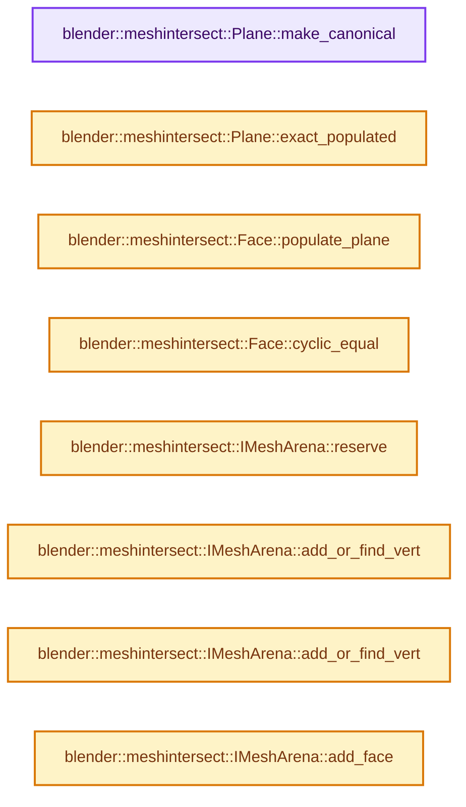

# 实现依赖专题：source/blender/blenlib/intern/mesh_intersect.cc

[方向导航](README.md) · [符号索引](../%E7%AC%A6%E5%8F%B7%E4%BE%9D%E8%B5%96%E4%B8%8E%E5%AE%9E%E7%8E%B0%E7%B4%A2%E5%BC%95.md)

本专题从正文实际调用进入，集中保存共享实现。函数有稳定锚点，可从调用处直接跳到对应完整函数；递归与互相调用通过回链组织。

## 本文件的实现关系




## 完整成员与函数实现

<a id="f-d21f9fa9be0121b8"></a>

### `blender::meshintersect::Plane::make_canonical`

实现位置：[source/blender/blenlib/intern/mesh_intersect.cc](../../../../../source/blender/blenlib/intern/mesh_intersect.cc) · L103—L128。

**教学注释版**

<!-- annotated:4c2188d12c34a3 -->

```cpp
void Plane::make_canonical()
{
  if (norm_exact[0] != 0) {
    mpq_class den = norm_exact[0];
    norm_exact = mpq3(1, norm_exact[1] / den, norm_exact[2] / den);
    d_exact = d_exact / den;
  }
  else if (norm_exact[1] != 0) {
    mpq_class den = norm_exact[1];
    norm_exact = mpq3(0, 1, norm_exact[2] / den);
    d_exact = d_exact / den;
  }
  else {
    if (norm_exact[2] != 0) {
      mpq_class den = norm_exact[2];
      norm_exact = mpq3(0, 0, 1);
      d_exact = d_exact / den;
    }
    else {
      /* A degenerate plane. */
      d_exact = 0;
    }
  }
  norm = double3(norm_exact[0].get_d(), norm_exact[1].get_d(), norm_exact[2].get_d());
  d = d_exact.get_d();
}
```

<details>
<summary>核对原始源码：source/blender/blenlib/intern/mesh_intersect.cc · L103—L128</summary>

<!-- original:4c2188d12c34a3:source/blender/blenlib/intern/mesh_intersect.cc:103:128 -->

```cpp
void Plane::make_canonical()
{
  if (norm_exact[0] != 0) {
    mpq_class den = norm_exact[0];
    norm_exact = mpq3(1, norm_exact[1] / den, norm_exact[2] / den);
    d_exact = d_exact / den;
  }
  else if (norm_exact[1] != 0) {
    mpq_class den = norm_exact[1];
    norm_exact = mpq3(0, 1, norm_exact[2] / den);
    d_exact = d_exact / den;
  }
  else {
    if (norm_exact[2] != 0) {
      mpq_class den = norm_exact[2];
      norm_exact = mpq3(0, 0, 1);
      d_exact = d_exact / den;
    }
    else {
      /* A degenerate plane. */
      d_exact = 0;
    }
  }
  norm = double3(norm_exact[0].get_d(), norm_exact[1].get_d(), norm_exact[2].get_d());
  d = d_exact.get_d();
}
```

</details>

**沿实际写入检查状态**

- `norm_exact = mpq3(1, norm_exact[1] / den, norm_exact[2] / den);`
- `d_exact = d_exact / den;`
- `norm_exact = mpq3(0, 1, norm_exact[2] / den);`
- `norm_exact = mpq3(0, 0, 1);`
- `d_exact = 0;`
- `norm = double3(norm_exact[0].get_d(), norm_exact[1].get_d(), norm_exact[2].get_d());`
- `d = d_exact.get_d();`

**继续追踪实现**

- `mpq3` → [调用协议](../%E6%A8%A1%E6%9D%BF%E5%AE%8F%E4%B8%8E%E5%8A%A8%E6%80%81%E5%88%86%E6%B4%BE%E5%8D%8F%E8%AE%AE.md)：函数指针、局部可调用对象或未展开的宏；必须结合调用者环境。调用位置L107。
- `double3` → [调用协议](../%E6%A8%A1%E6%9D%BF%E5%AE%8F%E4%B8%8E%E5%8A%A8%E6%80%81%E5%88%86%E6%B4%BE%E5%8D%8F%E8%AE%AE.md)：函数指针、局部可调用对象或未展开的宏；必须结合调用者环境。调用位置L126。
- `norm_exact[0].get_d` → [调用协议](../%E6%A8%A1%E6%9D%BF%E5%AE%8F%E4%B8%8E%E5%8A%A8%E6%80%81%E5%88%86%E6%B4%BE%E5%8D%8F%E8%AE%AE.md)：接收对象类型依赖auto、返回值或模板实例；不按同名猜测目标。调用位置L126。
- `norm_exact[1].get_d` → [调用协议](../%E6%A8%A1%E6%9D%BF%E5%AE%8F%E4%B8%8E%E5%8A%A8%E6%80%81%E5%88%86%E6%B4%BE%E5%8D%8F%E8%AE%AE.md)：接收对象类型依赖auto、返回值或模板实例；不按同名猜测目标。调用位置L126。
- `norm_exact[2].get_d` → [调用协议](../%E6%A8%A1%E6%9D%BF%E5%AE%8F%E4%B8%8E%E5%8A%A8%E6%80%81%E5%88%86%E6%B4%BE%E5%8D%8F%E8%AE%AE.md)：接收对象类型依赖auto、返回值或模板实例；不按同名猜测目标。调用位置L126。
- `d_exact.get_d` → [调用协议](../%E6%A8%A1%E6%9D%BF%E5%AE%8F%E4%B8%8E%E5%8A%A8%E6%80%81%E5%88%86%E6%B4%BE%E5%8D%8F%E8%AE%AE.md)：接收对象类型依赖auto、返回值或模板实例；不按同名猜测目标。调用位置L127。

<a id="f-a54fcfd5a76e0d57"></a>

### `blender::meshintersect::Plane::exact_populated`

实现位置：[source/blender/blenlib/intern/mesh_intersect.cc](../../../../../source/blender/blenlib/intern/mesh_intersect.cc) · L142—L145。

**教学注释版**

<!-- annotated:03f5ef31f70aa2 -->

```cpp
bool Plane::exact_populated() const
{
  return norm_exact[0] != 0 || norm_exact[1] != 0 || norm_exact[2] != 0;
}
```

<details>
<summary>核对原始源码：source/blender/blenlib/intern/mesh_intersect.cc · L142—L145</summary>

<!-- original:03f5ef31f70aa2:source/blender/blenlib/intern/mesh_intersect.cc:142:145 -->

```cpp
bool Plane::exact_populated() const
{
  return norm_exact[0] != 0 || norm_exact[1] != 0 || norm_exact[2] != 0;
}
```

</details>

**结果出口**

- `return norm_exact[0] != 0 || norm_exact[1] != 0 || norm_exact[2] != 0;`

**继续追踪实现**

本实现没有需要继续展开的显式调用；检查返回表达式、对象转换和调用者前置条件。

<a id="f-ce1cfa9b88c00e5f"></a>

### `blender::meshintersect::Face::populate_plane`

实现位置：[source/blender/blenlib/intern/mesh_intersect.cc](../../../../../source/blender/blenlib/intern/mesh_intersect.cc) · L174—L215。

接口参数：

- `bool need_exact`

**教学注释版**

<!-- annotated:0e42bc1ea7b14a -->

```cpp
void Face::populate_plane(bool need_exact)
{
  if (plane != nullptr) {
    if (!need_exact || plane->exact_populated()) {
      return;
    }
  }
  if (need_exact) {
    mpq3 normal_exact;
    if (vert.size() > 3) {
      Array<mpq3> co(vert.size());
      for (int i : index_range()) {
        co[i] = vert[i]->co_exact;
      }
      // [讲解] co.as_span：提供数组的借用访问入口。
      normal_exact = math::cross_poly(co.as_span());
    }
    else {
      mpq3 tr02 = vert[0]->co_exact - vert[2]->co_exact;
      mpq3 tr12 = vert[1]->co_exact - vert[2]->co_exact;
      normal_exact = math::cross(tr02, tr12);
    }
    mpq_class d_exact = -math::dot(normal_exact, vert[0]->co_exact);
    plane = new Plane(normal_exact, d_exact);
  }
  else {
    double3 normal;
    if (vert.size() > 3) {
      Array<double3> co(vert.size());
      for (int i : index_range()) {
        co[i] = vert[i]->co;
      }
      normal = math::cross_poly(co.as_span());
    }
    else {
      double3 tr02 = vert[0]->co - vert[2]->co;
      double3 tr12 = vert[1]->co - vert[2]->co;
      normal = math::cross(tr02, tr12);
    }
    double d = -math::dot(normal, vert[0]->co);
    plane = new Plane(normal, d);
  }
}
```

<details>
<summary>核对原始源码：source/blender/blenlib/intern/mesh_intersect.cc · L174—L215</summary>

<!-- original:0e42bc1ea7b14a:source/blender/blenlib/intern/mesh_intersect.cc:174:215 -->

```cpp
void Face::populate_plane(bool need_exact)
{
  if (plane != nullptr) {
    if (!need_exact || plane->exact_populated()) {
      return;
    }
  }
  if (need_exact) {
    mpq3 normal_exact;
    if (vert.size() > 3) {
      Array<mpq3> co(vert.size());
      for (int i : index_range()) {
        co[i] = vert[i]->co_exact;
      }
      normal_exact = math::cross_poly(co.as_span());
    }
    else {
      mpq3 tr02 = vert[0]->co_exact - vert[2]->co_exact;
      mpq3 tr12 = vert[1]->co_exact - vert[2]->co_exact;
      normal_exact = math::cross(tr02, tr12);
    }
    mpq_class d_exact = -math::dot(normal_exact, vert[0]->co_exact);
    plane = new Plane(normal_exact, d_exact);
  }
  else {
    double3 normal;
    if (vert.size() > 3) {
      Array<double3> co(vert.size());
      for (int i : index_range()) {
        co[i] = vert[i]->co;
      }
      normal = math::cross_poly(co.as_span());
    }
    else {
      double3 tr02 = vert[0]->co - vert[2]->co;
      double3 tr12 = vert[1]->co - vert[2]->co;
      normal = math::cross(tr02, tr12);
    }
    double d = -math::dot(normal, vert[0]->co);
    plane = new Plane(normal, d);
  }
}
```

</details>

**沿实际写入检查状态**

- `co[i] = vert[i]->co_exact;`
- `normal_exact = math::cross_poly(co.as_span());`
- `normal_exact = math::cross(tr02, tr12);`
- `plane = new Plane(normal_exact, d_exact);`
- `co[i] = vert[i]->co;`
- `normal = math::cross_poly(co.as_span());`
- `normal = math::cross(tr02, tr12);`
- `plane = new Plane(normal, d);`

**继续追踪实现**

- `plane->exact_populated` → [调用协议](../%E6%A8%A1%E6%9D%BF%E5%AE%8F%E4%B8%8E%E5%8A%A8%E6%80%81%E5%88%86%E6%B4%BE%E5%8D%8F%E8%AE%AE.md)：接收对象类型依赖auto、返回值或模板实例；不按同名猜测目标。调用位置L177。
- `vert.size` → [调用协议](../%E6%A8%A1%E6%9D%BF%E5%AE%8F%E4%B8%8E%E5%8A%A8%E6%80%81%E5%88%86%E6%B4%BE%E5%8D%8F%E8%AE%AE.md)：接收对象类型依赖auto、返回值或模板实例；不按同名猜测目标。调用位置L183。
- `index_range` → [blender::meshintersect::CoplanarClusterInfo::index_range · L888](%E4%BE%9D%E8%B5%96-mesh_intersect-3f2f20.md#f-2f594ced5d0018a8)。
- `math::cross_poly` → [blender::math::cross_poly · L584](../12-%E7%A9%BA%E9%97%B4%E6%95%B0%E6%8D%AE%E7%BB%93%E6%9E%84%E4%B8%8E%E5%87%A0%E4%BD%95%E7%AE%97%E6%B3%95/%E4%BE%9D%E8%B5%96-BLI_math_vector-906a87.md#f-55793dc18b0e7912)。
- `co.as_span` → [blender::Array::as_span · L254](08-Array%E5%A4%8D%E5%88%B6%E7%A7%BB%E5%8A%A8%E4%B8%8E%E9%94%80%E6%AF%81.md#f-05fc77056a242032)。
- `math::cross` → [blender::math::cross · L549](../12-%E7%A9%BA%E9%97%B4%E6%95%B0%E6%8D%AE%E7%BB%93%E6%9E%84%E4%B8%8E%E5%87%A0%E4%BD%95%E7%AE%97%E6%B3%95/%E4%BE%9D%E8%B5%96-BLI_math_vector-906a87.md#f-cb1b14dc107aa107)；[blender::math::cross · L562](../12-%E7%A9%BA%E9%97%B4%E6%95%B0%E6%8D%AE%E7%BB%93%E6%9E%84%E4%B8%8E%E5%87%A0%E4%BD%95%E7%AE%97%E6%B3%95/%E4%BE%9D%E8%B5%96-BLI_math_vector-906a87.md#f-8dcac1cc63a3672a)；[blender::math::cross · L217](../12-%E7%A9%BA%E9%97%B4%E6%95%B0%E6%8D%AE%E7%BB%93%E6%9E%84%E4%B8%8E%E5%87%A0%E4%BD%95%E7%AE%97%E6%B3%95/%E4%BE%9D%E8%B5%96-BLI_math_basis_types-fc7090.md#f-0cb9fb63f068f85e)。同名重载需按实参类型选择。
- `math::dot` → [blender::math::dot · L430](../12-%E7%A9%BA%E9%97%B4%E6%95%B0%E6%8D%AE%E7%BB%93%E6%9E%84%E4%B8%8E%E5%87%A0%E4%BD%95%E7%AE%97%E6%B3%95/%E4%BE%9D%E8%B5%96-BLI_math_vector-906a87.md#f-6f0c6a081b107428)；[blender::math::dot · L198](../12-%E7%A9%BA%E9%97%B4%E6%95%B0%E6%8D%AE%E7%BB%93%E6%9E%84%E4%B8%8E%E5%87%A0%E4%BD%95%E7%AE%97%E6%B3%95/%E4%BE%9D%E8%B5%96-BLI_math_quaternion-cf105d.md#f-5b1ef457981dbc76)。同名重载需按实参类型选择。

<a id="f-72d5e37aeea5bc1b"></a>

### `blender::meshintersect::Face::cyclic_equal`

实现位置：[source/blender/blenlib/intern/mesh_intersect.cc](../../../../../source/blender/blenlib/intern/mesh_intersect.cc) · L237—L259。

接口参数：

- `const Face &other`

**教学注释版**

<!-- annotated:c2d0173bdd177d -->

```cpp
bool Face::cyclic_equal(const Face &other) const
{
  if (this->size() != other.size()) {
    return false;
  }
  int flen = this->size();
  for (FacePos start : index_range()) {
    for (FacePos start_other : index_range()) {
      bool ok = true;
      for (int i = 0; ok && i < flen; ++i) {
        FacePos p = (start + i) % flen;
        FacePos p_other = (start_other + i) % flen;
        if (this->vert[p] != other.vert[p_other]) {
          ok = false;
        }
      }
      if (ok) {
        return true;
      }
    }
  }
  return false;
}
```

<details>
<summary>核对原始源码：source/blender/blenlib/intern/mesh_intersect.cc · L237—L259</summary>

<!-- original:c2d0173bdd177d:source/blender/blenlib/intern/mesh_intersect.cc:237:259 -->

```cpp
bool Face::cyclic_equal(const Face &other) const
{
  if (this->size() != other.size()) {
    return false;
  }
  int flen = this->size();
  for (FacePos start : index_range()) {
    for (FacePos start_other : index_range()) {
      bool ok = true;
      for (int i = 0; ok && i < flen; ++i) {
        FacePos p = (start + i) % flen;
        FacePos p_other = (start_other + i) % flen;
        if (this->vert[p] != other.vert[p_other]) {
          ok = false;
        }
      }
      if (ok) {
        return true;
      }
    }
  }
  return false;
}
```

</details>

**沿实际写入检查状态**

- `ok = false;`

**结果出口**

- `return false;`
- `return true;`

**继续追踪实现**

- `this->size` → [blender::meshintersect::Face::size · L156](%E4%BE%9D%E8%B5%96-BLI_mesh_intersect-db7f59.md#f-ae8917c425c3684c)。
- `other.size` → [blender::meshintersect::Face::size · L156](%E4%BE%9D%E8%B5%96-BLI_mesh_intersect-db7f59.md#f-ae8917c425c3684c)。
- `index_range` → [blender::meshintersect::CoplanarClusterInfo::index_range · L888](%E4%BE%9D%E8%B5%96-mesh_intersect-3f2f20.md#f-2f594ced5d0018a8)。

<a id="f-abdff16518c225ae"></a>

### `blender::meshintersect::IMeshArena::reserve`

实现位置：[source/blender/blenlib/intern/mesh_intersect.cc](../../../../../source/blender/blenlib/intern/mesh_intersect.cc) · L482—L485。

接口参数：

- `int vert_num_hint`
- `int face_num_hint`

**教学注释版**

<!-- annotated:1b4c759dc8401c -->

```cpp
void IMeshArena::reserve(int vert_num_hint, int face_num_hint)
{
  pimpl_->reserve(vert_num_hint, face_num_hint);
}
```

<details>
<summary>核对原始源码：source/blender/blenlib/intern/mesh_intersect.cc · L482—L485</summary>

<!-- original:1b4c759dc8401c:source/blender/blenlib/intern/mesh_intersect.cc:482:485 -->

```cpp
void IMeshArena::reserve(int vert_num_hint, int face_num_hint)
{
  pimpl_->reserve(vert_num_hint, face_num_hint);
}
```

</details>

**继续追踪实现**

- `pimpl_->reserve` → [调用协议](../%E6%A8%A1%E6%9D%BF%E5%AE%8F%E4%B8%8E%E5%8A%A8%E6%80%81%E5%88%86%E6%B4%BE%E5%8D%8F%E8%AE%AE.md)：接收对象类型依赖auto、返回值或模板实例；不按同名猜测目标。调用位置L484。

<a id="f-525363e2a219ccab"></a>

### `blender::meshintersect::IMeshArena::add_or_find_vert`

实现位置：[source/blender/blenlib/intern/mesh_intersect.cc](../../../../../source/blender/blenlib/intern/mesh_intersect.cc) · L497—L500。

接口参数：

- `const mpq3 &co`
- `int orig`

**教学注释版**

<!-- annotated:caa376a136e4f2 -->

```cpp
const Vert *IMeshArena::add_or_find_vert(const mpq3 &co, int orig)
{
  return pimpl_->add_or_find_vert(co, orig);
}
```

<details>
<summary>核对原始源码：source/blender/blenlib/intern/mesh_intersect.cc · L497—L500</summary>

<!-- original:caa376a136e4f2:source/blender/blenlib/intern/mesh_intersect.cc:497:500 -->

```cpp
const Vert *IMeshArena::add_or_find_vert(const mpq3 &co, int orig)
{
  return pimpl_->add_or_find_vert(co, orig);
}
```

</details>

**结果出口**

- `return pimpl_->add_or_find_vert(co, orig);`

**继续追踪实现**

- `pimpl_->add_or_find_vert` → [调用协议](../%E6%A8%A1%E6%9D%BF%E5%AE%8F%E4%B8%8E%E5%8A%A8%E6%80%81%E5%88%86%E6%B4%BE%E5%8D%8F%E8%AE%AE.md)：接收对象类型依赖auto、返回值或模板实例；不按同名猜测目标。调用位置L499。

<a id="f-5c10fda292c74f3d"></a>

### `blender::meshintersect::IMeshArena::add_or_find_vert`

实现位置：[source/blender/blenlib/intern/mesh_intersect.cc](../../../../../source/blender/blenlib/intern/mesh_intersect.cc) · L502—L505。

接口参数：

- `Vert *vert`

**教学注释版**

<!-- annotated:f63df5f5e87fcd -->

```cpp
const Vert *IMeshArena::add_or_find_vert(Vert *vert)
{
  return pimpl_->add_or_find_vert(vert);
}
```

<details>
<summary>核对原始源码：source/blender/blenlib/intern/mesh_intersect.cc · L502—L505</summary>

<!-- original:f63df5f5e87fcd:source/blender/blenlib/intern/mesh_intersect.cc:502:505 -->

```cpp
const Vert *IMeshArena::add_or_find_vert(Vert *vert)
{
  return pimpl_->add_or_find_vert(vert);
}
```

</details>

**结果出口**

- `return pimpl_->add_or_find_vert(vert);`

**继续追踪实现**

- `pimpl_->add_or_find_vert` → [调用协议](../%E6%A8%A1%E6%9D%BF%E5%AE%8F%E4%B8%8E%E5%8A%A8%E6%80%81%E5%88%86%E6%B4%BE%E5%8D%8F%E8%AE%AE.md)：接收对象类型依赖auto、返回值或模板实例；不按同名猜测目标。调用位置L504。

<a id="f-3a68cd3713c51cce"></a>

### `blender::meshintersect::IMeshArena::add_face`

实现位置：[source/blender/blenlib/intern/mesh_intersect.cc](../../../../../source/blender/blenlib/intern/mesh_intersect.cc) · L507—L513。

接口参数：

- `Span<const Vert *> verts`
- `int orig`
- `Span<int> edge_origs`
- `Span<bool> is_intersect`

**教学注释版**

<!-- annotated:81128fe232b78f -->

```cpp
Face *IMeshArena::add_face(Span<const Vert *> verts,
                           int orig,
                           Span<int> edge_origs,
                           Span<bool> is_intersect)
{
  return pimpl_->add_face(verts, orig, edge_origs, is_intersect);
}
```

<details>
<summary>核对原始源码：source/blender/blenlib/intern/mesh_intersect.cc · L507—L513</summary>

<!-- original:81128fe232b78f:source/blender/blenlib/intern/mesh_intersect.cc:507:513 -->

```cpp
Face *IMeshArena::add_face(Span<const Vert *> verts,
                           int orig,
                           Span<int> edge_origs,
                           Span<bool> is_intersect)
{
  return pimpl_->add_face(verts, orig, edge_origs, is_intersect);
}
```

</details>

**结果出口**

- `return pimpl_->add_face(verts, orig, edge_origs, is_intersect);`

**继续追踪实现**

- `pimpl_->add_face` → [调用协议](../%E6%A8%A1%E6%9D%BF%E5%AE%8F%E4%B8%8E%E5%8A%A8%E6%80%81%E5%88%86%E6%B4%BE%E5%8D%8F%E8%AE%AE.md)：接收对象类型依赖auto、返回值或模板实例；不按同名猜测目标。调用位置L512。

<a id="f-ef40c791363e0ea9"></a>

### `blender::meshintersect::IMeshArena::add_face`

实现位置：[source/blender/blenlib/intern/mesh_intersect.cc](../../../../../source/blender/blenlib/intern/mesh_intersect.cc) · L515—L518。

接口参数：

- `Span<const Vert *> verts`
- `int orig`
- `Span<int> edge_origs`

**教学注释版**

<!-- annotated:eb06c7bc9d8672 -->

```cpp
Face *IMeshArena::add_face(Span<const Vert *> verts, int orig, Span<int> edge_origs)
{
  return pimpl_->add_face(verts, orig, edge_origs);
}
```

<details>
<summary>核对原始源码：source/blender/blenlib/intern/mesh_intersect.cc · L515—L518</summary>

<!-- original:eb06c7bc9d8672:source/blender/blenlib/intern/mesh_intersect.cc:515:518 -->

```cpp
Face *IMeshArena::add_face(Span<const Vert *> verts, int orig, Span<int> edge_origs)
{
  return pimpl_->add_face(verts, orig, edge_origs);
}
```

</details>

**结果出口**

- `return pimpl_->add_face(verts, orig, edge_origs);`

**继续追踪实现**

- `pimpl_->add_face` → [调用协议](../%E6%A8%A1%E6%9D%BF%E5%AE%8F%E4%B8%8E%E5%8A%A8%E6%80%81%E5%88%86%E6%B4%BE%E5%8D%8F%E8%AE%AE.md)：接收对象类型依赖auto、返回值或模板实例；不按同名猜测目标。调用位置L517。

<a id="f-dcbc874c2618f4c4"></a>

### `blender::meshintersect::IMeshArena::add_face`

实现位置：[source/blender/blenlib/intern/mesh_intersect.cc](../../../../../source/blender/blenlib/intern/mesh_intersect.cc) · L520—L523。

接口参数：

- `Span<const Vert *> verts`
- `int orig`

**教学注释版**

<!-- annotated:96fa22d88d1e85 -->

```cpp
Face *IMeshArena::add_face(Span<const Vert *> verts, int orig)
{
  return pimpl_->add_face(verts, orig);
}
```

<details>
<summary>核对原始源码：source/blender/blenlib/intern/mesh_intersect.cc · L520—L523</summary>

<!-- original:96fa22d88d1e85:source/blender/blenlib/intern/mesh_intersect.cc:520:523 -->

```cpp
Face *IMeshArena::add_face(Span<const Vert *> verts, int orig)
{
  return pimpl_->add_face(verts, orig);
}
```

</details>

**结果出口**

- `return pimpl_->add_face(verts, orig);`

**继续追踪实现**

- `pimpl_->add_face` → [调用协议](../%E6%A8%A1%E6%9D%BF%E5%AE%8F%E4%B8%8E%E5%8A%A8%E6%80%81%E5%88%86%E6%B4%BE%E5%8D%8F%E8%AE%AE.md)：接收对象类型依赖auto、返回值或模板实例；不按同名猜测目标。调用位置L522。

<a id="f-aa6d9d8eef5f16e1"></a>

### `blender::meshintersect::IMeshArena::add_or_find_vert`

实现位置：[source/blender/blenlib/intern/mesh_intersect.cc](../../../../../source/blender/blenlib/intern/mesh_intersect.cc) · L525—L528。

接口参数：

- `const double3 &co`
- `int orig`

**教学注释版**

<!-- annotated:7041a165fbfbaf -->

```cpp
const Vert *IMeshArena::add_or_find_vert(const double3 &co, int orig)
{
  return pimpl_->add_or_find_vert(co, orig);
}
```

<details>
<summary>核对原始源码：source/blender/blenlib/intern/mesh_intersect.cc · L525—L528</summary>

<!-- original:7041a165fbfbaf:source/blender/blenlib/intern/mesh_intersect.cc:525:528 -->

```cpp
const Vert *IMeshArena::add_or_find_vert(const double3 &co, int orig)
{
  return pimpl_->add_or_find_vert(co, orig);
}
```

</details>

**结果出口**

- `return pimpl_->add_or_find_vert(co, orig);`

**继续追踪实现**

- `pimpl_->add_or_find_vert` → [调用协议](../%E6%A8%A1%E6%9D%BF%E5%AE%8F%E4%B8%8E%E5%8A%A8%E6%80%81%E5%88%86%E6%B4%BE%E5%8D%8F%E8%AE%AE.md)：接收对象类型依赖auto、返回值或模板实例；不按同名猜测目标。调用位置L527。

<a id="f-e65219c100eb54c9"></a>

### `blender::meshintersect::IMesh::set_faces`

实现位置：[source/blender/blenlib/intern/mesh_intersect.cc](../../../../../source/blender/blenlib/intern/mesh_intersect.cc) · L540—L543。

接口参数：

- `Span<Face *> faces`

**教学注释版**

<!-- annotated:f5cc5d2afe51a4 -->

```cpp
void IMesh::set_faces(Span<Face *> faces)
{
  face_ = faces;
}
```

<details>
<summary>核对原始源码：source/blender/blenlib/intern/mesh_intersect.cc · L540—L543</summary>

<!-- original:f5cc5d2afe51a4:source/blender/blenlib/intern/mesh_intersect.cc:540:543 -->

```cpp
void IMesh::set_faces(Span<Face *> faces)
{
  face_ = faces;
}
```

</details>

**沿实际写入检查状态**

- `face_ = faces;`

**继续追踪实现**

本实现没有需要继续展开的显式调用；检查返回表达式、对象转换和调用者前置条件。

<a id="f-baabda882eb3bd9b"></a>

### `blender::meshintersect::IMesh::populate_vert`

实现位置：[source/blender/blenlib/intern/mesh_intersect.cc](../../../../../source/blender/blenlib/intern/mesh_intersect.cc) · L545—L552。

**教学注释版**

<!-- annotated:1c6b2d1d18788d -->

```cpp
void IMesh::populate_vert()
{
  /* This is likely an overestimate, since verts are shared between
   * faces. It is ok if estimate is over or even under. */
  constexpr int ESTIMATE_VERTS_PER_FACE = 4;
  int estimate_verts_num = ESTIMATE_VERTS_PER_FACE * face_.size();
  populate_vert(estimate_verts_num);
}
```

<details>
<summary>核对原始源码：source/blender/blenlib/intern/mesh_intersect.cc · L545—L552</summary>

<!-- original:1c6b2d1d18788d:source/blender/blenlib/intern/mesh_intersect.cc:545:552 -->

```cpp
void IMesh::populate_vert()
{
  /* This is likely an overestimate, since verts are shared between
   * faces. It is ok if estimate is over or even under. */
  constexpr int ESTIMATE_VERTS_PER_FACE = 4;
  int estimate_verts_num = ESTIMATE_VERTS_PER_FACE * face_.size();
  populate_vert(estimate_verts_num);
}
```

</details>

**继续追踪实现**

- `face_.size` → [调用协议](../%E6%A8%A1%E6%9D%BF%E5%AE%8F%E4%B8%8E%E5%8A%A8%E6%80%81%E5%88%86%E6%B4%BE%E5%8D%8F%E8%AE%AE.md)：接收对象类型依赖auto、返回值或模板实例；不按同名猜测目标。调用位置L550。
- `populate_vert` → [blender::meshintersect::IMesh::populate_vert · L545](%E4%BE%9D%E8%B5%96-mesh_intersect-3f2f20.md#f-baabda882eb3bd9b)；[blender::meshintersect::IMesh::populate_vert · L554](%E4%BE%9D%E8%B5%96-mesh_intersect-3f2f20.md#f-0ab095211800b44d)。同名重载需按实参类型选择。

<a id="f-0ab095211800b44d"></a>

### `blender::meshintersect::IMesh::populate_vert`

实现位置：[source/blender/blenlib/intern/mesh_intersect.cc](../../../../../source/blender/blenlib/intern/mesh_intersect.cc) · L554—L602。

接口参数：

- `int max_verts`

**教学注释版**

<!-- annotated:5d479501441dff -->

```cpp
void IMesh::populate_vert(int max_verts)
{
  if (vert_populated_) {
    return;
  }
  vert_to_index_.reserve(max_verts);
  int next_allocate_index = 0;
  for (const Face *f : face_) {
    for (const Vert *v : *f) {
      if (v->id == 1) {
      }
      int index = vert_to_index_.lookup_default(v, NO_INDEX);
      if (index == NO_INDEX) {
        BLI_assert(next_allocate_index < UINT_MAX - 2);
        vert_to_index_.add(v, next_allocate_index++);
      }
    }
  }
  int tot_v = next_allocate_index;
  vert_ = Array<const Vert *>(tot_v);
  for (auto item : vert_to_index_.items()) {
    int index = item.value;
    BLI_assert(index < tot_v);
    vert_[index] = item.key;
  }
  /* Easier debugging (at least when there are no merged input verts)
   * if output vert order is same as input, with new verts at the end.
   * TODO: when all debugged, set fix_order = false. */
  const bool fix_order = true;
  if (fix_order) {
    parallel_sort(vert_.begin(), vert_.end(), [](const Vert *a, const Vert *b) {
      if (a->orig != NO_INDEX && b->orig != NO_INDEX) {
        return a->orig < b->orig;
      }
      if (a->orig != NO_INDEX) {
        return true;
      }
      if (b->orig != NO_INDEX) {
        return false;
      }
      return a->id < b->id;
    });
    for (int i : vert_.index_range()) {
      const Vert *v = vert_[i];
      vert_to_index_.add_overwrite(v, i);
    }
  }
  vert_populated_ = true;
}
```

<details>
<summary>核对原始源码：source/blender/blenlib/intern/mesh_intersect.cc · L554—L602</summary>

<!-- original:5d479501441dff:source/blender/blenlib/intern/mesh_intersect.cc:554:602 -->

```cpp
void IMesh::populate_vert(int max_verts)
{
  if (vert_populated_) {
    return;
  }
  vert_to_index_.reserve(max_verts);
  int next_allocate_index = 0;
  for (const Face *f : face_) {
    for (const Vert *v : *f) {
      if (v->id == 1) {
      }
      int index = vert_to_index_.lookup_default(v, NO_INDEX);
      if (index == NO_INDEX) {
        BLI_assert(next_allocate_index < UINT_MAX - 2);
        vert_to_index_.add(v, next_allocate_index++);
      }
    }
  }
  int tot_v = next_allocate_index;
  vert_ = Array<const Vert *>(tot_v);
  for (auto item : vert_to_index_.items()) {
    int index = item.value;
    BLI_assert(index < tot_v);
    vert_[index] = item.key;
  }
  /* Easier debugging (at least when there are no merged input verts)
   * if output vert order is same as input, with new verts at the end.
   * TODO: when all debugged, set fix_order = false. */
  const bool fix_order = true;
  if (fix_order) {
    parallel_sort(vert_.begin(), vert_.end(), [](const Vert *a, const Vert *b) {
      if (a->orig != NO_INDEX && b->orig != NO_INDEX) {
        return a->orig < b->orig;
      }
      if (a->orig != NO_INDEX) {
        return true;
      }
      if (b->orig != NO_INDEX) {
        return false;
      }
      return a->id < b->id;
    });
    for (int i : vert_.index_range()) {
      const Vert *v = vert_[i];
      vert_to_index_.add_overwrite(v, i);
    }
  }
  vert_populated_ = true;
}
```

</details>

**沿实际写入检查状态**

- `vert_ = Array<const Vert *>(tot_v);`
- `vert_[index] = item.key;`
- `vert_populated_ = true;`

**结果出口**

- `return a->orig < b->orig;`
- `return true;`
- `return false;`
- `return a->id < b->id;`

**继续追踪实现**

- `vert_to_index_.reserve` → [调用协议](../%E6%A8%A1%E6%9D%BF%E5%AE%8F%E4%B8%8E%E5%8A%A8%E6%80%81%E5%88%86%E6%B4%BE%E5%8D%8F%E8%AE%AE.md)：接收对象类型依赖auto、返回值或模板实例；不按同名猜测目标。调用位置L559。
- `vert_to_index_.lookup_default` → [调用协议](../%E6%A8%A1%E6%9D%BF%E5%AE%8F%E4%B8%8E%E5%8A%A8%E6%80%81%E5%88%86%E6%B4%BE%E5%8D%8F%E8%AE%AE.md)：接收对象类型依赖auto、返回值或模板实例；不按同名猜测目标。调用位置L565。
- `BLI_assert` → [BLI_assert · L48](%E4%BE%9D%E8%B5%96-BLI_assert-cc98e8.md#m-57a88495704d)；[BLI_assert · L63](%E4%BE%9D%E8%B5%96-BLI_assert-cc98e8.md#m-d07050020cb5)。宏定义由构建条件选择。
- `vert_to_index_.add` → [调用协议](../%E6%A8%A1%E6%9D%BF%E5%AE%8F%E4%B8%8E%E5%8A%A8%E6%80%81%E5%88%86%E6%B4%BE%E5%8D%8F%E8%AE%AE.md)：接收对象类型依赖auto、返回值或模板实例；不按同名猜测目标。调用位置L568。
- `Array<const Vert *>` → [blender::Array::Array · L78](07-Array%E6%9E%84%E9%80%A0%E4%B8%8E%E5%AD%98%E5%82%A8.md#f-001fd5eb3c658238)；[blender::Array::Array · L84](07-Array%E6%9E%84%E9%80%A0%E4%B8%8E%E5%AD%98%E5%82%A8.md#f-674e2f10361a462b)；[blender::Array::Array · L89](07-Array%E6%9E%84%E9%80%A0%E4%B8%8E%E5%AD%98%E5%82%A8.md#f-aa1e5908a9b67557)；[blender::Array::Array · L103](07-Array%E6%9E%84%E9%80%A0%E4%B8%8E%E5%AD%98%E5%82%A8.md#f-b141be39084346f3)；[blender::Array::Array · L110](07-Array%E6%9E%84%E9%80%A0%E4%B8%8E%E5%AD%98%E5%82%A8.md#f-452e276f39e81a2a)；[blender::Array::Array · L123](07-Array%E6%9E%84%E9%80%A0%E4%B8%8E%E5%AD%98%E5%82%A8.md#f-646aa58152ec44f6)；[blender::Array::Array · L135](07-Array%E6%9E%84%E9%80%A0%E4%B8%8E%E5%AD%98%E5%82%A8.md#f-0a9de4a549125f99)；[blender::Array::Array · L168](07-Array%E6%9E%84%E9%80%A0%E4%B8%8E%E5%AD%98%E5%82%A8.md#f-31f001eb92069e9d)；[blender::Array::Array · L176](07-Array%E6%9E%84%E9%80%A0%E4%B8%8E%E5%AD%98%E5%82%A8.md#f-cf8148f06fc6747a)；[blender::Array::Array · L178](07-Array%E6%9E%84%E9%80%A0%E4%B8%8E%E5%AD%98%E5%82%A8.md#f-2ddca2fb9dd964b3)。同名重载需按实参类型选择。
- `vert_to_index_.items` → [调用协议](../%E6%A8%A1%E6%9D%BF%E5%AE%8F%E4%B8%8E%E5%8A%A8%E6%80%81%E5%88%86%E6%B4%BE%E5%8D%8F%E8%AE%AE.md)：接收对象类型依赖auto、返回值或模板实例；不按同名猜测目标。调用位置L574。
- `parallel_sort` → [blender::parallel_sort · L36](%E4%BE%9D%E8%B5%96-BLI_sort-1e6ad7.md#f-c7bb69e225bb6ec0)；[blender::parallel_sort · L41](%E4%BE%9D%E8%B5%96-BLI_sort-1e6ad7.md#f-c4cdce306be83899)；[blender::parallel_sort · L46](%E4%BE%9D%E8%B5%96-BLI_sort-1e6ad7.md#f-7cdbab466f203f4f)；[blender::parallel_sort · L50](%E4%BE%9D%E8%B5%96-BLI_sort-1e6ad7.md#f-e8a3491a7ba9b37f)。同名重载需按实参类型选择。
- `vert_.begin` → [调用协议](../%E6%A8%A1%E6%9D%BF%E5%AE%8F%E4%B8%8E%E5%8A%A8%E6%80%81%E5%88%86%E6%B4%BE%E5%8D%8F%E8%AE%AE.md)：接收对象类型依赖auto、返回值或模板实例；不按同名猜测目标。调用位置L584。
- `vert_.end` → [调用协议](../%E6%A8%A1%E6%9D%BF%E5%AE%8F%E4%B8%8E%E5%8A%A8%E6%80%81%E5%88%86%E6%B4%BE%E5%8D%8F%E8%AE%AE.md)：接收对象类型依赖auto、返回值或模板实例；不按同名猜测目标。调用位置L584。
- `vert_.index_range` → [调用协议](../%E6%A8%A1%E6%9D%BF%E5%AE%8F%E4%B8%8E%E5%8A%A8%E6%80%81%E5%88%86%E6%B4%BE%E5%8D%8F%E8%AE%AE.md)：接收对象类型依赖auto、返回值或模板实例；不按同名猜测目标。调用位置L596。
- `vert_to_index_.add_overwrite` → [调用协议](../%E6%A8%A1%E6%9D%BF%E5%AE%8F%E4%B8%8E%E5%8A%A8%E6%80%81%E5%88%86%E6%B4%BE%E5%8D%8F%E8%AE%AE.md)：接收对象类型依赖auto、返回值或模板实例；不按同名猜测目标。调用位置L598。

<a id="f-8dad97fb1970e9d3"></a>

### `blender::meshintersect::IMesh::erase_face_positions`

实现位置：[source/blender/blenlib/intern/mesh_intersect.cc](../../../../../source/blender/blenlib/intern/mesh_intersect.cc) · L604—L643。

接口参数：

- `int f_index`
- `Span<bool> face_pos_erase`
- `IMeshArena *arena`

**教学注释版**

<!-- annotated:31cf040399a813 -->

```cpp
bool IMesh::erase_face_positions(int f_index, Span<bool> face_pos_erase, IMeshArena *arena)
{
  const Face *cur_f = this->face(f_index);
  int cur_len = cur_f->size();
  int to_erase_num = 0;
  for (int i : cur_f->index_range()) {
    if (face_pos_erase[i]) {
      ++to_erase_num;
    }
  }
  if (to_erase_num == 0) {
    return false;
  }
  int new_len = cur_len - to_erase_num;
  if (new_len < 3) {
    /* This erase causes removal of whole face.
     * Because this may be called from a loop over the face array,
     * we don't want to compress that array right here; instead will
     * mark with null pointer and caller should call remove_null_faces().
     * the loop is done.
     */
    this->face_[f_index] = nullptr;
    return true;
  }
  Array<const Vert *> new_vert(new_len);
  Array<int> new_edge_orig(new_len);
  Array<bool> new_is_intersect(new_len);
  int new_index = 0;
  for (int i : cur_f->index_range()) {
    if (!face_pos_erase[i]) {
      new_vert[new_index] = (*cur_f)[i];
      new_edge_orig[new_index] = cur_f->edge_orig[i];
      new_is_intersect[new_index] = cur_f->is_intersect[i];
      ++new_index;
    }
  }
  BLI_assert(new_index == new_len);
  this->face_[f_index] = arena->add_face(new_vert, cur_f->orig, new_edge_orig, new_is_intersect);
  return false;
}
```

<details>
<summary>核对原始源码：source/blender/blenlib/intern/mesh_intersect.cc · L604—L643</summary>

<!-- original:31cf040399a813:source/blender/blenlib/intern/mesh_intersect.cc:604:643 -->

```cpp
bool IMesh::erase_face_positions(int f_index, Span<bool> face_pos_erase, IMeshArena *arena)
{
  const Face *cur_f = this->face(f_index);
  int cur_len = cur_f->size();
  int to_erase_num = 0;
  for (int i : cur_f->index_range()) {
    if (face_pos_erase[i]) {
      ++to_erase_num;
    }
  }
  if (to_erase_num == 0) {
    return false;
  }
  int new_len = cur_len - to_erase_num;
  if (new_len < 3) {
    /* This erase causes removal of whole face.
     * Because this may be called from a loop over the face array,
     * we don't want to compress that array right here; instead will
     * mark with null pointer and caller should call remove_null_faces().
     * the loop is done.
     */
    this->face_[f_index] = nullptr;
    return true;
  }
  Array<const Vert *> new_vert(new_len);
  Array<int> new_edge_orig(new_len);
  Array<bool> new_is_intersect(new_len);
  int new_index = 0;
  for (int i : cur_f->index_range()) {
    if (!face_pos_erase[i]) {
      new_vert[new_index] = (*cur_f)[i];
      new_edge_orig[new_index] = cur_f->edge_orig[i];
      new_is_intersect[new_index] = cur_f->is_intersect[i];
      ++new_index;
    }
  }
  BLI_assert(new_index == new_len);
  this->face_[f_index] = arena->add_face(new_vert, cur_f->orig, new_edge_orig, new_is_intersect);
  return false;
}
```

</details>

**沿实际写入检查状态**

- `this->face_[f_index] = nullptr;`
- `new_vert[new_index] = (*cur_f)[i];`
- `new_edge_orig[new_index] = cur_f->edge_orig[i];`
- `new_is_intersect[new_index] = cur_f->is_intersect[i];`
- `this->face_[f_index] = arena->add_face(new_vert, cur_f->orig, new_edge_orig, new_is_intersect);`

**结果出口**

- `return false;`
- `return true;`

**继续追踪实现**

- `this->face` → [blender::meshintersect::IMesh::face · L253](%E4%BE%9D%E8%B5%96-BLI_mesh_intersect-db7f59.md#f-02419d5b631de370)。
- `cur_f->size` → [blender::meshintersect::Face::size · L156](%E4%BE%9D%E8%B5%96-BLI_mesh_intersect-db7f59.md#f-ae8917c425c3684c)。
- `cur_f->index_range` → [blender::meshintersect::Face::index_range · L171](%E4%BE%9D%E8%B5%96-BLI_mesh_intersect-db7f59.md#f-6d7b67dcb755ec3b)。
- `BLI_assert` → [BLI_assert · L48](%E4%BE%9D%E8%B5%96-BLI_assert-cc98e8.md#m-57a88495704d)；[BLI_assert · L63](%E4%BE%9D%E8%B5%96-BLI_assert-cc98e8.md#m-d07050020cb5)。宏定义由构建条件选择。
- `arena->add_face` → [blender::meshintersect::IMeshArena::add_face · L507](%E4%BE%9D%E8%B5%96-mesh_intersect-3f2f20.md#f-3a68cd3713c51cce)；[blender::meshintersect::IMeshArena::add_face · L515](%E4%BE%9D%E8%B5%96-mesh_intersect-3f2f20.md#f-ef40c791363e0ea9)；[blender::meshintersect::IMeshArena::add_face · L520](%E4%BE%9D%E8%B5%96-mesh_intersect-3f2f20.md#f-dcbc874c2618f4c4)。同名重载需按实参类型选择。

<a id="f-07612aada2eb7c82"></a>

### `blender::meshintersect::IMesh::remove_null_faces`

实现位置：[source/blender/blenlib/intern/mesh_intersect.cc](../../../../../source/blender/blenlib/intern/mesh_intersect.cc) · L645—L667。

**教学注释版**

<!-- annotated:15482d197b81bf -->

```cpp
void IMesh::remove_null_faces()
{
  int64_t nullcount = 0;
  for (Face *f : this->face_) {
    if (f == nullptr) {
      ++nullcount;
    }
  }
  if (nullcount == 0) {
    return;
  }
  int64_t new_size = this->face_.size() - nullcount;
  int64_t copy_to_index = 0;
  int64_t copy_from_index = 0;
  Array<Face *> new_face(new_size);
  while (copy_from_index < face_.size()) {
    Face *f_from = face_[copy_from_index++];
    if (f_from) {
      new_face[copy_to_index++] = f_from;
    }
  }
  this->face_ = new_face;
}
```

<details>
<summary>核对原始源码：source/blender/blenlib/intern/mesh_intersect.cc · L645—L667</summary>

<!-- original:15482d197b81bf:source/blender/blenlib/intern/mesh_intersect.cc:645:667 -->

```cpp
void IMesh::remove_null_faces()
{
  int64_t nullcount = 0;
  for (Face *f : this->face_) {
    if (f == nullptr) {
      ++nullcount;
    }
  }
  if (nullcount == 0) {
    return;
  }
  int64_t new_size = this->face_.size() - nullcount;
  int64_t copy_to_index = 0;
  int64_t copy_from_index = 0;
  Array<Face *> new_face(new_size);
  while (copy_from_index < face_.size()) {
    Face *f_from = face_[copy_from_index++];
    if (f_from) {
      new_face[copy_to_index++] = f_from;
    }
  }
  this->face_ = new_face;
}
```

</details>

**沿实际写入检查状态**

- `this->face_ = new_face;`

**继续追踪实现**

- `this->face_.size` → [调用协议](../%E6%A8%A1%E6%9D%BF%E5%AE%8F%E4%B8%8E%E5%8A%A8%E6%80%81%E5%88%86%E6%B4%BE%E5%8D%8F%E8%AE%AE.md)：接收对象类型依赖auto、返回值或模板实例；不按同名猜测目标。调用位置L656。
- `face_.size` → [调用协议](../%E6%A8%A1%E6%9D%BF%E5%AE%8F%E4%B8%8E%E5%8A%A8%E6%80%81%E5%88%86%E6%B4%BE%E5%8D%8F%E8%AE%AE.md)：接收对象类型依赖auto、返回值或模板实例；不按同名猜测目标。调用位置L660。

<a id="f-6cde52b9d0547d68"></a>

### `blender::meshintersect::bbs_might_intersect`

实现位置：[source/blender/blenlib/intern/mesh_intersect.cc](../../../../../source/blender/blenlib/intern/mesh_intersect.cc) · L695—L698。

接口参数：

- `const BoundingBox &bb_a`
- `const BoundingBox &bb_b`

**教学注释版**

<!-- annotated:b68fabe7a34472 -->

```cpp
bool bbs_might_intersect(const BoundingBox &bb_a, const BoundingBox &bb_b)
{
  return isect_aabb_aabb_v3(bb_a.min, bb_a.max, bb_b.min, bb_b.max);
}
```

<details>
<summary>核对原始源码：source/blender/blenlib/intern/mesh_intersect.cc · L695—L698</summary>

<!-- original:b68fabe7a34472:source/blender/blenlib/intern/mesh_intersect.cc:695:698 -->

```cpp
bool bbs_might_intersect(const BoundingBox &bb_a, const BoundingBox &bb_b)
{
  return isect_aabb_aabb_v3(bb_a.min, bb_a.max, bb_b.min, bb_b.max);
}
```

</details>

**结果出口**

- `return isect_aabb_aabb_v3(bb_a.min, bb_a.max, bb_b.min, bb_b.max);`

**继续追踪实现**

- `isect_aabb_aabb_v3` → [blender::isect_aabb_aabb_v3 · L3226](../12-%E7%A9%BA%E9%97%B4%E6%95%B0%E6%8D%AE%E7%BB%93%E6%9E%84%E4%B8%8E%E5%87%A0%E4%BD%95%E7%AE%97%E6%B3%95/%E4%BE%9D%E8%B5%96-math_geom-8d91a3.md#f-c85e5e3016c33e83)。

<a id="f-f1f36dc5ab37760e"></a>

### `blender::meshintersect::calc_face_bounding_boxes`

实现位置：[source/blender/blenlib/intern/mesh_intersect.cc](../../../../../source/blender/blenlib/intern/mesh_intersect.cc) · L764—L789。

接口参数：

- `const IMesh &m`

**教学注释版**

<!-- annotated:6ab646fbe7e981 -->

```cpp
static Array<BoundingBox> calc_face_bounding_boxes(const IMesh &m)
{
  int n = m.face_size();
  Array<BoundingBox> ans(n);
  TaskParallelSettings settings;
  BBCalcData data(m, &ans);
  BBChunkData chunk_data;
  BLI_parallel_range_settings_defaults(&settings);
  settings.userdata_chunk = &chunk_data;
  settings.userdata_chunk_size = sizeof(chunk_data);
  settings.func_reduce = calc_face_bb_reduce;
  settings.min_iter_per_thread = 1000;
  settings.use_threading = intersect_use_threading;
  BLI_task_parallel_range(0, n, &data, calc_face_bb_range_func, &settings);
  double max_abs_val = chunk_data.max_abs_val;
  constexpr float pad_factor = 10.0f;
  float pad = max_abs_val == 0.0f ? FLT_EPSILON : 2 * FLT_EPSILON * max_abs_val;
  pad *= pad_factor; /* For extra safety. */
  TaskParallelSettings pad_settings;
  BLI_parallel_range_settings_defaults(&pad_settings);
  settings.min_iter_per_thread = 1000;
  settings.use_threading = intersect_use_threading;
  BBPadData pad_data(&ans, pad);
  BLI_task_parallel_range(0, n, &pad_data, pad_face_bb_range_func, &pad_settings);
  return ans;
}
```

<details>
<summary>核对原始源码：source/blender/blenlib/intern/mesh_intersect.cc · L764—L789</summary>

<!-- original:6ab646fbe7e981:source/blender/blenlib/intern/mesh_intersect.cc:764:789 -->

```cpp
static Array<BoundingBox> calc_face_bounding_boxes(const IMesh &m)
{
  int n = m.face_size();
  Array<BoundingBox> ans(n);
  TaskParallelSettings settings;
  BBCalcData data(m, &ans);
  BBChunkData chunk_data;
  BLI_parallel_range_settings_defaults(&settings);
  settings.userdata_chunk = &chunk_data;
  settings.userdata_chunk_size = sizeof(chunk_data);
  settings.func_reduce = calc_face_bb_reduce;
  settings.min_iter_per_thread = 1000;
  settings.use_threading = intersect_use_threading;
  BLI_task_parallel_range(0, n, &data, calc_face_bb_range_func, &settings);
  double max_abs_val = chunk_data.max_abs_val;
  constexpr float pad_factor = 10.0f;
  float pad = max_abs_val == 0.0f ? FLT_EPSILON : 2 * FLT_EPSILON * max_abs_val;
  pad *= pad_factor; /* For extra safety. */
  TaskParallelSettings pad_settings;
  BLI_parallel_range_settings_defaults(&pad_settings);
  settings.min_iter_per_thread = 1000;
  settings.use_threading = intersect_use_threading;
  BBPadData pad_data(&ans, pad);
  BLI_task_parallel_range(0, n, &pad_data, pad_face_bb_range_func, &pad_settings);
  return ans;
}
```

</details>

**沿实际写入检查状态**

- `settings.userdata_chunk = &chunk_data;`
- `settings.userdata_chunk_size = sizeof(chunk_data);`
- `settings.func_reduce = calc_face_bb_reduce;`
- `settings.min_iter_per_thread = 1000;`
- `settings.use_threading = intersect_use_threading;`
- `pad *= pad_factor; /* For extra safety. */`

**结果出口**

- `return ans;`

**继续追踪实现**

- `m.face_size` → [blender::meshintersect::IMesh::face_size · L258](%E4%BE%9D%E8%B5%96-BLI_mesh_intersect-db7f59.md#f-12b9bd3f4e861301)。
- `BLI_parallel_range_settings_defaults` → [blender::BLI_parallel_range_settings_defaults · L218](%E4%BE%9D%E8%B5%96-BLI_task_c-917a71.md#f-3858ad801a98e123)。
- `BLI_task_parallel_range` → [blender::BLI_task_parallel_range · L101](../11-Depsgraph%E4%B8%8E%E5%B9%B6%E8%A1%8C%E4%BB%BB%E5%8A%A1%E7%B3%BB%E7%BB%9F/08-%E4%BB%BB%E5%8A%A1%E9%9A%94%E7%A6%BB%E6%AD%BB%E9%94%81%E4%B8%8E%E5%AE%9E%E6%88%98.md#f-9d237d7e4e78d7e2)。

<a id="f-3cb70f97ddb347bc"></a>

### `blender::meshintersect::CoplanarCluster::CoplanarCluster`

实现位置：[source/blender/blenlib/intern/mesh_intersect.cc](../../../../../source/blender/blenlib/intern/mesh_intersect.cc) · L805—L805。

**教学注释版**

<!-- annotated:75f8960c6c4d50 -->

```cpp
  CoplanarCluster() = default;
```

<details>
<summary>核对原始源码：source/blender/blenlib/intern/mesh_intersect.cc · L805—L805</summary>

<!-- original:75f8960c6c4d50:source/blender/blenlib/intern/mesh_intersect.cc:805:805 -->

```cpp
  CoplanarCluster() = default;
```

</details>

**继续追踪实现**

本实现没有需要继续展开的显式调用；检查返回表达式、对象转换和调用者前置条件。

<a id="f-2f18da27f531b677"></a>

### `blender::meshintersect::CoplanarCluster::CoplanarCluster`

实现位置：[source/blender/blenlib/intern/mesh_intersect.cc](../../../../../source/blender/blenlib/intern/mesh_intersect.cc) · L806—L809。

接口参数：

- `int t`
- `const BoundingBox &bb`

**教学注释版**

<!-- annotated:b4a7029eab8bd3 -->

```cpp
  CoplanarCluster(int t, const BoundingBox &bb)
  {
    this->add_tri(t, bb);
  }
```

<details>
<summary>核对原始源码：source/blender/blenlib/intern/mesh_intersect.cc · L806—L809</summary>

<!-- original:b4a7029eab8bd3:source/blender/blenlib/intern/mesh_intersect.cc:806:809 -->

```cpp
  CoplanarCluster(int t, const BoundingBox &bb)
  {
    this->add_tri(t, bb);
  }
```

</details>

**继续追踪实现**

- `this->add_tri` → [blender::meshintersect::CoplanarCluster::add_tri · L812](%E4%BE%9D%E8%B5%96-mesh_intersect-3f2f20.md#f-8aba96e279f47fab)。

<a id="f-8aba96e279f47fab"></a>

### `blender::meshintersect::CoplanarCluster::add_tri`

实现位置：[source/blender/blenlib/intern/mesh_intersect.cc](../../../../../source/blender/blenlib/intern/mesh_intersect.cc) · L812—L816。

接口参数：

- `int t`
- `const BoundingBox &bb`

**教学注释版**

<!-- annotated:a2dd5718541fa7 -->

```cpp
  void add_tri(int t, const BoundingBox &bb)
  {
    // [讲解] tris_.append：在尾部建立新元素，必要时先扩大存储。
    tris_.append(t);
    bb_.combine(bb);
  }
```

<details>
<summary>核对原始源码：source/blender/blenlib/intern/mesh_intersect.cc · L812—L816</summary>

<!-- original:a2dd5718541fa7:source/blender/blenlib/intern/mesh_intersect.cc:812:816 -->

```cpp
  void add_tri(int t, const BoundingBox &bb)
  {
    tris_.append(t);
    bb_.combine(bb);
  }
```

</details>

**继续追踪实现**

- `tris_.append` → [blender::Vector::append · L498](11-Vector%E6%8F%92%E5%85%A5%E5%88%A0%E9%99%A4%E4%B8%8E%E9%87%8D%E6%8E%92.md#f-5bde268a69e443ec)；[blender::Vector::append · L502](11-Vector%E6%8F%92%E5%85%A5%E5%88%A0%E9%99%A4%E4%B8%8E%E9%87%8D%E6%8E%92.md#f-591e0b15e6308532)。同名重载需按实参类型选择。
- `bb_.combine` → [blender::meshintersect::BoundingBox::combine · L346](%E4%BE%9D%E8%B5%96-BLI_mesh_intersect-db7f59.md#f-b2e813bdc68c5941)；[blender::meshintersect::BoundingBox::combine · L351](%E4%BE%9D%E8%B5%96-BLI_mesh_intersect-db7f59.md#f-6340148ca7e92a7f)；[blender::meshintersect::BoundingBox::combine · L356](%E4%BE%9D%E8%B5%96-BLI_mesh_intersect-db7f59.md#f-919d3f7ebe1858bc)。同名重载需按实参类型选择。

<a id="f-a3dda75310bde0da"></a>

### `blender::meshintersect::CoplanarCluster::tot_tri`

实现位置：[source/blender/blenlib/intern/mesh_intersect.cc](../../../../../source/blender/blenlib/intern/mesh_intersect.cc) · L817—L820。

**教学注释版**

<!-- annotated:0e51e0f5ff668e -->

```cpp
  int tot_tri() const
  {
    // [讲解] tris_.size：用end_减begin_得到活元素数量。
    return tris_.size();
  }
```

<details>
<summary>核对原始源码：source/blender/blenlib/intern/mesh_intersect.cc · L817—L820</summary>

<!-- original:0e51e0f5ff668e:source/blender/blenlib/intern/mesh_intersect.cc:817:820 -->

```cpp
  int tot_tri() const
  {
    return tris_.size();
  }
```

</details>

**结果出口**

- `return tris_.size();`

**继续追踪实现**

- `tris_.size` → [blender::Vector::size · L780](11-Vector%E6%8F%92%E5%85%A5%E5%88%A0%E9%99%A4%E4%B8%8E%E9%87%8D%E6%8E%92.md#f-714773731767349c)。

<a id="f-96dbb2257a8df182"></a>

### `blender::meshintersect::CoplanarCluster::tri`

实现位置：[source/blender/blenlib/intern/mesh_intersect.cc](../../../../../source/blender/blenlib/intern/mesh_intersect.cc) · L821—L824。

接口参数：

- `int index`

**教学注释版**

<!-- annotated:c3c28924e2de8d -->

```cpp
  int tri(int index) const
  {
    return tris_[index];
  }
```

<details>
<summary>核对原始源码：source/blender/blenlib/intern/mesh_intersect.cc · L821—L824</summary>

<!-- original:c3c28924e2de8d:source/blender/blenlib/intern/mesh_intersect.cc:821:824 -->

```cpp
  int tri(int index) const
  {
    return tris_[index];
  }
```

</details>

**结果出口**

- `return tris_[index];`

**继续追踪实现**

本实现没有需要继续展开的显式调用；检查返回表达式、对象转换和调用者前置条件。

<a id="f-da00e891c33fe57b"></a>

### `blender::meshintersect::CoplanarClusterInfo::tri_cluster`

实现位置：[source/blender/blenlib/intern/mesh_intersect.cc](../../../../../source/blender/blenlib/intern/mesh_intersect.cc) · L857—L861。

接口参数：

- `int t`

**教学注释版**

<!-- annotated:c18ff8477a3d64 -->

```cpp
  int tri_cluster(int t) const
  {
    // [讲解] tri_cluster_.size：查询固定有效长度及其索引范围。
    BLI_assert(t < tri_cluster_.size());
    return tri_cluster_[t];
  }
```

<details>
<summary>核对原始源码：source/blender/blenlib/intern/mesh_intersect.cc · L857—L861</summary>

<!-- original:c18ff8477a3d64:source/blender/blenlib/intern/mesh_intersect.cc:857:861 -->

```cpp
  int tri_cluster(int t) const
  {
    BLI_assert(t < tri_cluster_.size());
    return tri_cluster_[t];
  }
```

</details>

**结果出口**

- `return tri_cluster_[t];`

**继续追踪实现**

- `BLI_assert` → [BLI_assert · L48](%E4%BE%9D%E8%B5%96-BLI_assert-cc98e8.md#m-57a88495704d)；[BLI_assert · L63](%E4%BE%9D%E8%B5%96-BLI_assert-cc98e8.md#m-d07050020cb5)。宏定义由构建条件选择。
- `tri_cluster_.size` → [blender::Array::size · L267](08-Array%E5%A4%8D%E5%88%B6%E7%A7%BB%E5%8A%A8%E4%B8%8E%E9%94%80%E6%AF%81.md#f-c13f1b5a44f423b2)。

<a id="f-530832fa9419da42"></a>

### `blender::meshintersect::CoplanarClusterInfo::add_cluster`

实现位置：[source/blender/blenlib/intern/mesh_intersect.cc](../../../../../source/blender/blenlib/intern/mesh_intersect.cc) · L863—L871。

接口参数：

- `const CoplanarCluster &cl`

**教学注释版**

<!-- annotated:db4e640b568bda -->

```cpp
  int add_cluster(const CoplanarCluster &cl)
  {
    // [讲解] clusters_.append_and_get_index：在尾部建立新元素，必要时先扩大存储。
    int c_index = clusters_.append_and_get_index(cl);
    for (int t : cl) {
      // [讲解] tri_cluster_.size：查询固定有效长度及其索引范围。
      BLI_assert(t < tri_cluster_.size());
      tri_cluster_[t] = c_index;
    }
    return c_index;
  }
```

<details>
<summary>核对原始源码：source/blender/blenlib/intern/mesh_intersect.cc · L863—L871</summary>

<!-- original:db4e640b568bda:source/blender/blenlib/intern/mesh_intersect.cc:863:871 -->

```cpp
  int add_cluster(const CoplanarCluster &cl)
  {
    int c_index = clusters_.append_and_get_index(cl);
    for (int t : cl) {
      BLI_assert(t < tri_cluster_.size());
      tri_cluster_[t] = c_index;
    }
    return c_index;
  }
```

</details>

**沿实际写入检查状态**

- `tri_cluster_[t] = c_index;`

**结果出口**

- `return c_index;`

**继续追踪实现**

- `clusters_.append_and_get_index` → [blender::Vector::append_and_get_index · L517](11-Vector%E6%8F%92%E5%85%A5%E5%88%A0%E9%99%A4%E4%B8%8E%E9%87%8D%E6%8E%92.md#f-1de78b06c3aa90cd)；[blender::Vector::append_and_get_index · L521](11-Vector%E6%8F%92%E5%85%A5%E5%88%A0%E9%99%A4%E4%B8%8E%E9%87%8D%E6%8E%92.md#f-91413faf22574850)。同名重载需按实参类型选择。
- `BLI_assert` → [BLI_assert · L48](%E4%BE%9D%E8%B5%96-BLI_assert-cc98e8.md#m-57a88495704d)；[BLI_assert · L63](%E4%BE%9D%E8%B5%96-BLI_assert-cc98e8.md#m-d07050020cb5)。宏定义由构建条件选择。
- `tri_cluster_.size` → [blender::Array::size · L267](08-Array%E5%A4%8D%E5%88%B6%E7%A7%BB%E5%8A%A8%E4%B8%8E%E9%94%80%E6%AF%81.md#f-c13f1b5a44f423b2)。

<a id="f-465c951ea594cc67"></a>

### `blender::meshintersect::CoplanarClusterInfo::tot_cluster`

实现位置：[source/blender/blenlib/intern/mesh_intersect.cc](../../../../../source/blender/blenlib/intern/mesh_intersect.cc) · L873—L876。

**教学注释版**

<!-- annotated:0610ad359c782e -->

```cpp
  int tot_cluster() const
  {
    // [讲解] clusters_.size：用end_减begin_得到活元素数量。
    return clusters_.size();
  }
```

<details>
<summary>核对原始源码：source/blender/blenlib/intern/mesh_intersect.cc · L873—L876</summary>

<!-- original:0610ad359c782e:source/blender/blenlib/intern/mesh_intersect.cc:873:876 -->

```cpp
  int tot_cluster() const
  {
    return clusters_.size();
  }
```

</details>

**结果出口**

- `return clusters_.size();`

**继续追踪实现**

- `clusters_.size` → [blender::Vector::size · L780](11-Vector%E6%8F%92%E5%85%A5%E5%88%A0%E9%99%A4%E4%B8%8E%E9%87%8D%E6%8E%92.md#f-714773731767349c)。

<a id="f-2f594ced5d0018a8"></a>

### `blender::meshintersect::CoplanarClusterInfo::index_range`

实现位置：[source/blender/blenlib/intern/mesh_intersect.cc](../../../../../source/blender/blenlib/intern/mesh_intersect.cc) · L888—L891。

**教学注释版**

<!-- annotated:2ada26e4dfd717 -->

```cpp
  IndexRange index_range() const
  {
    return clusters_.index_range();
  }
```

<details>
<summary>核对原始源码：source/blender/blenlib/intern/mesh_intersect.cc · L888—L891</summary>

<!-- original:2ada26e4dfd717:source/blender/blenlib/intern/mesh_intersect.cc:888:891 -->

```cpp
  IndexRange index_range() const
  {
    return clusters_.index_range();
  }
```

</details>

**结果出口**

- `return clusters_.index_range();`

**继续追踪实现**

- `clusters_.index_range` → [blender::Vector::index_range · L1026](12-Vector%E5%BC%82%E5%B8%B8%E5%AE%89%E5%85%A8%E4%B8%8E%E8%BE%B9%E7%95%8C.md#f-ac29cf36ef185ab9)。

<a id="f-a0d590c5e110594f"></a>

### `blender::meshintersect::CoplanarClusterInfo::cluster`

实现位置：[source/blender/blenlib/intern/mesh_intersect.cc](../../../../../source/blender/blenlib/intern/mesh_intersect.cc) · L893—L897。

接口参数：

- `int index`

**教学注释版**

<!-- annotated:a7ff697002aa6b -->

```cpp
  const CoplanarCluster &cluster(int index) const
  {
    // [讲解] clusters_.size：用end_减begin_得到活元素数量。
    BLI_assert(index < clusters_.size());
    return clusters_[index];
  }
```

<details>
<summary>核对原始源码：source/blender/blenlib/intern/mesh_intersect.cc · L893—L897</summary>

<!-- original:a7ff697002aa6b:source/blender/blenlib/intern/mesh_intersect.cc:893:897 -->

```cpp
  const CoplanarCluster &cluster(int index) const
  {
    BLI_assert(index < clusters_.size());
    return clusters_[index];
  }
```

</details>

**结果出口**

- `return clusters_[index];`

**继续追踪实现**

- `BLI_assert` → [BLI_assert · L48](%E4%BE%9D%E8%B5%96-BLI_assert-cc98e8.md#m-57a88495704d)；[BLI_assert · L63](%E4%BE%9D%E8%B5%96-BLI_assert-cc98e8.md#m-d07050020cb5)。宏定义由构建条件选择。
- `clusters_.size` → [blender::Vector::size · L780](11-Vector%E6%8F%92%E5%85%A5%E5%88%A0%E9%99%A4%E4%B8%8E%E9%87%8D%E6%8E%92.md#f-714773731767349c)。

<a id="f-7d4e4e0e79640725"></a>

### `blender::meshintersect::ITT_value::ITT_value`

实现位置：[source/blender/blenlib/intern/mesh_intersect.cc](../../../../../source/blender/blenlib/intern/mesh_intersect.cc) · L912—L912。

**教学注释版**

<!-- annotated:ea7ade66140d59 -->

```cpp
  ITT_value() = default;
```

<details>
<summary>核对原始源码：source/blender/blenlib/intern/mesh_intersect.cc · L912—L912</summary>

<!-- original:ea7ade66140d59:source/blender/blenlib/intern/mesh_intersect.cc:912:912 -->

```cpp
  ITT_value() = default;
```

</details>

**继续追踪实现**

本实现没有需要继续展开的显式调用；检查返回表达式、对象转换和调用者前置条件。

<a id="f-330df82a921b4cf4"></a>

### `blender::meshintersect::ITT_value::ITT_value`

实现位置：[source/blender/blenlib/intern/mesh_intersect.cc](../../../../../source/blender/blenlib/intern/mesh_intersect.cc) · L913—L913。

接口参数：

- `ITT_value_kind k`

**教学注释版**

<!-- annotated:35f0c43da8dbe6 -->

```cpp
  explicit ITT_value(ITT_value_kind k) : kind(k) {}
```

<details>
<summary>核对原始源码：source/blender/blenlib/intern/mesh_intersect.cc · L913—L913</summary>

<!-- original:35f0c43da8dbe6:source/blender/blenlib/intern/mesh_intersect.cc:913:913 -->

```cpp
  explicit ITT_value(ITT_value_kind k) : kind(k) {}
```

</details>

**继续追踪实现**

本实现没有需要继续展开的显式调用；检查返回表达式、对象转换和调用者前置条件。

<a id="f-d233dd34592ba467"></a>

### `blender::meshintersect::ITT_value::ITT_value`

实现位置：[source/blender/blenlib/intern/mesh_intersect.cc](../../../../../source/blender/blenlib/intern/mesh_intersect.cc) · L914—L914。

接口参数：

- `ITT_value_kind k`
- `int tsrc`

**教学注释版**

<!-- annotated:9ae2bb1b5d07c7 -->

```cpp
  ITT_value(ITT_value_kind k, int tsrc) : t_source(tsrc), kind(k) {}
```

<details>
<summary>核对原始源码：source/blender/blenlib/intern/mesh_intersect.cc · L914—L914</summary>

<!-- original:9ae2bb1b5d07c7:source/blender/blenlib/intern/mesh_intersect.cc:914:914 -->

```cpp
  ITT_value(ITT_value_kind k, int tsrc) : t_source(tsrc), kind(k) {}
```

</details>

**继续追踪实现**

本实现没有需要继续展开的显式调用；检查返回表达式、对象转换和调用者前置条件。

<a id="f-dda34f7ef104ac77"></a>

### `blender::meshintersect::ITT_value::ITT_value`

实现位置：[source/blender/blenlib/intern/mesh_intersect.cc](../../../../../source/blender/blenlib/intern/mesh_intersect.cc) · L915—L915。

接口参数：

- `ITT_value_kind k`
- `const mpq3 &p1`

**教学注释版**

<!-- annotated:52d788abf0a21b -->

```cpp
  ITT_value(ITT_value_kind k, const mpq3 &p1) : p1(p1), kind(k) {}
```

<details>
<summary>核对原始源码：source/blender/blenlib/intern/mesh_intersect.cc · L915—L915</summary>

<!-- original:52d788abf0a21b:source/blender/blenlib/intern/mesh_intersect.cc:915:915 -->

```cpp
  ITT_value(ITT_value_kind k, const mpq3 &p1) : p1(p1), kind(k) {}
```

</details>

**继续追踪实现**

本实现没有需要继续展开的显式调用；检查返回表达式、对象转换和调用者前置条件。

<a id="f-9106197077109c5f"></a>

### `blender::meshintersect::ITT_value::ITT_value`

实现位置：[source/blender/blenlib/intern/mesh_intersect.cc](../../../../../source/blender/blenlib/intern/mesh_intersect.cc) · L916—L916。

接口参数：

- `ITT_value_kind k`
- `const mpq3 &p1`
- `const mpq3 &p2`

**教学注释版**

<!-- annotated:d6f7a09c367528 -->

```cpp
  ITT_value(ITT_value_kind k, const mpq3 &p1, const mpq3 &p2) : p1(p1), p2(p2), kind(k) {}
```

<details>
<summary>核对原始源码：source/blender/blenlib/intern/mesh_intersect.cc · L916—L916</summary>

<!-- original:d6f7a09c367528:source/blender/blenlib/intern/mesh_intersect.cc:916:916 -->

```cpp
  ITT_value(ITT_value_kind k, const mpq3 &p1, const mpq3 &p2) : p1(p1), p2(p2), kind(k) {}
```

</details>

**继续追踪实现**

本实现没有需要继续展开的显式调用；检查返回表达式、对象转换和调用者前置条件。

<a id="f-124a7625088e556c"></a>

### `blender::meshintersect::project_3d_to_2d`

实现位置：[source/blender/blenlib/intern/mesh_intersect.cc](../../../../../source/blender/blenlib/intern/mesh_intersect.cc) · L926—L949。

接口参数：

- `const mpq3 &p3d`
- `int proj_axis`

**教学注释版**

<!-- annotated:a84d25bd48dfdd -->

```cpp
static mpq2 project_3d_to_2d(const mpq3 &p3d, int proj_axis)
{
  mpq2 p2d;
  switch (proj_axis) {
    case (0): {
      p2d[0] = p3d[1];
      p2d[1] = p3d[2];
      break;
    }
    case (1): {
      p2d[0] = p3d[0];
      p2d[1] = p3d[2];
      break;
    }
    case (2): {
      p2d[0] = p3d[0];
      p2d[1] = p3d[1];
      break;
    }
    default:
      BLI_assert(false);
  }
  return p2d;
}
```

<details>
<summary>核对原始源码：source/blender/blenlib/intern/mesh_intersect.cc · L926—L949</summary>

<!-- original:a84d25bd48dfdd:source/blender/blenlib/intern/mesh_intersect.cc:926:949 -->

```cpp
static mpq2 project_3d_to_2d(const mpq3 &p3d, int proj_axis)
{
  mpq2 p2d;
  switch (proj_axis) {
    case (0): {
      p2d[0] = p3d[1];
      p2d[1] = p3d[2];
      break;
    }
    case (1): {
      p2d[0] = p3d[0];
      p2d[1] = p3d[2];
      break;
    }
    case (2): {
      p2d[0] = p3d[0];
      p2d[1] = p3d[1];
      break;
    }
    default:
      BLI_assert(false);
  }
  return p2d;
}
```

</details>

**沿实际写入检查状态**

- `p2d[0] = p3d[1];`
- `p2d[1] = p3d[2];`
- `p2d[0] = p3d[0];`
- `p2d[1] = p3d[1];`

**结果出口**

- `return p2d;`

**继续追踪实现**

- `BLI_assert` → [BLI_assert · L48](%E4%BE%9D%E8%B5%96-BLI_assert-cc98e8.md#m-57a88495704d)；[BLI_assert · L63](%E4%BE%9D%E8%B5%96-BLI_assert-cc98e8.md#m-d07050020cb5)。宏定义由构建条件选择。

<a id="f-06fa6b93fcddb352"></a>

### `blender::meshintersect::supremum_dot_cross`

实现位置：[source/blender/blenlib/intern/mesh_intersect.cc](../../../../../source/blender/blenlib/intern/mesh_intersect.cc) · L981—L992。

接口参数：

- `const double3 &a`
- `const double3 &b`

**教学注释版**

<!-- annotated:0d78b554df1367 -->

```cpp
static double supremum_dot_cross(const double3 &a, const double3 &b)
{
  double3 abs_a = math::abs(a);
  double3 abs_b = math::abs(b);
  double3 c;
  /* This is dot(cross(a, b), cross(a,b)) but using absolute values for a and b
   * and always using + when operation is + or -. */
  c[0] = abs_a[1] * abs_b[2] + abs_a[2] * abs_b[1];
  c[1] = abs_a[2] * abs_b[0] + abs_a[0] * abs_b[2];
  c[2] = abs_a[0] * abs_b[1] + abs_a[1] * abs_b[0];
  return math::dot(c, c);
}
```

<details>
<summary>核对原始源码：source/blender/blenlib/intern/mesh_intersect.cc · L981—L992</summary>

<!-- original:0d78b554df1367:source/blender/blenlib/intern/mesh_intersect.cc:981:992 -->

```cpp
static double supremum_dot_cross(const double3 &a, const double3 &b)
{
  double3 abs_a = math::abs(a);
  double3 abs_b = math::abs(b);
  double3 c;
  /* This is dot(cross(a, b), cross(a,b)) but using absolute values for a and b
   * and always using + when operation is + or -. */
  c[0] = abs_a[1] * abs_b[2] + abs_a[2] * abs_b[1];
  c[1] = abs_a[2] * abs_b[0] + abs_a[0] * abs_b[2];
  c[2] = abs_a[0] * abs_b[1] + abs_a[1] * abs_b[0];
  return math::dot(c, c);
}
```

</details>

**沿实际写入检查状态**

- `c[0] = abs_a[1] * abs_b[2] + abs_a[2] * abs_b[1];`
- `c[1] = abs_a[2] * abs_b[0] + abs_a[0] * abs_b[2];`
- `c[2] = abs_a[0] * abs_b[1] + abs_a[1] * abs_b[0];`

**结果出口**

- `return math::dot(c, c);`

**继续追踪实现**

- `math::abs` → [blender::math::abs · L38](../12-%E7%A9%BA%E9%97%B4%E6%95%B0%E6%8D%AE%E7%BB%93%E6%9E%84%E4%B8%8E%E5%87%A0%E4%BD%95%E7%AE%97%E6%B3%95/%E4%BE%9D%E8%B5%96-BLI_math_vector-906a87.md#f-e755530125bc2198)；[blender::math::abs · L201](../12-%E7%A9%BA%E9%97%B4%E6%95%B0%E6%8D%AE%E7%BB%93%E6%9E%84%E4%B8%8E%E5%87%A0%E4%BD%95%E7%AE%97%E6%B3%95/%E4%BE%9D%E8%B5%96-BLI_math_basis_types-fc7090.md#f-a137ffce39989ffc)；[blender::math::abs · L33](../12-%E7%A9%BA%E9%97%B4%E6%95%B0%E6%8D%AE%E7%BB%93%E6%9E%84%E4%B8%8E%E5%87%A0%E4%BD%95%E7%AE%97%E6%B3%95/%E4%BE%9D%E8%B5%96-BLI_math_base-0728eb.md#f-a2c9c981f4e8420c)。同名重载需按实参类型选择。
- `math::dot` → [blender::math::dot · L430](../12-%E7%A9%BA%E9%97%B4%E6%95%B0%E6%8D%AE%E7%BB%93%E6%9E%84%E4%B8%8E%E5%87%A0%E4%BD%95%E7%AE%97%E6%B3%95/%E4%BE%9D%E8%B5%96-BLI_math_vector-906a87.md#f-6f0c6a081b107428)；[blender::math::dot · L198](../12-%E7%A9%BA%E9%97%B4%E6%95%B0%E6%8D%AE%E7%BB%93%E6%9E%84%E4%B8%8E%E5%87%A0%E4%BD%95%E7%AE%97%E6%B3%95/%E4%BE%9D%E8%B5%96-BLI_math_quaternion-cf105d.md#f-5b1ef457981dbc76)。同名重载需按实参类型选择。

<a id="f-5b4f28b8c50f8c4d"></a>

### `blender::meshintersect::prepare_need_vert`

实现位置：[source/blender/blenlib/intern/mesh_intersect.cc](../../../../../source/blender/blenlib/intern/mesh_intersect.cc) · L1513—L1518。

接口参数：

- `CDT_data &cd`
- `const mpq3 &p3d`

**教学注释版**

<!-- annotated:6e1820ff1c39d7 -->

```cpp
static int prepare_need_vert(CDT_data &cd, const mpq3 &p3d)
{
  mpq2 p2d = project_3d_to_2d(p3d, cd.proj_axis);
  int v = cd.vert.append_and_get_index(p2d);
  return v;
}
```

<details>
<summary>核对原始源码：source/blender/blenlib/intern/mesh_intersect.cc · L1513—L1518</summary>

<!-- original:6e1820ff1c39d7:source/blender/blenlib/intern/mesh_intersect.cc:1513:1518 -->

```cpp
static int prepare_need_vert(CDT_data &cd, const mpq3 &p3d)
{
  mpq2 p2d = project_3d_to_2d(p3d, cd.proj_axis);
  int v = cd.vert.append_and_get_index(p2d);
  return v;
}
```

</details>

**结果出口**

- `return v;`

**继续追踪实现**

- `project_3d_to_2d` → [blender::meshintersect::project_3d_to_2d · L926](%E4%BE%9D%E8%B5%96-mesh_intersect-3f2f20.md#f-124a7625088e556c)。
- `cd.vert.append_and_get_index` → [调用协议](../%E6%A8%A1%E6%9D%BF%E5%AE%8F%E4%B8%8E%E5%8A%A8%E6%80%81%E5%88%86%E6%B4%BE%E5%8D%8F%E8%AE%AE.md)：接收对象类型依赖auto、返回值或模板实例；不按同名猜测目标。调用位置L1516。

<a id="f-054f8306eb5c98fc"></a>

### `blender::meshintersect::unproject_cdt_vert`

实现位置：[source/blender/blenlib/intern/mesh_intersect.cc](../../../../../source/blender/blenlib/intern/mesh_intersect.cc) · L1527—L1563。

接口参数：

- `const CDT_data &cd`
- `const mpq2 &p2d`

**教学注释版**

<!-- annotated:536648f3dc0420 -->

```cpp
static mpq3 unproject_cdt_vert(const CDT_data &cd, const mpq2 &p2d)
{
  mpq3 p3d;
  BLI_assert(cd.t_plane->exact_populated());
  BLI_assert(cd.t_plane->norm_exact[cd.proj_axis] != 0);
  const mpq3 &n = cd.t_plane->norm_exact;
  const mpq_class &d = cd.t_plane->d_exact;
  switch (cd.proj_axis) {
    case (0): {
      mpq_class num = n[1] * p2d[0] + n[2] * p2d[1] + d;
      num = -num;
      p3d[0] = num / n[0];
      p3d[1] = p2d[0];
      p3d[2] = p2d[1];
      break;
    }
    case (1): {
      p3d[0] = p2d[0];
      mpq_class num = n[0] * p2d[0] + n[2] * p2d[1] + d;
      num = -num;
      p3d[1] = num / n[1];
      p3d[2] = p2d[1];
      break;
    }
    case (2): {
      p3d[0] = p2d[0];
      p3d[1] = p2d[1];
      mpq_class num = n[0] * p2d[0] + n[1] * p2d[1] + d;
      num = -num;
      p3d[2] = num / n[2];
      break;
    }
    default:
      BLI_assert(false);
  }
  return p3d;
}
```

<details>
<summary>核对原始源码：source/blender/blenlib/intern/mesh_intersect.cc · L1527—L1563</summary>

<!-- original:536648f3dc0420:source/blender/blenlib/intern/mesh_intersect.cc:1527:1563 -->

```cpp
static mpq3 unproject_cdt_vert(const CDT_data &cd, const mpq2 &p2d)
{
  mpq3 p3d;
  BLI_assert(cd.t_plane->exact_populated());
  BLI_assert(cd.t_plane->norm_exact[cd.proj_axis] != 0);
  const mpq3 &n = cd.t_plane->norm_exact;
  const mpq_class &d = cd.t_plane->d_exact;
  switch (cd.proj_axis) {
    case (0): {
      mpq_class num = n[1] * p2d[0] + n[2] * p2d[1] + d;
      num = -num;
      p3d[0] = num / n[0];
      p3d[1] = p2d[0];
      p3d[2] = p2d[1];
      break;
    }
    case (1): {
      p3d[0] = p2d[0];
      mpq_class num = n[0] * p2d[0] + n[2] * p2d[1] + d;
      num = -num;
      p3d[1] = num / n[1];
      p3d[2] = p2d[1];
      break;
    }
    case (2): {
      p3d[0] = p2d[0];
      p3d[1] = p2d[1];
      mpq_class num = n[0] * p2d[0] + n[1] * p2d[1] + d;
      num = -num;
      p3d[2] = num / n[2];
      break;
    }
    default:
      BLI_assert(false);
  }
  return p3d;
}
```

</details>

**沿实际写入检查状态**

- `num = -num;`
- `p3d[0] = num / n[0];`
- `p3d[1] = p2d[0];`
- `p3d[2] = p2d[1];`
- `p3d[0] = p2d[0];`
- `p3d[1] = num / n[1];`
- `p3d[1] = p2d[1];`
- `p3d[2] = num / n[2];`

**结果出口**

- `return p3d;`

**继续追踪实现**

- `BLI_assert` → [BLI_assert · L48](%E4%BE%9D%E8%B5%96-BLI_assert-cc98e8.md#m-57a88495704d)；[BLI_assert · L63](%E4%BE%9D%E8%B5%96-BLI_assert-cc98e8.md#m-d07050020cb5)。宏定义由构建条件选择。
- `cd.t_plane->exact_populated` → [调用协议](../%E6%A8%A1%E6%9D%BF%E5%AE%8F%E4%B8%8E%E5%8A%A8%E6%80%81%E5%88%86%E6%B4%BE%E5%8D%8F%E8%AE%AE.md)：接收对象类型依赖auto、返回值或模板实例；不按同名猜测目标。调用位置L1530。

<a id="f-bfae3fd84d1bb314"></a>

### `blender::meshintersect::prepare_need_edge`

实现位置：[source/blender/blenlib/intern/mesh_intersect.cc](../../../../../source/blender/blenlib/intern/mesh_intersect.cc) · L1565—L1570。

接口参数：

- `CDT_data &cd`
- `const mpq3 &p1`
- `const mpq3 &p2`

**教学注释版**

<!-- annotated:9e57deb1454972 -->

```cpp
static void prepare_need_edge(CDT_data &cd, const mpq3 &p1, const mpq3 &p2)
{
  int v1 = prepare_need_vert(cd, p1);
  int v2 = prepare_need_vert(cd, p2);
  cd.edge.append(int2(v1, v2));
}
```

<details>
<summary>核对原始源码：source/blender/blenlib/intern/mesh_intersect.cc · L1565—L1570</summary>

<!-- original:9e57deb1454972:source/blender/blenlib/intern/mesh_intersect.cc:1565:1570 -->

```cpp
static void prepare_need_edge(CDT_data &cd, const mpq3 &p1, const mpq3 &p2)
{
  int v1 = prepare_need_vert(cd, p1);
  int v2 = prepare_need_vert(cd, p2);
  cd.edge.append(int2(v1, v2));
}
```

</details>

**继续追踪实现**

- `prepare_need_vert` → [blender::meshintersect::prepare_need_vert · L1513](%E4%BE%9D%E8%B5%96-mesh_intersect-3f2f20.md#f-5b4f28b8c50f8c4d)。
- `cd.edge.append` → [调用协议](../%E6%A8%A1%E6%9D%BF%E5%AE%8F%E4%B8%8E%E5%8A%A8%E6%80%81%E5%88%86%E6%B4%BE%E5%8D%8F%E8%AE%AE.md)：接收对象类型依赖auto、返回值或模板实例；不按同名猜测目标。调用位置L1569。
- `int2` → [int2 · L643](../05-%E5%87%A0%E4%BD%95%E5%AD%98%E5%82%A8%E4%B8%8E%E6%8B%93%E6%89%91%E6%98%A0%E5%B0%84/%E4%BE%9D%E8%B5%96-smaa-b67bc2.md#m-8960c8e6139d)。宏定义由构建条件选择。

<a id="f-810d63d973bb445c"></a>

### `blender::meshintersect::prepare_need_tri`

实现位置：[source/blender/blenlib/intern/mesh_intersect.cc](../../../../../source/blender/blenlib/intern/mesh_intersect.cc) · L1572—L1600。

接口参数：

- `CDT_data &cd`
- `const IMesh &tm`
- `int t`

**教学注释版**

<!-- annotated:98bf2224549311 -->

```cpp
static void prepare_need_tri(CDT_data &cd, const IMesh &tm, int t)
{
  const Face &tri = *tm.face(t);
  int v0 = prepare_need_vert(cd, tri[0]->co_exact);
  int v1 = prepare_need_vert(cd, tri[1]->co_exact);
  int v2 = prepare_need_vert(cd, tri[2]->co_exact);
  bool rev;
  /* How to get CCW orientation of projected triangle? Note that when look down y axis
   * as opposed to x or z, the orientation of the other two axes is not right-and-up. */
  BLI_assert(cd.t_plane->exact_populated());
  if (tri.plane->norm_exact[cd.proj_axis] >= 0) {
    rev = cd.proj_axis == 1;
  }
  else {
    rev = cd.proj_axis != 1;
  }
  cd.face_offsets.append(cd.face_vert_indices.size());
  cd.face_vert_indices.append(v0);
  if (rev) {
    cd.face_vert_indices.append(v2);
    cd.face_vert_indices.append(v1);
  }
  else {
    cd.face_vert_indices.append(v1);
    cd.face_vert_indices.append(v2);
  }
  cd.input_face.append(t);
  cd.is_reversed.append(rev);
}
```

<details>
<summary>核对原始源码：source/blender/blenlib/intern/mesh_intersect.cc · L1572—L1600</summary>

<!-- original:98bf2224549311:source/blender/blenlib/intern/mesh_intersect.cc:1572:1600 -->

```cpp
static void prepare_need_tri(CDT_data &cd, const IMesh &tm, int t)
{
  const Face &tri = *tm.face(t);
  int v0 = prepare_need_vert(cd, tri[0]->co_exact);
  int v1 = prepare_need_vert(cd, tri[1]->co_exact);
  int v2 = prepare_need_vert(cd, tri[2]->co_exact);
  bool rev;
  /* How to get CCW orientation of projected triangle? Note that when look down y axis
   * as opposed to x or z, the orientation of the other two axes is not right-and-up. */
  BLI_assert(cd.t_plane->exact_populated());
  if (tri.plane->norm_exact[cd.proj_axis] >= 0) {
    rev = cd.proj_axis == 1;
  }
  else {
    rev = cd.proj_axis != 1;
  }
  cd.face_offsets.append(cd.face_vert_indices.size());
  cd.face_vert_indices.append(v0);
  if (rev) {
    cd.face_vert_indices.append(v2);
    cd.face_vert_indices.append(v1);
  }
  else {
    cd.face_vert_indices.append(v1);
    cd.face_vert_indices.append(v2);
  }
  cd.input_face.append(t);
  cd.is_reversed.append(rev);
}
```

</details>

**沿实际写入检查状态**

- `rev = cd.proj_axis == 1;`
- `rev = cd.proj_axis != 1;`

**继续追踪实现**

- `tm.face` → [blender::meshintersect::IMesh::face · L253](%E4%BE%9D%E8%B5%96-BLI_mesh_intersect-db7f59.md#f-02419d5b631de370)。
- `prepare_need_vert` → [blender::meshintersect::prepare_need_vert · L1513](%E4%BE%9D%E8%B5%96-mesh_intersect-3f2f20.md#f-5b4f28b8c50f8c4d)。
- `BLI_assert` → [BLI_assert · L48](%E4%BE%9D%E8%B5%96-BLI_assert-cc98e8.md#m-57a88495704d)；[BLI_assert · L63](%E4%BE%9D%E8%B5%96-BLI_assert-cc98e8.md#m-d07050020cb5)。宏定义由构建条件选择。
- `cd.t_plane->exact_populated` → [调用协议](../%E6%A8%A1%E6%9D%BF%E5%AE%8F%E4%B8%8E%E5%8A%A8%E6%80%81%E5%88%86%E6%B4%BE%E5%8D%8F%E8%AE%AE.md)：接收对象类型依赖auto、返回值或模板实例；不按同名猜测目标。调用位置L1581。
- `cd.face_offsets.append` → [调用协议](../%E6%A8%A1%E6%9D%BF%E5%AE%8F%E4%B8%8E%E5%8A%A8%E6%80%81%E5%88%86%E6%B4%BE%E5%8D%8F%E8%AE%AE.md)：接收对象类型依赖auto、返回值或模板实例；不按同名猜测目标。调用位置L1588。
- `cd.face_vert_indices.size` → [调用协议](../%E6%A8%A1%E6%9D%BF%E5%AE%8F%E4%B8%8E%E5%8A%A8%E6%80%81%E5%88%86%E6%B4%BE%E5%8D%8F%E8%AE%AE.md)：接收对象类型依赖auto、返回值或模板实例；不按同名猜测目标。调用位置L1588。
- `cd.face_vert_indices.append` → [调用协议](../%E6%A8%A1%E6%9D%BF%E5%AE%8F%E4%B8%8E%E5%8A%A8%E6%80%81%E5%88%86%E6%B4%BE%E5%8D%8F%E8%AE%AE.md)：接收对象类型依赖auto、返回值或模板实例；不按同名猜测目标。调用位置L1589。
- `cd.input_face.append` → [调用协议](../%E6%A8%A1%E6%9D%BF%E5%AE%8F%E4%B8%8E%E5%8A%A8%E6%80%81%E5%88%86%E6%B4%BE%E5%8D%8F%E8%AE%AE.md)：接收对象类型依赖auto、返回值或模板实例；不按同名猜测目标。调用位置L1598。
- `cd.is_reversed.append` → [调用协议](../%E6%A8%A1%E6%9D%BF%E5%AE%8F%E4%B8%8E%E5%8A%A8%E6%80%81%E5%88%86%E6%B4%BE%E5%8D%8F%E8%AE%AE.md)：接收对象类型依赖auto、返回值或模板实例；不按同名猜测目标。调用位置L1599。

<a id="f-99b01827ddc3598b"></a>

### `blender::meshintersect::prepare_cdt_input`

实现位置：[source/blender/blenlib/intern/mesh_intersect.cc](../../../../../source/blender/blenlib/intern/mesh_intersect.cc) · L1602—L1630。

接口参数：

- `const IMesh &tm`
- `int t`
- `const Span<ITT_value> itts`

**教学注释版**

<!-- annotated:bd863af86e4312 -->

```cpp
static CDT_data prepare_cdt_input(const IMesh &tm, int t, const Span<ITT_value> itts)
{
  CDT_data ans;
  BLI_assert(tm.face(t)->plane_populated());
  ans.t_plane = tm.face(t)->plane;
  BLI_assert(ans.t_plane->exact_populated());
  ans.proj_axis = math::dominant_axis(ans.t_plane->norm_exact);
  prepare_need_tri(ans, tm, t);
  for (const ITT_value &itt : itts) {
    switch (itt.kind) {
      case INONE:
        break;
      case IPOINT: {
        prepare_need_vert(ans, itt.p1);
        break;
      }
      case ISEGMENT: {
        prepare_need_edge(ans, itt.p1, itt.p2);
        break;
      }
      case ICOPLANAR: {
        prepare_need_tri(ans, tm, itt.t_source);
        break;
      }
    }
  }
  ans.face_offsets.append(ans.face_vert_indices.size());
  return ans;
}
```

<details>
<summary>核对原始源码：source/blender/blenlib/intern/mesh_intersect.cc · L1602—L1630</summary>

<!-- original:bd863af86e4312:source/blender/blenlib/intern/mesh_intersect.cc:1602:1630 -->

```cpp
static CDT_data prepare_cdt_input(const IMesh &tm, int t, const Span<ITT_value> itts)
{
  CDT_data ans;
  BLI_assert(tm.face(t)->plane_populated());
  ans.t_plane = tm.face(t)->plane;
  BLI_assert(ans.t_plane->exact_populated());
  ans.proj_axis = math::dominant_axis(ans.t_plane->norm_exact);
  prepare_need_tri(ans, tm, t);
  for (const ITT_value &itt : itts) {
    switch (itt.kind) {
      case INONE:
        break;
      case IPOINT: {
        prepare_need_vert(ans, itt.p1);
        break;
      }
      case ISEGMENT: {
        prepare_need_edge(ans, itt.p1, itt.p2);
        break;
      }
      case ICOPLANAR: {
        prepare_need_tri(ans, tm, itt.t_source);
        break;
      }
    }
  }
  ans.face_offsets.append(ans.face_vert_indices.size());
  return ans;
}
```

</details>

**沿实际写入检查状态**

- `ans.t_plane = tm.face(t)->plane;`
- `ans.proj_axis = math::dominant_axis(ans.t_plane->norm_exact);`

**结果出口**

- `return ans;`

**继续追踪实现**

- `BLI_assert` → [BLI_assert · L48](%E4%BE%9D%E8%B5%96-BLI_assert-cc98e8.md#m-57a88495704d)；[BLI_assert · L63](%E4%BE%9D%E8%B5%96-BLI_assert-cc98e8.md#m-d07050020cb5)。宏定义由构建条件选择。
- `tm.face(t)->plane_populated` → [调用协议](../%E6%A8%A1%E6%9D%BF%E5%AE%8F%E4%B8%8E%E5%8A%A8%E6%80%81%E5%88%86%E6%B4%BE%E5%8D%8F%E8%AE%AE.md)：接收对象类型依赖auto、返回值或模板实例；不按同名猜测目标。调用位置L1605。
- `tm.face` → [blender::meshintersect::IMesh::face · L253](%E4%BE%9D%E8%B5%96-BLI_mesh_intersect-db7f59.md#f-02419d5b631de370)。
- `ans.t_plane->exact_populated` → [调用协议](../%E6%A8%A1%E6%9D%BF%E5%AE%8F%E4%B8%8E%E5%8A%A8%E6%80%81%E5%88%86%E6%B4%BE%E5%8D%8F%E8%AE%AE.md)：接收对象类型依赖auto、返回值或模板实例；不按同名猜测目标。调用位置L1607。
- `math::dominant_axis` → [blender::math::dominant_axis · L668](../12-%E7%A9%BA%E9%97%B4%E6%95%B0%E6%8D%AE%E7%BB%93%E6%9E%84%E4%B8%8E%E5%87%A0%E4%BD%95%E7%AE%97%E6%B3%95/%E4%BE%9D%E8%B5%96-BLI_math_vector-906a87.md#f-29bbd91a3e22182f)。
- `prepare_need_tri` → [blender::meshintersect::prepare_need_tri · L1572](%E4%BE%9D%E8%B5%96-mesh_intersect-3f2f20.md#f-810d63d973bb445c)。
- `prepare_need_vert` → [blender::meshintersect::prepare_need_vert · L1513](%E4%BE%9D%E8%B5%96-mesh_intersect-3f2f20.md#f-5b4f28b8c50f8c4d)。
- `prepare_need_edge` → [blender::meshintersect::prepare_need_edge · L1565](%E4%BE%9D%E8%B5%96-mesh_intersect-3f2f20.md#f-bfae3fd84d1bb314)。
- `ans.face_offsets.append` → [调用协议](../%E6%A8%A1%E6%9D%BF%E5%AE%8F%E4%B8%8E%E5%8A%A8%E6%80%81%E5%88%86%E6%B4%BE%E5%8D%8F%E8%AE%AE.md)：接收对象类型依赖auto、返回值或模板实例；不按同名猜测目标。调用位置L1628。
- `ans.face_vert_indices.size` → [调用协议](../%E6%A8%A1%E6%9D%BF%E5%AE%8F%E4%B8%8E%E5%8A%A8%E6%80%81%E5%88%86%E6%B4%BE%E5%8D%8F%E8%AE%AE.md)：接收对象类型依赖auto、返回值或模板实例；不按同名猜测目标。调用位置L1628。

<a id="f-ccd42add49d25c10"></a>

### `blender::meshintersect::prepare_cdt_input_for_cluster`

实现位置：[source/blender/blenlib/intern/mesh_intersect.cc](../../../../../source/blender/blenlib/intern/mesh_intersect.cc) · L1632—L1665。

接口参数：

- `const IMesh &tm`
- `const CoplanarClusterInfo &clinfo`
- `int c`
- `const Span<ITT_value> itts`

**教学注释版**

<!-- annotated:3d1c47d4a51823 -->

```cpp
static CDT_data prepare_cdt_input_for_cluster(const IMesh &tm,
                                              const CoplanarClusterInfo &clinfo,
                                              int c,
                                              const Span<ITT_value> itts)
{
  CDT_data ans;
  BLI_assert(c < clinfo.tot_cluster());
  const CoplanarCluster &cl = clinfo.cluster(c);
  BLI_assert(cl.tot_tri() > 0);
  int t0 = cl.tri(0);
  BLI_assert(tm.face(t0)->plane_populated());
  ans.t_plane = tm.face(t0)->plane;
  BLI_assert(ans.t_plane->exact_populated());
  ans.proj_axis = math::dominant_axis(ans.t_plane->norm_exact);
  for (const int t : cl) {
    prepare_need_tri(ans, tm, t);
  }
  for (const ITT_value &itt : itts) {
    switch (itt.kind) {
      case IPOINT: {
        prepare_need_vert(ans, itt.p1);
        break;
      }
      case ISEGMENT: {
        prepare_need_edge(ans, itt.p1, itt.p2);
        break;
      }
      default:
        break;
    }
  }
  ans.face_offsets.append(ans.face_vert_indices.size());
  return ans;
}
```

<details>
<summary>核对原始源码：source/blender/blenlib/intern/mesh_intersect.cc · L1632—L1665</summary>

<!-- original:3d1c47d4a51823:source/blender/blenlib/intern/mesh_intersect.cc:1632:1665 -->

```cpp
static CDT_data prepare_cdt_input_for_cluster(const IMesh &tm,
                                              const CoplanarClusterInfo &clinfo,
                                              int c,
                                              const Span<ITT_value> itts)
{
  CDT_data ans;
  BLI_assert(c < clinfo.tot_cluster());
  const CoplanarCluster &cl = clinfo.cluster(c);
  BLI_assert(cl.tot_tri() > 0);
  int t0 = cl.tri(0);
  BLI_assert(tm.face(t0)->plane_populated());
  ans.t_plane = tm.face(t0)->plane;
  BLI_assert(ans.t_plane->exact_populated());
  ans.proj_axis = math::dominant_axis(ans.t_plane->norm_exact);
  for (const int t : cl) {
    prepare_need_tri(ans, tm, t);
  }
  for (const ITT_value &itt : itts) {
    switch (itt.kind) {
      case IPOINT: {
        prepare_need_vert(ans, itt.p1);
        break;
      }
      case ISEGMENT: {
        prepare_need_edge(ans, itt.p1, itt.p2);
        break;
      }
      default:
        break;
    }
  }
  ans.face_offsets.append(ans.face_vert_indices.size());
  return ans;
}
```

</details>

**沿实际写入检查状态**

- `ans.t_plane = tm.face(t0)->plane;`
- `ans.proj_axis = math::dominant_axis(ans.t_plane->norm_exact);`

**结果出口**

- `return ans;`

**继续追踪实现**

- `BLI_assert` → [BLI_assert · L48](%E4%BE%9D%E8%B5%96-BLI_assert-cc98e8.md#m-57a88495704d)；[BLI_assert · L63](%E4%BE%9D%E8%B5%96-BLI_assert-cc98e8.md#m-d07050020cb5)。宏定义由构建条件选择。
- `clinfo.tot_cluster` → [blender::meshintersect::CoplanarClusterInfo::tot_cluster · L873](%E4%BE%9D%E8%B5%96-mesh_intersect-3f2f20.md#f-465c951ea594cc67)。
- `clinfo.cluster` → [blender::meshintersect::CoplanarClusterInfo::cluster · L893](%E4%BE%9D%E8%B5%96-mesh_intersect-3f2f20.md#f-a0d590c5e110594f)。
- `cl.tot_tri` → [blender::meshintersect::CoplanarCluster::tot_tri · L817](%E4%BE%9D%E8%B5%96-mesh_intersect-3f2f20.md#f-a3dda75310bde0da)。
- `cl.tri` → [blender::meshintersect::CoplanarCluster::tri · L821](%E4%BE%9D%E8%B5%96-mesh_intersect-3f2f20.md#f-96dbb2257a8df182)。
- `tm.face(t0)->plane_populated` → [调用协议](../%E6%A8%A1%E6%9D%BF%E5%AE%8F%E4%B8%8E%E5%8A%A8%E6%80%81%E5%88%86%E6%B4%BE%E5%8D%8F%E8%AE%AE.md)：接收对象类型依赖auto、返回值或模板实例；不按同名猜测目标。调用位置L1642。
- `tm.face` → [blender::meshintersect::IMesh::face · L253](%E4%BE%9D%E8%B5%96-BLI_mesh_intersect-db7f59.md#f-02419d5b631de370)。
- `ans.t_plane->exact_populated` → [调用协议](../%E6%A8%A1%E6%9D%BF%E5%AE%8F%E4%B8%8E%E5%8A%A8%E6%80%81%E5%88%86%E6%B4%BE%E5%8D%8F%E8%AE%AE.md)：接收对象类型依赖auto、返回值或模板实例；不按同名猜测目标。调用位置L1644。
- `math::dominant_axis` → [blender::math::dominant_axis · L668](../12-%E7%A9%BA%E9%97%B4%E6%95%B0%E6%8D%AE%E7%BB%93%E6%9E%84%E4%B8%8E%E5%87%A0%E4%BD%95%E7%AE%97%E6%B3%95/%E4%BE%9D%E8%B5%96-BLI_math_vector-906a87.md#f-29bbd91a3e22182f)。
- `prepare_need_tri` → [blender::meshintersect::prepare_need_tri · L1572](%E4%BE%9D%E8%B5%96-mesh_intersect-3f2f20.md#f-810d63d973bb445c)。
- `prepare_need_vert` → [blender::meshintersect::prepare_need_vert · L1513](%E4%BE%9D%E8%B5%96-mesh_intersect-3f2f20.md#f-5b4f28b8c50f8c4d)。
- `prepare_need_edge` → [blender::meshintersect::prepare_need_edge · L1565](%E4%BE%9D%E8%B5%96-mesh_intersect-3f2f20.md#f-bfae3fd84d1bb314)。
- `ans.face_offsets.append` → [调用协议](../%E6%A8%A1%E6%9D%BF%E5%AE%8F%E4%B8%8E%E5%8A%A8%E6%80%81%E5%88%86%E6%B4%BE%E5%8D%8F%E8%AE%AE.md)：接收对象类型依赖auto、返回值或模板实例；不按同名猜测目标。调用位置L1663。
- `ans.face_vert_indices.size` → [调用协议](../%E6%A8%A1%E6%9D%BF%E5%AE%8F%E4%B8%8E%E5%8A%A8%E6%80%81%E5%88%86%E6%B4%BE%E5%8D%8F%E8%AE%AE.md)：接收对象类型依赖auto、返回值或模板实例；不按同名猜测目标。调用位置L1663。

<a id="f-4b21d95251d92160"></a>

### `blender::meshintersect::populate_cdt_edge_map`

实现位置：[source/blender/blenlib/intern/mesh_intersect.cc](../../../../../source/blender/blenlib/intern/mesh_intersect.cc) · L1671—L1679。

接口参数：

- `Map<OrderedEdge, int> &verts_to_edge`
- `const CDT_result<mpq_class> &cdt_out`

**教学注释版**

<!-- annotated:f9c4d13cad2314 -->

```cpp
static void populate_cdt_edge_map(Map<OrderedEdge, int> &verts_to_edge,
                                  const CDT_result<mpq_class> &cdt_out)
{
  // [讲解] verts_to_edge.reserve：重新组织槽位或准备容量。
  verts_to_edge.reserve(cdt_out.edge.size());
  for (int e : cdt_out.edge.index_range()) {
    /* There should be only one edge for each vertex pair. */
    // [讲解] verts_to_edge.add：按哈希与相等关系加入键或键值。
    verts_to_edge.add(OrderedEdge(cdt_out.edge[e]), e);
  }
}
```

<details>
<summary>核对原始源码：source/blender/blenlib/intern/mesh_intersect.cc · L1671—L1679</summary>

<!-- original:f9c4d13cad2314:source/blender/blenlib/intern/mesh_intersect.cc:1671:1679 -->

```cpp
static void populate_cdt_edge_map(Map<OrderedEdge, int> &verts_to_edge,
                                  const CDT_result<mpq_class> &cdt_out)
{
  verts_to_edge.reserve(cdt_out.edge.size());
  for (int e : cdt_out.edge.index_range()) {
    /* There should be only one edge for each vertex pair. */
    verts_to_edge.add(OrderedEdge(cdt_out.edge[e]), e);
  }
}
```

</details>

**继续追踪实现**

- `verts_to_edge.reserve` → [blender::Map::reserve · L1028](../02-%E5%93%88%E5%B8%8C%E8%A1%A8%E4%B8%8E%E5%85%B3%E8%81%94%E6%95%B0%E6%8D%AE%E7%BB%93%E6%9E%84/06-%E5%88%A0%E9%99%A4%E5%A2%93%E7%A2%91%E4%B8%8E%E5%80%BC%E9%94%80%E6%AF%81.md#f-03761191d90c03e9)。
- `cdt_out.edge.size` → [调用协议](../%E6%A8%A1%E6%9D%BF%E5%AE%8F%E4%B8%8E%E5%8A%A8%E6%80%81%E5%88%86%E6%B4%BE%E5%8D%8F%E8%AE%AE.md)：接收对象类型依赖auto、返回值或模板实例；不按同名猜测目标。调用位置L1674。
- `cdt_out.edge.index_range` → [调用协议](../%E6%A8%A1%E6%9D%BF%E5%AE%8F%E4%B8%8E%E5%8A%A8%E6%80%81%E5%88%86%E6%B4%BE%E5%8D%8F%E8%AE%AE.md)：接收对象类型依赖auto、返回值或模板实例；不按同名猜测目标。调用位置L1675。
- `verts_to_edge.add` → [blender::Map::add · L295](../02-%E5%93%88%E5%B8%8C%E8%A1%A8%E4%B8%8E%E5%85%B3%E8%81%94%E6%95%B0%E6%8D%AE%E7%BB%93%E6%9E%84/04-Map%E6%9F%A5%E6%89%BE%E4%B8%8E%E9%94%AE%E8%AE%BF%E9%97%AE.md#f-8d38101abf162f88)；[blender::Map::add · L299](../02-%E5%93%88%E5%B8%8C%E8%A1%A8%E4%B8%8E%E5%85%B3%E8%81%94%E6%95%B0%E6%8D%AE%E7%BB%93%E6%9E%84/04-Map%E6%9F%A5%E6%89%BE%E4%B8%8E%E9%94%AE%E8%AE%BF%E9%97%AE.md#f-1f59510cdfbd9f87)；[blender::Map::add · L303](../02-%E5%93%88%E5%B8%8C%E8%A1%A8%E4%B8%8E%E5%85%B3%E8%81%94%E6%95%B0%E6%8D%AE%E7%BB%93%E6%9E%84/04-Map%E6%9F%A5%E6%89%BE%E4%B8%8E%E9%94%AE%E8%AE%BF%E9%97%AE.md#f-645e0522347aa018)；[blender::Map::add · L307](../02-%E5%93%88%E5%B8%8C%E8%A1%A8%E4%B8%8E%E5%85%B3%E8%81%94%E6%95%B0%E6%8D%AE%E7%BB%93%E6%9E%84/04-Map%E6%9F%A5%E6%89%BE%E4%B8%8E%E9%94%AE%E8%AE%BF%E9%97%AE.md#f-03405db0730cedc0)。同名重载需按实参类型选择。
- `OrderedEdge` → [blender::OrderedEdge::OrderedEdge · L23](%E4%BE%9D%E8%B5%96-BLI_ordered_edge-c75bbf.md#f-a3124963ff5ebc95)；[blender::OrderedEdge::OrderedEdge · L34](%E4%BE%9D%E8%B5%96-BLI_ordered_edge-c75bbf.md#f-d84344bfffb12a82)；[blender::OrderedEdge::OrderedEdge · L35](%E4%BE%9D%E8%B5%96-BLI_ordered_edge-c75bbf.md#f-03a4b58de7ddef2c)。同名重载需按实参类型选择。

<a id="f-98b05c743714bb93"></a>

### `blender::meshintersect::do_cdt`

实现位置：[source/blender/blenlib/intern/mesh_intersect.cc](../../../../../source/blender/blenlib/intern/mesh_intersect.cc) · L1684—L1748。

接口参数：

- `CDT_data &cd`

**教学注释版**

<!-- annotated:cd8f1fc34145e8 -->

```cpp
static void do_cdt(CDT_data &cd)
{
  constexpr int dbg_level = 0;
  CDT_input<mpq_class> cdt_in;
  cdt_in.vert = Span<mpq2>(cd.vert);
  cdt_in.edge = Span<int2>(cd.edge);
  cdt_in.face_offsets = cd.face_offsets.as_span();
  cdt_in.face_vert_indices = cd.face_vert_indices;
  if (dbg_level > 0) {
    std::cout << "CDT input\nVerts:\n";
    for (int i : cdt_in.vert.index_range()) {
      std::cout << "v" << i << ": " << cdt_in.vert[i] << "=(" << cdt_in.vert[i][0].get_d() << ","
                << cdt_in.vert[i][1].get_d() << ")\n";
    }
    std::cout << "Edges:\n";
    for (int i : cdt_in.edge.index_range()) {
      std::cout << "e" << i << ": (" << cdt_in.edge[i][0] << ", " << cdt_in.edge[i][1] << ")\n";
    }
    std::cout << "Tris\n";
    const GroupedSpan<int> in_faces(cdt_in.face_offsets, cdt_in.face_vert_indices);
    for (int f : in_faces.index_range()) {
      std::cout << "f" << f << ": ";
      for (int j : in_faces[f].index_range()) {
        std::cout << in_faces[f][j] << " ";
      }
      std::cout << "\n";
    }
  }
  cdt_in.epsilon = 0; /* TODO: needs attention for non-exact T. */
  cdt_in.needed_ids = CDT_ORIG_VERTS | CDT_ORIG_EDGES | CDT_ORIG_FACES;
  cd.cdt_out = delaunay_2d_calc(cdt_in, CDT_INSIDE);
  constexpr int make_edge_map_threshold = 15;
  if (cd.cdt_out.edge.size() >= make_edge_map_threshold) {
    populate_cdt_edge_map(cd.verts_to_edge, cd.cdt_out);
  }
  if (dbg_level > 0) {
    std::cout << "\nCDT result\nVerts:\n";
    for (int i : cd.cdt_out.vert.index_range()) {
      std::cout << "v" << i << ": " << cd.cdt_out.vert[i] << "=(" << cd.cdt_out.vert[i][0].get_d()
                << "," << cd.cdt_out.vert[i][1].get_d() << "\n";
    }
    std::cout << "Tris\n";
    for (int f : cd.cdt_out.face.index_range()) {
      std::cout << "f" << f << ": ";
      for (int j : cd.cdt_out.face[f].index_range()) {
        std::cout << cd.cdt_out.face[f][j] << " ";
      }
      std::cout << "orig: ";
      for (int j : cd.cdt_out.face_orig[f].index_range()) {
        std::cout << cd.cdt_out.face_orig[f][j] << " ";
      }
      std::cout << "\n";
    }
    std::cout << "Edges\n";
    for (int e : cd.cdt_out.edge.index_range()) {
      std::cout << "e" << e << ": (" << cd.cdt_out.edge[e][0] << ", " << cd.cdt_out.edge[e][1]
                << ") ";
      std::cout << "orig: ";
      for (int j : cd.cdt_out.edge_orig[e].index_range()) {
        std::cout << cd.cdt_out.edge_orig[e][j] << " ";
      }
      std::cout << "\n";
    }
  }
}
```

<details>
<summary>核对原始源码：source/blender/blenlib/intern/mesh_intersect.cc · L1684—L1748</summary>

<!-- original:cd8f1fc34145e8:source/blender/blenlib/intern/mesh_intersect.cc:1684:1748 -->

```cpp
static void do_cdt(CDT_data &cd)
{
  constexpr int dbg_level = 0;
  CDT_input<mpq_class> cdt_in;
  cdt_in.vert = Span<mpq2>(cd.vert);
  cdt_in.edge = Span<int2>(cd.edge);
  cdt_in.face_offsets = cd.face_offsets.as_span();
  cdt_in.face_vert_indices = cd.face_vert_indices;
  if (dbg_level > 0) {
    std::cout << "CDT input\nVerts:\n";
    for (int i : cdt_in.vert.index_range()) {
      std::cout << "v" << i << ": " << cdt_in.vert[i] << "=(" << cdt_in.vert[i][0].get_d() << ","
                << cdt_in.vert[i][1].get_d() << ")\n";
    }
    std::cout << "Edges:\n";
    for (int i : cdt_in.edge.index_range()) {
      std::cout << "e" << i << ": (" << cdt_in.edge[i][0] << ", " << cdt_in.edge[i][1] << ")\n";
    }
    std::cout << "Tris\n";
    const GroupedSpan<int> in_faces(cdt_in.face_offsets, cdt_in.face_vert_indices);
    for (int f : in_faces.index_range()) {
      std::cout << "f" << f << ": ";
      for (int j : in_faces[f].index_range()) {
        std::cout << in_faces[f][j] << " ";
      }
      std::cout << "\n";
    }
  }
  cdt_in.epsilon = 0; /* TODO: needs attention for non-exact T. */
  cdt_in.needed_ids = CDT_ORIG_VERTS | CDT_ORIG_EDGES | CDT_ORIG_FACES;
  cd.cdt_out = delaunay_2d_calc(cdt_in, CDT_INSIDE);
  constexpr int make_edge_map_threshold = 15;
  if (cd.cdt_out.edge.size() >= make_edge_map_threshold) {
    populate_cdt_edge_map(cd.verts_to_edge, cd.cdt_out);
  }
  if (dbg_level > 0) {
    std::cout << "\nCDT result\nVerts:\n";
    for (int i : cd.cdt_out.vert.index_range()) {
      std::cout << "v" << i << ": " << cd.cdt_out.vert[i] << "=(" << cd.cdt_out.vert[i][0].get_d()
                << "," << cd.cdt_out.vert[i][1].get_d() << "\n";
    }
    std::cout << "Tris\n";
    for (int f : cd.cdt_out.face.index_range()) {
      std::cout << "f" << f << ": ";
      for (int j : cd.cdt_out.face[f].index_range()) {
        std::cout << cd.cdt_out.face[f][j] << " ";
      }
      std::cout << "orig: ";
      for (int j : cd.cdt_out.face_orig[f].index_range()) {
        std::cout << cd.cdt_out.face_orig[f][j] << " ";
      }
      std::cout << "\n";
    }
    std::cout << "Edges\n";
    for (int e : cd.cdt_out.edge.index_range()) {
      std::cout << "e" << e << ": (" << cd.cdt_out.edge[e][0] << ", " << cd.cdt_out.edge[e][1]
                << ") ";
      std::cout << "orig: ";
      for (int j : cd.cdt_out.edge_orig[e].index_range()) {
        std::cout << cd.cdt_out.edge_orig[e][j] << " ";
      }
      std::cout << "\n";
    }
  }
}
```

</details>

**沿实际写入检查状态**

- `cdt_in.vert = Span<mpq2>(cd.vert);`
- `cdt_in.edge = Span<int2>(cd.edge);`
- `cdt_in.face_offsets = cd.face_offsets.as_span();`
- `cdt_in.face_vert_indices = cd.face_vert_indices;`
- `cdt_in.epsilon = 0; /* TODO: needs attention for non-exact T. */`
- `cdt_in.needed_ids = CDT_ORIG_VERTS | CDT_ORIG_EDGES | CDT_ORIG_FACES;`
- `cd.cdt_out = delaunay_2d_calc(cdt_in, CDT_INSIDE);`

**继续追踪实现**

- `Span<mpq2>` → [blender::Span](%E4%BE%9D%E8%B5%96-BLI_span-6aa95f.md#t-8765a8e0c1d5)；[blender::Span](%E4%BE%9D%E8%B5%96-BLI_index_range-7d7cc5.md#t-86091874a1c0)；[blender::Span](../05-%E5%87%A0%E4%BD%95%E5%AD%98%E5%82%A8%E4%B8%8E%E6%8B%93%E6%89%91%E6%98%A0%E5%B0%84/%E4%BE%9D%E8%B5%96-DNA_pointcloud_types-cfb82c.md#t-112aa6ed842c)；[blender::Span](../05-%E5%87%A0%E4%BD%95%E5%AD%98%E5%82%A8%E4%B8%8E%E6%8B%93%E6%89%91%E6%98%A0%E5%B0%84/%E4%BE%9D%E8%B5%96-DNA_node_types-6708b9.md#t-49ec6fbb9b69)；[blender::Span](../05-%E5%87%A0%E4%BD%95%E5%AD%98%E5%82%A8%E4%B8%8E%E6%8B%93%E6%89%91%E6%98%A0%E5%B0%84/%E4%BE%9D%E8%B5%96-DNA_mesh_types-81f02e.md#t-184fd48fb638)；[blender::Span](../05-%E5%87%A0%E4%BD%95%E5%AD%98%E5%82%A8%E4%B8%8E%E6%8B%93%E6%89%91%E6%98%A0%E5%B0%84/%E4%BE%9D%E8%B5%96-DNA_anim_types-39c5d9.md#t-d841071994c2)；[blender::Span](../05-%E5%87%A0%E4%BD%95%E5%AD%98%E5%82%A8%E4%B8%8E%E6%8B%93%E6%89%91%E6%98%A0%E5%B0%84/%E4%BE%9D%E8%B5%96-RNA_path_fwd-79c989.md#t-4dbb08969e41)。
- `Span<int2>` → [blender::Span](%E4%BE%9D%E8%B5%96-BLI_span-6aa95f.md#t-8765a8e0c1d5)；[blender::Span](%E4%BE%9D%E8%B5%96-BLI_index_range-7d7cc5.md#t-86091874a1c0)；[blender::Span](../05-%E5%87%A0%E4%BD%95%E5%AD%98%E5%82%A8%E4%B8%8E%E6%8B%93%E6%89%91%E6%98%A0%E5%B0%84/%E4%BE%9D%E8%B5%96-DNA_pointcloud_types-cfb82c.md#t-112aa6ed842c)；[blender::Span](../05-%E5%87%A0%E4%BD%95%E5%AD%98%E5%82%A8%E4%B8%8E%E6%8B%93%E6%89%91%E6%98%A0%E5%B0%84/%E4%BE%9D%E8%B5%96-DNA_node_types-6708b9.md#t-49ec6fbb9b69)；[blender::Span](../05-%E5%87%A0%E4%BD%95%E5%AD%98%E5%82%A8%E4%B8%8E%E6%8B%93%E6%89%91%E6%98%A0%E5%B0%84/%E4%BE%9D%E8%B5%96-DNA_mesh_types-81f02e.md#t-184fd48fb638)；[blender::Span](../05-%E5%87%A0%E4%BD%95%E5%AD%98%E5%82%A8%E4%B8%8E%E6%8B%93%E6%89%91%E6%98%A0%E5%B0%84/%E4%BE%9D%E8%B5%96-DNA_anim_types-39c5d9.md#t-d841071994c2)；[blender::Span](../05-%E5%87%A0%E4%BD%95%E5%AD%98%E5%82%A8%E4%B8%8E%E6%8B%93%E6%89%91%E6%98%A0%E5%B0%84/%E4%BE%9D%E8%B5%96-RNA_path_fwd-79c989.md#t-4dbb08969e41)。
- `cd.face_offsets.as_span` → [调用协议](../%E6%A8%A1%E6%9D%BF%E5%AE%8F%E4%B8%8E%E5%8A%A8%E6%80%81%E5%88%86%E6%B4%BE%E5%8D%8F%E8%AE%AE.md)：接收对象类型依赖auto、返回值或模板实例；不按同名猜测目标。调用位置L1690。
- `cdt_in.vert.index_range` → [调用协议](../%E6%A8%A1%E6%9D%BF%E5%AE%8F%E4%B8%8E%E5%8A%A8%E6%80%81%E5%88%86%E6%B4%BE%E5%8D%8F%E8%AE%AE.md)：接收对象类型依赖auto、返回值或模板实例；不按同名猜测目标。调用位置L1694。
- `cdt_in.vert[i][0].get_d` → [调用协议](../%E6%A8%A1%E6%9D%BF%E5%AE%8F%E4%B8%8E%E5%8A%A8%E6%80%81%E5%88%86%E6%B4%BE%E5%8D%8F%E8%AE%AE.md)：接收对象类型依赖auto、返回值或模板实例；不按同名猜测目标。调用位置L1695。
- `cdt_in.vert[i][1].get_d` → [调用协议](../%E6%A8%A1%E6%9D%BF%E5%AE%8F%E4%B8%8E%E5%8A%A8%E6%80%81%E5%88%86%E6%B4%BE%E5%8D%8F%E8%AE%AE.md)：接收对象类型依赖auto、返回值或模板实例；不按同名猜测目标。调用位置L1696。
- `cdt_in.edge.index_range` → [调用协议](../%E6%A8%A1%E6%9D%BF%E5%AE%8F%E4%B8%8E%E5%8A%A8%E6%80%81%E5%88%86%E6%B4%BE%E5%8D%8F%E8%AE%AE.md)：接收对象类型依赖auto、返回值或模板实例；不按同名猜测目标。调用位置L1699。
- `in_faces.index_range` → [blender::offset_indices::GroupedSpan::index_range · L143](../05-%E5%87%A0%E4%BD%95%E5%AD%98%E5%82%A8%E4%B8%8E%E6%8B%93%E6%89%91%E6%98%A0%E5%B0%84/02-OffsetIndices%E5%AE%8C%E6%95%B4%E6%8E%A5%E5%8F%A3.md#f-b8ff7336d5914412)。
- `in_faces[f].index_range` → [调用协议](../%E6%A8%A1%E6%9D%BF%E5%AE%8F%E4%B8%8E%E5%8A%A8%E6%80%81%E5%88%86%E6%B4%BE%E5%8D%8F%E8%AE%AE.md)：接收对象类型依赖auto、返回值或模板实例；不按同名猜测目标。调用位置L1706。
- `delaunay_2d_calc` → [调用协议](../%E6%A8%A1%E6%9D%BF%E5%AE%8F%E4%B8%8E%E5%8A%A8%E6%80%81%E5%88%86%E6%B4%BE%E5%8D%8F%E8%AE%AE.md)：函数指针、局部可调用对象或未展开的宏；必须结合调用者环境。调用位置L1714。
- `cd.cdt_out.edge.size` → [调用协议](../%E6%A8%A1%E6%9D%BF%E5%AE%8F%E4%B8%8E%E5%8A%A8%E6%80%81%E5%88%86%E6%B4%BE%E5%8D%8F%E8%AE%AE.md)：接收对象类型依赖auto、返回值或模板实例；不按同名猜测目标。调用位置L1716。
- `populate_cdt_edge_map` → [blender::meshintersect::populate_cdt_edge_map · L1671](%E4%BE%9D%E8%B5%96-mesh_intersect-3f2f20.md#f-4b21d95251d92160)。
- `cd.cdt_out.vert.index_range` → [调用协议](../%E6%A8%A1%E6%9D%BF%E5%AE%8F%E4%B8%8E%E5%8A%A8%E6%80%81%E5%88%86%E6%B4%BE%E5%8D%8F%E8%AE%AE.md)：接收对象类型依赖auto、返回值或模板实例；不按同名猜测目标。调用位置L1721。
- `cd.cdt_out.vert[i][0].get_d` → [调用协议](../%E6%A8%A1%E6%9D%BF%E5%AE%8F%E4%B8%8E%E5%8A%A8%E6%80%81%E5%88%86%E6%B4%BE%E5%8D%8F%E8%AE%AE.md)：接收对象类型依赖auto、返回值或模板实例；不按同名猜测目标。调用位置L1722。
- `cd.cdt_out.vert[i][1].get_d` → [调用协议](../%E6%A8%A1%E6%9D%BF%E5%AE%8F%E4%B8%8E%E5%8A%A8%E6%80%81%E5%88%86%E6%B4%BE%E5%8D%8F%E8%AE%AE.md)：接收对象类型依赖auto、返回值或模板实例；不按同名猜测目标。调用位置L1723。
- `cd.cdt_out.face.index_range` → [调用协议](../%E6%A8%A1%E6%9D%BF%E5%AE%8F%E4%B8%8E%E5%8A%A8%E6%80%81%E5%88%86%E6%B4%BE%E5%8D%8F%E8%AE%AE.md)：接收对象类型依赖auto、返回值或模板实例；不按同名猜测目标。调用位置L1726。
- `cd.cdt_out.face[f].index_range` → [调用协议](../%E6%A8%A1%E6%9D%BF%E5%AE%8F%E4%B8%8E%E5%8A%A8%E6%80%81%E5%88%86%E6%B4%BE%E5%8D%8F%E8%AE%AE.md)：接收对象类型依赖auto、返回值或模板实例；不按同名猜测目标。调用位置L1728。
- `cd.cdt_out.face_orig[f].index_range` → [调用协议](../%E6%A8%A1%E6%9D%BF%E5%AE%8F%E4%B8%8E%E5%8A%A8%E6%80%81%E5%88%86%E6%B4%BE%E5%8D%8F%E8%AE%AE.md)：接收对象类型依赖auto、返回值或模板实例；不按同名猜测目标。调用位置L1732。
- `cd.cdt_out.edge.index_range` → [调用协议](../%E6%A8%A1%E6%9D%BF%E5%AE%8F%E4%B8%8E%E5%8A%A8%E6%80%81%E5%88%86%E6%B4%BE%E5%8D%8F%E8%AE%AE.md)：接收对象类型依赖auto、返回值或模板实例；不按同名猜测目标。调用位置L1738。
- `cd.cdt_out.edge_orig[e].index_range` → [调用协议](../%E6%A8%A1%E6%9D%BF%E5%AE%8F%E4%B8%8E%E5%8A%A8%E6%80%81%E5%88%86%E6%B4%BE%E5%8D%8F%E8%AE%AE.md)：接收对象类型依赖auto、返回值或模板实例；不按同名猜测目标。调用位置L1742。

<a id="f-a6c5ecc6833cb65f"></a>

### `blender::meshintersect::get_cdt_edge_orig`

实现位置：[source/blender/blenlib/intern/mesh_intersect.cc](../../../../../source/blender/blenlib/intern/mesh_intersect.cc) · L1760—L1829。

接口参数：

- `int i0`
- `int i1`
- `const CDT_data &cd`
- `const IMesh &in_tm`
- `bool *r_is_intersect`

**教学注释版**

<!-- annotated:2ef5f6563b6d99 -->

```cpp
static int get_cdt_edge_orig(
    int i0, int i1, const CDT_data &cd, const IMesh &in_tm, bool *r_is_intersect)
{
  uint32_t foff = cd.cdt_out.face_edge_offset;
  *r_is_intersect = false;
  int e = NO_INDEX;
  if (cd.verts_to_edge.size() > 0) {
    /* Use the populated map to find the edge, if any, between vertices i0 and i1. */
    e = cd.verts_to_edge.lookup_default(OrderedEdge(i0, i1), NO_INDEX);
  }
  else {
    for (int ee : cd.cdt_out.edge.index_range()) {
      const int2 edge = cd.cdt_out.edge[ee];
      if ((edge[0] == i0 && edge[1] == i1) || (edge[0] == i1 && edge[1] == i0)) {
        e = ee;
        break;
      }
    }
  }
  if (e == NO_INDEX) {
    return NO_INDEX;
  }

  /* Pick an arbitrary orig, but not one equal to NO_INDEX, if we can help it. */
  /* TODO: if edge has origs from more than one part of the nary input,
   * then want to set *r_is_intersect to true. */
  int face_eorig = NO_INDEX;
  bool have_non_face_eorig = false;
  for (uint32_t orig_index : cd.cdt_out.edge_orig[e]) {
    /* orig_index encodes the triangle and pos within the triangle of the input edge. */
    if (orig_index >= foff) {
      if (face_eorig == NO_INDEX) {
        uint32_t in_face_index = (orig_index / foff) - 1;
        int pos = int(orig_index % foff);
        /* We need to retrieve the edge orig field from the Face used to populate the
         * in_face_index'th face of the CDT, at the pos'th position of the face. */
        int in_tm_face_index = cd.input_face[in_face_index];
        BLI_assert(in_tm_face_index < in_tm.face_size());
        const Face *facep = in_tm.face(in_tm_face_index);
        BLI_assert(pos < facep->size());
        bool is_rev = cd.is_reversed[in_face_index];
        int eorig = is_rev ? facep->edge_orig[2 - pos] : facep->edge_orig[pos];
        if (eorig != NO_INDEX) {
          face_eorig = eorig;
        }
      }
    }
    else {
      if (!have_non_face_eorig) {
        have_non_face_eorig = true;
      }
      if (face_eorig != NO_INDEX && have_non_face_eorig) {
        /* Only need at most one orig for each type. */
        break;
      }
    }
  }
  if (face_eorig != NO_INDEX) {
    return face_eorig;
  }
  if (have_non_face_eorig) {
    /* This must have been an input to the CDT problem that was an intersection edge. */
    /* TODO: maybe there is an orig index:
     * This happens if an input edge was formed by an input face having
     * an edge that is co-planar with the cluster, while the face as a whole is not. */
    *r_is_intersect = true;
    return NO_INDEX;
  }
  return NO_INDEX;
}
```

<details>
<summary>核对原始源码：source/blender/blenlib/intern/mesh_intersect.cc · L1760—L1829</summary>

<!-- original:2ef5f6563b6d99:source/blender/blenlib/intern/mesh_intersect.cc:1760:1829 -->

```cpp
static int get_cdt_edge_orig(
    int i0, int i1, const CDT_data &cd, const IMesh &in_tm, bool *r_is_intersect)
{
  uint32_t foff = cd.cdt_out.face_edge_offset;
  *r_is_intersect = false;
  int e = NO_INDEX;
  if (cd.verts_to_edge.size() > 0) {
    /* Use the populated map to find the edge, if any, between vertices i0 and i1. */
    e = cd.verts_to_edge.lookup_default(OrderedEdge(i0, i1), NO_INDEX);
  }
  else {
    for (int ee : cd.cdt_out.edge.index_range()) {
      const int2 edge = cd.cdt_out.edge[ee];
      if ((edge[0] == i0 && edge[1] == i1) || (edge[0] == i1 && edge[1] == i0)) {
        e = ee;
        break;
      }
    }
  }
  if (e == NO_INDEX) {
    return NO_INDEX;
  }

  /* Pick an arbitrary orig, but not one equal to NO_INDEX, if we can help it. */
  /* TODO: if edge has origs from more than one part of the nary input,
   * then want to set *r_is_intersect to true. */
  int face_eorig = NO_INDEX;
  bool have_non_face_eorig = false;
  for (uint32_t orig_index : cd.cdt_out.edge_orig[e]) {
    /* orig_index encodes the triangle and pos within the triangle of the input edge. */
    if (orig_index >= foff) {
      if (face_eorig == NO_INDEX) {
        uint32_t in_face_index = (orig_index / foff) - 1;
        int pos = int(orig_index % foff);
        /* We need to retrieve the edge orig field from the Face used to populate the
         * in_face_index'th face of the CDT, at the pos'th position of the face. */
        int in_tm_face_index = cd.input_face[in_face_index];
        BLI_assert(in_tm_face_index < in_tm.face_size());
        const Face *facep = in_tm.face(in_tm_face_index);
        BLI_assert(pos < facep->size());
        bool is_rev = cd.is_reversed[in_face_index];
        int eorig = is_rev ? facep->edge_orig[2 - pos] : facep->edge_orig[pos];
        if (eorig != NO_INDEX) {
          face_eorig = eorig;
        }
      }
    }
    else {
      if (!have_non_face_eorig) {
        have_non_face_eorig = true;
      }
      if (face_eorig != NO_INDEX && have_non_face_eorig) {
        /* Only need at most one orig for each type. */
        break;
      }
    }
  }
  if (face_eorig != NO_INDEX) {
    return face_eorig;
  }
  if (have_non_face_eorig) {
    /* This must have been an input to the CDT problem that was an intersection edge. */
    /* TODO: maybe there is an orig index:
     * This happens if an input edge was formed by an input face having
     * an edge that is co-planar with the cluster, while the face as a whole is not. */
    *r_is_intersect = true;
    return NO_INDEX;
  }
  return NO_INDEX;
}
```

</details>

**沿实际写入检查状态**

- `e = cd.verts_to_edge.lookup_default(OrderedEdge(i0, i1), NO_INDEX);`
- `e = ee;`
- `face_eorig = eorig;`
- `have_non_face_eorig = true;`

**结果出口**

- `return NO_INDEX;`
- `return face_eorig;`

**继续追踪实现**

- `cd.verts_to_edge.size` → [调用协议](../%E6%A8%A1%E6%9D%BF%E5%AE%8F%E4%B8%8E%E5%8A%A8%E6%80%81%E5%88%86%E6%B4%BE%E5%8D%8F%E8%AE%AE.md)：接收对象类型依赖auto、返回值或模板实例；不按同名猜测目标。调用位置L1766。
- `cd.verts_to_edge.lookup_default` → [调用协议](../%E6%A8%A1%E6%9D%BF%E5%AE%8F%E4%B8%8E%E5%8A%A8%E6%80%81%E5%88%86%E6%B4%BE%E5%8D%8F%E8%AE%AE.md)：接收对象类型依赖auto、返回值或模板实例；不按同名猜测目标。调用位置L1768。
- `OrderedEdge` → [blender::OrderedEdge::OrderedEdge · L23](%E4%BE%9D%E8%B5%96-BLI_ordered_edge-c75bbf.md#f-a3124963ff5ebc95)；[blender::OrderedEdge::OrderedEdge · L34](%E4%BE%9D%E8%B5%96-BLI_ordered_edge-c75bbf.md#f-d84344bfffb12a82)；[blender::OrderedEdge::OrderedEdge · L35](%E4%BE%9D%E8%B5%96-BLI_ordered_edge-c75bbf.md#f-03a4b58de7ddef2c)。同名重载需按实参类型选择。
- `cd.cdt_out.edge.index_range` → [调用协议](../%E6%A8%A1%E6%9D%BF%E5%AE%8F%E4%B8%8E%E5%8A%A8%E6%80%81%E5%88%86%E6%B4%BE%E5%8D%8F%E8%AE%AE.md)：接收对象类型依赖auto、返回值或模板实例；不按同名猜测目标。调用位置L1771。
- `BLI_assert` → [BLI_assert · L48](%E4%BE%9D%E8%B5%96-BLI_assert-cc98e8.md#m-57a88495704d)；[BLI_assert · L63](%E4%BE%9D%E8%B5%96-BLI_assert-cc98e8.md#m-d07050020cb5)。宏定义由构建条件选择。
- `in_tm.face_size` → [blender::meshintersect::IMesh::face_size · L258](%E4%BE%9D%E8%B5%96-BLI_mesh_intersect-db7f59.md#f-12b9bd3f4e861301)。
- `in_tm.face` → [blender::meshintersect::IMesh::face · L253](%E4%BE%9D%E8%B5%96-BLI_mesh_intersect-db7f59.md#f-02419d5b631de370)。
- `facep->size` → [blender::meshintersect::Face::size · L156](%E4%BE%9D%E8%B5%96-BLI_mesh_intersect-db7f59.md#f-ae8917c425c3684c)。

<a id="f-f6a5d4184f781a5e"></a>

### `blender::meshintersect::cdt_tri_as_imesh_face`

实现位置：[source/blender/blenlib/intern/mesh_intersect.cc](../../../../../source/blender/blenlib/intern/mesh_intersect.cc) · L1836—L1874。

接口参数：

- `int cdt_out_t`
- `int cdt_in_t`
- `const CDT_data &cd`
- `const IMesh &tm`
- `IMeshArena *arena`

**教学注释版**

<!-- annotated:68ef3cc0440c76 -->

```cpp
static Face *cdt_tri_as_imesh_face(
    int cdt_out_t, int cdt_in_t, const CDT_data &cd, const IMesh &tm, IMeshArena *arena)
{
  const CDT_result<mpq_class> &cdt_out = cd.cdt_out;
  int t_orig = tm.face(cd.input_face[cdt_in_t])->orig;
  BLI_assert(cdt_out.face[cdt_out_t].size() == 3);
  int i0 = cdt_out.face[cdt_out_t][0];
  int i1 = cdt_out.face[cdt_out_t][1];
  int i2 = cdt_out.face[cdt_out_t][2];
  mpq3 v0co = unproject_cdt_vert(cd, cdt_out.vert[i0]);
  mpq3 v1co = unproject_cdt_vert(cd, cdt_out.vert[i1]);
  mpq3 v2co = unproject_cdt_vert(cd, cdt_out.vert[i2]);
  /* No need to provide an original index: if coord matches
   * an original one, then it will already be in the arena
   * with the correct orig field. */
  const Vert *v0 = arena->add_or_find_vert(v0co, NO_INDEX);
  const Vert *v1 = arena->add_or_find_vert(v1co, NO_INDEX);
  const Vert *v2 = arena->add_or_find_vert(v2co, NO_INDEX);
  Face *facep;
  bool is_isect0;
  bool is_isect1;
  bool is_isect2;
  if (cd.is_reversed[cdt_in_t]) {
    int oe0 = get_cdt_edge_orig(i0, i2, cd, tm, &is_isect0);
    int oe1 = get_cdt_edge_orig(i2, i1, cd, tm, &is_isect1);
    int oe2 = get_cdt_edge_orig(i1, i0, cd, tm, &is_isect2);
    facep = arena->add_face(
        {v0, v2, v1}, t_orig, {oe0, oe1, oe2}, {is_isect0, is_isect1, is_isect2});
  }
  else {
    int oe0 = get_cdt_edge_orig(i0, i1, cd, tm, &is_isect0);
    int oe1 = get_cdt_edge_orig(i1, i2, cd, tm, &is_isect1);
    int oe2 = get_cdt_edge_orig(i2, i0, cd, tm, &is_isect2);
    facep = arena->add_face(
        {v0, v1, v2}, t_orig, {oe0, oe1, oe2}, {is_isect0, is_isect1, is_isect2});
  }
  facep->populate_plane(false);
  return facep;
}
```

<details>
<summary>核对原始源码：source/blender/blenlib/intern/mesh_intersect.cc · L1836—L1874</summary>

<!-- original:68ef3cc0440c76:source/blender/blenlib/intern/mesh_intersect.cc:1836:1874 -->

```cpp
static Face *cdt_tri_as_imesh_face(
    int cdt_out_t, int cdt_in_t, const CDT_data &cd, const IMesh &tm, IMeshArena *arena)
{
  const CDT_result<mpq_class> &cdt_out = cd.cdt_out;
  int t_orig = tm.face(cd.input_face[cdt_in_t])->orig;
  BLI_assert(cdt_out.face[cdt_out_t].size() == 3);
  int i0 = cdt_out.face[cdt_out_t][0];
  int i1 = cdt_out.face[cdt_out_t][1];
  int i2 = cdt_out.face[cdt_out_t][2];
  mpq3 v0co = unproject_cdt_vert(cd, cdt_out.vert[i0]);
  mpq3 v1co = unproject_cdt_vert(cd, cdt_out.vert[i1]);
  mpq3 v2co = unproject_cdt_vert(cd, cdt_out.vert[i2]);
  /* No need to provide an original index: if coord matches
   * an original one, then it will already be in the arena
   * with the correct orig field. */
  const Vert *v0 = arena->add_or_find_vert(v0co, NO_INDEX);
  const Vert *v1 = arena->add_or_find_vert(v1co, NO_INDEX);
  const Vert *v2 = arena->add_or_find_vert(v2co, NO_INDEX);
  Face *facep;
  bool is_isect0;
  bool is_isect1;
  bool is_isect2;
  if (cd.is_reversed[cdt_in_t]) {
    int oe0 = get_cdt_edge_orig(i0, i2, cd, tm, &is_isect0);
    int oe1 = get_cdt_edge_orig(i2, i1, cd, tm, &is_isect1);
    int oe2 = get_cdt_edge_orig(i1, i0, cd, tm, &is_isect2);
    facep = arena->add_face(
        {v0, v2, v1}, t_orig, {oe0, oe1, oe2}, {is_isect0, is_isect1, is_isect2});
  }
  else {
    int oe0 = get_cdt_edge_orig(i0, i1, cd, tm, &is_isect0);
    int oe1 = get_cdt_edge_orig(i1, i2, cd, tm, &is_isect1);
    int oe2 = get_cdt_edge_orig(i2, i0, cd, tm, &is_isect2);
    facep = arena->add_face(
        {v0, v1, v2}, t_orig, {oe0, oe1, oe2}, {is_isect0, is_isect1, is_isect2});
  }
  facep->populate_plane(false);
  return facep;
}
```

</details>

**沿实际写入检查状态**

- `facep = arena->add_face(`

**结果出口**

- `return facep;`

**继续追踪实现**

- `tm.face` → [blender::meshintersect::IMesh::face · L253](%E4%BE%9D%E8%B5%96-BLI_mesh_intersect-db7f59.md#f-02419d5b631de370)。
- `BLI_assert` → [BLI_assert · L48](%E4%BE%9D%E8%B5%96-BLI_assert-cc98e8.md#m-57a88495704d)；[BLI_assert · L63](%E4%BE%9D%E8%B5%96-BLI_assert-cc98e8.md#m-d07050020cb5)。宏定义由构建条件选择。
- `cdt_out.face[cdt_out_t].size` → [调用协议](../%E6%A8%A1%E6%9D%BF%E5%AE%8F%E4%B8%8E%E5%8A%A8%E6%80%81%E5%88%86%E6%B4%BE%E5%8D%8F%E8%AE%AE.md)：接收对象类型依赖auto、返回值或模板实例；不按同名猜测目标。调用位置L1841。
- `unproject_cdt_vert` → [blender::meshintersect::unproject_cdt_vert · L1527](%E4%BE%9D%E8%B5%96-mesh_intersect-3f2f20.md#f-054f8306eb5c98fc)。
- `arena->add_or_find_vert` → [blender::meshintersect::IMeshArena::add_or_find_vert · L497](%E4%BE%9D%E8%B5%96-mesh_intersect-3f2f20.md#f-525363e2a219ccab)；[blender::meshintersect::IMeshArena::add_or_find_vert · L502](%E4%BE%9D%E8%B5%96-mesh_intersect-3f2f20.md#f-5c10fda292c74f3d)；[blender::meshintersect::IMeshArena::add_or_find_vert · L525](%E4%BE%9D%E8%B5%96-mesh_intersect-3f2f20.md#f-aa6d9d8eef5f16e1)。同名重载需按实参类型选择。
- `get_cdt_edge_orig` → [blender::meshintersect::get_cdt_edge_orig · L1760](%E4%BE%9D%E8%B5%96-mesh_intersect-3f2f20.md#f-a6c5ecc6833cb65f)。
- `arena->add_face` → [blender::meshintersect::IMeshArena::add_face · L507](%E4%BE%9D%E8%B5%96-mesh_intersect-3f2f20.md#f-3a68cd3713c51cce)；[blender::meshintersect::IMeshArena::add_face · L515](%E4%BE%9D%E8%B5%96-mesh_intersect-3f2f20.md#f-ef40c791363e0ea9)；[blender::meshintersect::IMeshArena::add_face · L520](%E4%BE%9D%E8%B5%96-mesh_intersect-3f2f20.md#f-dcbc874c2618f4c4)。同名重载需按实参类型选择。
- `facep->populate_plane` → [blender::meshintersect::Face::populate_plane · L174](%E4%BE%9D%E8%B5%96-mesh_intersect-3f2f20.md#f-ce1cfa9b88c00e5f)。

<a id="f-b3c7282896b04401"></a>

### `blender::meshintersect::is_quad_flip_first_third`

实现位置：[source/blender/blenlib/intern/mesh_intersect.cc](../../../../../source/blender/blenlib/intern/mesh_intersect.cc) · L1877—L1889。

接口参数：

- `const double3 &v1`
- `const double3 &v2`
- `const double3 &v3`
- `const double3 &v4`

**教学注释版**

<!-- annotated:e87454165a97c7 -->

```cpp
static bool is_quad_flip_first_third(const double3 &v1,
                                     const double3 &v2,
                                     const double3 &v3,
                                     const double3 &v4)
{
  const double3 d_12 = v2 - v1;
  const double3 d_13 = v3 - v1;
  const double3 d_14 = v4 - v1;

  const double3 cross_a = math::cross(d_12, d_13);
  const double3 cross_b = math::cross(d_14, d_13);
  return math::dot(cross_a, cross_b) > 0.0f;
}
```

<details>
<summary>核对原始源码：source/blender/blenlib/intern/mesh_intersect.cc · L1877—L1889</summary>

<!-- original:e87454165a97c7:source/blender/blenlib/intern/mesh_intersect.cc:1877:1889 -->

```cpp
static bool is_quad_flip_first_third(const double3 &v1,
                                     const double3 &v2,
                                     const double3 &v3,
                                     const double3 &v4)
{
  const double3 d_12 = v2 - v1;
  const double3 d_13 = v3 - v1;
  const double3 d_14 = v4 - v1;

  const double3 cross_a = math::cross(d_12, d_13);
  const double3 cross_b = math::cross(d_14, d_13);
  return math::dot(cross_a, cross_b) > 0.0f;
}
```

</details>

**结果出口**

- `return math::dot(cross_a, cross_b) > 0.0f;`

**继续追踪实现**

- `math::cross` → [blender::math::cross · L549](../12-%E7%A9%BA%E9%97%B4%E6%95%B0%E6%8D%AE%E7%BB%93%E6%9E%84%E4%B8%8E%E5%87%A0%E4%BD%95%E7%AE%97%E6%B3%95/%E4%BE%9D%E8%B5%96-BLI_math_vector-906a87.md#f-cb1b14dc107aa107)；[blender::math::cross · L562](../12-%E7%A9%BA%E9%97%B4%E6%95%B0%E6%8D%AE%E7%BB%93%E6%9E%84%E4%B8%8E%E5%87%A0%E4%BD%95%E7%AE%97%E6%B3%95/%E4%BE%9D%E8%B5%96-BLI_math_vector-906a87.md#f-8dcac1cc63a3672a)；[blender::math::cross · L217](../12-%E7%A9%BA%E9%97%B4%E6%95%B0%E6%8D%AE%E7%BB%93%E6%9E%84%E4%B8%8E%E5%87%A0%E4%BD%95%E7%AE%97%E6%B3%95/%E4%BE%9D%E8%B5%96-BLI_math_basis_types-fc7090.md#f-0cb9fb63f068f85e)。同名重载需按实参类型选择。
- `math::dot` → [blender::math::dot · L430](../12-%E7%A9%BA%E9%97%B4%E6%95%B0%E6%8D%AE%E7%BB%93%E6%9E%84%E4%B8%8E%E5%87%A0%E4%BD%95%E7%AE%97%E6%B3%95/%E4%BE%9D%E8%B5%96-BLI_math_vector-906a87.md#f-6f0c6a081b107428)；[blender::math::dot · L198](../12-%E7%A9%BA%E9%97%B4%E6%95%B0%E6%8D%AE%E7%BB%93%E6%9E%84%E4%B8%8E%E5%87%A0%E4%BD%95%E7%AE%97%E6%B3%95/%E4%BE%9D%E8%B5%96-BLI_math_quaternion-cf105d.md#f-5b1ef457981dbc76)。同名重载需按实参类型选择。

<a id="f-4e557dedbb6adb0f"></a>

### `blender::meshintersect::polyfill_triangulate_poly`

实现位置：[source/blender/blenlib/intern/mesh_intersect.cc](../../../../../source/blender/blenlib/intern/mesh_intersect.cc) · L1903—L1975。

接口参数：

- `Face *f`
- `IMeshArena *arena`

**教学注释版**

<!-- annotated:d014449ae5a262 -->

```cpp
static Array<Face *> polyfill_triangulate_poly(Face *f, IMeshArena *arena)
{
  /* Similar to loop body in #BM_mesh_calc_tessellation. */
  int flen = f->size();
  BLI_assert(flen >= 4);
  if (!f->plane_populated()) {
    f->populate_plane(false);
  }
  const double3 &poly_normal = f->plane->norm;
  float no[3] = {float(poly_normal[0]), float(poly_normal[1]), float(poly_normal[2])};
  normalize_v3(no);
  if (flen == 4) {
    const Vert *v0 = (*f)[0];
    const Vert *v1 = (*f)[1];
    const Vert *v2 = (*f)[2];
    const Vert *v3 = (*f)[3];
    int eo_01 = f->edge_orig[0];
    int eo_12 = f->edge_orig[1];
    int eo_23 = f->edge_orig[2];
    int eo_30 = f->edge_orig[3];
    Face *f0, *f1;
    if (is_quad_flip_first_third(v0->co, v1->co, v2->co, v3->co)) [[unlikely]] {
      f0 = arena->add_face({v0, v1, v3}, f->orig, {eo_01, -1, eo_30}, {false, false, false});
      f1 = arena->add_face({v1, v2, v3}, f->orig, {eo_12, eo_23, -1}, {false, false, false});
    }
    else {
      f0 = arena->add_face({v0, v1, v2}, f->orig, {eo_01, eo_12, -1}, {false, false, false});
      f1 = arena->add_face({v0, v2, v3}, f->orig, {-1, eo_23, eo_30}, {false, false, false});
    }
    return Array<Face *>{f0, f1};
  }
  /* Project along negative face normal so (x,y) can be used in 2d. */
  float axis_mat[3][3];
  float (*projverts)[2];
  uint(*tris)[3];
  const int totfilltri = flen - 2;
  /* Prepare projected vertices and array to receive triangles in tessellation. */
  tris = MEM_new_array_uninitialized<uint[3]>(size_t(totfilltri), __func__);
  projverts = MEM_new_array_uninitialized<float[2]>(size_t(flen), __func__);
  axis_dominant_v3_to_m3_negate(axis_mat, no);
  for (int j = 0; j < flen; ++j) {
    const double3 &dco = (*f)[j]->co;
    float co[3] = {float(dco[0]), float(dco[1]), float(dco[2])};
    mul_v2_m3v3(projverts[j], axis_mat, co);
  }
  BLI_polyfill_calc(projverts, flen, 1, tris);
  /* Put tessellation triangles into Face form. Record original edges where they exist. */
  Array<Face *> ans(totfilltri);
  for (int t = 0; t < totfilltri; ++t) {
    uint *tri = tris[t];
    int eo[3];
    const Vert *v[3];
    for (int k = 0; k < 3; k++) {
      BLI_assert(tri[k] < flen);
      v[k] = (*f)[tri[k]];
      /* If tri edge goes between two successive indices in
       * the original face, then it is an original edge. */
      if ((tri[k] + 1) % flen == tri[(k + 1) % 3]) {
        eo[k] = f->edge_orig[tri[k]];
      }
      else {
        eo[k] = NO_INDEX;
      }
      ans[t] = arena->add_face(
          {v[0], v[1], v[2]}, f->orig, {eo[0], eo[1], eo[2]}, {false, false, false});
    }
  }

  MEM_delete(tris);
  MEM_delete(projverts);

  return ans;
}
```

<details>
<summary>核对原始源码：source/blender/blenlib/intern/mesh_intersect.cc · L1903—L1975</summary>

<!-- original:d014449ae5a262:source/blender/blenlib/intern/mesh_intersect.cc:1903:1975 -->

```cpp
static Array<Face *> polyfill_triangulate_poly(Face *f, IMeshArena *arena)
{
  /* Similar to loop body in #BM_mesh_calc_tessellation. */
  int flen = f->size();
  BLI_assert(flen >= 4);
  if (!f->plane_populated()) {
    f->populate_plane(false);
  }
  const double3 &poly_normal = f->plane->norm;
  float no[3] = {float(poly_normal[0]), float(poly_normal[1]), float(poly_normal[2])};
  normalize_v3(no);
  if (flen == 4) {
    const Vert *v0 = (*f)[0];
    const Vert *v1 = (*f)[1];
    const Vert *v2 = (*f)[2];
    const Vert *v3 = (*f)[3];
    int eo_01 = f->edge_orig[0];
    int eo_12 = f->edge_orig[1];
    int eo_23 = f->edge_orig[2];
    int eo_30 = f->edge_orig[3];
    Face *f0, *f1;
    if (is_quad_flip_first_third(v0->co, v1->co, v2->co, v3->co)) [[unlikely]] {
      f0 = arena->add_face({v0, v1, v3}, f->orig, {eo_01, -1, eo_30}, {false, false, false});
      f1 = arena->add_face({v1, v2, v3}, f->orig, {eo_12, eo_23, -1}, {false, false, false});
    }
    else {
      f0 = arena->add_face({v0, v1, v2}, f->orig, {eo_01, eo_12, -1}, {false, false, false});
      f1 = arena->add_face({v0, v2, v3}, f->orig, {-1, eo_23, eo_30}, {false, false, false});
    }
    return Array<Face *>{f0, f1};
  }
  /* Project along negative face normal so (x,y) can be used in 2d. */
  float axis_mat[3][3];
  float (*projverts)[2];
  uint(*tris)[3];
  const int totfilltri = flen - 2;
  /* Prepare projected vertices and array to receive triangles in tessellation. */
  tris = MEM_new_array_uninitialized<uint[3]>(size_t(totfilltri), __func__);
  projverts = MEM_new_array_uninitialized<float[2]>(size_t(flen), __func__);
  axis_dominant_v3_to_m3_negate(axis_mat, no);
  for (int j = 0; j < flen; ++j) {
    const double3 &dco = (*f)[j]->co;
    float co[3] = {float(dco[0]), float(dco[1]), float(dco[2])};
    mul_v2_m3v3(projverts[j], axis_mat, co);
  }
  BLI_polyfill_calc(projverts, flen, 1, tris);
  /* Put tessellation triangles into Face form. Record original edges where they exist. */
  Array<Face *> ans(totfilltri);
  for (int t = 0; t < totfilltri; ++t) {
    uint *tri = tris[t];
    int eo[3];
    const Vert *v[3];
    for (int k = 0; k < 3; k++) {
      BLI_assert(tri[k] < flen);
      v[k] = (*f)[tri[k]];
      /* If tri edge goes between two successive indices in
       * the original face, then it is an original edge. */
      if ((tri[k] + 1) % flen == tri[(k + 1) % 3]) {
        eo[k] = f->edge_orig[tri[k]];
      }
      else {
        eo[k] = NO_INDEX;
      }
      ans[t] = arena->add_face(
          {v[0], v[1], v[2]}, f->orig, {eo[0], eo[1], eo[2]}, {false, false, false});
    }
  }

  MEM_delete(tris);
  MEM_delete(projverts);

  return ans;
}
```

</details>

**沿实际写入检查状态**

- `f0 = arena->add_face({v0, v1, v3}, f->orig, {eo_01, -1, eo_30}, {false, false, false});`
- `f1 = arena->add_face({v1, v2, v3}, f->orig, {eo_12, eo_23, -1}, {false, false, false});`
- `f0 = arena->add_face({v0, v1, v2}, f->orig, {eo_01, eo_12, -1}, {false, false, false});`
- `f1 = arena->add_face({v0, v2, v3}, f->orig, {-1, eo_23, eo_30}, {false, false, false});`
- `tris = MEM_new_array_uninitialized<uint[3]>(size_t(totfilltri), __func__);`
- `projverts = MEM_new_array_uninitialized<float[2]>(size_t(flen), __func__);`
- `v[k] = (*f)[tri[k]];`
- `eo[k] = f->edge_orig[tri[k]];`
- `eo[k] = NO_INDEX;`
- `ans[t] = arena->add_face(`

**结果出口**

- `return Array<Face *>{f0, f1};`
- `return ans;`

**继续追踪实现**

- `f->size` → [blender::meshintersect::Face::size · L156](%E4%BE%9D%E8%B5%96-BLI_mesh_intersect-db7f59.md#f-ae8917c425c3684c)。
- `BLI_assert` → [BLI_assert · L48](%E4%BE%9D%E8%B5%96-BLI_assert-cc98e8.md#m-57a88495704d)；[BLI_assert · L63](%E4%BE%9D%E8%B5%96-BLI_assert-cc98e8.md#m-d07050020cb5)。宏定义由构建条件选择。
- `f->plane_populated` → [blender::meshintersect::Face::plane_populated · L178](%E4%BE%9D%E8%B5%96-BLI_mesh_intersect-db7f59.md#f-071be69ff03c7a48)。
- `f->populate_plane` → [blender::meshintersect::Face::populate_plane · L174](%E4%BE%9D%E8%B5%96-mesh_intersect-3f2f20.md#f-ce1cfa9b88c00e5f)。
- `normalize_v3` → [blender::normalize_v3 · L933](../12-%E7%A9%BA%E9%97%B4%E6%95%B0%E6%8D%AE%E7%BB%93%E6%9E%84%E4%B8%8E%E5%87%A0%E4%BD%95%E7%AE%97%E6%B3%95/%E4%BE%9D%E8%B5%96-math_vector_inline-0c8541.md#f-5f3257e657ef732c)。
- `is_quad_flip_first_third` → [blender::meshintersect::is_quad_flip_first_third · L1877](%E4%BE%9D%E8%B5%96-mesh_intersect-3f2f20.md#f-b3c7282896b04401)。
- `arena->add_face` → [blender::meshintersect::IMeshArena::add_face · L507](%E4%BE%9D%E8%B5%96-mesh_intersect-3f2f20.md#f-3a68cd3713c51cce)；[blender::meshintersect::IMeshArena::add_face · L515](%E4%BE%9D%E8%B5%96-mesh_intersect-3f2f20.md#f-ef40c791363e0ea9)；[blender::meshintersect::IMeshArena::add_face · L520](%E4%BE%9D%E8%B5%96-mesh_intersect-3f2f20.md#f-dcbc874c2618f4c4)。同名重载需按实参类型选择。
- `MEM_new_array_uninitialized<uint[3]>` → [MEM_new_array_uninitialized · L608](../03-%E5%86%85%E5%AD%98%E5%88%86%E9%85%8D%E4%B8%8E%E8%BF%90%E8%A1%8C%E6%97%B6%E7%B1%BB%E5%9E%8B/%E4%BE%9D%E8%B5%96-MEM_guardedalloc-b54eca.md#f-b7103eae8eb57b05)；[MEM_new_array_uninitialized · L129](../03-%E5%86%85%E5%AD%98%E5%88%86%E9%85%8D%E4%B8%8E%E8%BF%90%E8%A1%8C%E6%97%B6%E7%B1%BB%E5%9E%8B/%E4%BE%9D%E8%B5%96-mallocn-afdcd4.md#f-bf6ef4ddcfb6e5df)。同名重载需按实参类型选择。
- `MEM_new_array_uninitialized<float[2]>` → [MEM_new_array_uninitialized · L608](../03-%E5%86%85%E5%AD%98%E5%88%86%E9%85%8D%E4%B8%8E%E8%BF%90%E8%A1%8C%E6%97%B6%E7%B1%BB%E5%9E%8B/%E4%BE%9D%E8%B5%96-MEM_guardedalloc-b54eca.md#f-b7103eae8eb57b05)；[MEM_new_array_uninitialized · L129](../03-%E5%86%85%E5%AD%98%E5%88%86%E9%85%8D%E4%B8%8E%E8%BF%90%E8%A1%8C%E6%97%B6%E7%B1%BB%E5%9E%8B/%E4%BE%9D%E8%B5%96-mallocn-afdcd4.md#f-bf6ef4ddcfb6e5df)。同名重载需按实参类型选择。
- `axis_dominant_v3_to_m3_negate` → [blender::axis_dominant_v3_to_m3_negate · L3719](../12-%E7%A9%BA%E9%97%B4%E6%95%B0%E6%8D%AE%E7%BB%93%E6%9E%84%E4%B8%8E%E5%87%A0%E4%BD%95%E7%AE%97%E6%B3%95/%E4%BE%9D%E8%B5%96-math_geom-8d91a3.md#f-a179811fe7db7a80)。
- `mul_v2_m3v3` → [blender::mul_v2_m3v3 · L844](../12-%E7%A9%BA%E9%97%B4%E6%95%B0%E6%8D%AE%E7%BB%93%E6%9E%84%E4%B8%8E%E5%87%A0%E4%BD%95%E7%AE%97%E6%B3%95/%E4%BE%9D%E8%B5%96-math_matrix_c-004123.md#f-2550a487d003ca6b)。
- `BLI_polyfill_calc` → [blender::BLI_polyfill_calc · L1112](%E4%BE%9D%E8%B5%96-polyfill_2d-89228d.md#f-88f1e5fb26ac2298)。
- `MEM_delete` → [MEM_delete · L400](../03-%E5%86%85%E5%AD%98%E5%88%86%E9%85%8D%E4%B8%8E%E8%BF%90%E8%A1%8C%E6%97%B6%E7%B1%BB%E5%9E%8B/%E4%BE%9D%E8%B5%96-MEM_guardedalloc-b54eca.md#f-9049ffdd1682887c)。

<a id="f-c0e655b93feaee10"></a>

### `blender::meshintersect::exact_triangulate_poly`

实现位置：[source/blender/blenlib/intern/mesh_intersect.cc](../../../../../source/blender/blenlib/intern/mesh_intersect.cc) · L1992—L2077。

接口参数：

- `Face *f`
- `IMeshArena *arena`

**教学注释版**

<!-- annotated:900a727dccf5fe -->

```cpp
static Array<Face *> exact_triangulate_poly(Face *f, IMeshArena *arena)
{
  int flen = f->size();
  Array<mpq2> in_verts(flen);
  const Array<int> face_offsets({0, flen});
  Array<int> face_vert_indices(flen);
  // [讲解] face_vert_indices.begin：提供数组的借用访问入口。
  std::iota(face_vert_indices.begin(), face_vert_indices.end(), 0);

  /* Project poly along dominant axis of normal to get 2d coords. */
  if (!f->plane_populated()) {
    f->populate_plane(false);
  }
  const double3 &poly_normal = f->plane->norm;
  int axis = math::dominant_axis(poly_normal);
  /* If project down y axis as opposed to x or z, the orientation
   * of the face will be reversed.
   * Yet another reversal happens if the poly normal in the dominant
   * direction is opposite that of the positive dominant axis. */
  bool rev1 = (axis == 1);
  bool rev2 = poly_normal[axis] < 0;
  bool rev = rev1 ^ rev2;
  for (int i = 0; i < flen; ++i) {
    int ii = rev ? flen - i - 1 : i;
    mpq2 &p2d = in_verts[ii];
    int k = 0;
    for (int j = 0; j < 3; ++j) {
      if (j != axis) {
        p2d[k++] = (*f)[ii]->co_exact[j];
      }
    }
  }

  CDT_input<mpq_class> cdt_in;
  cdt_in.vert = in_verts;
  // [讲解] face_offsets.as_span：提供数组的借用访问入口。
  cdt_in.face_offsets = face_offsets.as_span();
  cdt_in.face_vert_indices = face_vert_indices;
  cdt_in.needed_ids = CDT_ORIG_VERTS | CDT_ORIG_EDGES | CDT_ORIG_FACES;

  CDT_result<mpq_class> cdt_out = delaunay_2d_calc(cdt_in, CDT_INSIDE);
  int n_tris = cdt_out.face.size();
  Array<Face *> ans(n_tris);
  for (int t = 0; t < n_tris; ++t) {
    int i_v_out[3];
    const Vert *v[3];
    int eo[3];
    bool needs_steiner = false;
    for (int i = 0; i < 3; ++i) {
      i_v_out[i] = cdt_out.face[t][i];
      if (cdt_out.vert_orig[i_v_out[i]].is_empty()) {
        needs_steiner = true;
        break;
      }
      v[i] = (*f)[cdt_out.vert_orig[i_v_out[i]][0]];
    }
    if (needs_steiner) {
      /* Fall back on the polyfill triangulator. */
      return polyfill_triangulate_poly(f, arena);
    }
    Map<OrderedEdge, int> verts_to_edge;
    populate_cdt_edge_map(verts_to_edge, cdt_out);
    uint32_t foff = cdt_out.face_edge_offset;
    for (int i = 0; i < 3; ++i) {
      const OrderedEdge vpair_canon(i_v_out[i], i_v_out[(i + 1) % 3]);
      // [讲解] verts_to_edge.lookup_default：按键查找对应项。
      int e_out = verts_to_edge.lookup_default(vpair_canon, NO_INDEX);
      BLI_assert(e_out != NO_INDEX);
      eo[i] = NO_INDEX;
      for (uint32_t orig : cdt_out.edge_orig[e_out]) {
        if (orig >= foff) {
          int pos = int(orig % foff);
          BLI_assert(pos < f->size());
          eo[i] = f->edge_orig[pos];
          break;
        }
      }
    }
    if (rev) {
      ans[t] = arena->add_face(
          {v[0], v[2], v[1]}, f->orig, {eo[2], eo[1], eo[0]}, {false, false, false});
    }
    else {
      ans[t] = arena->add_face(
          {v[0], v[1], v[2]}, f->orig, {eo[0], eo[1], eo[2]}, {false, false, false});
    }
  }
  return ans;
}
```

<details>
<summary>核对原始源码：source/blender/blenlib/intern/mesh_intersect.cc · L1992—L2077</summary>

<!-- original:900a727dccf5fe:source/blender/blenlib/intern/mesh_intersect.cc:1992:2077 -->

```cpp
static Array<Face *> exact_triangulate_poly(Face *f, IMeshArena *arena)
{
  int flen = f->size();
  Array<mpq2> in_verts(flen);
  const Array<int> face_offsets({0, flen});
  Array<int> face_vert_indices(flen);
  std::iota(face_vert_indices.begin(), face_vert_indices.end(), 0);

  /* Project poly along dominant axis of normal to get 2d coords. */
  if (!f->plane_populated()) {
    f->populate_plane(false);
  }
  const double3 &poly_normal = f->plane->norm;
  int axis = math::dominant_axis(poly_normal);
  /* If project down y axis as opposed to x or z, the orientation
   * of the face will be reversed.
   * Yet another reversal happens if the poly normal in the dominant
   * direction is opposite that of the positive dominant axis. */
  bool rev1 = (axis == 1);
  bool rev2 = poly_normal[axis] < 0;
  bool rev = rev1 ^ rev2;
  for (int i = 0; i < flen; ++i) {
    int ii = rev ? flen - i - 1 : i;
    mpq2 &p2d = in_verts[ii];
    int k = 0;
    for (int j = 0; j < 3; ++j) {
      if (j != axis) {
        p2d[k++] = (*f)[ii]->co_exact[j];
      }
    }
  }

  CDT_input<mpq_class> cdt_in;
  cdt_in.vert = in_verts;
  cdt_in.face_offsets = face_offsets.as_span();
  cdt_in.face_vert_indices = face_vert_indices;
  cdt_in.needed_ids = CDT_ORIG_VERTS | CDT_ORIG_EDGES | CDT_ORIG_FACES;

  CDT_result<mpq_class> cdt_out = delaunay_2d_calc(cdt_in, CDT_INSIDE);
  int n_tris = cdt_out.face.size();
  Array<Face *> ans(n_tris);
  for (int t = 0; t < n_tris; ++t) {
    int i_v_out[3];
    const Vert *v[3];
    int eo[3];
    bool needs_steiner = false;
    for (int i = 0; i < 3; ++i) {
      i_v_out[i] = cdt_out.face[t][i];
      if (cdt_out.vert_orig[i_v_out[i]].is_empty()) {
        needs_steiner = true;
        break;
      }
      v[i] = (*f)[cdt_out.vert_orig[i_v_out[i]][0]];
    }
    if (needs_steiner) {
      /* Fall back on the polyfill triangulator. */
      return polyfill_triangulate_poly(f, arena);
    }
    Map<OrderedEdge, int> verts_to_edge;
    populate_cdt_edge_map(verts_to_edge, cdt_out);
    uint32_t foff = cdt_out.face_edge_offset;
    for (int i = 0; i < 3; ++i) {
      const OrderedEdge vpair_canon(i_v_out[i], i_v_out[(i + 1) % 3]);
      int e_out = verts_to_edge.lookup_default(vpair_canon, NO_INDEX);
      BLI_assert(e_out != NO_INDEX);
      eo[i] = NO_INDEX;
      for (uint32_t orig : cdt_out.edge_orig[e_out]) {
        if (orig >= foff) {
          int pos = int(orig % foff);
          BLI_assert(pos < f->size());
          eo[i] = f->edge_orig[pos];
          break;
        }
      }
    }
    if (rev) {
      ans[t] = arena->add_face(
          {v[0], v[2], v[1]}, f->orig, {eo[2], eo[1], eo[0]}, {false, false, false});
    }
    else {
      ans[t] = arena->add_face(
          {v[0], v[1], v[2]}, f->orig, {eo[0], eo[1], eo[2]}, {false, false, false});
    }
  }
  return ans;
}
```

</details>

**沿实际写入检查状态**

- `cdt_in.vert = in_verts;`
- `cdt_in.face_offsets = face_offsets.as_span();`
- `cdt_in.face_vert_indices = face_vert_indices;`
- `cdt_in.needed_ids = CDT_ORIG_VERTS | CDT_ORIG_EDGES | CDT_ORIG_FACES;`
- `i_v_out[i] = cdt_out.face[t][i];`
- `needs_steiner = true;`
- `v[i] = (*f)[cdt_out.vert_orig[i_v_out[i]][0]];`
- `eo[i] = NO_INDEX;`
- `eo[i] = f->edge_orig[pos];`
- `ans[t] = arena->add_face(`

**结果出口**

- `return polyfill_triangulate_poly(f, arena);`
- `return ans;`

**继续追踪实现**

- `f->size` → [blender::meshintersect::Face::size · L156](%E4%BE%9D%E8%B5%96-BLI_mesh_intersect-db7f59.md#f-ae8917c425c3684c)。
- `std::iota` → [外部契约](https://eel.is/c++draft/)：这个边界按实际表达式及所属类型核对参数、返回值、寿命与失败行为。这里提供接口入口，不声称已解释该第三方版本的内部实现。
- `face_vert_indices.begin` → [blender::Array::begin · L332](08-Array%E5%A4%8D%E5%88%B6%E7%A7%BB%E5%8A%A8%E4%B8%8E%E9%94%80%E6%AF%81.md#f-c8883b490929edac)；[blender::Array::begin · L341](08-Array%E5%A4%8D%E5%88%B6%E7%A7%BB%E5%8A%A8%E4%B8%8E%E9%94%80%E6%AF%81.md#f-62d7e9ae6a7826e8)。同名重载需按实参类型选择。
- `face_vert_indices.end` → [blender::Array::end · L336](08-Array%E5%A4%8D%E5%88%B6%E7%A7%BB%E5%8A%A8%E4%B8%8E%E9%94%80%E6%AF%81.md#f-3b7a7433862ab426)；[blender::Array::end · L345](08-Array%E5%A4%8D%E5%88%B6%E7%A7%BB%E5%8A%A8%E4%B8%8E%E9%94%80%E6%AF%81.md#f-c97b06b19f45e8ec)。同名重载需按实参类型选择。
- `f->plane_populated` → [blender::meshintersect::Face::plane_populated · L178](%E4%BE%9D%E8%B5%96-BLI_mesh_intersect-db7f59.md#f-071be69ff03c7a48)。
- `f->populate_plane` → [blender::meshintersect::Face::populate_plane · L174](%E4%BE%9D%E8%B5%96-mesh_intersect-3f2f20.md#f-ce1cfa9b88c00e5f)。
- `math::dominant_axis` → [blender::math::dominant_axis · L668](../12-%E7%A9%BA%E9%97%B4%E6%95%B0%E6%8D%AE%E7%BB%93%E6%9E%84%E4%B8%8E%E5%87%A0%E4%BD%95%E7%AE%97%E6%B3%95/%E4%BE%9D%E8%B5%96-BLI_math_vector-906a87.md#f-29bbd91a3e22182f)。
- `face_offsets.as_span` → [blender::Array::as_span · L254](08-Array%E5%A4%8D%E5%88%B6%E7%A7%BB%E5%8A%A8%E4%B8%8E%E9%94%80%E6%AF%81.md#f-05fc77056a242032)。
- `delaunay_2d_calc` → [调用协议](../%E6%A8%A1%E6%9D%BF%E5%AE%8F%E4%B8%8E%E5%8A%A8%E6%80%81%E5%88%86%E6%B4%BE%E5%8D%8F%E8%AE%AE.md)：函数指针、局部可调用对象或未展开的宏；必须结合调用者环境。调用位置L2030。
- `cdt_out.face.size` → [调用协议](../%E6%A8%A1%E6%9D%BF%E5%AE%8F%E4%B8%8E%E5%8A%A8%E6%80%81%E5%88%86%E6%B4%BE%E5%8D%8F%E8%AE%AE.md)：接收对象类型依赖auto、返回值或模板实例；不按同名猜测目标。调用位置L2031。
- `cdt_out.vert_orig[i_v_out[i]].is_empty` → [调用协议](../%E6%A8%A1%E6%9D%BF%E5%AE%8F%E4%B8%8E%E5%8A%A8%E6%80%81%E5%88%86%E6%B4%BE%E5%8D%8F%E8%AE%AE.md)：接收对象类型依赖auto、返回值或模板实例；不按同名猜测目标。调用位置L2040。
- `polyfill_triangulate_poly` → [blender::meshintersect::polyfill_triangulate_poly · L1903](%E4%BE%9D%E8%B5%96-mesh_intersect-3f2f20.md#f-4e557dedbb6adb0f)。
- `populate_cdt_edge_map` → [blender::meshintersect::populate_cdt_edge_map · L1671](%E4%BE%9D%E8%B5%96-mesh_intersect-3f2f20.md#f-4b21d95251d92160)。
- `verts_to_edge.lookup_default` → [blender::Map::lookup_default · L570](../02-%E5%93%88%E5%B8%8C%E8%A1%A8%E4%B8%8E%E5%85%B3%E8%81%94%E6%95%B0%E6%8D%AE%E7%BB%93%E6%9E%84/05-Map%E6%8F%92%E5%85%A5%E4%B8%8E%E5%9B%9E%E8%B0%83.md#f-40294aaf345f6a8b)。
- `BLI_assert` → [BLI_assert · L48](%E4%BE%9D%E8%B5%96-BLI_assert-cc98e8.md#m-57a88495704d)；[BLI_assert · L63](%E4%BE%9D%E8%B5%96-BLI_assert-cc98e8.md#m-d07050020cb5)。宏定义由构建条件选择。
- `arena->add_face` → [blender::meshintersect::IMeshArena::add_face · L507](%E4%BE%9D%E8%B5%96-mesh_intersect-3f2f20.md#f-3a68cd3713c51cce)；[blender::meshintersect::IMeshArena::add_face · L515](%E4%BE%9D%E8%B5%96-mesh_intersect-3f2f20.md#f-ef40c791363e0ea9)；[blender::meshintersect::IMeshArena::add_face · L520](%E4%BE%9D%E8%B5%96-mesh_intersect-3f2f20.md#f-dcbc874c2618f4c4)。同名重载需按实参类型选择。

<a id="f-0b3ef1a1a6b062ab"></a>

### `blender::meshintersect::face_is_degenerate`

实现位置：[source/blender/blenlib/intern/mesh_intersect.cc](../../../../../source/blender/blenlib/intern/mesh_intersect.cc) · L2079—L2104。

接口参数：

- `const Face *f`

**教学注释版**

<!-- annotated:706db92d0043d7 -->

```cpp
static bool face_is_degenerate(const Face *f)
{
  const Face &face = *f;
  const Vert *v0 = face[0];
  const Vert *v1 = face[1];
  const Vert *v2 = face[2];
  if (v0 == v1 || v0 == v2 || v1 == v2) {
    return true;
  }
  double3 da = v2->co - v0->co;
  double3 db = v2->co - v1->co;
  double3 dab = math::cross(da, db);
  double dab_length_squared = math::length_squared(dab);
  double err_bound = supremum_dot_cross(dab, dab) * index_dot_cross * DBL_EPSILON;
  if (dab_length_squared > err_bound) {
    return false;
  }
  mpq3 a = v2->co_exact - v0->co_exact;
  mpq3 b = v2->co_exact - v1->co_exact;
  mpq3 ab = math::cross(a, b);
  if (ab.x == 0 && ab.y == 0 && ab.z == 0) {
    return true;
  }

  return false;
}
```

<details>
<summary>核对原始源码：source/blender/blenlib/intern/mesh_intersect.cc · L2079—L2104</summary>

<!-- original:706db92d0043d7:source/blender/blenlib/intern/mesh_intersect.cc:2079:2104 -->

```cpp
static bool face_is_degenerate(const Face *f)
{
  const Face &face = *f;
  const Vert *v0 = face[0];
  const Vert *v1 = face[1];
  const Vert *v2 = face[2];
  if (v0 == v1 || v0 == v2 || v1 == v2) {
    return true;
  }
  double3 da = v2->co - v0->co;
  double3 db = v2->co - v1->co;
  double3 dab = math::cross(da, db);
  double dab_length_squared = math::length_squared(dab);
  double err_bound = supremum_dot_cross(dab, dab) * index_dot_cross * DBL_EPSILON;
  if (dab_length_squared > err_bound) {
    return false;
  }
  mpq3 a = v2->co_exact - v0->co_exact;
  mpq3 b = v2->co_exact - v1->co_exact;
  mpq3 ab = math::cross(a, b);
  if (ab.x == 0 && ab.y == 0 && ab.z == 0) {
    return true;
  }

  return false;
}
```

</details>

**结果出口**

- `return true;`
- `return false;`

**继续追踪实现**

- `math::cross` → [blender::math::cross · L549](../12-%E7%A9%BA%E9%97%B4%E6%95%B0%E6%8D%AE%E7%BB%93%E6%9E%84%E4%B8%8E%E5%87%A0%E4%BD%95%E7%AE%97%E6%B3%95/%E4%BE%9D%E8%B5%96-BLI_math_vector-906a87.md#f-cb1b14dc107aa107)；[blender::math::cross · L562](../12-%E7%A9%BA%E9%97%B4%E6%95%B0%E6%8D%AE%E7%BB%93%E6%9E%84%E4%B8%8E%E5%87%A0%E4%BD%95%E7%AE%97%E6%B3%95/%E4%BE%9D%E8%B5%96-BLI_math_vector-906a87.md#f-8dcac1cc63a3672a)；[blender::math::cross · L217](../12-%E7%A9%BA%E9%97%B4%E6%95%B0%E6%8D%AE%E7%BB%93%E6%9E%84%E4%B8%8E%E5%87%A0%E4%BD%95%E7%AE%97%E6%B3%95/%E4%BE%9D%E8%B5%96-BLI_math_basis_types-fc7090.md#f-0cb9fb63f068f85e)。同名重载需按实参类型选择。
- `math::length_squared` → [blender::math::length_squared · L452](../12-%E7%A9%BA%E9%97%B4%E6%95%B0%E6%8D%AE%E7%BB%93%E6%9E%84%E4%B8%8E%E5%87%A0%E4%BD%95%E7%AE%97%E6%B3%95/%E4%BE%9D%E8%B5%96-BLI_math_vector-906a87.md#f-b1e1749f57230265)。
- `supremum_dot_cross` → [blender::meshintersect::supremum_dot_cross · L981](%E4%BE%9D%E8%B5%96-mesh_intersect-3f2f20.md#f-06fa6b93fcddb352)。

<a id="f-89e5114cad3a52e0"></a>

### `blender::meshintersect::any_degenerate_tris_fast`

实现位置：[source/blender/blenlib/intern/mesh_intersect.cc](../../../../../source/blender/blenlib/intern/mesh_intersect.cc) · L2107—L2135。

接口参数：

- `const Array<Face *> &triangulation`

**教学注释版**

<!-- annotated:6d99dac1c601df -->

```cpp
static bool any_degenerate_tris_fast(const Array<Face *> &triangulation)
{
  for (const Face *f : triangulation) {
    const Vert *v0 = (*f)[0];
    const Vert *v1 = (*f)[1];
    const Vert *v2 = (*f)[2];
    if (v0 == v1 || v0 == v2 || v1 == v2) {
      return true;
    }
    double3 da = v2->co - v0->co;
    double3 db = v2->co - v1->co;
    double da_length_squared = math::length_squared(da);
    double db_length_squared = math::length_squared(db);
    if (da_length_squared == 0.0 || db_length_squared == 0.0) {
      return true;
    }
    /* |da x db| = |da| |db| sin t, where t is angle between them.
     * The triangle is almost degenerate if sin t is almost 0.
     * sin^2 t = |da x db|^2 / (|da|^2 |db|^2)
     */
    double3 dab = math::cross(da, db);
    double dab_length_squared = math::length_squared(dab);
    double sin_squared_t = dab_length_squared / (da_length_squared * db_length_squared);
    if (sin_squared_t < 1e-8) {
      return true;
    }
  }
  return false;
}
```

<details>
<summary>核对原始源码：source/blender/blenlib/intern/mesh_intersect.cc · L2107—L2135</summary>

<!-- original:6d99dac1c601df:source/blender/blenlib/intern/mesh_intersect.cc:2107:2135 -->

```cpp
static bool any_degenerate_tris_fast(const Array<Face *> &triangulation)
{
  for (const Face *f : triangulation) {
    const Vert *v0 = (*f)[0];
    const Vert *v1 = (*f)[1];
    const Vert *v2 = (*f)[2];
    if (v0 == v1 || v0 == v2 || v1 == v2) {
      return true;
    }
    double3 da = v2->co - v0->co;
    double3 db = v2->co - v1->co;
    double da_length_squared = math::length_squared(da);
    double db_length_squared = math::length_squared(db);
    if (da_length_squared == 0.0 || db_length_squared == 0.0) {
      return true;
    }
    /* |da x db| = |da| |db| sin t, where t is angle between them.
     * The triangle is almost degenerate if sin t is almost 0.
     * sin^2 t = |da x db|^2 / (|da|^2 |db|^2)
     */
    double3 dab = math::cross(da, db);
    double dab_length_squared = math::length_squared(dab);
    double sin_squared_t = dab_length_squared / (da_length_squared * db_length_squared);
    if (sin_squared_t < 1e-8) {
      return true;
    }
  }
  return false;
}
```

</details>

**结果出口**

- `return true;`
- `return false;`

**继续追踪实现**

- `math::length_squared` → [blender::math::length_squared · L452](../12-%E7%A9%BA%E9%97%B4%E6%95%B0%E6%8D%AE%E7%BB%93%E6%9E%84%E4%B8%8E%E5%87%A0%E4%BD%95%E7%AE%97%E6%B3%95/%E4%BE%9D%E8%B5%96-BLI_math_vector-906a87.md#f-b1e1749f57230265)。
- `math::cross` → [blender::math::cross · L549](../12-%E7%A9%BA%E9%97%B4%E6%95%B0%E6%8D%AE%E7%BB%93%E6%9E%84%E4%B8%8E%E5%87%A0%E4%BD%95%E7%AE%97%E6%B3%95/%E4%BE%9D%E8%B5%96-BLI_math_vector-906a87.md#f-cb1b14dc107aa107)；[blender::math::cross · L562](../12-%E7%A9%BA%E9%97%B4%E6%95%B0%E6%8D%AE%E7%BB%93%E6%9E%84%E4%B8%8E%E5%87%A0%E4%BD%95%E7%AE%97%E6%B3%95/%E4%BE%9D%E8%B5%96-BLI_math_vector-906a87.md#f-8dcac1cc63a3672a)；[blender::math::cross · L217](../12-%E7%A9%BA%E9%97%B4%E6%95%B0%E6%8D%AE%E7%BB%93%E6%9E%84%E4%B8%8E%E5%87%A0%E4%BD%95%E7%AE%97%E6%B3%95/%E4%BE%9D%E8%B5%96-BLI_math_basis_types-fc7090.md#f-0cb9fb63f068f85e)。同名重载需按实参类型选择。

<a id="f-945548475f2f0f23"></a>

### `blender::meshintersect::triangulate_poly`

实现位置：[source/blender/blenlib/intern/mesh_intersect.cc](../../../../../source/blender/blenlib/intern/mesh_intersect.cc) · L2145—L2155。

接口参数：

- `Face *f`
- `IMeshArena *arena`

**教学注释版**

<!-- annotated:8131011c13e9b7 -->

```cpp
static Array<Face *> triangulate_poly(Face *f, IMeshArena *arena)
{
  /* Try the much faster method using Blender's BLI_polyfill_calc. */
  Array<Face *> ans = polyfill_triangulate_poly(f, arena);

  /* This may create degenerate triangles. If so, try the exact CDT-based triangulator. */
  if (any_degenerate_tris_fast(ans)) {
    return exact_triangulate_poly(f, arena);
  }
  return ans;
}
```

<details>
<summary>核对原始源码：source/blender/blenlib/intern/mesh_intersect.cc · L2145—L2155</summary>

<!-- original:8131011c13e9b7:source/blender/blenlib/intern/mesh_intersect.cc:2145:2155 -->

```cpp
static Array<Face *> triangulate_poly(Face *f, IMeshArena *arena)
{
  /* Try the much faster method using Blender's BLI_polyfill_calc. */
  Array<Face *> ans = polyfill_triangulate_poly(f, arena);

  /* This may create degenerate triangles. If so, try the exact CDT-based triangulator. */
  if (any_degenerate_tris_fast(ans)) {
    return exact_triangulate_poly(f, arena);
  }
  return ans;
}
```

</details>

**结果出口**

- `return exact_triangulate_poly(f, arena);`
- `return ans;`

**继续追踪实现**

- `polyfill_triangulate_poly` → [blender::meshintersect::polyfill_triangulate_poly · L1903](%E4%BE%9D%E8%B5%96-mesh_intersect-3f2f20.md#f-4e557dedbb6adb0f)。
- `any_degenerate_tris_fast` → [blender::meshintersect::any_degenerate_tris_fast · L2107](%E4%BE%9D%E8%B5%96-mesh_intersect-3f2f20.md#f-89e5114cad3a52e0)。
- `exact_triangulate_poly` → [blender::meshintersect::exact_triangulate_poly · L1992](%E4%BE%9D%E8%B5%96-mesh_intersect-3f2f20.md#f-c0e655b93feaee10)。

<a id="f-d73c6945969173b5"></a>

### `blender::meshintersect::triangulate_polymesh`

实现位置：[source/blender/blenlib/intern/mesh_intersect.cc](../../../../../source/blender/blenlib/intern/mesh_intersect.cc) · L2157—L2184。

接口参数：

- `IMesh &imesh`
- `IMeshArena *arena`

**教学注释版**

<!-- annotated:b67037ea53cb2c -->

```cpp
IMesh triangulate_polymesh(IMesh &imesh, IMeshArena *arena)
{
  Vector<Face *> face_tris;
  constexpr int estimated_tris_per_face = 3;
  // [讲解] face_tris.reserve：确保可容纳至少min_capacity个元素；当前size和已有元素值不因容量请求本身而增加。
  face_tris.reserve(estimated_tris_per_face * imesh.face_size());
  threading::parallel_for(imesh.face_index_range(), 2048, [&](IndexRange range) {
    for (int i : range) {
      Face *f = imesh.face(i);
      if (!f->plane_populated() && f->size() >= 4) {
        f->populate_plane(false);
      }
    }
  });
  for (Face *f : imesh.faces()) {
    /* Tessellate face f, following plan similar to #BM_face_calc_tessellation. */
    int flen = f->size();
    if (flen == 3) {
      // [讲解] face_tris.append：在尾部建立新元素，必要时先扩大存储。
      face_tris.append(f);
    }
    else {
      Array<Face *> tris = triangulate_poly(f, arena);
      for (Face *tri : tris) {
        face_tris.append(tri);
      }
    }
  }
  return IMesh(face_tris);
}
```

<details>
<summary>核对原始源码：source/blender/blenlib/intern/mesh_intersect.cc · L2157—L2184</summary>

<!-- original:b67037ea53cb2c:source/blender/blenlib/intern/mesh_intersect.cc:2157:2184 -->

```cpp
IMesh triangulate_polymesh(IMesh &imesh, IMeshArena *arena)
{
  Vector<Face *> face_tris;
  constexpr int estimated_tris_per_face = 3;
  face_tris.reserve(estimated_tris_per_face * imesh.face_size());
  threading::parallel_for(imesh.face_index_range(), 2048, [&](IndexRange range) {
    for (int i : range) {
      Face *f = imesh.face(i);
      if (!f->plane_populated() && f->size() >= 4) {
        f->populate_plane(false);
      }
    }
  });
  for (Face *f : imesh.faces()) {
    /* Tessellate face f, following plan similar to #BM_face_calc_tessellation. */
    int flen = f->size();
    if (flen == 3) {
      face_tris.append(f);
    }
    else {
      Array<Face *> tris = triangulate_poly(f, arena);
      for (Face *tri : tris) {
        face_tris.append(tri);
      }
    }
  }
  return IMesh(face_tris);
}
```

</details>

**结果出口**

- `return IMesh(face_tris);`

**继续追踪实现**

- `face_tris.reserve` → [blender::Vector::reserve · L405](10-Vector%E6%89%A9%E5%AE%B9%E4%B8%8E%E5%A2%9E%E9%95%BF.md#f-4cf9c0f00e01102e)。
- `imesh.face_size` → [blender::meshintersect::IMesh::face_size · L258](%E4%BE%9D%E8%B5%96-BLI_mesh_intersect-db7f59.md#f-12b9bd3f4e861301)。
- `threading::parallel_for` → [blender::threading::parallel_for · L68](../11-Depsgraph%E4%B8%8E%E5%B9%B6%E8%A1%8C%E4%BB%BB%E5%8A%A1%E7%B3%BB%E7%BB%9F/07-%E4%BB%BB%E5%8A%A1%E6%B1%A0%E4%B8%8ETBB%E6%8E%A5%E5%85%A5.md#f-838294754c24426c)。
- `imesh.face_index_range` → [blender::meshintersect::IMesh::face_index_range · L303](%E4%BE%9D%E8%B5%96-BLI_mesh_intersect-db7f59.md#f-f99d06ca9b4d4bf3)。
- `imesh.face` → [blender::meshintersect::IMesh::face · L253](%E4%BE%9D%E8%B5%96-BLI_mesh_intersect-db7f59.md#f-02419d5b631de370)。
- `f->plane_populated` → [blender::meshintersect::Face::plane_populated · L178](%E4%BE%9D%E8%B5%96-BLI_mesh_intersect-db7f59.md#f-071be69ff03c7a48)。
- `f->size` → [blender::meshintersect::Face::size · L156](%E4%BE%9D%E8%B5%96-BLI_mesh_intersect-db7f59.md#f-ae8917c425c3684c)。
- `f->populate_plane` → [blender::meshintersect::Face::populate_plane · L174](%E4%BE%9D%E8%B5%96-mesh_intersect-3f2f20.md#f-ce1cfa9b88c00e5f)。
- `imesh.faces` → [blender::meshintersect::IMesh::faces · L314](%E4%BE%9D%E8%B5%96-BLI_mesh_intersect-db7f59.md#f-d7cce97e16d068d6)。
- `face_tris.append` → [blender::Vector::append · L498](11-Vector%E6%8F%92%E5%85%A5%E5%88%A0%E9%99%A4%E4%B8%8E%E9%87%8D%E6%8E%92.md#f-5bde268a69e443ec)；[blender::Vector::append · L502](11-Vector%E6%8F%92%E5%85%A5%E5%88%A0%E9%99%A4%E4%B8%8E%E9%87%8D%E6%8E%92.md#f-591e0b15e6308532)。同名重载需按实参类型选择。
- `triangulate_poly` → [blender::meshintersect::triangulate_poly · L2145](%E4%BE%9D%E8%B5%96-mesh_intersect-3f2f20.md#f-945548475f2f0f23)。
- `IMesh` → [blender::meshintersect::IMesh::IMesh · L249](%E4%BE%9D%E8%B5%96-BLI_mesh_intersect-db7f59.md#f-a634f97a36e1e530)；[blender::meshintersect::IMesh::IMesh · L250](%E4%BE%9D%E8%B5%96-BLI_mesh_intersect-db7f59.md#f-3bf7e33468786690)。同名重载需按实参类型选择。

<a id="f-5cc2e0ef3d51394f"></a>

### `blender::meshintersect::extract_subdivided_tri`

实现位置：[source/blender/blenlib/intern/mesh_intersect.cc](../../../../../source/blender/blenlib/intern/mesh_intersect.cc) · L2190—L2216。

接口参数：

- `const CDT_data &cd`
- `const IMesh &in_tm`
- `int t`
- `IMeshArena *arena`

**教学注释版**

<!-- annotated:ab07ea444f4f28 -->

```cpp
static IMesh extract_subdivided_tri(const CDT_data &cd,
                                    const IMesh &in_tm,
                                    int t,
                                    IMeshArena *arena)
{
  const CDT_result<mpq_class> &cdt_out = cd.cdt_out;
  int t_in_cdt = -1;
  for (int i = 0; i < cd.input_face.size(); ++i) {
    if (cd.input_face[i] == t) {
      t_in_cdt = i;
    }
  }
  if (t_in_cdt == -1) {
    std::cout << "Could not find " << t << " in cdt input tris\n";
    BLI_assert(false);
    return IMesh();
  }
  constexpr int inline_buf_size = 20;
  Vector<Face *, inline_buf_size> faces;
  for (int f : cdt_out.face.index_range()) {
    if (cdt_out.face_orig[f].contains(t_in_cdt)) {
      Face *facep = cdt_tri_as_imesh_face(f, t_in_cdt, cd, in_tm, arena);
      // [讲解] faces.append：在尾部建立新元素，必要时先扩大存储。
      faces.append(facep);
    }
  }
  return IMesh(faces);
}
```

<details>
<summary>核对原始源码：source/blender/blenlib/intern/mesh_intersect.cc · L2190—L2216</summary>

<!-- original:ab07ea444f4f28:source/blender/blenlib/intern/mesh_intersect.cc:2190:2216 -->

```cpp
static IMesh extract_subdivided_tri(const CDT_data &cd,
                                    const IMesh &in_tm,
                                    int t,
                                    IMeshArena *arena)
{
  const CDT_result<mpq_class> &cdt_out = cd.cdt_out;
  int t_in_cdt = -1;
  for (int i = 0; i < cd.input_face.size(); ++i) {
    if (cd.input_face[i] == t) {
      t_in_cdt = i;
    }
  }
  if (t_in_cdt == -1) {
    std::cout << "Could not find " << t << " in cdt input tris\n";
    BLI_assert(false);
    return IMesh();
  }
  constexpr int inline_buf_size = 20;
  Vector<Face *, inline_buf_size> faces;
  for (int f : cdt_out.face.index_range()) {
    if (cdt_out.face_orig[f].contains(t_in_cdt)) {
      Face *facep = cdt_tri_as_imesh_face(f, t_in_cdt, cd, in_tm, arena);
      faces.append(facep);
    }
  }
  return IMesh(faces);
}
```

</details>

**沿实际写入检查状态**

- `t_in_cdt = i;`

**结果出口**

- `return IMesh();`
- `return IMesh(faces);`

**继续追踪实现**

- `cd.input_face.size` → [调用协议](../%E6%A8%A1%E6%9D%BF%E5%AE%8F%E4%B8%8E%E5%8A%A8%E6%80%81%E5%88%86%E6%B4%BE%E5%8D%8F%E8%AE%AE.md)：接收对象类型依赖auto、返回值或模板实例；不按同名猜测目标。调用位置L2197。
- `BLI_assert` → [BLI_assert · L48](%E4%BE%9D%E8%B5%96-BLI_assert-cc98e8.md#m-57a88495704d)；[BLI_assert · L63](%E4%BE%9D%E8%B5%96-BLI_assert-cc98e8.md#m-d07050020cb5)。宏定义由构建条件选择。
- `IMesh` → [blender::meshintersect::IMesh::IMesh · L249](%E4%BE%9D%E8%B5%96-BLI_mesh_intersect-db7f59.md#f-a634f97a36e1e530)；[blender::meshintersect::IMesh::IMesh · L250](%E4%BE%9D%E8%B5%96-BLI_mesh_intersect-db7f59.md#f-3bf7e33468786690)。同名重载需按实参类型选择。
- `cdt_out.face.index_range` → [调用协议](../%E6%A8%A1%E6%9D%BF%E5%AE%8F%E4%B8%8E%E5%8A%A8%E6%80%81%E5%88%86%E6%B4%BE%E5%8D%8F%E8%AE%AE.md)：接收对象类型依赖auto、返回值或模板实例；不按同名猜测目标。调用位置L2209。
- `cdt_out.face_orig[f].contains` → [调用协议](../%E6%A8%A1%E6%9D%BF%E5%AE%8F%E4%B8%8E%E5%8A%A8%E6%80%81%E5%88%86%E6%B4%BE%E5%8D%8F%E8%AE%AE.md)：接收对象类型依赖auto、返回值或模板实例；不按同名猜测目标。调用位置L2210。
- `cdt_tri_as_imesh_face` → [blender::meshintersect::cdt_tri_as_imesh_face · L1836](%E4%BE%9D%E8%B5%96-mesh_intersect-3f2f20.md#f-f6a5d4184f781a5e)。
- `faces.append` → [blender::Vector::append · L498](11-Vector%E6%8F%92%E5%85%A5%E5%88%A0%E9%99%A4%E4%B8%8E%E9%87%8D%E6%8E%92.md#f-5bde268a69e443ec)；[blender::Vector::append · L502](11-Vector%E6%8F%92%E5%85%A5%E5%88%A0%E9%99%A4%E4%B8%8E%E9%87%8D%E6%8E%92.md#f-591e0b15e6308532)。同名重载需按实参类型选择。

<a id="f-5296d2e6d389b59e"></a>

### `blender::meshintersect::TriOverlaps::overlap`

实现位置：[source/blender/blenlib/intern/mesh_intersect.cc](../../../../../source/blender/blenlib/intern/mesh_intersect.cc) · L2349—L2352。

**教学注释版**

<!-- annotated:d8af4d238127d9 -->

```cpp
  Span<BVHTreeOverlap> overlap() const
  {
    return Span<BVHTreeOverlap>(overlap_, overlap_num_);
  }
```

<details>
<summary>核对原始源码：source/blender/blenlib/intern/mesh_intersect.cc · L2349—L2352</summary>

<!-- original:d8af4d238127d9:source/blender/blenlib/intern/mesh_intersect.cc:2349:2352 -->

```cpp
  Span<BVHTreeOverlap> overlap() const
  {
    return Span<BVHTreeOverlap>(overlap_, overlap_num_);
  }
```

</details>

**结果出口**

- `return Span<BVHTreeOverlap>(overlap_, overlap_num_);`

**继续追踪实现**

- `Span<BVHTreeOverlap>` → [blender::Span](%E4%BE%9D%E8%B5%96-BLI_span-6aa95f.md#t-8765a8e0c1d5)；[blender::Span](%E4%BE%9D%E8%B5%96-BLI_index_range-7d7cc5.md#t-86091874a1c0)；[blender::Span](../05-%E5%87%A0%E4%BD%95%E5%AD%98%E5%82%A8%E4%B8%8E%E6%8B%93%E6%89%91%E6%98%A0%E5%B0%84/%E4%BE%9D%E8%B5%96-DNA_pointcloud_types-cfb82c.md#t-112aa6ed842c)；[blender::Span](../05-%E5%87%A0%E4%BD%95%E5%AD%98%E5%82%A8%E4%B8%8E%E6%8B%93%E6%89%91%E6%98%A0%E5%B0%84/%E4%BE%9D%E8%B5%96-DNA_node_types-6708b9.md#t-49ec6fbb9b69)；[blender::Span](../05-%E5%87%A0%E4%BD%95%E5%AD%98%E5%82%A8%E4%B8%8E%E6%8B%93%E6%89%91%E6%98%A0%E5%B0%84/%E4%BE%9D%E8%B5%96-DNA_mesh_types-81f02e.md#t-184fd48fb638)；[blender::Span](../05-%E5%87%A0%E4%BD%95%E5%AD%98%E5%82%A8%E4%B8%8E%E6%8B%93%E6%89%91%E6%98%A0%E5%B0%84/%E4%BE%9D%E8%B5%96-DNA_anim_types-39c5d9.md#t-d841071994c2)；[blender::Span](../05-%E5%87%A0%E4%BD%95%E5%AD%98%E5%82%A8%E4%B8%8E%E6%8B%93%E6%89%91%E6%98%A0%E5%B0%84/%E4%BE%9D%E8%B5%96-RNA_path_fwd-79c989.md#t-4dbb08969e41)。

<a id="f-79715c8e1cf12730"></a>

### `blender::meshintersect::TriOverlaps::first_overlap_index`

实现位置：[source/blender/blenlib/intern/mesh_intersect.cc](../../../../../source/blender/blenlib/intern/mesh_intersect.cc) · L2354—L2357。

接口参数：

- `int t`

**教学注释版**

<!-- annotated:1f62d46a5308a0 -->

```cpp
  int first_overlap_index(int t) const
  {
    return first_overlap_[t];
  }
```

<details>
<summary>核对原始源码：source/blender/blenlib/intern/mesh_intersect.cc · L2354—L2357</summary>

<!-- original:1f62d46a5308a0:source/blender/blenlib/intern/mesh_intersect.cc:2354:2357 -->

```cpp
  int first_overlap_index(int t) const
  {
    return first_overlap_[t];
  }
```

</details>

**结果出口**

- `return first_overlap_[t];`

**继续追踪实现**

本实现没有需要继续展开的显式调用；检查返回表达式、对象转换和调用者前置条件。

<a id="f-587ca4a0582d3f9e"></a>

### `blender::meshintersect::canon_int_pair`

实现位置：[source/blender/blenlib/intern/mesh_intersect.cc](../../../../../source/blender/blenlib/intern/mesh_intersect.cc) · L2386—L2392。

接口参数：

- `int a`
- `int b`

**教学注释版**

<!-- annotated:9d5bbfb0a68023 -->

```cpp
static std::pair<int, int> canon_int_pair(int a, int b)
{
  if (a > b) {
    std::swap(a, b);
  }
  return std::pair<int, int>(a, b);
}
```

<details>
<summary>核对原始源码：source/blender/blenlib/intern/mesh_intersect.cc · L2386—L2392</summary>

<!-- original:9d5bbfb0a68023:source/blender/blenlib/intern/mesh_intersect.cc:2386:2392 -->

```cpp
static std::pair<int, int> canon_int_pair(int a, int b)
{
  if (a > b) {
    std::swap(a, b);
  }
  return std::pair<int, int>(a, b);
}
```

</details>

**结果出口**

- `return std::pair<int, int>(a, b);`

**继续追踪实现**

- `std::swap` → [外部契约](https://eel.is/c++draft/)：这个边界按实际表达式及所属类型核对参数、返回值、寿命与失败行为。这里提供接口入口，不声称已解释该第三方版本的内部实现。
- `std::pair<int, int>` → [外部契约](https://eel.is/c++draft/)：这个边界按实际表达式及所属类型核对参数、返回值、寿命与失败行为。这里提供接口入口，不声称已解释该第三方版本的内部实现。

<a id="f-f68ab851a539e395"></a>

### `blender::meshintersect::calc_overlap_itts`

实现位置：[source/blender/blenlib/intern/mesh_intersect.cc](../../../../../source/blender/blenlib/intern/mesh_intersect.cc) · L2418—L2440。

接口参数：

- `Map<std::pair<int, int>, ITT_value> &itt_map`
- `const IMesh &tm`
- `const TriOverlaps &ov`
- `IMeshArena *arena`

**教学注释版**

<!-- annotated:4b12ac3e898850 -->

```cpp
static void calc_overlap_itts(Map<std::pair<int, int>, ITT_value> &itt_map,
                              const IMesh &tm,
                              const TriOverlaps &ov,
                              IMeshArena *arena)
{
  OverlapIttsData data(itt_map, tm, arena);
  /* Put dummy values in `itt_map` initially,
   * so map entries will exist when doing the range function.
   * This means we won't have to protect the `itt_map.add_overwrite` function with a lock. */
  for (const BVHTreeOverlap &olap : ov.overlap()) {
    std::pair<int, int> key = canon_int_pair(olap.indexA, olap.indexB);
    // [讲解] itt_map.contains：查询活项数量或键是否存在。
    if (!itt_map.contains(key)) {
      // [讲解] itt_map.add_new：按哈希与相等关系加入键或键值。
      itt_map.add_new(key, ITT_value());
      data.intersect_pairs.append(key);
    }
  }
  int tot_intersect_pairs = data.intersect_pairs.size();
  TaskParallelSettings settings;
  BLI_parallel_range_settings_defaults(&settings);
  settings.min_iter_per_thread = 1000;
  settings.use_threading = intersect_use_threading;
  BLI_task_parallel_range(0, tot_intersect_pairs, &data, calc_overlap_itts_range_func, &settings);
}
```

<details>
<summary>核对原始源码：source/blender/blenlib/intern/mesh_intersect.cc · L2418—L2440</summary>

<!-- original:4b12ac3e898850:source/blender/blenlib/intern/mesh_intersect.cc:2418:2440 -->

```cpp
static void calc_overlap_itts(Map<std::pair<int, int>, ITT_value> &itt_map,
                              const IMesh &tm,
                              const TriOverlaps &ov,
                              IMeshArena *arena)
{
  OverlapIttsData data(itt_map, tm, arena);
  /* Put dummy values in `itt_map` initially,
   * so map entries will exist when doing the range function.
   * This means we won't have to protect the `itt_map.add_overwrite` function with a lock. */
  for (const BVHTreeOverlap &olap : ov.overlap()) {
    std::pair<int, int> key = canon_int_pair(olap.indexA, olap.indexB);
    if (!itt_map.contains(key)) {
      itt_map.add_new(key, ITT_value());
      data.intersect_pairs.append(key);
    }
  }
  int tot_intersect_pairs = data.intersect_pairs.size();
  TaskParallelSettings settings;
  BLI_parallel_range_settings_defaults(&settings);
  settings.min_iter_per_thread = 1000;
  settings.use_threading = intersect_use_threading;
  BLI_task_parallel_range(0, tot_intersect_pairs, &data, calc_overlap_itts_range_func, &settings);
}
```

</details>

**沿实际写入检查状态**

- `settings.min_iter_per_thread = 1000;`
- `settings.use_threading = intersect_use_threading;`

**继续追踪实现**

- `ov.overlap` → [blender::meshintersect::TriOverlaps::overlap · L2349](%E4%BE%9D%E8%B5%96-mesh_intersect-3f2f20.md#f-5296d2e6d389b59e)。
- `canon_int_pair` → [blender::meshintersect::canon_int_pair · L2386](%E4%BE%9D%E8%B5%96-mesh_intersect-3f2f20.md#f-587ca4a0582d3f9e)。
- `itt_map.contains` → [blender::Map::contains · L353](../02-%E5%93%88%E5%B8%8C%E8%A1%A8%E4%B8%8E%E5%85%B3%E8%81%94%E6%95%B0%E6%8D%AE%E7%BB%93%E6%9E%84/04-Map%E6%9F%A5%E6%89%BE%E4%B8%8E%E9%94%AE%E8%AE%BF%E9%97%AE.md#f-70237c86261ee04d)。
- `itt_map.add_new` → [blender::Map::add_new · L265](../02-%E5%93%88%E5%B8%8C%E8%A1%A8%E4%B8%8E%E5%85%B3%E8%81%94%E6%95%B0%E6%8D%AE%E7%BB%93%E6%9E%84/02-Map%E6%80%BB%E4%BD%93%E5%B8%83%E5%B1%80.md#f-521ff0865e8229d0)；[blender::Map::add_new · L269](../02-%E5%93%88%E5%B8%8C%E8%A1%A8%E4%B8%8E%E5%85%B3%E8%81%94%E6%95%B0%E6%8D%AE%E7%BB%93%E6%9E%84/02-Map%E6%80%BB%E4%BD%93%E5%B8%83%E5%B1%80.md#f-d89cee0e3d2848a0)；[blender::Map::add_new · L273](../02-%E5%93%88%E5%B8%8C%E8%A1%A8%E4%B8%8E%E5%85%B3%E8%81%94%E6%95%B0%E6%8D%AE%E7%BB%93%E6%9E%84/02-Map%E6%80%BB%E4%BD%93%E5%B8%83%E5%B1%80.md#f-c13142c32e703ebd)；[blender::Map::add_new · L277](../02-%E5%93%88%E5%B8%8C%E8%A1%A8%E4%B8%8E%E5%85%B3%E8%81%94%E6%95%B0%E6%8D%AE%E7%BB%93%E6%9E%84/04-Map%E6%9F%A5%E6%89%BE%E4%B8%8E%E9%94%AE%E8%AE%BF%E9%97%AE.md#f-da1e537f229db040)。同名重载需按实参类型选择。
- `ITT_value` → [blender::meshintersect::ITT_value::ITT_value · L912](%E4%BE%9D%E8%B5%96-mesh_intersect-3f2f20.md#f-7d4e4e0e79640725)；[blender::meshintersect::ITT_value::ITT_value · L913](%E4%BE%9D%E8%B5%96-mesh_intersect-3f2f20.md#f-330df82a921b4cf4)；[blender::meshintersect::ITT_value::ITT_value · L914](%E4%BE%9D%E8%B5%96-mesh_intersect-3f2f20.md#f-d233dd34592ba467)；[blender::meshintersect::ITT_value::ITT_value · L915](%E4%BE%9D%E8%B5%96-mesh_intersect-3f2f20.md#f-dda34f7ef104ac77)；[blender::meshintersect::ITT_value::ITT_value · L916](%E4%BE%9D%E8%B5%96-mesh_intersect-3f2f20.md#f-9106197077109c5f)。同名重载需按实参类型选择。
- `data.intersect_pairs.append` → [调用协议](../%E6%A8%A1%E6%9D%BF%E5%AE%8F%E4%B8%8E%E5%8A%A8%E6%80%81%E5%88%86%E6%B4%BE%E5%8D%8F%E8%AE%AE.md)：接收对象类型依赖auto、返回值或模板实例；不按同名猜测目标。调用位置L2431。
- `data.intersect_pairs.size` → [调用协议](../%E6%A8%A1%E6%9D%BF%E5%AE%8F%E4%B8%8E%E5%8A%A8%E6%80%81%E5%88%86%E6%B4%BE%E5%8D%8F%E8%AE%AE.md)：接收对象类型依赖auto、返回值或模板实例；不按同名猜测目标。调用位置L2434。
- `BLI_parallel_range_settings_defaults` → [blender::BLI_parallel_range_settings_defaults · L218](%E4%BE%9D%E8%B5%96-BLI_task_c-917a71.md#f-3858ad801a98e123)。
- `BLI_task_parallel_range` → [blender::BLI_task_parallel_range · L101](../11-Depsgraph%E4%B8%8E%E5%B9%B6%E8%A1%8C%E4%BB%BB%E5%8A%A1%E7%B3%BB%E7%BB%9F/08-%E4%BB%BB%E5%8A%A1%E9%9A%94%E7%A6%BB%E6%AD%BB%E9%94%81%E4%B8%8E%E5%AE%9E%E6%88%98.md#f-9d237d7e4e78d7e2)。

<a id="f-72b39576c8c77374"></a>

### `blender::meshintersect::calc_subdivided_non_cluster_tris`

实现位置：[source/blender/blenlib/intern/mesh_intersect.cc](../../../../../source/blender/blenlib/intern/mesh_intersect.cc) · L2448—L2543。

接口参数：

- `Array<IMesh> &r_tri_subdivided`
- `const IMesh &tm`
- `const Map<std::pair<int, int>, ITT_value> &itt_map`
- `const CoplanarClusterInfo &clinfo`
- `const TriOverlaps &ov`
- `IMeshArena *arena`

**教学注释版**

<!-- annotated:acf5c3fe21f979 -->

```cpp
static void calc_subdivided_non_cluster_tris(Array<IMesh> &r_tri_subdivided,
                                             const IMesh &tm,
                                             const Map<std::pair<int, int>, ITT_value> &itt_map,
                                             const CoplanarClusterInfo &clinfo,
                                             const TriOverlaps &ov,
                                             IMeshArena *arena)
{
  const int dbg_level = 0;
  if (dbg_level > 0) {
    std::cout << "\nCALC_SUBDIVIDED_TRIS\n\n";
  }
  Span<BVHTreeOverlap> overlap = ov.overlap();
  struct OverlapTriRange {
    int tri_index;
    int overlap_start;
    int len;
  };
  Vector<OverlapTriRange> overlap_tri_range;
  // [讲解] overlap.size：查询视图长度或生成对应有效索引区间。
  int overlap_num = overlap.size();
  // [讲解] overlap_tri_range.reserve：确保可容纳至少min_capacity个元素；当前size和已有元素值不因容量请求本身而增加。
  overlap_tri_range.reserve(overlap_num);
  int overlap_index = 0;
  while (overlap_index < overlap_num) {
    int t = overlap[overlap_index].indexA;
    int i = overlap_index;
    while (i + 1 < overlap_num && overlap[i + 1].indexA == t) {
      ++i;
    }
    /* Now overlap[overlap_index] to overlap[i] have indexA == t.
     * We only record ranges for triangles that are not in clusters,
     * because the ones in clusters are handled separately. */
    if (clinfo.tri_cluster(t) == NO_INDEX) {
      int len = i - overlap_index + 1;
      if (!(len == 1 && overlap[overlap_index].indexB == t)) {
        OverlapTriRange range = {t, overlap_index, len};
        // [讲解] overlap_tri_range.append：在尾部建立新元素，必要时先扩大存储。
        overlap_tri_range.append(range);
#  ifdef PERFDEBUG
        bumpperfcount(0, len); /* Non-cluster overlaps. */
#  endif
      }
    }
    overlap_index = i + 1;
  }
  int overlap_tri_range_num = overlap_tri_range.size();
  Array<CDT_data> cd_data(overlap_tri_range_num);
  int grain_size = 64;
  threading::parallel_for(overlap_tri_range.index_range(), grain_size, [&](IndexRange range) {
    for (int otr_index : range) {
      OverlapTriRange &otr = overlap_tri_range[otr_index];
      int t = otr.tri_index;
      if (dbg_level > 0) {
        std::cout << "handling overlap range\nt=" << t << " start=" << otr.overlap_start
                  << " len=" << otr.len << "\n";
      }
      constexpr int inline_capacity = 100;
      Vector<ITT_value, inline_capacity> itts(otr.len);
      for (int j = otr.overlap_start; j < otr.overlap_start + otr.len; ++j) {
        int t_other = overlap[j].indexB;
        std::pair<int, int> key = canon_int_pair(t, t_other);
        ITT_value itt;
        // [讲解] itt_map.contains：查询活项数量或键是否存在。
        if (itt_map.contains(key)) {
          // [讲解] itt_map.lookup：按键查找对应项。
          itt = itt_map.lookup(key);
        }
        if (itt.kind != INONE) {
          itts.append(itt);
        }
        if (dbg_level > 0) {
          std::cout << "  tri t" << t_other << "; result = " << itt << "\n";
        }
      }
      if (itts.size() > 0) {
        cd_data[otr_index] = prepare_cdt_input(tm, t, itts);
        do_cdt(cd_data[otr_index]);
      }
    }
  });
  /* Extract the new faces serially, so that Boolean is repeatable regardless of parallelism. */
  for (int otr_index : overlap_tri_range.index_range()) {
    CDT_data &cdd = cd_data[otr_index];
    if (cdd.vert.size() > 0) {
      int t = overlap_tri_range[otr_index].tri_index;
      r_tri_subdivided[t] = extract_subdivided_tri(cdd, tm, t, arena);
      if (dbg_level > 1) {
        std::cout << "subdivide output for tri " << t << " = " << r_tri_subdivided[t];
      }
    }
  }
  /* Now have to put in the triangles that are the same as the input ones, and not in clusters.
   */
  threading::parallel_for(tm.face_index_range(), 2048, [&](IndexRange range) {
    for (int t : range) {
      if (r_tri_subdivided[t].face_size() == 0 && clinfo.tri_cluster(t) == NO_INDEX) {
        r_tri_subdivided[t] = IMesh({tm.face(t)});
      }
    }
  });
}
```

<details>
<summary>核对原始源码：source/blender/blenlib/intern/mesh_intersect.cc · L2448—L2543</summary>

<!-- original:acf5c3fe21f979:source/blender/blenlib/intern/mesh_intersect.cc:2448:2543 -->

```cpp
static void calc_subdivided_non_cluster_tris(Array<IMesh> &r_tri_subdivided,
                                             const IMesh &tm,
                                             const Map<std::pair<int, int>, ITT_value> &itt_map,
                                             const CoplanarClusterInfo &clinfo,
                                             const TriOverlaps &ov,
                                             IMeshArena *arena)
{
  const int dbg_level = 0;
  if (dbg_level > 0) {
    std::cout << "\nCALC_SUBDIVIDED_TRIS\n\n";
  }
  Span<BVHTreeOverlap> overlap = ov.overlap();
  struct OverlapTriRange {
    int tri_index;
    int overlap_start;
    int len;
  };
  Vector<OverlapTriRange> overlap_tri_range;
  int overlap_num = overlap.size();
  overlap_tri_range.reserve(overlap_num);
  int overlap_index = 0;
  while (overlap_index < overlap_num) {
    int t = overlap[overlap_index].indexA;
    int i = overlap_index;
    while (i + 1 < overlap_num && overlap[i + 1].indexA == t) {
      ++i;
    }
    /* Now overlap[overlap_index] to overlap[i] have indexA == t.
     * We only record ranges for triangles that are not in clusters,
     * because the ones in clusters are handled separately. */
    if (clinfo.tri_cluster(t) == NO_INDEX) {
      int len = i - overlap_index + 1;
      if (!(len == 1 && overlap[overlap_index].indexB == t)) {
        OverlapTriRange range = {t, overlap_index, len};
        overlap_tri_range.append(range);
#  ifdef PERFDEBUG
        bumpperfcount(0, len); /* Non-cluster overlaps. */
#  endif
      }
    }
    overlap_index = i + 1;
  }
  int overlap_tri_range_num = overlap_tri_range.size();
  Array<CDT_data> cd_data(overlap_tri_range_num);
  int grain_size = 64;
  threading::parallel_for(overlap_tri_range.index_range(), grain_size, [&](IndexRange range) {
    for (int otr_index : range) {
      OverlapTriRange &otr = overlap_tri_range[otr_index];
      int t = otr.tri_index;
      if (dbg_level > 0) {
        std::cout << "handling overlap range\nt=" << t << " start=" << otr.overlap_start
                  << " len=" << otr.len << "\n";
      }
      constexpr int inline_capacity = 100;
      Vector<ITT_value, inline_capacity> itts(otr.len);
      for (int j = otr.overlap_start; j < otr.overlap_start + otr.len; ++j) {
        int t_other = overlap[j].indexB;
        std::pair<int, int> key = canon_int_pair(t, t_other);
        ITT_value itt;
        if (itt_map.contains(key)) {
          itt = itt_map.lookup(key);
        }
        if (itt.kind != INONE) {
          itts.append(itt);
        }
        if (dbg_level > 0) {
          std::cout << "  tri t" << t_other << "; result = " << itt << "\n";
        }
      }
      if (itts.size() > 0) {
        cd_data[otr_index] = prepare_cdt_input(tm, t, itts);
        do_cdt(cd_data[otr_index]);
      }
    }
  });
  /* Extract the new faces serially, so that Boolean is repeatable regardless of parallelism. */
  for (int otr_index : overlap_tri_range.index_range()) {
    CDT_data &cdd = cd_data[otr_index];
    if (cdd.vert.size() > 0) {
      int t = overlap_tri_range[otr_index].tri_index;
      r_tri_subdivided[t] = extract_subdivided_tri(cdd, tm, t, arena);
      if (dbg_level > 1) {
        std::cout << "subdivide output for tri " << t << " = " << r_tri_subdivided[t];
      }
    }
  }
  /* Now have to put in the triangles that are the same as the input ones, and not in clusters.
   */
  threading::parallel_for(tm.face_index_range(), 2048, [&](IndexRange range) {
    for (int t : range) {
      if (r_tri_subdivided[t].face_size() == 0 && clinfo.tri_cluster(t) == NO_INDEX) {
        r_tri_subdivided[t] = IMesh({tm.face(t)});
      }
    }
  });
}
```

</details>

**沿实际写入检查状态**

- `overlap_index = i + 1;`
- `itt = itt_map.lookup(key);`
- `cd_data[otr_index] = prepare_cdt_input(tm, t, itts);`
- `r_tri_subdivided[t] = extract_subdivided_tri(cdd, tm, t, arena);`
- `r_tri_subdivided[t] = IMesh({tm.face(t)});`

**继续追踪实现**

- `ov.overlap` → [blender::meshintersect::TriOverlaps::overlap · L2349](%E4%BE%9D%E8%B5%96-mesh_intersect-3f2f20.md#f-5296d2e6d389b59e)。
- `overlap.size` → [blender::Span::size · L256](05-Span%E5%8F%AA%E8%AF%BB%E8%BF%9E%E7%BB%AD%E8%A7%86%E5%9B%BE.md#f-5f80fa006089c998)。
- `overlap_tri_range.reserve` → [blender::Vector::reserve · L405](10-Vector%E6%89%A9%E5%AE%B9%E4%B8%8E%E5%A2%9E%E9%95%BF.md#f-4cf9c0f00e01102e)。
- `clinfo.tri_cluster` → [blender::meshintersect::CoplanarClusterInfo::tri_cluster · L857](%E4%BE%9D%E8%B5%96-mesh_intersect-3f2f20.md#f-da00e891c33fe57b)。
- `overlap_tri_range.append` → [blender::Vector::append · L498](11-Vector%E6%8F%92%E5%85%A5%E5%88%A0%E9%99%A4%E4%B8%8E%E9%87%8D%E6%8E%92.md#f-5bde268a69e443ec)；[blender::Vector::append · L502](11-Vector%E6%8F%92%E5%85%A5%E5%88%A0%E9%99%A4%E4%B8%8E%E9%87%8D%E6%8E%92.md#f-591e0b15e6308532)。同名重载需按实参类型选择。
- `bumpperfcount` → [blender::meshintersect::bumpperfcount · L3110](%E4%BE%9D%E8%B5%96-mesh_intersect-3f2f20.md#f-23d46d228d17e243)。
- `overlap_tri_range.size` → [blender::Vector::size · L780](11-Vector%E6%8F%92%E5%85%A5%E5%88%A0%E9%99%A4%E4%B8%8E%E9%87%8D%E6%8E%92.md#f-714773731767349c)。
- `threading::parallel_for` → [blender::threading::parallel_for · L68](../11-Depsgraph%E4%B8%8E%E5%B9%B6%E8%A1%8C%E4%BB%BB%E5%8A%A1%E7%B3%BB%E7%BB%9F/07-%E4%BB%BB%E5%8A%A1%E6%B1%A0%E4%B8%8ETBB%E6%8E%A5%E5%85%A5.md#f-838294754c24426c)。
- `overlap_tri_range.index_range` → [blender::Vector::index_range · L1026](12-Vector%E5%BC%82%E5%B8%B8%E5%AE%89%E5%85%A8%E4%B8%8E%E8%BE%B9%E7%95%8C.md#f-ac29cf36ef185ab9)。
- `canon_int_pair` → [blender::meshintersect::canon_int_pair · L2386](%E4%BE%9D%E8%B5%96-mesh_intersect-3f2f20.md#f-587ca4a0582d3f9e)。
- `itt_map.contains` → [blender::Map::contains · L353](../02-%E5%93%88%E5%B8%8C%E8%A1%A8%E4%B8%8E%E5%85%B3%E8%81%94%E6%95%B0%E6%8D%AE%E7%BB%93%E6%9E%84/04-Map%E6%9F%A5%E6%89%BE%E4%B8%8E%E9%94%AE%E8%AE%BF%E9%97%AE.md#f-70237c86261ee04d)。
- `itt_map.lookup` → [blender::Map::lookup · L545](../02-%E5%93%88%E5%B8%8C%E8%A1%A8%E4%B8%8E%E5%85%B3%E8%81%94%E6%95%B0%E6%8D%AE%E7%BB%93%E6%9E%84/04-Map%E6%9F%A5%E6%89%BE%E4%B8%8E%E9%94%AE%E8%AE%BF%E9%97%AE.md#f-f25ef95f1454656d)；[blender::Map::lookup · L549](../02-%E5%93%88%E5%B8%8C%E8%A1%A8%E4%B8%8E%E5%85%B3%E8%81%94%E6%95%B0%E6%8D%AE%E7%BB%93%E6%9E%84/04-Map%E6%9F%A5%E6%89%BE%E4%B8%8E%E9%94%AE%E8%AE%BF%E9%97%AE.md#f-742f9454fa7ea4b9)。同名重载需按实参类型选择。
- `itts.append` → [blender::Vector::append · L498](11-Vector%E6%8F%92%E5%85%A5%E5%88%A0%E9%99%A4%E4%B8%8E%E9%87%8D%E6%8E%92.md#f-5bde268a69e443ec)；[blender::Vector::append · L502](11-Vector%E6%8F%92%E5%85%A5%E5%88%A0%E9%99%A4%E4%B8%8E%E9%87%8D%E6%8E%92.md#f-591e0b15e6308532)。同名重载需按实参类型选择。
- `itts.size` → [blender::Vector::size · L780](11-Vector%E6%8F%92%E5%85%A5%E5%88%A0%E9%99%A4%E4%B8%8E%E9%87%8D%E6%8E%92.md#f-714773731767349c)。
- `prepare_cdt_input` → [blender::meshintersect::prepare_cdt_input · L1602](%E4%BE%9D%E8%B5%96-mesh_intersect-3f2f20.md#f-99b01827ddc3598b)。
- `do_cdt` → [blender::meshintersect::do_cdt · L1684](%E4%BE%9D%E8%B5%96-mesh_intersect-3f2f20.md#f-98b05c743714bb93)。
- `cdd.vert.size` → [调用协议](../%E6%A8%A1%E6%9D%BF%E5%AE%8F%E4%B8%8E%E5%8A%A8%E6%80%81%E5%88%86%E6%B4%BE%E5%8D%8F%E8%AE%AE.md)：接收对象类型依赖auto、返回值或模板实例；不按同名猜测目标。调用位置L2526。
- `extract_subdivided_tri` → [blender::meshintersect::extract_subdivided_tri · L2190](%E4%BE%9D%E8%B5%96-mesh_intersect-3f2f20.md#f-5cc2e0ef3d51394f)。
- `tm.face_index_range` → [blender::meshintersect::IMesh::face_index_range · L303](%E4%BE%9D%E8%B5%96-BLI_mesh_intersect-db7f59.md#f-f99d06ca9b4d4bf3)。
- `r_tri_subdivided[t].face_size` → [调用协议](../%E6%A8%A1%E6%9D%BF%E5%AE%8F%E4%B8%8E%E5%8A%A8%E6%80%81%E5%88%86%E6%B4%BE%E5%8D%8F%E8%AE%AE.md)：接收对象类型依赖auto、返回值或模板实例；不按同名猜测目标。调用位置L2538。
- `IMesh` → [blender::meshintersect::IMesh::IMesh · L249](%E4%BE%9D%E8%B5%96-BLI_mesh_intersect-db7f59.md#f-a634f97a36e1e530)；[blender::meshintersect::IMesh::IMesh · L250](%E4%BE%9D%E8%B5%96-BLI_mesh_intersect-db7f59.md#f-3bf7e33468786690)。同名重载需按实参类型选择。
- `tm.face` → [blender::meshintersect::IMesh::face · L253](%E4%BE%9D%E8%B5%96-BLI_mesh_intersect-db7f59.md#f-02419d5b631de370)。

<a id="f-b33dc146fbc1ad03"></a>

### `blender::meshintersect::calc_cluster_tris`

实现位置：[source/blender/blenlib/intern/mesh_intersect.cc](../../../../../source/blender/blenlib/intern/mesh_intersect.cc) · L2552—L2584。

接口参数：

- `Array<IMesh> &tri_subdivided`
- `const IMesh &tm`
- `const CoplanarClusterInfo &clinfo`
- `const Span<CDT_data> cluster_subdivided`
- `IMeshArena *arena`

**教学注释版**

<!-- annotated:9d2cb1f2edfac6 -->

```cpp
static void calc_cluster_tris(Array<IMesh> &tri_subdivided,
                              const IMesh &tm,
                              const CoplanarClusterInfo &clinfo,
                              const Span<CDT_data> cluster_subdivided,
                              IMeshArena *arena)
{
  for (int c : clinfo.index_range()) {
    const CoplanarCluster &cl = clinfo.cluster(c);
    const CDT_data &cd = cluster_subdivided[c];
    /* Each triangle in cluster c should be an input triangle in cd.input_faces.
     * (See prepare_cdt_input_for_cluster.)
     * So accumulate a Vector of Face* for each input face by going through the
     * output faces and making a Face for each input face that it is part of.
     * (The Boolean algorithm wants duplicates if a given output triangle is part
     * of more than one input triangle.)
     */
    int n_cluster_tris = cl.tot_tri();
    const CDT_result<mpq_class> &cdt_out = cd.cdt_out;
    BLI_assert(cd.input_face.size() == n_cluster_tris);
    Array<Vector<Face *>> face_vec(n_cluster_tris);
    for (int cdt_out_t : cdt_out.face.index_range()) {
      for (int cdt_in_t : cdt_out.face_orig[cdt_out_t]) {
        Face *f = cdt_tri_as_imesh_face(cdt_out_t, cdt_in_t, cd, tm, arena);
        face_vec[cdt_in_t].append(f);
      }
    }
    for (int cdt_in_t : cd.input_face.index_range()) {
      int tm_t = cd.input_face[cdt_in_t];
      BLI_assert(tri_subdivided[tm_t].face_size() == 0);
      tri_subdivided[tm_t] = IMesh(face_vec[cdt_in_t]);
    }
  }
}
```

<details>
<summary>核对原始源码：source/blender/blenlib/intern/mesh_intersect.cc · L2552—L2584</summary>

<!-- original:9d2cb1f2edfac6:source/blender/blenlib/intern/mesh_intersect.cc:2552:2584 -->

```cpp
static void calc_cluster_tris(Array<IMesh> &tri_subdivided,
                              const IMesh &tm,
                              const CoplanarClusterInfo &clinfo,
                              const Span<CDT_data> cluster_subdivided,
                              IMeshArena *arena)
{
  for (int c : clinfo.index_range()) {
    const CoplanarCluster &cl = clinfo.cluster(c);
    const CDT_data &cd = cluster_subdivided[c];
    /* Each triangle in cluster c should be an input triangle in cd.input_faces.
     * (See prepare_cdt_input_for_cluster.)
     * So accumulate a Vector of Face* for each input face by going through the
     * output faces and making a Face for each input face that it is part of.
     * (The Boolean algorithm wants duplicates if a given output triangle is part
     * of more than one input triangle.)
     */
    int n_cluster_tris = cl.tot_tri();
    const CDT_result<mpq_class> &cdt_out = cd.cdt_out;
    BLI_assert(cd.input_face.size() == n_cluster_tris);
    Array<Vector<Face *>> face_vec(n_cluster_tris);
    for (int cdt_out_t : cdt_out.face.index_range()) {
      for (int cdt_in_t : cdt_out.face_orig[cdt_out_t]) {
        Face *f = cdt_tri_as_imesh_face(cdt_out_t, cdt_in_t, cd, tm, arena);
        face_vec[cdt_in_t].append(f);
      }
    }
    for (int cdt_in_t : cd.input_face.index_range()) {
      int tm_t = cd.input_face[cdt_in_t];
      BLI_assert(tri_subdivided[tm_t].face_size() == 0);
      tri_subdivided[tm_t] = IMesh(face_vec[cdt_in_t]);
    }
  }
}
```

</details>

**沿实际写入检查状态**

- `tri_subdivided[tm_t] = IMesh(face_vec[cdt_in_t]);`

**继续追踪实现**

- `clinfo.index_range` → [blender::meshintersect::CoplanarClusterInfo::index_range · L888](%E4%BE%9D%E8%B5%96-mesh_intersect-3f2f20.md#f-2f594ced5d0018a8)。
- `clinfo.cluster` → [blender::meshintersect::CoplanarClusterInfo::cluster · L893](%E4%BE%9D%E8%B5%96-mesh_intersect-3f2f20.md#f-a0d590c5e110594f)。
- `cl.tot_tri` → [blender::meshintersect::CoplanarCluster::tot_tri · L817](%E4%BE%9D%E8%B5%96-mesh_intersect-3f2f20.md#f-a3dda75310bde0da)。
- `BLI_assert` → [BLI_assert · L48](%E4%BE%9D%E8%B5%96-BLI_assert-cc98e8.md#m-57a88495704d)；[BLI_assert · L63](%E4%BE%9D%E8%B5%96-BLI_assert-cc98e8.md#m-d07050020cb5)。宏定义由构建条件选择。
- `cd.input_face.size` → [调用协议](../%E6%A8%A1%E6%9D%BF%E5%AE%8F%E4%B8%8E%E5%8A%A8%E6%80%81%E5%88%86%E6%B4%BE%E5%8D%8F%E8%AE%AE.md)：接收对象类型依赖auto、返回值或模板实例；不按同名猜测目标。调用位置L2570。
- `cdt_out.face.index_range` → [调用协议](../%E6%A8%A1%E6%9D%BF%E5%AE%8F%E4%B8%8E%E5%8A%A8%E6%80%81%E5%88%86%E6%B4%BE%E5%8D%8F%E8%AE%AE.md)：接收对象类型依赖auto、返回值或模板实例；不按同名猜测目标。调用位置L2572。
- `cdt_tri_as_imesh_face` → [blender::meshintersect::cdt_tri_as_imesh_face · L1836](%E4%BE%9D%E8%B5%96-mesh_intersect-3f2f20.md#f-f6a5d4184f781a5e)。
- `face_vec[cdt_in_t].append` → [调用协议](../%E6%A8%A1%E6%9D%BF%E5%AE%8F%E4%B8%8E%E5%8A%A8%E6%80%81%E5%88%86%E6%B4%BE%E5%8D%8F%E8%AE%AE.md)：接收对象类型依赖auto、返回值或模板实例；不按同名猜测目标。调用位置L2575。
- `cd.input_face.index_range` → [调用协议](../%E6%A8%A1%E6%9D%BF%E5%AE%8F%E4%B8%8E%E5%8A%A8%E6%80%81%E5%88%86%E6%B4%BE%E5%8D%8F%E8%AE%AE.md)：接收对象类型依赖auto、返回值或模板实例；不按同名猜测目标。调用位置L2578。
- `tri_subdivided[tm_t].face_size` → [调用协议](../%E6%A8%A1%E6%9D%BF%E5%AE%8F%E4%B8%8E%E5%8A%A8%E6%80%81%E5%88%86%E6%B4%BE%E5%8D%8F%E8%AE%AE.md)：接收对象类型依赖auto、返回值或模板实例；不按同名猜测目标。调用位置L2580。
- `IMesh` → [blender::meshintersect::IMesh::IMesh · L249](%E4%BE%9D%E8%B5%96-BLI_mesh_intersect-db7f59.md#f-a634f97a36e1e530)；[blender::meshintersect::IMesh::IMesh · L250](%E4%BE%9D%E8%B5%96-BLI_mesh_intersect-db7f59.md#f-3bf7e33468786690)。同名重载需按实参类型选择。

<a id="f-ae4b43d74f501a38"></a>

### `blender::meshintersect::calc_cluster_subdivided`

实现位置：[source/blender/blenlib/intern/mesh_intersect.cc](../../../../../source/blender/blenlib/intern/mesh_intersect.cc) · L2586—L2636。

接口参数：

- `const CoplanarClusterInfo &clinfo`
- `int c`
- `const IMesh &tm`
- `const TriOverlaps &ov`
- `const Map<std::pair<int, int>, ITT_value> &itt_map`
- `IMeshArena *`

**教学注释版**

<!-- annotated:069e3c15ea9605 -->

```cpp
static CDT_data calc_cluster_subdivided(const CoplanarClusterInfo &clinfo,
                                        int c,
                                        const IMesh &tm,
                                        const TriOverlaps &ov,
                                        const Map<std::pair<int, int>, ITT_value> &itt_map,
                                        IMeshArena * /*arena*/)
{
  constexpr int dbg_level = 0;
  BLI_assert(c < clinfo.tot_cluster());
  const CoplanarCluster &cl = clinfo.cluster(c);
  /* Make a CDT input with triangles from C and intersects from other triangles in tm. */
  if (dbg_level > 0) {
    std::cout << "CALC_CLUSTER_SUBDIVIDED for cluster " << c << " = " << cl << "\n";
  }
  /* Get vector itts of all intersections of a triangle of cl with any triangle of tm not
   * in cl and not co-planar with it (for that latter, if there were an intersection,
   * it should already be in cluster cl). */
  Vector<ITT_value> itts;
  Span<BVHTreeOverlap> ovspan = ov.overlap();
  for (int t : cl) {
    if (dbg_level > 0) {
      std::cout << "find intersects with triangle " << t << " of cluster\n";
    }
    int first_i = ov.first_overlap_index(t);
    if (first_i == -1) {
      continue;
    }
    // [讲解] ovspan.size：查询视图长度或生成对应有效索引区间。
    for (int i = first_i; i < ovspan.size() && ovspan[i].indexA == t; ++i) {
      int t_other = ovspan[i].indexB;
      if (clinfo.tri_cluster(t_other) != c) {
        if (dbg_level > 0) {
          std::cout << "use intersect(" << t << "," << t_other << "\n";
        }
        std::pair<int, int> key = canon_int_pair(t, t_other);
        // [讲解] itt_map.contains：查询活项数量或键是否存在。
        if (itt_map.contains(key)) {
          // [讲解] itt_map.lookup：按键查找对应项。
          ITT_value itt = itt_map.lookup(key);
          if (!ELEM(itt.kind, INONE, ICOPLANAR)) {
            // [讲解] itts.append：在尾部建立新元素，必要时先扩大存储。
            itts.append(itt);
            if (dbg_level > 0) {
              std::cout << "  itt = " << itt << "\n";
            }
          }
        }
      }
    }
  }
  /* Use CDT to subdivide the cluster triangles and the points and segments in itts. */
  CDT_data cd_data = prepare_cdt_input_for_cluster(tm, clinfo, c, itts);
  do_cdt(cd_data);
  return cd_data;
}
```

<details>
<summary>核对原始源码：source/blender/blenlib/intern/mesh_intersect.cc · L2586—L2636</summary>

<!-- original:069e3c15ea9605:source/blender/blenlib/intern/mesh_intersect.cc:2586:2636 -->

```cpp
static CDT_data calc_cluster_subdivided(const CoplanarClusterInfo &clinfo,
                                        int c,
                                        const IMesh &tm,
                                        const TriOverlaps &ov,
                                        const Map<std::pair<int, int>, ITT_value> &itt_map,
                                        IMeshArena * /*arena*/)
{
  constexpr int dbg_level = 0;
  BLI_assert(c < clinfo.tot_cluster());
  const CoplanarCluster &cl = clinfo.cluster(c);
  /* Make a CDT input with triangles from C and intersects from other triangles in tm. */
  if (dbg_level > 0) {
    std::cout << "CALC_CLUSTER_SUBDIVIDED for cluster " << c << " = " << cl << "\n";
  }
  /* Get vector itts of all intersections of a triangle of cl with any triangle of tm not
   * in cl and not co-planar with it (for that latter, if there were an intersection,
   * it should already be in cluster cl). */
  Vector<ITT_value> itts;
  Span<BVHTreeOverlap> ovspan = ov.overlap();
  for (int t : cl) {
    if (dbg_level > 0) {
      std::cout << "find intersects with triangle " << t << " of cluster\n";
    }
    int first_i = ov.first_overlap_index(t);
    if (first_i == -1) {
      continue;
    }
    for (int i = first_i; i < ovspan.size() && ovspan[i].indexA == t; ++i) {
      int t_other = ovspan[i].indexB;
      if (clinfo.tri_cluster(t_other) != c) {
        if (dbg_level > 0) {
          std::cout << "use intersect(" << t << "," << t_other << "\n";
        }
        std::pair<int, int> key = canon_int_pair(t, t_other);
        if (itt_map.contains(key)) {
          ITT_value itt = itt_map.lookup(key);
          if (!ELEM(itt.kind, INONE, ICOPLANAR)) {
            itts.append(itt);
            if (dbg_level > 0) {
              std::cout << "  itt = " << itt << "\n";
            }
          }
        }
      }
    }
  }
  /* Use CDT to subdivide the cluster triangles and the points and segments in itts. */
  CDT_data cd_data = prepare_cdt_input_for_cluster(tm, clinfo, c, itts);
  do_cdt(cd_data);
  return cd_data;
}
```

</details>

**结果出口**

- `return cd_data;`

**继续追踪实现**

- `BLI_assert` → [BLI_assert · L48](%E4%BE%9D%E8%B5%96-BLI_assert-cc98e8.md#m-57a88495704d)；[BLI_assert · L63](%E4%BE%9D%E8%B5%96-BLI_assert-cc98e8.md#m-d07050020cb5)。宏定义由构建条件选择。
- `clinfo.tot_cluster` → [blender::meshintersect::CoplanarClusterInfo::tot_cluster · L873](%E4%BE%9D%E8%B5%96-mesh_intersect-3f2f20.md#f-465c951ea594cc67)。
- `clinfo.cluster` → [blender::meshintersect::CoplanarClusterInfo::cluster · L893](%E4%BE%9D%E8%B5%96-mesh_intersect-3f2f20.md#f-a0d590c5e110594f)。
- `ov.overlap` → [blender::meshintersect::TriOverlaps::overlap · L2349](%E4%BE%9D%E8%B5%96-mesh_intersect-3f2f20.md#f-5296d2e6d389b59e)。
- `ov.first_overlap_index` → [blender::meshintersect::TriOverlaps::first_overlap_index · L2354](%E4%BE%9D%E8%B5%96-mesh_intersect-3f2f20.md#f-79715c8e1cf12730)。
- `ovspan.size` → [blender::Span::size · L256](05-Span%E5%8F%AA%E8%AF%BB%E8%BF%9E%E7%BB%AD%E8%A7%86%E5%9B%BE.md#f-5f80fa006089c998)。
- `clinfo.tri_cluster` → [blender::meshintersect::CoplanarClusterInfo::tri_cluster · L857](%E4%BE%9D%E8%B5%96-mesh_intersect-3f2f20.md#f-da00e891c33fe57b)。
- `canon_int_pair` → [blender::meshintersect::canon_int_pair · L2386](%E4%BE%9D%E8%B5%96-mesh_intersect-3f2f20.md#f-587ca4a0582d3f9e)。
- `itt_map.contains` → [blender::Map::contains · L353](../02-%E5%93%88%E5%B8%8C%E8%A1%A8%E4%B8%8E%E5%85%B3%E8%81%94%E6%95%B0%E6%8D%AE%E7%BB%93%E6%9E%84/04-Map%E6%9F%A5%E6%89%BE%E4%B8%8E%E9%94%AE%E8%AE%BF%E9%97%AE.md#f-70237c86261ee04d)。
- `itt_map.lookup` → [blender::Map::lookup · L545](../02-%E5%93%88%E5%B8%8C%E8%A1%A8%E4%B8%8E%E5%85%B3%E8%81%94%E6%95%B0%E6%8D%AE%E7%BB%93%E6%9E%84/04-Map%E6%9F%A5%E6%89%BE%E4%B8%8E%E9%94%AE%E8%AE%BF%E9%97%AE.md#f-f25ef95f1454656d)；[blender::Map::lookup · L549](../02-%E5%93%88%E5%B8%8C%E8%A1%A8%E4%B8%8E%E5%85%B3%E8%81%94%E6%95%B0%E6%8D%AE%E7%BB%93%E6%9E%84/04-Map%E6%9F%A5%E6%89%BE%E4%B8%8E%E9%94%AE%E8%AE%BF%E9%97%AE.md#f-742f9454fa7ea4b9)。同名重载需按实参类型选择。
- `ELEM` → [ELEM · L88](../05-%E5%87%A0%E4%BD%95%E5%AD%98%E5%82%A8%E4%B8%8E%E6%8B%93%E6%89%91%E6%98%A0%E5%B0%84/%E4%BE%9D%E8%B5%96-GHOST_utildefines-34b996.md#m-d28724a15928)；[ELEM · L135](%E4%BE%9D%E8%B5%96-BLI_utildefines-293a0a.md#m-d6572de7cae0)。宏定义由构建条件选择。
- `itts.append` → [blender::Vector::append · L498](11-Vector%E6%8F%92%E5%85%A5%E5%88%A0%E9%99%A4%E4%B8%8E%E9%87%8D%E6%8E%92.md#f-5bde268a69e443ec)；[blender::Vector::append · L502](11-Vector%E6%8F%92%E5%85%A5%E5%88%A0%E9%99%A4%E4%B8%8E%E9%87%8D%E6%8E%92.md#f-591e0b15e6308532)。同名重载需按实参类型选择。
- `prepare_cdt_input_for_cluster` → [blender::meshintersect::prepare_cdt_input_for_cluster · L1632](%E4%BE%9D%E8%B5%96-mesh_intersect-3f2f20.md#f-ccd42add49d25c10)。
- `do_cdt` → [blender::meshintersect::do_cdt · L1684](%E4%BE%9D%E8%B5%96-mesh_intersect-3f2f20.md#f-98b05c743714bb93)。

<a id="f-b5687e8037e387c5"></a>

### `blender::meshintersect::union_tri_subdivides`

实现位置：[source/blender/blenlib/intern/mesh_intersect.cc](../../../../../source/blender/blenlib/intern/mesh_intersect.cc) · L2638—L2652。

接口参数：

- `const Array<IMesh> &tri_subdivided`

**教学注释版**

<!-- annotated:cd8640ec296d1f -->

```cpp
static IMesh union_tri_subdivides(const Array<IMesh> &tri_subdivided)
{
  int tot_tri = 0;
  for (const IMesh &m : tri_subdivided) {
    tot_tri += m.face_size();
  }
  Array<Face *> faces(tot_tri);
  int face_index = 0;
  for (const IMesh &m : tri_subdivided) {
    for (Face *f : m.faces()) {
      faces[face_index++] = f;
    }
  }
  return IMesh(faces);
}
```

<details>
<summary>核对原始源码：source/blender/blenlib/intern/mesh_intersect.cc · L2638—L2652</summary>

<!-- original:cd8640ec296d1f:source/blender/blenlib/intern/mesh_intersect.cc:2638:2652 -->

```cpp
static IMesh union_tri_subdivides(const Array<IMesh> &tri_subdivided)
{
  int tot_tri = 0;
  for (const IMesh &m : tri_subdivided) {
    tot_tri += m.face_size();
  }
  Array<Face *> faces(tot_tri);
  int face_index = 0;
  for (const IMesh &m : tri_subdivided) {
    for (Face *f : m.faces()) {
      faces[face_index++] = f;
    }
  }
  return IMesh(faces);
}
```

</details>

**沿实际写入检查状态**

- `tot_tri += m.face_size();`

**结果出口**

- `return IMesh(faces);`

**继续追踪实现**

- `m.face_size` → [调用协议](../%E6%A8%A1%E6%9D%BF%E5%AE%8F%E4%B8%8E%E5%8A%A8%E6%80%81%E5%88%86%E6%B4%BE%E5%8D%8F%E8%AE%AE.md)：接收对象类型依赖auto、返回值或模板实例；不按同名猜测目标。调用位置L2642。
- `m.faces` → [调用协议](../%E6%A8%A1%E6%9D%BF%E5%AE%8F%E4%B8%8E%E5%8A%A8%E6%80%81%E5%88%86%E6%B4%BE%E5%8D%8F%E8%AE%AE.md)：接收对象类型依赖auto、返回值或模板实例；不按同名猜测目标。调用位置L2647。
- `IMesh` → [blender::meshintersect::IMesh::IMesh · L249](%E4%BE%9D%E8%B5%96-BLI_mesh_intersect-db7f59.md#f-a634f97a36e1e530)；[blender::meshintersect::IMesh::IMesh · L250](%E4%BE%9D%E8%B5%96-BLI_mesh_intersect-db7f59.md#f-3bf7e33468786690)。同名重载需按实参类型选择。

<a id="f-c318c2ac315e917b"></a>

### `blender::meshintersect::find_clusters`

实现位置：[source/blender/blenlib/intern/mesh_intersect.cc](../../../../../source/blender/blenlib/intern/mesh_intersect.cc) · L2654—L2776。

接口参数：

- `const IMesh &tm`
- `const Array<BoundingBox> &tri_bb`
- `const Map<std::pair<int, int>, ITT_value> &itt_map`

**教学注释版**

<!-- annotated:cd2d7597525a20 -->

```cpp
static CoplanarClusterInfo find_clusters(const IMesh &tm,
                                         const Array<BoundingBox> &tri_bb,
                                         const Map<std::pair<int, int>, ITT_value> &itt_map)
{
  constexpr int dbg_level = 0;
  if (dbg_level > 0) {
    std::cout << "FIND_CLUSTERS\n";
  }
  CoplanarClusterInfo ans(tm.face_size());
  /* Use a VectorSet to get stable order from run to run. */
  VectorSet<int> maybe_coplanar_tris;
  // [讲解] maybe_coplanar_tris.reserve：重新组织槽位或准备容量。
  maybe_coplanar_tris.reserve(2 * itt_map.size());
  for (auto item : itt_map.items()) {
    if (item.value.kind == ICOPLANAR) {
      int t1 = item.key.first;
      int t2 = item.key.second;
      maybe_coplanar_tris.add_multiple({t1, t2});
    }
  }
  if (dbg_level > 0) {
    // [讲解] maybe_coplanar_tris.size：查询活项数量或键是否存在。
    std::cout << "found " << maybe_coplanar_tris.size() << " possible coplanar tris\n";
  }
  // [讲解] maybe_coplanar_tris.is_empty：查询活项数量或键是否存在。
  if (maybe_coplanar_tris.is_empty()) {
    if (dbg_level > 0) {
      std::cout << "No possible coplanar tris, so no clusters\n";
    }
    return ans;
  }
  /* There can be more than one #CoplanarCluster per plane. Accumulate them in
   * a Vector. We will have to merge some elements of the Vector as we discover
   * triangles that form intersection bridges between two or more clusters. */
  Map<Plane, Vector<CoplanarCluster>> plane_cls;
  plane_cls.reserve(maybe_coplanar_tris.size());
  for (int t : maybe_coplanar_tris) {
    /* Use a canonical version of the plane for map index.
     * We can't just store the canonical version in the face
     * since canonicalizing loses the orientation of the normal. */
    Plane tplane = *tm.face(t)->plane;
    BLI_assert(tplane.exact_populated());
    tplane.make_canonical();
    if (dbg_level > 0) {
      std::cout << "plane for tri " << t << " = " << &tplane << "\n";
    }
    /* Assume all planes are in canonical from (see canon_plane()). */
    // [讲解] plane_cls.contains：查询活项数量或键是否存在。
    if (plane_cls.contains(tplane)) {
      // [讲解] plane_cls.lookup：按键查找对应项。
      Vector<CoplanarCluster> &curcls = plane_cls.lookup(tplane);
      if (dbg_level > 0) {
        std::cout << "already has " << curcls.size() << " clusters\n";
      }
      /* Partition `curcls` into those that intersect t non-trivially, and those that don't. */
      Vector<CoplanarCluster *> int_cls;
      Vector<CoplanarCluster *> no_int_cls;
      for (CoplanarCluster &cl : curcls) {
        if (dbg_level > 1) {
          std::cout << "consider intersecting with cluster " << cl << "\n";
        }
        if (bbs_might_intersect(tri_bb[t], cl.bounding_box())) {
          if (dbg_level > 1) {
            std::cout << "append to int_cls\n";
          }
          // [讲解] int_cls.append：在尾部建立新元素，必要时先扩大存储。
          int_cls.append(&cl);
        }
        else {
          if (dbg_level > 1) {
            std::cout << "append to no_int_cls\n";
          }
          no_int_cls.append(&cl);
        }
      }
      if (int_cls.is_empty()) {
        /* t doesn't intersect any existing cluster in its plane, so make one just for it. */
        if (dbg_level > 1) {
          std::cout << "no intersecting clusters for t, make a new one\n";
        }
        curcls.append(CoplanarCluster(t, tri_bb[t]));
      }
      else if (int_cls.size() == 1) {
        /* t intersects exactly one existing cluster, so can add t to that cluster. */
        if (dbg_level > 1) {
          std::cout << "exactly one existing cluster, " << int_cls[0] << ", adding to it\n";
        }
        int_cls[0]->add_tri(t, tri_bb[t]);
      }
      else {
        /* t intersections 2 or more existing clusters: need to merge them and replace all the
         * originals with the merged one in `curcls`. */
        if (dbg_level > 1) {
          std::cout << "merging\n";
        }
        CoplanarCluster mergecl;
        mergecl.add_tri(t, tri_bb[t]);
        for (CoplanarCluster *cl : int_cls) {
          for (int t : *cl) {
            mergecl.add_tri(t, tri_bb[t]);
          }
        }
        Vector<CoplanarCluster> newvec;
        newvec.append(mergecl);
        for (CoplanarCluster *cl_no_int : no_int_cls) {
          newvec.append(*cl_no_int);
        }
        plane_cls.add_overwrite(tplane, newvec);
      }
    }
    else {
      if (dbg_level > 0) {
        std::cout << "first cluster for its plane\n";
      }
      // [讲解] plane_cls.add_new：按哈希与相等关系加入键或键值。
      plane_cls.add_new(tplane, Vector<CoplanarCluster>{CoplanarCluster(t, tri_bb[t])});
    }
  }
  /* Does this give deterministic order for cluster ids? I think so, since
   * hash for planes is on their values, not their addresses. */
  for (auto item : plane_cls.items()) {
    for (const CoplanarCluster &cl : item.value) {
      if (cl.tot_tri() > 1) {
        ans.add_cluster(cl);
      }
    }
  }

  return ans;
}
```

<details>
<summary>核对原始源码：source/blender/blenlib/intern/mesh_intersect.cc · L2654—L2776</summary>

<!-- original:cd2d7597525a20:source/blender/blenlib/intern/mesh_intersect.cc:2654:2776 -->

```cpp
static CoplanarClusterInfo find_clusters(const IMesh &tm,
                                         const Array<BoundingBox> &tri_bb,
                                         const Map<std::pair<int, int>, ITT_value> &itt_map)
{
  constexpr int dbg_level = 0;
  if (dbg_level > 0) {
    std::cout << "FIND_CLUSTERS\n";
  }
  CoplanarClusterInfo ans(tm.face_size());
  /* Use a VectorSet to get stable order from run to run. */
  VectorSet<int> maybe_coplanar_tris;
  maybe_coplanar_tris.reserve(2 * itt_map.size());
  for (auto item : itt_map.items()) {
    if (item.value.kind == ICOPLANAR) {
      int t1 = item.key.first;
      int t2 = item.key.second;
      maybe_coplanar_tris.add_multiple({t1, t2});
    }
  }
  if (dbg_level > 0) {
    std::cout << "found " << maybe_coplanar_tris.size() << " possible coplanar tris\n";
  }
  if (maybe_coplanar_tris.is_empty()) {
    if (dbg_level > 0) {
      std::cout << "No possible coplanar tris, so no clusters\n";
    }
    return ans;
  }
  /* There can be more than one #CoplanarCluster per plane. Accumulate them in
   * a Vector. We will have to merge some elements of the Vector as we discover
   * triangles that form intersection bridges between two or more clusters. */
  Map<Plane, Vector<CoplanarCluster>> plane_cls;
  plane_cls.reserve(maybe_coplanar_tris.size());
  for (int t : maybe_coplanar_tris) {
    /* Use a canonical version of the plane for map index.
     * We can't just store the canonical version in the face
     * since canonicalizing loses the orientation of the normal. */
    Plane tplane = *tm.face(t)->plane;
    BLI_assert(tplane.exact_populated());
    tplane.make_canonical();
    if (dbg_level > 0) {
      std::cout << "plane for tri " << t << " = " << &tplane << "\n";
    }
    /* Assume all planes are in canonical from (see canon_plane()). */
    if (plane_cls.contains(tplane)) {
      Vector<CoplanarCluster> &curcls = plane_cls.lookup(tplane);
      if (dbg_level > 0) {
        std::cout << "already has " << curcls.size() << " clusters\n";
      }
      /* Partition `curcls` into those that intersect t non-trivially, and those that don't. */
      Vector<CoplanarCluster *> int_cls;
      Vector<CoplanarCluster *> no_int_cls;
      for (CoplanarCluster &cl : curcls) {
        if (dbg_level > 1) {
          std::cout << "consider intersecting with cluster " << cl << "\n";
        }
        if (bbs_might_intersect(tri_bb[t], cl.bounding_box())) {
          if (dbg_level > 1) {
            std::cout << "append to int_cls\n";
          }
          int_cls.append(&cl);
        }
        else {
          if (dbg_level > 1) {
            std::cout << "append to no_int_cls\n";
          }
          no_int_cls.append(&cl);
        }
      }
      if (int_cls.is_empty()) {
        /* t doesn't intersect any existing cluster in its plane, so make one just for it. */
        if (dbg_level > 1) {
          std::cout << "no intersecting clusters for t, make a new one\n";
        }
        curcls.append(CoplanarCluster(t, tri_bb[t]));
      }
      else if (int_cls.size() == 1) {
        /* t intersects exactly one existing cluster, so can add t to that cluster. */
        if (dbg_level > 1) {
          std::cout << "exactly one existing cluster, " << int_cls[0] << ", adding to it\n";
        }
        int_cls[0]->add_tri(t, tri_bb[t]);
      }
      else {
        /* t intersections 2 or more existing clusters: need to merge them and replace all the
         * originals with the merged one in `curcls`. */
        if (dbg_level > 1) {
          std::cout << "merging\n";
        }
        CoplanarCluster mergecl;
        mergecl.add_tri(t, tri_bb[t]);
        for (CoplanarCluster *cl : int_cls) {
          for (int t : *cl) {
            mergecl.add_tri(t, tri_bb[t]);
          }
        }
        Vector<CoplanarCluster> newvec;
        newvec.append(mergecl);
        for (CoplanarCluster *cl_no_int : no_int_cls) {
          newvec.append(*cl_no_int);
        }
        plane_cls.add_overwrite(tplane, newvec);
      }
    }
    else {
      if (dbg_level > 0) {
        std::cout << "first cluster for its plane\n";
      }
      plane_cls.add_new(tplane, Vector<CoplanarCluster>{CoplanarCluster(t, tri_bb[t])});
    }
  }
  /* Does this give deterministic order for cluster ids? I think so, since
   * hash for planes is on their values, not their addresses. */
  for (auto item : plane_cls.items()) {
    for (const CoplanarCluster &cl : item.value) {
      if (cl.tot_tri() > 1) {
        ans.add_cluster(cl);
      }
    }
  }

  return ans;
}
```

</details>

**结果出口**

- `return ans;`

**继续追踪实现**

- `tm.face_size` → [blender::meshintersect::IMesh::face_size · L258](%E4%BE%9D%E8%B5%96-BLI_mesh_intersect-db7f59.md#f-12b9bd3f4e861301)。
- `maybe_coplanar_tris.reserve` → [blender::VectorSet::reserve · L660](14-VectorSet%E7%A8%B3%E5%AE%9A%E7%B4%A2%E5%BC%95%E4%B8%8E%E5%8E%BB%E9%87%8D.md#f-2315ad23ca588c20)。
- `itt_map.size` → [blender::Map::size · L976](../02-%E5%93%88%E5%B8%8C%E8%A1%A8%E4%B8%8E%E5%85%B3%E8%81%94%E6%95%B0%E6%8D%AE%E7%BB%93%E6%9E%84/06-%E5%88%A0%E9%99%A4%E5%A2%93%E7%A2%91%E4%B8%8E%E5%80%BC%E9%94%80%E6%AF%81.md#f-ac1e466c97fbbebe)。
- `itt_map.items` → [blender::Map::items · L902](../02-%E5%93%88%E5%B8%8C%E8%A1%A8%E4%B8%8E%E5%85%B3%E8%81%94%E6%95%B0%E6%8D%AE%E7%BB%93%E6%9E%84/06-%E5%88%A0%E9%99%A4%E5%A2%93%E7%A2%91%E4%B8%8E%E5%80%BC%E9%94%80%E6%AF%81.md#f-9ef4f6f70cba8f81)；[blender::Map::items · L913](../02-%E5%93%88%E5%B8%8C%E8%A1%A8%E4%B8%8E%E5%85%B3%E8%81%94%E6%95%B0%E6%8D%AE%E7%BB%93%E6%9E%84/06-%E5%88%A0%E9%99%A4%E5%A2%93%E7%A2%91%E4%B8%8E%E5%80%BC%E9%94%80%E6%AF%81.md#f-0a69f4e73db8973e)；[blender::Map::items · L926](../02-%E5%93%88%E5%B8%8C%E8%A1%A8%E4%B8%8E%E5%85%B3%E8%81%94%E6%95%B0%E6%8D%AE%E7%BB%93%E6%9E%84/06-%E5%88%A0%E9%99%A4%E5%A2%93%E7%A2%91%E4%B8%8E%E5%80%BC%E9%94%80%E6%AF%81.md#f-092add737130dcfb)；[blender::Map::items · L927](../02-%E5%93%88%E5%B8%8C%E8%A1%A8%E4%B8%8E%E5%85%B3%E8%81%94%E6%95%B0%E6%8D%AE%E7%BB%93%E6%9E%84/06-%E5%88%A0%E9%99%A4%E5%A2%93%E7%A2%91%E4%B8%8E%E5%80%BC%E9%94%80%E6%AF%81.md#f-4bfc999f60cdede4)。同名重载需按实参类型选择。
- `maybe_coplanar_tris.add_multiple` → [blender::VectorSet::add_multiple · L394](14-VectorSet%E7%A8%B3%E5%AE%9A%E7%B4%A2%E5%BC%95%E4%B8%8E%E5%8E%BB%E9%87%8D.md#f-911e364c3013b35e)。
- `maybe_coplanar_tris.size` → [blender::VectorSet::size · L611](14-VectorSet%E7%A8%B3%E5%AE%9A%E7%B4%A2%E5%BC%95%E4%B8%8E%E5%8E%BB%E9%87%8D.md#f-f42667f4f31e3349)。
- `maybe_coplanar_tris.is_empty` → [blender::VectorSet::is_empty · L619](14-VectorSet%E7%A8%B3%E5%AE%9A%E7%B4%A2%E5%BC%95%E4%B8%8E%E5%8E%BB%E9%87%8D.md#f-0d62a24040f63dec)。
- `plane_cls.reserve` → [blender::Map::reserve · L1028](../02-%E5%93%88%E5%B8%8C%E8%A1%A8%E4%B8%8E%E5%85%B3%E8%81%94%E6%95%B0%E6%8D%AE%E7%BB%93%E6%9E%84/06-%E5%88%A0%E9%99%A4%E5%A2%93%E7%A2%91%E4%B8%8E%E5%80%BC%E9%94%80%E6%AF%81.md#f-03761191d90c03e9)。
- `tm.face` → [blender::meshintersect::IMesh::face · L253](%E4%BE%9D%E8%B5%96-BLI_mesh_intersect-db7f59.md#f-02419d5b631de370)。
- `BLI_assert` → [BLI_assert · L48](%E4%BE%9D%E8%B5%96-BLI_assert-cc98e8.md#m-57a88495704d)；[BLI_assert · L63](%E4%BE%9D%E8%B5%96-BLI_assert-cc98e8.md#m-d07050020cb5)。宏定义由构建条件选择。
- `tplane.exact_populated` → [blender::meshintersect::Plane::exact_populated · L142](%E4%BE%9D%E8%B5%96-mesh_intersect-3f2f20.md#f-a54fcfd5a76e0d57)。
- `tplane.make_canonical` → [blender::meshintersect::Plane::make_canonical · L103](%E4%BE%9D%E8%B5%96-mesh_intersect-3f2f20.md#f-d21f9fa9be0121b8)。
- `plane_cls.contains` → [blender::Map::contains · L353](../02-%E5%93%88%E5%B8%8C%E8%A1%A8%E4%B8%8E%E5%85%B3%E8%81%94%E6%95%B0%E6%8D%AE%E7%BB%93%E6%9E%84/04-Map%E6%9F%A5%E6%89%BE%E4%B8%8E%E9%94%AE%E8%AE%BF%E9%97%AE.md#f-70237c86261ee04d)。
- `plane_cls.lookup` → [blender::Map::lookup · L545](../02-%E5%93%88%E5%B8%8C%E8%A1%A8%E4%B8%8E%E5%85%B3%E8%81%94%E6%95%B0%E6%8D%AE%E7%BB%93%E6%9E%84/04-Map%E6%9F%A5%E6%89%BE%E4%B8%8E%E9%94%AE%E8%AE%BF%E9%97%AE.md#f-f25ef95f1454656d)；[blender::Map::lookup · L549](../02-%E5%93%88%E5%B8%8C%E8%A1%A8%E4%B8%8E%E5%85%B3%E8%81%94%E6%95%B0%E6%8D%AE%E7%BB%93%E6%9E%84/04-Map%E6%9F%A5%E6%89%BE%E4%B8%8E%E9%94%AE%E8%AE%BF%E9%97%AE.md#f-742f9454fa7ea4b9)。同名重载需按实参类型选择。
- `curcls.size` → [blender::Vector::size · L780](11-Vector%E6%8F%92%E5%85%A5%E5%88%A0%E9%99%A4%E4%B8%8E%E9%87%8D%E6%8E%92.md#f-714773731767349c)。
- `bbs_might_intersect` → [blender::meshintersect::bbs_might_intersect · L695](%E4%BE%9D%E8%B5%96-mesh_intersect-3f2f20.md#f-6cde52b9d0547d68)。
- `cl.bounding_box` → [调用协议](../%E6%A8%A1%E6%9D%BF%E5%AE%8F%E4%B8%8E%E5%8A%A8%E6%80%81%E5%88%86%E6%B4%BE%E5%8D%8F%E8%AE%AE.md)：接收对象类型依赖auto、返回值或模板实例；不按同名猜测目标。调用位置L2710。
- `int_cls.append` → [blender::Vector::append · L498](11-Vector%E6%8F%92%E5%85%A5%E5%88%A0%E9%99%A4%E4%B8%8E%E9%87%8D%E6%8E%92.md#f-5bde268a69e443ec)；[blender::Vector::append · L502](11-Vector%E6%8F%92%E5%85%A5%E5%88%A0%E9%99%A4%E4%B8%8E%E9%87%8D%E6%8E%92.md#f-591e0b15e6308532)。同名重载需按实参类型选择。
- `no_int_cls.append` → [blender::Vector::append · L498](11-Vector%E6%8F%92%E5%85%A5%E5%88%A0%E9%99%A4%E4%B8%8E%E9%87%8D%E6%8E%92.md#f-5bde268a69e443ec)；[blender::Vector::append · L502](11-Vector%E6%8F%92%E5%85%A5%E5%88%A0%E9%99%A4%E4%B8%8E%E9%87%8D%E6%8E%92.md#f-591e0b15e6308532)。同名重载需按实参类型选择。
- `int_cls.is_empty` → [blender::Vector::is_empty · L792](11-Vector%E6%8F%92%E5%85%A5%E5%88%A0%E9%99%A4%E4%B8%8E%E9%87%8D%E6%8E%92.md#f-937bbd9cb80bdcc8)。
- `curcls.append` → [blender::Vector::append · L498](11-Vector%E6%8F%92%E5%85%A5%E5%88%A0%E9%99%A4%E4%B8%8E%E9%87%8D%E6%8E%92.md#f-5bde268a69e443ec)；[blender::Vector::append · L502](11-Vector%E6%8F%92%E5%85%A5%E5%88%A0%E9%99%A4%E4%B8%8E%E9%87%8D%E6%8E%92.md#f-591e0b15e6308532)。同名重载需按实参类型选择。
- `CoplanarCluster` → [blender::meshintersect::CoplanarCluster::CoplanarCluster · L805](%E4%BE%9D%E8%B5%96-mesh_intersect-3f2f20.md#f-3cb70f97ddb347bc)；[blender::meshintersect::CoplanarCluster::CoplanarCluster · L806](%E4%BE%9D%E8%B5%96-mesh_intersect-3f2f20.md#f-2f18da27f531b677)。同名重载需按实参类型选择。
- `int_cls.size` → [blender::Vector::size · L780](11-Vector%E6%8F%92%E5%85%A5%E5%88%A0%E9%99%A4%E4%B8%8E%E9%87%8D%E6%8E%92.md#f-714773731767349c)。
- `int_cls[0]->add_tri` → [调用协议](../%E6%A8%A1%E6%9D%BF%E5%AE%8F%E4%B8%8E%E5%8A%A8%E6%80%81%E5%88%86%E6%B4%BE%E5%8D%8F%E8%AE%AE.md)：接收对象类型依赖auto、返回值或模板实例；不按同名猜测目标。调用位置L2735。
- `mergecl.add_tri` → [blender::meshintersect::CoplanarCluster::add_tri · L812](%E4%BE%9D%E8%B5%96-mesh_intersect-3f2f20.md#f-8aba96e279f47fab)。
- `newvec.append` → [blender::Vector::append · L498](11-Vector%E6%8F%92%E5%85%A5%E5%88%A0%E9%99%A4%E4%B8%8E%E9%87%8D%E6%8E%92.md#f-5bde268a69e443ec)；[blender::Vector::append · L502](11-Vector%E6%8F%92%E5%85%A5%E5%88%A0%E9%99%A4%E4%B8%8E%E9%87%8D%E6%8E%92.md#f-591e0b15e6308532)。同名重载需按实参类型选择。
- `plane_cls.add_overwrite` → [blender::Map::add_overwrite · L325](../02-%E5%93%88%E5%B8%8C%E8%A1%A8%E4%B8%8E%E5%85%B3%E8%81%94%E6%95%B0%E6%8D%AE%E7%BB%93%E6%9E%84/04-Map%E6%9F%A5%E6%89%BE%E4%B8%8E%E9%94%AE%E8%AE%BF%E9%97%AE.md#f-e340706c503570c8)；[blender::Map::add_overwrite · L329](../02-%E5%93%88%E5%B8%8C%E8%A1%A8%E4%B8%8E%E5%85%B3%E8%81%94%E6%95%B0%E6%8D%AE%E7%BB%93%E6%9E%84/04-Map%E6%9F%A5%E6%89%BE%E4%B8%8E%E9%94%AE%E8%AE%BF%E9%97%AE.md#f-33b468b72fd66944)；[blender::Map::add_overwrite · L333](../02-%E5%93%88%E5%B8%8C%E8%A1%A8%E4%B8%8E%E5%85%B3%E8%81%94%E6%95%B0%E6%8D%AE%E7%BB%93%E6%9E%84/04-Map%E6%9F%A5%E6%89%BE%E4%B8%8E%E9%94%AE%E8%AE%BF%E9%97%AE.md#f-d91cbf0ab4beeb7f)；[blender::Map::add_overwrite · L337](../02-%E5%93%88%E5%B8%8C%E8%A1%A8%E4%B8%8E%E5%85%B3%E8%81%94%E6%95%B0%E6%8D%AE%E7%BB%93%E6%9E%84/04-Map%E6%9F%A5%E6%89%BE%E4%B8%8E%E9%94%AE%E8%AE%BF%E9%97%AE.md#f-7e2b93551ab3f253)。同名重载需按实参类型选择。
- `plane_cls.add_new` → [blender::Map::add_new · L265](../02-%E5%93%88%E5%B8%8C%E8%A1%A8%E4%B8%8E%E5%85%B3%E8%81%94%E6%95%B0%E6%8D%AE%E7%BB%93%E6%9E%84/02-Map%E6%80%BB%E4%BD%93%E5%B8%83%E5%B1%80.md#f-521ff0865e8229d0)；[blender::Map::add_new · L269](../02-%E5%93%88%E5%B8%8C%E8%A1%A8%E4%B8%8E%E5%85%B3%E8%81%94%E6%95%B0%E6%8D%AE%E7%BB%93%E6%9E%84/02-Map%E6%80%BB%E4%BD%93%E5%B8%83%E5%B1%80.md#f-d89cee0e3d2848a0)；[blender::Map::add_new · L273](../02-%E5%93%88%E5%B8%8C%E8%A1%A8%E4%B8%8E%E5%85%B3%E8%81%94%E6%95%B0%E6%8D%AE%E7%BB%93%E6%9E%84/02-Map%E6%80%BB%E4%BD%93%E5%B8%83%E5%B1%80.md#f-c13142c32e703ebd)；[blender::Map::add_new · L277](../02-%E5%93%88%E5%B8%8C%E8%A1%A8%E4%B8%8E%E5%85%B3%E8%81%94%E6%95%B0%E6%8D%AE%E7%BB%93%E6%9E%84/04-Map%E6%9F%A5%E6%89%BE%E4%B8%8E%E9%94%AE%E8%AE%BF%E9%97%AE.md#f-da1e537f229db040)。同名重载需按实参类型选择。
- `plane_cls.items` → [blender::Map::items · L902](../02-%E5%93%88%E5%B8%8C%E8%A1%A8%E4%B8%8E%E5%85%B3%E8%81%94%E6%95%B0%E6%8D%AE%E7%BB%93%E6%9E%84/06-%E5%88%A0%E9%99%A4%E5%A2%93%E7%A2%91%E4%B8%8E%E5%80%BC%E9%94%80%E6%AF%81.md#f-9ef4f6f70cba8f81)；[blender::Map::items · L913](../02-%E5%93%88%E5%B8%8C%E8%A1%A8%E4%B8%8E%E5%85%B3%E8%81%94%E6%95%B0%E6%8D%AE%E7%BB%93%E6%9E%84/06-%E5%88%A0%E9%99%A4%E5%A2%93%E7%A2%91%E4%B8%8E%E5%80%BC%E9%94%80%E6%AF%81.md#f-0a69f4e73db8973e)；[blender::Map::items · L926](../02-%E5%93%88%E5%B8%8C%E8%A1%A8%E4%B8%8E%E5%85%B3%E8%81%94%E6%95%B0%E6%8D%AE%E7%BB%93%E6%9E%84/06-%E5%88%A0%E9%99%A4%E5%A2%93%E7%A2%91%E4%B8%8E%E5%80%BC%E9%94%80%E6%AF%81.md#f-092add737130dcfb)；[blender::Map::items · L927](../02-%E5%93%88%E5%B8%8C%E8%A1%A8%E4%B8%8E%E5%85%B3%E8%81%94%E6%95%B0%E6%8D%AE%E7%BB%93%E6%9E%84/06-%E5%88%A0%E9%99%A4%E5%A2%93%E7%A2%91%E4%B8%8E%E5%80%BC%E9%94%80%E6%AF%81.md#f-4bfc999f60cdede4)。同名重载需按实参类型选择。
- `cl.tot_tri` → [调用协议](../%E6%A8%A1%E6%9D%BF%E5%AE%8F%E4%B8%8E%E5%8A%A8%E6%80%81%E5%88%86%E6%B4%BE%E5%8D%8F%E8%AE%AE.md)：接收对象类型依赖auto、返回值或模板实例；不按同名猜测目标。调用位置L2769。
- `ans.add_cluster` → [blender::meshintersect::CoplanarClusterInfo::add_cluster · L863](%E4%BE%9D%E8%B5%96-mesh_intersect-3f2f20.md#f-530832fa9419da42)。

<a id="f-77b30a6adb5d1cec"></a>

### `blender::meshintersect::has_degenerate_tris`

实现位置：[source/blender/blenlib/intern/mesh_intersect.cc](../../../../../source/blender/blenlib/intern/mesh_intersect.cc) · L2808—L2821。

接口参数：

- `const IMesh &tm`

**教学注释版**

<!-- annotated:e6a3bde2076516 -->

```cpp
static bool has_degenerate_tris(const IMesh &tm)
{
  DegenData degen_data = {tm};
  DegenChunkData degen_chunk_data;
  TaskParallelSettings settings;
  BLI_parallel_range_settings_defaults(&settings);
  settings.userdata_chunk = &degen_chunk_data;
  settings.userdata_chunk_size = sizeof(degen_chunk_data);
  settings.func_reduce = degenerate_reduce;
  settings.min_iter_per_thread = 1000;
  settings.use_threading = intersect_use_threading;
  BLI_task_parallel_range(0, tm.face_size(), &degen_data, degenerate_range_func, &settings);
  return degen_chunk_data.has_degenerate_tri;
}
```

<details>
<summary>核对原始源码：source/blender/blenlib/intern/mesh_intersect.cc · L2808—L2821</summary>

<!-- original:e6a3bde2076516:source/blender/blenlib/intern/mesh_intersect.cc:2808:2821 -->

```cpp
static bool has_degenerate_tris(const IMesh &tm)
{
  DegenData degen_data = {tm};
  DegenChunkData degen_chunk_data;
  TaskParallelSettings settings;
  BLI_parallel_range_settings_defaults(&settings);
  settings.userdata_chunk = &degen_chunk_data;
  settings.userdata_chunk_size = sizeof(degen_chunk_data);
  settings.func_reduce = degenerate_reduce;
  settings.min_iter_per_thread = 1000;
  settings.use_threading = intersect_use_threading;
  BLI_task_parallel_range(0, tm.face_size(), &degen_data, degenerate_range_func, &settings);
  return degen_chunk_data.has_degenerate_tri;
}
```

</details>

**沿实际写入检查状态**

- `settings.userdata_chunk = &degen_chunk_data;`
- `settings.userdata_chunk_size = sizeof(degen_chunk_data);`
- `settings.func_reduce = degenerate_reduce;`
- `settings.min_iter_per_thread = 1000;`
- `settings.use_threading = intersect_use_threading;`

**结果出口**

- `return degen_chunk_data.has_degenerate_tri;`

**继续追踪实现**

- `BLI_parallel_range_settings_defaults` → [blender::BLI_parallel_range_settings_defaults · L218](%E4%BE%9D%E8%B5%96-BLI_task_c-917a71.md#f-3858ad801a98e123)。
- `BLI_task_parallel_range` → [blender::BLI_task_parallel_range · L101](../11-Depsgraph%E4%B8%8E%E5%B9%B6%E8%A1%8C%E4%BB%BB%E5%8A%A1%E7%B3%BB%E7%BB%9F/08-%E4%BB%BB%E5%8A%A1%E9%9A%94%E7%A6%BB%E6%AD%BB%E9%94%81%E4%B8%8E%E5%AE%9E%E6%88%98.md#f-9d237d7e4e78d7e2)。
- `tm.face_size` → [blender::meshintersect::IMesh::face_size · L258](%E4%BE%9D%E8%B5%96-BLI_mesh_intersect-db7f59.md#f-12b9bd3f4e861301)。

<a id="f-b628f97c34573431"></a>

### `blender::meshintersect::remove_degenerate_tris`

实现位置：[source/blender/blenlib/intern/mesh_intersect.cc](../../../../../source/blender/blenlib/intern/mesh_intersect.cc) · L2823—L2835。

接口参数：

- `const IMesh &tm_in`

**教学注释版**

<!-- annotated:5a13a7fbc61eee -->

```cpp
static IMesh remove_degenerate_tris(const IMesh &tm_in)
{
  IMesh ans;
  Vector<Face *> new_faces;
  // [讲解] new_faces.reserve：确保可容纳至少min_capacity个元素；当前size和已有元素值不因容量请求本身而增加。
  new_faces.reserve(tm_in.face_size());
  for (Face *f : tm_in.faces()) {
    if (!face_is_degenerate(f)) {
      // [讲解] new_faces.append：在尾部建立新元素，必要时先扩大存储。
      new_faces.append(f);
    }
  }
  ans.set_faces(new_faces);
  return ans;
}
```

<details>
<summary>核对原始源码：source/blender/blenlib/intern/mesh_intersect.cc · L2823—L2835</summary>

<!-- original:5a13a7fbc61eee:source/blender/blenlib/intern/mesh_intersect.cc:2823:2835 -->

```cpp
static IMesh remove_degenerate_tris(const IMesh &tm_in)
{
  IMesh ans;
  Vector<Face *> new_faces;
  new_faces.reserve(tm_in.face_size());
  for (Face *f : tm_in.faces()) {
    if (!face_is_degenerate(f)) {
      new_faces.append(f);
    }
  }
  ans.set_faces(new_faces);
  return ans;
}
```

</details>

**结果出口**

- `return ans;`

**继续追踪实现**

- `new_faces.reserve` → [blender::Vector::reserve · L405](10-Vector%E6%89%A9%E5%AE%B9%E4%B8%8E%E5%A2%9E%E9%95%BF.md#f-4cf9c0f00e01102e)。
- `tm_in.face_size` → [blender::meshintersect::IMesh::face_size · L258](%E4%BE%9D%E8%B5%96-BLI_mesh_intersect-db7f59.md#f-12b9bd3f4e861301)。
- `tm_in.faces` → [blender::meshintersect::IMesh::faces · L314](%E4%BE%9D%E8%B5%96-BLI_mesh_intersect-db7f59.md#f-d7cce97e16d068d6)。
- `face_is_degenerate` → [blender::meshintersect::face_is_degenerate · L2079](%E4%BE%9D%E8%B5%96-mesh_intersect-3f2f20.md#f-0b3ef1a1a6b062ab)。
- `new_faces.append` → [blender::Vector::append · L498](11-Vector%E6%8F%92%E5%85%A5%E5%88%A0%E9%99%A4%E4%B8%8E%E9%87%8D%E6%8E%92.md#f-5bde268a69e443ec)；[blender::Vector::append · L502](11-Vector%E6%8F%92%E5%85%A5%E5%88%A0%E9%99%A4%E4%B8%8E%E9%87%8D%E6%8E%92.md#f-591e0b15e6308532)。同名重载需按实参类型选择。
- `ans.set_faces` → [blender::meshintersect::IMesh::set_faces · L540](%E4%BE%9D%E8%B5%96-mesh_intersect-3f2f20.md#f-e65219c100eb54c9)。

<a id="f-a04a8acfff08a47f"></a>

### `blender::meshintersect::trimesh_nary_intersect`

实现位置：[source/blender/blenlib/intern/mesh_intersect.cc](../../../../../source/blender/blenlib/intern/mesh_intersect.cc) · L2842—L2963。

接口参数：

- `const IMesh &tm_in`
- `int nshapes`
- `const FunctionRef<int(int)> shape_fn`
- `int`
- `bool use_self`
- `IMeshArena *arena`

**教学注释版**

<!-- annotated:5b0945f484f6fd -->

```cpp
IMesh trimesh_nary_intersect(const IMesh &tm_in,
                             int nshapes,
                             const FunctionRef<int(int)> shape_fn,
                             bool use_self,
                             IMeshArena *arena)
{
  constexpr int dbg_level = 0;
  if (dbg_level > 0) {
    std::cout << "\nTRIMESH_NARY_INTERSECT nshapes=" << nshapes << " use_self=" << use_self
              << "\n";
    for (const Face *f : tm_in.faces()) {
      BLI_assert(f->is_tri());
      UNUSED_VARS_NDEBUG(f);
    }
    if (dbg_level > 1) {
      std::cout << "input mesh:\n" << tm_in;
      for (int t : tm_in.face_index_range()) {
        std::cout << "shape(" << t << ") = " << shape_fn(tm_in.face(t)->orig) << "\n";
      }
      write_obj_mesh(const_cast<IMesh &>(tm_in), "trimesh_input");
    }
  }
#  ifdef PERFDEBUG
  perfdata_init();
  double start_time = BLI_time_now_seconds();
  std::cout << "trimesh_nary_intersect start\n";
#  endif
  /* Usually can use tm_in but if it has degenerate or illegal triangles,
   * then need to work on a copy of it without those triangles. */
  const IMesh *tm_clean = &tm_in;
  IMesh tm_cleaned;
  if (has_degenerate_tris(tm_in)) {
    if (dbg_level > 0) {
      std::cout << "cleaning degenerate triangles\n";
    }
    tm_cleaned = remove_degenerate_tris(tm_in);
    tm_clean = &tm_cleaned;
    if (dbg_level > 1) {
      std::cout << "cleaned input mesh:\n" << tm_cleaned;
    }
  }
#  ifdef PERFDEBUG
  double clean_time = BLI_time_now_seconds();
  std::cout << "cleaned, time = " << clean_time - start_time << "\n";
#  endif
  Array<BoundingBox> tri_bb = calc_face_bounding_boxes(*tm_clean);
#  ifdef PERFDEBUG
  double bb_calc_time = BLI_time_now_seconds();
  std::cout << "bbs calculated, time = " << bb_calc_time - clean_time << "\n";
#  endif
  TriOverlaps tri_ov(*tm_clean, tri_bb, nshapes, shape_fn, use_self);
#  ifdef PERFDEBUG
  double overlap_time = BLI_time_now_seconds();
  std::cout << "intersect overlaps calculated, time = " << overlap_time - bb_calc_time << "\n";
#  endif
  Array<IMesh> tri_subdivided(tm_clean->face_size(), NoInitialization());
  threading::parallel_for(tm_clean->face_index_range(), 1024, [&](IndexRange range) {
    for (int t : range) {
      if (tri_ov.first_overlap_index(t) != -1) {
        tm_clean->face(t)->populate_plane(true);
      }
      new (static_cast<void *>(&tri_subdivided[t])) IMesh;
    }
  });
#  ifdef PERFDEBUG
  double plane_populate = BLI_time_now_seconds();
  std::cout << "planes populated, time = " << plane_populate - overlap_time << "\n";
#  endif
  /* itt_map((a,b)) will hold the intersection value resulting from intersecting
   * triangles with indices a and b, where a < b. */
  Map<std::pair<int, int>, ITT_value> itt_map;
  // [讲解] itt_map.reserve：重新组织槽位或准备容量。
  itt_map.reserve(tri_ov.overlap().size());
  calc_overlap_itts(itt_map, *tm_clean, tri_ov, arena);
#  ifdef PERFDEBUG
  double itt_time = BLI_time_now_seconds();
  std::cout << "itts found, time = " << itt_time - plane_populate << "\n";
#  endif
  CoplanarClusterInfo clinfo = find_clusters(*tm_clean, tri_bb, itt_map);
  if (dbg_level > 1) {
    std::cout << clinfo;
  }
#  ifdef PERFDEBUG
  double find_cluster_time = BLI_time_now_seconds();
  std::cout << "clusters found, time = " << find_cluster_time - itt_time << "\n";
  doperfmax(0, tm_in.face_size());
  doperfmax(1, clinfo.tot_cluster());
  doperfmax(2, tri_ov.overlap().size());
#  endif
  calc_subdivided_non_cluster_tris(tri_subdivided, *tm_clean, itt_map, clinfo, tri_ov, arena);
#  ifdef PERFDEBUG
  double subdivided_tris_time = BLI_time_now_seconds();
  std::cout << "subdivided non-cluster tris found, time = " << subdivided_tris_time - itt_time
            << "\n";
#  endif
  Array<CDT_data> cluster_subdivided(clinfo.tot_cluster());
  for (int c : clinfo.index_range()) {
    cluster_subdivided[c] = calc_cluster_subdivided(clinfo, c, *tm_clean, tri_ov, itt_map, arena);
  }
#  ifdef PERFDEBUG
  double cluster_subdivide_time = BLI_time_now_seconds();
  std::cout << "subdivided clusters found, time = "
            << cluster_subdivide_time - subdivided_tris_time << "\n";
#  endif
  calc_cluster_tris(tri_subdivided, *tm_clean, clinfo, cluster_subdivided, arena);
#  ifdef PERFDEBUG
  double extract_time = BLI_time_now_seconds();
  std::cout << "subdivided cluster tris found, time = " << extract_time - cluster_subdivide_time
            << "\n";
#  endif
  IMesh combined = union_tri_subdivides(tri_subdivided);
  if (dbg_level > 1) {
    std::cout << "TRIMESH_NARY_INTERSECT answer:\n";
    std::cout << combined;
  }
#  ifdef PERFDEBUG
  double end_time = BLI_time_now_seconds();
  std::cout << "triangles combined, time = " << end_time - extract_time << "\n";
  std::cout << "trimesh_nary_intersect done, total time = " << end_time - start_time << "\n";
  dump_perfdata();
#  endif
  return combined;
}
```

<details>
<summary>核对原始源码：source/blender/blenlib/intern/mesh_intersect.cc · L2842—L2963</summary>

<!-- original:5b0945f484f6fd:source/blender/blenlib/intern/mesh_intersect.cc:2842:2963 -->

```cpp
IMesh trimesh_nary_intersect(const IMesh &tm_in,
                             int nshapes,
                             const FunctionRef<int(int)> shape_fn,
                             bool use_self,
                             IMeshArena *arena)
{
  constexpr int dbg_level = 0;
  if (dbg_level > 0) {
    std::cout << "\nTRIMESH_NARY_INTERSECT nshapes=" << nshapes << " use_self=" << use_self
              << "\n";
    for (const Face *f : tm_in.faces()) {
      BLI_assert(f->is_tri());
      UNUSED_VARS_NDEBUG(f);
    }
    if (dbg_level > 1) {
      std::cout << "input mesh:\n" << tm_in;
      for (int t : tm_in.face_index_range()) {
        std::cout << "shape(" << t << ") = " << shape_fn(tm_in.face(t)->orig) << "\n";
      }
      write_obj_mesh(const_cast<IMesh &>(tm_in), "trimesh_input");
    }
  }
#  ifdef PERFDEBUG
  perfdata_init();
  double start_time = BLI_time_now_seconds();
  std::cout << "trimesh_nary_intersect start\n";
#  endif
  /* Usually can use tm_in but if it has degenerate or illegal triangles,
   * then need to work on a copy of it without those triangles. */
  const IMesh *tm_clean = &tm_in;
  IMesh tm_cleaned;
  if (has_degenerate_tris(tm_in)) {
    if (dbg_level > 0) {
      std::cout << "cleaning degenerate triangles\n";
    }
    tm_cleaned = remove_degenerate_tris(tm_in);
    tm_clean = &tm_cleaned;
    if (dbg_level > 1) {
      std::cout << "cleaned input mesh:\n" << tm_cleaned;
    }
  }
#  ifdef PERFDEBUG
  double clean_time = BLI_time_now_seconds();
  std::cout << "cleaned, time = " << clean_time - start_time << "\n";
#  endif
  Array<BoundingBox> tri_bb = calc_face_bounding_boxes(*tm_clean);
#  ifdef PERFDEBUG
  double bb_calc_time = BLI_time_now_seconds();
  std::cout << "bbs calculated, time = " << bb_calc_time - clean_time << "\n";
#  endif
  TriOverlaps tri_ov(*tm_clean, tri_bb, nshapes, shape_fn, use_self);
#  ifdef PERFDEBUG
  double overlap_time = BLI_time_now_seconds();
  std::cout << "intersect overlaps calculated, time = " << overlap_time - bb_calc_time << "\n";
#  endif
  Array<IMesh> tri_subdivided(tm_clean->face_size(), NoInitialization());
  threading::parallel_for(tm_clean->face_index_range(), 1024, [&](IndexRange range) {
    for (int t : range) {
      if (tri_ov.first_overlap_index(t) != -1) {
        tm_clean->face(t)->populate_plane(true);
      }
      new (static_cast<void *>(&tri_subdivided[t])) IMesh;
    }
  });
#  ifdef PERFDEBUG
  double plane_populate = BLI_time_now_seconds();
  std::cout << "planes populated, time = " << plane_populate - overlap_time << "\n";
#  endif
  /* itt_map((a,b)) will hold the intersection value resulting from intersecting
   * triangles with indices a and b, where a < b. */
  Map<std::pair<int, int>, ITT_value> itt_map;
  itt_map.reserve(tri_ov.overlap().size());
  calc_overlap_itts(itt_map, *tm_clean, tri_ov, arena);
#  ifdef PERFDEBUG
  double itt_time = BLI_time_now_seconds();
  std::cout << "itts found, time = " << itt_time - plane_populate << "\n";
#  endif
  CoplanarClusterInfo clinfo = find_clusters(*tm_clean, tri_bb, itt_map);
  if (dbg_level > 1) {
    std::cout << clinfo;
  }
#  ifdef PERFDEBUG
  double find_cluster_time = BLI_time_now_seconds();
  std::cout << "clusters found, time = " << find_cluster_time - itt_time << "\n";
  doperfmax(0, tm_in.face_size());
  doperfmax(1, clinfo.tot_cluster());
  doperfmax(2, tri_ov.overlap().size());
#  endif
  calc_subdivided_non_cluster_tris(tri_subdivided, *tm_clean, itt_map, clinfo, tri_ov, arena);
#  ifdef PERFDEBUG
  double subdivided_tris_time = BLI_time_now_seconds();
  std::cout << "subdivided non-cluster tris found, time = " << subdivided_tris_time - itt_time
            << "\n";
#  endif
  Array<CDT_data> cluster_subdivided(clinfo.tot_cluster());
  for (int c : clinfo.index_range()) {
    cluster_subdivided[c] = calc_cluster_subdivided(clinfo, c, *tm_clean, tri_ov, itt_map, arena);
  }
#  ifdef PERFDEBUG
  double cluster_subdivide_time = BLI_time_now_seconds();
  std::cout << "subdivided clusters found, time = "
            << cluster_subdivide_time - subdivided_tris_time << "\n";
#  endif
  calc_cluster_tris(tri_subdivided, *tm_clean, clinfo, cluster_subdivided, arena);
#  ifdef PERFDEBUG
  double extract_time = BLI_time_now_seconds();
  std::cout << "subdivided cluster tris found, time = " << extract_time - cluster_subdivide_time
            << "\n";
#  endif
  IMesh combined = union_tri_subdivides(tri_subdivided);
  if (dbg_level > 1) {
    std::cout << "TRIMESH_NARY_INTERSECT answer:\n";
    std::cout << combined;
  }
#  ifdef PERFDEBUG
  double end_time = BLI_time_now_seconds();
  std::cout << "triangles combined, time = " << end_time - extract_time << "\n";
  std::cout << "trimesh_nary_intersect done, total time = " << end_time - start_time << "\n";
  dump_perfdata();
#  endif
  return combined;
}
```

</details>

**沿实际写入检查状态**

- `tm_cleaned = remove_degenerate_tris(tm_in);`
- `tm_clean = &tm_cleaned;`
- `cluster_subdivided[c] = calc_cluster_subdivided(clinfo, c, *tm_clean, tri_ov, itt_map, arena);`

**结果出口**

- `return combined;`

**继续追踪实现**

- `tm_in.faces` → [blender::meshintersect::IMesh::faces · L314](%E4%BE%9D%E8%B5%96-BLI_mesh_intersect-db7f59.md#f-d7cce97e16d068d6)。
- `BLI_assert` → [BLI_assert · L48](%E4%BE%9D%E8%B5%96-BLI_assert-cc98e8.md#m-57a88495704d)；[BLI_assert · L63](%E4%BE%9D%E8%B5%96-BLI_assert-cc98e8.md#m-d07050020cb5)。宏定义由构建条件选择。
- `f->is_tri` → [调用协议](../%E6%A8%A1%E6%9D%BF%E5%AE%8F%E4%B8%8E%E5%8A%A8%E6%80%81%E5%88%86%E6%B4%BE%E5%8D%8F%E8%AE%AE.md)：接收对象类型依赖auto、返回值或模板实例；不按同名猜测目标。调用位置L2853。
- `UNUSED_VARS_NDEBUG` → [UNUSED_VARS_NDEBUG · L526](%E4%BE%9D%E8%B5%96-BLI_utildefines-293a0a.md#m-fea439f7d366)；[UNUSED_VARS_NDEBUG · L528](%E4%BE%9D%E8%B5%96-BLI_utildefines-293a0a.md#m-a8f8cfac06c0)。宏定义由构建条件选择。
- `tm_in.face_index_range` → [blender::meshintersect::IMesh::face_index_range · L303](%E4%BE%9D%E8%B5%96-BLI_mesh_intersect-db7f59.md#f-f99d06ca9b4d4bf3)。
- `shape_fn` → [调用协议](../%E6%A8%A1%E6%9D%BF%E5%AE%8F%E4%B8%8E%E5%8A%A8%E6%80%81%E5%88%86%E6%B4%BE%E5%8D%8F%E8%AE%AE.md)：局部可调用对象，须结合其初始化与捕获环境。调用位置L2859。
- `tm_in.face` → [blender::meshintersect::IMesh::face · L253](%E4%BE%9D%E8%B5%96-BLI_mesh_intersect-db7f59.md#f-02419d5b631de370)。
- `write_obj_mesh` → [blender::meshintersect::write_obj_mesh · L3010](%E4%BE%9D%E8%B5%96-mesh_intersect-3f2f20.md#f-3244bfb52929e374)。
- `perfdata_init` → [blender::meshintersect::perfdata_init · L3068](%E4%BE%9D%E8%B5%96-mesh_intersect-3f2f20.md#f-68b2f96fb5ff0561)。
- `BLI_time_now_seconds` → [blender::BLI_time_now_seconds · L30](%E4%BE%9D%E8%B5%96-time-be4317.md#f-78479f031bcc3c53)。
- `has_degenerate_tris` → [blender::meshintersect::has_degenerate_tris · L2808](%E4%BE%9D%E8%B5%96-mesh_intersect-3f2f20.md#f-77b30a6adb5d1cec)。
- `remove_degenerate_tris` → [blender::meshintersect::remove_degenerate_tris · L2823](%E4%BE%9D%E8%B5%96-mesh_intersect-3f2f20.md#f-b628f97c34573431)。
- `calc_face_bounding_boxes` → [blender::meshintersect::calc_face_bounding_boxes · L764](%E4%BE%9D%E8%B5%96-mesh_intersect-3f2f20.md#f-f1f36dc5ab37760e)。
- `tm_clean->face_size` → [blender::meshintersect::IMesh::face_size · L258](%E4%BE%9D%E8%B5%96-BLI_mesh_intersect-db7f59.md#f-12b9bd3f4e861301)。
- `NoInitialization` → [blender::NoInitialization](../03-%E5%86%85%E5%AD%98%E5%88%86%E9%85%8D%E4%B8%8E%E8%BF%90%E8%A1%8C%E6%97%B6%E7%B1%BB%E5%9E%8B/%E4%BE%9D%E8%B5%96-BLI_memory_utils-e249c3.md#t-3502e11e3a54)。
- `threading::parallel_for` → [blender::threading::parallel_for · L68](../11-Depsgraph%E4%B8%8E%E5%B9%B6%E8%A1%8C%E4%BB%BB%E5%8A%A1%E7%B3%BB%E7%BB%9F/07-%E4%BB%BB%E5%8A%A1%E6%B1%A0%E4%B8%8ETBB%E6%8E%A5%E5%85%A5.md#f-838294754c24426c)。
- `tm_clean->face_index_range` → [blender::meshintersect::IMesh::face_index_range · L303](%E4%BE%9D%E8%B5%96-BLI_mesh_intersect-db7f59.md#f-f99d06ca9b4d4bf3)。
- `tri_ov.first_overlap_index` → [blender::meshintersect::TriOverlaps::first_overlap_index · L2354](%E4%BE%9D%E8%B5%96-mesh_intersect-3f2f20.md#f-79715c8e1cf12730)。
- `tm_clean->face(t)->populate_plane` → [调用协议](../%E6%A8%A1%E6%9D%BF%E5%AE%8F%E4%B8%8E%E5%8A%A8%E6%80%81%E5%88%86%E6%B4%BE%E5%8D%8F%E8%AE%AE.md)：接收对象类型依赖auto、返回值或模板实例；不按同名猜测目标。调用位置L2901。
- `tm_clean->face` → [blender::meshintersect::IMesh::face · L253](%E4%BE%9D%E8%B5%96-BLI_mesh_intersect-db7f59.md#f-02419d5b631de370)。
- `itt_map.reserve` → [blender::Map::reserve · L1028](../02-%E5%93%88%E5%B8%8C%E8%A1%A8%E4%B8%8E%E5%85%B3%E8%81%94%E6%95%B0%E6%8D%AE%E7%BB%93%E6%9E%84/06-%E5%88%A0%E9%99%A4%E5%A2%93%E7%A2%91%E4%B8%8E%E5%80%BC%E9%94%80%E6%AF%81.md#f-03761191d90c03e9)。
- `tri_ov.overlap().size` → [调用协议](../%E6%A8%A1%E6%9D%BF%E5%AE%8F%E4%B8%8E%E5%8A%A8%E6%80%81%E5%88%86%E6%B4%BE%E5%8D%8F%E8%AE%AE.md)：接收对象类型依赖auto、返回值或模板实例；不按同名猜测目标。调用位置L2913。
- `tri_ov.overlap` → [blender::meshintersect::TriOverlaps::overlap · L2349](%E4%BE%9D%E8%B5%96-mesh_intersect-3f2f20.md#f-5296d2e6d389b59e)。
- `calc_overlap_itts` → [blender::meshintersect::calc_overlap_itts · L2418](%E4%BE%9D%E8%B5%96-mesh_intersect-3f2f20.md#f-f68ab851a539e395)。
- `find_clusters` → [blender::meshintersect::find_clusters · L2654](%E4%BE%9D%E8%B5%96-mesh_intersect-3f2f20.md#f-c318c2ac315e917b)。
- `doperfmax` → [blender::meshintersect::doperfmax · L3115](%E4%BE%9D%E8%B5%96-mesh_intersect-3f2f20.md#f-4e84aaaf1c87a8dd)。
- `tm_in.face_size` → [blender::meshintersect::IMesh::face_size · L258](%E4%BE%9D%E8%B5%96-BLI_mesh_intersect-db7f59.md#f-12b9bd3f4e861301)。
- `clinfo.tot_cluster` → [blender::meshintersect::CoplanarClusterInfo::tot_cluster · L873](%E4%BE%9D%E8%B5%96-mesh_intersect-3f2f20.md#f-465c951ea594cc67)。
- `calc_subdivided_non_cluster_tris` → [blender::meshintersect::calc_subdivided_non_cluster_tris · L2448](%E4%BE%9D%E8%B5%96-mesh_intersect-3f2f20.md#f-72b39576c8c77374)。
- `clinfo.index_range` → [blender::meshintersect::CoplanarClusterInfo::index_range · L888](%E4%BE%9D%E8%B5%96-mesh_intersect-3f2f20.md#f-2f594ced5d0018a8)。
- `calc_cluster_subdivided` → [blender::meshintersect::calc_cluster_subdivided · L2586](%E4%BE%9D%E8%B5%96-mesh_intersect-3f2f20.md#f-ae4b43d74f501a38)。
- `calc_cluster_tris` → [blender::meshintersect::calc_cluster_tris · L2552](%E4%BE%9D%E8%B5%96-mesh_intersect-3f2f20.md#f-b33dc146fbc1ad03)。
- `union_tri_subdivides` → [blender::meshintersect::union_tri_subdivides · L2638](%E4%BE%9D%E8%B5%96-mesh_intersect-3f2f20.md#f-b5687e8037e387c5)。
- `dump_perfdata` → [blender::meshintersect::dump_perfdata · L3120](%E4%BE%9D%E8%B5%96-mesh_intersect-3f2f20.md#f-a4625fc1465629ec)。

<a id="f-3244bfb52929e374"></a>

### `blender::meshintersect::write_obj_mesh`

实现位置：[source/blender/blenlib/intern/mesh_intersect.cc](../../../../../source/blender/blenlib/intern/mesh_intersect.cc) · L3010—L3056。

接口参数：

- `IMesh &m`
- `const std::string &objname`

**教学注释版**

<!-- annotated:309b67ebbfd759 -->

```cpp
void write_obj_mesh(IMesh &m, const std::string &objname)
{
  /* Would like to use #BKE_tempdir_base() here, but that brings in dependence on kernel library.
   * This is just for developer debugging anyway,
   * and should never be called in production Blender. */
#  ifdef _WIN_32
  const char *objdir = BLI_dir_home();
  if (objdir == nullptr) {
    std::cout << "Could not access home directory\n";
    return;
  }
#  else
  const char *objdir = "/tmp/";
#  endif

  if (m.face_size() == 0) {
    return;
  }

  std::string fname = std::string(objdir) + objname + std::string(".obj");
  std::ofstream f;
  f.open(fname);
  if (!f) {
    std::cout << "Could not open file " << fname << "\n";
    return;
  }

  if (!m.has_verts()) {
    m.populate_vert();
  }
  for (const Vert *v : m.vertices()) {
    const double3 dv = v->co;
    f << "v " << dv[0] << " " << dv[1] << " " << dv[2] << "\n";
  }
  for (const Face *face : m.faces()) {
    /* OBJ files use 1-indexing for vertices. */
    f << "f ";
    for (const Vert *v : *face) {
      int i = m.lookup_vert(v);
      BLI_assert(i != NO_INDEX);
      /* OBJ files use 1-indexing for vertices. */
      f << i + 1 << " ";
    }
    f << "\n";
  }
  f.close();
}
```

<details>
<summary>核对原始源码：source/blender/blenlib/intern/mesh_intersect.cc · L3010—L3056</summary>

<!-- original:309b67ebbfd759:source/blender/blenlib/intern/mesh_intersect.cc:3010:3056 -->

```cpp
void write_obj_mesh(IMesh &m, const std::string &objname)
{
  /* Would like to use #BKE_tempdir_base() here, but that brings in dependence on kernel library.
   * This is just for developer debugging anyway,
   * and should never be called in production Blender. */
#  ifdef _WIN_32
  const char *objdir = BLI_dir_home();
  if (objdir == nullptr) {
    std::cout << "Could not access home directory\n";
    return;
  }
#  else
  const char *objdir = "/tmp/";
#  endif

  if (m.face_size() == 0) {
    return;
  }

  std::string fname = std::string(objdir) + objname + std::string(".obj");
  std::ofstream f;
  f.open(fname);
  if (!f) {
    std::cout << "Could not open file " << fname << "\n";
    return;
  }

  if (!m.has_verts()) {
    m.populate_vert();
  }
  for (const Vert *v : m.vertices()) {
    const double3 dv = v->co;
    f << "v " << dv[0] << " " << dv[1] << " " << dv[2] << "\n";
  }
  for (const Face *face : m.faces()) {
    /* OBJ files use 1-indexing for vertices. */
    f << "f ";
    for (const Vert *v : *face) {
      int i = m.lookup_vert(v);
      BLI_assert(i != NO_INDEX);
      /* OBJ files use 1-indexing for vertices. */
      f << i + 1 << " ";
    }
    f << "\n";
  }
  f.close();
}
```

</details>

**继续追踪实现**

- `BLI_dir_home` → [blender::BLI_dir_home · L99](%E4%BE%9D%E8%B5%96-storage-bda15e.md#f-ecbf67fd9338348e)。
- `m.face_size` → [blender::meshintersect::IMesh::face_size · L258](%E4%BE%9D%E8%B5%96-BLI_mesh_intersect-db7f59.md#f-12b9bd3f4e861301)。
- `std::string` → [外部契约](https://eel.is/c++draft/)：这个边界按实际表达式及所属类型核对参数、返回值、寿命与失败行为。这里提供接口入口，不声称已解释该第三方版本的内部实现。
- `f.open` → [外部契约](https://eel.is/c++draft/)：这个边界按实际表达式及所属类型核对参数、返回值、寿命与失败行为。这里提供接口入口，不声称已解释该第三方版本的内部实现。
- `m.has_verts` → [blender::meshintersect::IMesh::has_verts · L268](%E4%BE%9D%E8%B5%96-BLI_mesh_intersect-db7f59.md#f-f0c9e8a7fba64131)。
- `m.populate_vert` → [blender::meshintersect::IMesh::populate_vert · L545](%E4%BE%9D%E8%B5%96-mesh_intersect-3f2f20.md#f-baabda882eb3bd9b)；[blender::meshintersect::IMesh::populate_vert · L554](%E4%BE%9D%E8%B5%96-mesh_intersect-3f2f20.md#f-0ab095211800b44d)。同名重载需按实参类型选择。
- `m.vertices` → [blender::meshintersect::IMesh::vertices · L308](%E4%BE%9D%E8%B5%96-BLI_mesh_intersect-db7f59.md#f-014a20eb33ef6510)。
- `m.faces` → [blender::meshintersect::IMesh::faces · L314](%E4%BE%9D%E8%B5%96-BLI_mesh_intersect-db7f59.md#f-d7cce97e16d068d6)。
- `m.lookup_vert` → [blender::meshintersect::IMesh::lookup_vert · L291](%E4%BE%9D%E8%B5%96-BLI_mesh_intersect-db7f59.md#f-537622ab267fbb35)。
- `BLI_assert` → [BLI_assert · L48](%E4%BE%9D%E8%B5%96-BLI_assert-cc98e8.md#m-57a88495704d)；[BLI_assert · L63](%E4%BE%9D%E8%B5%96-BLI_assert-cc98e8.md#m-d07050020cb5)。宏定义由构建条件选择。
- `f.close` → [外部契约](https://eel.is/c++draft/)：这个边界按实际表达式及所属类型核对参数、返回值、寿命与失败行为。这里提供接口入口，不声称已解释该第三方版本的内部实现。

<a id="f-68b2f96fb5ff0561"></a>

### `blender::meshintersect::perfdata_init`

实现位置：[source/blender/blenlib/intern/mesh_intersect.cc](../../../../../source/blender/blenlib/intern/mesh_intersect.cc) · L3068—L3103。

**教学注释版**

<!-- annotated:30034194a265a3 -->

```cpp
static void perfdata_init()
{
  perfdata = new PerfCounts;

  /* count 0. */
  perfdata->count.append(0);
  perfdata->count_name.append("Non-cluster overlaps");

  /* count 1. */
  perfdata->count.append(0);
  perfdata->count_name.append("intersect_tri_tri calls");

  /* count 2. */
  perfdata->count.append(0);
  perfdata->count_name.append("tri tri intersects decided by filter plane tests");

  /* count 3. */
  perfdata->count.append(0);
  perfdata->count_name.append("tri tri intersects decided by exact plane tests");

  /* count 4. */
  perfdata->count.append(0);
  perfdata->count_name.append("final non-NONE intersects");

  /* max 0. */
  perfdata->max.append(0);
  perfdata->max_name.append("total faces");

  /* max 1. */
  perfdata->max.append(0);
  perfdata->max_name.append("total clusters");

  /* max 2. */
  perfdata->max.append(0);
  perfdata->max_name.append("total overlaps");
}
```

<details>
<summary>核对原始源码：source/blender/blenlib/intern/mesh_intersect.cc · L3068—L3103</summary>

<!-- original:30034194a265a3:source/blender/blenlib/intern/mesh_intersect.cc:3068:3103 -->

```cpp
static void perfdata_init()
{
  perfdata = new PerfCounts;

  /* count 0. */
  perfdata->count.append(0);
  perfdata->count_name.append("Non-cluster overlaps");

  /* count 1. */
  perfdata->count.append(0);
  perfdata->count_name.append("intersect_tri_tri calls");

  /* count 2. */
  perfdata->count.append(0);
  perfdata->count_name.append("tri tri intersects decided by filter plane tests");

  /* count 3. */
  perfdata->count.append(0);
  perfdata->count_name.append("tri tri intersects decided by exact plane tests");

  /* count 4. */
  perfdata->count.append(0);
  perfdata->count_name.append("final non-NONE intersects");

  /* max 0. */
  perfdata->max.append(0);
  perfdata->max_name.append("total faces");

  /* max 1. */
  perfdata->max.append(0);
  perfdata->max_name.append("total clusters");

  /* max 2. */
  perfdata->max.append(0);
  perfdata->max_name.append("total overlaps");
}
```

</details>

**沿实际写入检查状态**

- `perfdata = new PerfCounts;`

**继续追踪实现**

- `perfdata->count.append` → [调用协议](../%E6%A8%A1%E6%9D%BF%E5%AE%8F%E4%B8%8E%E5%8A%A8%E6%80%81%E5%88%86%E6%B4%BE%E5%8D%8F%E8%AE%AE.md)：接收对象类型依赖auto、返回值或模板实例；不按同名猜测目标。调用位置L3073。
- `perfdata->count_name.append` → [调用协议](../%E6%A8%A1%E6%9D%BF%E5%AE%8F%E4%B8%8E%E5%8A%A8%E6%80%81%E5%88%86%E6%B4%BE%E5%8D%8F%E8%AE%AE.md)：接收对象类型依赖auto、返回值或模板实例；不按同名猜测目标。调用位置L3074。
- `perfdata->max.append` → [调用协议](../%E6%A8%A1%E6%9D%BF%E5%AE%8F%E4%B8%8E%E5%8A%A8%E6%80%81%E5%88%86%E6%B4%BE%E5%8D%8F%E8%AE%AE.md)：接收对象类型依赖auto、返回值或模板实例；不按同名猜测目标。调用位置L3093。
- `perfdata->max_name.append` → [调用协议](../%E6%A8%A1%E6%9D%BF%E5%AE%8F%E4%B8%8E%E5%8A%A8%E6%80%81%E5%88%86%E6%B4%BE%E5%8D%8F%E8%AE%AE.md)：接收对象类型依赖auto、返回值或模板实例；不按同名猜测目标。调用位置L3094。

<a id="f-23d46d228d17e243"></a>

### `blender::meshintersect::bumpperfcount`

实现位置：[source/blender/blenlib/intern/mesh_intersect.cc](../../../../../source/blender/blenlib/intern/mesh_intersect.cc) · L3110—L3113。

接口参数：

- `int countnum`
- `int amt`

**教学注释版**

<!-- annotated:5fa80bc3f325f7 -->

```cpp
static void bumpperfcount(int countnum, int amt)
{
  perfdata->count[countnum] += amt;
}
```

<details>
<summary>核对原始源码：source/blender/blenlib/intern/mesh_intersect.cc · L3110—L3113</summary>

<!-- original:5fa80bc3f325f7:source/blender/blenlib/intern/mesh_intersect.cc:3110:3113 -->

```cpp
static void bumpperfcount(int countnum, int amt)
{
  perfdata->count[countnum] += amt;
}
```

</details>

**沿实际写入检查状态**

- `perfdata->count[countnum] += amt;`

**继续追踪实现**

本实现没有需要继续展开的显式调用；检查返回表达式、对象转换和调用者前置条件。

<a id="f-4e84aaaf1c87a8dd"></a>

### `blender::meshintersect::doperfmax`

实现位置：[source/blender/blenlib/intern/mesh_intersect.cc](../../../../../source/blender/blenlib/intern/mesh_intersect.cc) · L3115—L3118。

接口参数：

- `int maxnum`
- `int val`

**教学注释版**

<!-- annotated:8c843b54c48af1 -->

```cpp
static void doperfmax(int maxnum, int val)
{
  perfdata->max[maxnum] = max_ii(perfdata->max[maxnum], val);
}
```

<details>
<summary>核对原始源码：source/blender/blenlib/intern/mesh_intersect.cc · L3115—L3118</summary>

<!-- original:8c843b54c48af1:source/blender/blenlib/intern/mesh_intersect.cc:3115:3118 -->

```cpp
static void doperfmax(int maxnum, int val)
{
  perfdata->max[maxnum] = max_ii(perfdata->max[maxnum], val);
}
```

</details>

**沿实际写入检查状态**

- `perfdata->max[maxnum] = max_ii(perfdata->max[maxnum], val);`

**继续追踪实现**

- `max_ii` → [blender::max_ii · L368](../12-%E7%A9%BA%E9%97%B4%E6%95%B0%E6%8D%AE%E7%BB%93%E6%9E%84%E4%B8%8E%E5%87%A0%E4%BD%95%E7%AE%97%E6%B3%95/%E4%BE%9D%E8%B5%96-math_base_inline-546b00.md#f-c45aa7b373adb94c)。

<a id="f-a4625fc1465629ec"></a>

### `blender::meshintersect::dump_perfdata`

实现位置：[source/blender/blenlib/intern/mesh_intersect.cc](../../../../../source/blender/blenlib/intern/mesh_intersect.cc) · L3120—L3130。

**教学注释版**

<!-- annotated:5f45d48d888982 -->

```cpp
static void dump_perfdata()
{
  std::cout << "\nPERFDATA\n";
  for (int i : perfdata->count.index_range()) {
    std::cout << perfdata->count_name[i] << " = " << perfdata->count[i] << "\n";
  }
  for (int i : perfdata->max.index_range()) {
    std::cout << perfdata->max_name[i] << " = " << perfdata->max[i] << "\n";
  }
  delete perfdata;
}
```

<details>
<summary>核对原始源码：source/blender/blenlib/intern/mesh_intersect.cc · L3120—L3130</summary>

<!-- original:5f45d48d888982:source/blender/blenlib/intern/mesh_intersect.cc:3120:3130 -->

```cpp
static void dump_perfdata()
{
  std::cout << "\nPERFDATA\n";
  for (int i : perfdata->count.index_range()) {
    std::cout << perfdata->count_name[i] << " = " << perfdata->count[i] << "\n";
  }
  for (int i : perfdata->max.index_range()) {
    std::cout << perfdata->max_name[i] << " = " << perfdata->max[i] << "\n";
  }
  delete perfdata;
}
```

</details>

**继续追踪实现**

- `perfdata->count.index_range` → [调用协议](../%E6%A8%A1%E6%9D%BF%E5%AE%8F%E4%B8%8E%E5%8A%A8%E6%80%81%E5%88%86%E6%B4%BE%E5%8D%8F%E8%AE%AE.md)：接收对象类型依赖auto、返回值或模板实例；不按同名猜测目标。调用位置L3123。
- `perfdata->max.index_range` → [调用协议](../%E6%A8%A1%E6%9D%BF%E5%AE%8F%E4%B8%8E%E5%8A%A8%E6%80%81%E5%88%86%E6%B4%BE%E5%8D%8F%E8%AE%AE.md)：接收对象类型依赖auto、返回值或模板实例；不按同名猜测目标。调用位置L3126。
