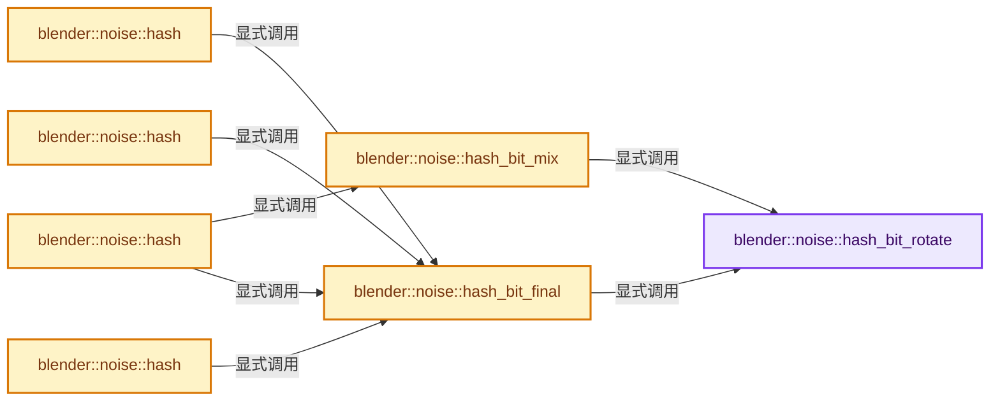
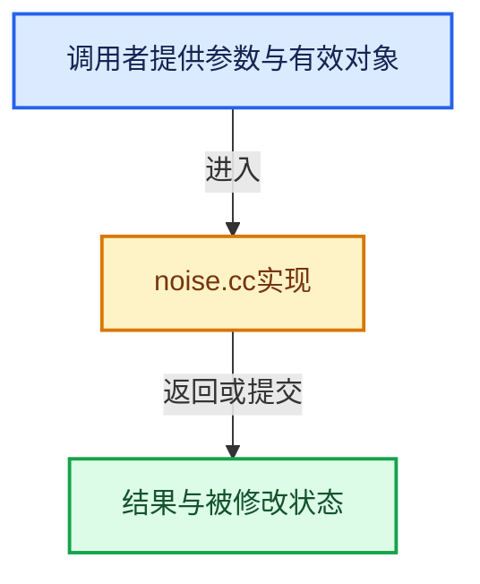

# 实现依赖专题：source/blender/blenlib/intern/noise.cc

[方向导航](README.md) · [符号索引](../%E7%AC%A6%E5%8F%B7%E4%BE%9D%E8%B5%96%E4%B8%8E%E5%AE%9E%E7%8E%B0%E7%B4%A2%E5%BC%95.md)

本专题从正文实际调用进入，集中保存共享实现。函数有稳定锚点，可从调用处直接跳到对应完整函数；递归与互相调用通过回链组织。

## 本文件的实现关系






## 完整成员与函数实现

<a id="f-d7d6fd925b9e2aa8"></a>

### `blender::noise::hash_bit_rotate`

实现位置：[source/blender/blenlib/intern/noise.cc](../../../../../source/blender/blenlib/intern/noise.cc) · L44—L47。

接口参数：

- `uint32_t x`
- `uint32_t k`

**教学注释版**

<!-- annotated:3665688f37e29b -->

```cpp
BLI_INLINE uint32_t hash_bit_rotate(uint32_t x, uint32_t k)
{
  return (x << k) | (x >> (32 - k));
}
```

<details>
<summary>核对原始源码：source/blender/blenlib/intern/noise.cc · L44—L47</summary>

<!-- original:3665688f37e29b:source/blender/blenlib/intern/noise.cc:44:47 -->

```cpp
BLI_INLINE uint32_t hash_bit_rotate(uint32_t x, uint32_t k)
{
  return (x << k) | (x >> (32 - k));
}
```

</details>

**结果出口**

- `return (x << k) | (x >> (32 - k));`

**继续追踪实现**

本实现没有需要继续展开的显式调用；检查返回表达式、对象转换和调用者前置条件。

<a id="f-5041200c66eb93c8"></a>

### `blender::noise::hash_bit_mix`

实现位置：[source/blender/blenlib/intern/noise.cc](../../../../../source/blender/blenlib/intern/noise.cc) · L49—L69。

接口参数：

- `uint32_t &a`
- `uint32_t &b`
- `uint32_t &c`

**教学注释版**

<!-- annotated:af004e57ae1205 -->

```cpp
BLI_INLINE void hash_bit_mix(uint32_t &a, uint32_t &b, uint32_t &c)
{
  a -= c;
  a ^= hash_bit_rotate(c, 4);
  c += b;
  b -= a;
  b ^= hash_bit_rotate(a, 6);
  a += c;
  c -= b;
  c ^= hash_bit_rotate(b, 8);
  b += a;
  a -= c;
  a ^= hash_bit_rotate(c, 16);
  c += b;
  b -= a;
  b ^= hash_bit_rotate(a, 19);
  a += c;
  c -= b;
  c ^= hash_bit_rotate(b, 4);
  b += a;
}
```

<details>
<summary>核对原始源码：source/blender/blenlib/intern/noise.cc · L49—L69</summary>

<!-- original:af004e57ae1205:source/blender/blenlib/intern/noise.cc:49:69 -->

```cpp
BLI_INLINE void hash_bit_mix(uint32_t &a, uint32_t &b, uint32_t &c)
{
  a -= c;
  a ^= hash_bit_rotate(c, 4);
  c += b;
  b -= a;
  b ^= hash_bit_rotate(a, 6);
  a += c;
  c -= b;
  c ^= hash_bit_rotate(b, 8);
  b += a;
  a -= c;
  a ^= hash_bit_rotate(c, 16);
  c += b;
  b -= a;
  b ^= hash_bit_rotate(a, 19);
  a += c;
  c -= b;
  c ^= hash_bit_rotate(b, 4);
  b += a;
}
```

</details>

**沿实际写入检查状态**

- `a -= c;`
- `c += b;`
- `b -= a;`
- `a += c;`
- `c -= b;`
- `b += a;`

**继续追踪实现**

- `hash_bit_rotate` → [blender::noise::hash_bit_rotate · L44](%E4%BE%9D%E8%B5%96-noise-a3f6de.md#f-d7d6fd925b9e2aa8)。

<a id="f-54284fd1094b6e2a"></a>

### `blender::noise::hash_bit_final`

实现位置：[source/blender/blenlib/intern/noise.cc](../../../../../source/blender/blenlib/intern/noise.cc) · L71—L87。

接口参数：

- `uint32_t &a`
- `uint32_t &b`
- `uint32_t &c`

**教学注释版**

<!-- annotated:03c97623486d40 -->

```cpp
BLI_INLINE void hash_bit_final(uint32_t &a, uint32_t &b, uint32_t &c)
{
  c ^= b;
  c -= hash_bit_rotate(b, 14);
  a ^= c;
  a -= hash_bit_rotate(c, 11);
  b ^= a;
  b -= hash_bit_rotate(a, 25);
  c ^= b;
  c -= hash_bit_rotate(b, 16);
  a ^= c;
  a -= hash_bit_rotate(c, 4);
  b ^= a;
  b -= hash_bit_rotate(a, 14);
  c ^= b;
  c -= hash_bit_rotate(b, 24);
}
```

<details>
<summary>核对原始源码：source/blender/blenlib/intern/noise.cc · L71—L87</summary>

<!-- original:03c97623486d40:source/blender/blenlib/intern/noise.cc:71:87 -->

```cpp
BLI_INLINE void hash_bit_final(uint32_t &a, uint32_t &b, uint32_t &c)
{
  c ^= b;
  c -= hash_bit_rotate(b, 14);
  a ^= c;
  a -= hash_bit_rotate(c, 11);
  b ^= a;
  b -= hash_bit_rotate(a, 25);
  c ^= b;
  c -= hash_bit_rotate(b, 16);
  a ^= c;
  a -= hash_bit_rotate(c, 4);
  b ^= a;
  b -= hash_bit_rotate(a, 14);
  c ^= b;
  c -= hash_bit_rotate(b, 24);
}
```

</details>

**沿实际写入检查状态**

- `c -= hash_bit_rotate(b, 14);`
- `a -= hash_bit_rotate(c, 11);`
- `b -= hash_bit_rotate(a, 25);`
- `c -= hash_bit_rotate(b, 16);`
- `a -= hash_bit_rotate(c, 4);`
- `b -= hash_bit_rotate(a, 14);`
- `c -= hash_bit_rotate(b, 24);`

**继续追踪实现**

- `hash_bit_rotate` → [blender::noise::hash_bit_rotate · L44](%E4%BE%9D%E8%B5%96-noise-a3f6de.md#f-d7d6fd925b9e2aa8)。

<a id="f-009a25f1b73b74f7"></a>

### `blender::noise::hash`

实现位置：[source/blender/blenlib/intern/noise.cc](../../../../../source/blender/blenlib/intern/noise.cc) · L89—L98。

接口参数：

- `uint32_t kx`

**教学注释版**

<!-- annotated:7161238ec13099 -->

```cpp
uint32_t hash(uint32_t kx)
{
  uint32_t a, b, c;
  a = b = c = 0xdeadbeef + (1 << 2) + 13;

  a += kx;
  hash_bit_final(a, b, c);

  return c;
}
```

<details>
<summary>核对原始源码：source/blender/blenlib/intern/noise.cc · L89—L98</summary>

<!-- original:7161238ec13099:source/blender/blenlib/intern/noise.cc:89:98 -->

```cpp
uint32_t hash(uint32_t kx)
{
  uint32_t a, b, c;
  a = b = c = 0xdeadbeef + (1 << 2) + 13;

  a += kx;
  hash_bit_final(a, b, c);

  return c;
}
```

</details>

**沿实际写入检查状态**

- `a = b = c = 0xdeadbeef + (1 << 2) + 13;`
- `a += kx;`

**结果出口**

- `return c;`

**继续追踪实现**

- `hash_bit_final` → [blender::noise::hash_bit_final · L71](%E4%BE%9D%E8%B5%96-noise-a3f6de.md#f-54284fd1094b6e2a)。

<a id="f-ebd444c127234ba0"></a>

### `blender::noise::hash`

实现位置：[source/blender/blenlib/intern/noise.cc](../../../../../source/blender/blenlib/intern/noise.cc) · L100—L110。

接口参数：

- `uint32_t kx`
- `uint32_t ky`

**教学注释版**

<!-- annotated:1ce65637e22d81 -->

```cpp
uint32_t hash(uint32_t kx, uint32_t ky)
{
  uint32_t a, b, c;
  a = b = c = 0xdeadbeef + (2 << 2) + 13;

  b += ky;
  a += kx;
  hash_bit_final(a, b, c);

  return c;
}
```

<details>
<summary>核对原始源码：source/blender/blenlib/intern/noise.cc · L100—L110</summary>

<!-- original:1ce65637e22d81:source/blender/blenlib/intern/noise.cc:100:110 -->

```cpp
uint32_t hash(uint32_t kx, uint32_t ky)
{
  uint32_t a, b, c;
  a = b = c = 0xdeadbeef + (2 << 2) + 13;

  b += ky;
  a += kx;
  hash_bit_final(a, b, c);

  return c;
}
```

</details>

**沿实际写入检查状态**

- `a = b = c = 0xdeadbeef + (2 << 2) + 13;`
- `b += ky;`
- `a += kx;`

**结果出口**

- `return c;`

**继续追踪实现**

- `hash_bit_final` → [blender::noise::hash_bit_final · L71](%E4%BE%9D%E8%B5%96-noise-a3f6de.md#f-54284fd1094b6e2a)。

<a id="f-447163c6095ffe9e"></a>

### `blender::noise::hash`

实现位置：[source/blender/blenlib/intern/noise.cc](../../../../../source/blender/blenlib/intern/noise.cc) · L112—L123。

接口参数：

- `uint32_t kx`
- `uint32_t ky`
- `uint32_t kz`

**教学注释版**

<!-- annotated:b97ef69fea92e4 -->

```cpp
uint32_t hash(uint32_t kx, uint32_t ky, uint32_t kz)
{
  uint32_t a, b, c;
  a = b = c = 0xdeadbeef + (3 << 2) + 13;

  c += kz;
  b += ky;
  a += kx;
  hash_bit_final(a, b, c);

  return c;
}
```

<details>
<summary>核对原始源码：source/blender/blenlib/intern/noise.cc · L112—L123</summary>

<!-- original:b97ef69fea92e4:source/blender/blenlib/intern/noise.cc:112:123 -->

```cpp
uint32_t hash(uint32_t kx, uint32_t ky, uint32_t kz)
{
  uint32_t a, b, c;
  a = b = c = 0xdeadbeef + (3 << 2) + 13;

  c += kz;
  b += ky;
  a += kx;
  hash_bit_final(a, b, c);

  return c;
}
```

</details>

**沿实际写入检查状态**

- `a = b = c = 0xdeadbeef + (3 << 2) + 13;`
- `c += kz;`
- `b += ky;`
- `a += kx;`

**结果出口**

- `return c;`

**继续追踪实现**

- `hash_bit_final` → [blender::noise::hash_bit_final · L71](%E4%BE%9D%E8%B5%96-noise-a3f6de.md#f-54284fd1094b6e2a)。

<a id="f-ea97e12274a1e60b"></a>

### `blender::noise::hash`

实现位置：[source/blender/blenlib/intern/noise.cc](../../../../../source/blender/blenlib/intern/noise.cc) · L125—L139。

接口参数：

- `uint32_t kx`
- `uint32_t ky`
- `uint32_t kz`
- `uint32_t kw`

**教学注释版**

<!-- annotated:f8c016a6a62e7f -->

```cpp
uint32_t hash(uint32_t kx, uint32_t ky, uint32_t kz, uint32_t kw)
{
  uint32_t a, b, c;
  a = b = c = 0xdeadbeef + (4 << 2) + 13;

  a += kx;
  b += ky;
  c += kz;
  hash_bit_mix(a, b, c);

  a += kw;
  hash_bit_final(a, b, c);

  return c;
}
```

<details>
<summary>核对原始源码：source/blender/blenlib/intern/noise.cc · L125—L139</summary>

<!-- original:f8c016a6a62e7f:source/blender/blenlib/intern/noise.cc:125:139 -->

```cpp
uint32_t hash(uint32_t kx, uint32_t ky, uint32_t kz, uint32_t kw)
{
  uint32_t a, b, c;
  a = b = c = 0xdeadbeef + (4 << 2) + 13;

  a += kx;
  b += ky;
  c += kz;
  hash_bit_mix(a, b, c);

  a += kw;
  hash_bit_final(a, b, c);

  return c;
}
```

</details>

**沿实际写入检查状态**

- `a = b = c = 0xdeadbeef + (4 << 2) + 13;`
- `a += kx;`
- `b += ky;`
- `c += kz;`
- `a += kw;`

**结果出口**

- `return c;`

**继续追踪实现**

- `hash_bit_mix` → [blender::noise::hash_bit_mix · L49](%E4%BE%9D%E8%B5%96-noise-a3f6de.md#f-5041200c66eb93c8)。
- `hash_bit_final` → [blender::noise::hash_bit_final · L71](%E4%BE%9D%E8%B5%96-noise-a3f6de.md#f-54284fd1094b6e2a)。
