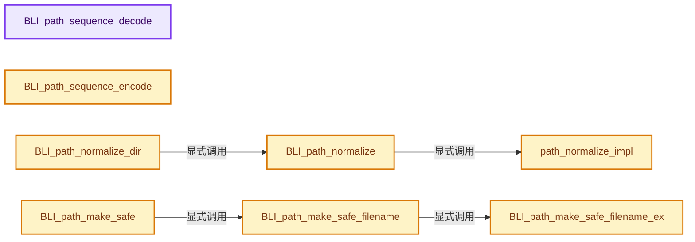
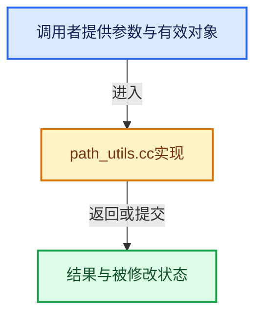

# 实现依赖专题：source/blender/blenlib/intern/path_utils.cc

[方向导航](README.md) · [符号索引](../%E7%AC%A6%E5%8F%B7%E4%BE%9D%E8%B5%96%E4%B8%8E%E5%AE%9E%E7%8E%B0%E7%B4%A2%E5%BC%95.md)

本专题从正文实际调用进入，集中保存共享实现。函数有稳定锚点，可从调用处直接跳到对应完整函数；递归与互相调用通过回链组织。

## 本文件的实现关系






## 完整成员与函数实现

<a id="f-4ad3eb43842c6c22"></a>

### `BLI_path_sequence_decode`

实现位置：[source/blender/blenlib/intern/path_utils.cc](../../../../../source/blender/blenlib/intern/path_utils.cc) · L61—L129。

接口参数：

- `const char *path`
- `char *head`
- `const size_t head_maxncpy`
- `char *tail`
- `const size_t tail_maxncpy`
- `ushort *r_digits_len`

**教学注释版**

<!-- annotated:cedfe1fe50f4c3 -->

```cpp
int BLI_path_sequence_decode(const char *path,
                             char *head,
                             const size_t head_maxncpy,
                             char *tail,
                             const size_t tail_maxncpy,
                             ushort *r_digits_len)
{
  if (head) {
    BLI_string_debug_size(head, head_maxncpy);
  }
  if (tail) {
    BLI_string_debug_size(tail, tail_maxncpy);
  }

  uint nums = 0, nume = 0;
  int i;
  bool found_digit = false;
  const char *const lslash = BLI_path_slash_rfind(path);
  const char *const extension = BLI_path_extension_or_end(lslash ? lslash : path);
  const uint lslash_len = lslash != nullptr ? int(lslash - path) : 0;
  const uint name_end = uint(extension - path);

  for (i = name_end - 1; i >= int(lslash_len); i--) {
    if (isdigit(path[i])) {
      if (found_digit) {
        nums = i;
      }
      else {
        nume = i;
        nums = i;
        found_digit = true;
      }
    }
    else {
      if (found_digit) {
        break;
      }
    }
  }

  if (found_digit) {
    const long long int ret = strtoll(&(path[nums]), nullptr, 10);
    if (ret >= INT_MIN && ret <= INT_MAX) {
      if (tail) {
        BLI_strncpy(tail, &path[nume + 1], tail_maxncpy);
      }
      if (head) {
        // [讲解] std::min<size_t>：按比较关系选取较小值；截断范围时还需先满足非负和可表示范围，min本身不会证明边界安全。
        BLI_strncpy(head, path, std::min<size_t>(head_maxncpy, nums + 1));
      }
      if (r_digits_len) {
        *r_digits_len = nume - nums + 1;
      }
      return int(ret);
    }
  }

  if (tail) {
    BLI_strncpy(tail, path + name_end, tail_maxncpy);
  }
  if (head) {
    /* Name_end points to last character of head,
     * make it +1 so null-terminator is nicely placed. */
    BLI_strncpy(head, path, std::min<size_t>(head_maxncpy, name_end + 1));
  }
  if (r_digits_len) {
    *r_digits_len = 0;
  }
  return 0;
}
```

<details>
<summary>核对原始源码：source/blender/blenlib/intern/path_utils.cc · L61—L129</summary>

<!-- original:cedfe1fe50f4c3:source/blender/blenlib/intern/path_utils.cc:61:129 -->

```cpp
int BLI_path_sequence_decode(const char *path,
                             char *head,
                             const size_t head_maxncpy,
                             char *tail,
                             const size_t tail_maxncpy,
                             ushort *r_digits_len)
{
  if (head) {
    BLI_string_debug_size(head, head_maxncpy);
  }
  if (tail) {
    BLI_string_debug_size(tail, tail_maxncpy);
  }

  uint nums = 0, nume = 0;
  int i;
  bool found_digit = false;
  const char *const lslash = BLI_path_slash_rfind(path);
  const char *const extension = BLI_path_extension_or_end(lslash ? lslash : path);
  const uint lslash_len = lslash != nullptr ? int(lslash - path) : 0;
  const uint name_end = uint(extension - path);

  for (i = name_end - 1; i >= int(lslash_len); i--) {
    if (isdigit(path[i])) {
      if (found_digit) {
        nums = i;
      }
      else {
        nume = i;
        nums = i;
        found_digit = true;
      }
    }
    else {
      if (found_digit) {
        break;
      }
    }
  }

  if (found_digit) {
    const long long int ret = strtoll(&(path[nums]), nullptr, 10);
    if (ret >= INT_MIN && ret <= INT_MAX) {
      if (tail) {
        BLI_strncpy(tail, &path[nume + 1], tail_maxncpy);
      }
      if (head) {
        BLI_strncpy(head, path, std::min<size_t>(head_maxncpy, nums + 1));
      }
      if (r_digits_len) {
        *r_digits_len = nume - nums + 1;
      }
      return int(ret);
    }
  }

  if (tail) {
    BLI_strncpy(tail, path + name_end, tail_maxncpy);
  }
  if (head) {
    /* Name_end points to last character of head,
     * make it +1 so null-terminator is nicely placed. */
    BLI_strncpy(head, path, std::min<size_t>(head_maxncpy, name_end + 1));
  }
  if (r_digits_len) {
    *r_digits_len = 0;
  }
  return 0;
}
```

</details>

**沿实际写入检查状态**

- `nums = i;`
- `nume = i;`
- `found_digit = true;`

**结果出口**

- `return int(ret);`
- `return 0;`

**继续追踪实现**

- `BLI_string_debug_size` → [BLI_string_debug_size · L666](%E4%BE%9D%E8%B5%96-BLI_string-b43058.md#m-b560dcb5e1df)；[BLI_string_debug_size · L673](%E4%BE%9D%E8%B5%96-BLI_string-b43058.md#m-6b2ed5aaa6e2)。宏定义由构建条件选择。
- `BLI_path_slash_rfind` → [BLI_path_slash_rfind · L1991](%E4%BE%9D%E8%B5%96-path_utils-b4d26a.md#f-31df87a0b5777d08)。
- `BLI_path_extension_or_end` → [BLI_path_extension_or_end · L1681](%E4%BE%9D%E8%B5%96-path_utils-b4d26a.md#f-c766884945075983)。
- `isdigit` → [调用协议](../%E6%A8%A1%E6%9D%BF%E5%AE%8F%E4%B8%8E%E5%8A%A8%E6%80%81%E5%88%86%E6%B4%BE%E5%8D%8F%E8%AE%AE.md)：函数指针、局部可调用对象或未展开的宏；必须结合调用者环境。调用位置L84。
- `strtoll` → [调用协议](../%E6%A8%A1%E6%9D%BF%E5%AE%8F%E4%B8%8E%E5%8A%A8%E6%80%81%E5%88%86%E6%B4%BE%E5%8D%8F%E8%AE%AE.md)：函数指针、局部可调用对象或未展开的宏；必须结合调用者环境。调用位置L102。
- `BLI_strncpy` → [blender::BLI_strncpy · L70](%E4%BE%9D%E8%B5%96-string-1d986f.md#f-6324147b0d116da1)。
- `std::min<size_t>` → [外部契约](https://eel.is/c++draft/alg.min.max)：按比较关系选取较小值；截断范围时还需先满足非负和可表示范围，min本身不会证明边界安全。

<a id="f-0ce71e15b7dc0658"></a>

### `BLI_path_sequence_encode`

实现位置：[source/blender/blenlib/intern/path_utils.cc](../../../../../source/blender/blenlib/intern/path_utils.cc) · L131—L147。

接口参数：

- `char *path`
- `const size_t path_maxncpy`
- `const char *head`
- `const char *tail`
- `ushort numlen`
- `int pic`

**教学注释版**

<!-- annotated:495845df1c0e42 -->

```cpp
void BLI_path_sequence_encode(char *path,
                              const size_t path_maxncpy,
                              const char *head,
                              const char *tail,
                              ushort numlen,
                              int pic)
{
  BLI_string_debug_size(path, path_maxncpy);

  /* FIXME: MAX_ID_NAME & FILE_MAXFILE
   *
   * As this function directly works on a full file path (typically a FILE_MAX long char buffer),
   * and does not perform any check on the filename part of the path, it can easily generate final
   * paths containing a filename longer than the max supported length (FILE_MAXFILE).
   */
  // [讲解] std::max：按比较关系选取较大值。本讲解中的增长公式同时满足最低请求和几何增长；若保存返回引用，还需注意实参寿命。
  BLI_snprintf(path, path_maxncpy, "%s%.*d%s", head, numlen, std::max(0, pic), tail);
}
```

<details>
<summary>核对原始源码：source/blender/blenlib/intern/path_utils.cc · L131—L147</summary>

<!-- original:495845df1c0e42:source/blender/blenlib/intern/path_utils.cc:131:147 -->

```cpp
void BLI_path_sequence_encode(char *path,
                              const size_t path_maxncpy,
                              const char *head,
                              const char *tail,
                              ushort numlen,
                              int pic)
{
  BLI_string_debug_size(path, path_maxncpy);

  /* FIXME: MAX_ID_NAME & FILE_MAXFILE
   *
   * As this function directly works on a full file path (typically a FILE_MAX long char buffer),
   * and does not perform any check on the filename part of the path, it can easily generate final
   * paths containing a filename longer than the max supported length (FILE_MAXFILE).
   */
  BLI_snprintf(path, path_maxncpy, "%s%.*d%s", head, numlen, std::max(0, pic), tail);
}
```

</details>

**继续追踪实现**

- `BLI_string_debug_size` → [BLI_string_debug_size · L666](%E4%BE%9D%E8%B5%96-BLI_string-b43058.md#m-b560dcb5e1df)；[BLI_string_debug_size · L673](%E4%BE%9D%E8%B5%96-BLI_string-b43058.md#m-6b2ed5aaa6e2)。宏定义由构建条件选择。
- `BLI_snprintf` → [blender::BLI_snprintf · L201](%E4%BE%9D%E8%B5%96-string-1d986f.md#f-c4de2f0e81459332)。
- `std::max` → [外部契约](https://eel.is/c++draft/alg.min.max)：按比较关系选取较大值。本讲解中的增长公式同时满足最低请求和几何增长；若保存返回引用，还需注意实参寿命。

<a id="f-863d9cd0a7e1fa15"></a>

### `path_normalize_impl`

实现位置：[source/blender/blenlib/intern/path_utils.cc](../../../../../source/blender/blenlib/intern/path_utils.cc) · L153—L375。

接口参数：

- `char *path`
- `bool check_blend_relative_prefix`

**教学注释版**

<!-- annotated:6da62c17691abe -->

```cpp
static int path_normalize_impl(char *path, bool check_blend_relative_prefix)
{
  const char *path_orig = path;
  int path_len = strlen(path);

  /*
   * Skip absolute prefix.
   * ---------------------
   */
  if (check_blend_relative_prefix && (path[0] == '/' && path[1] == '/')) {
    path = path + 2; /* Leave the initial `//` untouched. */
    path_len -= 2;

    /* Strip leading slashes, as they will interfere with the absolute/relative check
     * (besides being redundant). */
    int i = 0;
    while (path[i] == SEP) {
      i++;
    }

    if (i != 0) {
      // [讲解] memmove：复制可能重叠的字节区间；允许字节重叠不代表自动满足任意C++对象的移动构造契约。
      memmove(path, path + i, (path_len - i) + 1);
      path_len -= i;
    }
    BLI_assert(path_len == strlen(path));
  }

#ifdef WIN32
  /* Skip to the first slash of the drive or UNC path,
   * so additional slashes are treated as doubles. */
  if (path_orig == path) {
    int path_unc_len = BLI_path_unc_prefix_len(path);
    if (path_unc_len) {
      path_unc_len -= 1;
      BLI_assert(path_unc_len > 0 && path[path_unc_len] == SEP);
      path += path_unc_len;
      path_len -= path_unc_len;
    }
    else if (BLI_path_is_win32_drive(path)) { /* Check for `C:` (2 characters only). */
      path += 2;
      path_len -= 2;
    }
  }
#endif /* WIN32 */
  /* Works on WIN32 as well, because the drive component is skipped. */
  const bool is_relative = path[0] && (path[0] != SEP);

  /*
   * Strip redundant path components.
   * --------------------------------
   */

  /* NOTE(@ideasman42):
   *   `memmove(start, eind, strlen(eind) + 1);`
   * is the same as
   *   `BLI_strncpy(start, eind, ...);`
   * except string-copy should not be used because there is overlap,
   * so use `memmove` 's slightly more obscure syntax. */

  /* Inline replacement:
   * - `/./` -> `/`.
   * - `//` -> `/`.
   * Performed until no more replacements can be made. */
  if (path_len > 1) {
    for (int i = path_len - 1; i > 0; i--) {
      /* Calculate the redundant slash span (if any). */
      if (path[i] == SEP) {
        const int i_end = i;
        do {
          /* Stepping over elements assumes 'i' references a separator. */
          BLI_assert(path[i] == SEP);
          if (path[i - 1] == SEP) {
            i -= 1; /* Found `//`, replace with `/`. */
          }
          else if (i >= 2 && path[i - 1] == '.' && path[i - 2] == SEP) {
            i -= 2; /* Found `/./`, replace with `/`. */
          }
          else {
            break;
          }
        } while (i > 0);

        if (i < i_end) {
          memmove(path + i, path + i_end, (path_len - i_end) + 1);
          path_len -= i_end - i;
          BLI_assert(strlen(path) == path_len);
        }
      }
    }
  }
  /* Remove redundant `./` prefix as it's redundant & complicates collapsing directories. */
  if (is_relative) {
    if ((path_len > 2) && (path[0] == '.') && (path[1] == SEP)) {
      memmove(path, path + 2, (path_len - 2) + 1);
      path_len -= 2;
    }
  }

  /*
   * Collapse Parent Directories.
   * ----------------------------
   *
   * Example: `<parent>/<child>/../` -> `<parent>/`
   *
   * Notes:
   * - Leading `../` are skipped as they cannot be collapsed (see `start_base`).
   * - Multiple parent directories are handled at once to reduce number of `memmove` calls.
   */

#define IS_PARENT_DIR(p) ((p)[0] == '.' && (p)[1] == '.' && ELEM((p)[2], SEP, '\0'))

  /* First non prefix path component. */
  char *path_first_non_slash_part = path;
  while (*path_first_non_slash_part && *path_first_non_slash_part == SEP) {
    path_first_non_slash_part++;
  }

  /* Maintain a pointer to the end of leading `..` component.
   * Skip leading parent directories because logically they cannot be collapsed. */
  char *start_base = path_first_non_slash_part;
  while (IS_PARENT_DIR(start_base)) {
    start_base += 3;
  }

  /* It's possible the entire path is made of up `../`,
   * in this case there is nothing to do. */
  if (start_base < path + path_len) {
    /* Step over directories, always starting out on the character after the slash. */
    char *start = start_base;
    char *start_temp;
    while ((start_temp = strstr(start, SEP_STR ".." SEP_STR)) ||
           /* Check if the string ends with `/..` & assign when found, else nullptr. */
           (start_temp = ((start <= &path[path_len - 3]) &&
                          STREQ(&path[path_len - 3], SEP_STR "..")) ?
                             &path[path_len - 3] :
                             nullptr))
    {
      start = start_temp + 1; /* Skip the `/`. */
      BLI_assert(start_base != start);

      /* Step `end_all` forwards (over all `..`). */
      char *end_all = start;
      do {
        BLI_assert(IS_PARENT_DIR(end_all));
        end_all += 3;
        BLI_assert(end_all <= path + path_len + 1);
      } while (IS_PARENT_DIR(end_all));

      /* Step `start` backwards (until `end` meets `end_all` or `start` meets `start_base`). */
      char *end = start;
      do {
        BLI_assert(start_base < start);
        BLI_assert(*(start - 1) == SEP);
        /* Step `start` backwards one. */
        do {
          start--;
        } while (start_base < start && *(start - 1) != SEP);
        BLI_assert(*start != SEP);         /* Ensure the loop ran at least once. */
        BLI_assert(!IS_PARENT_DIR(start)); /* Clamping by `start_base` prevents this. */
        end += 3;
      } while ((start != start_base) && (end < end_all));

      if (end > path + path_len) {
        BLI_assert(*(end - 1) == '\0');
        end--;
        end_all--;
      }
      BLI_assert(start < end && start >= start_base);
      const size_t start_len = path_len - (end - path);
      memmove(start, end, start_len + 1);
      path_len -= end - start;
      BLI_assert(strlen(path) == path_len);
      /* Other `..` directories may have been moved to the front, step `start_base` past them. */
      if (start == start_base && (end != end_all)) [[unlikely]] {
        start_base += (end_all - end);
        start = (start_base < path + path_len) ? start_base : start_base - 1;
      }
    }
  }

  BLI_assert(strlen(path) == path_len);
  /* Characters before the `start_base` must *only* be `../../../` (multiples of 3). */
  BLI_assert((start_base - path_first_non_slash_part) % 3 == 0);
  /* All `..` ahead of `start_base` were collapsed (including trailing `/..`). */
  BLI_assert(!(start_base < path + path_len) ||
             (!strstr(start_base, SEP_STR ".." SEP_STR) &&
              !(path_len >= 3 && STREQ(&path[path_len - 3], SEP_STR ".."))));

  /*
   * Final Prefix Cleanup.
   * ---------------------
   */
  if (is_relative) {
    if (path_len == 0 && (path == path_orig)) {
      path[0] = '.';
      path[1] = '\0';
      path_len = 1;
    }
  }
  else {
    /* Support for odd paths: eg `/../home/me` --> `/home/me`
     * this is a valid path in blender but we can't handle this the usual way below
     * simply strip this prefix then evaluate the path as usual.
     * Python's `os.path.normpath()` does this. */
    if (start_base != path_first_non_slash_part) {
      char *start = start_base > path + path_len ? start_base - 1 : start_base;
      /* As long as `start` is set correctly, it should never begin with `../`
       * as these directories are expected to be skipped. */
      BLI_assert(!IS_PARENT_DIR(start));
      const size_t start_len = path_len - (start - path);
      BLI_assert(strlen(start) == start_len);
      memmove(path_first_non_slash_part, start, start_len + 1);
      path_len -= start - path_first_non_slash_part;
      BLI_assert(strlen(path) == path_len);
    }
  }

  BLI_assert(strlen(path) == path_len);

#undef IS_PARENT_DIR

  return (path - path_orig) + path_len;
}
```

<details>
<summary>核对原始源码：source/blender/blenlib/intern/path_utils.cc · L153—L375</summary>

<!-- original:6da62c17691abe:source/blender/blenlib/intern/path_utils.cc:153:375 -->

```cpp
static int path_normalize_impl(char *path, bool check_blend_relative_prefix)
{
  const char *path_orig = path;
  int path_len = strlen(path);

  /*
   * Skip absolute prefix.
   * ---------------------
   */
  if (check_blend_relative_prefix && (path[0] == '/' && path[1] == '/')) {
    path = path + 2; /* Leave the initial `//` untouched. */
    path_len -= 2;

    /* Strip leading slashes, as they will interfere with the absolute/relative check
     * (besides being redundant). */
    int i = 0;
    while (path[i] == SEP) {
      i++;
    }

    if (i != 0) {
      memmove(path, path + i, (path_len - i) + 1);
      path_len -= i;
    }
    BLI_assert(path_len == strlen(path));
  }

#ifdef WIN32
  /* Skip to the first slash of the drive or UNC path,
   * so additional slashes are treated as doubles. */
  if (path_orig == path) {
    int path_unc_len = BLI_path_unc_prefix_len(path);
    if (path_unc_len) {
      path_unc_len -= 1;
      BLI_assert(path_unc_len > 0 && path[path_unc_len] == SEP);
      path += path_unc_len;
      path_len -= path_unc_len;
    }
    else if (BLI_path_is_win32_drive(path)) { /* Check for `C:` (2 characters only). */
      path += 2;
      path_len -= 2;
    }
  }
#endif /* WIN32 */
  /* Works on WIN32 as well, because the drive component is skipped. */
  const bool is_relative = path[0] && (path[0] != SEP);

  /*
   * Strip redundant path components.
   * --------------------------------
   */

  /* NOTE(@ideasman42):
   *   `memmove(start, eind, strlen(eind) + 1);`
   * is the same as
   *   `BLI_strncpy(start, eind, ...);`
   * except string-copy should not be used because there is overlap,
   * so use `memmove` 's slightly more obscure syntax. */

  /* Inline replacement:
   * - `/./` -> `/`.
   * - `//` -> `/`.
   * Performed until no more replacements can be made. */
  if (path_len > 1) {
    for (int i = path_len - 1; i > 0; i--) {
      /* Calculate the redundant slash span (if any). */
      if (path[i] == SEP) {
        const int i_end = i;
        do {
          /* Stepping over elements assumes 'i' references a separator. */
          BLI_assert(path[i] == SEP);
          if (path[i - 1] == SEP) {
            i -= 1; /* Found `//`, replace with `/`. */
          }
          else if (i >= 2 && path[i - 1] == '.' && path[i - 2] == SEP) {
            i -= 2; /* Found `/./`, replace with `/`. */
          }
          else {
            break;
          }
        } while (i > 0);

        if (i < i_end) {
          memmove(path + i, path + i_end, (path_len - i_end) + 1);
          path_len -= i_end - i;
          BLI_assert(strlen(path) == path_len);
        }
      }
    }
  }
  /* Remove redundant `./` prefix as it's redundant & complicates collapsing directories. */
  if (is_relative) {
    if ((path_len > 2) && (path[0] == '.') && (path[1] == SEP)) {
      memmove(path, path + 2, (path_len - 2) + 1);
      path_len -= 2;
    }
  }

  /*
   * Collapse Parent Directories.
   * ----------------------------
   *
   * Example: `<parent>/<child>/../` -> `<parent>/`
   *
   * Notes:
   * - Leading `../` are skipped as they cannot be collapsed (see `start_base`).
   * - Multiple parent directories are handled at once to reduce number of `memmove` calls.
   */

#define IS_PARENT_DIR(p) ((p)[0] == '.' && (p)[1] == '.' && ELEM((p)[2], SEP, '\0'))

  /* First non prefix path component. */
  char *path_first_non_slash_part = path;
  while (*path_first_non_slash_part && *path_first_non_slash_part == SEP) {
    path_first_non_slash_part++;
  }

  /* Maintain a pointer to the end of leading `..` component.
   * Skip leading parent directories because logically they cannot be collapsed. */
  char *start_base = path_first_non_slash_part;
  while (IS_PARENT_DIR(start_base)) {
    start_base += 3;
  }

  /* It's possible the entire path is made of up `../`,
   * in this case there is nothing to do. */
  if (start_base < path + path_len) {
    /* Step over directories, always starting out on the character after the slash. */
    char *start = start_base;
    char *start_temp;
    while ((start_temp = strstr(start, SEP_STR ".." SEP_STR)) ||
           /* Check if the string ends with `/..` & assign when found, else nullptr. */
           (start_temp = ((start <= &path[path_len - 3]) &&
                          STREQ(&path[path_len - 3], SEP_STR "..")) ?
                             &path[path_len - 3] :
                             nullptr))
    {
      start = start_temp + 1; /* Skip the `/`. */
      BLI_assert(start_base != start);

      /* Step `end_all` forwards (over all `..`). */
      char *end_all = start;
      do {
        BLI_assert(IS_PARENT_DIR(end_all));
        end_all += 3;
        BLI_assert(end_all <= path + path_len + 1);
      } while (IS_PARENT_DIR(end_all));

      /* Step `start` backwards (until `end` meets `end_all` or `start` meets `start_base`). */
      char *end = start;
      do {
        BLI_assert(start_base < start);
        BLI_assert(*(start - 1) == SEP);
        /* Step `start` backwards one. */
        do {
          start--;
        } while (start_base < start && *(start - 1) != SEP);
        BLI_assert(*start != SEP);         /* Ensure the loop ran at least once. */
        BLI_assert(!IS_PARENT_DIR(start)); /* Clamping by `start_base` prevents this. */
        end += 3;
      } while ((start != start_base) && (end < end_all));

      if (end > path + path_len) {
        BLI_assert(*(end - 1) == '\0');
        end--;
        end_all--;
      }
      BLI_assert(start < end && start >= start_base);
      const size_t start_len = path_len - (end - path);
      memmove(start, end, start_len + 1);
      path_len -= end - start;
      BLI_assert(strlen(path) == path_len);
      /* Other `..` directories may have been moved to the front, step `start_base` past them. */
      if (start == start_base && (end != end_all)) [[unlikely]] {
        start_base += (end_all - end);
        start = (start_base < path + path_len) ? start_base : start_base - 1;
      }
    }
  }

  BLI_assert(strlen(path) == path_len);
  /* Characters before the `start_base` must *only* be `../../../` (multiples of 3). */
  BLI_assert((start_base - path_first_non_slash_part) % 3 == 0);
  /* All `..` ahead of `start_base` were collapsed (including trailing `/..`). */
  BLI_assert(!(start_base < path + path_len) ||
             (!strstr(start_base, SEP_STR ".." SEP_STR) &&
              !(path_len >= 3 && STREQ(&path[path_len - 3], SEP_STR ".."))));

  /*
   * Final Prefix Cleanup.
   * ---------------------
   */
  if (is_relative) {
    if (path_len == 0 && (path == path_orig)) {
      path[0] = '.';
      path[1] = '\0';
      path_len = 1;
    }
  }
  else {
    /* Support for odd paths: eg `/../home/me` --> `/home/me`
     * this is a valid path in blender but we can't handle this the usual way below
     * simply strip this prefix then evaluate the path as usual.
     * Python's `os.path.normpath()` does this. */
    if (start_base != path_first_non_slash_part) {
      char *start = start_base > path + path_len ? start_base - 1 : start_base;
      /* As long as `start` is set correctly, it should never begin with `../`
       * as these directories are expected to be skipped. */
      BLI_assert(!IS_PARENT_DIR(start));
      const size_t start_len = path_len - (start - path);
      BLI_assert(strlen(start) == start_len);
      memmove(path_first_non_slash_part, start, start_len + 1);
      path_len -= start - path_first_non_slash_part;
      BLI_assert(strlen(path) == path_len);
    }
  }

  BLI_assert(strlen(path) == path_len);

#undef IS_PARENT_DIR

  return (path - path_orig) + path_len;
}
```

</details>

**沿实际写入检查状态**

- `path = path + 2; /* Leave the initial ˋ//ˋ untouched. */`
- `path_len -= 2;`
- `path_len -= i;`
- `path_unc_len -= 1;`
- `path += path_unc_len;`
- `path_len -= path_unc_len;`
- `path += 2;`
- `i -= 1; /* Found ˋ//ˋ, replace with ˋ/ˋ. */`
- `i -= 2; /* Found ˋ/./ˋ, replace with ˋ/ˋ. */`
- `path_len -= i_end - i;`
- `start_base += 3;`
- `start = start_temp + 1; /* Skip the ˋ/ˋ. */`
- `end_all += 3;`
- `end += 3;`
- `path_len -= end - start;`
- `start_base += (end_all - end);`
- `start = (start_base < path + path_len) ? start_base : start_base - 1;`
- `path[0] = '.';`
- `path[1] = '\0';`
- `path_len = 1;`
- `path_len -= start - path_first_non_slash_part;`

**结果出口**

- `return (path - path_orig) + path_len;`

**继续追踪实现**

- `strlen` → [外部契约](https://eel.is/c++draft/)：这个边界按实际表达式及所属类型核对参数、返回值、寿命与失败行为。这里提供接口入口，不声称已解释该第三方版本的内部实现。
- `memmove` → [外部契约](https://eel.is/c++draft/cstring.syn)：复制可能重叠的字节区间；允许字节重叠不代表自动满足任意C++对象的移动构造契约。
- `BLI_assert` → [BLI_assert · L48](%E4%BE%9D%E8%B5%96-BLI_assert-cc98e8.md#m-57a88495704d)；[BLI_assert · L63](%E4%BE%9D%E8%B5%96-BLI_assert-cc98e8.md#m-d07050020cb5)。宏定义由构建条件选择。
- `BLI_path_unc_prefix_len` → [BLI_path_unc_prefix_len · L552](%E4%BE%9D%E8%B5%96-path_utils-b4d26a.md#f-715be314b62551c8)。
- `BLI_path_is_win32_drive` → [BLI_path_is_win32_drive · L576](%E4%BE%9D%E8%B5%96-path_utils-b4d26a.md#f-48d89d39b0d5c4e2)。
- `IS_PARENT_DIR` → [调用协议](../%E6%A8%A1%E6%9D%BF%E5%AE%8F%E4%B8%8E%E5%8A%A8%E6%80%81%E5%88%86%E6%B4%BE%E5%8D%8F%E8%AE%AE.md)：函数指针、局部可调用对象或未展开的宏；必须结合调用者环境。调用位置L273。
- `strstr` → [调用协议](../%E6%A8%A1%E6%9D%BF%E5%AE%8F%E4%B8%8E%E5%8A%A8%E6%80%81%E5%88%86%E6%B4%BE%E5%8D%8F%E8%AE%AE.md)：函数指针、局部可调用对象或未展开的宏；必须结合调用者环境。调用位置L283。
- `STREQ` → [STREQ · L112](../05-%E5%87%A0%E4%BD%95%E5%AD%98%E5%82%A8%E4%B8%8E%E6%8B%93%E6%89%91%E6%98%A0%E5%B0%84/%E4%BE%9D%E8%B5%96-GHOST_utildefines-34b996.md#m-9549fb6aafd2)；[STREQ · L451](%E4%BE%9D%E8%B5%96-BLI_utildefines-293a0a.md#m-c7b745bcfad2)；[STREQ · L55](../05-%E5%87%A0%E4%BD%95%E5%AD%98%E5%82%A8%E4%B8%8E%E6%8B%93%E6%89%91%E6%98%A0%E5%B0%84/%E4%BE%9D%E8%B5%96-clog-a0bec8.md#m-96e78f386894)。宏定义由构建条件选择。

<a id="f-f17914e0f9704330"></a>

### `BLI_path_normalize`

实现位置：[source/blender/blenlib/intern/path_utils.cc](../../../../../source/blender/blenlib/intern/path_utils.cc) · L377—L380。

接口参数：

- `char *path`

**教学注释版**

<!-- annotated:2779deb2208cfd -->

```cpp
int BLI_path_normalize(char *path)
{
  return path_normalize_impl(path, true);
}
```

<details>
<summary>核对原始源码：source/blender/blenlib/intern/path_utils.cc · L377—L380</summary>

<!-- original:2779deb2208cfd:source/blender/blenlib/intern/path_utils.cc:377:380 -->

```cpp
int BLI_path_normalize(char *path)
{
  return path_normalize_impl(path, true);
}
```

</details>

**结果出口**

- `return path_normalize_impl(path, true);`

**继续追踪实现**

- `path_normalize_impl` → [path_normalize_impl · L153](%E4%BE%9D%E8%B5%96-path_utils-b4d26a.md#f-863d9cd0a7e1fa15)。

<a id="f-26b3b7f735aa6270"></a>

### `BLI_path_normalize_dir`

实现位置：[source/blender/blenlib/intern/path_utils.cc](../../../../../source/blender/blenlib/intern/path_utils.cc) · L387—L396。

接口参数：

- `char *dir`
- `size_t dir_maxncpy`

**教学注释版**

<!-- annotated:98452a435dcaf4 -->

```cpp
int BLI_path_normalize_dir(char *dir, size_t dir_maxncpy)
{
  /* Would just create an unexpected "/" path, just early exit entirely. */
  if (dir[0] == '\0') {
    return 0;
  }

  int dir_len = BLI_path_normalize(dir);
  return BLI_path_slash_ensure_ex(dir, dir_maxncpy, dir_len);
}
```

<details>
<summary>核对原始源码：source/blender/blenlib/intern/path_utils.cc · L387—L396</summary>

<!-- original:98452a435dcaf4:source/blender/blenlib/intern/path_utils.cc:387:396 -->

```cpp
int BLI_path_normalize_dir(char *dir, size_t dir_maxncpy)
{
  /* Would just create an unexpected "/" path, just early exit entirely. */
  if (dir[0] == '\0') {
    return 0;
  }

  int dir_len = BLI_path_normalize(dir);
  return BLI_path_slash_ensure_ex(dir, dir_maxncpy, dir_len);
}
```

</details>

**结果出口**

- `return 0;`
- `return BLI_path_slash_ensure_ex(dir, dir_maxncpy, dir_len);`

**继续追踪实现**

- `BLI_path_normalize` → [BLI_path_normalize · L377](%E4%BE%9D%E8%B5%96-path_utils-b4d26a.md#f-f17914e0f9704330)。
- `BLI_path_slash_ensure_ex` → [BLI_path_slash_ensure_ex · L2006](%E4%BE%9D%E8%B5%96-path_utils-b4d26a.md#f-caac16e85411d927)。

<a id="f-dd17c1ce4014b07e"></a>

### `BLI_path_make_safe_filename_ex`

实现位置：[source/blender/blenlib/intern/path_utils.cc](../../../../../source/blender/blenlib/intern/path_utils.cc) · L421—L495。

接口参数：

- `char *filename`
- `bool allow_tokens`

**教学注释版**

<!-- annotated:b6c9bbc7f086bd -->

```cpp
bool BLI_path_make_safe_filename_ex(char *filename, bool allow_tokens)
{
#define INVALID_CHARS \
  "\x01\x02\x03\x04\x05\x06\x07\x08\x09\x0a\x0b\x0c\x0d\x0e\x0f" \
  "\x10\x11\x12\x13\x14\x15\x16\x17\x18\x19\x1a\x1b\x1c\x1d\x1e\x1f" \
  "/\\?*:|\""
#define INVALID_TOKENS "<>"

  const char *invalid = allow_tokens ? INVALID_CHARS : INVALID_CHARS INVALID_TOKENS;

#undef INVALID_CHARS
#undef INVALID_TOKENS

  char *fn;
  bool changed = false;

  if (*filename == '\0') {
    return changed;
  }

  for (fn = filename; *fn && (fn = strpbrk(fn, invalid)); fn++) {
    *fn = '_';
    changed = true;
  }

  /* Forbid only dots. */
  for (fn = filename; *fn == '.'; fn++) {
    /* Pass. */
  }
  if (*fn == '\0') {
    *filename = '_';
    changed = true;
  }

#ifdef WIN32
  {
    const char *invalid_names[] = {
        "con",  "prn",  "aux",  "null", "com1", "com2", "com3",  "com4",
        "com5", "com6", "com7", "com8", "com9", "lpt1", "lpt2",  "lpt3",
        "lpt4", "lpt5", "lpt6", "lpt7", "lpt8", "lpt9", nullptr,
    };
    const size_t len = strlen(filename);
    char *filename_lower = BLI_strdupn(filename, len);
    const char **iname;

    /* Forbid trailing dot (trailing space has already been replaced above). */
    if (filename[len - 1] == '.') {
      filename[len - 1] = '_';
      changed = true;
    }

    /* Check for forbidden names - not we have to check all combination
     * of upper and lower cases, hence the usage of filename_lower
     * (more efficient than using #BLI_strcasestr repeatedly). */
    BLI_str_tolower_ascii(filename_lower, len);
    for (iname = invalid_names; *iname; iname++) {
      if (strstr(filename_lower, *iname) == filename_lower) {
        const size_t iname_len = strlen(*iname);
        /* Only invalid if the whole name is made of the invalid chunk, or it has an
         * (assumed extension) dot just after. This means it will also catch *valid*
         * names like `aux.foo.bar`, but should be good enough for us! */
        if ((iname_len == len) || (filename_lower[iname_len] == '.')) {
          *filename = '_';
          changed = true;
          break;
        }
      }
    }

    MEM_delete(filename_lower);
  }
#endif

  return changed;
}
```

<details>
<summary>核对原始源码：source/blender/blenlib/intern/path_utils.cc · L421—L495</summary>

<!-- original:b6c9bbc7f086bd:source/blender/blenlib/intern/path_utils.cc:421:495 -->

```cpp
bool BLI_path_make_safe_filename_ex(char *filename, bool allow_tokens)
{
#define INVALID_CHARS \
  "\x01\x02\x03\x04\x05\x06\x07\x08\x09\x0a\x0b\x0c\x0d\x0e\x0f" \
  "\x10\x11\x12\x13\x14\x15\x16\x17\x18\x19\x1a\x1b\x1c\x1d\x1e\x1f" \
  "/\\?*:|\""
#define INVALID_TOKENS "<>"

  const char *invalid = allow_tokens ? INVALID_CHARS : INVALID_CHARS INVALID_TOKENS;

#undef INVALID_CHARS
#undef INVALID_TOKENS

  char *fn;
  bool changed = false;

  if (*filename == '\0') {
    return changed;
  }

  for (fn = filename; *fn && (fn = strpbrk(fn, invalid)); fn++) {
    *fn = '_';
    changed = true;
  }

  /* Forbid only dots. */
  for (fn = filename; *fn == '.'; fn++) {
    /* Pass. */
  }
  if (*fn == '\0') {
    *filename = '_';
    changed = true;
  }

#ifdef WIN32
  {
    const char *invalid_names[] = {
        "con",  "prn",  "aux",  "null", "com1", "com2", "com3",  "com4",
        "com5", "com6", "com7", "com8", "com9", "lpt1", "lpt2",  "lpt3",
        "lpt4", "lpt5", "lpt6", "lpt7", "lpt8", "lpt9", nullptr,
    };
    const size_t len = strlen(filename);
    char *filename_lower = BLI_strdupn(filename, len);
    const char **iname;

    /* Forbid trailing dot (trailing space has already been replaced above). */
    if (filename[len - 1] == '.') {
      filename[len - 1] = '_';
      changed = true;
    }

    /* Check for forbidden names - not we have to check all combination
     * of upper and lower cases, hence the usage of filename_lower
     * (more efficient than using #BLI_strcasestr repeatedly). */
    BLI_str_tolower_ascii(filename_lower, len);
    for (iname = invalid_names; *iname; iname++) {
      if (strstr(filename_lower, *iname) == filename_lower) {
        const size_t iname_len = strlen(*iname);
        /* Only invalid if the whole name is made of the invalid chunk, or it has an
         * (assumed extension) dot just after. This means it will also catch *valid*
         * names like `aux.foo.bar`, but should be good enough for us! */
        if ((iname_len == len) || (filename_lower[iname_len] == '.')) {
          *filename = '_';
          changed = true;
          break;
        }
      }
    }

    MEM_delete(filename_lower);
  }
#endif

  return changed;
}
```

</details>

**沿实际写入检查状态**

- `changed = true;`

**结果出口**

- `return changed;`

**继续追踪实现**

- `strpbrk` → [调用协议](../%E6%A8%A1%E6%9D%BF%E5%AE%8F%E4%B8%8E%E5%8A%A8%E6%80%81%E5%88%86%E6%B4%BE%E5%8D%8F%E8%AE%AE.md)：函数指针、局部可调用对象或未展开的宏；必须结合调用者环境。调用位置L441。
- `strlen` → [外部契约](https://eel.is/c++draft/)：这个边界按实际表达式及所属类型核对参数、返回值、寿命与失败行为。这里提供接口入口，不声称已解释该第三方版本的内部实现。
- `BLI_strdupn` → [blender::BLI_strdupn · L32](%E4%BE%9D%E8%B5%96-string-1d986f.md#f-65dc033cf6e67cff)。
- `BLI_str_tolower_ascii` → [blender::BLI_str_tolower_ascii · L962](%E4%BE%9D%E8%B5%96-string-1d986f.md#f-a2721b5a991b6953)。
- `strstr` → [调用协议](../%E6%A8%A1%E6%9D%BF%E5%AE%8F%E4%B8%8E%E5%8A%A8%E6%80%81%E5%88%86%E6%B4%BE%E5%8D%8F%E8%AE%AE.md)：函数指针、局部可调用对象或未展开的宏；必须结合调用者环境。调用位置L477。
- `MEM_delete` → [MEM_delete · L400](../03-%E5%86%85%E5%AD%98%E5%88%86%E9%85%8D%E4%B8%8E%E8%BF%90%E8%A1%8C%E6%97%B6%E7%B1%BB%E5%9E%8B/%E4%BE%9D%E8%B5%96-MEM_guardedalloc-b54eca.md#f-9049ffdd1682887c)。

<a id="f-5b8de3cd8cdd3b82"></a>

### `BLI_path_make_safe_filename`

实现位置：[source/blender/blenlib/intern/path_utils.cc](../../../../../source/blender/blenlib/intern/path_utils.cc) · L497—L500。

接口参数：

- `char *filename`

**教学注释版**

<!-- annotated:cb22b22d9ac325 -->

```cpp
bool BLI_path_make_safe_filename(char *filename)
{
  return BLI_path_make_safe_filename_ex(filename, false);
}
```

<details>
<summary>核对原始源码：source/blender/blenlib/intern/path_utils.cc · L497—L500</summary>

<!-- original:cb22b22d9ac325:source/blender/blenlib/intern/path_utils.cc:497:500 -->

```cpp
bool BLI_path_make_safe_filename(char *filename)
{
  return BLI_path_make_safe_filename_ex(filename, false);
}
```

</details>

**结果出口**

- `return BLI_path_make_safe_filename_ex(filename, false);`

**继续追踪实现**

- `BLI_path_make_safe_filename_ex` → [BLI_path_make_safe_filename_ex · L421](%E4%BE%9D%E8%B5%96-path_utils-b4d26a.md#f-dd17c1ce4014b07e)。

<a id="f-6597e6a058dce57c"></a>

### `BLI_path_make_safe`

实现位置：[source/blender/blenlib/intern/path_utils.cc](../../../../../source/blender/blenlib/intern/path_utils.cc) · L502—L534。

接口参数：

- `char *path`

**教学注释版**

<!-- annotated:dc462752809e03 -->

```cpp
bool BLI_path_make_safe(char *path)
{
  /* Simply apply #BLI_path_make_safe_filename() over each component of the path.
   * Luckily enough, same *safe* rules applies to file & directory names. */
  char *curr_slash, *curr_path = path;
  bool changed = false;
  bool skip_first = false;

#ifdef WIN32
  if (BLI_path_is_abs_win32(path)) {
    /* Do not make safe `C:` in `C:\foo\bar`. */
    skip_first = true;
  }
#endif

  for (curr_slash = const_cast<char *>(BLI_path_slash_find(curr_path)); curr_slash;
       curr_slash = const_cast<char *>(BLI_path_slash_find(curr_path)))
  {
    const char backup = *curr_slash;
    *curr_slash = '\0';
    if (!skip_first && (*curr_path != '\0') && BLI_path_make_safe_filename(curr_path)) {
      changed = true;
    }
    skip_first = false;
    curr_path = curr_slash + 1;
    *curr_slash = backup;
  }
  if (BLI_path_make_safe_filename(curr_path)) {
    changed = true;
  }

  return changed;
}
```

<details>
<summary>核对原始源码：source/blender/blenlib/intern/path_utils.cc · L502—L534</summary>

<!-- original:dc462752809e03:source/blender/blenlib/intern/path_utils.cc:502:534 -->

```cpp
bool BLI_path_make_safe(char *path)
{
  /* Simply apply #BLI_path_make_safe_filename() over each component of the path.
   * Luckily enough, same *safe* rules applies to file & directory names. */
  char *curr_slash, *curr_path = path;
  bool changed = false;
  bool skip_first = false;

#ifdef WIN32
  if (BLI_path_is_abs_win32(path)) {
    /* Do not make safe `C:` in `C:\foo\bar`. */
    skip_first = true;
  }
#endif

  for (curr_slash = const_cast<char *>(BLI_path_slash_find(curr_path)); curr_slash;
       curr_slash = const_cast<char *>(BLI_path_slash_find(curr_path)))
  {
    const char backup = *curr_slash;
    *curr_slash = '\0';
    if (!skip_first && (*curr_path != '\0') && BLI_path_make_safe_filename(curr_path)) {
      changed = true;
    }
    skip_first = false;
    curr_path = curr_slash + 1;
    *curr_slash = backup;
  }
  if (BLI_path_make_safe_filename(curr_path)) {
    changed = true;
  }

  return changed;
}
```

</details>

**沿实际写入检查状态**

- `skip_first = true;`
- `curr_slash = const_cast<char *>(BLI_path_slash_find(curr_path)))`
- `changed = true;`
- `skip_first = false;`
- `curr_path = curr_slash + 1;`

**结果出口**

- `return changed;`

**继续追踪实现**

- `BLI_path_is_abs_win32` → [BLI_path_is_abs_win32 · L601](%E4%BE%9D%E8%B5%96-path_utils-b4d26a.md#f-eefd4f5199c08a52)。
- `BLI_path_slash_find` → [BLI_path_slash_find · L1976](%E4%BE%9D%E8%B5%96-path_utils-b4d26a.md#f-f77582d5eeab2a3a)。
- `BLI_path_make_safe_filename` → [BLI_path_make_safe_filename · L497](%E4%BE%9D%E8%B5%96-path_utils-b4d26a.md#f-5b8de3cd8cdd3b82)。

<a id="f-d938443d331ba72c"></a>

### `BLI_path_is_rel`

实现位置：[source/blender/blenlib/intern/path_utils.cc](../../../../../source/blender/blenlib/intern/path_utils.cc) · L536—L539。

接口参数：

- `const char *path`

**教学注释版**

<!-- annotated:6b5c4934f77967 -->

```cpp
bool BLI_path_is_rel(const char *path)
{
  return path[0] == '/' && path[1] == '/';
}
```

<details>
<summary>核对原始源码：source/blender/blenlib/intern/path_utils.cc · L536—L539</summary>

<!-- original:6b5c4934f77967:source/blender/blenlib/intern/path_utils.cc:536:539 -->

```cpp
bool BLI_path_is_rel(const char *path)
{
  return path[0] == '/' && path[1] == '/';
}
```

</details>

**结果出口**

- `return path[0] == '/' && path[1] == '/';`

**继续追踪实现**

本实现没有需要继续展开的显式调用；检查返回表达式、对象转换和调用者前置条件。

<a id="f-46098bb47609c0b1"></a>

### `BLI_path_is_unc`

实现位置：[source/blender/blenlib/intern/path_utils.cc](../../../../../source/blender/blenlib/intern/path_utils.cc) · L541—L544。

接口参数：

- `const char *path`

**教学注释版**

<!-- annotated:8da01bdb31e7f5 -->

```cpp
bool BLI_path_is_unc(const char *path)
{
  return path[0] == '\\' && path[1] == '\\';
}
```

<details>
<summary>核对原始源码：source/blender/blenlib/intern/path_utils.cc · L541—L544</summary>

<!-- original:8da01bdb31e7f5:source/blender/blenlib/intern/path_utils.cc:541:544 -->

```cpp
bool BLI_path_is_unc(const char *path)
{
  return path[0] == '\\' && path[1] == '\\';
}
```

</details>

**结果出口**

- `return path[0] == '\\' && path[1] == '\\';`

**继续追踪实现**

本实现没有需要继续展开的显式调用；检查返回表达式、对象转换和调用者前置条件。

<a id="f-715be314b62551c8"></a>

### `BLI_path_unc_prefix_len`

实现位置：[source/blender/blenlib/intern/path_utils.cc](../../../../../source/blender/blenlib/intern/path_utils.cc) · L552—L564。

接口参数：

- `const char *path`

**教学注释版**

<!-- annotated:5db9dfb8557896 -->

```cpp
static int BLI_path_unc_prefix_len(const char *path)
{
  if (BLI_path_is_unc(path)) {
    if ((path[2] == '?') && (path[3] == '\\')) {
      /* We assume long UNC path like `\\?\server\share\folder` etc. */
      return 4;
    }

    return 2;
  }

  return 0;
}
```

<details>
<summary>核对原始源码：source/blender/blenlib/intern/path_utils.cc · L552—L564</summary>

<!-- original:5db9dfb8557896:source/blender/blenlib/intern/path_utils.cc:552:564 -->

```cpp
static int BLI_path_unc_prefix_len(const char *path)
{
  if (BLI_path_is_unc(path)) {
    if ((path[2] == '?') && (path[3] == '\\')) {
      /* We assume long UNC path like `\\?\server\share\folder` etc. */
      return 4;
    }

    return 2;
  }

  return 0;
}
```

</details>

**结果出口**

- `return 4;`
- `return 2;`
- `return 0;`

**继续追踪实现**

- `BLI_path_is_unc` → [BLI_path_is_unc · L541](%E4%BE%9D%E8%B5%96-path_utils-b4d26a.md#f-46098bb47609c0b1)。

<a id="f-48d89d39b0d5c4e2"></a>

### `BLI_path_is_win32_drive`

实现位置：[source/blender/blenlib/intern/path_utils.cc](../../../../../source/blender/blenlib/intern/path_utils.cc) · L576—L579。

接口参数：

- `const char *path`

**教学注释版**

<!-- annotated:01267f5f7c379e -->

```cpp
bool BLI_path_is_win32_drive(const char *path)
{
  return isalpha(path[0]) && (path[1] == ':');
}
```

<details>
<summary>核对原始源码：source/blender/blenlib/intern/path_utils.cc · L576—L579</summary>

<!-- original:01267f5f7c379e:source/blender/blenlib/intern/path_utils.cc:576:579 -->

```cpp
bool BLI_path_is_win32_drive(const char *path)
{
  return isalpha(path[0]) && (path[1] == ':');
}
```

</details>

**结果出口**

- `return isalpha(path[0]) && (path[1] == ':');`

**继续追踪实现**

- `isalpha` → [调用协议](../%E6%A8%A1%E6%9D%BF%E5%AE%8F%E4%B8%8E%E5%8A%A8%E6%80%81%E5%88%86%E6%B4%BE%E5%8D%8F%E8%AE%AE.md)：函数指针、局部可调用对象或未展开的宏；必须结合调用者环境。调用位置L578。

<a id="f-0eeec757f986689a"></a>

### `BLI_path_is_win32_drive_only`

实现位置：[source/blender/blenlib/intern/path_utils.cc](../../../../../source/blender/blenlib/intern/path_utils.cc) · L581—L584。

接口参数：

- `const char *path`

**教学注释版**

<!-- annotated:d43d7c4748f94a -->

```cpp
bool BLI_path_is_win32_drive_only(const char *path)
{
  return isalpha(path[0]) && (path[1] == ':') && (path[2] == '\0');
}
```

<details>
<summary>核对原始源码：source/blender/blenlib/intern/path_utils.cc · L581—L584</summary>

<!-- original:d43d7c4748f94a:source/blender/blenlib/intern/path_utils.cc:581:584 -->

```cpp
bool BLI_path_is_win32_drive_only(const char *path)
{
  return isalpha(path[0]) && (path[1] == ':') && (path[2] == '\0');
}
```

</details>

**结果出口**

- `return isalpha(path[0]) && (path[1] == ':') && (path[2] == '\0');`

**继续追踪实现**

- `isalpha` → [调用协议](../%E6%A8%A1%E6%9D%BF%E5%AE%8F%E4%B8%8E%E5%8A%A8%E6%80%81%E5%88%86%E6%B4%BE%E5%8D%8F%E8%AE%AE.md)：函数指针、局部可调用对象或未展开的宏；必须结合调用者环境。调用位置L583。

<a id="f-f38f797c4fbae4a2"></a>

### `BLI_path_is_win32_drive_with_slash`

实现位置：[source/blender/blenlib/intern/path_utils.cc](../../../../../source/blender/blenlib/intern/path_utils.cc) · L586—L589。

接口参数：

- `const char *path`

**教学注释版**

<!-- annotated:203372deec2135 -->

```cpp
bool BLI_path_is_win32_drive_with_slash(const char *path)
{
  return isalpha(path[0]) && (path[1] == ':') && ELEM(path[2], '\\', '/');
}
```

<details>
<summary>核对原始源码：source/blender/blenlib/intern/path_utils.cc · L586—L589</summary>

<!-- original:203372deec2135:source/blender/blenlib/intern/path_utils.cc:586:589 -->

```cpp
bool BLI_path_is_win32_drive_with_slash(const char *path)
{
  return isalpha(path[0]) && (path[1] == ':') && ELEM(path[2], '\\', '/');
}
```

</details>

**结果出口**

- `return isalpha(path[0]) && (path[1] == ':') && ELEM(path[2], '\\', '/');`

**继续追踪实现**

- `isalpha` → [调用协议](../%E6%A8%A1%E6%9D%BF%E5%AE%8F%E4%B8%8E%E5%8A%A8%E6%80%81%E5%88%86%E6%B4%BE%E5%8D%8F%E8%AE%AE.md)：函数指针、局部可调用对象或未展开的宏；必须结合调用者环境。调用位置L588。
- `ELEM` → [ELEM · L88](../05-%E5%87%A0%E4%BD%95%E5%AD%98%E5%82%A8%E4%B8%8E%E6%8B%93%E6%89%91%E6%98%A0%E5%B0%84/%E4%BE%9D%E8%B5%96-GHOST_utildefines-34b996.md#m-d28724a15928)；[ELEM · L135](%E4%BE%9D%E8%B5%96-BLI_utildefines-293a0a.md#m-d6572de7cae0)。宏定义由构建条件选择。

<a id="f-eefd4f5199c08a52"></a>

### `BLI_path_is_abs_win32`

实现位置：[source/blender/blenlib/intern/path_utils.cc](../../../../../source/blender/blenlib/intern/path_utils.cc) · L601—L606。

接口参数：

- `const char *path`

**教学注释版**

<!-- annotated:1bf6ecde0dac34 -->

```cpp
static bool BLI_path_is_abs_win32(const char *path)
{
  /* Don't use the `BLI_path_is_win32_drive_with_slash`
   * since paths such as `C:` are valid on their own. */
  return BLI_path_is_win32_drive(path) || BLI_path_is_unc(path);
}
```

<details>
<summary>核对原始源码：source/blender/blenlib/intern/path_utils.cc · L601—L606</summary>

<!-- original:1bf6ecde0dac34:source/blender/blenlib/intern/path_utils.cc:601:606 -->

```cpp
static bool BLI_path_is_abs_win32(const char *path)
{
  /* Don't use the `BLI_path_is_win32_drive_with_slash`
   * since paths such as `C:` are valid on their own. */
  return BLI_path_is_win32_drive(path) || BLI_path_is_unc(path);
}
```

</details>

**结果出口**

- `return BLI_path_is_win32_drive(path) || BLI_path_is_unc(path);`

**继续追踪实现**

- `BLI_path_is_win32_drive` → [BLI_path_is_win32_drive · L576](%E4%BE%9D%E8%B5%96-path_utils-b4d26a.md#f-48d89d39b0d5c4e2)。
- `BLI_path_is_unc` → [BLI_path_is_unc · L541](%E4%BE%9D%E8%B5%96-path_utils-b4d26a.md#f-46098bb47609c0b1)。

<a id="f-cad9f0044a653ce1"></a>

### `next_slash`

实现位置：[source/blender/blenlib/intern/path_utils.cc](../../../../../source/blender/blenlib/intern/path_utils.cc) · L608—L615。

接口参数：

- `wchar_t *path`

**教学注释版**

<!-- annotated:ac47f9321e7c63 -->

```cpp
static wchar_t *next_slash(wchar_t *path)
{
  wchar_t *slash = path;
  while (*slash && *slash != L'\\') {
    slash++;
  }
  return slash;
}
```

<details>
<summary>核对原始源码：source/blender/blenlib/intern/path_utils.cc · L608—L615</summary>

<!-- original:ac47f9321e7c63:source/blender/blenlib/intern/path_utils.cc:608:615 -->

```cpp
static wchar_t *next_slash(wchar_t *path)
{
  wchar_t *slash = path;
  while (*slash && *slash != L'\\') {
    slash++;
  }
  return slash;
}
```

</details>

**结果出口**

- `return slash;`

**继续追踪实现**

本实现没有需要继续展开的显式调用；检查返回表达式、对象转换和调用者前置条件。

<a id="f-9b28aaa99a106d67"></a>

### `BLI_path_add_slash_to_share`

实现位置：[source/blender/blenlib/intern/path_utils.cc](../../../../../source/blender/blenlib/intern/path_utils.cc) · L618—L628。

接口参数：

- `wchar_t *uncpath`

**教学注释版**

<!-- annotated:c7cc41ba528446 -->

```cpp
static void BLI_path_add_slash_to_share(wchar_t *uncpath)
{
  wchar_t *slash_after_server = next_slash(uncpath + 2);
  if (*slash_after_server) {
    wchar_t *slash_after_share = next_slash(slash_after_server + 1);
    if (!(*slash_after_share)) {
      slash_after_share[0] = L'\\';
      slash_after_share[1] = L'\0';
    }
  }
}
```

<details>
<summary>核对原始源码：source/blender/blenlib/intern/path_utils.cc · L618—L628</summary>

<!-- original:c7cc41ba528446:source/blender/blenlib/intern/path_utils.cc:618:628 -->

```cpp
static void BLI_path_add_slash_to_share(wchar_t *uncpath)
{
  wchar_t *slash_after_server = next_slash(uncpath + 2);
  if (*slash_after_server) {
    wchar_t *slash_after_share = next_slash(slash_after_server + 1);
    if (!(*slash_after_share)) {
      slash_after_share[0] = L'\\';
      slash_after_share[1] = L'\0';
    }
  }
}
```

</details>

**沿实际写入检查状态**

- `slash_after_share[0] = L'\\';`
- `slash_after_share[1] = L'\0';`

**继续追踪实现**

- `next_slash` → [next_slash · L608](%E4%BE%9D%E8%B5%96-path_utils-b4d26a.md#f-cad9f0044a653ce1)。

<a id="f-f1232d499a5d6a8e"></a>

### `BLI_path_unc_to_short`

实现位置：[source/blender/blenlib/intern/path_utils.cc](../../../../../source/blender/blenlib/intern/path_utils.cc) · L630—L656。

接口参数：

- `wchar_t *unc`

**教学注释版**

<!-- annotated:a422a2bdc2d683 -->

```cpp
static void BLI_path_unc_to_short(wchar_t *unc)
{
  wchar_t tmp[PATH_MAX];

  int len = wcslen(unc);
  /* Convert:
   * - `\\?\UNC\server\share\folder\...` to `\\server\share\folder\...`
   * - `\\?\C:\` to `C:\`
   * - `\\?\C:\folder\...` to `C:\folder\...`
   */
  if ((len > 3) && (unc[0] == L'\\') && (unc[1] == L'\\') && (unc[2] == L'?') &&
      ELEM(unc[3], L'\\', L'/'))
  {
    if ((len > 5) && (unc[5] == L':')) {
      wcsncpy(tmp, unc + 4, len - 4);
      tmp[len - 4] = L'\0';
      wcscpy(unc, tmp);
    }
    else if ((len > 7) && (wcsncmp(&unc[4], L"UNC", 3) == 0) && ELEM(unc[7], L'\\', L'/')) {
      tmp[0] = L'\\';
      tmp[1] = L'\\';
      wcsncpy(tmp + 2, unc + 8, len - 8);
      tmp[len - 6] = L'\0';
      wcscpy(unc, tmp);
    }
  }
}
```

<details>
<summary>核对原始源码：source/blender/blenlib/intern/path_utils.cc · L630—L656</summary>

<!-- original:a422a2bdc2d683:source/blender/blenlib/intern/path_utils.cc:630:656 -->

```cpp
static void BLI_path_unc_to_short(wchar_t *unc)
{
  wchar_t tmp[PATH_MAX];

  int len = wcslen(unc);
  /* Convert:
   * - `\\?\UNC\server\share\folder\...` to `\\server\share\folder\...`
   * - `\\?\C:\` to `C:\`
   * - `\\?\C:\folder\...` to `C:\folder\...`
   */
  if ((len > 3) && (unc[0] == L'\\') && (unc[1] == L'\\') && (unc[2] == L'?') &&
      ELEM(unc[3], L'\\', L'/'))
  {
    if ((len > 5) && (unc[5] == L':')) {
      wcsncpy(tmp, unc + 4, len - 4);
      tmp[len - 4] = L'\0';
      wcscpy(unc, tmp);
    }
    else if ((len > 7) && (wcsncmp(&unc[4], L"UNC", 3) == 0) && ELEM(unc[7], L'\\', L'/')) {
      tmp[0] = L'\\';
      tmp[1] = L'\\';
      wcsncpy(tmp + 2, unc + 8, len - 8);
      tmp[len - 6] = L'\0';
      wcscpy(unc, tmp);
    }
  }
}
```

</details>

**沿实际写入检查状态**

- `tmp[0] = L'\\';`
- `tmp[1] = L'\\';`

**继续追踪实现**

- `wcslen` → [调用协议](../%E6%A8%A1%E6%9D%BF%E5%AE%8F%E4%B8%8E%E5%8A%A8%E6%80%81%E5%88%86%E6%B4%BE%E5%8D%8F%E8%AE%AE.md)：函数指针、局部可调用对象或未展开的宏；必须结合调用者环境。调用位置L634。
- `ELEM` → [ELEM · L88](../05-%E5%87%A0%E4%BD%95%E5%AD%98%E5%82%A8%E4%B8%8E%E6%8B%93%E6%89%91%E6%98%A0%E5%B0%84/%E4%BE%9D%E8%B5%96-GHOST_utildefines-34b996.md#m-d28724a15928)；[ELEM · L135](%E4%BE%9D%E8%B5%96-BLI_utildefines-293a0a.md#m-d6572de7cae0)。宏定义由构建条件选择。
- `wcsncpy` → [调用协议](../%E6%A8%A1%E6%9D%BF%E5%AE%8F%E4%B8%8E%E5%8A%A8%E6%80%81%E5%88%86%E6%B4%BE%E5%8D%8F%E8%AE%AE.md)：函数指针、局部可调用对象或未展开的宏；必须结合调用者环境。调用位置L644。
- `wcscpy` → [调用协议](../%E6%A8%A1%E6%9D%BF%E5%AE%8F%E4%B8%8E%E5%8A%A8%E6%80%81%E5%88%86%E6%B4%BE%E5%8D%8F%E8%AE%AE.md)：函数指针、局部可调用对象或未展开的宏；必须结合调用者环境。调用位置L646。
- `wcsncmp` → [调用协议](../%E6%A8%A1%E6%9D%BF%E5%AE%8F%E4%B8%8E%E5%8A%A8%E6%80%81%E5%88%86%E6%B4%BE%E5%8D%8F%E8%AE%AE.md)：函数指针、局部可调用对象或未展开的宏；必须结合调用者环境。调用位置L648。

<a id="f-589499a96ae446db"></a>

### `BLI_path_normalize_unc`

实现位置：[source/blender/blenlib/intern/path_utils.cc](../../../../../source/blender/blenlib/intern/path_utils.cc) · L658—L663。

接口参数：

- `char *path`
- `int path_maxncpy`

**教学注释版**

<!-- annotated:a14c8329c0d9ce -->

```cpp
void BLI_path_normalize_unc(char *path, int path_maxncpy)
{
  wchar_t *tmp_16 = alloc_utf16_from_8(path, 1);
  BLI_path_normalize_unc_16(tmp_16);
  conv_utf_16_to_8(tmp_16, path, path_maxncpy);
}
```

<details>
<summary>核对原始源码：source/blender/blenlib/intern/path_utils.cc · L658—L663</summary>

<!-- original:a14c8329c0d9ce:source/blender/blenlib/intern/path_utils.cc:658:663 -->

```cpp
void BLI_path_normalize_unc(char *path, int path_maxncpy)
{
  wchar_t *tmp_16 = alloc_utf16_from_8(path, 1);
  BLI_path_normalize_unc_16(tmp_16);
  conv_utf_16_to_8(tmp_16, path, path_maxncpy);
}
```

</details>

**继续追踪实现**

- `alloc_utf16_from_8` → [alloc_utf16_from_8 · L294](../05-%E5%87%A0%E4%BD%95%E5%AD%98%E5%82%A8%E4%B8%8E%E6%8B%93%E6%89%91%E6%98%A0%E5%B0%84/%E4%BE%9D%E8%B5%96-utfconv-434070.md#f-78e5de8a178cdc83)。
- `BLI_path_normalize_unc_16` → [BLI_path_normalize_unc_16 · L665](%E4%BE%9D%E8%B5%96-path_utils-b4d26a.md#f-422d4494cef122db)。
- `conv_utf_16_to_8` → [conv_utf_16_to_8 · L116](../05-%E5%87%A0%E4%BD%95%E5%AD%98%E5%82%A8%E4%B8%8E%E6%8B%93%E6%89%91%E6%98%A0%E5%B0%84/%E4%BE%9D%E8%B5%96-utfconv-434070.md#f-a9a82cceffb55796)。

<a id="f-422d4494cef122db"></a>

### `BLI_path_normalize_unc_16`

实现位置：[source/blender/blenlib/intern/path_utils.cc](../../../../../source/blender/blenlib/intern/path_utils.cc) · L665—L669。

接口参数：

- `wchar_t *path_16`

**教学注释版**

<!-- annotated:ac770768c3ad99 -->

```cpp
void BLI_path_normalize_unc_16(wchar_t *path_16)
{
  BLI_path_unc_to_short(path_16);
  BLI_path_add_slash_to_share(path_16);
}
```

<details>
<summary>核对原始源码：source/blender/blenlib/intern/path_utils.cc · L665—L669</summary>

<!-- original:ac770768c3ad99:source/blender/blenlib/intern/path_utils.cc:665:669 -->

```cpp
void BLI_path_normalize_unc_16(wchar_t *path_16)
{
  BLI_path_unc_to_short(path_16);
  BLI_path_add_slash_to_share(path_16);
}
```

</details>

**继续追踪实现**

- `BLI_path_unc_to_short` → [BLI_path_unc_to_short · L630](%E4%BE%9D%E8%B5%96-path_utils-b4d26a.md#f-f1232d499a5d6a8e)。
- `BLI_path_add_slash_to_share` → [BLI_path_add_slash_to_share · L618](%E4%BE%9D%E8%B5%96-path_utils-b4d26a.md#f-9b28aaa99a106d67)。

<a id="f-c7322285f3614f66"></a>

### `BLI_path_rel`

实现位置：[source/blender/blenlib/intern/path_utils.cc](../../../../../source/blender/blenlib/intern/path_utils.cc) · L820—L843。

接口参数：

- `char path[FILE_MAX]`
- `const char *basepath`

**教学注释版**

<!-- annotated:ae0655536c14ce -->

```cpp
void BLI_path_rel(char path[FILE_MAX], const char *basepath)
{
  const bool walk_up = true;
  const bool blend_relative = true;

#ifdef WIN32
  if (BLI_strnlen(basepath, 3) > 2 && !BLI_path_is_abs_win32(basepath)) {
    /* Fix missing volume name in relative base,
     * can happen with old `recent-files.txt` files. */
    char base_path[FILE_MAX];
    BLI_windows_get_default_root_dir(base_path);
    char *base_path_after_root = &base_path[2];
    if (!ELEM(basepath[0], '\\', '/')) {
      base_path_after_root++;
    }
    BLI_strncpy(
        base_path_after_root, basepath, sizeof(base_path) - (base_path_after_root - base_path));
    path_relative_to_impl(path, FILE_MAX, base_path, walk_up, blend_relative);
    return;
  }
#endif

  path_relative_to_impl(path, FILE_MAX, basepath, walk_up, blend_relative);
}
```

<details>
<summary>核对原始源码：source/blender/blenlib/intern/path_utils.cc · L820—L843</summary>

<!-- original:ae0655536c14ce:source/blender/blenlib/intern/path_utils.cc:820:843 -->

```cpp
void BLI_path_rel(char path[FILE_MAX], const char *basepath)
{
  const bool walk_up = true;
  const bool blend_relative = true;

#ifdef WIN32
  if (BLI_strnlen(basepath, 3) > 2 && !BLI_path_is_abs_win32(basepath)) {
    /* Fix missing volume name in relative base,
     * can happen with old `recent-files.txt` files. */
    char base_path[FILE_MAX];
    BLI_windows_get_default_root_dir(base_path);
    char *base_path_after_root = &base_path[2];
    if (!ELEM(basepath[0], '\\', '/')) {
      base_path_after_root++;
    }
    BLI_strncpy(
        base_path_after_root, basepath, sizeof(base_path) - (base_path_after_root - base_path));
    path_relative_to_impl(path, FILE_MAX, base_path, walk_up, blend_relative);
    return;
  }
#endif

  path_relative_to_impl(path, FILE_MAX, basepath, walk_up, blend_relative);
}
```

</details>

**继续追踪实现**

- `BLI_strnlen` → [blender::BLI_strnlen · L919](%E4%BE%9D%E8%B5%96-string-1d986f.md#f-137cab173af92dd4)。
- `BLI_path_is_abs_win32` → [BLI_path_is_abs_win32 · L601](%E4%BE%9D%E8%B5%96-path_utils-b4d26a.md#f-eefd4f5199c08a52)。
- `BLI_windows_get_default_root_dir` → [blender::BLI_windows_get_default_root_dir · L437](%E4%BE%9D%E8%B5%96-winstuff-500d85.md#f-270063fa979e5338)。
- `ELEM` → [ELEM · L88](../05-%E5%87%A0%E4%BD%95%E5%AD%98%E5%82%A8%E4%B8%8E%E6%8B%93%E6%89%91%E6%98%A0%E5%B0%84/%E4%BE%9D%E8%B5%96-GHOST_utildefines-34b996.md#m-d28724a15928)；[ELEM · L135](%E4%BE%9D%E8%B5%96-BLI_utildefines-293a0a.md#m-d6572de7cae0)。宏定义由构建条件选择。
- `BLI_strncpy` → [blender::BLI_strncpy · L70](%E4%BE%9D%E8%B5%96-string-1d986f.md#f-6324147b0d116da1)。
- `path_relative_to_impl` → [调用协议](../%E6%A8%A1%E6%9D%BF%E5%AE%8F%E4%B8%8E%E5%8A%A8%E6%80%81%E5%88%86%E6%B4%BE%E5%8D%8F%E8%AE%AE.md)：函数指针、局部可调用对象或未展开的宏；必须结合调用者环境。调用位置L837。

<a id="f-1ecb13d2af478c0e"></a>

### `BLI_path_suffix`

实现位置：[source/blender/blenlib/intern/path_utils.cc](../../../../../source/blender/blenlib/intern/path_utils.cc) · L845—L874。

接口参数：

- `char *path`
- `size_t path_maxncpy`
- `const char *suffix`
- `const char *sep`

**教学注释版**

<!-- annotated:df2850a1f34c95 -->

```cpp
bool BLI_path_suffix(char *path, size_t path_maxncpy, const char *suffix, const char *sep)
{
  BLI_string_debug_size_after_nil(path, path_maxncpy);

  const size_t suffix_len = strlen(suffix);
  const size_t sep_len = strlen(sep);
  char *extension = const_cast<char *>(BLI_path_extension_or_end(path));
  const size_t extension_len = strlen(extension);
  const size_t path_end = extension - path;
  const size_t path_len = path_end + extension_len;
  if (path_len + sep_len + suffix_len >= path_maxncpy) {
    return false;
  }

  if (extension_len) {
    // [讲解] memmove：复制可能重叠的字节区间；允许字节重叠不代表自动满足任意C++对象的移动构造契约。
    memmove(extension + (sep_len + suffix_len), extension, extension_len);
  }
  char *c = path + path_end;
  if (sep_len) {
    // [讲解] memcpy：复制字节，源与目标不应重叠。类型生命周期、对齐和可复制表示须由调用者证明，不是任意对象的复制构造。
    memcpy(c, sep, sep_len);
    c += sep_len;
  }
  if (suffix_len) {
    memcpy(c, suffix, suffix_len);
    c += suffix_len;
  }
  c += extension_len;
  *c = '\0';
  return true;
}
```

<details>
<summary>核对原始源码：source/blender/blenlib/intern/path_utils.cc · L845—L874</summary>

<!-- original:df2850a1f34c95:source/blender/blenlib/intern/path_utils.cc:845:874 -->

```cpp
bool BLI_path_suffix(char *path, size_t path_maxncpy, const char *suffix, const char *sep)
{
  BLI_string_debug_size_after_nil(path, path_maxncpy);

  const size_t suffix_len = strlen(suffix);
  const size_t sep_len = strlen(sep);
  char *extension = const_cast<char *>(BLI_path_extension_or_end(path));
  const size_t extension_len = strlen(extension);
  const size_t path_end = extension - path;
  const size_t path_len = path_end + extension_len;
  if (path_len + sep_len + suffix_len >= path_maxncpy) {
    return false;
  }

  if (extension_len) {
    memmove(extension + (sep_len + suffix_len), extension, extension_len);
  }
  char *c = path + path_end;
  if (sep_len) {
    memcpy(c, sep, sep_len);
    c += sep_len;
  }
  if (suffix_len) {
    memcpy(c, suffix, suffix_len);
    c += suffix_len;
  }
  c += extension_len;
  *c = '\0';
  return true;
}
```

</details>

**沿实际写入检查状态**

- `c += sep_len;`
- `c += suffix_len;`
- `c += extension_len;`

**结果出口**

- `return false;`
- `return true;`

**继续追踪实现**

- `BLI_string_debug_size_after_nil` → [blender::BLI_string_debug_size_after_nil · L1341](%E4%BE%9D%E8%B5%96-string-1d986f.md#f-7b0e5ec36aefb7f9)。
- `strlen` → [外部契约](https://eel.is/c++draft/)：这个边界按实际表达式及所属类型核对参数、返回值、寿命与失败行为。这里提供接口入口，不声称已解释该第三方版本的内部实现。
- `BLI_path_extension_or_end` → [BLI_path_extension_or_end · L1681](%E4%BE%9D%E8%B5%96-path_utils-b4d26a.md#f-c766884945075983)。
- `memmove` → [外部契约](https://eel.is/c++draft/cstring.syn)：复制可能重叠的字节区间；允许字节重叠不代表自动满足任意C++对象的移动构造契约。
- `memcpy` → [外部契约](https://eel.is/c++draft/cstring.syn)：复制字节，源与目标不应重叠。类型生命周期、对齐和可复制表示须由调用者证明，不是任意对象的复制构造。

<a id="f-e133a6d6f695e1a3"></a>

### `BLI_path_parent_dir_end`

实现位置：[source/blender/blenlib/intern/path_utils.cc](../../../../../source/blender/blenlib/intern/path_utils.cc) · L876—L901。

接口参数：

- `const char *path`
- `size_t path_len`

**教学注释版**

<!-- annotated:bfaec29370dd55 -->

```cpp
const char *BLI_path_parent_dir_end(const char *path, size_t path_len)
{
  const char *path_end = path + path_len - 1;
  const char *p = path_end;
  while (p >= path) {
    if (BLI_path_slash_is_native_compat(*p)) {
      break;
    }
    p--;
  }
  while (p > path) {
    if (BLI_path_slash_is_native_compat(*(p - 1))) {
      p -= 1; /* Skip `/`. */
    }
    else if ((p + 1 > path) && (*(p - 1) == '.') && BLI_path_slash_is_native_compat(*p - 2)) {
      p -= 2; /* Skip `/.` (actually `/./` but the last slash was already skipped) */
    }
    else {
      break;
    }
  }
  if ((p > path) && (p != path_end)) {
    return p;
  }
  return nullptr;
}
```

<details>
<summary>核对原始源码：source/blender/blenlib/intern/path_utils.cc · L876—L901</summary>

<!-- original:bfaec29370dd55:source/blender/blenlib/intern/path_utils.cc:876:901 -->

```cpp
const char *BLI_path_parent_dir_end(const char *path, size_t path_len)
{
  const char *path_end = path + path_len - 1;
  const char *p = path_end;
  while (p >= path) {
    if (BLI_path_slash_is_native_compat(*p)) {
      break;
    }
    p--;
  }
  while (p > path) {
    if (BLI_path_slash_is_native_compat(*(p - 1))) {
      p -= 1; /* Skip `/`. */
    }
    else if ((p + 1 > path) && (*(p - 1) == '.') && BLI_path_slash_is_native_compat(*p - 2)) {
      p -= 2; /* Skip `/.` (actually `/./` but the last slash was already skipped) */
    }
    else {
      break;
    }
  }
  if ((p > path) && (p != path_end)) {
    return p;
  }
  return nullptr;
}
```

</details>

**沿实际写入检查状态**

- `p -= 1; /* Skip ˋ/ˋ. */`
- `p -= 2; /* Skip ˋ/.ˋ (actually ˋ/./ˋ but the last slash was already skipped) */`

**结果出口**

- `return p;`
- `return nullptr;`

**继续追踪实现**

- `BLI_path_slash_is_native_compat` → [blender::BLI_path_slash_is_native_compat · L765](%E4%BE%9D%E8%B5%96-BLI_path_utils-130405.md#f-e95b7b29f428577d)。

<a id="f-111df144f335a226"></a>

### `BLI_path_parent_dir`

实现位置：[source/blender/blenlib/intern/path_utils.cc](../../../../../source/blender/blenlib/intern/path_utils.cc) · L903—L927。

接口参数：

- `char *path`

**教学注释版**

<!-- annotated:d00616ccf10a8c -->

```cpp
bool BLI_path_parent_dir(char *path)
{
  /* Use #BLI_path_name_at_index instead of checking if the strings ends with `parent_dir`
   * to ensure the logic isn't confused by:
   * - Directory names that happen to end with `..`.
   * - When `path` is empty, the contents will be `../`
   *   which would cause checking for a tailing `/../` fail.
   * Extracting the span of the final directory avoids both these issues. */
  int tail_ofs = 0, tail_len = 0;
  if (!BLI_path_name_at_index(path, -1, &tail_ofs, &tail_len)) {
    return false;
  }
  if (tail_len == 1) {
    /* Last path is `.`, as normalize should remove this, it's safe to assume failure.
     * This happens when the input a single period (possibly with slashes before or after). */
    if (path[tail_ofs] == '.') {
      return false;
    }
  }

  /* Input paths should already be normalized if `..` is part of the path. */
  BLI_assert(!((tail_len == 2) && (path[tail_ofs] == '.') && (path[tail_ofs + 1] == '.')));
  path[tail_ofs] = '\0';
  return true;
}
```

<details>
<summary>核对原始源码：source/blender/blenlib/intern/path_utils.cc · L903—L927</summary>

<!-- original:d00616ccf10a8c:source/blender/blenlib/intern/path_utils.cc:903:927 -->

```cpp
bool BLI_path_parent_dir(char *path)
{
  /* Use #BLI_path_name_at_index instead of checking if the strings ends with `parent_dir`
   * to ensure the logic isn't confused by:
   * - Directory names that happen to end with `..`.
   * - When `path` is empty, the contents will be `../`
   *   which would cause checking for a tailing `/../` fail.
   * Extracting the span of the final directory avoids both these issues. */
  int tail_ofs = 0, tail_len = 0;
  if (!BLI_path_name_at_index(path, -1, &tail_ofs, &tail_len)) {
    return false;
  }
  if (tail_len == 1) {
    /* Last path is `.`, as normalize should remove this, it's safe to assume failure.
     * This happens when the input a single period (possibly with slashes before or after). */
    if (path[tail_ofs] == '.') {
      return false;
    }
  }

  /* Input paths should already be normalized if `..` is part of the path. */
  BLI_assert(!((tail_len == 2) && (path[tail_ofs] == '.') && (path[tail_ofs + 1] == '.')));
  path[tail_ofs] = '\0';
  return true;
}
```

</details>

**沿实际写入检查状态**

- `path[tail_ofs] = '\0';`

**结果出口**

- `return false;`
- `return true;`

**继续追踪实现**

- `BLI_path_name_at_index` → [BLI_path_name_at_index · L1922](%E4%BE%9D%E8%B5%96-path_utils-b4d26a.md#f-08ab2c5cd974c6f6)。
- `BLI_assert` → [BLI_assert · L48](%E4%BE%9D%E8%B5%96-BLI_assert-cc98e8.md#m-57a88495704d)；[BLI_assert · L63](%E4%BE%9D%E8%B5%96-BLI_assert-cc98e8.md#m-d07050020cb5)。宏定义由构建条件选择。

<a id="f-0b43319191dadd94"></a>

### `path_frame_chars_find_range`

实现位置：[source/blender/blenlib/intern/path_utils.cc](../../../../../source/blender/blenlib/intern/path_utils.cc) · L950—L980。

接口参数：

- `const char *path`
- `int *r_char_start`
- `int *r_char_end`

**教学注释版**

<!-- annotated:2342c75f2fd8cc -->

```cpp
static bool path_frame_chars_find_range(const char *path, int *r_char_start, int *r_char_end)
{
  uint ch_sta, ch_end, i;
  /* Insert current frame: `file###` -> `file001`. */
  ch_sta = ch_end = 0;
  for (i = 0; path[i] != '\0'; i++) {
    if (ELEM(path[i], '\\', '/')) {
      ch_end = 0; /* This is a directory name, don't use any hashes we found. */
    }
    else if (path[i] == '#') {
      ch_sta = i;
      ch_end = ch_sta + 1;
      while (path[ch_end] == '#') {
        ch_end++;
      }
      i = ch_end - 1; /* Keep searching. */

      /* Don't break, there may be a slash after this that invalidates the previous #'s. */
    }
  }

  if (ch_end) {
    *r_char_start = ch_sta;
    *r_char_end = ch_end;
    return true;
  }

  *r_char_start = -1;
  *r_char_end = -1;
  return false;
}
```

<details>
<summary>核对原始源码：source/blender/blenlib/intern/path_utils.cc · L950—L980</summary>

<!-- original:2342c75f2fd8cc:source/blender/blenlib/intern/path_utils.cc:950:980 -->

```cpp
static bool path_frame_chars_find_range(const char *path, int *r_char_start, int *r_char_end)
{
  uint ch_sta, ch_end, i;
  /* Insert current frame: `file###` -> `file001`. */
  ch_sta = ch_end = 0;
  for (i = 0; path[i] != '\0'; i++) {
    if (ELEM(path[i], '\\', '/')) {
      ch_end = 0; /* This is a directory name, don't use any hashes we found. */
    }
    else if (path[i] == '#') {
      ch_sta = i;
      ch_end = ch_sta + 1;
      while (path[ch_end] == '#') {
        ch_end++;
      }
      i = ch_end - 1; /* Keep searching. */

      /* Don't break, there may be a slash after this that invalidates the previous #'s. */
    }
  }

  if (ch_end) {
    *r_char_start = ch_sta;
    *r_char_end = ch_end;
    return true;
  }

  *r_char_start = -1;
  *r_char_end = -1;
  return false;
}
```

</details>

**沿实际写入检查状态**

- `ch_sta = ch_end = 0;`
- `ch_end = 0; /* This is a directory name, don't use any hashes we found. */`
- `ch_sta = i;`
- `ch_end = ch_sta + 1;`
- `i = ch_end - 1; /* Keep searching. */`

**结果出口**

- `return true;`
- `return false;`

**继续追踪实现**

- `ELEM` → [ELEM · L88](../05-%E5%87%A0%E4%BD%95%E5%AD%98%E5%82%A8%E4%B8%8E%E6%8B%93%E6%89%91%E6%98%A0%E5%B0%84/%E4%BE%9D%E8%B5%96-GHOST_utildefines-34b996.md#m-d28724a15928)；[ELEM · L135](%E4%BE%9D%E8%B5%96-BLI_utildefines-293a0a.md#m-d6572de7cae0)。宏定义由构建条件选择。

<a id="f-f71a476d47eeae39"></a>

### `ensure_digits`

实现位置：[source/blender/blenlib/intern/path_utils.cc](../../../../../source/blender/blenlib/intern/path_utils.cc) · L986—L997。

接口参数：

- `char *path`
- `int digits`

**教学注释版**

<!-- annotated:0fc94402c3faf8 -->

```cpp
static void ensure_digits(char *path, int digits)
{
  char *file = const_cast<char *>(BLI_path_basename(path));
  if (strrchr(file, '#') == nullptr) {
    int len = strlen(file);

    while (digits--) {
      file[len++] = '#';
    }
    file[len] = '\0';
  }
}
```

<details>
<summary>核对原始源码：source/blender/blenlib/intern/path_utils.cc · L986—L997</summary>

<!-- original:0fc94402c3faf8:source/blender/blenlib/intern/path_utils.cc:986:997 -->

```cpp
static void ensure_digits(char *path, int digits)
{
  char *file = const_cast<char *>(BLI_path_basename(path));
  if (strrchr(file, '#') == nullptr) {
    int len = strlen(file);

    while (digits--) {
      file[len++] = '#';
    }
    file[len] = '\0';
  }
}
```

</details>

**沿实际写入检查状态**

- `file[len] = '\0';`

**继续追踪实现**

- `BLI_path_basename` → [BLI_path_basename · L1847](%E4%BE%9D%E8%B5%96-path_utils-b4d26a.md#f-1b9bc48bebf9dfcd)。
- `strrchr` → [调用协议](../%E6%A8%A1%E6%9D%BF%E5%AE%8F%E4%B8%8E%E5%8A%A8%E6%80%81%E5%88%86%E6%B4%BE%E5%8D%8F%E8%AE%AE.md)：函数指针、局部可调用对象或未展开的宏；必须结合调用者环境。调用位置L989。
- `strlen` → [外部契约](https://eel.is/c++draft/)：这个边界按实际表达式及所属类型核对参数、返回值、寿命与失败行为。这里提供接口入口，不声称已解释该第三方版本的内部实现。

<a id="f-86ecc33491f04e49"></a>

### `BLI_path_frame`

实现位置：[source/blender/blenlib/intern/path_utils.cc](../../../../../source/blender/blenlib/intern/path_utils.cc) · L999—L1017。

接口参数：

- `char *path`
- `size_t path_maxncpy`
- `int frame`
- `int digits`

**教学注释版**

<!-- annotated:7da7df4b091d43 -->

```cpp
bool BLI_path_frame(char *path, size_t path_maxncpy, int frame, int digits)
{
  BLI_string_debug_size_after_nil(path, path_maxncpy);

  int ch_sta, ch_end;

  if (digits) {
    ensure_digits(path, digits);
  }

  if (path_frame_chars_find_range(path, &ch_sta, &ch_end)) {
    char frame_str[FILENAME_FRAME_CHARS_MAX + 1]; /* One for null. */
    // [讲解] std::min：按比较关系选取较小值；截断范围时还需先满足非负和可表示范围，min本身不会证明边界安全。
    const int ch_span = std::min(ch_end - ch_sta, FILENAME_FRAME_CHARS_MAX);
    SNPRINTF(frame_str, "%.*d", ch_span, frame);
    BLI_string_replace_range(path, path_maxncpy, ch_sta, ch_end, frame_str);
    return true;
  }
  return false;
}
```

<details>
<summary>核对原始源码：source/blender/blenlib/intern/path_utils.cc · L999—L1017</summary>

<!-- original:7da7df4b091d43:source/blender/blenlib/intern/path_utils.cc:999:1017 -->

```cpp
bool BLI_path_frame(char *path, size_t path_maxncpy, int frame, int digits)
{
  BLI_string_debug_size_after_nil(path, path_maxncpy);

  int ch_sta, ch_end;

  if (digits) {
    ensure_digits(path, digits);
  }

  if (path_frame_chars_find_range(path, &ch_sta, &ch_end)) {
    char frame_str[FILENAME_FRAME_CHARS_MAX + 1]; /* One for null. */
    const int ch_span = std::min(ch_end - ch_sta, FILENAME_FRAME_CHARS_MAX);
    SNPRINTF(frame_str, "%.*d", ch_span, frame);
    BLI_string_replace_range(path, path_maxncpy, ch_sta, ch_end, frame_str);
    return true;
  }
  return false;
}
```

</details>

**结果出口**

- `return true;`
- `return false;`

**继续追踪实现**

- `BLI_string_debug_size_after_nil` → [blender::BLI_string_debug_size_after_nil · L1341](%E4%BE%9D%E8%B5%96-string-1d986f.md#f-7b0e5ec36aefb7f9)。
- `ensure_digits` → [ensure_digits · L986](%E4%BE%9D%E8%B5%96-path_utils-b4d26a.md#f-f71a476d47eeae39)。
- `path_frame_chars_find_range` → [path_frame_chars_find_range · L950](%E4%BE%9D%E8%B5%96-path_utils-b4d26a.md#f-0b43319191dadd94)。
- `std::min` → [外部契约](https://eel.is/c++draft/alg.min.max)：按比较关系选取较小值；截断范围时还需先满足非负和可表示范围，min本身不会证明边界安全。
- `SNPRINTF` → [SNPRINTF · L601](%E4%BE%9D%E8%B5%96-BLI_string-b43058.md#m-6193d55b5ab8)。宏定义由构建条件选择。
- `BLI_string_replace_range` → [blender::BLI_string_replace_range · L139](%E4%BE%9D%E8%B5%96-string_utils-bbfe0c.md#f-7c2708998c2b1d3a)。

<a id="f-37c0762bcf95f919"></a>

### `BLI_path_frame_get`

实现位置：[source/blender/blenlib/intern/path_utils.cc](../../../../../source/blender/blenlib/intern/path_utils.cc) · L1039—L1073。

接口参数：

- `const char *path`
- `int *r_frame`
- `int *r_digits_len`

**教学注释版**

<!-- annotated:efd059a4650b8c -->

```cpp
bool BLI_path_frame_get(const char *path, int *r_frame, int *r_digits_len)
{
  if (*path == '\0') {
    return false;
  }

  *r_digits_len = 0;

  const char *file = BLI_path_basename(path);
  const char *file_ext = BLI_path_extension_or_end(file);
  const char *c = file_ext;

  /* Find start of number (if there is one). */
  int digits_len = 0;
  while (c-- != file && isdigit(*c)) {
    digits_len++;
  }
  c++;

  if (digits_len == 0) {
    return false;
  }

  *r_digits_len = digits_len;

  /* Only consider numbers inside the range of valid frame-numbers (ints). */
  /* No need to trim the string, `strtoll` ignores non-digits. */
  const long long num = strtoll(c, nullptr, 10);
  if (num > INT_MAX) {
    return false;
  }

  *r_frame = int(num);
  return true;
}
```

<details>
<summary>核对原始源码：source/blender/blenlib/intern/path_utils.cc · L1039—L1073</summary>

<!-- original:efd059a4650b8c:source/blender/blenlib/intern/path_utils.cc:1039:1073 -->

```cpp
bool BLI_path_frame_get(const char *path, int *r_frame, int *r_digits_len)
{
  if (*path == '\0') {
    return false;
  }

  *r_digits_len = 0;

  const char *file = BLI_path_basename(path);
  const char *file_ext = BLI_path_extension_or_end(file);
  const char *c = file_ext;

  /* Find start of number (if there is one). */
  int digits_len = 0;
  while (c-- != file && isdigit(*c)) {
    digits_len++;
  }
  c++;

  if (digits_len == 0) {
    return false;
  }

  *r_digits_len = digits_len;

  /* Only consider numbers inside the range of valid frame-numbers (ints). */
  /* No need to trim the string, `strtoll` ignores non-digits. */
  const long long num = strtoll(c, nullptr, 10);
  if (num > INT_MAX) {
    return false;
  }

  *r_frame = int(num);
  return true;
}
```

</details>

**结果出口**

- `return false;`
- `return true;`

**继续追踪实现**

- `BLI_path_basename` → [BLI_path_basename · L1847](%E4%BE%9D%E8%B5%96-path_utils-b4d26a.md#f-1b9bc48bebf9dfcd)。
- `BLI_path_extension_or_end` → [BLI_path_extension_or_end · L1681](%E4%BE%9D%E8%B5%96-path_utils-b4d26a.md#f-c766884945075983)。
- `isdigit` → [调用协议](../%E6%A8%A1%E6%9D%BF%E5%AE%8F%E4%B8%8E%E5%8A%A8%E6%80%81%E5%88%86%E6%B4%BE%E5%8D%8F%E8%AE%AE.md)：函数指针、局部可调用对象或未展开的宏；必须结合调用者环境。调用位置L1053。
- `strtoll` → [调用协议](../%E6%A8%A1%E6%9D%BF%E5%AE%8F%E4%B8%8E%E5%8A%A8%E6%80%81%E5%88%86%E6%B4%BE%E5%8D%8F%E8%AE%AE.md)：函数指针、局部可调用对象或未展开的宏；必须结合调用者环境。调用位置L1066。

<a id="f-7bf09c39891f1b39"></a>

### `BLI_path_frame_strip`

实现位置：[source/blender/blenlib/intern/path_utils.cc](../../../../../source/blender/blenlib/intern/path_utils.cc) · L1075—L1112。

接口参数：

- `char *path`
- `char *r_ext`
- `const size_t ext_maxncpy`

**教学注释版**

<!-- annotated:c508196e406611 -->

```cpp
void BLI_path_frame_strip(char *path, char *r_ext, const size_t ext_maxncpy)
{
  BLI_string_debug_size(r_ext, ext_maxncpy);
  *r_ext = '\0';
  if (*path == '\0') {
    return;
  }

  char *file = const_cast<char *>(BLI_path_basename(path));
  char *file_ext = const_cast<char *>(BLI_path_extension_or_end(file));
  BLI_strncpy(r_ext, file_ext, ext_maxncpy);

  char *c = file_ext;

  /* Find start of number (if there is one). */
  int digits_len = 0;
  while (c-- != file && isdigit(*c)) {
    digits_len++;
  }
  c++;

  /* No need to trim the string, `strtoll` ignores non-digits. */
  const long long num = strtoll(c, nullptr, 10);
  if (num <= INT_MAX) {
    /* Replace the number with the suffix. */
    while (digits_len--) {
      *c++ = '#';
    }
  }
  else {
    /* Don't strip numbers outside the range of valid frame-numbers (ints).
     * So go back to where we were before finding the start of the number. */
    c += digits_len;
  }

  /* Terminate the string. */
  *c = '\0';
}
```

<details>
<summary>核对原始源码：source/blender/blenlib/intern/path_utils.cc · L1075—L1112</summary>

<!-- original:c508196e406611:source/blender/blenlib/intern/path_utils.cc:1075:1112 -->

```cpp
void BLI_path_frame_strip(char *path, char *r_ext, const size_t ext_maxncpy)
{
  BLI_string_debug_size(r_ext, ext_maxncpy);
  *r_ext = '\0';
  if (*path == '\0') {
    return;
  }

  char *file = const_cast<char *>(BLI_path_basename(path));
  char *file_ext = const_cast<char *>(BLI_path_extension_or_end(file));
  BLI_strncpy(r_ext, file_ext, ext_maxncpy);

  char *c = file_ext;

  /* Find start of number (if there is one). */
  int digits_len = 0;
  while (c-- != file && isdigit(*c)) {
    digits_len++;
  }
  c++;

  /* No need to trim the string, `strtoll` ignores non-digits. */
  const long long num = strtoll(c, nullptr, 10);
  if (num <= INT_MAX) {
    /* Replace the number with the suffix. */
    while (digits_len--) {
      *c++ = '#';
    }
  }
  else {
    /* Don't strip numbers outside the range of valid frame-numbers (ints).
     * So go back to where we were before finding the start of the number. */
    c += digits_len;
  }

  /* Terminate the string. */
  *c = '\0';
}
```

</details>

**沿实际写入检查状态**

- `c += digits_len;`

**继续追踪实现**

- `BLI_string_debug_size` → [BLI_string_debug_size · L666](%E4%BE%9D%E8%B5%96-BLI_string-b43058.md#m-b560dcb5e1df)；[BLI_string_debug_size · L673](%E4%BE%9D%E8%B5%96-BLI_string-b43058.md#m-6b2ed5aaa6e2)。宏定义由构建条件选择。
- `BLI_path_basename` → [BLI_path_basename · L1847](%E4%BE%9D%E8%B5%96-path_utils-b4d26a.md#f-1b9bc48bebf9dfcd)。
- `BLI_path_extension_or_end` → [BLI_path_extension_or_end · L1681](%E4%BE%9D%E8%B5%96-path_utils-b4d26a.md#f-c766884945075983)。
- `BLI_strncpy` → [blender::BLI_strncpy · L70](%E4%BE%9D%E8%B5%96-string-1d986f.md#f-6324147b0d116da1)。
- `isdigit` → [调用协议](../%E6%A8%A1%E6%9D%BF%E5%AE%8F%E4%B8%8E%E5%8A%A8%E6%80%81%E5%88%86%E6%B4%BE%E5%8D%8F%E8%AE%AE.md)：函数指针、局部可调用对象或未展开的宏；必须结合调用者环境。调用位置L1091。
- `strtoll` → [调用协议](../%E6%A8%A1%E6%9D%BF%E5%AE%8F%E4%B8%8E%E5%8A%A8%E6%80%81%E5%88%86%E6%B4%BE%E5%8D%8F%E8%AE%AE.md)：函数指针、局部可调用对象或未展开的宏；必须结合调用者环境。调用位置L1097。

<a id="f-002380948c1caeb6"></a>

### `BLI_path_abs`

实现位置：[source/blender/blenlib/intern/path_utils.cc](../../../../../source/blender/blenlib/intern/path_utils.cc) · L1164—L1266。

接口参数：

- `char path[FILE_MAX]`
- `const char *basepath`

**教学注释版**

<!-- annotated:59c6799c98136a -->

```cpp
bool BLI_path_abs(char path[FILE_MAX], const char *basepath)
{
  BLI_string_debug_size_after_nil(path, FILE_MAX);
  /* A `basepath` starting with `//` will be made absolute multiple times. */
  BLI_assert_msg(!BLI_path_is_rel(basepath), "The 'basepath' cannot start with '//'!");

  const bool wasrelative = BLI_path_is_rel(path);
  char tmp[FILE_MAX];
  char base[FILE_MAX];
#ifdef WIN32

  /* Without this, an empty string converts to: `C:\` */
  if (*path == '\0') {
    return wasrelative;
  }

  /* We are checking here if we have an absolute path that is not in the current `.blend` file
   * as a lib main - we are basically checking for the case that a UNIX root `/` is passed. */
  if (!wasrelative && !BLI_path_is_abs_win32(path)) {
    const size_t root_dir_len = 3;
    char *p = path;
    BLI_windows_get_default_root_dir(tmp);
    BLI_assert(strlen(tmp) == root_dir_len);

    /* Step over the slashes at the beginning of the path. */
    p = (char *)BLI_path_slash_skip(p);
    BLI_strncpy(tmp + root_dir_len, p, sizeof(tmp) - root_dir_len);
  }
  else {
    STRNCPY(tmp, path);
  }
#else
  STRNCPY(tmp, path);

  /* Check for loading a MS-Windows path on a POSIX system
   * in this case, there is no use in trying `C:/` since it
   * will never exist on a Unix system.
   *
   * Add a `/` prefix and lowercase the drive-letter, remove the `:`.
   * `C:\foo.JPG` -> `/c/foo.JPG` */

  if (BLI_path_is_win32_drive_with_slash(tmp)) {
    tmp[1] = tolower(tmp[0]); /* Replace `:` with drive-letter. */
    tmp[0] = '/';
    /* `\` the slash will be converted later. */
  }

#endif

  /* NOTE(@jesterKing): push slashes into unix mode - strings entering this part are
   * potentially messed up: having both back- and forward slashes.
   * Here we push into one conform direction, and at the end we
   * push them into the system specific dir. This ensures uniformity
   * of paths and solving some problems (and prevent potential future ones).
   *
   * NOTE(@elubie): For UNC paths the first characters containing the UNC prefix
   * shouldn't be switched as we need to distinguish them from
   * paths relative to the `.blend` file. */
  BLI_string_replace_char(tmp + BLI_path_unc_prefix_len(tmp), '\\', '/');

  /* Paths starting with `//` will get the blend file as their base,
   * this isn't standard in any OS but is used in blender all over the place. */
  if (wasrelative) {
    const char *lslash;
    STRNCPY(base, basepath);

    /* File component is ignored, so don't bother with the trailing slash. */
    BLI_path_normalize(base);
    lslash = BLI_path_slash_rfind(base);
    BLI_string_replace_char(base + BLI_path_unc_prefix_len(base), '\\', '/');

    if (lslash) {
      /* Length up to and including last `/`. */
      const int baselen = int(lslash - base) + 1;
      /* Use path for temp storage here, we copy back over it right away. */
      BLI_strncpy(path, tmp + 2, FILE_MAX); /* Strip `//` prefix. */

      // [讲解] memcpy：复制字节，源与目标不应重叠。类型生命周期、对齐和可复制表示须由调用者证明，不是任意对象的复制构造。
      memcpy(tmp, base, baselen); /* Prefix with base up to last `/`. */
      BLI_strncpy(tmp + baselen, path, sizeof(tmp) - baselen); /* Append path after `//`. */
      BLI_strncpy(path, tmp, FILE_MAX);                        /* Return as result. */
    }
    else {
      /* Base doesn't seem to be a directory, ignore it and just strip `//` prefix on path. */
      BLI_strncpy(path, tmp + 2, FILE_MAX);
    }
  }
  else {
    /* Base ignored. */
    BLI_strncpy(path, tmp, FILE_MAX);
  }

#ifdef WIN32
  /* NOTE(@jesterking): Skip first two chars, which in case of absolute path will
   * be `drive:/blabla` and in case of `relpath` `//blabla/`.
   * So `relpath` `//` will be retained, rest will be nice and shiny WIN32 backward slashes. */
  BLI_string_replace_char(path + 2, '/', '\\');
#endif

  /* Ensure this is after correcting for path switch. */
  BLI_path_normalize(path);

  return wasrelative;
}
```

<details>
<summary>核对原始源码：source/blender/blenlib/intern/path_utils.cc · L1164—L1266</summary>

<!-- original:59c6799c98136a:source/blender/blenlib/intern/path_utils.cc:1164:1266 -->

```cpp
bool BLI_path_abs(char path[FILE_MAX], const char *basepath)
{
  BLI_string_debug_size_after_nil(path, FILE_MAX);
  /* A `basepath` starting with `//` will be made absolute multiple times. */
  BLI_assert_msg(!BLI_path_is_rel(basepath), "The 'basepath' cannot start with '//'!");

  const bool wasrelative = BLI_path_is_rel(path);
  char tmp[FILE_MAX];
  char base[FILE_MAX];
#ifdef WIN32

  /* Without this, an empty string converts to: `C:\` */
  if (*path == '\0') {
    return wasrelative;
  }

  /* We are checking here if we have an absolute path that is not in the current `.blend` file
   * as a lib main - we are basically checking for the case that a UNIX root `/` is passed. */
  if (!wasrelative && !BLI_path_is_abs_win32(path)) {
    const size_t root_dir_len = 3;
    char *p = path;
    BLI_windows_get_default_root_dir(tmp);
    BLI_assert(strlen(tmp) == root_dir_len);

    /* Step over the slashes at the beginning of the path. */
    p = (char *)BLI_path_slash_skip(p);
    BLI_strncpy(tmp + root_dir_len, p, sizeof(tmp) - root_dir_len);
  }
  else {
    STRNCPY(tmp, path);
  }
#else
  STRNCPY(tmp, path);

  /* Check for loading a MS-Windows path on a POSIX system
   * in this case, there is no use in trying `C:/` since it
   * will never exist on a Unix system.
   *
   * Add a `/` prefix and lowercase the drive-letter, remove the `:`.
   * `C:\foo.JPG` -> `/c/foo.JPG` */

  if (BLI_path_is_win32_drive_with_slash(tmp)) {
    tmp[1] = tolower(tmp[0]); /* Replace `:` with drive-letter. */
    tmp[0] = '/';
    /* `\` the slash will be converted later. */
  }

#endif

  /* NOTE(@jesterKing): push slashes into unix mode - strings entering this part are
   * potentially messed up: having both back- and forward slashes.
   * Here we push into one conform direction, and at the end we
   * push them into the system specific dir. This ensures uniformity
   * of paths and solving some problems (and prevent potential future ones).
   *
   * NOTE(@elubie): For UNC paths the first characters containing the UNC prefix
   * shouldn't be switched as we need to distinguish them from
   * paths relative to the `.blend` file. */
  BLI_string_replace_char(tmp + BLI_path_unc_prefix_len(tmp), '\\', '/');

  /* Paths starting with `//` will get the blend file as their base,
   * this isn't standard in any OS but is used in blender all over the place. */
  if (wasrelative) {
    const char *lslash;
    STRNCPY(base, basepath);

    /* File component is ignored, so don't bother with the trailing slash. */
    BLI_path_normalize(base);
    lslash = BLI_path_slash_rfind(base);
    BLI_string_replace_char(base + BLI_path_unc_prefix_len(base), '\\', '/');

    if (lslash) {
      /* Length up to and including last `/`. */
      const int baselen = int(lslash - base) + 1;
      /* Use path for temp storage here, we copy back over it right away. */
      BLI_strncpy(path, tmp + 2, FILE_MAX); /* Strip `//` prefix. */

      memcpy(tmp, base, baselen); /* Prefix with base up to last `/`. */
      BLI_strncpy(tmp + baselen, path, sizeof(tmp) - baselen); /* Append path after `//`. */
      BLI_strncpy(path, tmp, FILE_MAX);                        /* Return as result. */
    }
    else {
      /* Base doesn't seem to be a directory, ignore it and just strip `//` prefix on path. */
      BLI_strncpy(path, tmp + 2, FILE_MAX);
    }
  }
  else {
    /* Base ignored. */
    BLI_strncpy(path, tmp, FILE_MAX);
  }

#ifdef WIN32
  /* NOTE(@jesterking): Skip first two chars, which in case of absolute path will
   * be `drive:/blabla` and in case of `relpath` `//blabla/`.
   * So `relpath` `//` will be retained, rest will be nice and shiny WIN32 backward slashes. */
  BLI_string_replace_char(path + 2, '/', '\\');
#endif

  /* Ensure this is after correcting for path switch. */
  BLI_path_normalize(path);

  return wasrelative;
}
```

</details>

**沿实际写入检查状态**

- `p = (char *)BLI_path_slash_skip(p);`
- `tmp[1] = tolower(tmp[0]); /* Replace ˋ:ˋ with drive-letter. */`
- `tmp[0] = '/';`
- `lslash = BLI_path_slash_rfind(base);`

**结果出口**

- `return wasrelative;`

**继续追踪实现**

- `BLI_string_debug_size_after_nil` → [blender::BLI_string_debug_size_after_nil · L1341](%E4%BE%9D%E8%B5%96-string-1d986f.md#f-7b0e5ec36aefb7f9)。
- `BLI_assert_msg` → [BLI_assert_msg · L55](%E4%BE%9D%E8%B5%96-BLI_assert-cc98e8.md#m-695eed20dceb)；[BLI_assert_msg · L64](%E4%BE%9D%E8%B5%96-BLI_assert-cc98e8.md#m-7de5563de4db)。宏定义由构建条件选择。
- `BLI_path_is_rel` → [BLI_path_is_rel · L536](%E4%BE%9D%E8%B5%96-path_utils-b4d26a.md#f-d938443d331ba72c)。
- `BLI_path_is_abs_win32` → [BLI_path_is_abs_win32 · L601](%E4%BE%9D%E8%B5%96-path_utils-b4d26a.md#f-eefd4f5199c08a52)。
- `BLI_windows_get_default_root_dir` → [blender::BLI_windows_get_default_root_dir · L437](%E4%BE%9D%E8%B5%96-winstuff-500d85.md#f-270063fa979e5338)。
- `BLI_assert` → [BLI_assert · L48](%E4%BE%9D%E8%B5%96-BLI_assert-cc98e8.md#m-57a88495704d)；[BLI_assert · L63](%E4%BE%9D%E8%B5%96-BLI_assert-cc98e8.md#m-d07050020cb5)。宏定义由构建条件选择。
- `strlen` → [外部契约](https://eel.is/c++draft/)：这个边界按实际表达式及所属类型核对参数、返回值、寿命与失败行为。这里提供接口入口，不声称已解释该第三方版本的内部实现。
- `BLI_path_slash_skip` → [BLI_path_slash_skip · L2040](%E4%BE%9D%E8%B5%96-path_utils-b4d26a.md#f-8c7b87c95685cb12)。
- `BLI_strncpy` → [blender::BLI_strncpy · L70](%E4%BE%9D%E8%B5%96-string-1d986f.md#f-6324147b0d116da1)。
- `STRNCPY` → [blender::STRNCPY · L690](%E4%BE%9D%E8%B5%96-BLI_string-b43058.md#f-6b2d861724026be6)。
- `BLI_path_is_win32_drive_with_slash` → [BLI_path_is_win32_drive_with_slash · L586](%E4%BE%9D%E8%B5%96-path_utils-b4d26a.md#f-f38f797c4fbae4a2)。
- `tolower` → [调用协议](../%E6%A8%A1%E6%9D%BF%E5%AE%8F%E4%B8%8E%E5%8A%A8%E6%80%81%E5%88%86%E6%B4%BE%E5%8D%8F%E8%AE%AE.md)：函数指针、局部可调用对象或未展开的宏；必须结合调用者环境。调用位置L1206。
- `BLI_string_replace_char` → [blender::BLI_string_replace_char · L113](%E4%BE%9D%E8%B5%96-string_utils-bbfe0c.md#f-3e3aac364a1bfdfa)。
- `BLI_path_unc_prefix_len` → [BLI_path_unc_prefix_len · L552](%E4%BE%9D%E8%B5%96-path_utils-b4d26a.md#f-715be314b62551c8)。
- `BLI_path_normalize` → [BLI_path_normalize · L377](%E4%BE%9D%E8%B5%96-path_utils-b4d26a.md#f-f17914e0f9704330)。
- `BLI_path_slash_rfind` → [BLI_path_slash_rfind · L1991](%E4%BE%9D%E8%B5%96-path_utils-b4d26a.md#f-31df87a0b5777d08)。
- `memcpy` → [外部契约](https://eel.is/c++draft/cstring.syn)：复制字节，源与目标不应重叠。类型生命周期、对齐和可复制表示须由调用者证明，不是任意对象的复制构造。

<a id="f-80f1f1b21a355aa9"></a>

### `BLI_path_is_abs_from_cwd`

实现位置：[source/blender/blenlib/intern/path_utils.cc](../../../../../source/blender/blenlib/intern/path_utils.cc) · L1268—L1282。

接口参数：

- `const char *path`

**教学注释版**

<!-- annotated:e97197621e0c1f -->

```cpp
bool BLI_path_is_abs_from_cwd(const char *path)
{
  bool is_abs = false;

#ifdef WIN32
  if (BLI_path_is_abs_win32(path)) {
    is_abs = true;
  }
#else
  if (path[0] == '/') {
    is_abs = true;
  }
#endif
  return is_abs;
}
```

<details>
<summary>核对原始源码：source/blender/blenlib/intern/path_utils.cc · L1268—L1282</summary>

<!-- original:e97197621e0c1f:source/blender/blenlib/intern/path_utils.cc:1268:1282 -->

```cpp
bool BLI_path_is_abs_from_cwd(const char *path)
{
  bool is_abs = false;

#ifdef WIN32
  if (BLI_path_is_abs_win32(path)) {
    is_abs = true;
  }
#else
  if (path[0] == '/') {
    is_abs = true;
  }
#endif
  return is_abs;
}
```

</details>

**沿实际写入检查状态**

- `is_abs = true;`

**结果出口**

- `return is_abs;`

**继续追踪实现**

- `BLI_path_is_abs_win32` → [BLI_path_is_abs_win32 · L601](%E4%BE%9D%E8%B5%96-path_utils-b4d26a.md#f-eefd4f5199c08a52)。

<a id="f-a2be2b889367098e"></a>

### `BLI_path_abs_from_cwd`

实现位置：[source/blender/blenlib/intern/path_utils.cc](../../../../../source/blender/blenlib/intern/path_utils.cc) · L1284—L1303。

接口参数：

- `char *path`
- `const size_t path_maxncpy`

**教学注释版**

<!-- annotated:ee6602b865616f -->

```cpp
bool BLI_path_abs_from_cwd(char *path, const size_t path_maxncpy)
{
  BLI_string_debug_size_after_nil(path, path_maxncpy);

  if (!BLI_path_is_abs_from_cwd(path)) {
    char cwd[PATH_MAX];
    /* In case the full path to the blend isn't used. */
    if (BLI_current_working_dir(cwd, sizeof(cwd))) {
      char origpath[PATH_MAX];
      STRNCPY(origpath, path);
      BLI_path_join(path, path_maxncpy, cwd, origpath);
    }
    else {
      printf("Could not get the current working directory - $PWD for an unknown reason.\n");
    }
    return true;
  }

  return false;
}
```

<details>
<summary>核对原始源码：source/blender/blenlib/intern/path_utils.cc · L1284—L1303</summary>

<!-- original:ee6602b865616f:source/blender/blenlib/intern/path_utils.cc:1284:1303 -->

```cpp
bool BLI_path_abs_from_cwd(char *path, const size_t path_maxncpy)
{
  BLI_string_debug_size_after_nil(path, path_maxncpy);

  if (!BLI_path_is_abs_from_cwd(path)) {
    char cwd[PATH_MAX];
    /* In case the full path to the blend isn't used. */
    if (BLI_current_working_dir(cwd, sizeof(cwd))) {
      char origpath[PATH_MAX];
      STRNCPY(origpath, path);
      BLI_path_join(path, path_maxncpy, cwd, origpath);
    }
    else {
      printf("Could not get the current working directory - $PWD for an unknown reason.\n");
    }
    return true;
  }

  return false;
}
```

</details>

**结果出口**

- `return true;`
- `return false;`

**继续追踪实现**

- `BLI_string_debug_size_after_nil` → [blender::BLI_string_debug_size_after_nil · L1341](%E4%BE%9D%E8%B5%96-string-1d986f.md#f-7b0e5ec36aefb7f9)。
- `BLI_path_is_abs_from_cwd` → [BLI_path_is_abs_from_cwd · L1268](%E4%BE%9D%E8%B5%96-path_utils-b4d26a.md#f-80f1f1b21a355aa9)。
- `BLI_current_working_dir` → [blender::BLI_current_working_dir · L83](%E4%BE%9D%E8%B5%96-storage-bda15e.md#f-eedb786f547bc889)。
- `STRNCPY` → [blender::STRNCPY · L690](%E4%BE%9D%E8%B5%96-BLI_string-b43058.md#f-6b2d861724026be6)。
- `BLI_path_join` → [BLI_path_join · L386](%E4%BE%9D%E8%B5%96-BLI_path_utils-130405.md#m-f3b1183fb80c)。宏定义由构建条件选择。
- `printf` → [外部契约](https://eel.is/c++draft/)：这个边界按实际表达式及所属类型核对参数、返回值、寿命与失败行为。这里提供接口入口，不声称已解释该第三方版本的内部实现。

<a id="f-503a83be7074cbb4"></a>

### `BLI_setenv`

实现位置：[source/blender/blenlib/intern/path_utils.cc](../../../../../source/blender/blenlib/intern/path_utils.cc) · L1412—L1426。

接口参数：

- `const char *env`
- `const char *val`

**教学注释版**

<!-- annotated:a283deb3f14acc -->

```cpp
void BLI_setenv(const char *env, const char *val)
{
#if (defined(_WIN32) || defined(_WIN64))
  /* MS-Windows. */
  uputenv(env, val);
#else
  /* Linux/macOS/BSD */
  if (val) {
    setenv(env, val, 1);
  }
  else {
    unsetenv(env);
  }
#endif
}
```

<details>
<summary>核对原始源码：source/blender/blenlib/intern/path_utils.cc · L1412—L1426</summary>

<!-- original:a283deb3f14acc:source/blender/blenlib/intern/path_utils.cc:1412:1426 -->

```cpp
void BLI_setenv(const char *env, const char *val)
{
#if (defined(_WIN32) || defined(_WIN64))
  /* MS-Windows. */
  uputenv(env, val);
#else
  /* Linux/macOS/BSD */
  if (val) {
    setenv(env, val, 1);
  }
  else {
    unsetenv(env);
  }
#endif
}
```

</details>

**继续追踪实现**

- `uputenv` → [uputenv · L151](../05-%E5%87%A0%E4%BD%95%E5%AD%98%E5%82%A8%E4%B8%8E%E6%8B%93%E6%89%91%E6%98%A0%E5%B0%84/%E4%BE%9D%E8%B5%96-utf_winfunc-288522.md#f-e745c84e95153d17)。
- `setenv` → [调用协议](../%E6%A8%A1%E6%9D%BF%E5%AE%8F%E4%B8%8E%E5%8A%A8%E6%80%81%E5%88%86%E6%B4%BE%E5%8D%8F%E8%AE%AE.md)：函数指针、局部可调用对象或未展开的宏；必须结合调用者环境。调用位置L1420。
- `unsetenv` → [调用协议](../%E6%A8%A1%E6%9D%BF%E5%AE%8F%E4%B8%8E%E5%8A%A8%E6%80%81%E5%88%86%E6%B4%BE%E5%8D%8F%E8%AE%AE.md)：函数指针、局部可调用对象或未展开的宏；必须结合调用者环境。调用位置L1423。

<a id="f-c6a0b8b917e9ef4c"></a>

### `BLI_getenv`

实现位置：[source/blender/blenlib/intern/path_utils.cc](../../../../../source/blender/blenlib/intern/path_utils.cc) · L1435—L1464。

接口参数：

- `const char *env`

**教学注释版**

<!-- annotated:9f1502cfe2c901 -->

```cpp
const char *BLI_getenv(const char *env)
{
#ifdef _MSC_VER
  const char *result = nullptr;
  /* 32767 is the maximum size of the environment variable on windows,
   * reserve one more character for the zero terminator. */
  static wchar_t buffer[32768];
  wchar_t *env_16 = alloc_utf16_from_8(env, 0);
  if (env_16) {
    /* Skip zero for both empty strings and when the environment variable isn't found. */
    if (GetEnvironmentVariableW(env_16, buffer, ARRAY_SIZE(buffer))) {
      char *res_utf8 = alloc_utf_8_from_16(buffer, 0);
      /* Make sure the result is valid, and will fit into our temporary storage buffer. */
      if (res_utf8) {
        if (strlen(res_utf8) + 1 < sizeof(buffer)) {
          /* We are re-using the utf16 buffer here, since allocating a second static buffer to
           * contain the UTF8 version to return would be wasteful. */
          // [讲解] memcpy：复制字节，源与目标不应重叠。类型生命周期、对齐和可复制表示须由调用者证明，不是任意对象的复制构造。
          memcpy(buffer, res_utf8, strlen(res_utf8) + 1);
          result = (const char *)buffer;
        }
        // [讲解] free：归还相匹配的C分配存储，不自动执行C++析构；不可用于Windows的_aligned_malloc结果。
        free(res_utf8);
      }
    }
    free(env_16);
  }
  return result;
#else
  return getenv(env);
#endif
}
```

<details>
<summary>核对原始源码：source/blender/blenlib/intern/path_utils.cc · L1435—L1464</summary>

<!-- original:9f1502cfe2c901:source/blender/blenlib/intern/path_utils.cc:1435:1464 -->

```cpp
const char *BLI_getenv(const char *env)
{
#ifdef _MSC_VER
  const char *result = nullptr;
  /* 32767 is the maximum size of the environment variable on windows,
   * reserve one more character for the zero terminator. */
  static wchar_t buffer[32768];
  wchar_t *env_16 = alloc_utf16_from_8(env, 0);
  if (env_16) {
    /* Skip zero for both empty strings and when the environment variable isn't found. */
    if (GetEnvironmentVariableW(env_16, buffer, ARRAY_SIZE(buffer))) {
      char *res_utf8 = alloc_utf_8_from_16(buffer, 0);
      /* Make sure the result is valid, and will fit into our temporary storage buffer. */
      if (res_utf8) {
        if (strlen(res_utf8) + 1 < sizeof(buffer)) {
          /* We are re-using the utf16 buffer here, since allocating a second static buffer to
           * contain the UTF8 version to return would be wasteful. */
          memcpy(buffer, res_utf8, strlen(res_utf8) + 1);
          result = (const char *)buffer;
        }
        free(res_utf8);
      }
    }
    free(env_16);
  }
  return result;
#else
  return getenv(env);
#endif
}
```

</details>

**沿实际写入检查状态**

- `result = (const char *)buffer;`

**结果出口**

- `return result;`
- `return getenv(env);`

**继续追踪实现**

- `alloc_utf16_from_8` → [alloc_utf16_from_8 · L294](../05-%E5%87%A0%E4%BD%95%E5%AD%98%E5%82%A8%E4%B8%8E%E6%8B%93%E6%89%91%E6%98%A0%E5%B0%84/%E4%BE%9D%E8%B5%96-utfconv-434070.md#f-78e5de8a178cdc83)。
- `GetEnvironmentVariableW` → [调用协议](../%E6%A8%A1%E6%9D%BF%E5%AE%8F%E4%B8%8E%E5%8A%A8%E6%80%81%E5%88%86%E6%B4%BE%E5%8D%8F%E8%AE%AE.md)：函数指针、局部可调用对象或未展开的宏；必须结合调用者环境。调用位置L1445。
- `ARRAY_SIZE` → [ARRAY_SIZE · L37](../05-%E5%87%A0%E4%BD%95%E5%AD%98%E5%82%A8%E4%B8%8E%E6%8B%93%E6%89%91%E6%98%A0%E5%B0%84/%E4%BE%9D%E8%B5%96-GHOST_utildefines-34b996.md#f-60392d045ee4c602)。
- `alloc_utf_8_from_16` → [alloc_utf_8_from_16 · L282](../05-%E5%87%A0%E4%BD%95%E5%AD%98%E5%82%A8%E4%B8%8E%E6%8B%93%E6%89%91%E6%98%A0%E5%B0%84/%E4%BE%9D%E8%B5%96-utfconv-434070.md#f-50ee804238d344ea)。
- `strlen` → [外部契约](https://eel.is/c++draft/)：这个边界按实际表达式及所属类型核对参数、返回值、寿命与失败行为。这里提供接口入口，不声称已解释该第三方版本的内部实现。
- `memcpy` → [外部契约](https://eel.is/c++draft/cstring.syn)：复制字节，源与目标不应重叠。类型生命周期、对齐和可复制表示须由调用者证明，不是任意对象的复制构造。
- `free` → [外部契约](https://eel.is/c++draft/c.malloc)：归还相匹配的C分配存储，不自动执行C++析构；不可用于Windows的_aligned_malloc结果。
- `getenv` → [调用协议](../%E6%A8%A1%E6%9D%BF%E5%AE%8F%E4%B8%8E%E5%8A%A8%E6%80%81%E5%88%86%E6%B4%BE%E5%8D%8F%E8%AE%AE.md)：函数指针、局部可调用对象或未展开的宏；必须结合调用者环境。调用位置L1462。

<a id="f-8437373d29c2d420"></a>

### `path_extension_check_ex`

实现位置：[source/blender/blenlib/intern/path_utils.cc](../../../../../source/blender/blenlib/intern/path_utils.cc) · L1466—L1476。

接口参数：

- `const char *path`
- `const size_t path_len`
- `const char *ext`
- `const size_t ext_len`

**教学注释版**

<!-- annotated:872e87796d5cb4 -->

```cpp
static bool path_extension_check_ex(const char *path,
                                    const size_t path_len,
                                    const char *ext,
                                    const size_t ext_len)
{
  BLI_assert(strlen(path) == path_len);
  BLI_assert(strlen(ext) == ext_len);

  return (((path_len == 0 || ext_len == 0 || ext_len >= path_len) == 0) &&
          (BLI_strcasecmp(ext, path + path_len - ext_len) == 0));
}
```

<details>
<summary>核对原始源码：source/blender/blenlib/intern/path_utils.cc · L1466—L1476</summary>

<!-- original:872e87796d5cb4:source/blender/blenlib/intern/path_utils.cc:1466:1476 -->

```cpp
static bool path_extension_check_ex(const char *path,
                                    const size_t path_len,
                                    const char *ext,
                                    const size_t ext_len)
{
  BLI_assert(strlen(path) == path_len);
  BLI_assert(strlen(ext) == ext_len);

  return (((path_len == 0 || ext_len == 0 || ext_len >= path_len) == 0) &&
          (BLI_strcasecmp(ext, path + path_len - ext_len) == 0));
}
```

</details>

**结果出口**

- `return (((path_len == 0 || ext_len == 0 || ext_len >= path_len) == 0) &&`

**继续追踪实现**

- `BLI_assert` → [BLI_assert · L48](%E4%BE%9D%E8%B5%96-BLI_assert-cc98e8.md#m-57a88495704d)；[BLI_assert · L63](%E4%BE%9D%E8%B5%96-BLI_assert-cc98e8.md#m-d07050020cb5)。宏定义由构建条件选择。
- `strlen` → [外部契约](https://eel.is/c++draft/)：这个边界按实际表达式及所属类型核对参数、返回值、寿命与失败行为。这里提供接口入口，不声称已解释该第三方版本的内部实现。
- `BLI_strcasecmp` → [blender::BLI_strcasecmp · L643](%E4%BE%9D%E8%B5%96-string-1d986f.md#f-4d435afbbbd61278)。

<a id="f-592869c7e73e0de7"></a>

### `BLI_path_extension_check`

实现位置：[source/blender/blenlib/intern/path_utils.cc](../../../../../source/blender/blenlib/intern/path_utils.cc) · L1478—L1481。

接口参数：

- `const char *path`
- `const char *ext`

**教学注释版**

<!-- annotated:8a293d4ac8ee32 -->

```cpp
bool BLI_path_extension_check(const char *path, const char *ext)
{
  return path_extension_check_ex(path, strlen(path), ext, strlen(ext));
}
```

<details>
<summary>核对原始源码：source/blender/blenlib/intern/path_utils.cc · L1478—L1481</summary>

<!-- original:8a293d4ac8ee32:source/blender/blenlib/intern/path_utils.cc:1478:1481 -->

```cpp
bool BLI_path_extension_check(const char *path, const char *ext)
{
  return path_extension_check_ex(path, strlen(path), ext, strlen(ext));
}
```

</details>

**结果出口**

- `return path_extension_check_ex(path, strlen(path), ext, strlen(ext));`

**继续追踪实现**

- `path_extension_check_ex` → [path_extension_check_ex · L1466](%E4%BE%9D%E8%B5%96-path_utils-b4d26a.md#f-8437373d29c2d420)。
- `strlen` → [外部契约](https://eel.is/c++draft/)：这个边界按实际表达式及所属类型核对参数、返回值、寿命与失败行为。这里提供接口入口，不声称已解释该第三方版本的内部实现。

<a id="f-5f4ad72908476cfd"></a>

### `BLI_path_extension_check_n`

实现位置：[source/blender/blenlib/intern/path_utils.cc](../../../../../source/blender/blenlib/intern/path_utils.cc) · L1483—L1503。

接口参数：

- `const char *path`

**教学注释版**

<!-- annotated:6595f9c8d5b8e7 -->

```cpp
bool BLI_path_extension_check_n(const char *path, ...)
{
  const size_t path_len = strlen(path);

  va_list args;
  const char *ext;
  bool ret = false;

  va_start(args, path);

  while ((ext = static_cast<const char *>(va_arg(args, void *)))) {
    if (path_extension_check_ex(path, path_len, ext, strlen(ext))) {
      ret = true;
      break;
    }
  }

  va_end(args);

  return ret;
}
```

<details>
<summary>核对原始源码：source/blender/blenlib/intern/path_utils.cc · L1483—L1503</summary>

<!-- original:6595f9c8d5b8e7:source/blender/blenlib/intern/path_utils.cc:1483:1503 -->

```cpp
bool BLI_path_extension_check_n(const char *path, ...)
{
  const size_t path_len = strlen(path);

  va_list args;
  const char *ext;
  bool ret = false;

  va_start(args, path);

  while ((ext = static_cast<const char *>(va_arg(args, void *)))) {
    if (path_extension_check_ex(path, path_len, ext, strlen(ext))) {
      ret = true;
      break;
    }
  }

  va_end(args);

  return ret;
}
```

</details>

**沿实际写入检查状态**

- `ret = true;`

**结果出口**

- `return ret;`

**继续追踪实现**

- `strlen` → [外部契约](https://eel.is/c++draft/)：这个边界按实际表达式及所属类型核对参数、返回值、寿命与失败行为。这里提供接口入口，不声称已解释该第三方版本的内部实现。
- `va_start` → [调用协议](../%E6%A8%A1%E6%9D%BF%E5%AE%8F%E4%B8%8E%E5%8A%A8%E6%80%81%E5%88%86%E6%B4%BE%E5%8D%8F%E8%AE%AE.md)：函数指针、局部可调用对象或未展开的宏；必须结合调用者环境。调用位置L1491。
- `va_arg` → [调用协议](../%E6%A8%A1%E6%9D%BF%E5%AE%8F%E4%B8%8E%E5%8A%A8%E6%80%81%E5%88%86%E6%B4%BE%E5%8D%8F%E8%AE%AE.md)：函数指针、局部可调用对象或未展开的宏；必须结合调用者环境。调用位置L1493。
- `path_extension_check_ex` → [path_extension_check_ex · L1466](%E4%BE%9D%E8%B5%96-path_utils-b4d26a.md#f-8437373d29c2d420)。
- `va_end` → [调用协议](../%E6%A8%A1%E6%9D%BF%E5%AE%8F%E4%B8%8E%E5%8A%A8%E6%80%81%E5%88%86%E6%B4%BE%E5%8D%8F%E8%AE%AE.md)：函数指针、局部可调用对象或未展开的宏；必须结合调用者环境。调用位置L1500。

<a id="f-6c9c1f20eacc5647"></a>

### `BLI_path_extension_check_array`

实现位置：[source/blender/blenlib/intern/path_utils.cc](../../../../../source/blender/blenlib/intern/path_utils.cc) · L1505—L1518。

接口参数：

- `const char *path`
- `const char **ext_array`

**教学注释版**

<!-- annotated:a0c296543d71d9 -->

```cpp
bool BLI_path_extension_check_array(const char *path, const char **ext_array)
{
  const size_t path_len = strlen(path);
  int i = 0;

  while (ext_array[i]) {
    if (path_extension_check_ex(path, path_len, ext_array[i], strlen(ext_array[i]))) {
      return true;
    }

    i++;
  }
  return false;
}
```

<details>
<summary>核对原始源码：source/blender/blenlib/intern/path_utils.cc · L1505—L1518</summary>

<!-- original:a0c296543d71d9:source/blender/blenlib/intern/path_utils.cc:1505:1518 -->

```cpp
bool BLI_path_extension_check_array(const char *path, const char **ext_array)
{
  const size_t path_len = strlen(path);
  int i = 0;

  while (ext_array[i]) {
    if (path_extension_check_ex(path, path_len, ext_array[i], strlen(ext_array[i]))) {
      return true;
    }

    i++;
  }
  return false;
}
```

</details>

**结果出口**

- `return true;`
- `return false;`

**继续追踪实现**

- `strlen` → [外部契约](https://eel.is/c++draft/)：这个边界按实际表达式及所属类型核对参数、返回值、寿命与失败行为。这里提供接口入口，不声称已解释该第三方版本的内部实现。
- `path_extension_check_ex` → [path_extension_check_ex · L1466](%E4%BE%9D%E8%B5%96-path_utils-b4d26a.md#f-8437373d29c2d420)。

<a id="f-0c5b9f6d51702d62"></a>

### `BLI_path_extension_check_glob`

实现位置：[source/blender/blenlib/intern/path_utils.cc](../../../../../source/blender/blenlib/intern/path_utils.cc) · L1520—L1544。

接口参数：

- `const char *path`
- `const char *ext_fnmatch`

**教学注释版**

<!-- annotated:84fdb7b9f168a1 -->

```cpp
bool BLI_path_extension_check_glob(const char *path, const char *ext_fnmatch)
{
  const char *ext_step = ext_fnmatch;
  char pattern[16];

  while (ext_step[0]) {
    const char *ext_next;
    size_t len_ext;

    if ((ext_next = strchr(ext_step, ';'))) {
      len_ext = ext_next - ext_step + 1;
      BLI_strncpy(pattern, ext_step, (len_ext > sizeof(pattern)) ? sizeof(pattern) : len_ext);
    }
    else {
      len_ext = STRNCPY_RLEN(pattern, ext_step);
    }

    if (fnmatch(pattern, path, FNM_CASEFOLD) == 0) {
      return true;
    }
    ext_step += len_ext;
  }

  return false;
}
```

<details>
<summary>核对原始源码：source/blender/blenlib/intern/path_utils.cc · L1520—L1544</summary>

<!-- original:84fdb7b9f168a1:source/blender/blenlib/intern/path_utils.cc:1520:1544 -->

```cpp
bool BLI_path_extension_check_glob(const char *path, const char *ext_fnmatch)
{
  const char *ext_step = ext_fnmatch;
  char pattern[16];

  while (ext_step[0]) {
    const char *ext_next;
    size_t len_ext;

    if ((ext_next = strchr(ext_step, ';'))) {
      len_ext = ext_next - ext_step + 1;
      BLI_strncpy(pattern, ext_step, (len_ext > sizeof(pattern)) ? sizeof(pattern) : len_ext);
    }
    else {
      len_ext = STRNCPY_RLEN(pattern, ext_step);
    }

    if (fnmatch(pattern, path, FNM_CASEFOLD) == 0) {
      return true;
    }
    ext_step += len_ext;
  }

  return false;
}
```

</details>

**沿实际写入检查状态**

- `len_ext = ext_next - ext_step + 1;`
- `len_ext = STRNCPY_RLEN(pattern, ext_step);`
- `ext_step += len_ext;`

**结果出口**

- `return true;`
- `return false;`

**继续追踪实现**

- `strchr` → [调用协议](../%E6%A8%A1%E6%9D%BF%E5%AE%8F%E4%B8%8E%E5%8A%A8%E6%80%81%E5%88%86%E6%B4%BE%E5%8D%8F%E8%AE%AE.md)：函数指针、局部可调用对象或未展开的宏；必须结合调用者环境。调用位置L1529。
- `BLI_strncpy` → [blender::BLI_strncpy · L70](%E4%BE%9D%E8%B5%96-string-1d986f.md#f-6324147b0d116da1)。
- `STRNCPY_RLEN` → [STRNCPY_RLEN · L600](%E4%BE%9D%E8%B5%96-BLI_string-b43058.md#m-81329fe9f9ee)。宏定义由构建条件选择。
- `fnmatch` → [fnmatch · L50](%E4%BE%9D%E8%B5%96-fnmatch-f4d244.md#f-89e772f67ae3dfaa)。

<a id="f-5c166a2d15572357"></a>

### `BLI_path_extension_replace`

实现位置：[source/blender/blenlib/intern/path_utils.cc](../../../../../source/blender/blenlib/intern/path_utils.cc) · L1572—L1584。

接口参数：

- `char *path`
- `size_t path_maxncpy`
- `const char *ext`

**教学注释版**

<!-- annotated:ec87edf09c9313 -->

```cpp
bool BLI_path_extension_replace(char *path, size_t path_maxncpy, const char *ext)
{
  BLI_string_debug_size_after_nil(path, path_maxncpy);

  char *path_ext = const_cast<char *>(BLI_path_extension_or_end(path));
  const size_t ext_len = strlen(ext);
  if ((path_ext - path) + ext_len >= path_maxncpy) {
    return false;
  }

  // [讲解] memcpy：复制字节，源与目标不应重叠。类型生命周期、对齐和可复制表示须由调用者证明，不是任意对象的复制构造。
  memcpy(path_ext, ext, ext_len + 1);
  return true;
}
```

<details>
<summary>核对原始源码：source/blender/blenlib/intern/path_utils.cc · L1572—L1584</summary>

<!-- original:ec87edf09c9313:source/blender/blenlib/intern/path_utils.cc:1572:1584 -->

```cpp
bool BLI_path_extension_replace(char *path, size_t path_maxncpy, const char *ext)
{
  BLI_string_debug_size_after_nil(path, path_maxncpy);

  char *path_ext = const_cast<char *>(BLI_path_extension_or_end(path));
  const size_t ext_len = strlen(ext);
  if ((path_ext - path) + ext_len >= path_maxncpy) {
    return false;
  }

  memcpy(path_ext, ext, ext_len + 1);
  return true;
}
```

</details>

**结果出口**

- `return false;`
- `return true;`

**继续追踪实现**

- `BLI_string_debug_size_after_nil` → [blender::BLI_string_debug_size_after_nil · L1341](%E4%BE%9D%E8%B5%96-string-1d986f.md#f-7b0e5ec36aefb7f9)。
- `BLI_path_extension_or_end` → [BLI_path_extension_or_end · L1681](%E4%BE%9D%E8%B5%96-path_utils-b4d26a.md#f-c766884945075983)。
- `strlen` → [外部契约](https://eel.is/c++draft/)：这个边界按实际表达式及所属类型核对参数、返回值、寿命与失败行为。这里提供接口入口，不声称已解释该第三方版本的内部实现。
- `memcpy` → [外部契约](https://eel.is/c++draft/cstring.syn)：复制字节，源与目标不应重叠。类型生命周期、对齐和可复制表示须由调用者证明，不是任意对象的复制构造。

<a id="f-7e87c1aef957112e"></a>

### `BLI_path_extension_strip`

实现位置：[source/blender/blenlib/intern/path_utils.cc](../../../../../source/blender/blenlib/intern/path_utils.cc) · L1586—L1594。

接口参数：

- `char *path`

**教学注释版**

<!-- annotated:b226b1823cae01 -->

```cpp
bool BLI_path_extension_strip(char *path)
{
  char *path_ext = const_cast<char *>(BLI_path_extension(path));
  if (path_ext == nullptr) {
    return false;
  }
  *path_ext = '\0';
  return true;
}
```

<details>
<summary>核对原始源码：source/blender/blenlib/intern/path_utils.cc · L1586—L1594</summary>

<!-- original:b226b1823cae01:source/blender/blenlib/intern/path_utils.cc:1586:1594 -->

```cpp
bool BLI_path_extension_strip(char *path)
{
  char *path_ext = const_cast<char *>(BLI_path_extension(path));
  if (path_ext == nullptr) {
    return false;
  }
  *path_ext = '\0';
  return true;
}
```

</details>

**结果出口**

- `return false;`
- `return true;`

**继续追踪实现**

- `BLI_path_extension` → [BLI_path_extension · L1718](%E4%BE%9D%E8%B5%96-path_utils-b4d26a.md#f-428260ac6d649f4a)。

<a id="f-8253818a36b0a79e"></a>

### `BLI_path_extension_ensure`

实现位置：[source/blender/blenlib/intern/path_utils.cc](../../../../../source/blender/blenlib/intern/path_utils.cc) · L1596—L1627。

接口参数：

- `char *path`
- `size_t path_maxncpy`
- `const char *ext`

**教学注释版**

<!-- annotated:a41b8a8186a4d6 -->

```cpp
bool BLI_path_extension_ensure(char *path, size_t path_maxncpy, const char *ext)
{
  BLI_string_debug_size_after_nil(path, path_maxncpy);

  /* First check the extension is already there.
   * If `path_ext` is the end of the string this is simply checking if `ext` is also empty. */
  const char *path_ext = BLI_path_extension_or_end(path);
  if (STREQ(path_ext, ext)) {
    return true;
  }

  const size_t path_len = strlen(path);
  const size_t ext_len = strlen(ext);
  int64_t a;

  for (a = path_len - 1; a >= 0; a--) {
    if (path[a] == '.') {
      path[a] = '\0';
    }
    else {
      break;
    }
  }
  a++;

  if (a + ext_len >= path_maxncpy) {
    return false;
  }

  // [讲解] memcpy：复制字节，源与目标不应重叠。类型生命周期、对齐和可复制表示须由调用者证明，不是任意对象的复制构造。
  memcpy(path + a, ext, ext_len + 1);
  return true;
}
```

<details>
<summary>核对原始源码：source/blender/blenlib/intern/path_utils.cc · L1596—L1627</summary>

<!-- original:a41b8a8186a4d6:source/blender/blenlib/intern/path_utils.cc:1596:1627 -->

```cpp
bool BLI_path_extension_ensure(char *path, size_t path_maxncpy, const char *ext)
{
  BLI_string_debug_size_after_nil(path, path_maxncpy);

  /* First check the extension is already there.
   * If `path_ext` is the end of the string this is simply checking if `ext` is also empty. */
  const char *path_ext = BLI_path_extension_or_end(path);
  if (STREQ(path_ext, ext)) {
    return true;
  }

  const size_t path_len = strlen(path);
  const size_t ext_len = strlen(ext);
  int64_t a;

  for (a = path_len - 1; a >= 0; a--) {
    if (path[a] == '.') {
      path[a] = '\0';
    }
    else {
      break;
    }
  }
  a++;

  if (a + ext_len >= path_maxncpy) {
    return false;
  }

  memcpy(path + a, ext, ext_len + 1);
  return true;
}
```

</details>

**沿实际写入检查状态**

- `path[a] = '\0';`

**结果出口**

- `return true;`
- `return false;`

**继续追踪实现**

- `BLI_string_debug_size_after_nil` → [blender::BLI_string_debug_size_after_nil · L1341](%E4%BE%9D%E8%B5%96-string-1d986f.md#f-7b0e5ec36aefb7f9)。
- `BLI_path_extension_or_end` → [BLI_path_extension_or_end · L1681](%E4%BE%9D%E8%B5%96-path_utils-b4d26a.md#f-c766884945075983)。
- `STREQ` → [STREQ · L112](../05-%E5%87%A0%E4%BD%95%E5%AD%98%E5%82%A8%E4%B8%8E%E6%8B%93%E6%89%91%E6%98%A0%E5%B0%84/%E4%BE%9D%E8%B5%96-GHOST_utildefines-34b996.md#m-9549fb6aafd2)；[STREQ · L451](%E4%BE%9D%E8%B5%96-BLI_utildefines-293a0a.md#m-c7b745bcfad2)；[STREQ · L55](../05-%E5%87%A0%E4%BD%95%E5%AD%98%E5%82%A8%E4%B8%8E%E6%8B%93%E6%89%91%E6%98%A0%E5%B0%84/%E4%BE%9D%E8%B5%96-clog-a0bec8.md#m-96e78f386894)。宏定义由构建条件选择。
- `strlen` → [外部契约](https://eel.is/c++draft/)：这个边界按实际表达式及所属类型核对参数、返回值、寿命与失败行为。这里提供接口入口，不声称已解释该第三方版本的内部实现。
- `memcpy` → [外部契约](https://eel.is/c++draft/cstring.syn)：复制字节，源与目标不应重叠。类型生命周期、对齐和可复制表示须由调用者证明，不是任意对象的复制构造。

<a id="f-c894bd448541aaa1"></a>

### `BLI_path_split_dir_file`

实现位置：[source/blender/blenlib/intern/path_utils.cc](../../../../../source/blender/blenlib/intern/path_utils.cc) · L1641—L1659。

接口参数：

- `const char *filepath`
- `char *dir`
- `const size_t dir_maxncpy`
- `char *file`
- `const size_t file_maxncpy`

**教学注释版**

<!-- annotated:fa97d3987e1894 -->

```cpp
void BLI_path_split_dir_file(const char *filepath,
                             char *dir,
                             const size_t dir_maxncpy,
                             char *file,
                             const size_t file_maxncpy)
{
  BLI_string_debug_size(dir, dir_maxncpy);
  BLI_string_debug_size(file, file_maxncpy);

  const char *basename = BLI_path_basename(filepath);
  if (basename != filepath) {
    const size_t dir_size = (basename - filepath) + 1;
    // [讲解] std::min：按比较关系选取较小值；截断范围时还需先满足非负和可表示范围，min本身不会证明边界安全。
    BLI_strncpy(dir, filepath, std::min(dir_maxncpy, dir_size));
  }
  else {
    dir[0] = '\0';
  }
  BLI_strncpy(file, basename, file_maxncpy);
}
```

<details>
<summary>核对原始源码：source/blender/blenlib/intern/path_utils.cc · L1641—L1659</summary>

<!-- original:fa97d3987e1894:source/blender/blenlib/intern/path_utils.cc:1641:1659 -->

```cpp
void BLI_path_split_dir_file(const char *filepath,
                             char *dir,
                             const size_t dir_maxncpy,
                             char *file,
                             const size_t file_maxncpy)
{
  BLI_string_debug_size(dir, dir_maxncpy);
  BLI_string_debug_size(file, file_maxncpy);

  const char *basename = BLI_path_basename(filepath);
  if (basename != filepath) {
    const size_t dir_size = (basename - filepath) + 1;
    BLI_strncpy(dir, filepath, std::min(dir_maxncpy, dir_size));
  }
  else {
    dir[0] = '\0';
  }
  BLI_strncpy(file, basename, file_maxncpy);
}
```

</details>

**沿实际写入检查状态**

- `dir[0] = '\0';`

**继续追踪实现**

- `BLI_string_debug_size` → [BLI_string_debug_size · L666](%E4%BE%9D%E8%B5%96-BLI_string-b43058.md#m-b560dcb5e1df)；[BLI_string_debug_size · L673](%E4%BE%9D%E8%B5%96-BLI_string-b43058.md#m-6b2ed5aaa6e2)。宏定义由构建条件选择。
- `BLI_path_basename` → [BLI_path_basename · L1847](%E4%BE%9D%E8%B5%96-path_utils-b4d26a.md#f-1b9bc48bebf9dfcd)。
- `BLI_strncpy` → [blender::BLI_strncpy · L70](%E4%BE%9D%E8%B5%96-string-1d986f.md#f-6324147b0d116da1)。
- `std::min` → [外部契约](https://eel.is/c++draft/alg.min.max)：按比较关系选取较小值；截断范围时还需先满足非负和可表示范围，min本身不会证明边界安全。

<a id="f-ba2c2e768a1d47e7"></a>

### `BLI_path_split_dir_part`

实现位置：[source/blender/blenlib/intern/path_utils.cc](../../../../../source/blender/blenlib/intern/path_utils.cc) · L1661—L1672。

接口参数：

- `const char *filepath`
- `char *dir`
- `const size_t dir_maxncpy`

**教学注释版**

<!-- annotated:c11585c332b1e7 -->

```cpp
void BLI_path_split_dir_part(const char *filepath, char *dir, const size_t dir_maxncpy)
{
  BLI_string_debug_size(dir, dir_maxncpy);
  const char *basename = BLI_path_basename(filepath);
  if (basename != filepath) {
    const size_t dir_size = (basename - filepath) + 1;
    // [讲解] std::min：按比较关系选取较小值；截断范围时还需先满足非负和可表示范围，min本身不会证明边界安全。
    BLI_strncpy(dir, filepath, std::min(dir_maxncpy, dir_size));
  }
  else {
    dir[0] = '\0';
  }
}
```

<details>
<summary>核对原始源码：source/blender/blenlib/intern/path_utils.cc · L1661—L1672</summary>

<!-- original:c11585c332b1e7:source/blender/blenlib/intern/path_utils.cc:1661:1672 -->

```cpp
void BLI_path_split_dir_part(const char *filepath, char *dir, const size_t dir_maxncpy)
{
  BLI_string_debug_size(dir, dir_maxncpy);
  const char *basename = BLI_path_basename(filepath);
  if (basename != filepath) {
    const size_t dir_size = (basename - filepath) + 1;
    BLI_strncpy(dir, filepath, std::min(dir_maxncpy, dir_size));
  }
  else {
    dir[0] = '\0';
  }
}
```

</details>

**沿实际写入检查状态**

- `dir[0] = '\0';`

**继续追踪实现**

- `BLI_string_debug_size` → [BLI_string_debug_size · L666](%E4%BE%9D%E8%B5%96-BLI_string-b43058.md#m-b560dcb5e1df)；[BLI_string_debug_size · L673](%E4%BE%9D%E8%B5%96-BLI_string-b43058.md#m-6b2ed5aaa6e2)。宏定义由构建条件选择。
- `BLI_path_basename` → [BLI_path_basename · L1847](%E4%BE%9D%E8%B5%96-path_utils-b4d26a.md#f-1b9bc48bebf9dfcd)。
- `BLI_strncpy` → [blender::BLI_strncpy · L70](%E4%BE%9D%E8%B5%96-string-1d986f.md#f-6324147b0d116da1)。
- `std::min` → [外部契约](https://eel.is/c++draft/alg.min.max)：按比较关系选取较小值；截断范围时还需先满足非负和可表示范围，min本身不会证明边界安全。

<a id="f-fac783d5356a4c48"></a>

### `BLI_path_split_file_part`

实现位置：[source/blender/blenlib/intern/path_utils.cc](../../../../../source/blender/blenlib/intern/path_utils.cc) · L1674—L1679。

接口参数：

- `const char *filepath`
- `char *file`
- `const size_t file_maxncpy`

**教学注释版**

<!-- annotated:a90a8c7100252a -->

```cpp
void BLI_path_split_file_part(const char *filepath, char *file, const size_t file_maxncpy)
{
  BLI_string_debug_size(file, file_maxncpy);
  const char *basename = BLI_path_basename(filepath);
  BLI_strncpy(file, basename, file_maxncpy);
}
```

<details>
<summary>核对原始源码：source/blender/blenlib/intern/path_utils.cc · L1674—L1679</summary>

<!-- original:a90a8c7100252a:source/blender/blenlib/intern/path_utils.cc:1674:1679 -->

```cpp
void BLI_path_split_file_part(const char *filepath, char *file, const size_t file_maxncpy)
{
  BLI_string_debug_size(file, file_maxncpy);
  const char *basename = BLI_path_basename(filepath);
  BLI_strncpy(file, basename, file_maxncpy);
}
```

</details>

**继续追踪实现**

- `BLI_string_debug_size` → [BLI_string_debug_size · L666](%E4%BE%9D%E8%B5%96-BLI_string-b43058.md#m-b560dcb5e1df)；[BLI_string_debug_size · L673](%E4%BE%9D%E8%B5%96-BLI_string-b43058.md#m-6b2ed5aaa6e2)。宏定义由构建条件选择。
- `BLI_path_basename` → [BLI_path_basename · L1847](%E4%BE%9D%E8%B5%96-path_utils-b4d26a.md#f-1b9bc48bebf9dfcd)。
- `BLI_strncpy` → [blender::BLI_strncpy · L70](%E4%BE%9D%E8%B5%96-string-1d986f.md#f-6324147b0d116da1)。

<a id="f-c766884945075983"></a>

### `BLI_path_extension_or_end`

实现位置：[source/blender/blenlib/intern/path_utils.cc](../../../../../source/blender/blenlib/intern/path_utils.cc) · L1681—L1716。

接口参数：

- `const char *filepath`

**教学注释版**

<!-- annotated:2a67ea252ebc5b -->

```cpp
const char *BLI_path_extension_or_end(const char *filepath)
{
  /* NOTE(@ideasman42): Skip the extension when there are no preceding non-extension characters in
   * the file name. This ignores extensions at the beginning of a string or directly after a slash.
   * Only using trailing extension characters has the advantage that stripping the extension
   * never leads to a blank string (which can't be used as a file path).
   * Matches Python's `os.path.splitext`. */
  const char *ext = nullptr;
  bool has_non_ext = false;
  const char *c = filepath;
  for (; *c; c++) {
    switch (*c) {
      case '.': {
        if (has_non_ext) {
          ext = c;
        }
        break;
      }
      case SEP:
      case ALTSEP: {
        ext = nullptr;
        has_non_ext = false;
        break;
      }
      default: {
        has_non_ext = true;
        break;
      }
    }
  }
  if (ext) {
    return ext;
  }
  BLI_assert(*c == '\0');
  return c;
}
```

<details>
<summary>核对原始源码：source/blender/blenlib/intern/path_utils.cc · L1681—L1716</summary>

<!-- original:2a67ea252ebc5b:source/blender/blenlib/intern/path_utils.cc:1681:1716 -->

```cpp
const char *BLI_path_extension_or_end(const char *filepath)
{
  /* NOTE(@ideasman42): Skip the extension when there are no preceding non-extension characters in
   * the file name. This ignores extensions at the beginning of a string or directly after a slash.
   * Only using trailing extension characters has the advantage that stripping the extension
   * never leads to a blank string (which can't be used as a file path).
   * Matches Python's `os.path.splitext`. */
  const char *ext = nullptr;
  bool has_non_ext = false;
  const char *c = filepath;
  for (; *c; c++) {
    switch (*c) {
      case '.': {
        if (has_non_ext) {
          ext = c;
        }
        break;
      }
      case SEP:
      case ALTSEP: {
        ext = nullptr;
        has_non_ext = false;
        break;
      }
      default: {
        has_non_ext = true;
        break;
      }
    }
  }
  if (ext) {
    return ext;
  }
  BLI_assert(*c == '\0');
  return c;
}
```

</details>

**沿实际写入检查状态**

- `ext = c;`
- `ext = nullptr;`
- `has_non_ext = false;`
- `has_non_ext = true;`

**结果出口**

- `return ext;`
- `return c;`

**继续追踪实现**

- `BLI_assert` → [BLI_assert · L48](%E4%BE%9D%E8%B5%96-BLI_assert-cc98e8.md#m-57a88495704d)；[BLI_assert · L63](%E4%BE%9D%E8%B5%96-BLI_assert-cc98e8.md#m-d07050020cb5)。宏定义由构建条件选择。

<a id="f-428260ac6d649f4a"></a>

### `BLI_path_extension`

实现位置：[source/blender/blenlib/intern/path_utils.cc](../../../../../source/blender/blenlib/intern/path_utils.cc) · L1718—L1722。

接口参数：

- `const char *filepath`

**教学注释版**

<!-- annotated:31debf9b181bd7 -->

```cpp
const char *BLI_path_extension(const char *filepath)
{
  const char *ext = BLI_path_extension_or_end(filepath);
  return *ext ? ext : nullptr;
}
```

<details>
<summary>核对原始源码：source/blender/blenlib/intern/path_utils.cc · L1718—L1722</summary>

<!-- original:31debf9b181bd7:source/blender/blenlib/intern/path_utils.cc:1718:1722 -->

```cpp
const char *BLI_path_extension(const char *filepath)
{
  const char *ext = BLI_path_extension_or_end(filepath);
  return *ext ? ext : nullptr;
}
```

</details>

**结果出口**

- `return *ext ? ext : nullptr;`

**继续追踪实现**

- `BLI_path_extension_or_end` → [BLI_path_extension_or_end · L1681](%E4%BE%9D%E8%B5%96-path_utils-b4d26a.md#f-c766884945075983)。

<a id="f-1b9bc48bebf9dfcd"></a>

### `BLI_path_basename`

实现位置：[source/blender/blenlib/intern/path_utils.cc](../../../../../source/blender/blenlib/intern/path_utils.cc) · L1847—L1851。

接口参数：

- `const char *path`

**教学注释版**

<!-- annotated:42fc10cb048932 -->

```cpp
const char *BLI_path_basename(const char *path)
{
  const char *const filename = BLI_path_slash_rfind(path);
  return filename ? filename + 1 : path;
}
```

<details>
<summary>核对原始源码：source/blender/blenlib/intern/path_utils.cc · L1847—L1851</summary>

<!-- original:42fc10cb048932:source/blender/blenlib/intern/path_utils.cc:1847:1851 -->

```cpp
const char *BLI_path_basename(const char *path)
{
  const char *const filename = BLI_path_slash_rfind(path);
  return filename ? filename + 1 : path;
}
```

</details>

**结果出口**

- `return filename ? filename + 1 : path;`

**继续追踪实现**

- `BLI_path_slash_rfind` → [BLI_path_slash_rfind · L1991](%E4%BE%9D%E8%B5%96-path_utils-b4d26a.md#f-31df87a0b5777d08)。

<a id="f-e6f75af4964039d0"></a>

### `path_name_at_index_forward`

实现位置：[source/blender/blenlib/intern/path_utils.cc](../../../../../source/blender/blenlib/intern/path_utils.cc) · L1853—L1885。

接口参数：

- `const char *__restrict path`
- `const int index`
- `int *__restrict r_offset`
- `int *__restrict r_len`

**教学注释版**

<!-- annotated:e7d85bfc907f29 -->

```cpp
static bool path_name_at_index_forward(const char *__restrict path,
                                       const int index,
                                       int *__restrict r_offset,
                                       int *__restrict r_len)
{
  BLI_assert(index >= 0);
  int index_step = 0;
  int prev = -1;
  int i = 0;
  while (true) {
    const char c = path[i];
    if ((c == '\0') || BLI_path_slash_is_native_compat(c)) {
      if (prev + 1 != i) {
        prev += 1;
        /* Skip `/./` (behave as if they don't exist). */
        if (!((i - prev == 1) && (prev != 0) && (path[prev] == '.'))) {
          if (index_step == index) {
            *r_offset = prev;
            *r_len = i - prev;
            return true;
          }
          index_step += 1;
        }
      }
      if (c == '\0') {
        break;
      }
      prev = i;
    }
    i += 1;
  }
  return false;
}
```

<details>
<summary>核对原始源码：source/blender/blenlib/intern/path_utils.cc · L1853—L1885</summary>

<!-- original:e7d85bfc907f29:source/blender/blenlib/intern/path_utils.cc:1853:1885 -->

```cpp
static bool path_name_at_index_forward(const char *__restrict path,
                                       const int index,
                                       int *__restrict r_offset,
                                       int *__restrict r_len)
{
  BLI_assert(index >= 0);
  int index_step = 0;
  int prev = -1;
  int i = 0;
  while (true) {
    const char c = path[i];
    if ((c == '\0') || BLI_path_slash_is_native_compat(c)) {
      if (prev + 1 != i) {
        prev += 1;
        /* Skip `/./` (behave as if they don't exist). */
        if (!((i - prev == 1) && (prev != 0) && (path[prev] == '.'))) {
          if (index_step == index) {
            *r_offset = prev;
            *r_len = i - prev;
            return true;
          }
          index_step += 1;
        }
      }
      if (c == '\0') {
        break;
      }
      prev = i;
    }
    i += 1;
  }
  return false;
}
```

</details>

**沿实际写入检查状态**

- `prev += 1;`
- `index_step += 1;`
- `prev = i;`
- `i += 1;`

**结果出口**

- `return true;`
- `return false;`

**继续追踪实现**

- `BLI_assert` → [BLI_assert · L48](%E4%BE%9D%E8%B5%96-BLI_assert-cc98e8.md#m-57a88495704d)；[BLI_assert · L63](%E4%BE%9D%E8%B5%96-BLI_assert-cc98e8.md#m-d07050020cb5)。宏定义由构建条件选择。
- `BLI_path_slash_is_native_compat` → [blender::BLI_path_slash_is_native_compat · L765](%E4%BE%9D%E8%B5%96-BLI_path_utils-130405.md#f-e95b7b29f428577d)。

<a id="f-a2b39046cef7bfc8"></a>

### `path_name_at_index_backward`

实现位置：[source/blender/blenlib/intern/path_utils.cc](../../../../../source/blender/blenlib/intern/path_utils.cc) · L1887—L1920。

接口参数：

- `const char *__restrict path`
- `const int index`
- `int *__restrict r_offset`
- `int *__restrict r_len`

**教学注释版**

<!-- annotated:2b25bb1904c15a -->

```cpp
static bool path_name_at_index_backward(const char *__restrict path,
                                        const int index,
                                        int *__restrict r_offset,
                                        int *__restrict r_len)
{
  /* Negative number, reverse where -1 is the last element. */
  BLI_assert(index < 0);
  int index_step = -1;
  int prev = strlen(path);
  int i = prev - 1;
  while (true) {
    const char c = i >= 0 ? path[i] : '\0';
    if ((c == '\0') || BLI_path_slash_is_native_compat(c)) {
      if (prev - 1 != i) {
        i += 1;
        /* Skip `/./` (behave as if they don't exist). */
        if (!((prev - i == 1) && (i != 0) && (path[i] == '.'))) {
          if (index_step == index) {
            *r_offset = i;
            *r_len = prev - i;
            return true;
          }
          index_step -= 1;
        }
      }
      if (c == '\0') {
        break;
      }
      prev = i;
    }
    i -= 1;
  }
  return false;
}
```

<details>
<summary>核对原始源码：source/blender/blenlib/intern/path_utils.cc · L1887—L1920</summary>

<!-- original:2b25bb1904c15a:source/blender/blenlib/intern/path_utils.cc:1887:1920 -->

```cpp
static bool path_name_at_index_backward(const char *__restrict path,
                                        const int index,
                                        int *__restrict r_offset,
                                        int *__restrict r_len)
{
  /* Negative number, reverse where -1 is the last element. */
  BLI_assert(index < 0);
  int index_step = -1;
  int prev = strlen(path);
  int i = prev - 1;
  while (true) {
    const char c = i >= 0 ? path[i] : '\0';
    if ((c == '\0') || BLI_path_slash_is_native_compat(c)) {
      if (prev - 1 != i) {
        i += 1;
        /* Skip `/./` (behave as if they don't exist). */
        if (!((prev - i == 1) && (i != 0) && (path[i] == '.'))) {
          if (index_step == index) {
            *r_offset = i;
            *r_len = prev - i;
            return true;
          }
          index_step -= 1;
        }
      }
      if (c == '\0') {
        break;
      }
      prev = i;
    }
    i -= 1;
  }
  return false;
}
```

</details>

**沿实际写入检查状态**

- `i += 1;`
- `index_step -= 1;`
- `prev = i;`
- `i -= 1;`

**结果出口**

- `return true;`
- `return false;`

**继续追踪实现**

- `BLI_assert` → [BLI_assert · L48](%E4%BE%9D%E8%B5%96-BLI_assert-cc98e8.md#m-57a88495704d)；[BLI_assert · L63](%E4%BE%9D%E8%B5%96-BLI_assert-cc98e8.md#m-d07050020cb5)。宏定义由构建条件选择。
- `strlen` → [外部契约](https://eel.is/c++draft/)：这个边界按实际表达式及所属类型核对参数、返回值、寿命与失败行为。这里提供接口入口，不声称已解释该第三方版本的内部实现。
- `BLI_path_slash_is_native_compat` → [blender::BLI_path_slash_is_native_compat · L765](%E4%BE%9D%E8%B5%96-BLI_path_utils-130405.md#f-e95b7b29f428577d)。

<a id="f-08ab2c5cd974c6f6"></a>

### `BLI_path_name_at_index`

实现位置：[source/blender/blenlib/intern/path_utils.cc](../../../../../source/blender/blenlib/intern/path_utils.cc) · L1922—L1929。

接口参数：

- `const char *__restrict path`
- `const int index`
- `int *__restrict r_offset`
- `int *__restrict r_len`

**教学注释版**

<!-- annotated:fe00e1b7382450 -->

```cpp
bool BLI_path_name_at_index(const char *__restrict path,
                            const int index,
                            int *__restrict r_offset,
                            int *__restrict r_len)
{
  return (index >= 0) ? path_name_at_index_forward(path, index, r_offset, r_len) :
                        path_name_at_index_backward(path, index, r_offset, r_len);
}
```

<details>
<summary>核对原始源码：source/blender/blenlib/intern/path_utils.cc · L1922—L1929</summary>

<!-- original:fe00e1b7382450:source/blender/blenlib/intern/path_utils.cc:1922:1929 -->

```cpp
bool BLI_path_name_at_index(const char *__restrict path,
                            const int index,
                            int *__restrict r_offset,
                            int *__restrict r_len)
{
  return (index >= 0) ? path_name_at_index_forward(path, index, r_offset, r_len) :
                        path_name_at_index_backward(path, index, r_offset, r_len);
}
```

</details>

**结果出口**

- `return (index >= 0) ? path_name_at_index_forward(path, index, r_offset, r_len) :`

**继续追踪实现**

- `path_name_at_index_forward` → [path_name_at_index_forward · L1853](%E4%BE%9D%E8%B5%96-path_utils-b4d26a.md#f-e6f75af4964039d0)。
- `path_name_at_index_backward` → [path_name_at_index_backward · L1887](%E4%BE%9D%E8%B5%96-path_utils-b4d26a.md#f-a2b39046cef7bfc8)。

<a id="f-7aee9b5c30526e8c"></a>

### `BLI_path_contains`

实现位置：[source/blender/blenlib/intern/path_utils.cc](../../../../../source/blender/blenlib/intern/path_utils.cc) · L1931—L1939。

接口参数：

- `const char *container_path`
- `const char *containee_path`

**教学注释版**

<!-- annotated:6598470d84de47 -->

```cpp
bool BLI_path_contains(const char *container_path, const char *containee_path)
{
  if (container_path[0] == '\0') {
    return false;
  }

  const bool walk_up = false;
  return BLI_path_relative_to(containee_path, container_path, walk_up, nullptr, 0);
}
```

<details>
<summary>核对原始源码：source/blender/blenlib/intern/path_utils.cc · L1931—L1939</summary>

<!-- original:6598470d84de47:source/blender/blenlib/intern/path_utils.cc:1931:1939 -->

```cpp
bool BLI_path_contains(const char *container_path, const char *containee_path)
{
  if (container_path[0] == '\0') {
    return false;
  }

  const bool walk_up = false;
  return BLI_path_relative_to(containee_path, container_path, walk_up, nullptr, 0);
}
```

</details>

**结果出口**

- `return false;`
- `return BLI_path_relative_to(containee_path, container_path, walk_up, nullptr, 0);`

**继续追踪实现**

- `BLI_path_relative_to` → [BLI_path_relative_to · L1941](%E4%BE%9D%E8%B5%96-path_utils-b4d26a.md#f-e93f4cf948ebecd3)。

<a id="f-e93f4cf948ebecd3"></a>

### `BLI_path_relative_to`

实现位置：[source/blender/blenlib/intern/path_utils.cc](../../../../../source/blender/blenlib/intern/path_utils.cc) · L1941—L1974。

接口参数：

- `const char *path`
- `const char *base_dir`
- `const bool walk_up`
- `char *r_path_relative`
- `const size_t r_path_relative_maxncpy`

**教学注释版**

<!-- annotated:95bdb953e109c5 -->

```cpp
bool BLI_path_relative_to(const char *path,
                          const char *base_dir,
                          const bool walk_up,
                          char *r_path_relative,
                          const size_t r_path_relative_maxncpy)
{
  if (r_path_relative) {
    r_path_relative[0] = '\0';
  }

  if (base_dir[0] == '\0') {
    BLI_assert_msg(0, "BLI_path_relative_to should not be called with an empty base directory");
    return false;
  }

  /* Add a trailing slash, otherwise path_relative_to_impl assumes it's a file. */
  char base_dir_slash[FILE_MAX];
  STRNCPY(base_dir_slash, base_dir);
  BLI_path_slash_ensure(base_dir_slash, sizeof(base_dir_slash));

  char path_rel[FILE_MAX];
  STRNCPY(path_rel, path);

  const bool blend_relative = false;
  if (!path_relative_to_impl(path_rel, sizeof(path_rel), base_dir_slash, walk_up, blend_relative))
  {
    return false;
  }

  if (r_path_relative) {
    BLI_strncpy(r_path_relative, path_rel, r_path_relative_maxncpy);
  }
  return true;
}
```

<details>
<summary>核对原始源码：source/blender/blenlib/intern/path_utils.cc · L1941—L1974</summary>

<!-- original:95bdb953e109c5:source/blender/blenlib/intern/path_utils.cc:1941:1974 -->

```cpp
bool BLI_path_relative_to(const char *path,
                          const char *base_dir,
                          const bool walk_up,
                          char *r_path_relative,
                          const size_t r_path_relative_maxncpy)
{
  if (r_path_relative) {
    r_path_relative[0] = '\0';
  }

  if (base_dir[0] == '\0') {
    BLI_assert_msg(0, "BLI_path_relative_to should not be called with an empty base directory");
    return false;
  }

  /* Add a trailing slash, otherwise path_relative_to_impl assumes it's a file. */
  char base_dir_slash[FILE_MAX];
  STRNCPY(base_dir_slash, base_dir);
  BLI_path_slash_ensure(base_dir_slash, sizeof(base_dir_slash));

  char path_rel[FILE_MAX];
  STRNCPY(path_rel, path);

  const bool blend_relative = false;
  if (!path_relative_to_impl(path_rel, sizeof(path_rel), base_dir_slash, walk_up, blend_relative))
  {
    return false;
  }

  if (r_path_relative) {
    BLI_strncpy(r_path_relative, path_rel, r_path_relative_maxncpy);
  }
  return true;
}
```

</details>

**沿实际写入检查状态**

- `r_path_relative[0] = '\0';`

**结果出口**

- `return false;`
- `return true;`

**继续追踪实现**

- `BLI_assert_msg` → [BLI_assert_msg · L55](%E4%BE%9D%E8%B5%96-BLI_assert-cc98e8.md#m-695eed20dceb)；[BLI_assert_msg · L64](%E4%BE%9D%E8%B5%96-BLI_assert-cc98e8.md#m-7de5563de4db)。宏定义由构建条件选择。
- `STRNCPY` → [blender::STRNCPY · L690](%E4%BE%9D%E8%B5%96-BLI_string-b43058.md#f-6b2d861724026be6)。
- `BLI_path_slash_ensure` → [BLI_path_slash_ensure · L2021](%E4%BE%9D%E8%B5%96-path_utils-b4d26a.md#f-5a6c9abc494fe6dd)。
- `path_relative_to_impl` → [调用协议](../%E6%A8%A1%E6%9D%BF%E5%AE%8F%E4%B8%8E%E5%8A%A8%E6%80%81%E5%88%86%E6%B4%BE%E5%8D%8F%E8%AE%AE.md)：函数指针、局部可调用对象或未展开的宏；必须结合调用者环境。调用位置L1965。
- `BLI_strncpy` → [blender::BLI_strncpy · L70](%E4%BE%9D%E8%B5%96-string-1d986f.md#f-6324147b0d116da1)。

<a id="f-f77582d5eeab2a3a"></a>

### `BLI_path_slash_find`

实现位置：[source/blender/blenlib/intern/path_utils.cc](../../../../../source/blender/blenlib/intern/path_utils.cc) · L1976—L1989。

接口参数：

- `const char *path`

**教学注释版**

<!-- annotated:5c5596440ab3b8 -->

```cpp
const char *BLI_path_slash_find(const char *path)
{
  const char *const ffslash = strchr(path, '/');
  const char *const fbslash = strchr(path, '\\');

  if (!ffslash) {
    return fbslash;
  }
  if (!fbslash) {
    return ffslash;
  }

  return (ffslash < fbslash) ? ffslash : fbslash;
}
```

<details>
<summary>核对原始源码：source/blender/blenlib/intern/path_utils.cc · L1976—L1989</summary>

<!-- original:5c5596440ab3b8:source/blender/blenlib/intern/path_utils.cc:1976:1989 -->

```cpp
const char *BLI_path_slash_find(const char *path)
{
  const char *const ffslash = strchr(path, '/');
  const char *const fbslash = strchr(path, '\\');

  if (!ffslash) {
    return fbslash;
  }
  if (!fbslash) {
    return ffslash;
  }

  return (ffslash < fbslash) ? ffslash : fbslash;
}
```

</details>

**结果出口**

- `return fbslash;`
- `return ffslash;`
- `return (ffslash < fbslash) ? ffslash : fbslash;`

**继续追踪实现**

- `strchr` → [调用协议](../%E6%A8%A1%E6%9D%BF%E5%AE%8F%E4%B8%8E%E5%8A%A8%E6%80%81%E5%88%86%E6%B4%BE%E5%8D%8F%E8%AE%AE.md)：函数指针、局部可调用对象或未展开的宏；必须结合调用者环境。调用位置L1978。

<a id="f-31df87a0b5777d08"></a>

### `BLI_path_slash_rfind`

实现位置：[source/blender/blenlib/intern/path_utils.cc](../../../../../source/blender/blenlib/intern/path_utils.cc) · L1991—L2004。

接口参数：

- `const char *path`

**教学注释版**

<!-- annotated:afc1a6707f624c -->

```cpp
const char *BLI_path_slash_rfind(const char *path)
{
  const char *const lfslash = strrchr(path, '/');
  const char *const lbslash = strrchr(path, '\\');

  if (!lfslash) {
    return lbslash;
  }
  if (!lbslash) {
    return lfslash;
  }

  return (lfslash > lbslash) ? lfslash : lbslash;
}
```

<details>
<summary>核对原始源码：source/blender/blenlib/intern/path_utils.cc · L1991—L2004</summary>

<!-- original:afc1a6707f624c:source/blender/blenlib/intern/path_utils.cc:1991:2004 -->

```cpp
const char *BLI_path_slash_rfind(const char *path)
{
  const char *const lfslash = strrchr(path, '/');
  const char *const lbslash = strrchr(path, '\\');

  if (!lfslash) {
    return lbslash;
  }
  if (!lbslash) {
    return lfslash;
  }

  return (lfslash > lbslash) ? lfslash : lbslash;
}
```

</details>

**结果出口**

- `return lbslash;`
- `return lfslash;`
- `return (lfslash > lbslash) ? lfslash : lbslash;`

**继续追踪实现**

- `strrchr` → [调用协议](../%E6%A8%A1%E6%9D%BF%E5%AE%8F%E4%B8%8E%E5%8A%A8%E6%80%81%E5%88%86%E6%B4%BE%E5%8D%8F%E8%AE%AE.md)：函数指针、局部可调用对象或未展开的宏；必须结合调用者环境。调用位置L1993。

<a id="f-caac16e85411d927"></a>

### `BLI_path_slash_ensure_ex`

实现位置：[source/blender/blenlib/intern/path_utils.cc](../../../../../source/blender/blenlib/intern/path_utils.cc) · L2006—L2019。

接口参数：

- `char *path`
- `size_t path_maxncpy`
- `size_t path_len`

**教学注释版**

<!-- annotated:99178d60f48830 -->

```cpp
int BLI_path_slash_ensure_ex(char *path, size_t path_maxncpy, size_t path_len)
{
  BLI_string_debug_size_after_nil(path, path_maxncpy);
  BLI_assert(strlen(path) == path_len);
  BLI_assert(path_len < path_maxncpy);
  if (path_len == 0 || !BLI_path_slash_is_native_compat(path[path_len - 1])) {
    /* Avoid unlikely buffer overflow. */
    if (path_len + 1 < path_maxncpy) {
      path[path_len++] = SEP;
      path[path_len] = '\0';
    }
  }
  return path_len;
}
```

<details>
<summary>核对原始源码：source/blender/blenlib/intern/path_utils.cc · L2006—L2019</summary>

<!-- original:99178d60f48830:source/blender/blenlib/intern/path_utils.cc:2006:2019 -->

```cpp
int BLI_path_slash_ensure_ex(char *path, size_t path_maxncpy, size_t path_len)
{
  BLI_string_debug_size_after_nil(path, path_maxncpy);
  BLI_assert(strlen(path) == path_len);
  BLI_assert(path_len < path_maxncpy);
  if (path_len == 0 || !BLI_path_slash_is_native_compat(path[path_len - 1])) {
    /* Avoid unlikely buffer overflow. */
    if (path_len + 1 < path_maxncpy) {
      path[path_len++] = SEP;
      path[path_len] = '\0';
    }
  }
  return path_len;
}
```

</details>

**沿实际写入检查状态**

- `path[path_len] = '\0';`

**结果出口**

- `return path_len;`

**继续追踪实现**

- `BLI_string_debug_size_after_nil` → [blender::BLI_string_debug_size_after_nil · L1341](%E4%BE%9D%E8%B5%96-string-1d986f.md#f-7b0e5ec36aefb7f9)。
- `BLI_assert` → [BLI_assert · L48](%E4%BE%9D%E8%B5%96-BLI_assert-cc98e8.md#m-57a88495704d)；[BLI_assert · L63](%E4%BE%9D%E8%B5%96-BLI_assert-cc98e8.md#m-d07050020cb5)。宏定义由构建条件选择。
- `strlen` → [外部契约](https://eel.is/c++draft/)：这个边界按实际表达式及所属类型核对参数、返回值、寿命与失败行为。这里提供接口入口，不声称已解释该第三方版本的内部实现。
- `BLI_path_slash_is_native_compat` → [blender::BLI_path_slash_is_native_compat · L765](%E4%BE%9D%E8%B5%96-BLI_path_utils-130405.md#f-e95b7b29f428577d)。

<a id="f-5a6c9abc494fe6dd"></a>

### `BLI_path_slash_ensure`

实现位置：[source/blender/blenlib/intern/path_utils.cc](../../../../../source/blender/blenlib/intern/path_utils.cc) · L2021—L2024。

接口参数：

- `char *path`
- `size_t path_maxncpy`

**教学注释版**

<!-- annotated:1b767f32a82eb6 -->

```cpp
int BLI_path_slash_ensure(char *path, size_t path_maxncpy)
{
  return BLI_path_slash_ensure_ex(path, path_maxncpy, strlen(path));
}
```

<details>
<summary>核对原始源码：source/blender/blenlib/intern/path_utils.cc · L2021—L2024</summary>

<!-- original:1b767f32a82eb6:source/blender/blenlib/intern/path_utils.cc:2021:2024 -->

```cpp
int BLI_path_slash_ensure(char *path, size_t path_maxncpy)
{
  return BLI_path_slash_ensure_ex(path, path_maxncpy, strlen(path));
}
```

</details>

**结果出口**

- `return BLI_path_slash_ensure_ex(path, path_maxncpy, strlen(path));`

**继续追踪实现**

- `BLI_path_slash_ensure_ex` → [BLI_path_slash_ensure_ex · L2006](%E4%BE%9D%E8%B5%96-path_utils-b4d26a.md#f-caac16e85411d927)。
- `strlen` → [外部契约](https://eel.is/c++draft/)：这个边界按实际表达式及所属类型核对参数、返回值、寿命与失败行为。这里提供接口入口，不声称已解释该第三方版本的内部实现。

<a id="f-cbab4911dc2b5503"></a>

### `BLI_path_slash_rstrip`

实现位置：[source/blender/blenlib/intern/path_utils.cc](../../../../../source/blender/blenlib/intern/path_utils.cc) · L2026—L2038。

接口参数：

- `char *path`

**教学注释版**

<!-- annotated:aa47c1c793b61f -->

```cpp
void BLI_path_slash_rstrip(char *path)
{
  int len = strlen(path);
  while (len) {
    if (BLI_path_slash_is_native_compat(path[len - 1])) {
      path[len - 1] = '\0';
      len--;
    }
    else {
      break;
    }
  }
}
```

<details>
<summary>核对原始源码：source/blender/blenlib/intern/path_utils.cc · L2026—L2038</summary>

<!-- original:aa47c1c793b61f:source/blender/blenlib/intern/path_utils.cc:2026:2038 -->

```cpp
void BLI_path_slash_rstrip(char *path)
{
  int len = strlen(path);
  while (len) {
    if (BLI_path_slash_is_native_compat(path[len - 1])) {
      path[len - 1] = '\0';
      len--;
    }
    else {
      break;
    }
  }
}
```

</details>

**继续追踪实现**

- `strlen` → [外部契约](https://eel.is/c++draft/)：这个边界按实际表达式及所属类型核对参数、返回值、寿命与失败行为。这里提供接口入口，不声称已解释该第三方版本的内部实现。
- `BLI_path_slash_is_native_compat` → [blender::BLI_path_slash_is_native_compat · L765](%E4%BE%9D%E8%B5%96-BLI_path_utils-130405.md#f-e95b7b29f428577d)。

<a id="f-8c7b87c95685cb12"></a>

### `BLI_path_slash_skip`

实现位置：[source/blender/blenlib/intern/path_utils.cc](../../../../../source/blender/blenlib/intern/path_utils.cc) · L2040—L2047。

接口参数：

- `const char *path`

**教学注释版**

<!-- annotated:95775d4c9d4ba3 -->

```cpp
const char *BLI_path_slash_skip(const char *path)
{
  /* This accounts for a null byte too. */
  while (BLI_path_slash_is_native_compat(*path)) {
    path++;
  }
  return path;
}
```

<details>
<summary>核对原始源码：source/blender/blenlib/intern/path_utils.cc · L2040—L2047</summary>

<!-- original:95775d4c9d4ba3:source/blender/blenlib/intern/path_utils.cc:2040:2047 -->

```cpp
const char *BLI_path_slash_skip(const char *path)
{
  /* This accounts for a null byte too. */
  while (BLI_path_slash_is_native_compat(*path)) {
    path++;
  }
  return path;
}
```

</details>

**结果出口**

- `return path;`

**继续追踪实现**

- `BLI_path_slash_is_native_compat` → [blender::BLI_path_slash_is_native_compat · L765](%E4%BE%9D%E8%B5%96-BLI_path_utils-130405.md#f-e95b7b29f428577d)。

<a id="f-ee5950583691fcc2"></a>

### `BLI_path_slash_native`

实现位置：[source/blender/blenlib/intern/path_utils.cc](../../../../../source/blender/blenlib/intern/path_utils.cc) · L2049—L2058。

接口参数：

- `char *path`

**教学注释版**

<!-- annotated:9de5e1b99d891f -->

```cpp
void BLI_path_slash_native(char *path)
{
#ifdef WIN32
  if (path && BLI_strnlen(path, 3) > 2) {
    BLI_string_replace_char(path + 2, ALTSEP, SEP);
  }
#else
  BLI_string_replace_char(path + BLI_path_unc_prefix_len(path), ALTSEP, SEP);
#endif
}
```

<details>
<summary>核对原始源码：source/blender/blenlib/intern/path_utils.cc · L2049—L2058</summary>

<!-- original:9de5e1b99d891f:source/blender/blenlib/intern/path_utils.cc:2049:2058 -->

```cpp
void BLI_path_slash_native(char *path)
{
#ifdef WIN32
  if (path && BLI_strnlen(path, 3) > 2) {
    BLI_string_replace_char(path + 2, ALTSEP, SEP);
  }
#else
  BLI_string_replace_char(path + BLI_path_unc_prefix_len(path), ALTSEP, SEP);
#endif
}
```

</details>

**继续追踪实现**

- `BLI_strnlen` → [blender::BLI_strnlen · L919](%E4%BE%9D%E8%B5%96-string-1d986f.md#f-137cab173af92dd4)。
- `BLI_string_replace_char` → [blender::BLI_string_replace_char · L113](%E4%BE%9D%E8%B5%96-string_utils-bbfe0c.md#f-3e3aac364a1bfdfa)。
- `BLI_path_unc_prefix_len` → [BLI_path_unc_prefix_len · L552](%E4%BE%9D%E8%B5%96-path_utils-b4d26a.md#f-715be314b62551c8)。
