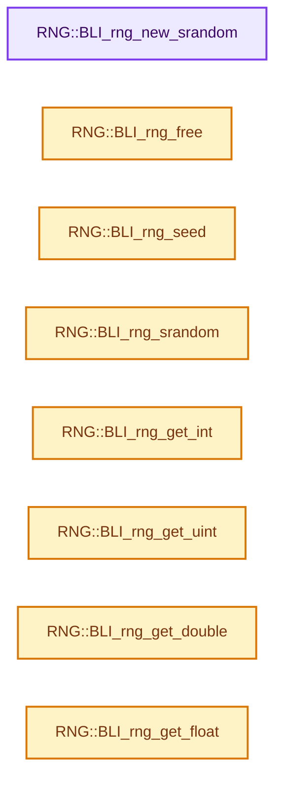
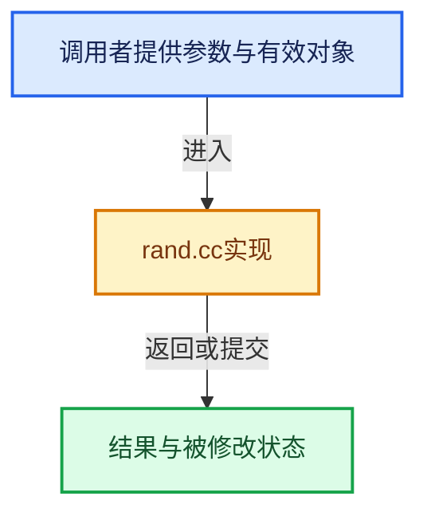

# 实现依赖专题：source/blender/blenlib/intern/rand.cc

[方向导航](README.md) · [符号索引](../%E7%AC%A6%E5%8F%B7%E4%BE%9D%E8%B5%96%E4%B8%8E%E5%AE%9E%E7%8E%B0%E7%B4%A2%E5%BC%95.md)

本专题从正文实际调用进入，集中保存共享实现。函数有稳定锚点，可从调用处直接跳到对应完整函数；递归与互相调用通过回链组织。

## 本文件的实现关系






<a id="m-4c1cb45225d4"></a>

## 宏 `hash`

<!-- annotated:100a545f6c7e0e -->

```cpp
#define hash BLI_noise_hash_uchar_512

```

<details>
<summary>核对原始源码：source/blender/blenlib/intern/rand.cc · L30—L31</summary>

<!-- original:100a545f6c7e0e:source/blender/blenlib/intern/rand.cc:30:31 -->

```cpp
#define hash BLI_noise_hash_uchar_512

```

</details>

宏在预处理阶段展开，参数替换、重复求值和条件编译应直接从该定义检查。与普通函数不同，宏不会自动提供参数类型检查；构建配置选择哪个定义需结合外围条件。

## 完整成员与函数实现

<a id="f-61072c8c2d17d98d"></a>

### `RNG::BLI_rng_new_srandom`

实现位置：[source/blender/blenlib/intern/rand.cc](../../../../../source/blender/blenlib/intern/rand.cc) · L48—L53。

接口参数：

- `uint seed`

**教学注释版**

<!-- annotated:c2d718f7c7c34c -->

```cpp
RNG *BLI_rng_new_srandom(uint seed)
{
  RNG *rng = new RNG();
  rng->rng.seed_random(seed);
  return rng;
}
```

<details>
<summary>核对原始源码：source/blender/blenlib/intern/rand.cc · L48—L53</summary>

<!-- original:c2d718f7c7c34c:source/blender/blenlib/intern/rand.cc:48:53 -->

```cpp
RNG *BLI_rng_new_srandom(uint seed)
{
  RNG *rng = new RNG();
  rng->rng.seed_random(seed);
  return rng;
}
```

</details>

**结果出口**

- `return rng;`

**继续追踪实现**

- `rng->rng.seed_random` → [调用协议](../%E6%A8%A1%E6%9D%BF%E5%AE%8F%E4%B8%8E%E5%8A%A8%E6%80%81%E5%88%86%E6%B4%BE%E5%8D%8F%E8%AE%AE.md)：接收对象类型依赖auto、返回值或模板实例；不按同名猜测目标。调用位置L51。

<a id="f-366aa1dd842611e9"></a>

### `RNG::BLI_rng_free`

实现位置：[source/blender/blenlib/intern/rand.cc](../../../../../source/blender/blenlib/intern/rand.cc) · L55—L58。

接口参数：

- `RNG *rng`

**教学注释版**

<!-- annotated:d30c9606fb6554 -->

```cpp
void BLI_rng_free(RNG *rng)
{
  delete rng;
}
```

<details>
<summary>核对原始源码：source/blender/blenlib/intern/rand.cc · L55—L58</summary>

<!-- original:d30c9606fb6554:source/blender/blenlib/intern/rand.cc:55:58 -->

```cpp
void BLI_rng_free(RNG *rng)
{
  delete rng;
}
```

</details>

**继续追踪实现**

本实现没有需要继续展开的显式调用；检查返回表达式、对象转换和调用者前置条件。

<a id="f-7c414939368dc8b5"></a>

### `RNG::BLI_rng_seed`

实现位置：[source/blender/blenlib/intern/rand.cc](../../../../../source/blender/blenlib/intern/rand.cc) · L60—L63。

接口参数：

- `RNG *rng`
- `uint seed`

**教学注释版**

<!-- annotated:82be41d4860087 -->

```cpp
void BLI_rng_seed(RNG *rng, uint seed)
{
  rng->rng.seed(seed);
}
```

<details>
<summary>核对原始源码：source/blender/blenlib/intern/rand.cc · L60—L63</summary>

<!-- original:82be41d4860087:source/blender/blenlib/intern/rand.cc:60:63 -->

```cpp
void BLI_rng_seed(RNG *rng, uint seed)
{
  rng->rng.seed(seed);
}
```

</details>

**继续追踪实现**

- `rng->rng.seed` → [调用协议](../%E6%A8%A1%E6%9D%BF%E5%AE%8F%E4%B8%8E%E5%8A%A8%E6%80%81%E5%88%86%E6%B4%BE%E5%8D%8F%E8%AE%AE.md)：接收对象类型依赖auto、返回值或模板实例；不按同名猜测目标。调用位置L62。

<a id="f-1d13e5de536bd144"></a>

### `RNG::BLI_rng_srandom`

实现位置：[source/blender/blenlib/intern/rand.cc](../../../../../source/blender/blenlib/intern/rand.cc) · L65—L68。

接口参数：

- `RNG *rng`
- `uint seed`

**教学注释版**

<!-- annotated:ef9670a01289fb -->

```cpp
void BLI_rng_srandom(RNG *rng, uint seed)
{
  rng->rng.seed_random(seed);
}
```

<details>
<summary>核对原始源码：source/blender/blenlib/intern/rand.cc · L65—L68</summary>

<!-- original:ef9670a01289fb:source/blender/blenlib/intern/rand.cc:65:68 -->

```cpp
void BLI_rng_srandom(RNG *rng, uint seed)
{
  rng->rng.seed_random(seed);
}
```

</details>

**继续追踪实现**

- `rng->rng.seed_random` → [调用协议](../%E6%A8%A1%E6%9D%BF%E5%AE%8F%E4%B8%8E%E5%8A%A8%E6%80%81%E5%88%86%E6%B4%BE%E5%8D%8F%E8%AE%AE.md)：接收对象类型依赖auto、返回值或模板实例；不按同名猜测目标。调用位置L67。

<a id="f-b205a58a7f2c93cb"></a>

### `RNG::BLI_rng_get_int`

实现位置：[source/blender/blenlib/intern/rand.cc](../../../../../source/blender/blenlib/intern/rand.cc) · L75—L78。

接口参数：

- `RNG *rng`

**教学注释版**

<!-- annotated:96f61585044c5c -->

```cpp
int BLI_rng_get_int(RNG *rng)
{
  return rng->rng.get_int32();
}
```

<details>
<summary>核对原始源码：source/blender/blenlib/intern/rand.cc · L75—L78</summary>

<!-- original:96f61585044c5c:source/blender/blenlib/intern/rand.cc:75:78 -->

```cpp
int BLI_rng_get_int(RNG *rng)
{
  return rng->rng.get_int32();
}
```

</details>

**结果出口**

- `return rng->rng.get_int32();`

**继续追踪实现**

- `rng->rng.get_int32` → [调用协议](../%E6%A8%A1%E6%9D%BF%E5%AE%8F%E4%B8%8E%E5%8A%A8%E6%80%81%E5%88%86%E6%B4%BE%E5%8D%8F%E8%AE%AE.md)：接收对象类型依赖auto、返回值或模板实例；不按同名猜测目标。调用位置L77。

<a id="f-9241fd04ff762748"></a>

### `RNG::BLI_rng_get_uint`

实现位置：[source/blender/blenlib/intern/rand.cc](../../../../../source/blender/blenlib/intern/rand.cc) · L80—L83。

接口参数：

- `RNG *rng`

**教学注释版**

<!-- annotated:862ccd7f02f5c9 -->

```cpp
uint BLI_rng_get_uint(RNG *rng)
{
  return rng->rng.get_uint32();
}
```

<details>
<summary>核对原始源码：source/blender/blenlib/intern/rand.cc · L80—L83</summary>

<!-- original:862ccd7f02f5c9:source/blender/blenlib/intern/rand.cc:80:83 -->

```cpp
uint BLI_rng_get_uint(RNG *rng)
{
  return rng->rng.get_uint32();
}
```

</details>

**结果出口**

- `return rng->rng.get_uint32();`

**继续追踪实现**

- `rng->rng.get_uint32` → [调用协议](../%E6%A8%A1%E6%9D%BF%E5%AE%8F%E4%B8%8E%E5%8A%A8%E6%80%81%E5%88%86%E6%B4%BE%E5%8D%8F%E8%AE%AE.md)：接收对象类型依赖auto、返回值或模板实例；不按同名猜测目标。调用位置L82。

<a id="f-84f75c207b68570c"></a>

### `RNG::BLI_rng_get_double`

实现位置：[source/blender/blenlib/intern/rand.cc](../../../../../source/blender/blenlib/intern/rand.cc) · L85—L88。

接口参数：

- `RNG *rng`

**教学注释版**

<!-- annotated:d57d135da09d1b -->

```cpp
double BLI_rng_get_double(RNG *rng)
{
  return rng->rng.get_double();
}
```

<details>
<summary>核对原始源码：source/blender/blenlib/intern/rand.cc · L85—L88</summary>

<!-- original:d57d135da09d1b:source/blender/blenlib/intern/rand.cc:85:88 -->

```cpp
double BLI_rng_get_double(RNG *rng)
{
  return rng->rng.get_double();
}
```

</details>

**结果出口**

- `return rng->rng.get_double();`

**继续追踪实现**

- `rng->rng.get_double` → [调用协议](../%E6%A8%A1%E6%9D%BF%E5%AE%8F%E4%B8%8E%E5%8A%A8%E6%80%81%E5%88%86%E6%B4%BE%E5%8D%8F%E8%AE%AE.md)：接收对象类型依赖auto、返回值或模板实例；不按同名猜测目标。调用位置L87。

<a id="f-964cd94e36f95d8f"></a>

### `RNG::BLI_rng_get_float`

实现位置：[source/blender/blenlib/intern/rand.cc](../../../../../source/blender/blenlib/intern/rand.cc) · L90—L93。

接口参数：

- `RNG *rng`

**教学注释版**

<!-- annotated:d97f2e41e020e7 -->

```cpp
float BLI_rng_get_float(RNG *rng)
{
  return rng->rng.get_float();
}
```

<details>
<summary>核对原始源码：source/blender/blenlib/intern/rand.cc · L90—L93</summary>

<!-- original:d97f2e41e020e7:source/blender/blenlib/intern/rand.cc:90:93 -->

```cpp
float BLI_rng_get_float(RNG *rng)
{
  return rng->rng.get_float();
}
```

</details>

**结果出口**

- `return rng->rng.get_float();`

**继续追踪实现**

- `rng->rng.get_float` → [调用协议](../%E6%A8%A1%E6%9D%BF%E5%AE%8F%E4%B8%8E%E5%8A%A8%E6%80%81%E5%88%86%E6%B4%BE%E5%8D%8F%E8%AE%AE.md)：接收对象类型依赖auto、返回值或模板实例；不按同名猜测目标。调用位置L92。

<a id="f-c649171fba0f8ad2"></a>

### `RNG::BLI_rng_get_tri_sample_float_v2`

实现位置：[source/blender/blenlib/intern/rand.cc](../../../../../source/blender/blenlib/intern/rand.cc) · L95—L99。

接口参数：

- `RNG *rng`
- `const float v1[2]`
- `const float v2[2]`
- `const float v3[2]`
- `float r_pt[2]`

**教学注释版**

<!-- annotated:3ae8787dbf60b8 -->

```cpp
void BLI_rng_get_tri_sample_float_v2(
    RNG *rng, const float v1[2], const float v2[2], const float v3[2], float r_pt[2])
{
  copy_v2_v2(r_pt, rng->rng.get_triangle_sample(v1, v2, v3));
}
```

<details>
<summary>核对原始源码：source/blender/blenlib/intern/rand.cc · L95—L99</summary>

<!-- original:3ae8787dbf60b8:source/blender/blenlib/intern/rand.cc:95:99 -->

```cpp
void BLI_rng_get_tri_sample_float_v2(
    RNG *rng, const float v1[2], const float v2[2], const float v3[2], float r_pt[2])
{
  copy_v2_v2(r_pt, rng->rng.get_triangle_sample(v1, v2, v3));
}
```

</details>

**继续追踪实现**

- `copy_v2_v2` → [blender::copy_v2_v2 · L41](../12-%E7%A9%BA%E9%97%B4%E6%95%B0%E6%8D%AE%E7%BB%93%E6%9E%84%E4%B8%8E%E5%87%A0%E4%BD%95%E7%AE%97%E6%B3%95/%E4%BE%9D%E8%B5%96-math_vector_inline-0c8541.md#f-e736ee2dd71cd821)。
- `rng->rng.get_triangle_sample` → [调用协议](../%E6%A8%A1%E6%9D%BF%E5%AE%8F%E4%B8%8E%E5%8A%A8%E6%80%81%E5%88%86%E6%B4%BE%E5%8D%8F%E8%AE%AE.md)：接收对象类型依赖auto、返回值或模板实例；不按同名猜测目标。调用位置L98。

<a id="f-3e7e31c0773a489e"></a>

### `RNG::BLI_rng_shuffle_array`

实现位置：[source/blender/blenlib/intern/rand.cc](../../../../../source/blender/blenlib/intern/rand.cc) · L101—L123。

接口参数：

- `RNG *rng`
- `void *data`
- `uint elem_size_i`
- `uint elem_num`

**教学注释版**

<!-- annotated:ccc278f4fddeb7 -->

```cpp
void BLI_rng_shuffle_array(RNG *rng, void *data, uint elem_size_i, uint elem_num)
{
  if (elem_num <= 1) {
    return;
  }

  const uint elem_size = elem_size_i;
  uint i = elem_num;
  // [讲解] malloc：取得原始存储，失败可返回空指针；不构造C++对象。必须与匹配释放接口及对象寿命管理结合。
  void *temp = malloc(elem_size);

  while (i--) {
    const uint j = BLI_rng_get_uint(rng) % elem_num;
    if (i != j) {
      void *iElem = static_cast<uchar *>(data) + i * elem_size_i;
      void *jElem = static_cast<uchar *>(data) + j * elem_size_i;
      // [讲解] memcpy：复制字节，源与目标不应重叠。类型生命周期、对齐和可复制表示须由调用者证明，不是任意对象的复制构造。
      memcpy(temp, iElem, elem_size);
      memcpy(iElem, jElem, elem_size);
      memcpy(jElem, temp, elem_size);
    }
  }

  // [讲解] free：归还相匹配的C分配存储，不自动执行C++析构；不可用于Windows的_aligned_malloc结果。
  free(temp);
}
```

<details>
<summary>核对原始源码：source/blender/blenlib/intern/rand.cc · L101—L123</summary>

<!-- original:ccc278f4fddeb7:source/blender/blenlib/intern/rand.cc:101:123 -->

```cpp
void BLI_rng_shuffle_array(RNG *rng, void *data, uint elem_size_i, uint elem_num)
{
  if (elem_num <= 1) {
    return;
  }

  const uint elem_size = elem_size_i;
  uint i = elem_num;
  void *temp = malloc(elem_size);

  while (i--) {
    const uint j = BLI_rng_get_uint(rng) % elem_num;
    if (i != j) {
      void *iElem = static_cast<uchar *>(data) + i * elem_size_i;
      void *jElem = static_cast<uchar *>(data) + j * elem_size_i;
      memcpy(temp, iElem, elem_size);
      memcpy(iElem, jElem, elem_size);
      memcpy(jElem, temp, elem_size);
    }
  }

  free(temp);
}
```

</details>

**继续追踪实现**

- `malloc` → [外部契约](https://eel.is/c++draft/c.malloc)：取得原始存储，失败可返回空指针；不构造C++对象。必须与匹配释放接口及对象寿命管理结合。
- `BLI_rng_get_uint` → [RNG::BLI_rng_get_uint · L80](%E4%BE%9D%E8%B5%96-rand-171ca2.md#f-9241fd04ff762748)。
- `memcpy` → [外部契约](https://eel.is/c++draft/cstring.syn)：复制字节，源与目标不应重叠。类型生命周期、对齐和可复制表示须由调用者证明，不是任意对象的复制构造。
- `free` → [外部契约](https://eel.is/c++draft/c.malloc)：归还相匹配的C分配存储，不自动执行C++析构；不可用于Windows的_aligned_malloc结果。

<a id="f-06ccdca9974d0388"></a>

### `RNG::BLI_hash_frand`

实现位置：[source/blender/blenlib/intern/rand.cc](../../../../../source/blender/blenlib/intern/rand.cc) · L150—L156。

接口参数：

- `uint seed`

**教学注释版**

<!-- annotated:bfd0c974934088 -->

```cpp
float BLI_hash_frand(uint seed)
{
  RNG rng;

  BLI_rng_srandom(&rng, seed);
  return BLI_rng_get_float(&rng);
}
```

<details>
<summary>核对原始源码：source/blender/blenlib/intern/rand.cc · L150—L156</summary>

<!-- original:bfd0c974934088:source/blender/blenlib/intern/rand.cc:150:156 -->

```cpp
float BLI_hash_frand(uint seed)
{
  RNG rng;

  BLI_rng_srandom(&rng, seed);
  return BLI_rng_get_float(&rng);
}
```

</details>

**结果出口**

- `return BLI_rng_get_float(&rng);`

**继续追踪实现**

- `BLI_rng_srandom` → [RNG::BLI_rng_srandom · L65](%E4%BE%9D%E8%B5%96-rand-171ca2.md#f-1d13e5de536bd144)。
- `BLI_rng_get_float` → [RNG::BLI_rng_get_float · L90](%E4%BE%9D%E8%B5%96-rand-171ca2.md#f-964cd94e36f95d8f)。

<a id="f-527f498096e29f49"></a>

### `RNG::BLI_array_randomize`

实现位置：[source/blender/blenlib/intern/rand.cc](../../../../../source/blender/blenlib/intern/rand.cc) · L158—L164。

接口参数：

- `void *data`
- `uint elem_size`
- `uint elem_num`
- `uint seed`

**教学注释版**

<!-- annotated:ff6540f12a9ee9 -->

```cpp
void BLI_array_randomize(void *data, uint elem_size, uint elem_num, uint seed)
{
  RNG rng;

  BLI_rng_seed(&rng, seed);
  BLI_rng_shuffle_array(&rng, data, elem_size, elem_num);
}
```

<details>
<summary>核对原始源码：source/blender/blenlib/intern/rand.cc · L158—L164</summary>

<!-- original:ff6540f12a9ee9:source/blender/blenlib/intern/rand.cc:158:164 -->

```cpp
void BLI_array_randomize(void *data, uint elem_size, uint elem_num, uint seed)
{
  RNG rng;

  BLI_rng_seed(&rng, seed);
  BLI_rng_shuffle_array(&rng, data, elem_size, elem_num);
}
```

</details>

**继续追踪实现**

- `BLI_rng_seed` → [RNG::BLI_rng_seed · L60](%E4%BE%9D%E8%B5%96-rand-171ca2.md#f-7c414939368dc8b5)。
- `BLI_rng_shuffle_array` → [RNG::BLI_rng_shuffle_array · L101](%E4%BE%9D%E8%B5%96-rand-171ca2.md#f-3e7e31c0773a489e)。

<a id="f-9ae38c6fa45fba1f"></a>

### `RNG::BLI_rng_thread_rand`

实现位置：[source/blender/blenlib/intern/rand.cc](../../../../../source/blender/blenlib/intern/rand.cc) · L197—L200。

接口参数：

- `RNG_THREAD_ARRAY *rngarr`
- `int thread`

**教学注释版**

<!-- annotated:c6febcad2a0922 -->

```cpp
int BLI_rng_thread_rand(RNG_THREAD_ARRAY *rngarr, int thread)
{
  return BLI_rng_get_int(&rngarr->rng_tab[size_t(thread)]);
}
```

<details>
<summary>核对原始源码：source/blender/blenlib/intern/rand.cc · L197—L200</summary>

<!-- original:c6febcad2a0922:source/blender/blenlib/intern/rand.cc:197:200 -->

```cpp
int BLI_rng_thread_rand(RNG_THREAD_ARRAY *rngarr, int thread)
{
  return BLI_rng_get_int(&rngarr->rng_tab[size_t(thread)]);
}
```

</details>

**结果出口**

- `return BLI_rng_get_int(&rngarr->rng_tab[size_t(thread)]);`

**继续追踪实现**

- `BLI_rng_get_int` → [RNG::BLI_rng_get_int · L75](%E4%BE%9D%E8%B5%96-rand-171ca2.md#f-b205a58a7f2c93cb)。

<a id="f-7e595677c3af3aa5"></a>

### `RNG::halton_ex`

实现位置：[source/blender/blenlib/intern/rand.cc](../../../../../source/blender/blenlib/intern/rand.cc) · L206—L226。

接口参数：

- `double invprimes`
- `double *offset`

**教学注释版**

<!-- annotated:48395ce286678a -->

```cpp
BLI_INLINE double halton_ex(double invprimes, double *offset)
{
  double e = fabs((1.0 - *offset) - 1e-10);

  if (invprimes >= e) {
    double lasth;
    double h = invprimes;

    do {
      lasth = h;
      h *= invprimes;
    } while (h >= e);

    *offset += ((lasth + h) - 1.0);
  }
  else {
    *offset += invprimes;
  }

  return *offset;
}
```

<details>
<summary>核对原始源码：source/blender/blenlib/intern/rand.cc · L206—L226</summary>

<!-- original:48395ce286678a:source/blender/blenlib/intern/rand.cc:206:226 -->

```cpp
BLI_INLINE double halton_ex(double invprimes, double *offset)
{
  double e = fabs((1.0 - *offset) - 1e-10);

  if (invprimes >= e) {
    double lasth;
    double h = invprimes;

    do {
      lasth = h;
      h *= invprimes;
    } while (h >= e);

    *offset += ((lasth + h) - 1.0);
  }
  else {
    *offset += invprimes;
  }

  return *offset;
}
```

</details>

**沿实际写入检查状态**

- `lasth = h;`
- `h *= invprimes;`

**结果出口**

- `return *offset;`

**继续追踪实现**

- `fabs` → [外部契约](https://eel.is/c++draft/)：这个边界按实际表达式及所属类型核对参数、返回值、寿命与失败行为。这里提供接口入口，不声称已解释该第三方版本的内部实现。

<a id="f-3cc86267e8641246"></a>

### `RNG::BLI_halton_2d`

实现位置：[source/blender/blenlib/intern/rand.cc](../../../../../source/blender/blenlib/intern/rand.cc) · L239—L250。

接口参数：

- `const uint prime[2]`
- `double offset[2]`
- `int n`
- `double *r`

**教学注释版**

<!-- annotated:f5b4b2d7ee32cc -->

```cpp
void BLI_halton_2d(const uint prime[2], double offset[2], int n, double *r)
{
  const double invprimes[2] = {1.0 / double(prime[0]), 1.0 / double(prime[1])};

  r[0] = r[1] = 0.0;

  for (int s = 0; s < n; s++) {
    for (int i = 0; i < 2; i++) {
      r[i] = halton_ex(invprimes[i], &offset[i]);
    }
  }
}
```

<details>
<summary>核对原始源码：source/blender/blenlib/intern/rand.cc · L239—L250</summary>

<!-- original:f5b4b2d7ee32cc:source/blender/blenlib/intern/rand.cc:239:250 -->

```cpp
void BLI_halton_2d(const uint prime[2], double offset[2], int n, double *r)
{
  const double invprimes[2] = {1.0 / double(prime[0]), 1.0 / double(prime[1])};

  r[0] = r[1] = 0.0;

  for (int s = 0; s < n; s++) {
    for (int i = 0; i < 2; i++) {
      r[i] = halton_ex(invprimes[i], &offset[i]);
    }
  }
}
```

</details>

**沿实际写入检查状态**

- `r[0] = r[1] = 0.0;`
- `r[i] = halton_ex(invprimes[i], &offset[i]);`

**继续追踪实现**

- `halton_ex` → [RNG::halton_ex · L206](%E4%BE%9D%E8%B5%96-rand-171ca2.md#f-7e595677c3af3aa5)。

<a id="f-5c37d529e0d07122"></a>

### `RNG::BLI_halton_3d`

实现位置：[source/blender/blenlib/intern/rand.cc](../../../../../source/blender/blenlib/intern/rand.cc) · L252—L264。

接口参数：

- `const uint prime[3]`
- `double offset[3]`
- `int n`
- `double *r`

**教学注释版**

<!-- annotated:4f3f0e0b1c0e7c -->

```cpp
void BLI_halton_3d(const uint prime[3], double offset[3], int n, double *r)
{
  const double invprimes[3] = {
      1.0 / double(prime[0]), 1.0 / double(prime[1]), 1.0 / double(prime[2])};

  r[0] = r[1] = r[2] = 0.0;

  for (int s = 0; s < n; s++) {
    for (int i = 0; i < 3; i++) {
      r[i] = halton_ex(invprimes[i], &offset[i]);
    }
  }
}
```

<details>
<summary>核对原始源码：source/blender/blenlib/intern/rand.cc · L252—L264</summary>

<!-- original:4f3f0e0b1c0e7c:source/blender/blenlib/intern/rand.cc:252:264 -->

```cpp
void BLI_halton_3d(const uint prime[3], double offset[3], int n, double *r)
{
  const double invprimes[3] = {
      1.0 / double(prime[0]), 1.0 / double(prime[1]), 1.0 / double(prime[2])};

  r[0] = r[1] = r[2] = 0.0;

  for (int s = 0; s < n; s++) {
    for (int i = 0; i < 3; i++) {
      r[i] = halton_ex(invprimes[i], &offset[i]);
    }
  }
}
```

</details>

**沿实际写入检查状态**

- `r[0] = r[1] = r[2] = 0.0;`
- `r[i] = halton_ex(invprimes[i], &offset[i]);`

**继续追踪实现**

- `halton_ex` → [RNG::halton_ex · L206](%E4%BE%9D%E8%B5%96-rand-171ca2.md#f-7e595677c3af3aa5)。

<a id="f-2631eb8ce6fdc517"></a>

### `RNG::radical_inverse`

实现位置：[source/blender/blenlib/intern/rand.cc](../../../../../source/blender/blenlib/intern/rand.cc) · L268—L281。

接口参数：

- `uint n`

**教学注释版**

<!-- annotated:e0b87ccc9e08a5 -->

```cpp
BLI_INLINE double radical_inverse(uint n)
{
  double u = 0;

  /* This reverse the bit-wise representation
   * around the decimal point. */
  for (double p = 0.5; n; p *= 0.5, n >>= 1) {
    if (n & 1) {
      u += p;
    }
  }

  return u;
}
```

<details>
<summary>核对原始源码：source/blender/blenlib/intern/rand.cc · L268—L281</summary>

<!-- original:e0b87ccc9e08a5:source/blender/blenlib/intern/rand.cc:268:281 -->

```cpp
BLI_INLINE double radical_inverse(uint n)
{
  double u = 0;

  /* This reverse the bit-wise representation
   * around the decimal point. */
  for (double p = 0.5; n; p *= 0.5, n >>= 1) {
    if (n & 1) {
      u += p;
    }
  }

  return u;
}
```

</details>

**沿实际写入检查状态**

- `u += p;`

**结果出口**

- `return u;`

**继续追踪实现**

本实现没有需要继续展开的显式调用；检查返回表达式、对象转换和调用者前置条件。

<a id="f-432b6bdfda7c0a80"></a>

### `RNG::BLI_hammersley_1d`

实现位置：[source/blender/blenlib/intern/rand.cc](../../../../../source/blender/blenlib/intern/rand.cc) · L283—L286。

接口参数：

- `uint n`
- `double *r`

**教学注释版**

<!-- annotated:5f7a439ac4f660 -->

```cpp
void BLI_hammersley_1d(uint n, double *r)
{
  *r = radical_inverse(n);
}
```

<details>
<summary>核对原始源码：source/blender/blenlib/intern/rand.cc · L283—L286</summary>

<!-- original:5f7a439ac4f660:source/blender/blenlib/intern/rand.cc:283:286 -->

```cpp
void BLI_hammersley_1d(uint n, double *r)
{
  *r = radical_inverse(n);
}
```

</details>

**继续追踪实现**

- `radical_inverse` → [RNG::radical_inverse · L268](%E4%BE%9D%E8%B5%96-rand-171ca2.md#f-2631eb8ce6fdc517)。
